# CMU《深度学习导论｜CMU 11785 introduction to deep learning Fall 2024》中英字幕（deepseek - P24：Fall 2024 Lecture 24.zh_en - GPT中英字幕课程资源 - BV1CfsReEEw8

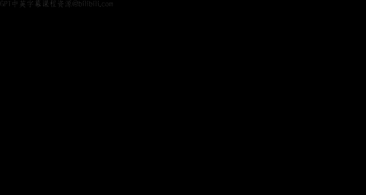

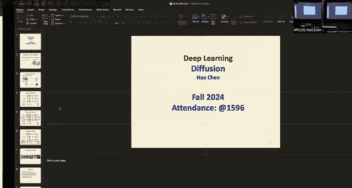

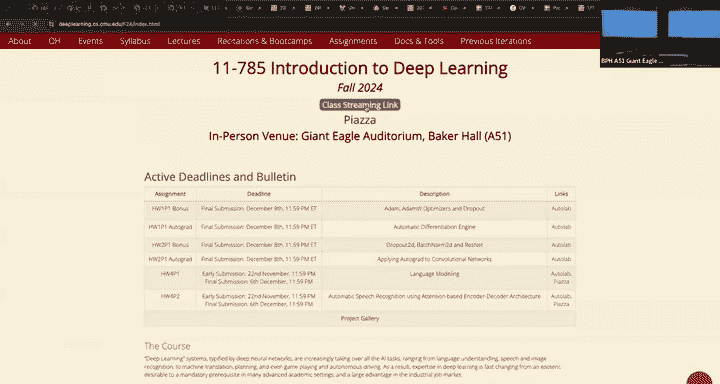

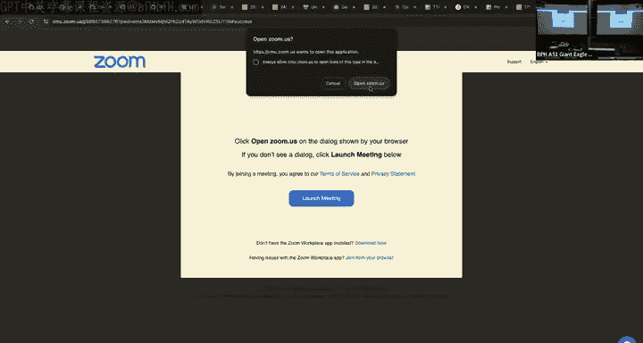

Recording in progress。

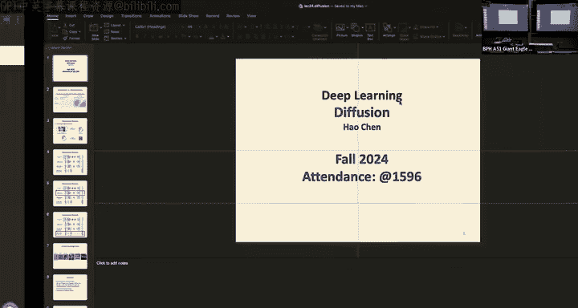

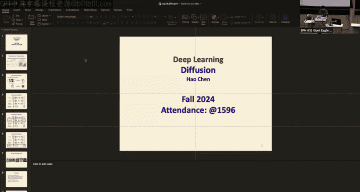

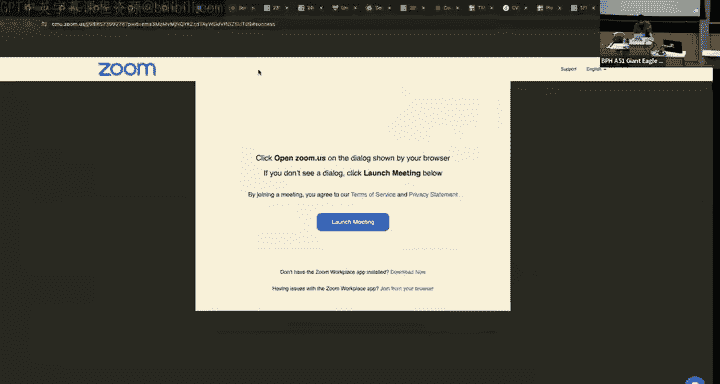

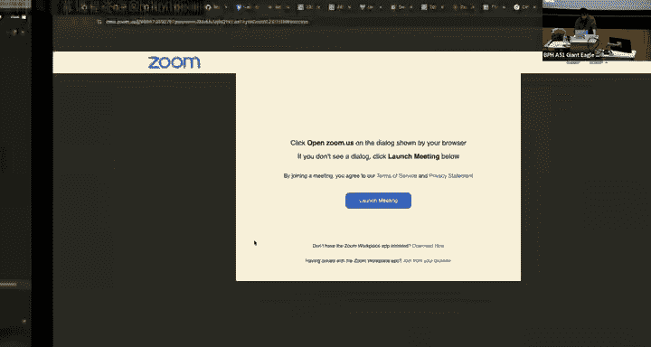

。嗯。

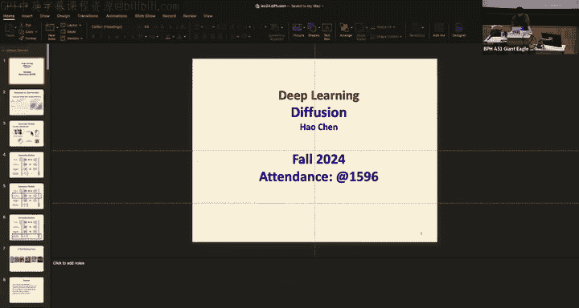

Okay， so let's get started with today's lecture。Pro picture will be joining in Zoom。

 and I'll be giving the lecture about the diffusion models。

So please remember to fill in the attendance poll。So， let's get started。

So this lecture will be about the geneative models。

 so diffusion model is one type of the geneative models。

 and here's an illustration of geneative models versus discriminatives。

 perhaps you have already learned about a lot of this in machine learning courses。

Here I'm just going to give a brief recap about the general model and discriminative model so in discriminative model you we basically want to learn the conditional distribution PY given X。

 so this reflected on the data distribution is a decision boundary between different clusters of data as shown in the illustration。

And in geneative model， we instead learning the conditional probability PY given x。

 we are going to learn the posterior Px given y， and learning the posterior probability can give us the conditional probability by using the base rule。

And Px given y is actually， we are learning the probability distribution over data instead of just a decision boundary。

And so one sentence summary is basically geometry models are learning the data distribution instead of just a decision boundary or just a classifier on top of the data。

And7 models have found benefits that after learning。

 they can be used to generate data from the learn data distribution。So in training。

 we feed the model a bunch of samples from the data distribution。

 It can be images or audios or signals of any modality。And after training。

 we can directly make sampling from the neural network to generate real data from different modities。

 real data from different modities。And here are some common types of ja models。

 perhaps most well known is GNS， which we will learn in the next few lectures。

 so basically in GNS we have a discriminatory and ja and the discriminatory and ja are a to each other。

 basically beating themselves during training to learn the data distribution how implicly to learn the data distribution。

And VE we actually learned that from the last lecture， so basically we have an encoder and have a。

 the encoder is in charge of encode the raw data into a latent variable。

 and the decoder is in charge of generating new data from the latent variable。

And in this lecture we'll cover diffusion models and we'll show that diffusion model is actually just a stacking of VEs。

 and we also connect diffusion model with a flow based jumping models in the later slides of the lecture。

And generation is。这。这是我就。Oh sorry， Can someone mute。好。あの。Okay， sorry。

 And the generation is actually a fast evolving field。 So from these images。

 you can briefly see that in 2013 and 2014， when wei Ys and Gza are just come out。

 We barely can generate very realistic images with these models。 However， today， we can。

 like in 2024， we can generate very long sequence of videos was very high resolution with just diffusion models。

So it's a very fast evolving field， and many new ideas are and new techniques are coming basically every month。

 every week in the field。So the content of this lecture will first go through some basics of the deinoing diffusion model and we connect diffusion models from the stotochastic differential equations and score matching perspective。

 and we'll introduce acceleration technique for diffusion models which called DDIM and then conditional diffusion models and at then end we'll go through the applications of diffusion models。

So let's first go through some basics of diffusion models。

 we'll show that diffusion models are just stacking of VEs and decompose the forward reverse process and training sampling in diffusion models。

So let's get started。So when talking about the denoing diffusion models。

 perhaps this is what we commonly saw from the  tutorialtorials online or from the papers。

 so we'll see a chain of latent variables from Xt to x0 and there are two process maybe a diffusion process and a reverse dennoing process with some methods in both process。

However， in this lecture year， we are going to view diffusion model from a totally different perspective。

 the diffusion model is just a stack of VEs。😊，So let's first do a brief recap of the variation autoencoder we learned from last lecture that variation autoencoders are likelihood based generative models。

 meaning they directly estimates the S hood from the data to change the model and VE can be illustrate from a brief graph here。

 so basically we have two variables， a variable x which means all raw data and a variable Z which means the data variable we want to compress the data and want to sample the data from。

And we have a decoder in our version of auto encodes。

 basically the decoder is a geometry model which learns the probability by sampling x from the latent data Z。

 So basically we are transforming the latent variable Z into some real data via the decoder。

And however， with only the decoder we don't have the late variable z from the data because we don't know what's a late variable variable for the data。

 so we need to learn an encoder， the encoder is basically an inference model which approximate posterior from data about Z and the encoder and decoder is trained by maximizing the elbow of variation autoencos。

 the is basically say two objective one is the reconstruction objective between the reconstructioncon S and the regional x and one is the K divergence between the posterior estimate by the encoder and a prior assumption basically here in variation auto encodecoder the prior is a gaussian distribution。

And here is a more detailed illustration of the VEs， so basically we have our little graph here。

 we have two variables x and z， and we have two process the decoding process from z to x。

 which is which is learning how to generate data from the latent variable Z basically the probability of Px given z。

 and we have an encoding process which perating the posterior basically how to learn to generate z from the raw data x。

And the encode for decoder， we can random sample a variable from a Gaussian distribution and feed the sample data to the decoder。

 and the decoder will give us a reconstructed the original data。

 and further encoder is an inference model to estimate basically mean and variance of the Gaussian distribution in the latent。

So it's predicting two things， one is a mean and one is the variance for the latent distribution。

So Vs are actually mathematically very nice and very beautiful but it also has some limitationss。

 the naive V is basically very generating very blurry results as shown in this figure here so you can see that for the very simple figure digital figures and for the phases is actually generating very blurry results。

😊，And the reason of this blurry results is actually one limitation of ways is that the decoder must transform a standard Gaussian all the way to a very complex target distribution in one step。

 So what does that mean you can see from this figure。

 So basically in the latent space we have a Gaussian unmodal Gaussian distribution and we sample one noise variable from the distribution phase into the decoder。

 and we hope this can help us recontract the row data directly。 and in fact。

 the row data is a very complicated distribution with a multimod which is a multimod distribution。

And doing the transformation from a Gaussian distribution to the very complex target distribution in one step is actually often a very large gap。

 and this large gap will cause blurry results because we are using normally we are using the MIC to optimize the version autoing and just capture the common mode of the data which gives us the blurry results instead of the sharper results。

So there are some solutions， one solution is to actually add an a network at the end of decoder which can help to us to capture the multiple target target distribution and this lecture will cover another solution which will eventually lead us to diffusion models so the solution is actually quite straightforward so it's transforming the standard gaussian into the target distribution in one step is very difficult problem。

 we can decompose the one step into multiple steps by having some intermediate latent variables to reduce the gap of each step。

So here is idea of the stacking V， or we can call it formally as here rockque V Es。

 So in here Rockque Vs， we are stacking vs on top of each other。

 So well have multiple intermediate latent here， multiple I I use T to indicate the multiple latents。

And we will have the joint distribution over the multiple latents and also the posterior distribution over the multiple latents。

And this graph shows at the bottom basically illustrates the idea of the stacking Vs。

 So instead of having just one x and1 z， we can have multiple latent variables this they1 z2 and z3 and x。

 And during decoding with starting from the like the deep z like z3 and transforming z3 to2 transforming z2 to z1 and transforming z1 eventually to x this is basically the decoding process in hiarch vs and in the encoding process in hiarch vs we encoding x into z and encoding z1 into z2 and ening z2 into z3。

 So basically you can see that we introduce several late latent variables and decomps the encoding process and the decoding process into several steps instead of one step we just seen in the normal Vs。

And looking into more details of the stacking wayss， especially the decoder。

 so we can see that for the decoder， let's say we have three latetum variable， x3 S2 and xZ。

 actually they should be these 3z2 and but here I'm using x instead to connect better with the diffusion models later。

And you can see that from the deep this and we have three decoders for these three late variables。

 each decoder is para by phi3， phi 2 and5hi1 and even though they are indicated with different parameter here。

 the parameter can be shared across different decoders。And from x3。

 which is basically a very raw Gaussian distribution or very raw Gaussian noise。

 we decode that from the last decoder to get x2 which is partially dened from the Gaussian distribution and we feed x2 into another decoder and gets x1 which is a more den which is a more den noise data and eventually we fade into another decoder which gave us the eventually reconstruct data and you can see that basically for each step。

 the decoder removes part of the noise from the Gaussian distribution or from the Gaussian variable and it provides a better seed model for the next step and towards we gets the final distribution so that's the basic idea of stacking ways。

And in second phase we actually in the last night we show you we have three latent variables and actually we can have many。

 many steps in the late in the intermediate process let's say we have in total t steps and each step we incrementally recover the final distribution by remove some noise from the data from the Gaussian distribution and we can have also t decoders each decoder remove the noise from the original data and gradually eventually toward we get the original recover the original clean data here is a clean image and in terms of distribution perspective you can see on the distribution plus here we have initially a unmodal Gaussian distribution and is gradually transformed the union model distribution Gaussian by slightly change the distribution at each step until we get the multimodal distribution complex target distribution。

And you may find this process is already very similar to the diffusion process we've seen。

And in fact， we'll see that we'll connect the stacking wayss with diffusion models and conclude that diffusion models are actually just a special case of stacking wayss。

 So this figure is basically a figure， more accurate figure from the last slide。

 So we have a trend of a set of。😊，Lant variables from x T to x0 and each variable from the x t to xt minus-1 we can use a decoder to to get the variable and we can have T decoders to get from Tx to x0 so you can so the reversing denoid process in the diffusion model is actually just a stacking of decoders of vs and a question here is what about the encodeders where so we have we have been talking about the decoders of vs and what about the encodes。

And you can see from this illustration here。 So basically we can get the latent from the latent from this previous latent by using an encoder corresponding to each decoder we use in the decoding process。

 So in V， the encoders are learned with the K divergence between the posteror and prior。

 but it usually suffers from the posterior craps issue。

 So basically means when when we have a strong enough decoder the encoder basically the posteror encoded by the encodeder basically encodes convey no information and decoder can just randomly deco information from the random sample Gasian。

 So instead of to circumvent this issue diffusion model use a fixed inference encodes。

 So basically we have a fixed markov chain for the encoder fixed gasian transition for the encoder to get the latent variables。

We'll get into this in the later slides， So the first。嗯。So it's actually either question。

 so we just illustrate that the reverse process is a stacking of the V decoders and the forward diffusion process is a stacking of the V encodeders。

 So before we're diving into more details about diffusion model。

 any question about the country we just have。Yes， can you go back one side and explain？

Mysteror collapse。Yeah， so in normal ways， you have a one latent Z and one latent X， right。

 The X is your raw data and latent is the Z is your latent variable。

 and encoder is in charge of compress your raw data into the late variable Z。

 and decoder is in charge of the geometry。reconstruct low data from the liium variable so the posterior cl issue is actually result from the K divergence。

 so in training of the ways you have a reconstructioncon objective to train the decoder and you have a K divergence to encourage the posterioror encoded by your encoder to be closer to a prior gasian。

And one problem is that once you have a very powerful decoder。

 the decoder will just ignore the posterior rear from the decoder from the encodeder and generate and learn to reconstruct data from the Gausian distribution。

 So that's basically a posterior collapse issue。And in different model。

 instead of training the encoders， we have instead of have。

 have the mean and Gaussian of the predict by the encoder， have them fixed。

 I'll show that in limit slides。ううん。So any other questions？

Does it mean that we don't train the decoder。 you still train the encoder。

 but the encoder learns basically a trivial solution。

 So basically it's not well connected with a decoder。 It's actually a trade off between the。

 So usually you will use a loss weight for the K divergence to train the V。

 It's actually a trade off of the loss weight。Yes， so we'll move on to more detail of the tininoian diffussion models。

So as we showed before that diffusion model actually have two process the forward diffusion process basically gradually as a noise to the input and reverse denoing process basically learn to generate data by denoing from the Gaussian distribution or from a Gaussian variable so is' illustrated from the figure here so we have other left the the clean raw data and otherwise the Gaussian noise and in the forward diffusion process is basically a stack of v encodederrs we encode the mean and Gaussians of the added Gaussian noise and as a noise into the image and make the image gradually towards a Gaussian noise and in the reverse denoing process with starting from a noise basically with sample from a Gaussian diffusion gets a noise vector and we do the denoing with the decoder at each step and each step we predict the noise added to the image and reduce and conduct some deno to get a more cleaner image and eventually we get clean image from the diffusion。

Process， and let's look into in more detail with each process。So the forward diffusion process。

 we've been saying that the forward diffusion process is just a stack of fixed V encoders。

 so it's gradually adding Gaussian noise according to some noise schedule， we call as beta T。

 So in the forward process is basically a Gaussian chain。

 So basically we have input x0 and towards the end of the chain we have xt and as each step we want to add some gaussian noise So basically each transition from x t minus1 to xt is a Gaussian distribution with some mean and and standard deviation controlled by the beta t。

And since this Gaussian distribution is actually independent in each step is a Markov chain in the forward process。

 we can actually compute the joint distribution of all the late variables given x0 or compute any distribution at any time step given x0 using the Gaussian transition So how can we do that So basically is a multiplicative of different is a multiplicative of multi step gaussian transitions So the forward words process basically allow us to sample any xt given any time step in a close form So basically we can get x t given x0 as another Gaussian distribution with mean as a squared of alpha hat t and the standard deviation as or the variance as one of the alpha hat t and alpha is basically multiplicative of the1 minus beta S。

And we can reverse this distribution in a sampling form。

 basically we can sample X T by sample a random variable epsilon from the Gatian distribution and multiply and skill it by the standard division we've seen in the Gaussian basis the squared of1 minus alpha hat T and adding the shift of R hat over the x0 variables and the noise schedule beta is basically design such that the eventual x variable x T will give us like the im transition will give us a normal distribution。

So。One confusion here is actually the alpha high T and beta T。 So we'll explain them more。

 So the beta T is basically a noise schedule you set before。

 so it can be linearly you set the time step。 Let's say as T as11000。

 and the beta T is can be linearly scaled over the 1000 steps from the raw data into the Gsian noise。

 and alpha T alpha T is actually a more yes。So you just choose tea， like whatever。 Yeah。

 T is help find。 you choose。 So people usually use 1000 or 4000 in their diffusion models。

And the alphava t is actually can be computed from the beta。

 so basically it's easier for us to compute the distribution of xt given x0。

 so the distribution of xt and x x0 looks very similar of the distribution of xt given x t minus1 and the distribution of x given x0 is actually a multiic from x0 towards a multi of xt and given xt minus1 starting from x0 towards the time step T so we can get a multi Gasian so you can see that basically the alphava hat is a multiplicative of the1 minus beta from from the distribution of xt given xt minus1。

And yeah， that's basically how do we get the distribution of X T given x0。

 So any question towards the distribution。Yes， the normal here。追。The嗯了。

I you it's just mean and very insane。whats the X。X C is an intermediate lateum variable。

 which you can treat it as some。Intermediate noise distribution， which is less and gentlemen the。

Like the function that the the normal distribution like。XTN这I我等你。So basically。

 you can see that the transition from each x0 and x T。

 let's say in order to get the x T from the x t -1。

 you're basically adding a coussian noise to the X T minus-1 to get X T and the way we got the noise basically model it as a couss distribution as shown that equation here。

 So basically Q X T given x t-1 is a causingussian distribution determined by the mean and standard vision and mean standard vision is determined by the noise schedule you set basically the beta T。

And because the forward process is fixed， right， And each transition from x t minus-1 to x T is a Gaussian distribution。

 so we can actually get x t directly from x 0 by doing the gaussian transition multiplicatively。

 So we can see that Q X T given x0 is basically a multiicative Gaussian gaussian distribution。

 where the mean and standard division is multi from the beta square of1 minus beta and beta from the one step transition。

😊，Yeah， I hope that's clear。So we can move on to the reverse denoing process。

 The reverse the purpose of the reving denoizing process is we want to generate data after we have the forward process from the Gaussian distribution。

 So what we do is we sample an xt from the standard Gaussian distribution and we usually re sample xt minus-1 from the distribution of xt minus-1 given xt and in last less we actually show the closeform distribution of xt given xt minus-1 and xt given x0。

 but we don't know the distribution of xt minus-1 given xt So how do we do that is not tractable So how do we do the reverse denoing process one good thing of having many。

 many small steps in the distributionffusion process is actually we can estimate the Q of xt minus-1 given xt by a Gaussian distribution if beta t is not enough it's actually quite similar to what we did in v encoder。

Is actually a stacking of V decoder。Instead of the decoder is predicting the mean and standard deviation of each added Gaussian。

 so we'll see that in more clearly in this illustration。

 so the reverse di process is a stacking of learnable V decoders and the job of the decoder is predicting the mean and standard deviation of added Gaussian noise。

So we start with a standard consent distribution P of Xc， which is a standard normal distribution。

And we have the joint distribution P theta basically theta is our learnable decoders of from between 0 and t as a joint distribution here。

 So basically from X， we do a transition form to get the X minus1 from X and we do this across all the time steps。

 So basically multily over all the T time steps。And each transition is modeled as a Gaussian again a Gaussian distribution as long as beta T is set small enough and this Gaussian distribution P theta of xt minus-1 given Xt is actually modeled by or a trainable network。

 So basically you can see its mean is predicting by the current Xt。

 So from the current Xt we predict the mean of the I Gaussian noise and the sigma or the variance actually can be predict by the network So you can see the predicting from the learnable network is actually similar to what we are predicting from a VE encoder is that it doing the decoding job at reverse deconoding process。

Yes， any question here I don even adding all these steps of0 to at end the distribution of is a normal likeusian distribution just as scaled by some factor So how does it make the distribution of X a multimodal distribution which was our goal evening is learning the mean in the standard deviation。

So yeah， still is， is is our similar Gaian， but eventually it learns some very complex data distribution。

O。And we'll come to how to learn the trainable network in the denoism process。

 The denoian process actually or the denoism models are trained similarly with the variation upper bounds as we saw in V is basically the negative elbow you can see that we model the elbow as so basically the joint distribution of the denoin process P theta of x0 to T and with the encoding process Q X T12 T given x0 and this actually derive to which os the very complicated devation details into three terms。

The first term is a K divergence between the Xt and Q of xt given x0 and P of xt actually this we'll see that because we use a fixed inference model in the encod process this will come give us as a constant term。

And we have another term basically L 0。 How do we transform from x 1 to x 0。

 So its basically how do we get raw data from the x 1 is a basic scaling term。

 Another constant term we can omit in our optimization。

 So what we really want to optimize is the middle term X T-1。 So we can see is added。😊。

Q divergence over all the time steps between encoding process between the encoding process Q x t-1 given x t and x0 and the predicted process we have the further de network Q of x t-1 given x T and how do we get Q of x t-1 given x and x0 is actually can be calculated in a close form from our forward distribution as showing in this another distribution here。

 So it basically you can see that it can be computed by B rule using the the two normal distribution we saw in the forward distribution and derived from a mean and standard division for the Q of x t-1 given x T and x0。

And yeah， so basic L T and X 0 can be omitted in the optimization。

And what we really want to optimize is basically the care divergence between the conditional of xt minus-1 given xt and x0 and the predict same from the tinino in the middle。

So， Any question from the zoom。Okay。Yeah， and how do we parameter the deno models So we can so that the care divergence have a very simple form between two Gas。

 So it's basically the。MC term between the mean。 we have the close form from Q of x t-1 give x t and x0 between the predicted mean form or denoizing network and skill by the standard revision we have for our de noise network and plus some constant term C and recall that we have we can get X T from or anytime study from x0 in or forward division process so we can actually calculate the meal head T also a close form。

 So basically you can calculate calculate this by using the beta and alpha we have from the forward process from X T。

And the Ch network actually is predicting the noise mean。

 so there are several variants which you can predicting the mean only or is predicting both the mean and the standard or the variance of the edit Gaussian。

 but here we choose to just simply predict the noise mean and the noise mean can be also transformed from Xt to xt minus1。

Uing this formulation and putting this two mean into the final objective work get the final objective of our training training of our noise models。

 Still， it looks very complicated with this very large weighting term。

 But this weighting term is actually just multi predictive of this scales in this two equations。

 And we can see that what's really matter is actually we want to minimize the edit noise into at each time step with some predicted noise from the de noise model and minimize the distance between them。

😊，So in DPM， they actually gave us a more simplified training objective。

 So they set the waiting term to a constant， just treating them as all once and。

Directly minimizing the MIC between the added noise and the predict noise from the network。

 So the network is doing somenoing by predicting the me of the added Gaussian to the late variables。

And this waiting term industry the waiting term actually is in charge of computing the correct maximum likelihood estimation。

 but its actually another trade off between the maximum likelihood and the perceptual quality of the eventual image we get from the different models。

So here is a summary for the training and sampling in the diffusion models。

 so in training the process is looked like this， so we have some sample data from our data sets。

 this is a row signal images and we sample some random time step T from we uniformly sample some time step T from the interval between1 and T and we sample some Gaussian noise。

From theusian Gaussian distribution。 and we add this Gaussian noise to get X T and we compute the we input X T to our de noise networks and predict the I Gaussian me of the I Ga noise and minimize M between the sample Gaussian noise and our predict Gaus noise from our de noise model。

 And in the sampling， we directly sample X T from the Gaussian distribution which is the end of the late variable。

 and we do schedule each transition from X T to get X T minus-1 by using or denoizing network to predict the mean of the Gaussian and using the equation we just saw before to get X T--1 from X T。

And here is a summary of the noise schedule so we can see that different parameters have different parameters changing a long time。

 we can see that so beta actually beta is very small from the left La figure is basically a linear schedule and left figure is basically in the logarm。

 you can see that beta is basically linear changing along the time steps。

 whereas other terms are changing accordingly and computed by the beta and basically determined by the beta T。

So a connection a recap on the connection of our diffusion model with Hiarch Vs。

 so diffusion models are basically a special case of the hiarch Vs。

 they have a fixed inference models in the forward process based stacking of V encoders and the latent variables have some the same dimension as the data dimension。

😊，And all elbow is compute is computed as each time step。

 So it's actually faster to change because in training。

 we can sample random time step instead of doing all time step as in hiarchical Vs。

 and the model is actually trained with some weighting of the elbow according to the same step instead in the simplified objective beside the weighting to simplify one。

啊 sir。Yeah， I'll answer country after this book。那。🤧咳。So what's the answer of this poll？Yeah。

 so basically in the the de noiseian network it is predicting the mean of the edit Gasian noise。

 actually in more complicated variances of the model is predicting both the mean and variances of the edit Gaussian。

So yeah， that's sense。 So any question regarding the forward and backward process of the models。

I just guess the multiple choices。 And the theazza is different from the。哦，O啊。Yeah， actually。

 just choose one phenomenon。 F that。Okay， well move on to the next content。

 So next in the last part in diffusion model basics。

 we are basically that diffusion model are basic stacking of V。And in this section。

 we'll see that we'll interpret diffusion model from the stochastic differential equations and score matching perspective and the reason why we want to study from the S is SD provides a very unified framework to interpreting diffusion models and the score based generation models。

 The score based generation models is more related to the flow based model and recified flow models we've seen more nowadays。

And a brief introduction to the ca differential equations。

 so well start with the ordinary differential equation。

 so in ordinary differential equation basically we are characterizing the change of one variable basically the change of the state of x given time T。

So you can see that we have a ordinary differential equation as this format D x divided by D T。

 which is a function of x given time a function between of x and the time。

And basically is describe how the value of x changing time。

 So for ordinaryffusion differential equation， we have an analytical solution basically x T of any time step is basically equal to x0 plus the integration of the function。

 the changing of x given time the function of x F given x and T between 0 and T and we can also have this calculated by the iterative numerical step。

 basically we can get each delta x t plus delta T by using x t plus function with the function or the change of x with deelta T。

And stochastic differential equation basically extends the ordinary differential equation by adding a noise term。

 so we have Dx divided by DT with FxT and another term which is actually a Gaussian term scaled by external division sigma of both X and T and we can in the SDE we usually call the first term as a drift coefficient in the second term as a diffusion coefficient。

 well see this more in the later slides。And the omegaity is basically white gloss noise。

 and we can see from the plot here， so basically x。

 the tri of x is more stochastic a long time and is actually described a probability distribution of the trend of x instead of a determiningmin this change of x in the ordinary differential equation and will categor diffusion models with stochastic differential equations in the later slides。

And another concept we have is basically score matching。

 so you can see that basically in the geometry models we are trying to learning the distribution of the data and to make the distribution probability density function。

 we actually actually any probability density function we will have the following form so we have a Pta of x。

 it will be an exponential function over F theta of x and normalize by some zta the normalizing factor。

 thista is basically making the probability density function。

Some to one and when max the log likelihood or doing the maximum log likelihood estimation is require us to know the normalizing factor thista。

 but this data is usually actually very difficult to compute or often intractable。

 So instead we can model the score function， basically a gradient of the log probability which we call as a score function。

 and well see that division model is basically matching the score function of the in the reverse process to the forward process。

So let's decompose the forward diffusion process as SDDs。

 so we start from our forward diffusion process， so starting for our clean data and we gradually add Gaussian noise at each intermediate time step together eventually a standard Gaussian distribution。

And we have the forward transition as each step， a Q of x t given x t minus-1 as a gaussian transition categorized by the noise schedule beta T。

 and we can write x T basically by sampling from a standard gaussian distribution and scaled by our standard deviation squared of beta t and as the bias of1 minus square of one minus beta of x t minus-1。

And we can do some relatingwriting to this sampling equation。

 so we can first rewrite beta T as a function of beta T and delta T。

 so basic delta T indicates the step size and the function of beta T allows us to have different steps at each different time step as in the Ss。

And we can do a ta expansion for the first squt diffusion to to do some approximation。

 So basically we have the squirt of1 minus beta t delta t of x t minus1 as x t minus1 minus beta t delta t divided by 2 and x t minus1。

 so this can be interpreted by we have x t minus1 and we do some offset skill by beta t delta t divided by2 and together x t from the x minus1 plus some noise term。

And we can see that this term is actually in the format of the S D we've seen before。

 So basically the change of the X D， the deelta X D， X D。

 basically the deelta X D basically equal to X D minus X T minus-1 indicates the change of in in the X。

And it's equal to minus。Beta T delta T divided by 2 and plus some noise term。 Basically。

 we categorize deelta T with noise with高ian。A variableariable with a noise term we've seen in the sto differential equation。

And we have the first term as a drift term。 So basically this dream term at each time time step。

 starting from some more complex target target distribution。

 we are drifting or we are pulling this target distribution towards the un mode of the Gaussian。

 and we have some diffusion term， which basically inject some noise to the path of the stochastic process。

 So the process is actually illustrate on the top， which actually， let's look into this first。

 it might be more clear。 So basically we have the stochastic process as shown here。

 we starting from very clean images and as on the left。

 we have multi mode distribution like two more distribution。

 more complex target distribution and each time step。

 we move some we we pull the towards the un mode Gaussian and some noise until we gets clean distribution until the clean image gets more similar to the very random Gausian noise。

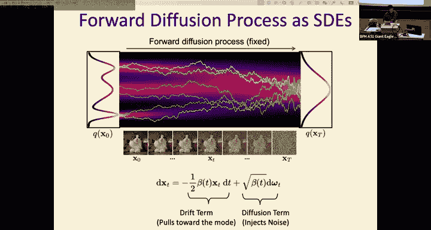

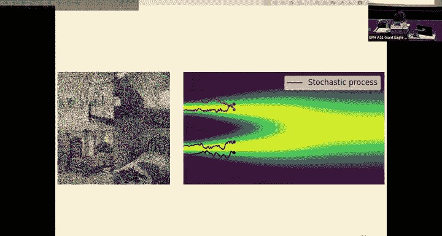

So for each for S is exactly we have a reverse form and the reverse form is basically a modification to the drift form the drift form we will have。

The beta T divided by 2 as the same as in or for form。

 but we have another form which is the beta T with a score function as we saw here of Q of Xt so basically the score function categorize how does or forward word transition X T given x t minus-1 changes。

And it categor in the forward frame how can we reverse this trend in our reverse process and here is the illustration of the reverse sastic process so basically starting from a Uni modelal Gaussian we are recover the drift we made in the forward process and injectesting some noise to make them towards a more complex target distribution。

 basically dinoing from the Gaussian noise to a clean distribution。

So the question in the reverse SDE here is how do we get this square function？

And this scroll function can be get as similarly in the stack deco step we think before we can train a denois network to match the score function of Q of X T。

So how do we do that？ So here we have again， another illustration of the forward S and reverse S D in the forward S。

 we have basically the format of the S D we've seen before it has a F X given deelta T and also another term for the basically the the Sigma term for the one noise and we can see that all F X T is basically the two。

Necting beta T divided by2 plus multiied by our X T and the G the function of G T is actually the squared of beta T and each forward S will have a reverse form as shown here。

 So basically we will keep the F X T and minus by the square of function G G of T multiied by the square function of P of X T and keep the noise term as the same with another sample noise actually W hat。

And we can compute the square of G of T， basically from the square of beta D as beta T。

 which gave us the reverse form of our S we've shown before。

And to learn this basically we use a very similar objective we've seen before。

 we want to train a different network indicate by s theta of Xt and time step T to match the score of diffus data sample so basically a score we can get from our forward word diffusion forward diffusion process and we also have a weighting function omega Ha T which we get that into later and this loss function is we compute this loss function over the sample data and over the sample time steps。

And over the samples the。X we added X we added the with added Gas noise。

 and we'll find this function actually quite similar to the objective we seen before for training diffus models in which is derived by the upper bound of the variation auto encodecoder。

So we can again characterize this objective， so basically。

We have requirements something basically we can get xt from x0 by using some multiplicative gaussian transition with variance as sigma t and bias as R t and this square function we can compute that form or forward word diffusion process So basically is taking the logarm of Q of xt given x which x0。

 which we have in a forward process and by taking derivative with respective to xt and Q of x t given x0 is basically a gaussian distribution and gaussian diffusion is form exponential of xt minus of x0 the square and divided by the sound division and the exponential and the logarithm actually cancels themselves so we have a derivative of this function with respective xt which eventually gave us basically noise sampler。

The the sample noise vector absolutelypson divided by the standard deviation signal。

 and so we have our dennoing network doing the similar thing。

 Were predicting the mean added to the the mean of the added noise。

 we input X and the time step x to predict the added mean of the Gaussian divided by also by signal and putting these two things back to the original objective。

 We get a very similar final objective for the division models。

 which is basically the M loads between the added Gaussian and the predicted Gaussian noise。

With a weight director。And as we saw before， the weighting vector is actually a trade of between the good perceptual quality。

 So basically when you set this noise the weighting vector to one。

 you will have a very high perceptual generation of images。

 but you will have low maximum maximum likelihood and it's kind of a trade。

 So once you want to the model categor more about the maximum likelihood to basic carefully sets the weighting factors and we will see actually this is a unified formulation for all the diffusion model variances。

 you will see that more complicated models parameter and those weight will lead to different diffusion model variances in the literature。

So yeah， we'll first go with Po three and then answer the questions。嗯。

So the answer of this question is basically the drift term is pulling the data towards the Uni Gaian mode。

 the multimod data towards the Unioss mode in the diffusion term of the SDD is adding the random Gasian noise or PC injectesting noise to the process which change X a long time。

So before moving on to the next section， any question regarding the content here？F。Okay， yeah。

 so in the next session， we' will introduce a denoizing diffusion in model。

 So basically DDM is a technique to accelerating the inference or the deno process of denoing diffusion models。

So we've seen before in the de models in order to do the generation。

 we have to start from XT by sample from a gausian distribution and doing inference transition step by step from T to0 so when we have 1000 steps we have to do this for 1000 times and this is extremely slow for generation of row images or any kind of row signals。

So a question we want to ask is can we do generation with less steps and the answer is actually yes。

 so basically in the normal denoing process we want to do a transition from a Gaussian noise to the K data step by step by removing the Gaussian noise added to the data。

 but in the generation with less steps， we are going to skip some steps in or skip some data variables in the chain。

 by predicting or removing a noise of a more complex distribution。

So here is a recap of how we do DDPM。 So DDPM is basically the de noiseian differentialff model we just introduced。

 So in DDPM。We have the forward word transition of Xt given xt minus-1。

 and we can also compute Xt given x0 forms this for word transition。

 because is a multipl of the causingusing transition。And the loss function is a simple loss function。

 which we minimize the predict noise added the predict of added Gaussian and by minimizing the M C between the actual mean of the added Gaussian with the predict me of added Gaussian。

And we can see that so in GDPDPM， the forward process of xt given xt 1 indicates the X transition of xt is only depending on the previous step and the other transition of XT given x0 and also the loss function is only used in train as they are never used in inference。

So the idea of DDIM is actually characterized the forward process no longer as a Markov forward process instead they characterize the forward process as a non Markov in forward process。

So， we can get。The some intermediate latent from X 0 and is both act 0 and its previous。

and its last latent xt。 So here we recognize DDM as Q theta。

 basically say the joint of x1 to T given x0 as some joint of x T and given given x0 and the transition from x t minus-1 given xt and x0 in the xt and x0。

 we can get that from or forward distribution process as in DDPM in the Q of x t minus-1 given xt and x0。

 this can be calculated as we shall before as in calculated mean of the edit did Gassian noise。

And we can do a basic transform on the Q seta of x minus-1 given x and x0。

 which eventually lead us to。Q of x T given x t minus-1 andda x0。

So we can use this Q of x t given x t minus-1 x0 to do some backward process。 Basically。

 we can characterizeize the backward process as another parametric Gaussian。

 So basically we have a pta of xt given x X t minus-1 given xt where if t equal to1。

 we just predict noise we just use the Gaussian predicted by the denoing process and when t equal to other time steps。

 we translates this process using the equation we just have which is the Qta given x t minus-1 and xt and x0 basically x0。

 we can get that from the ID noise from the id noise predicted by or denoin networks。

So you can see there the F theta T of x T is basically a transition from X T minus the pre noise by the current test span。

 which gave us actually the estimate as0。So this form actually more clearly describes the difference between DDM PM and DDM something so in DDPM something where we have a full loop over all the time steps from t to1 and we do at each time step we predict the mean of the I Gasian noise from Xt and dennos the noise from by minus x from mean of the I Gaussian and to get the xt minus1 and in DDM something is kind of different so we have also have a full loop but in the full loop we first predict the mean of the I Gaussian from or denois network and we estimate first estimate x0 from predict mean by using the minus predict mean from the dno network and then we get x minus1 from the estimate x0。

So you can see that from this property we can actually do fewer steps something with DDM so basically we can set the time step with more intervals。

 for example， we can set Tx0 1020 basis giving 10 steps IG time and to predict the desired Xt from the estimate as0 as any time。

So the DDM results actually quite impressive， so we can see that we say DDM provides very like significant acceleration compared to DDPM while obtaining some more。

Like comparable results， as we do in the full transition in D DDPM。So， yeah。

 another po for this lecture。So yeah， the answer of this is basically DDM will first as in the DDM sampling process。

 it actually first predict the noise given the time T and then estimate as 0 and finally get X minus-1。

 however in DDPM we directly estimate s minus1 without esttating the x0。

So another difference is that DDM I actually have a nonmarkov forward process。

 So basically we is late is dependent on both X T and X T the X T is dependent on both t-1 and x 0 instead of just T1 as in DDPM。

Sos24 of this pool。So yeah， any question regarding GDPP。嗯。

There are actually a bunch of other variant of I techniques for diffusion models and I believe current best results can do comparable sampling results with just 10 steps when when you are training them with just 1000 steps。

 so it's actually very promising direction for I diffusion models in the inference time。

So another topic we'll cover in the lecture is conditional diffusion models。

So here we want to categorize unconditional and conditional。

 So basically in conditional differential models， we categorize the joint distribution of x T of x 0 to T basically it's only x。

 we don't have any class information or or semantic information about the image and in the conditional di models。

 So basically we want to inject some conditional information， which we characterize as y。

 So basically we make the modeling distribution as a conditional distribution of x0 to T given y。

And this conditional basically can be any condition information， it can be a class label。

 it can be a text prompt， it can be a semantic mass or a segmentation mask or the objective funding box and there are many applications of the condition di models and the reason we want to have conditional different model is we want to make the generation more controllable。

And one way of having the conditional diffusion model is we can do conditional score matching in the diffusion objective so basically we can modify or score matching objective by using a basees rule and so basically we convert the P of xt given y by the basees rule which on the top we have p of x and p of y given x and bottom we have p of y and we can divide it by this from the logarithm which give us eventually give us the three term and the delta of log p of y is actually a constant term is prior about the conditional so we can ignore that so this eventually give us two terms the first is similar the unconditional square function before and the second is an aver gradient basically you can also understand it as a a conditional gradient。

So how can we add this conditional gradient into training？

Earlier people doing this with classifier free guidance so basically you will have an additional discrimininate classifier forestating the gradient of a P of x given x P of y given x and in the square matching this actually characterized by another parameter gamma which controls the strength of the condition so basically on top of diffusion model you will have another trained classifier where the classifier is in charge of predicting the condition from the generated images to make sure the contains the condition Y and matches the gradient of the P of y given x however the limitation of the classifier guidance is that you need a separate classifier so the conditional generation performance is largely limited to the performance of the conditional classifier。

And the conditional。And youll have to either train the classware together with a division model or user of the shell pretrain the classware。

 which actually introduces a training burden。So we'll introduce another very common telling in conditional division model。

 which called Cloudifier free guidance。 So it' modify the score matching with the conditional information as photos。

😊，We have our square matching of p of x given y as an unconditional score of delta of log p of ys and gamma and the gamma weighted conditional score of p of y given xt and we do another base basically transform over the p of y given xt which basically transform the p of y given xt again of p of x given t y and p of x and we can divide plug in this p of x given p of y given xt into our square matching with sigma as showing this equation here so basically we end up with a conditional score and an unconditional score the conditional score is weighted by the gamma in the unconditional score is weighted by y minus gamma so we can see that when we set gamma to1 we will have we will have purely conditional generation and when we have gamma to0 we will have an unconditional generation and there is。

🤧No class additional class fair needed for the class free during training。

 So how do we train with classifier free。 So we will have conditional embeddings for different conditional information。

 They can be class embedding from the class label or the semantic embedding from the text prompt or any kind of conditional embeddings and during training。

 we add additional embedding Stan for the unconditional embedding and we random drop the P original conditional embedding where P indicate a probability you said It's kind of like dropout with and replace the original conditional embedding with additional unconditional embedding and train the network with that simple as that will give us very。

The conditional control of the diffusion models。And yeah， any question about the Club Africans。Okay。

 with no question， we'll move on to the application of different models。

 So after knowing all the like basis of different models we introduce the techniques we've seen often seen of different models recently。

 So we' start of DPM DDPM is basically the basis of our different model and where diffusion model really gets popular。

 So in DDPM， the basis the categorize the。Diffusion model as a simple objective before they minimize the M IC between the edit Gasin and the predicted Ga from the Dno network。

 and the D network is basically a U model in the DDPM。 and DDPM is training on the very raw images。

 And you can see that by training on the very raw images。

 you can already have very realistic Japanese interfaces or any kind of thing images as showing here。

😊，And there are several improvements over the diff models where eventually this di model starting be gas。

 So basically， they started trying using larger denoing models with more sophisticated design。

 So basically have some adaptive， They called adaptive group group divisionffus。

 and they use attention layers in the unit。 Still， this di model are trained on the row images instead of the。

The latent division model we'll see later。And which means they require a very expensive computation。

 and this is the first time were division starting BGs。And we'll move on to this。

 which is called latent diffion model。 So latent di model basically follows the same mathematical as we see in DPM and in this lecture。

 except we have the latent diff model is learning the diffusion on a pretried V latent so you can see that basically adding another V in the stacking of V on top of the diffus model except this another way is pretried So this V actually provides some semantic latent space for the diffusion model to learn and the latent space is also highly compressed compared to the row image or the row signal。

So it's making the training of the division model significantly faster。 and this actually。

The latent division model is actually what the division model has been built on。 So basically。

 the division stable division model is just a scale up version of the latent division model。

And they use a tax conditional embedding for they use a a clip encoder。

 or actually more people use T 5 tax encoder for injecting the tax conditional information and。

The proteining way is also trained on some larger and low data sets。

 and the stable division actually is starting generating very controllable and realistic high resolution images where you can input a text prompt and it will generate the image according to your text prompt。

Which cause offrness？And the arm with stable diffusion model will have Dli。

 so basically Dli is from Open Air and I believe D has released two up to three this year。

 and Dli the difference of Dli is actually the tax encoder。

 the Dli use a C tax encode which is also from Open air and remaining space the same as a stable diffusion model。

And we also see DIT。 so basically it replace the unit architecture we've seen before in all the diffusion models with a transformer architecture。

 So in the unit architecture， we have a conal neural networks。 However。

 in DIT we have a transformer blocks basically the multi of attention and favorable networks and you can see that for DIT in unit with convolal networks。

 you can easily do done sampling with a latent with the latent variable or the input images X。

 However， in DIT you cannot easily do done sampling to predict the to predict the id noise of the diffusion forward dius。

 So DIT is actually more computational expensive compared to the unit we've seen currently So many techniques have been developed to reduce trying to reduce the complexity of DIT。

And more recently， we can also see a combination of the autoregressive models with the diffusion models。

 So in traditional， the autoregress model are usually used with discrete latent variables。

 So basically you will have some for example， take text， for example。

 you will have a token which tokenize the voltaget into the discrete index and you train autoregressive model to predict the next index according conditioning on previous ones。

 However， in this paper， basically they demonstrate that the autoregressive model can also be used with a diffusion loss。

 So instead of predicting the discrete index， you can use a diffusion laws to regress the current。

Let's say a token conditioning on all the previous token， but using a diffusion loss。And。

The mechanism of M is kind of different to the traditional autoga in the traditional autos of you basically predict token by token in order。

 So basically you predict this token and you predict the next token and predict the next one basically in sequential of the in a sequential order in M。

 they they actually。Actually， they didn't propose， but they verify this in their paper。

 So they use another random order。 They first predict a set of tokens starting with a set of for mass token and keep the high confidence one replace the mass token replace the remaining low one with mass token and do another step。

 So the order regress is actually happens set by side。

 So it' conditioned on the predicted token and made the next prediction from the mass token and M is actually the latest one the advance in the diffusion field where we can the best results of autogress of model plus diffusion loss。

😊。

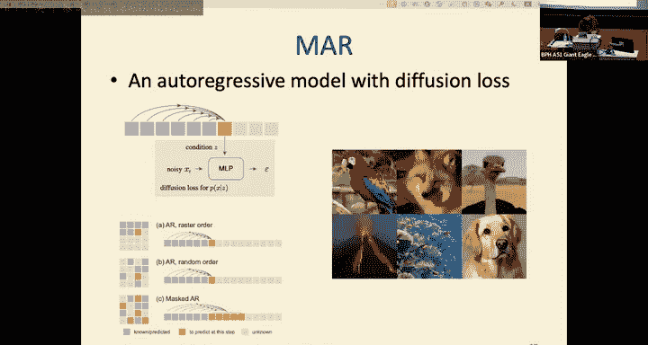

And yeah， I believe that's over today's lecture。

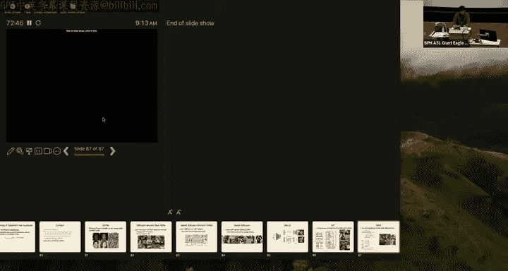

So we still have a few minutes so I can take any questions you real have。喂。Thank you。

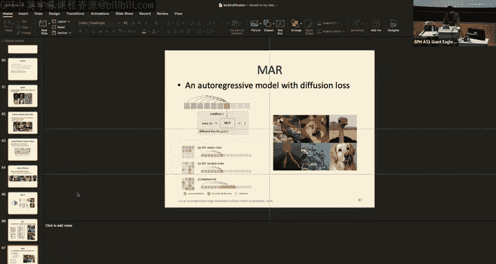

Thank you for great。we have done。