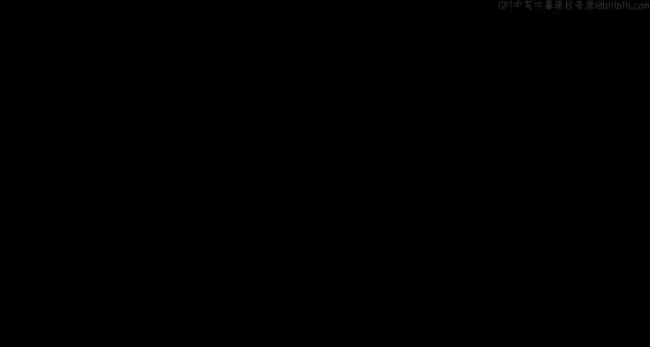
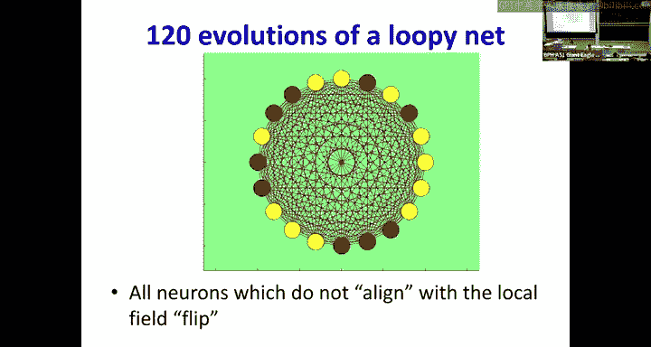
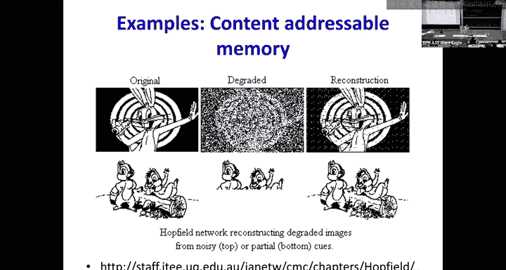
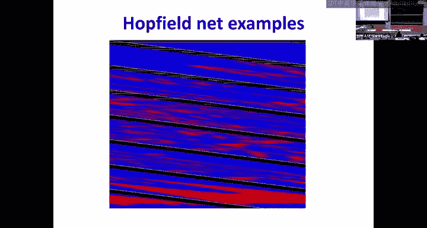
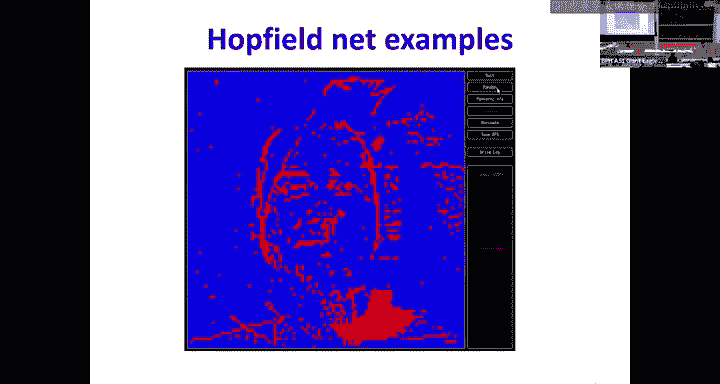
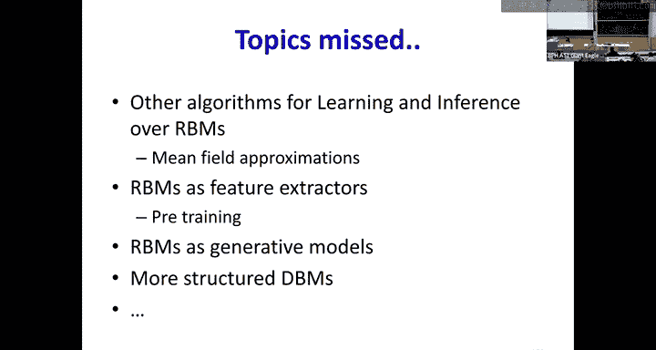

# CMU《深度学习导论｜CMU 11785 introduction to deep learning Fall 2024》中英字幕（deepseek - P25：[24]Fall 2024 Lecture 25.zh_en - GPT中英字幕课程资源 - BV1CfsReEEw8

嗯。Okay， guys。Didion stuff。嗯。It's a very sparse。 shouted it rummbling。結キ。It's the last class。

The attendance is super sparse。 I have three people in the classroom and something like eight people on Zoom。

 so。That's gonna be。Interest。As it happens， you know as the last week of the semester。

 I can I don't really expect people to be inspired to come to class here are a couple more。😊，But。

By this time of the semester， it doesn't matter which semester it is。

 nobody wants to come to class because you have your exams？就话。Anyway， it also happens that。

So we have two lectures today's lecture is of course in person。

 on Wednesday the lecture will be over Zoom， we have a lecture on graphraph neural networks by my Ts this time from Kiiggadi。

But today we're going to be talking about。Hofffield networks auto associateators and Bsman machines。

 Something special happened with these guys recently。😊，You know， related to these topics。

Anybody know what？Why were these things in the news recently？

The Nobel Prize right So yeah this year's two Nobel laureates in physics have used tools from physics to develop methods that are the foundations of today's powerful machine learning。

 John Hoopfield created an associative memory that can store and reconstruct images and other types of data from where other types of patterns and data and Jeff Fenton invented a method that can automatically find properties and data and so perform tasks it is identifying specific elements in。

😊，Pictures， but Hinton was actually awarded as this the noble for his work on Bman machines。

Which are related to Ho field networks。 So basically today's topic is the topic of a recent Nobel Prize。

 So maybe it's worth watching。 otherwise it's you know。

People don't really find the inspiration to come to this particular lecture。

But here's a story so far。We've studied what happened to my Trident。 Yeah no I don't need a trydent。

Yesス。Yeah。So this is the kind of network that we've。😊，Studied so far。 We had a feed forward network。

 stuffuff went in one end， and it just flowed through the network and came out the other end。

And you got your results。Now， in all of this， we were missing something。So a potential curiosity。

 What happens if？You feed the output of a neuron back to itself or something in a previous layers。

What would you do right， how would this behave， So how， for example。

 would a network of this kind behave where you have five neurons in this case， four。

But the output of each neuron feeds both itself feeds。The other neurons， right？ So now。

 if you were to provide it an input， how would how would it process it。Any ideas。嗯。Because。

You get an input here。That comes out here， right？And。But then that goes back in。

And when that goes back in， that's going to change the neurons again， right？

And then that result is going to go back in。 So if you were to draw this。

 how would you visualize drawing this network， How would you even conceptualize this process。😊。

You unroll it You can actually unroll it， right， So one simple way of thinking about this is like so。

 this is， and how deep is this network。Infinitely deep。So you're going to have something like this。

And。Maybe you have， you know。And then you have your activations。So this is W and then。

We have the same weights again and again and again， right。And so on。

 so this network basically and when would you stop。

 so when you have something that's infinitely deep。

When would you stop processing an input on conversion？Con convergence， when it stops changing。

 when further processing doesn't really change the behavior， right。

 And that all So that's basically the kind of network that this thing is， but。

Analyzing something of this kind， you know， is not really that hard。

 but comes up with some interesting properties。 So here is a simple loopy network。

 We're going to consider a special instance where the activation function as a。😊，Fual function。

 And so each neuron here now is a persceptron with a plus -1 input。😊，Output。

 every neuron receives inputs not just for externally， but from every other neuron as well。😊，And。

So and then every neuron output signals to every other neuron。 So after maybe the first iteration。

 every neuron just gets inputs from the other neurons， right？😊，And possibly itself。

 and then operates on it。 And the output is a。It part is。Processed by a threshold activation。

So I'm going to simplify this model a bit further。 Now， when I draw it like this。

 something becomes apparent， which is not apparent when I draw it in this manner。😊。

Which is that you have neurons A and B connecting to each other。

And so you have two different directions。For the signal， right。

 I could make those connections symmetric。And if I made this connection symmetric。

 you end up with what is called a hop field network。So our open network， nothing。

Particularly magical， it's just a network where。😊，The connections are loopy。

 Every neuron feeds every other neuron， right When I draw it in this manner。

 the processing may not be very obvious to you， but when and it， it becomes obvious what's happening。

 But let's now analyze what's going on here。So。It's。Here is what happens at each neuron。

Each neuron receives a weighted sum of。All of thee。The outputs of all of the other neurons。

 plus a bias， possibly。And so you know how the neuron operates first you compute。系啲。

And we call this Y a plus。The I， this is this aine term， I'm going to call this the field。At Nen I。

 this aine tonee。And this is operated on by an activation function theta right so if this is a threshold activation。

😊，What happens， How does the neuron behave？What is the output of this data as a threshold activation？

嗯。So when is the output going to be power class  one？那对吧一时候。This is going to be plus1 f。

The field is greater than or equal to 0。inus1， otherwise。Right。

This is simple now this is a loopy network， So the neuron has a current output。

And that output is likely to change。If the activation requires it to do so right what is the condition under which the neurons activation stays the same and what is the condition under which it changes So lets say the neuron is currently plus one。

😊，Right。When will it flip。What is the condition under which flip？Whether the fear is more。

Where the field is is negative， right？ So this goes to -1。If。The field is less than  zero， right。

 otherwise it stays the same。Suppose it's minus1。Then when does it flip？对嘅。the field is。

Positive exactly equal to we will ignore for the moment， right， So now， so here's what it happened。

 So there's a pattern over here。 If the field at the neuron。😊。

Is aligned with the output of the neuron itself。 Nothing happens at the neuron。

 If the field is misaligned。Then。E flips。And so。I can write it in this manner。If。

These two signs are not the same。 the initial sign if the sine of the field and the signine of the output are different。

Then it's going to flip。 If the two are the same， it will not flip。Right。

 so I can write it there alternately like so。 if the product of the。

Current output of the neuron and the field of the neuron is negative。

 then the neuron is going to flip to align itself with the field。

 Otherwise it's going to stay the same。😊，Make sense to everybody， right， okay？And so a neuron flips。

 if the weighted sum of other neurons outputs is of the opposite sign to its own current output value。

 but then when you do so， the neurons output has changed。😊，If the neurons output changes。

 then it changes the field at the other neurons。 So this might cause other neurons to flip。 So。

 for example， if you start off with a pattern like this。This might cause this second neuron to flip。

But because that neuron has flipped， some other neuron flips。

 but because that neuron flipped the first neuron can go back and flip all over again and so things have changed right and so this behavior can go on and on right and so if the signine of the field at any neuron opposes its own sign。

 the sign of the field at any neuron opposes its own sign，The neuron flips to match the field。

But then this is going to change the field at other neurons。

And so which may then flip and if those neurons flip then that may change the field of the current neuron which may then flip and this may go on right and so here is a loopy network of this kind 20 evolutions of it just a random network that I constructed in random a simulation it just goes on right。

😊，Here's one， where actually there are 120 evolutions。

 And you can see the whole thing keeps us clipping around， right。😊。

Thiss making sense to everybody right now thats my question to you。Thats， it's fun animation。

 So let it run through the 120。ItTake it stuff。O。Will this behavior continue forever now。

Looking at this。Will this behavior continue forever。 I it going to keep flipping。

Or will it ever stop？Is there predefined order？How these neurons are calculated or is it random。

 And so I could just be doing it， you know， all at once， right。Could be a random number than Iist。

Take the current set and update I could just be performing this。

So really the operation that we are performing is。Why？

If I write all of the things as a single vector。That's all I'm doing， right。So。Will this stop？

Any ideas。案連でその。External output in one of the neurons。

So。It turns out again that this is very easy to analyze。And let's analyze it， right？Look at this。

Actually， like let me write this， right。You have why。You have， let me call this F， right？

Just the field， which is the weighted sum of all of the other neurons plus the bias， right？😊，Now。

 y tends to becomes minus y。Sine of F。That's not equal to sine up。Right， right？So。I can alternately。

 if y times F。Or if y times F is less than 0。Y goes to minus y。Right。Make sense。 Okay。

 so I can say this that。Before the flip。Y times F is less than0。What is it after the flip？We going。

 It's because flipped right after。Y times F is greater than0， right What is the change in y times F？

A。the negation。 No。 So it's going to be。Y times F， let me call this y plus。After they。

Iran has responded minus。Y minus times f？What will this be？就关负责。It's two times。hy doで。Right。

Or if it hasn't flipped。😊，At 0。These are the only two options， right， so basically what we find。

 right？If the field matches the neuron's own sign， this guy' is going to be zero。And of the sign。

Doesn't match this。Local side， the difference is going to be two times。Why why times that。Right。

So what does this tell me that every single flip of the neuron？Is either going to。

What happens y times F does y times F ever decrease？No， right， either。Stays same。Or increases。

There is no other option， right？Can this keep going on increasing forever。Yes， no。

Is there anything over there thats lie that can go that can go up to infinity。

The sign y is either plus 1 or minus1。the weights are all bounded。Right， this thing cannot。Go人。对。

So you're not updating the weights。 No， this is just this is just processing the network， right？

So that's it。 right。 How do you train this thing， So here's the thing， right。Every time。

A neuron flips。 you're going to get- so I defining this D。

 which is simply the sum of y times the field over all the neurons。😊，RightAnd if I do that。

 I know every time a neuron flips this D must increase。 there is no other choice。

And so when will it stop when B can no longer increase？Right。So this thing is going to stop。

But these bounded。D is bounded。 So if I just write if I just write the D out has some over all pairs of neurons of W I J times Y I。

Y J。😊，pl the biasome right and so that's bounded because y I's and ygis are all just plus 1 or minus-1 right and so it's up bounded by the sum of the magnitudes of all of the weights plus the magnitudes of the biases right furthermore。

😊，There Delta d， how much the d changess in any flip？

Is simply going to be the smallest possible value， right of。

These two types the feel at any neuron and that too is bounded because w is not the ws have a lower bound right so the D is bounded the amount by which it changes is bounded。

Which means how many steps can it take。A capped value divided by a bounded value has a finite finite。

You know。Rraatio， right， which means that。Any sequence of flips must converge in a finite number of steps。

Does make sense？This is not going to go on forever。

That network is not infinitely deep ass finitely deep。 there's an upper bound。Questions。

There's still an important one， matter。对。One the inputs are going to be a splus bonds and minus ones。

 right？So the whole thing stays still， right， it's like saying it's setting all of the neurons at some initial value。

O。And so it alternate between two different values。

It can bounce around right because it can bounce around under one condition。

And what is the condition under which it can bounce around？Anybody want to hesitate a guess on that？

对呀。都 I was在。Just two neurons and I have two ways。For each other。 And I have。

To inquiitous anchorous neuron。 And when to saying one is positive mineral is positive。そすまで。So。

We'll get to that， right， what is the condition under which it can？

At point not all neural networks can oscillate， some of them can。

 right specifically when you introduce a bias， things break down。Yes， is it when YF is here。

But no why is either plus 1 or minus-1， right it can never be 0。

 so but here's a different way of thinking about it。😊，We defined something。 So the D that we defined。

Was。Simply。Subation over all neurons of Yi。Dot F， right， the field at the neuron。

And so we said this D must keep increasing。Instead of thinking of this D， I'm going to define an E。

 which I call an energy， which is minus half of the guy， right？😊，So， but then this term。

 y times field， it turned out was。Simply。Minus half of。Smission i y i。And then over here。

We Sammation J。W， I J， Y J。Minus B。哎。Right。And so if I expand that out further， this is going to be。

 let's ignore the B for now。 Actually， let me keep the be， right？So what will this be？

Just writing it out， This is。inus half。Submissionation over I J， W， I J。Y喂 J。Let。Semission I V。系啊。

This is it， right， I mean， I can have some factors off， but this is about it。I just expand it out。

 Okay， this term here。If I write it in terms of vectors。Right， then this is simply minus half。

W transpose。WY。Right， and this is。- half。Be transpo， fly。This make sense to everybody。Now。

 to answer the question for when this will oscillate， right？嗯。F， B is 0。

Then if there's a minimum at y， there's a minimum at minus y。Because it's quadratic and why。

Right that's when it can keep flipping back and forth because we know that any flip must not change must not increase D right and so if the flip results in the same D as before。

Then it will keep flipping， otherwise it will not， but once you introduce a B that goes away。😊。

that makes sense to you guys on Zoom。Whoever asked this question on Z。 Yeah， that does。 Thank you。

 Okay， there's a lot of。So a Hofffield network is a loopy binary network with symmetric connections。

😊，Every neuron。And the fee network attempts to align itself with the sign of the weighted combination of the outputs of the other neurons。

😊，The local field， given an initial configuration， neurons in the net will begin to flip to align themselves in this manner。

 causing the field or other neurons to change， potentially making them flip。😊。

Each evolution of the network is guaranteed decrease。

The energy of the neuron so it was guaranteed to increase E。

 but the energy is defined as minus of half of half times d and so each evolution is guaranteed to decrease the energy of this neuron right and because the energy is low bound it D was upbound it right and energy is minus half d so and every flip results in a finiter change。

And this value。It's going to converge。Either get to a situation where it keeps flipping back and forth or converses to a fixed value。

😊，In this case， is energygy similar to life。You chemistry， where it's like。We'll get to that， right？

So I don't have a pull up。Just this， because it's the final week。

 I'm just going to ask you these three questions。 Is the first statement true or false？Everybody。

True。ok。Second one， false third。嗯。Fuse false， false。It's actually true， right？

 That's the first thing that we did when we came to class。

 If I enroll it as basically an infinitely deep network， okay。And so。Anyway。

Where did this energy concept suddenly sprout from？To answer your question。

It turns out this actually this， why did the guys who won the Nobel for this win the Nobel in physics？

What does this have to do with physics？And it has everything to do with physics。

 So you have this notion called a spin loss。😊，Where these are phromtic materials。

Which are dipoles in a disordered。You know which have line some disorder now at each dipole。

 each dipole has a local magnetic field。Local magnetic moment。

 right and at each dipole there is a field， which is the cumulative field from all of the other dipoles and the medium。

😊，And so。The dipoles want to align themselves with the local field。

 if the field is pointing this way， the dipole wants to point the other way so that。You know。

 north gust or south， southt not， right。 But then when the the dipoles pointing this way and it's misaligned with the field。

 it's going to flip。But if it flips， it's going to change the the field at。Other dipoles。

 and those dipoles may flip。And if those dipoles flip。

 it's going to change the field back again at the current dipole， which may flip and this can go on。

 right？😊，Now what is the total field at the current dipole。

 the field at the current diolele is going is the cumulative contribution of all the other dipoles in the medium。

😊，And so the field at any dipole I is the sum where all of the other dipoles in the medium of。

J time the capital J shows the coupling length。Of GI times。

Xj right same thing that period wrote so you can think of the dipole as having its own magnetic moment and then you can apply an external magnetic field that is shown by B right and so the total field is the contribution of all of the other dipoleles plus the external magnetic field and what is the contribution of any dippo it depends on the。

The the dilectric constant of the material itself， and it also depends on the distance。

 something that's very close is going to have a much greater influence than something that's very far away。

😊，And so this thing all through this entire model is derived from the ISa model for magnetic materials。

Byicing and Lance 1924 when I was in grad school， this whole spin glass effect and these spin glass models were very heartened。

 I got myself a book on physics and didn't understand the word of the 200 pages I read。😊，But yeah。

 I read it。And so here's what you've got。The total field of the current dipole。

 what is the response of the current dipole that's going to flip？😊，Of the sign of the。

Valley of the current dipole the product or the value of the current dipole and the field。Hiss。啊。

Negative， if they are a aligned， is going to stay， it's not going to flip， right。

 So dipole flips if it's misaligned with the field at its location。

And the dipoleles will keep flipping a flip dipole changes the field at other dipole。

 some of which will feel a flip which will change the field at the current dipole。

 which may flip and so on。When will it stop？And here's where the concept of an energy comes in。

 you've all heard of you know every material has a potential energy right and how do materials evolve if I take something that's really hot and leave it there。

😊，Whats it going to be doing It's going to cool what is it actually doing when it cools it loses potential energy right and it changes the kinetic energy of the air molecules around it and so pretty much every material is going to keep losing its energy till it comes to an equilibrium。

😊，And so this guys no less， the energy is simply at any dipole is this minus half mat。😊。

Of the dipole value times the field at the current dipole and so if you work it out。

 that's the formula where it does it look familiar。

It looks a lot like what we just saw right and so you can think of the system as having a configuration right I have a bunch of dipoles which can take plus or minus1 as value。

😊，So， every configuration has。So the， you know， if I had N。Tyaps。

 then there are two ways to end possible configurations。

And every configuration has an energy now these are all in high you know high dimensional spaces。

 these patterns are binary so you can't really align them up and you know lay them out in a line。

 but if I could here's what the energy contour is going to look like if I laid all the states out in a line。

😊，Where adjacent points represent neighborhood， then the energy is going to be somewhat of a continuous contour and then when you initialize this dump this material in any state。

The material is going to begin to evolve， and when will it stop evolving？Based on this figure。

그 되지 look。It's like having a ball on this energy surface， you leave it there。

 it's going to end up at the bottom。The local value right。

 and so the system stops at one of its stable configurations。 These are the stable configurations。😊。

And here's the beautiful thing when it's at a stable configuration and perturb it。😊。

What will happen to it？It's going to go back to the stable configuration， right。

 so the system remembers。The state that it settled in。And our stuff here。

Is actually an analog of the potential energy of a spin glass， It will evolve。

Until the energy hits a local minimum， now this one has a very interesting interesting property。

 you've heard of shape memory alloys and things like that， right， what are shape memory allyies。😊。

ちっと。You can just crumple these things and then you heat them and then they come back to their original shape Why does that happen because it remembers its original shape right it has been designed so that the configuration that you set it in is a local minimum so when you crumple it and then you give the molecule some kinetic energy。

The whole thing is going to go back to thee。Local minimum， which is the original shape。

 it's what is called a I'm just not going to show the bias。The bias is like having an extra neuron。

 which is always pegged at one right and which is why introducing a bias makes this thing asymmetric because the bias is you know a neuron that's always at when and cannot flip its value。

 So when you have a bias。Then， you won't。He will not get this flipping state， okay， anyways。

So here's where we have R， right？😊，We have。In physics， they don't have the 。5。

We introduced a minus 0。5 just for convenience。But then here's where we are。

 right we can define an energy of the system。Which is minus half of y y transpose wy。

 or if I just expand out it summation over all IJ。Of WI J by IY J right and so the network is going to evolve until it arrives at a local minimum in the energy contour。

😊，And this makes it a content addressable memory。 Now， you guys have used computers。

 you're familiar with the memory of a computer。😊，How do you recall something in memory？

You actually go to the address， right， It's address based retrieval。

Here has a different kind of memory。This is content addressable memory。

 meaning you remember something， but you remember it partially。 And so you start off the。第一。

Data line with something that kind of resembles the pattern that you want to recollect。

And it's going to come back it's going to recover the entire pattern。

 it's recovery based on content rather than address content addressable memories are a very big deal。

😊，And computers， there's been a lot of research on it。

 also called Associative memory and hop field networks are an excellent content addressable memory。

 So here's a very very nice。😊，Example。So somebody created a network where they stored those two patterns。

 a chipendndale and bugs bunny。And then in the first case， they just add a lot of noise to it。

 And then they let the network evolve。It recovers。Bs money with a little bit of noise， right。

 Or in the second case， they completely erase the lower portion of the network。

Basically set everything to -1。 and if you let it evolve， it goes back and completes the pattern。

 So it performs both denizing and pattern completion。

Right， and here's a。Niceer example that somebody put up on the web。

If I can get it to play。Right。So you store different patterns in it。

 And then when you scramble the patterns， it just goes back to。

One are the patterns that it stirred that stirred。Very pretty。So， yeah。

Are you training the original pattern the first book？

First， so here's the computational。 Yes， how much memory does this kind of network have。

We'll get to both around questions。Okay。But first， here's the entire process， right。

 You're basically just iterating。You are saying y t plus1。

 the t plus1 iteration is basically the neuron aligning itself with the field。

Computed from the outputs of the T iteration。And I can also write it in。Mattrix format like so。

 right？Assuming that I have one neuron peg2。One， to account for the bias， right。

 then this is the basic evolution， right， and I can just that's how you'd implement it。And。

When do you stop evolving when the energy converges， the energy is no longer changing。

 then you say I'm done， right？😊，So the energy is again minus0。5 y transpose wY。

 you can keep updating this network till， this converges and the question before I get to you。

 just a story so far， the Hop field network is a loopy Bi network with symmetric connections。😊。

Neurons align themselves to the local field caused by other neurons。Given an initial configuration。

 the pattern of the neurons in the network will evolve until the energy of the network achieves a local minimum。

 and the evolution will be monotonic in total energy。😊，The dynamics mimic those of a spin glass。嗯。

The network is symmetric in the absence of a bias if y is a pattern minus y is also a pattern in those cases you can instead of coming to a specific pattern。

 it can just keep it can come either to that pattern settle either at that pattern or at its。😊。

Mirror image and it can even arrive at a situation where it keeps flipping between the pattern and its mirror image right so but the network acts as a content addressable memory if you initialize the network with a somewhat damaged version of a local minimum pattern that's going to evolve into that pattern effectively recalling the current pattern from a damaged or incomplete version right。

😊，First。Here I say， my final poll， right for the classs。Is that first statement true or false？申请。

Second one。我。And， third。嗯。2。Impossible， right， it's a very complicated system。

 you can't look at a million cross million matrix and figure out what is stored in it。😊。

That is the problem，But then。Here is the questions that the two questions that were asked。

 how do we make it store a specific pattern or set of patterns and how many patterns can we store so right how do you retrieve the patterns better？

😊，Now。Let's look at this first question。How do you teach a network to remember this image now。

 here's the thing， right， if I have n neurons。And if I have an image with n or if I have an image with n pixels。

 a million pixels， then I'm going to need one neuron per pixel， right。

 So the neuron is the network is going to have an N。

It's going to be an n parameter n neuro network and how many weights will I have？对对。Order n squared。

 right， it doesn't have to be symmetric。I just started off with the symmetric model。

You're going to have n times n minus1 over two。Now， here's a thing。Here is the。

Evolution of the network。 If I cant get this board clean enough。

The evolution of the network was simply。Why？Equals。Sine of W times y。

 Does this equation remind you of something？O。What if I got rid of the sign？What is this remind of？

cur in later。Speak up or。Mat。Because it's acur。Pard of me。

Let all right that's closer go back to your math class。What would y be if this were true？睇给你。

Can you say that a lot please， Y would be the eigenvector， right。For this to hold。

Why has to be an eigenvector？And for this to hold， y has to be an eigenvector with a positive。

I can value， correct。Yes or no。Okay， so if I havent， if I have n neurons。

 what is the size of the W matrix。It's N cross N， correct？

How many eigenvectors can an N cross and matrix have？ So how many patterns can this network remember。

嗯哼。basicallysically，'s。As many as you want， as many as as the number of neurons thats it， right。

 because you can have at most n。Aigenvectors right eigen andigen distinct eigenvectors there are situations where you can have other vectors which will also give you the same relation。

 but in that case the network is it is not really a memory it is remembering all everything。😊，Right。

 and so we want to design the WIj such that the energy is a local minimum when I run this y goes to sine of Wy。

😊，Then。I want the pattern to be static when the network is bad pattern， it should not evolve， right？

And furthermore， I want to be stable。 There's a difference between static and stable。 Sta is。

 you know， imbalanced。 St is if I move， if I'm moved， I come back， right， if I moved。

 I could also roll away and go to a completely different place and so。😊，He wanted to be stable。

 The W times Wi plus epsilon should go back to Y。And the math tells us that the stable back patterns must be close to the eigenvectors of W。

😊，Because you want y equals。WY， right？And so for a network with N neurons。

 we can store atmost n patterns reliably， you can have many more stable patterns。

 but those are static patterns， but they won't be stable， right？😊，So， for example。

 if I have two eigenvectors with the same eigenvalue。

 any linear combination of these guys is going to be static。😊，But， then。It's not really a memory。

 right？So here's the thing that will happen。If I get for most patterns。

 now if I start off with something that's not。An eigenvector are not one of these guys。

 Then this is going to evolve。Right。This tells us that for eigenvectors。

You're going to get y equals sine of y， but then you also have this other thing that if you keep it at y it's going to be stable。

 but if you had a bit of noise， it could either go back to the pattern or just roll away to a completely different eigenvector。

😊，We wanted to go back to the pattern right， that makes sense to everybody。And so。

Here is the energy of the network， you want this to be maximally low。😊，Okay， that's。

Kind of a you know self contradictory statement of sorts。

 you want it to be as low as possible for the target patterns。😊。

And as high as possible for all other patterns because。When you don't have a target pattern。

 it must go towards a target pattern。That makes sense。

RightBecause if it's also low for other patterns and if you move away from the target patterns。

 it's going to end up another pattern， which is not something that you really want to remember。😊。

And so we want to estimate W and B such that E is minimized for all the patterns y1 through Yp that you're trying to remember and it is。

Maximized for all other value right and the caveat is it's unrealistic for us to be able to store more than n patterns。

😊，This makes sense， right？So given this problem， how would you solve it？Yeah。Well。

 I remember reading in the handout for I think it was homework three。Mar face loss and margins。

 stuff like that trying to。F。The loss for。Things are non in the class as high as possible。

 Thanks for the loss that were in the class as low as possible。 So we could use。

So what is the procedure it use？Creian descent。You are going to try to minimize this E for target patterns。

Y 1 through yp， right， and so I can just say。I'm not using the bias and the bias is a fixed value component。

 so I can say w equals agon over w E of y， and I'm summing that e of y over all of my target patterns。

😊，This is the。I want to make sure that energy of all of my target patterns is minimized。

 but is this sufficient？Is it sufficient for me to minimize the energy of my target patterns。

 What's missing， I want to maximize the energy for all the other patterns。

RightAnd so for all of the other patterns， why not equal to Yp， I want to maximize this guy。

I have an objective function。Correct， how do I minimize the objective function？

The think is record the side。Creian descent rather than backdrop， right。

 there is no backdrop over here。 This is just a quadratic。I can just use gradient descent， right。

I can just if I just take a simple gradient descent， the derivative here's the thing。

 right P of y is minus half y transpose wy。It is a quadratic。

 so when you take a derivative it is wy squared effectively right half wy squared。😊。

And so when you take the derivative of the two and 2 cancel out。

 the two from the y squared cancels out the2 in the half。😊。

And so because you're always taking a step against the。Against the derivative。

 the minus becomes a plus。And so youre just left with you're taking a derivative with respect to W。

 right， wait。W， so this actually ends up being。U remember he Q have the half。

 but you can absorb it in E。 It just ends up being by by transpos。And so if you work on the math。

You'll see that y by transposeses the same shape as the transposive W， so it works out。

And same shape as W here。And so you end up with this simple gradient descent rule。

 the derivative of the energy with respect to W。😊，It's simply the outer product of y with itself。

 y times y transpose。Right， and。So our minus of y times y transpose。

 so the gradient descent rule says that w is simply going to become w plus eta whatever the learning rate is。

Times the sum over all the training patterns。The patterns that you want to remember of the outer product of the patterns minus the sum over all of the remaining patterns。

Are the patterns that you don't want to remember。 This making sense to everybody。Yeahや。Isn't it。

A number of other patterns laser big to。Okay， you guys are ahead of me。

 this is beautiful I like today's class right so this first thing is telling you which patterns to remember and you can actually emphasize some patterns more than others simply by repeating them。

😊，More than you want to repeat other patterns， right？This guy。To answer Hector's questions。

 how many of these do I have？Yeah。If I have N neurons， how many do I have？N squared two race to n。

 right， How many patterns do I have， It's two race to end， right？

 So am I going to be able to compute this。😊，No， right。

 So let's go back and look at this again from pictures I lovely it。😊。

This is what you have as the energy conour。And our business is to try to make sure that all of the so if I start off with some w。

 you're going to get an energy counter of this kind right for the different states。😊。

And then I give you some patterns to remember。What do we want to do。

 We want to pull the energy contour down over here so that this becomes a valley。

So also you want to pull the energy contour down here so that this becomes a value and this becomes a value。

What about the rest of them？They must all be pulled up。Right。But then if I just look at this。

 do I need to pull up every single guy？What is it enough for me to pull up？話は終わ。

Pon the one lower I just need to pull up the valleys right Every time I encounter valley。

 I pull it up I just capture all of the valleys and pull them up。 And so I could just do this。

 if you raise every valley eventually theyll move up you know。

 if something else becomes a valley you're going to pull that up。

 just keep identifying the valleys and pulling them up while pulling the pushing the energy down at the target patterns。

 how do you identify valleys equal could can you differentiate this。😊。

It's a complex thing on an integer grid， on a on on a， right。 So what would he do。Yeah。

Puttter in interior beautiful， right， I can just let the network evolve。😊。

How do you identify the values for the values for the current W？

Initialize the network randomly and let it evolve。 It's going to settle in a valley。 beautiful。

 right， Yes， so many times you' have to do this right， Thank you。 You guys are always ahead of me。

 right， so。😊，This would work right so here is the procedure initialized W。

 compute the total outer product of all of the target patterns。😊。

More important patterns can be presented more frequently。

Randomly initialize the network several times and let it evolve。 It's going to end up in a valley。

Compute data products or the value patterns pull those up， right and update the weights easy。

 And I can do this the。S GD way， right。I can just sample my target patterns。

And when I sample my target patterns， it's like saying I'm drawing from the distribution of target patterns。

And then with every time I get a target pattern， I can let it evolve and find a valley。

 I push down the target pattern and pull up the valley， right？😊，But then here's the question。S E。

 you know。How do I identify all of the valleys to pull them up， if I just did this。

 would I successfully pull up all the valleys？No， right， do I need to pull up all the rallies？

ItBeauful， right， I just need to are all values equally important， not really， right。😊。

You want memories to be stable， you want broad values around the memory。

Which means spur values in the neighborhood of memories are more important than values elsewhere。😊。

So how would you get these guys beautiful， right， initialize the network at the valid points。😊，嗯。

And let the network evolve。 It's going to settle inva。And that's all you have to do， right？

And so initialize Dubling， compute the total outer product of all the target patterns。😊。

Basically you can also present more important patterns more frequently。

And then initialize the network at each target pattern， let it evolve with settles at a valley。

 pull that up。So far you guys have come delivered， I'm doing the speaking。

 but you're coming up with ideas， this is very nice。😊，I'm going to ask you one more question now。

If I am doing this this S GD way， I get some data target pattern and then you know I push down the energy at the target pattern。

 let it evolve， it hits a barrier， I pull up a barrier， the target pattern， right。But what if？

That value is a target pattern itself。Then why， would it would it not kill that pattern each time you went there。

 it's going to kill that pattern， Then when you update for that。

 it's going to kill the first pattern， right， How would you deal with this。

I thought this was the termination condition。Primination condition。Yeah，ic the text that。

It ends up on the same spot and we just take it out of that's a lot of complex rules， yes。

You just push down the cracked point as airplane plane。You don't know if you're doing S D。

 you is going to be putting up things。 You don't know what you're seeing， right。Simple solution。

 do I need to travel all the way to the valley？I just need to make sure that the neighborhood of a pattern is higher than they。

Pattern itself， right？ So how can I get achieve that。Part you can try raising a plan。

I don't know what is in between， right， but I can do something much simpler。

I don't need to raise the entire surface or even every valley just raise the neighborhood of each target pattern。

 and what is the neighborhood of each target pattern。Let it evolve evolve of his steps。

 That's all he do。Right and so instead of going from here all the way down to this point。

 I just say run I say I want to be able to correct up to five errors， so let it run five times。

And then I'm pull that up yes。But if you're just doing the neighborhood， I mean， is't it。

Like you'd have to get very close to the target pattern to actually get into the value associated with the target pattern。

Very hero。So here's the thing。 What we are trying to do is do something like this。

For every target pattern。So this is my target pattern I want my。Target pattern to be at a value。

 So all I need to make sure is that if I travel away from it， I come back。But I guess how far。

 how far is how many steps you will at。 That's all。 Yeah， but doesn't that impact sort of the。

Reconstruction ability。 So if you have。 So yeah， yes， it does。 in the sense that。So it's a trade off。

 right， the further away you're willing to go， the greater the chance you take that you're going to be killing something else。

😊，But the more theyre able to。Pull things back， right？ Make sense。

 It turns out that you don't even need to do this。 if you just pull up something that's one point away。

 It's good for most practical purposes， right， So starting from a target pattern。

 let let the neural network evolve only a few steps and then try to raise the resultant location。

 It's going to raise the neighborhood of the targets。And avoids the problem of down Valley targets。

 So here's what is the algorithm is。 you initialize W。Then sample or target pattern。

Then initialize the network at that pattern and let it evolve a few steps。

 So you get the pattern and the counter pattern。 The difference between the two outer products is how much you're going to be correcting the。

Great matrix by， so everything good so far。You guys on Zoom， did all of this make sense？On Zoom。

Does one else。Yes， yes， thank you。And so。The hopping nets with air neurons can store up to n random patterns that we because that's how many。

Eigenvectors we can reliably have right and networks that store ordinary memories can be trained through optimization by minimizing the energy of the target patterns while increasing the energy of the neighboring patterns now。

😊，There's a restrict。 There's a problem over here。 right， It's like saying that if I have a。

Million pixel picture that I want to store， I need a million pixel memory。

 but this also means that I can only store a million images。What if I want to store。

 what if my images are all 1 million pixels or you know， just for example， 10 pixels？

But I want to store 100 of these。What would I do？Can this be used。どです。How。Well。

 if you define all the target pattern slip relative to some alley， it doesn't matter right。

 the math says that if I have 10 neurons， I can store 10 patterns。Oh， but I just you've got separate。

That sort sounds like， okay， if you have this minimum and then you flip the forward neurons。

 you a need to get higher Yeah， but at the end of it， it's still the same math， right。

Add an input layer， what could you do？Think get creative。

 this is what Hfield and Hton got their Nobel Prizes for。So I'm giving you a few minutes。

 a few seconds。Maybe instead using one neurons represent a pixels。

 we'll use 10 and then having B liquid redundant。He's one and over himself， right， I are there。

 So first， the memory capacity of an Android network is utmost N。😊，Stable patterns。

 How do you increase the capacity of the network to store more than1 patterns。 Here's what you do。

 You add a large number of neurons as actual values you don't care about。Right。

 so I have my 10 pixels that I want to store， but I can pad it with 1 thousand0 pixels。😊。

Whose values I don't really care about， right？ And so now I get a 1010 pixel。

I pad it with my 90 pixels。 so I have a nice round number。 And so now I have 1000 pixel image。

 but I'm only going to be reading the first 10 pixels。

 So the first 10 pixels are what I'm going to call my visible visible pixels， visible neurons。

 The other the ones I'm interested in。 The rest are padding。😊。

Meant only to increase the capacity of the network。 So basically。

 what I'm going to be doing is if I add K neurons， K bits。

Then the new capacity is endless K patterns， but we are interested in N patterns。

So the neurons that store the actual patterns are called the visible patterns。

 the guys you don't care about you're going to call them the hidden neurons， okay。

And these can be set to stir anything。You have n patterns。 just put a bunch of。Rishish。

And what will you store in that rubbish， what you put in that rubbish， you can put anything。

So long as it remembers that， it's going to remember the first1 bits as well。Right， and。

So what pattern care in these fill in these don't care bits， you can just do it randomly， right？😊。

Or flip a coin， or you can optimize try to get don't care with patterns that maximize your ability to retrieve stuff。

 right？And how do you store the patent standard optimization will work， right？

And so how do I retrieve a memory？I just do say using the standard evolution mechanism。

But this is ignoring a key fact。When I began filling things with rubbish。Right， it's not rubbish。

 It's just synthetic， right。Then if I have a 10 bit pattern and if I'm padding 990 bits。

During my recall， if I make errors in those 990 bits， is it going to change my recollection？No。

 right， I should be able to take advantage of that。the fact that those guys really don't care thiss。

And so we can do that。And so simple random settings of dont care bits and using this simple usual training and called strategies should work。

 I can just set them any odd how， but it doesn't sufficiently exploit the redundancy of the dont care bits so it's possible to set them such that the overall patterns are more memorable。

😊，Also given 10 bits I could create 200 different000 bit patterns。

 all of them were the same first 10 bits and you know if you recall the one instead of the other it doesn't really matter you're getting the first 10 bits right so we could be doing that right and so to exploit this properly this is again part of what Terry Sowsky and Jeff Hinton did the Sock Institute。

They recast this as a probabilistic machine， also based on physics。

 which is why they got a nobel prize for physics。 Now if I have a spin glass。

 if I have a dielectric material and I let it evolve。

Is it going to come to a stable pattern and just stay there？But what really happens？

Do the molecules stop changing？Then what happens？They keep flipping they have the same thank you right so each of them when there's only one condition under which nothing changes。

 what is that？Absolutely zero Kelvin， once it gets to zero Kelvin， all kinetic energy is zero， right？

Anything about0 Kelvin， things are going to change。 So what really happens is that。You're going to。

 if you have the network there， if you have the material there， it's going to begin evolving。

And as it evolves， the state keeps changing and there's a probability distribution over the states。

As it evolves， what happens is that this probability distribution changes。😊。

And eventually settles to a steady state distribution。Where in the steady state distribution。

 there are some expected states which are more likely than the others。

This distribution is called a Bsman distribution after Mr。 Bsman， right。

 and so if we are going to be that's physics。😊，Now， everything we've done so far mimics physics。

 So let's mimic it。 let's continue the mimicry， right， if for binary Y。

 the energy of a pattern is the analog of a negative log likelihood of a bulls non distribution。

 So I can literally say if this is my energy， then it's like saying that the probability。😊。

Of seeing that pattern。Is key is to minus some constant times energy。

 The constant is1 over T for the Bsman。Distribution， right， and is it normalizing term outside。This。

 you can see this。 This makes lower energy states more likely。Right， it make sense？

And so this is what we're going to do。 So you have the energy of the。

 I've drop the minus half because I'm just doing I less than G。the W is symmetric。 Okay。

 and so the energy is defined as。Mine us off。The summation over all pairs of neurons of。

The W you know the weight times the neuron values and the bias term external term the probability of any state this is like a soft max right eras to the energy divided by the sum over all states of eras to the energy right and so in this setting the neurons are stochastic they are not always going to be stable they are going to keep flipping back and forth。

But they're going to be flipping back and forth according to this distribution now some of you might have wondered where the sigmoid activation came from。

 right？Let's get to， let's actually see where the stigoid activation comes from this is again。

Very pretty and very easy math。 right Has there been anything complicated so far。

Nothing that you couldn't come up with yourself。 Every single thing that I introduced was predicted by you guys before I actually actually。

Explained it right， and there only 10 of you in class if there were 100。

Then I wouldn't need to lecture anyway。Here二。The stochastic Coff network models a probability distribution of states。

Where a state is a binary string， specifically， it models a Bman distribution and the parameters of the model are the weights of the network。

 The probability that the network will be in any state is just P of S。

 where P of S is given by this formula， right， Now， let me consider two different。Sts。So。Just。

Let's say I have。S buds of neurons， right？And just writing the neurons out like so， okay？

And in one state， I'll call these values A B，C D just so that we don't assign a specific value to it and this is plus1 in the other one this is minus1 and this is A B C and D。

Okay。Now， again， observe that the law of。P of S is simply proportional to the field at the neuron。

Right， that's what we've got。😊，So because it's eraed to minus the energy， right and so if I do this。

What is the。Difference。If， if I want P of S。Divided by P of S prime。So let me call this S。

Let me call this S prime， right。If I want P of S given。I'm calling this vibar。

 which is I'm fixing all the rest of these guts。Right and I'm calling this PFS prime given y bar because again。

 I'm fixing all of these guys。Right。What is the relationship between these two terms？

They must sum to one， correct， bybar is given。S is either minus1 or plus 1。Correct， okay。

 so I can just write this as1 minus。You have as given Bibleible。Everybody with me。Okay。

 what is the difference？Between。The field， okay， so。Let's see。We have。Log off。B of S。

Equals the field， right？We've seen this。 What is the difference between。log个。P of S minus log of。

PFS by。We worked this out， what was this？What was the difference between。The fear。

Two times the field， basically2 y， right， So if you actually work this out。

First log of PF S minus log of PF S bar is simply log of PF S over1 minus log of PF S， correct？And。

 furthermore。The difference is simply going to be the field because I had a minus half worked in。

Everybody remember this， we did this。Early in the class， correct。Because y is either plus 1 or -1。

 So if all like that happens， this is how much。The energy changed by when a single neuron flipped and that was exactly equal to the field。

Right and so we've got this guy。Log of P F S。I can write this as log of。Here。Log off。P of S equals 1。

I'm not writing the。us1 equals sum WIG。Yj， I'm ignoring the bias for now right， or P of S。

Or would1 minus P of S。As it is to。三 w high。J， Y， J， correct。So what will PFS be？

If I worked this out。There's a minus here。It just turns out。It ends up being the sigmant。

RightSo if you ever wondered where the sigoid came from。

 I'm not spending time on the mat because we're running out of time。

 but step by step the whole thing is very obvious， right？😊，And so now if I start with the sigma。

 does this make sense？😊，if I start with a sigmoid， this is the probability of the node taking value1 given all the other nodes。

Turns out it's a logistic。Right and so the Hoffill network is a probability distribution of our binary sequences。

 the Bsman distribution。😊，And you know， the distribution is the Bzeman distribution。

 but the conditional distribution of individual bits。As given by a logistic。

So this also generalizes to the softm， which we use。Right。Pretty much everything。

 So a lot of the things that we use today。Trace their history to this work on Bsman machine by Bsman machines by Salky and enter。

And。That is simply one hour。1 plus e raised to minus z is z was the5 term， right is the field， right。

 And so how does the network actually operate in this case， I can set the network。

And then at each neuron， I can just compute the field。Compute the logistic for the field value。

 which is going to give me a probability。😊，And then I can flip a coin with the probability of heads as computed by the logistic。

😊，And if the coin comes up heads， then I'm going to set the neuron to  one。Otherwise。

 I set it to minus1。This makes sense to everybody， right simple thing， right？

And if I keep doing this。Eventually， you're going to end up with a situation where the neurons will keep changing。

 but the distribution is going to be kind of static。

And so if you take the expectation over the distribution， you're going to get a。😊，A memory， right。

So here is a network， initialize the network with a。😊，The initial pattern。

 And then actually at each neuron， you just computer。The sigmoid on the field。

 the logistic on the field， and then draw the value of the neuron has either plus 1 or minus1 according to this probability distribution。

When do we stop and what is the final state of the system， how do we recall a memory？This guy。

 it's easy。You let the system evolve to equilibrium， right？And then after a while。

 after it's evolved for a long time， you let it evolve for 10 or 120 or 100 steps more。And then。

 you take the average。Of the state values over those 100 evolutions。

 and that's going to give you the expected value over the steady state distribution。😊。

Because after of some evolution， you expect it would have hit a steady state right。

 and that is going to be an estimated value。 So you know and then if this expected value is greater than 05。

😊，You set it to plus one， if it's less， you set it to0。

 or you can use a plus1 and minus1 notation if you want， right？

So this whole thing can be used for both noisy pattern completion。

 initialize the network and let the network evolve。

 it's going to clean out the noise or for pattern completion the two examples we saw in the。😊。

Bugs money， right。So how do you train this network？This is where things get a little more devious。

Because now it's a stochastic machine， right， And then you have。Things to complete。

 So we knew exactly how to train the network when we defined the energy。You just say。

 I want to minimize the energy at target patterns。 I want to maximize the energy at non target patterns。

When it's a probabilistic machine， how do you change it， How do you train it。

This begins to look a lot more complicated， right？Turns out。你 didn't change就听。

If I use maximum likelihood estimation。Then youre going to be maximizing the probability of the target patterns right and because in the probability you have this denominator term which sums over all patterns。

 you are also going to automatically be minimizing the probability of non targetar patterns。

So I can write， write down the log。Likelihood。Of my training data in this manner。And then， I can。

Compute my。Divatives of the lower likelihood。And then I can use gradient descent just as before。

 right。Now， but you still have this problem， what are these guys？What are these hidden values？

So here's what we can do。We can。You can try to。啊。Analytically solve far。

The networks parameters over all possible values of the。

Hidden neurons or you can sample from the posterior distribution of the hidden neurons it should be the same thing and so here's what we would do right you can fix the to train the network。

 you fix the visible units。Let these guys evolve。Take a sample。Keep repeating that。

 So each sample is going to become。A new extended sample with visible bits and hidden bits。

 so your training set is now going to become a training set of completed values。

And then you can use these completed values in the model。But。

Something cut happens over here when you actually work out this arithmetic。

And compute the gradient of the log likelihood。 You end up at exactly the same training rules as we did for Bsman machines for H field networks。

 In fact， identical， nothing changes。😊，whichch is why Im not going to bore you with the math。

 you just have to believe it but the maths you know on an extended version of the slides and so the only extra bit that we have to worry about is what are these hidden neurons。

😊，And the hidden neurons can be。Genenerated by simulation。 So for training in the first step。

 you fix the visible neurons。 You let the hidden neurons evolve。

And after they've evolved for a whilely begin sampling them to sample it to get in value you for the hidden neurons and you can do this for all of your trading samples。

 right？😊，And that gives you the extent。 Remember this。So， earlier。

We drew this curve and you said if you had a training point over here， you let it evolve。

And then you pull this down and he pushed this up， right， but this guy was incomplete。

Because you didn't have， you don't have the hidden values。

 so you can think of that as another dimension going into the page。Right。

 and so what happens here is that when you let fix the visible value and let the hidden value evolve。

 you are evolving along this dimension till you get to some point。😊。

And so this is going to be a new completed sample， so now this is your training sample。

 the positive training sample， and then to get a negative training sample。

 you let this guy evolve with it。The completed web evolve were but for a few steps。That makes sense。

I see a pose question on your face。And sort of makes。 Okay， so here's what it is， right， So I can。

 I'm going to go over by a couple of minutes。 Please bear with me， right， so。

I do want to complete this topic。Also， it's cold outside。H能。啊。You have， you can think of this as。

The visible neurons， the hidden neurons， right？All that we were given was the visible value。

So we want to create a combination of these two guys， right。

 So I'm going to have a surface over here。Which is the energy contour over all combinations of visible and hidden neurons at this visible value I have a curve going into the page。

😊，Right so here I can start at any point and let it evolve till it gets to some local minimum。

That's going to give me a completed point。For that thing， right now over here， I can go along。

 So that was going in this direction。Now I can go in this direction。And this is my completed point。

But then I can let it evolve。 And so now I。Pull this energy down and push that one up。

That makes sense？And so。Baically what we did was here。In this case。

 we fixed the visible values and let only the hidden values evolve。

Now you release the entire network and let all the neurons evolve。Right。

 so the first one is to complete the pattern。 The second one is to find the immediate region just downstream。

 And so here is what the actual。Computation looks like， right？For you can complete the data。

 you can complete a pattern many times over instead start of just completing advance once。

 which is why there's an extra escape and。The normalizing terms are to account for the length of the neurons。

 and the length of the patterns， but basically here's what you have。The same thing as before。

 it turns out that if you work out the。Complete arithmetic。 Here's what happens。

 You initialize the weights。Fix the visible neurons。

 let the hidden neurons evolve till you get a completed pattern。That's your new training pattern。

Then you release all of the neurons and let it evolve for a couple of steps。

 and that's the counter pattern。And then you are minimizing the energy of the completed pattern and maximizing it as the counter pattern。

 yes。So what's the capacity of this number， is it endless K？Right。And so。That's all that。

 But then if you can also think of this as a probability distribution。

 So this is what's called a Bzman machine， iss a stochastic extension of a Hkin network。😊。

And they enabled storage of many more patterns。T the Htfield network， right？

But it also enables computation of probabilities of patterns and completions of patterns。

And this was the overall。Procedure， right， given a set of trading patterns。

You initialize the weight to run simulations after clamping the visible bits。

To get completed patterns， then unclp the visible bits to get the counter patterns and these updated parameters。

Now， so overall。Once you train the network， you can use it as before。

 right I can use it for pattern completion for pattern completion。

 it means some of my visible bits are known and the rest are not known。

 I can let the entire network evolve to fill up the。😊，Blanked out bits。

 and then I'm going to ignore the hidden bits once it's evolved， or I can use it for。

Deinoizing patterns， right， thisguise。But it turns out I can also use this for classification。😊。

This was all about memory recall， right， how would I use this for classification？😊。

Do you learn one button or maybe class。That's too simplistic。Only like the average1。

Average pattern in the class here is what it is right what is your class？😊。

If I use the one bit one heart representation for the classes， it's like extending my input with。

A bunch of bits。Correct。And so now my training data is just the features plus the class bits。

And then during inference， I'm just going to fix the features and lets let the class bits。

Predt the classmates。 and so suddenly now I actually have。Classification。It's beautiful， right。😊。

I can just extend them with class。Given features， anchor the features estimate the posterory probability distribution of our classes。

So the Bolzman machine can do that too， there was a paper recently which said a H field network is all you need。

Right， which basically says， I'll post it on the web。嗯，你。As you can clearly see。

 this is really all you need。Now， one of the issues is that。You know， you a lot of simulations。

 right， and you're doing you're updating so many neurons over and over again。

 takes doesn't really work for very large problems。 So here's where some of the key tricks came in。

 restricted Bsman machines。Then you only you didn't let the。

 you separated the hidden neurons from the visible neurons in the standard Bolman machine。

 the visible and hidden neurons all talk to one another。In the restricted Bsman machines， only the。

The visible neurons talk to one another and the hidden neurons talk to one another， that's it。

 and I mean， no， the hidden neurons talk to visible neurons and visible neurons talk to hidden neurons。

 they don't talk to one another。So that gives us the the。Math is still the same， but because。

The hidden visible neurons affect the hidden neurons。But not each other。

 and when you clamp the visible neurons， there's only a single step of evolution。

In the first step of training right and so that sort of simplifies the computation。

 I'll skip a bit of the stuff。you。And this also naturally gives you this。

Other trick that we spoke about。That he just wanted to run only a couple of iterations to perform your update。

 It just follows out as a as as a。Consequence of the math， right？So and then these things。

 all of these stuff that we spoke about dealt with。Binary values for your。Bs for your features。

 it turns out it can also make them continuous valued by hangingging a gaussian。Of in state。

And then you actually can get continuous value on restricted Bzeman machines。

And then the other variants where。You know， the big Bzeman machine in the big Bzeman machine。

 every neuron talked to every neuron。If you separated them out saying that visible neurons don't talk to one another。

And hidden neurons don't talk to one another， it's kind of restricted and handicapped。

 So to get around it， you can have many layers of these。Pstricted neurons， they hidden neurons。

 and these are called deep bull span machines。Vs called helmholdtz machines。

 but they're all basically extensions of the same basic idea。So。That's it。 I went four minutes over。

 thank you for your patience。 I hope everything that we discussed today made sense。

 except the final few minutes。对。Thank you。うんうんうん。All right guys， this is the last class。

 thank you all， thanks for being here。😊，I hope you had fun， the next class is on Zoom。

And it won't be by me， although I will be attending。

And maybe I will see you around sometime in the coming semesters。

Thank you。