# CMU《深度学习导论｜CMU 11785 introduction to deep learning Fall 2024》中英字幕（deepseek - P26：[25]Fall 2024 Lecture 26.zh_en - GPT中英字幕课程资源 - BV1CfsReEEw8

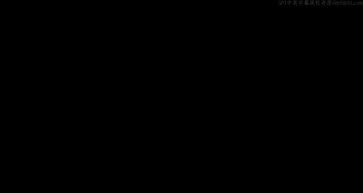

Good morning everybody。And welcome to this last lecture of idea for。For 2024。

 thank you all very much for staying through the course。

So this last lecture will be on graph neural networks。

 the lecture will be delivered by Gabriel Zencha and Carel Zagbo youparts and before we continue I just want to。

Thank all of RTs for everything they've done so far this semester， they've held the course together。

So with that note of tanks。Gabriel and Car over to you。So Gabriel， I cannot hear you。Okay。

 can you send me now， yes。Okay， yeah， good afternoon or from Tiga and good morning in Pittsburgh。

 so this last lecture would be about the graph neural networks as Prof has right mentioned I Ka via tearss and would be going over their lesson together。

So，啊。The models we've the models we've seen so far since the beginning of the course。

 we've learned about MLLPs and how they work as universal function approximate how we can train them using some variations of gradient disscent and we can directly compute the gradient using that propagation and we saw like a simple model like this。

 which would be a digit recognition model where we just we got like our data and we can flat it and pass it through an MLLP for recognition。

And another type of model we saw was the CNN base models。Was the CNN based models。

 which were primarily designed to handle image and spatial data and we did this by using like convolutional layers to land the special patterns and reduce the special dimensions with cooling but cool and pullinging and we also saw how we could train this using some other variation of using variations of gradient descent gradient descent and why the widths why the gradients were computed again using bad propagation。

And呢。From CNN model， so we same problem， which we had like an image recognition， however。

 rather than flattening the image to effect though。

 we tried to land some spatial features using some fixed size convolutional canops。

And another model which we've seen is the sequence to sequence models。

 which were inherently designed to do with the sequential data， and we studied the RNAs。

 Alestians and transformers and they prominently helped us by first of all。

 encoding the input sequence to some hidden representation and then decode that hidden the encoded sequence。

And again， sampling， we could train them as we've seen in all of our assignments so far。

 using some variation of gradient descent and the gradient way。Calculated using back propagation。

And we saw so many different tasks， which we could do on like a sequence sequence models and now the data we've been seeing so far are what weve referred to as a Euclidean distance。

 which mainly could be like tableular data like a matrix in demo multi layer perceptron or images which have like a six grids of。

Pixel insities。 And if we add like a time component to our images， and we get videos。

 then we can deal with special temporary grid and also sequence sequence models， which were an order。

And order data like a text or time time series。However。

 those are not the only kinds of data that exist in the real world， as you might already know。

 there are other types of data and we would refer to this as non Euclidean data。

 which means that the aspect of Euclidean of distance。On the features is not inherent。

 it's not direct。 So if if we were to give you like a knowledge graph or a social network graph and what would it mean to calculate the distance between I and camera if we are connected on that graph So it doesn't directly makes sense and such an example of such type of data。

 it's the graphs。Which is made of like node and edges represent entities and relationships and example of such such the social networks。

 molecules， knowledge club。 And we can also see like these in 3D meshe or point point cloud。

 So these are areas of data。These are various data format and in real world。

That's how the data exists and for example， right now we are seeing a traffic network。

 how if you were to train an MLLP， how are you going to structure the input to that MLP using this using this kind of data。

 so it's not very clear on how are we going to do that。

And again social networks and knowledge graphs。 So a lot of these kinds of data exist in the real world and even at the lower levels are the molecular levels in modeling bondings and the good thing about such kinds of data is it can really capture like a complex relationships。

 and so we want to see how to deal with these kinds of data。 However。

 in handling these kinds of data with the approaches which we have seen of with the analog these。

 CNNs and。And RNANs， so for NLPs or CNNs， we see that they assume some like irregular structured data。

 so it could be grids like we've seen in the images or some sequences and they cannot directly handle irregular neighborhoods or variable node connectivity。

 which we are going to in graphs， which we are going to see which we are going to see later on。

 so for nonucuclidean data then we see that it's a traditional convolution might not work here because how do we define maybe the neighborhoods of a particular note or something like that。

And again， then we have this s， a varying number of nes pay node， so here we see that， for example。

 note six。Has like a multiple just one neighbor why two has multiple neighbors。

 so if I were to design maybe somekenal which handles a one dimension and when I reach node two then it's basically going to fail so the standard convolution which you've seen we operated with some fixed filter dimensionskenoes where of fixed dimensions to our data。

 but for nonucleidean data with this very number of neighborhoods。

 it's difficult for those approaches to directly work on。嗯呢。Okay。So again。

 in Euclidean data like the images， we saw we spoke， we saw a spatial regularity。

 which means that we could move with somekenal of some particular dimensions and extract some spatial features。

 but here the whole concept of like locality， it's not。

It's not fixed and it varies across the structure as we saw in previous in the previous graph。

 for example， how would you define the locality of oneNot and another node and we also have the issue of like order sensitivity so for non-uclidean data like point graphs or the clouds undirected with emphasis on undirected here because for directed graphs we might represent them as an audit set but ondirected graphs。

 we will not represent them as audit sets so there is a problem here because if we mix around like pixels in an image then we would still be able to we will not be able to still get that spatial features I think we've seen it in assignments where the augmentations change a lot of things though。

But in fact， helping our helping our models。Yeah， but in here， there's no known order。

 so we need a way in which we can have a handle， like perutation， invari or equivalent types of data。

So and why it matters， I think we've already I already mentioned several of the properties。

 why it matters because first the reward is there are a lot of data sources that are noneuclidean and it also helps us to like enable neural applications。

 I think maybe you've already seen it in the news where a drug a drug was discovered using neural networks graph neural networks and also in terms of social network analysis。

 recommend assistance， so it could be used to suggest some products to you and most especially capturing complex relationships or even help us on performance with existing with existing products。

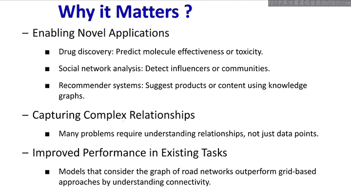

So before we proceed， here is a， Here is a pool。 I'm going to publish it。对。Okay。He。Yeah。Right。Okay。

Okay， so difference。That man， I think58% one sense。

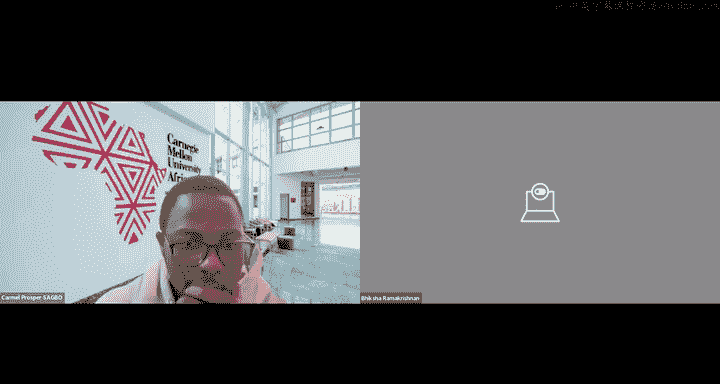

Bit for a few more。

Okay。Okay， yeah， so。We are right， so for the first statement Euclidean data refers to data that lies in a space where the distance between points can be calculated using some distance formula right。

 which is's maybe like the Euclidean distance which we know which we can use in calculating even like the distance between pixels and also embeddings which we are using for our MLPs and the second option。

 so CNNnns and an MLPs are specifically designed to handle nonuclidean data。

 I think insert there is again true because once we are designing the CNNnns we didn't if we remember from the lectures。

 we didn't try to focus on non-uclidean data， yeah we focus mainly on Euclidean Euclidean data。

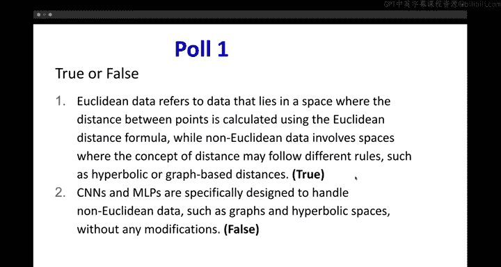

That。And I think camel will continue。

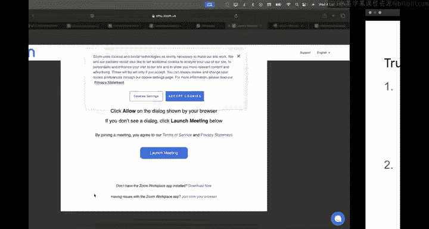

好。Yes， okay。So basically to handle some of these nonignligent data will be that we we are working with we be using a graph neural network which actually will rely on the structure of the graph that define the relationship between the different entities on the graph and here I will give a quick definition of what a graph is before we continue so basically if we want to take it in a description a graph will be。

Just another pair of elements two elements B and E and B will be the set of broad as we also call the node or point in our on our graph for instance if I take the particular case of this graph that we drew here is that this is what I will call a node and this one is also a new node and I will depend this relationship between this node this two node which we call a or maybe link it sometimes depending on determine where we working so if it is in network I will just say that maybe I have a link between this node and the other node on the network so basically that's what the graph is and it is。

Of different kind， but we'll have to maybe discover two main types of graph here which here this one is not an undirected graph。

 which means that there is no direction between the relation that actually lies into between two nodes。

 but here Ill have a directed graph where we have the node2 that has a link directed to the node one on the graph。

So basically， that's what it is for。a graph。And we use different kind of representation when we want to work in using some computation operation。

 so basically when we want to。T our model， for instance。

 we're not going just to use this set of ver and edges just in this way。

 but well have to come up with some representation that helps us to do some computation and what we already know and how we use it is some matrices that you can see as represented down here。

 but I'll explain more on therices on the next slide。So basically when we want to represent a graph。

 one of the representation that we can use is the ad metrics， which actually is of size n times n。

 we define n as the number of vertices on our graph and the metrics entries will be we value zero or one。

 so one when we have a link between two different。Nos but nowclock。

And it will be zero if there is no link， but again。

 what we need to know here is that this is defined by using some convention like this means that if I said that we have the entry AIJ is equal to one。

 this means that here I am saying that there is a link from the node I to node J。

 this is by convention。But we can also say that AI is equal to one means that there is a link from J to I this if I if we say that the convention is to read the。

The relation from the columnlog to the road。When you're working using a graph and you want to represent the matrix we always need to defend the convention before we start working with it so basically if you see down here for this graph you see that there is the link between the node one。

And the note four so if I'm going to present it with the metrics down here。

 we have the entry zero to the entry。Here's01，2， three， so this is the fourth element right。

 so this is the notebook for， so it will be the entry let me just put it this way。

It will be the entry。诶。I here is going to be zero。And J is going to be three。

But this is if I'm reading it with the metrics ordered from0 to n minus1。

The number of nodes on the graph because here we have one2，3，4 five nodes， so it's one2， three。

4 five nodes and the same thing on the row so when we apply this way you see that these actually describe the row duration between one and4 so basically one will refer to the entry0 and four we refer to a three on our graph so that's what it is。

So。Now now that we define what a graph is， we see how we can actually use it for our learning task in graphraph neural networks。

So。Basically when we want to work on a graph neural network。

 how do we do it we first need to represent our graph using some metricsrices。

 but then this also needs to we also need to know how we define the information that we are collecting from each of the nodes on the graph that we learn the structure that define data by the relationship between different nodes on the graph so here the motivation behind the notion of node embeddings actually is that we want to use it to represent the embeddings which is basically going to represent the for instance here。

 the relationship between different websites like for instance here if we want to do web classification we may use page embeddings in terms of neural embeddings for our work。

 if it is maybe a graph that defines the structure of relationship between different citation in a literature work。

 maybe want to do some literature classification we。

L on a em and we also have different other types like for in in AI for science we might be using atom em。

 so more generally in unified view what in notes will mean for us here might be a document if we actually。

Doing some classification work on maybe some documents。

 it might also be authors information or maybe protein。

 so these will represent the nodes and they are the object that we going to manipulate on our graph。

And on the other side， the links will now represent the interaction that we have or maybe dependence we have among the node for instance。

 when I take a structure of proteins in drug discovery。

 proteins actually has some interaction that defines the overall structure of the molecule maybe if I take an example of cancer dataset for instance。

 we know that cancer is a genetic problem and then if we want to represent some of these element on a graph we may represent the interaction between the different proteins that defines a mutation on a cancer dataset set so this is an example of thing that I can give。

And how do we really do this like we use the em to capture the latent feature on the different nodes on our graph structure。

 and then this is supported by using subdentstream prediction tasks that we use to do the classification wall maybe communication detection and dense revert。

 these are some of the tasks that we can complete by using。Dra neural networks。

And when we want to learn the northern buildingss， this is basically actually mapping the node that we have on our graph through some Ddisalbes in such a ways that。

The node that are similars on the graph will be on different classes and this is an example of how we do it here on the screen and then you see that to do that we need to assign some function that we use and feed the graph that we have into this function and at the end of the day we're going to get from this function。

 the neural conveys that help us to draw the structure in such a way that we can learn difference the similarity between the nodes that help us to define different classes of。

Lbeling that defines what a specific node on the graph will represent at the end of the day。

 so how do we really learn this which it on the next slide。So here is again。

 a second poll on neuro variant。

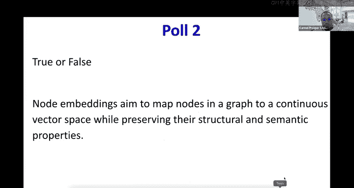

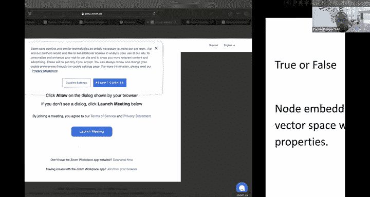

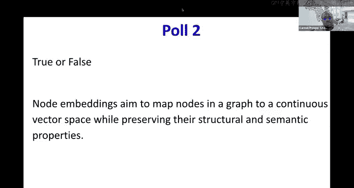

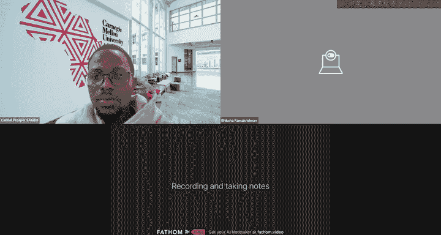

Amed， you can ask your question。Okay， thank you， so I wanted to ask with the know the em。

 does it also preserve information about the relationships that is is between the nodes or does it really just put their nodes in the em space？

Okay， so the growth of the northern buildings， as we say。

 is just that we're going to map the graph to some vector speed help appss actually to define the。

To define get the features of different nodes on the graph。

 but this will now re on the neighborhood of the specific node。

 so this help us to capture the relationship between a specific node and each neighborhood does' what we're going to do。

Okay， and maybe just to add it just to add to that Ar mean so once we are getting the node embeddings。

 which are the embeddings of the various nodes， we are not changing we are not changing the the relationship between each of the node。

 however we are just capturing like。Like Ka said， a dimension a different dimension of features which can help us to do maybe some other graph level task on it。

Okay， so again， for this second row we say that the node em actually comes to map the node in a graph through the continuous vector space while preserving the structural and semantic properties。

 which is true and。Now I'll let give you a continue on the second part of the lecture， yes。哦。Okay。

 yeah， so what now that we know about graph。 So let's define graph landing task。

 So we have three main types of task， we can perform on a graph and we categorize them into three different categories。

 and the first one being a note level tasks， which we see that， Okay。

 so given given some on non node， Okay， and its relations with order node。

 can we maybe do some sort of like node classification。 Can we determine if someone smokes。

 given that we know its。Given that we know that they maybe connected they are connected with people who smoke or something like that。

 is that possible so we'll see those kinds of things and we can of course help doing some other tasks on node regression determine some actual continuous value of the node and we also have like the edge level task which we can try to predict a link between two node so this again helps especially in recommended system so given that if I would build in a knowledge a viewgraph for you and I know you've viewed some movies can I recommend a new movie based on the previous movies which you have viewed。

And then we also have like the graph level task， which now we're considering the whole graph and we can do some sort of like graph classification or graph matching and all of things of that sort。

So。Exsanding on these。We will define three different path。For simplicity。

 we consider one of them that this is easily extendable to each and every different task and so the whole goal is here we want to start with maybe some complete graph and go through some stages of maybe partially observed graphs and then after some training then we want to be able to do like node level classification and a link prediction or graph。

Or graph classification。 And we will start with a task like note level classification。

 So giving some notes and a relation。 So these are， these are directly。Just sitting。

 and'm trying to find。Myあてた。嗯。Okay。嗯。うんう。我知。Okay， yeah so so so given we know this node。

 we know this node and it's connected to this node， which is an unknown node Okay。

 and this this unknown note also has some connections with some non node can we actually determine the values of this the classes of this on unknown note okay。

 and that's what we would be trying to do when we are talking about the node level classification。

 So this is our training after some training， then we want to be able determine let's say if we are trying to determine if it is a blue if it's a green or red note。

 then we want to determine the the color at the at the end of at the end of the training process So and how do we do this。

So we'll start with what what we know very well and which is our using is。

A multi layer perceptionron， right， So we are， we are very very with multi layer perceptionron。

 and we like them because they are differentiable and we can easily train them using back propag。

 So here let's consider let's consider this assay， let's consider this as a graph。 then。

Then on this graph， we can， we have。As Ka mentioned a set of vertices and edges and I would consider the whole graph with some graph level task here and what we can directly do is get for each of the the node embeddings。

 then we can pass it through some function to get some updated node embeddings。

And this function in this case can just be our simple multilayer perseron， right。

 So once we get the node embeddings repository multilay perseron， then we would be able to。

 of course， do some classification on on that node using those that node embedding。 So we have。

 of course， sigma sigma activation， which would be any other activation to introduce non non nonlinearity。

 So the whole point is that we can。Stack this combination。 And at the end。

 we can end up with again some， some graph that with some new note embeddings。

 which we can use this note embeddings for to to pass it through a classifier。

 And we are going to see this。The next slide， so giving some notes。

 we know if we already have if we have information stored in the notes so we have some like note level features。

 then we can determine the classes by just passing through some linear classifier and the easiest linear classifier which we know in this case it's the NLRP and I think that will straightforward。

 give you some class to which that node below but of course in this case it doesn't use any information about itsing its neighboring node it use just the information it has in itself。

But what if we don't if the information is rather stored in ages？

Which means that they not do not have like any meaning。

 but all the information is stored in edges so we can think maybe of the distance between two cities or something like that and。

We are trying to determine how far they are apart， which is information which should be on the node。

 So what we can do is we can pull the information from the edges。 So in this case。

 we get the information of all the edges which are connected to the node。

 we are trying to make the prediction on then we aggregate them via some sum or mean or some other operations。

 which we are going to see later。 and now using this transformed edge embedding which now represent a new node embedding。

 we can again apply a multi layer perception， which is a D classifier to classify to classify that note。

And呢。So that will help us and similar thing similar concept can be extended to edge level prediction。

 So if the information is stored in the edges， then we can just use an MP on the edge embeddings。

 But if information is taught on the notes， we can。Pull information from the node。

 So the equation on Zoom， which says， what do we mean by pulling information from the node or edges。

 So here we have some embeddings， which means we have some features from there。

 So we are going to get those features of the connect of the neighboring node or edges。 Okay。

 and then we have to aggregate them to form some new embeddings。 You would。

We would see this more formally later but this is the general concept so we would want to get information from the neighboring ones and I will get them together and how can we generalize this approach and to generalize this approach then we have something known as the graph convolution which means that we can start with some graph and after some series of iterations we have transformed our node embeddings to some other after some iterations we have new node embeddings which we can use it on a linear classifier to classify the graph and but before we proceed then let's just look at a little bit on the graph convolution first the CNN convolution so in the CNN convolution we remember we will dealing with some like a fixed degree。

So I already know the size of my image and I can determine the canal size which I want to which I want to use for my convolutional layers。

 but here there is no there's no fixed grid right so we need a more generalized way of performing convolution and to proceed with that。

Let's take a step back at what the CNNs were actually doing。 So if we look at the CNN， when we pass。

 when we take a canal and we put it over some region。

Then basically what we are trying to do is gather all information from all the pixels which are inside of that region where thekenal is to generate a new pixel like to capture this special context and this is similar to what we are trying to do with the graphs to get information from the neighboring node or from the neighboring edges to then update our to then update the current node embedding but however for CNNs。

 it was quite easy because we knew that we had like a rectangular grid and we can set some fixedkenal size and just slide over so for graph convolution。

 we will define it as a three three stage process some other people call it a two stage process so do not be confused if you see it。

As we mentioning as to stage process。 So the first thing we want to do is each node would send its features to its neighboring node as defined by the graphs edges。

 So the graph edges would help us to know which nodes are connected together and they would pass their information。

 the information about their features which in this case are their embeddings to the target node and the next stage we want to do is to aggregate all of the collected information from the neighboring node with with the target node on features and then we would update the target notes features using using its own its。

Features in the previous times step with that， which it has received from its neighbors。

So let's look at again， we mentioned about neighborhood。

 but what do we mean by the neighborhood So if we if we see this as a graph。

 then we have some the note the node node1 has some features features in x1 not to have some features in x2 So what are the the neighborhoods of node1 So the neighborhoods of node1 are the node which are connected to node1 and we can then like separate each of the node here to just this is just for the utilization purpose to see what we mean by the neighborhoods and if we zoom in into node6。

 then we see that its neighbors are。It levels are one，3 and4， okay。

 which means that we will need to get information from node one。

3 and4 in order to update node6 and were going to see how this is being done。

So the first step again is to first generate the node embeddings based on the local neighborhood so we know what the neighborhoods are right now。

 so we we generate the node embeddings of each of the neighborhood and then now we can aggregate this information so aggregating means that we can simply maybe decide to take the sum of all of them or we can decide to take the mean or we can decide to take the minimum。

 we can decide to take the maximum to produce some neighborhood embedding so some this represents information which is coming from the neighbors of a target node and we want to use this information we want to use this information after the aggregation in order to actually update the target node。

And more formally， we can define it this way。So here we are defining using the abriaging aggregation and so at the first iteration over here。

 then the he the hidden the node em of node v is just equal to its input features， right？

This is at the zero layer， right， But what happens now in the K plus one layer。

 So in the K plus one layer， the first thing we want to do is move over the neighborhoods of V。

 So we are going over the neighborhoods of V， which in this case。

 represents node that are directly connected to that are connected to V。

 So if if this is not V and this is U1。 and then this is U2 So we will be going over U1 and U2。

 and this means we are getting the node embe of U1。 So in this case， we will get for U1。

 we will get for you2 and we will aggregate them。 So here we are using the average the average scheme to aggregate。

 So we are summing them up and dividing by the total number of neighborhoods。And once we get this。

 okay， then we are going to， we are going to combine it with the current。Not embe of the。

 So it means that。Yeah， so we are going to get this combine this with the current node embedding of the But how do we do that。

 We need some way of combining it， So we'll define some landable parameters。

 which would help us to determine if how to combine this node and after this iteration。

 then we basically have updated the。The node embedding of for each for each iteration and so in the graph convolution we would be doing this for every node which is in our training set so for in the first layer every node is going to pass its information to its neighbors and it's going to updating itself and in the next layers the same the same process is going to reveal and so we can start multiple layers to form a a deep graph convolutional network and at the end we want to end up with some hidden representation of note of of the node embeddings of the which we can then use for other task like maybe。

Traification or regression。Any question of here before I proceed？Okay， please。

 if there is a question you just unmute yourself and ask。 Okay， excuse me。 could you Yes。

 could you repeat， what does that mean the Z。The embedding after kid leave。

 what's the difference between the H and Z is just assigning that？Yeah。

 so the the Z is my final note embedding。 So after some， after some iteration。

 I want to use these note embeddings now to do some， maybe to classify that note。😊，安静歌曲。Yeah。Okay。

 and then I proceed so then the question comes how do we how do we train such a network and in order to train these then we need to define some loss some loss function right and how do we define the loss function again as we as we saw in the previous in the previous slides we have WK and Bk which are trainable with matrices right and how do we。

How do we， how then do we proceed to train any guess on how we can。Do it。😊，嗯。Okay， it's right here。

 right， So we can just fit these node embedding into any loss functions and again。

 train without some variant of our stochastic gradient。So。

 and as prof asked on the So how are we going to be computing the laws， right。

 So now at the end of at the end of it， then we have some note embeddings for each of the for each of the node。

 right， So in this revised setting， then we want to minimize the the laws and the loss is。

We have some labels right for those nodes right in this case if we're dealing with node level classification and it maybe categorical。

 then we could use the cross entropy cross entropy loss and if it is if it's a real number we could even use the L to node because this F this function。

 which is our graph neural network， it would get in some input X orD and it's going to produce some Z or V。

 which is node embeddings which we can fit it to an MLLP。

Right we can build a classifier out of this and if we are able to build a classifier out of it。

 we can still then calculate its derivatives using back its gradients using back propagation and use SGD or some variants of SGD to train the network。

Any question on this？Okay， if no question， then I'm going to just give an example。

 So let's say have we have some graph and。We can then directly ask some questions on on it。

 So think about a graph， which is the interactions between between some drops right and you have some drop which you are trying to administer to a patient and you don't know like the if that drop is safe or not right but you know how that drop is connected with other with other drop So you can directly ask this is a node level classification task right a binary node level classification task。

 So how are we going to solve this then now we see okay， we are expanding the cross enpis。

 but in this case。We are adding some new parameters to it。 So first of all。

 we remember our z of the was the final output of the node embeddings。

 And now we would be introducing some new parameter， which is data。

 which would help us for our classification， right and。

And the Y of Y subD is the true level of the node which we know， which we know that， so in this case。

 using minimizing the cross entropy loss would help us to train that model。

 which we can use for a prediction to determine if it is safe or not。啊主。嗯。Okay。

 and then here we discuss like a simple way of like just of theing graph convolutions。

 which we mentioned， Okay， first we have to get the messages， then we need to aggregate them。

 then we need to update the node embeddings right Yeah。

 but with with graph search graph search right the paper it's on。

We are going to share it after the class so's。It's published by a professor in Stanford and here we see that we can generalize the final hidden node embeddings by performing some activation on this leable weights and the concatenation between the weights of the previous node embeddings and those of the the neighborhood okay but how do we how do we write is in the method which we knew as a message plus aggregation because that's what we define our graph convolution on so of course the first thing would be to aggregate those from the nes right so the aggregation means that I am going to get the previous layers node embeddings for every for every node in the neighborhood of V and stage two then I perform。

啊。I from the aggregation using the the aggregated note embeddings from the notes from the neighborhood of the and also the note embeddings of the target note and then we can then still ask ourselves。

 So what do we mean by neighborhood aggregation and how we can do it So that which we saw in the previous slides Here is it over here where we were doing the mean mean aggregation。

 right， but this is not the only way in which we can aggregategg right， we could actually。

We could actually do some transformation on the neighborhood vectors， right。

 So we apply an MP to each each and every， which was the first thing。

 which we saw once we were trying to introduce the graph convolution that we would just get the node embeddings and apply some MP to。

 So this， once we get the once we use use an MP to transform each neighbors node embedding。

 then we can just take the average of it。Or again we can use a an LSTM right so this means we are not restricted to just simple mean or simple mean or sum method。

 but we could also use an LSTN however it's very important to note that this LSTM here is shuffled okay and can someone tell me why we are shuff learning。

Any guess， please。Okay， so if we remember with LSTMs。

 LSTMs are good at capturing sequential data right so if we keep on giving if we fit this LSTN network all the time in the same sequence so let's say H of U1 H of U2 H of U3 right then this actually would break the rule which we saying we are trying to find a limitation invari method of aggregation because this Nehoods can change at any time so it's very important that if you want to pass into your LSTM then you should shuffle this so that it actually learns how to aggregate them rather than learning how they lie in some particular order okay。

嗯。Okay， are any question on the aggreg strategies？Okay， if not， then I am going to proceed。

 And here in graph search， again， they propose to use the al to normalization， right。

 So think about if。If the notes are if the em of a particular network of different scales and I am trying to aggregate them together。

 then we might implicitly give value to some particular node more than a another node so in graph stage they propose the application of like the2 normalization so that we can help like bring them to the scales and it's important to note that in some cases but not always the normalization would result to performance improvement right so if you're trying to train a graph neural network。

 this is something which you would want which you would want to try so that all the vectors would have the same L2 norm。

And with that， then would go on so there。Tpo。Okay。Okay。Oh。啊。

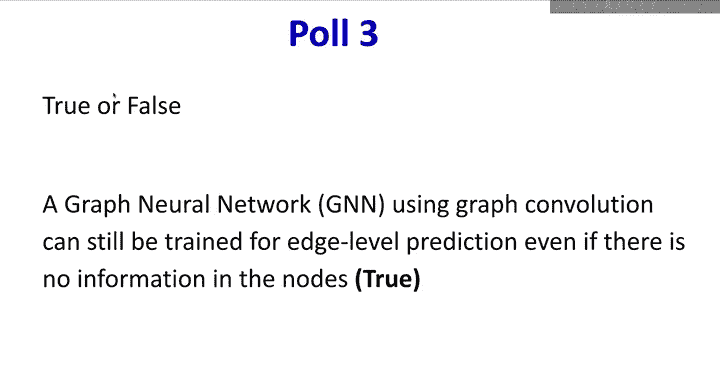

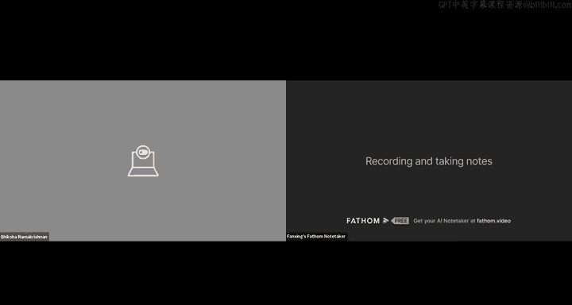

O啊 so。Is this possible。好。So in the graph neural network using graph convolution。

 we can still be able to train for edge level predictions。

 even if there are no information on the nerve。Is this true or false。Okay， why is it true。Okay。

 bless， Bob， bless。Why is it true， You can unmute yourself， and speak。ok啊。Okay。

 so for edge level prediction， even if we don't have information on the notes。

 but we have information on the edges， right， So we can always still。

Do the graph convolution in this case， then the neighborhoods of an edge would be the edges that are connected those that are connected via the same node or something like that and we from the ver first introduction that we could actually transform these edge features into some node level features right using these pooling operation right we could use some we could lend some MLT function that would transform the edge features into node features so we can always still do like graph convolution even if the node features are not available but edge features are available。

Okay， I think Kael will continue。哦。Excuse me， may I ask a question。Yes， miss about the last poll。

 it's more of the MLP that you mentioned that transferred the information from the edges to some node information rather than the last part that we were discussing was about the pulling of the information from each node to the target node。

Yes， so theP the MLP is still able to like transfer the edge information to the node okay。

 for us to for us to still do the graph convolution in the same way right which were doing it with the node embeddings but better again you can still think about this so the graph convolution we will not really fixing it on the node right with taking one of the future one of the components of the graph which which are the node and looking at its nevers right so can we define can we also be able to define the nevers of an edge。

Yeah。Yeah， if we can do this， then we can still perform graph convol right yeah， good you。

So far we discussed the notion of graphra neural network with some way of actually learning different things using graphra basically we talk about graph conversion network and the graphs。

 but are we going to see something which is also really interesting。

 which is the notion of graph attention network basically we want to introduce the concept of attention weight in the learning process that we using。

 so how do we define this attention weight basically in graph conversion network of maybe graphs we can see that this notion of attention weight is different which is this value here alpha V which is defininging the importance of the message that U is actually sending to the node view on the graph。

So on GCM and graphage， these attention weight is defined explicitly because it's going to be equal to this value here because we are actually performing some aggregation strategy that actually combine the average weight of the neighborhood average weight of the embeience of the neighborhood of the node B。

 so that's how we can actually extract the weights。

 the attention weight from this one which actually even equal importance to the neighborhood of the node B。

But what happen if in in the case where。Each of the node in the Noval neighborhood have a different importance of in terms of message that they are sending to the node3。

 so that's how what we are going to see in the next slide。And basically， as I was saying。

 it's not that all the node in the neighborhood of link giving node we are going to have the same importance in terms of information they send into the not。

 so if we want to do that one we now use the notion of attention which will define the attention in another way by actually assigning some arbitrary weight attention with to each of these node when we are aggregating the information and this approach of doing actually taking inspiration from cognitive attention。

And the attention with aVU， which actually focuses on the important part of the input data will fill out the rest of the information just by giving this arbitrary importance that we assign that were going to learn through the process of craft neural network here。

So basically this will help us， the idea is that we want to find the part of the data that actually show more importance and this will depend on the context of information that we have and also the learning process that we have on the network。

So how do we effectively learn this factor alpha value that we define as the attention weight on the network。

 basically the goal is that as I was saying we want to assign arbitrarily some importance to each of the neighborhood of the node P on the graph。

And then we'll compute the em using these addition strategy for each of the nodes in the neighborhood of the so at each layer we'll be computing this one and。

The node in the neighborhood now will be sending information。

 but now await this agation strategy now will be the weighted average of these information by using the attention width that we have and now we defend this attention implicitly through the learning process instead of just having like explicitly the way we define it in graph composition network in graph composition network or maybe graph stage。

 this was defined but explicitly because we don't have to learn it as the story defined as one divided by the number of elements in the neighborhood of the node。

So when we want to learn this attention we want to apply this attention mechanism here。

 what we do is that we depend on function A that we use to apply to the neighborhood to learn this function and this one is basically by taking the by concatenating the。

A aggregateated message from the neighborhood of the node V from the previous layer。

 will be using this information that we are collecting from this neighborhood and we combine with the information from the node itself and then after doing that one we'll get some coefficient。

 which is coefficient EBU and this coefficient actually define the importance of the message that the node view for instance is sending to the nodeV。

And how do we now that we get this coefficient that we have we be using this to。

Compute the attention width which is alpha video， basically we computed by using some soft mass function to defend some style stability for the values as they will be sending the information on the network to the node B。

 what we're going to do is that we take the soft function so that we have the submission of all the attention width sum into one on the network。

And when we define alpha value like that， now the attention weight is no longer going to be the normal value that we have before。

 but this will be defined based on the importance that each node has the node V by sending the information so that's what we compute here like now the aggregated emvariance that we compute layer L for the node B we now take the aggregated message which is basically here using the sum by applying this attention weight to each of the emvariance from the previous layer with the matrix that we learning and at the end of the day if I take the parts of these exam that we have here I take the node A and I want to compute the embe at node A what we're going to do is that we need to define we need to arbitrarily assigned some attention weights to the neighborhood of to each of the node in the。

which is basically D B and C as we have here so we're going to compute alpha A B。

 alpha A and alpha A G and once we compute this one now we can compute the the aggregation of the al just by summing up。

で modificationplication betweenで alpha。AB， the weight metrics that we trying to learn and also the em from the previous year。

 So we'll be doing it for each one of them and then we sum it up them and then we take them for some。

Acation function to get the em for the node a of this layer。

Once we get this one now we'll be concatetating this one we。So once we get this one。

 how do we actually apply it so I will say that when we want to compute the coefficient for a particular relationship when we want to compute the coefficient for the relation to define the attention with of relationship between a given node a and the node B。

 we actually applying some attention function with A that we choose some function A that will be used to compute that one and this function can be basically for instance within some linear layer and then just connate the information from the previous layer A and B and then after doing that one we pass for the linear layer to get the。

Qu theアデンション theアデションqui sorry。Of the node between the note A and B and after getting that one。

 we can now apply。Our activation then we get we can apply the soft function。

 then we get the attention weight that we'll be using to train our network。

 so the parameters of this function A that we using to compute the final convey we actually require us to learn some parameters so it's not just going to be only the weight metric that we are learning so far with the graph vibrational neural network。

 but now this will be again requiring us to compute and to learn the attention width with the other weight that we will learning so far so this is done by training the whole network in end to end fashion。

So any questions to far？So， I had a question。Yes。So by some initialization for this attention weight。

 when we the learning， like we a training procedure。

 we will learn the W and then the H for the next layer。

 and then as soon as these two are defined the EAP would be some deterministic value。

 What does that mean by learning that。Rumen is not at extra value， am we right？Okay。

 so basically what we are doing in graph conversion neural network is that we do not have any such notion of attention。

 so basically it's just applying some dividing of the aggregated message by the number of node we have in the neighborhood。

 but now when we start at this stage we will now start by。

Arbitrally assigning some values that randomly assigning some values。

 but these value were supposed to defend the importance of each of these node in the neighborhood to the node E for instance。

 to the node a for instance sorry so because we defend this value arbitrly in this value and not the correct values at the end of the data that defend the correct importance of each one of these node in the neighborhood to the given know that we dealing with so what do we do we need now through the learning process to update these attention with until we get the convergence value that actually minimizes the loss of our word value we are doing at the end of the day don' but my question is like they are function of the other parameter or not defining extra parameter during the training procedure。

We are not。They are not extra values， they are just function of the W and H。

 they are getting trained yeah。Yeah， so we are not defending some extra values。

 but the actual this attention way that we compute will be function of the other weight matric formation that we also learning so far on the network。

Yeah， thank you。Yes。Okay， so once we define this attention mechanism we can go far beyond that one because using just one attention weight function。

 we actually help us to learn both it might be some way tricky to get some step learning process with it so how do we what we can do to improve on that is that we can now apply the notion of multi head attention。

 where instead of just having one function A to learn。

 we define maybe several function a1 a2 and A3 and so on。

 so depends on the number of head that we have from the network and then at each layer we're going to compute for each function A。

 the attention weight for each one of them that we can concate it at the end of the day through aggregation strategy again to get the em for this node at this。

So if we define， for instance in the case of what we have here， like。

Three different function a1 in sorry a1 and a2 and a3， then at each layer for the node V。

 we're going to learn each one of these function because the different function。

 even though there might be a function of these metrics that we learn at this layer。

 they're going to be different function and for each one of them will be computing the importance that a node view which is in the neighborhood of V has to the node B and aggregate the message based on that one。

 to compute the final output。And then we do that one for the function A1 a2 A3。

 and after all this done， we now concatenate this information or maybe use some submission strategy to aggregate the information from the output of each one of these attention mechanism to get the final output and this help us to learn。

Our network parameters and also give us most stability in the attention mechanism process。

So this gives us some benefit， which is basically it allows us to implicitly specify different importance values for Al videos because when we start training our network。

 these values are not going to be some knownvalue， but there will be a arbitrarily and then for the learning process we be updating it until we get some。

Convergence values。 And then this is also give us some commission competitionary computational efficiencies already in terms of competition and as well。

 it gives us。Storage efficiency ins that the space matrix operation that we're doing here do not require more than you know of P+ E operation where V is the number of processeses we have on the network and E the number of edges we have that defend relationship between the different veres of the network。

 so it actually help us to learn， but at the same time this request doesn not require us to learn。

I would say random or maybe finite number of parameters。

 but we have some finite a fixed number of parameters that we actually training our network for to get the final output so it have some of these key benefits when we're using the attention mechanism as we already defined before we see that when we are learning these attention parameters。

 we do not actually use any other extract。Information than just the other parameters that we learning before。

 so this attention weight will be function of the weight matrices that we learning so far and the load embeddings from the previous layer。

So here we get some one example which is coming from the original paper of the attention mechanism actually。

 and as you can see is that the attention mechanism introduced in the graph neural network structure actually gives some better performance compared to the previous strategy we use to do neural network learning of tasks。

So it gives， for instance， an improvement of。1。8 percentage compared to using graphra convolal neural network。

 which is actually intensely， even these small values going to ease a huge difference between what we can do with the same graph convol neural network。

So。From here， we've just go through some of that stuff like。

How we do this work like when we learning through graphical network。

 we can actually stack different layers to learn this。To learn any tasks that we want to do。

 so basically this will be helping us to define at the end of the day when we compute the em and we get the outputs from pretty different layers we get in information for different other nodes and then we can stop these step by step and then get for a really deep architecture using graph neural network。

So this how is worked basically， so we have different layers。

 we have some inputs as Gabriel already has explained before when we start learning a graph neural network start the input which is going to be the feature at different nodes。

 then we process it through the graphph neural network。

 when we proceeded well be updating this information after each layer until the end and we can have multiple layers stack of layers on how a graph neural network。

So overall， what we can say is that trans neural network types can be used in various learning as。

 however， it doesn't work well for all type of data as we already seen at the beginning of this lecture。

 and then this introduce the notion of graph neural network that can help in such a situation where we realize on the relationship between the different entities。

 for instance， if we work dealing with social network maybe be dealing with drug discovery process。

 we may want to see what's the relationship between maybe this protein and this protein on the overall structure of the molecular of the drug that we maybe trying to work with and to do that one we'll be using a different graph neural network。

 for instance， graph conversions， graph， graph attention network and to train this。On what we do。

 we saw the training process how it works basically we first getting the message from different notes on the network and then。

After getting this message from the neighborhood of any given message。

 the immediate neighborhood of any given notes， what we're going to do is that we aggregate this information。

 but in different different depending on the type of structure we。

Oneant to use to learn the our task if it is graph completion neural network of graph age。

 there might be some change， but at the end of the day the user techniques that we use to train a neural network such as dropout or maybe feature augmentation can be applied to our graph neural network to train a network and there are also some other strategies that can be used in terms of graph to。

Do the augmentation and improve the performance of our learning strategy。

 which is the structure augmentation， basically this will come with the reflection of adding some virtual node or virtual edge on the graph maybe do some sampling operation in the neighborhood of a given nodes。

 so this will actually improve the performance of our learning tasks and we do this by using a message basin。

So I would say that this takes us to the end of this lecture and if you have any question。

 then we can still see it。十点交。So again， one thing that I forgot to remember to mention is that most of these leg slides content come from the original people of these different。

Graph and Girl Network， different published also from the lecture of Michigan learning we graph from Stan Bo University as well as notion from Michigan learning we Gr from CMU Can Law University。

So thank you。

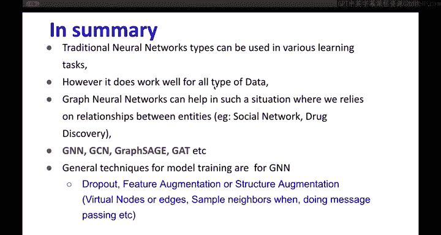

Nice， thank you boys， thank you， thank you very much。This is an excellent lecture。So folks。

 if you have any questions， you can post them on Piazza and Carmen and Gabriel will be an I。

Well be only to happy to answer your questions。 And again， thank you all for this semester。

I we'll be going away our projects at the end of this week。唔系。

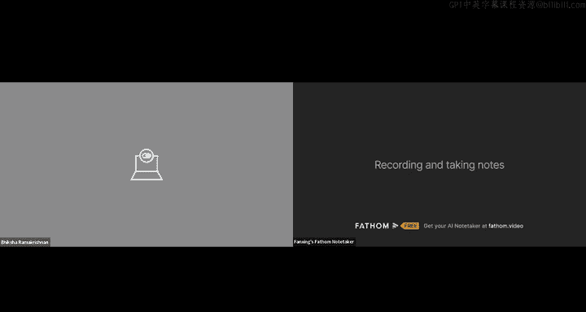

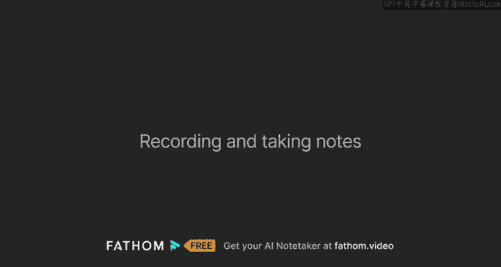