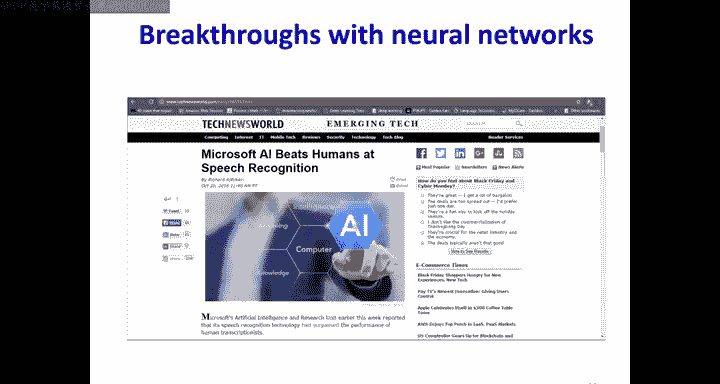
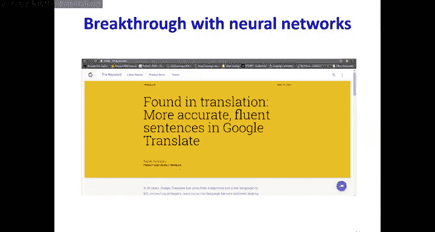
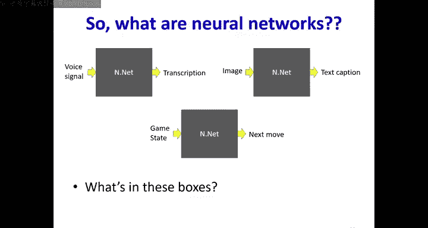
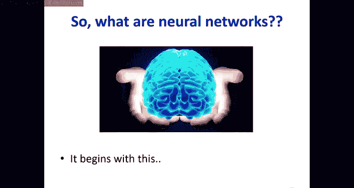
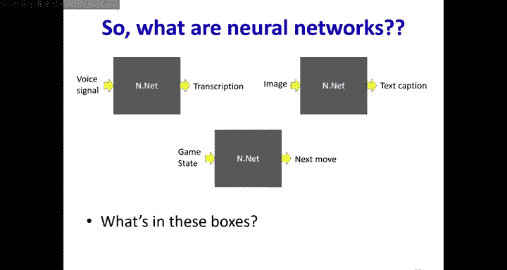
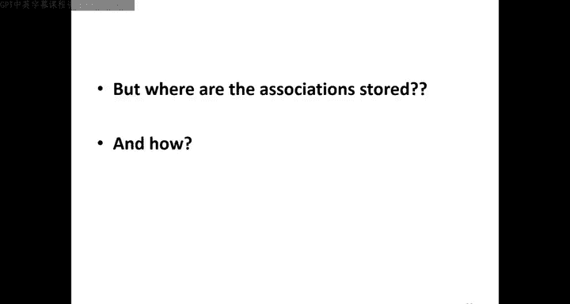
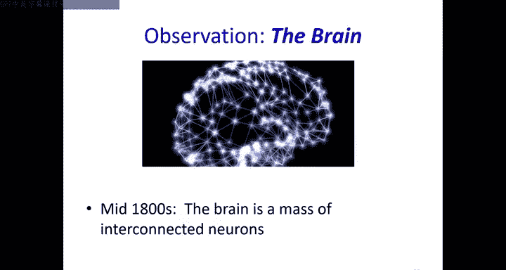
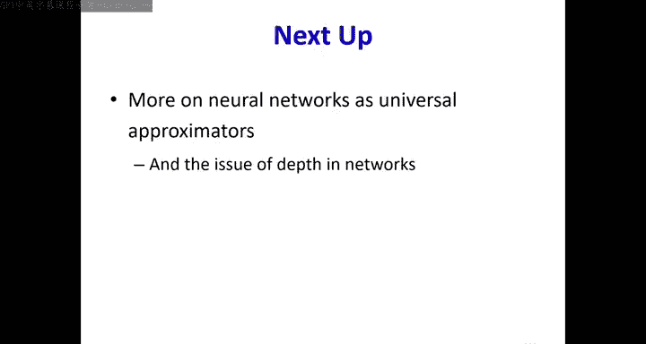

# CMU《深度学习导论｜CMU 11785 introduction to deep learning Fall 2024》中英字幕（deepseek - P2：[2]Fall 2024 Lecture 1.zh_en - GPT中英字幕课程资源 - BV1CfsReEEw8

Recording是。Yeah， like I said， I'd requested them to bring one。 but unfortunately。

 since we havet never it submitted to the。Yeah， so I thought I emailed you the link。你。Okay， yeah。

Honestly， if you just try to stay here or you pick it up the ceiling mics。

 the ceiling mics will work， but like， I mean， it's not going to be as clear。

 but there definitely will come through。那你。喂。The talk。

Yeah' me going to give it another minute see if。I sent my message。叫音。

I don't know if they can really go。Mhm。😊，就情。First class of the semester， I get to use Christine now。

M。是么开。Yeah my bring。です。バイ？Yeah， so like I said I can try to increase the volume a little bit but the ceilinging lights is to stand by the bridge neckmic there I know you like around sorry so the first half of the glassll Okay so hopefully yeah like said I've messaged them like I hope they can bring it。

 but I can't。Like they can run different department。啊。one？Welcome to this。线上发。And total gone。

But before we begin， this is a dumb classroom。Meanning no smart devices besides yourself cell phone alone。

Shut your laptops， turn off your fonts for them pocket them。你们。要只哪个信噶。Okay， when we have poll。

 so you see that app 26 up there。Before you shut your laptops here， just bear with me。

There will be a appearance call at the beginning of every class。

 you go up to the phone number shown on the slide。Regardless of where you are whether on Zoom。

 or whether you in the classroom？有不信号I keep jack肩花。attendance。我们身是。是IDJ。

I get an idea of who's in the classroom， but I to also have。8。Good morning， please。

Make sure that you're engaged。And so。不吧。So these are only five instances where you have to use it for your laptop。

 other times please keep your laptop shut。If you must use your laptop。

 I won't stop you purely this classroom。Sign to business and then come back in。

If you insist on opening a laptop in this classroom， I will stay quiet right here。Wait。

 until youre gentlemen with your business， because I do not。スピープアたら。喂。关 video。都是这。そ这个つ。公司。

Can havetop。I usually have a lapel mic today， I。We will be getting the laptop and my top。

So I'm going to try to speak from here。If those of you on Zoom cannot hear me just sta me now。30有这样子。

家嘛翻 my key。食饭没这见。烦脑。啊，有我我我着。Welcoming， everybody to the press。啊三毛俾。Some万另。

And we also have a logistics lecture。Recording that up one go。我前一班啊。

You are familiar with the logistics of the course。 I'm not going to spend any time much time on it in this lecture。

points。If you haven't seen that， please view the boxes lecture at once。い番さ。猫机。这么。や做。月かで。

You've been to the course website， the planning that CSS do CM。

 this is the course website that you needed。And if you haven't done so， please。Vi to that one。

The course objectives， logistics， quiz and homework policies， Ging policies。

 all of these all of these have been explained on the website。Some of be the subjective。As always。

 we will be dynamic of the。好。how the。students。And feminize this up with all of this information。

 because this says。Go to that。Now， you already。啊真。And you should have verified that you have access to。

这钱。Yeah。我先。いくなですね。呃ご写の？speakingea。Andま your doing。そうです。公是我。ょですね。O可。第二。screenYeah。Next， sorry。

 the screen is not。 It's showing the wrong screen。So。DidDid that get set right。go up and shake that。

对。啊。Let me continue because these things， even if you are on。Zoom。Hopefully。

 things get set right and being unable to see the screen right now is not probably not such a critical problem。

 But by now。Hopefully， all of you have signed up for Piazza。

And verify that you have access to the campus and opera。There is room， but there isn't room。

M channel out平。You'll get a note on farming study groups。 So the way this course is run。

 we encourage collaboration。 They not the talking about。So明白 that。Your best。

 you find best from your PM。Which means that we will expect all of you to。 We will。

Encage all of you to work in teams and to assist you in this regard。Study groups。

 Now before you begin。就是。Papers， please pass this around， everybody， keep one sheet。哇塞。This is right。

 let's take one sheet and pass it on。paper is the most important thing you'll have in class。

And here's what you're going to do with it。I could start off by pulling it in car。So。可啲。Again。

 in top。Wdering why I' doing this。小小兵。哎。早了点。makes a fantastic。So good things。

Wm very fantastic name tag。We're going to get。I have the city pyramid in front of you and every。I。

YouAnd I am going to be calling out names。like this guys tend to wonder all the。そ。别说微几脑。いっちゃか？Indeed。

 but also that I'm not picking only the same。 I'm not picking the same person again and again。

 because I just know one name。你啊。just。I apologize， okay。

So if you have not filled up the forms for the study groups， so please do so。Immediately。And then。

Heres are course philosophy。We want every one of you to get an A。But we want you to earn it。

So this means that we don't have a crazy， ingr scene。Which ensures that 50% of the class gets peace。

 That's not how we do it。We are grading you on absolute performance。

 but also compared to how the rest of your classes performed。 So I'm not giving you a free A。

 It's going to be incredibly hard to。すかプラゼ。你确你叫 work。And。We are going to provide a ton of resources。

 We have 25 T8。 We hold dozens of officers。 We 40 officers each week， in fact。Were going to we ss。

We have。 you all have the access to my office。 You can always come in any time if you have doubts。

 I look intimidating up here， but I'm not。And so you and。可。An pretty much him on Piazza。

Respon done over the past several semesters have semesters has been on the average， about5 minutes。

Which means that， and we get up to 40000 questions a a year or 20000 a semester。

 And we managed to respond all of these at the time of  five minutes to make sure that you guys are the best。

You can。We will have hackathons。 We will have other。Interact and you get to learn。

 But at the end of the we have every one of you going to have a T mentor tracking your performance at the end of the day。

 we're going to do everything we can to make sure that you actually do well in the course。能个 subject。

And somebody wants to mention that you're a ninja on the subject。So that's our job。

 And if you give it your best， you'll get an name， right。好。Again。It's a lot of work。

 and this is hand this is not the only course you will be taking。

 which means that you will be under stress。 Every one of your instructors and every one of the courses you take is going to pretend that that's the only course you're taking。

So， if you are under stress。Or if you feel overwhelmed or if you have problems。

 talk to your TA mentor， talk to me。We will do our best to help you。 And I will not。 I'm not。

standOkay， so thank you。 So every semester， we have a certain number of students who have。

Stress related issues。And they end up needing help。

I encourage you very strongly to reach out because we are here to help you。

And we will do everything we can to make sure that you get through the course comfortably。

It doesn't mean that you're going to get through the course easily。 You will have to put the work。

 put in the work。But we will do our best to help you in every possible way we can。搜。

We have hackathons every week。And on 31st， this Saturday。We have a meet and greet plus lab hackathon。

 which means we'll post the room。 and we hope we expect any of you wants to be there to be there。

We'll have pizza。 So， you know， that's usually a good thing to bring in the students。Now， all of you。

 most of you are strangers to one another。 That's your chance to go meet each other。

And help team up form study groups just to get to know each other。 So because in our experience。

My experience over over 25 years of teaching， you don't learn anything from me。

 A small number of you learn stuff from me。 The rest of you learn from those people。So， you know。

 having friends， knowing having your being able to discuss with your peers is a major thing。Again。

 we expect each of you to work individually。 You don't submit your friend' homework。

 You don't submit your friend code。But then you can refer to this person for help， right。

 And so this is that this is your opportunity to form。

 This is also a place where you will conduct labs and。

helplp you with the actual assignments and quizzes and such like。 So do be there。好。

Here are the course objectives。 We have three of them。

We're going to understand some of the theory behind neural networks。By the end of the semester。

 hopefully， you'll be able to build your own neural network components。

 which means that if you found to find yourself on an， you know deserted island somewhere。

 and for some reason， you have a computer。 And for some even stranger reason。

 you want to build a deep neural network， you will know how to do it。

And you'll also know how to work on large scale problems。So for this。

 on the business of understanding the theory， we will teach you the what。The why on the how。

 basically the math and occasionally will delve into the history。And this。

 knowing the whats in the house will help you contextualize how you can actually build your own systems and work on large scale problems。

Now， this means that， you know， it's also going to assist you with research applications to grad school and maybe job interviews。

 This is a big thing。 A lot of the stuff we cover in class here ends up in your job interviews。

 So do pay attention。Now， you have four homework books。Each of them has two parts in part one。

 you will be writing your own code and building your own toolkit。

And so that's where you learn to build your own network components。

And then each homework has a second part where you give， where we give you gobs of data。

And you're supposed to build state of art solutions for some problems。

 So this is where you learn to actually work on large scale problems。Now。😔，Those a few in 7，8。

5 will also have to work on a course project。 The course project may relate to any of these three objectives。

My lecture style is very ver。 I speak a lot。I have lots and lots of slides In one lecture。

 I have 270 slides for 80 minutes。How do I get through  to 70 slides。

 That's because I animate stuff mechanically， because I find that's the only thing that works。

 Anytime I do something automated， if I change my laptop， it doesn't work。

 So given a choice between deriving an equation on the board and showing you 65 pictures。

 I will show you 65 pictures。If you don't like this。

 if this is not the style of lecturing you are familiar with or you're comfortable with， you should。

 This is not the course for you， please set your laptop。That's right。 Thank you。

 All of you guys shutt your laptop。 Those at the back。 shutt your laptop， right， As I mentioned。

 this is a no laptop course。 You guys there。 Please shut your laptops。

No laptops and no phones in this classroom， right。And we have in class polls。

 for class participation。Where we， we post polls at random times， and these are posted on piazza。

 You must respond。You are expected to attend class， but some of you can't。

 Some of you are in horrible time zones。 Some of you will be sick。 Some of you have other。You know。

Unoidable engagements， in which case are。You just let me know。

And we'll make sure that you get the necessary exceptions。So it's an interactive class。

I like questions。And。There's a common problem among students。

 You feel embarrassed to ask questions because you think maybe you didn't get it right。

 Maybe you're making a fool of yourself。 You are not。So here's the rule。

 If you don't understand something， the problem is not that you didn't understand。

 The problem is that Ive not explained it sufficiently well for you to understand。

Which means that you should ask。Please do not be embarrassed。

 There's no such thing as a stupid question。 There's no such thing as an embarrassing question。

 There's no such thing as a silly question。 Everything is your game， right。

And I'm going try all kinds of strange tactics to encourage interaction。

 because I want keep to keep the students engaged。80 minutes of lecture is horrible。

I fall asleep delivering 80 minutes of lecture。 I expect you to fall asleep listening to me， right。

 I'm going try to try various tactics to keep you awake。And keep your smart devices shut。

 except for answering polls。Some of you may want to watch view the extra slides on your tablets。

 particularly if you're sitting at the back， and take notes。

If we find you using your devices for any other purpose， and I have spies all over the classroom。

Yeah are you。Then I will ask you to leave the classroom。

 finish your job and come back in if you wish to。Last but not the least。

 if you haven't already observed it， I'm handicapped。I'm using this thing here because I can't point。

 So this is all I can lift。 I'm going to use this to point to things。

 I'll bring strange stuff of this kind sword， pointers and so like， because。

I found that the Halloween store is the best place for pointing equipment。So I've had。

 I can't flip on my， my lapel mic。And sometimes I ask my Ts to do it。

 And I've had students complain about this。 They think find this behavior inappropriate。

If you think it's inappropriate， this is not the classroom。So， any questions。嗯。Yes。

 so will the attendance polls be announced and then we take out our laptops？生だ个。Finally。

 I'd like all of my peer。对。不意。Can so write your names and bake。one。嗯。是干嘛。什么好资。

These are the items are going to be second media in the semester。好。あのでなります。this is a very second。子还好。

You have in Kigali you have them。And don't， don't drive， right。

And so it's a very large number of these guys。Please seminar。

 So there are so many of them that it will take 10 minutes。action。就回家。I opposed on the。And， the。

好的你发的。汽车。We'll post this。 And if any of the recipe you want to take pictures saw as well。

 we'll post this picture on the I。And I will write down the names of every one of these people。

So you know who to go to。 And if you encounter one of them in the corridor， you know。

 I can corral them and ask questions。Thank you guys。Any other questions。Anything on zoom。Again。

 feel comfortable。街。We appreciate your writing this。

In the next class I would actually bring marker pants because trust me， I can't read this。

Not because the handwriting is bad or anything， it is what。I can't， it's too faint for me to read。

 right？是号。对呀，这。Keep on Zoom。 Do you have any questions。Something。Okay。So let me begin， right。

That's it。 That's the introduction to the course。 We jump right in。 So here's what。

We're going to go to today。 We're going to go briefly through our history of neural networks。

 connectionism。Its relation to cognition in the brain。

And its contrast to conventional computer architectures。 We will look at early models。

 and their limitations。modernern neural network。真更别。So the reason you are all here is because by now。

 everybody knows that neural networks are going take over the world。Now。

 I've been teaching this course for 12 years now。And for the first six years。

 my typical classroom consisted of anything between 6 and 12 people。

Nobody was interested because you know。You know， it didn't seem like a hot subject。

 and it wasn't going to win you a job。But then what has happened now is that we found that these things have been applied to pretty much every problem you can think of。

And they have established the state of the art。 And the best thing is。

 this seems like a simple solution to so many problems that those of us who are mathematically handicapped can still get along in machine learning life。

 thanks to neural networks， right。So， this is great。But all of this changed， you know， like I said。

 the first few years that I taught the course， nobody really turned up for my classroom。

 in my classroom。And then there was a switch。And this was around late 2016。So what happened？

 Here are some examples of the things that happened all at once。For 50 years。We have been trying to。

好。Autommate speech recognition。IBM built its first speech recognition system in the 1950s。

But in 2015， if you use Siri or one of these tools， you know， to perform speech recognition。

 it was mostly a party trick because。What you said and what came back。Were not even connected。

 They were not related。 And then for the first time in when was this， this was October 20，2016。

 There was this report that Microsoft had built a speech recognition system that outperformed human beings。

on a specific task。 But that's pretty amazing if you think about it， right。And。

They did it because they had switched to using neural networks。 These days， of course。

 automatic speech recognition systems are better than all of us in most tasks。

So also， machine translation。Again， what is the date here， This must be N。

I don't know if I can find that it November 2016， See the date again。 right， So in October 2016。

 if you used Google Translate， which was the best translation system of the day。

To translate from English to Spanish and translate the output back to English， What came in。

 what went out and what came in would not be the same。

 And we mostly used this to entertain ourselves in parties。 It wasn't a practical thing。

And then suddenly， in one day in November 2015， without， you know， much hoopla。

Google translate became so good that professionals were using this to generate the first cut of a translation。

😊，What happened。We began using neural networks。And same thing。

啊， the。The basic metric for what was a， was an intelligent system。

Was often considered intellectual games。 Now， the earliest intellectual game was that we put computers on was chess。

But then， by。By the mid 90s， we had already figured out how to build chess games that could be humans。

 Now， chess is one of those games， which is purely intellectually。 You don't see animals and other。

 you know， beings playing things like chess。It seems to epitomize the notion of abstract intelligence。

And computers beat it。 Any know where the first。Chs game that Beata grandmaster was built。Anyone。

It was right here in Carnegie Mellon。 So we built the first。 it was， it。

 it started off as a side project for somebody。Eventually， it became a thesis。 We built the first。

 It was called deep。Partt。Had beat a grandmaster， their person who built it then went off to IBM and built deep blue。

 which picked her。啊。Casperrov， right， Garyty Casperrov。

 which was who was the world champion of the day。Not human。Chess player has beat。

The best chess games or automated chess games ever since。So， yeah， we've beaten chess。

 But then Go was something like 60 orders of magnitude more complex than chess。

And so computers never really managed to beat humans at ches。 And we， you know。

 we continue to think that this epitomized human intelligence， the game of go。

And we couldn't get any computer algorithm to come close to beating the human shamps。

 or even amateurs。Until 2016。And then we had Alpha Go， which beat the then World champion Le at all。

 And these days， you have computer programs which can start learning to play go。

And three hours later， they can beat every human on the planet。

And that's because we switch to using neural networks。Or something like this， collection of pictures。

 and there are automatically generated captions over here。 I don't know if you can see them。

But're pretty good， right， Man in black shirt is playing a guitar， construction worker and。

Orange safety vest is working on a road。Now， this appeared in 2016。

 This was the first time that we actually had automated algorithms that could just look at a picture。

And describe them。 Now， as you can imagine， this is a pretty phenomenal thing。

We didn't expect any of this kind of intelligence from a computer program in。Just a year prior。

 And here we are， thanks to neural networks。So， and so on。 And now， of course。

 here's what Chad GPT can do。 This was。A picture that my X T A current took in his room。

And they spread to Chad DPT and said， describe it。 And here's what it says， the ceiling。

Appears to have several noticeable water stains。 He didn't notice it。 but Chad G there， right。

 and says which could indicate potential water damage。

 The stain seems to be spread across multiple tiles。 Therefore say in the world。

 It's funny human flu。 And then only after Chad GP T told him that he did he realize that there was a blue jacket somewhere in in his room。

 He didn't know。 Now， this is amazing， right， This is better， better than most human observers。

 And this is where we are right now， right， and even better。😊，So。And， and many other problems。

From astronomy to health， even predicting stock markets。Everywhere everything that you can think of。

 we have neural networks being employed， and they are phenomenally good。

So what are these neural networks。They sort of come to the conclusion that they had。

 they are actually game changers。 starting from 2016， theyve gone from。You know。

 place to place like this point。Neural network based AI is everywhere。Which is why you guys are here。

But what are these things。Now， in every case， it's some kind of a black box as far as you guys are concerned。

 where stuff goes in and stuff comes up。If I was performing speech recognition。

 a wise signal would go in and a transcription comes out。

 If there were captioning images and image goes in， a caption comes out。 If I'm playing games。

 the current state of the game goes in and your recommendation for the next move to make comes out。😊。

But what's in the box。We don't know， right？ So to understand what's in the box。

 we have to realize something about the tasks that we just looked at。Each one of these tasks。

 recognizing speech， captioning images， playing games。 These are basically human。

Actions powered by the human brain。So there's something about the way our brain works。

 which enables us to do all of this， which means perhaps。

If we want to understand how to do all of this， we have to look at the human brain。

Or even before that。We want to look at。

You know， how humans think coognition。 Now， here are all the things。Hements can do。We can learn。

We can solve problems。We can recognize patterns。 We can create。 right here's the most amazing thing。

 We can come up with things with no stimulus at all。😊，You know。

 most of the best ideas you come up with come up， you know， are thought up in the shower。

You have no external stimulus， maybe except perhaps water falling on your head or something。

And you can think up of bensne rings and。You name it， right。Or art or things that you can write。

 We are able to coitate。 We are able to create， and we are able to do this without external stimulus or seemingly without external stimulus。

 So how does all of this happen。😊，We would like to be able to emulate this human process of cognition。

But to emulate this， we need to know how humans work and how do they work。The problem is。

 as Marvin Minsky says， if the brain was simple enough to be understood。

We would be too simple to understand it。But that doesn't stop。 hasn't stopped us from trying。

 So we continue to try。 and the earliest models of cognition go back。2500 years。

 So the earliest recorded model was by Plato， I think。So this， anybody recognize this painting。It's。

I think is the school of Athens， you can feel find it in the Sistine Chapel。

It shows all of the scientists。Of the day going back into history to the earliest prehistory in a single painting。

 So I think in the middle， you have Socrates and。Aristotle and various others， diabetes and so on。

So going back to Pto's times， Pto was the first person who actually recorded a theory for how the human brain worked。

And history。Which was the ruling theory for the next 2000。200 years。Now， that's pretty amazing。

 right， was based on associations， associationism。 Now， what is associationism。

 You're familiar with it。 All of you must have heard about Paavlo's dog。😊，Where he would ring a bell。

 and the dog would begin to d。 So this is because the dog had formed an association between the ringing of the bell and。

Being given food。So。啊，搜写是但差不。The theory was， that's how we operate。

 And this is actually a pretty good theory。It is， in fact， how we operate。 Now。

 think about it Every time you observe lightning， you hear thunder after a while。

So once you have formed this association， if you see a lightning， you expect thundernda。

If you don't observe the lightning， but if you hear the thunder。

 you will believe that a lightning must have struck nearby。 So you have formed the association。

But then， and， and we form various associations of this kind based on our daily experiences。

 And thereafter， when you perform any kind of inference， any kind of logic， it's based on。😊。

The associations that you have formed in your head。But then the question really is， you know。

 this hasn't the fact that we are doing this through associations。Is all very fine。 And， in fact。

 what is math， Math is just a functional form of associations。

 You're associating an input with an output。 So even the most modern machine learning algorithms of today are effectively association based mechanisms。

 But where and how are these associations storedred。😊。

For this。Weve got to go back and look at the brain。By the mid 18 hundreds。

 thanks to improvements in microscopy。We knew that this brain。

 the brain was a massive network of basic elements。Which we hadn't yet called begun calling neurons。

 The term neuron came later， but we had already formed the knew that the brain had lots of very specialized cells and that they were deeply interconnected。

 That's fine。 But how does that actually store all of the information， these associations， these。

 the ability to come up with with inferences。

That idea。 So， again， if you look closely into the brain， this is what it looks like。

You have many of these sets， billions of these sets。And these neurons。Each neuron connects。

Has incoming connections from several neurons。Each neuron connects out to many neurons。

 That's how the network is formed。 So the brain is a network of neurons。And this guy， Alexander Bain。

Came up with the first model for how this performed computation。So this was in 1873， a book。

 He wrote a book called mindd and body。 And he hypothesized。

 He theorized that how the brain functions and what it stores is entirely a function of the connections between the neurons。

Now， this was a pretty incredible insight。And not only did he have this insight。 He。

 he even came up with some models of this kind。 So here， for example。

 is one of his example is models。He showed how the same connection of neurons can produce different outputs for different inputs。

 So here， for example， there are three inputs。 There are three outputs。

And if N we now assuming that all the inputs are binary 0 or 1。If A and B are one。Then x fires。

 if A and C are one， Z fires， If B and C are one， y fire。 So all you just have one network。

But depending on the pattern of inputs， you have different output patterns。Now。

 this was one of Alex Bain's models。 He even came up with another model extensions where he showed how simply changing the level of the input。

Could change the output pattern here， for example， X gets two copies of the input。

 Y gets three copies。 So if the input is faint， only viable fire， if the input is strong。

 both x and viable fire。 So this is， you know， all of this seems fairly normal to us right now。

But in the 1870s， this was revolutionary。 And so believe it or not。

 these are the earliest artificial neural network models。

If you ever wondered where how far back the history of neural networks goes， as we know it。

 it goes back to 1873。And he also came up with。Some theory on how these things learn to store specific patterns。

 So when two impressions con or closely succeed one another。

 the nerve currents find some bridge or place of continuity better or worse。

According to the abundance of nerve matter available for the transition， basically， basically。

 he says that when things， when one neuron excites another。

 then it forms a connection between the two it， he predicted what we now learn as heavy and learning。

 So he came up with all of these rules。s a bit was brilliant。It was entirely correct。But then。

 unfortunately。You know， this is from Bertra and Russell。

 The fundamental cause of the trouble is that in the modern modern world。

 the stupid or cockshire and the intelligent are full of doubt。 So this happened with Alex Bing。

In 1873， he postulated that there must be maybe a million neurons in the head。

With 5 billion connections。 So it could acquire 200000 concepts。あか。Then 10 years later。

 he thought about it。 And he said， you know， percepts don't just come fully formed。

 You have partial percepts in your head。 And if you want to store all of those。

 you're going to require a lot more than a million neurons and you know， a few billion connections。

 And eventually， there was a lot of opposition to him。 Everybody thought he was stupid。 And in 1903。

 he caved and he said， you， he apologize。 He said， yes， I made miss。 I made a mistake。

 This is not how the thing works and recanted。And he was correct when he first hypothesized the model。

 and he was wrong when he reanted。As it turns out， we now know that。

The human brain has enough material to store all of this symbol。

 We have about 80 billion neurons in our little head。

And we have something like something like 100 trillion connections。

 Then there's enough brain matter in your head to store everything that you will encounter in life and have something left to spare。

So。The human brain is， in fact， a connectionist machine。

 meaningan everything that we do is based on the connections between the neurons。

Neurons connect to other neurons。And the processing capacity of the brain is。

I stored in the manner in which these connections are formed。

 So your artificial neural network is a connectionist machine。 It emulates the structure。

It's a structure comprising many simple units like your neuron。

 which are connected to each other deeply。And the magic that happens is all in the connections。

 not the basic units themselves。😊，So this is your connectionist architecture at any live the human brain。

那。This differs from。Yes sound phone， right？What is the architecture of the processor in your stand in your in your standard computer。

 Any know。I'm sure you do， because it's on the slide， right， It's this is called a。What's it called。

You must have heard of the one Niman architecture。What is the one I'm an architecture for anybody。

Anyone know。Someone was know， right？Can I pick our item name here。Allright， so。

The one Neman architecture says that has a processing unit。And a memory。 that's separate。

And the memory holds the data， and the programs。So the operations that the computer performs depends on the programme。

 If you wanted to perform something different， you change the program。

If you wanted to operate on a different data， you change the data and the memory。

By separating the processing， central processing and memory and the memory and programs in this manner。

 you can use the same processor to do all kinds of things。 For example。

 you have your laptops or your phones， the same laptop can perform millions of different operations performed you know have millions of different applications。

 and that's because you just change the program in the memory。In the connectionist machine。

 the architecture of the machine itself is the program。 because what the computer can do。

 what the machine can do is based on how the basic units are connected to one another。

If you wanted to perform a different operation， you got to change the computer itself。 Now。

 this is not a very great architecture because， you know。

Being requiring a new computer every every time you want a new program。Can be kind of expensive。

 which is why most of the time， we emulate connectionist machines on19 architectures。

 But there's a fundamental difference between。Your neural network architectures。

 which are connectionless and the standard。Processor architecture that you have on your computer on your phones。

And so， to recap。Neal Network BSCI has taken over mostly now。

These originally began its computational models of the brain。Or more generally。

 as models of cognition。And the earliest model of cognition was associationism。

 And the more recent model of the brain is connectionist。

 where neurons connect to neurons and the workings of the brain are entirely in the connections between the neurons。

So。Current neural networks models are all connectionist missions。We have a poem。Piazza， number 21。

Yeah。嗯不是。对。I'll have my littleel mic in the next class， I should be。Okay。这 question。Yes。veThank you。

 right。 What about the second。Anyone want to answer the second question。Yes。

How many connections exist， H0 trillion， right？ It's enormously large。 Thank you。

If you have not responded yet， okay， please shut your laptops。 You will continue， right。So。

The answer is to the first question is Alex saying。And to the second question， it's 100 trillion。

So here we are。 These are connectionist machines。 These are networks of processing elements。

 and all world knowledge is stored in the connections between the elements。

 But what are these elements themselves。For this， we're going to go back to the human brain。

 the basic unit of the human brain。And this is what the neuron looks like。 It's got a head。

Thank so much and lots of different connections。Through which other neurons connect to this neuro。

Now， roughly speaking， if the total signal coming in from all the other neurons exceed some pressure。

 the neuron fires and that firing goes down this long leg and branches out to many outgoing connections to other neurons。

This is the basic structure。 And just some factoids， because neurons。

 it's a connections between the neurons that really matter。You cannot replace neurons。

 which is why once your brain is formed， it's not going to change。 If you have some brain damage。

 you can't just regrow those， those neurons because if you did， the connections would not be there。

 whatever information was stored in them is gone， along with the connections。And so you。

 you're basically fully formed by the age of 2。And another interesting thing is that this long leg is protected by a whole lot of fat。

Those little orange things。 It's called a mile in sheet。

And it turns out that how intelligent you are depends on how much fat you have in your head。

So being a fat head is a compliment right。This was actually true of Einstein。

 They studied Einstein's brain。They found the has has exactly the same number of neurons as everybody else。

But he had a lot more fat in his head。And。So that's a basic model， right。

 But we want to computationalize it。And the first computational model for it was by these two guys。

 Mclo and Ps。Maallo was a professor in。the University of Chicago at that time。

 and Pitt was a homeless guy。Who came and knocked on his door？

And ended up spending a few months with Meello， and they came up with。

The first computational model of neurons。And I'm sure you just took one side at it。

 look at this and immediately figured that this was the homeless guy。 and this was the problem。好さ。

Anyway。So here was their model。 The Mcon Pits model。 When Pitt first came up with this model。

 he did all the math。And I still can't understand the paper that he， that they wrote。

It's pretty complicated here。 And he was only 20， and he had never finished school and never been to college。

 So it was pretty amazing。 He ended up as a pro M I T。So this is what the model looks like。 He said。

 they said that every neuron has two kinds of connections。Exciitatory synapses。

So signals that come down the excitatory signap when youre on fire。And inhibitory synapses。

 if anything comes down the inhibitory synapse， the neuron will not fire。

And they showed that just using this simple form mechanism。

 you can construct pretty much any boolean gate。And so another of their innovations was to show that you can think of the entire brain as a giant Boolean machine。

 which performs Boolean logic。So here， for example。Ass one。The the first neuron fires。

 it connects to the second neuron through two connections。 So one time instant later。

 whatever the time instant is。The second neuron will fire。 So this is just。I didn't it。第二。Now。

 the neuron fires only if it gets two inputs。So for this neuron to fire。Both one and two must fire。

If only one of them fires， the neuron number 3 gets only a single input and， it will not fire。

 So what boolean gate is this， anybody。Right， and what would this， So what would this be。

If the neuron will fire， if there are two inputs， what is it going to be。That's an awe right。

 If either the first one or the second file gets two inputs。And so it's going to fire。

 And this is a little more interesting。 The first one must file。

 and the second was one must not fire。 So it's one and not2。 So as you can see。

 these things can form pretty complex。 They can form， perform Boolean logic。And then。

 they can even emulate all kinds of phenomena that we observe in the real world。 So， for example。

 if you touch something very hot。Or something very cold。 Your instant response， if you， if you're。

 if you touch it very briefly， youll actually feel heat。

 It's only when you continue to hold it for a little while that you actually sense the cold。😊。

And they showed how this model can actually emulate this behavior here， for example。

If you have a cold receptor and a heat receptor and a heat sensation and a cold sensation。

 if you touch the cold receptor very briefly。Then one second later， this one1 instant later。

 this gets the the sensation from here。But one instant later。It gets only one。Input。

 one is not enough for the cold sensation to fire。So it will not fire。 But if you keep holding。

Keep sensing the cold。 Two instance later， you're going get one going down this line and the second going down this line。

 and you will actually sense the cold。 So you have to keep。

 you have to sense the cold long enough for you to actually feel it。On the other hand。

If you just had a very brief。Cold input， you're going to get one that goes through this a little bit。

 Then that goes out here， and then that goes out here。 and you actually feel heat。

 But if you continue to hold the cold sense the cold at the second time instant。

This one is actually going to be inhibited。By the， by the inhibitory connection over here。

 And so you won't feel the heat。 They came up with this very interesting architecture。

 which shows that just their basic model can model many of these interesting phenomena that we see in the real world。

😊，So this was the landmark that actually started off all of the work on on artificial neural networks。

 but。It was kind of incomplete。 They showed that their networks can model small classes of functions。

That if you have a tape， it's actually tuuring complete。But they didn't prove any results。

 and they didn't come up with a mechanism whereby this network could learn to perform certain behavior。

 So， for example， if you wanted the brain to learn associations。

 they came up with no computational mechanism by which the associations could actually be learn。

For that， we waited for this guy， Donald Hemp。So he wrote a book called the Organization of Behavior in 1949。

Like all the people of those days， he was another interesting character who。

Tried being everything from a farmer to a Hobo to a teacher before he went off and did his PhD。

So this book is where he wrote this very complicated paragraph。But then， you know， you can。

 it summarized these days as neurons that fire together wire together。 The basic idea was this。Again。

 the question is， we are trying to figure out how neurons learn to connect to one another and how they learn the strength of their connections。

And he observed that， in a synaptic connection。The two neurons don't actually touch one another。

The first neuron has this bulb called the synaptic knob。

 And any time the neuron actually has some excitation， it's going to release some chemicals。

 And those chemicals flow from the neuron to set to the second neuron shown by the red bar。😊，Now。

 if the excitation of the first neuron causes the second neuron to also get excited。

 then the bulb becomes slightly nause。Which means the next time around。

 a firing of the first neuron is more likely to cause the second neuron to fire because the surface is larger and there will be more chemicals released。

Now， you can put math to it， and you can see that the weight of the connection between the two neurons。

 X and Y has the behavior。That。Anytime both x and y are 1， this weight will increase。 So W X。

 Y equals W X Y plus eight times。X times y， where x and y are binary。Now， this gives you an idea。

 This gives us gives us a mechanism for learning how the weights between neurons are formed and how they get strengthened。

But can anybody tell me what's wrong with this。Anyone。Yes。They never get weaker， right。

These always get stronger。 So if you wait long enough， eventually。

 every connection is going to be really strong， It's going to be a useless network。

 So this was fundamentally unstable。Stronger connections continue to enforce themselves。 There's no。

 there's no notion of competition。 There's no reduction of the weights。And so learning is unbounded。

Now， this heavyian learning is a pretty good idea。 We still use it in many machine learning algorithms。

SoFor that。We had to wait for。Yet another insight。 But first， here's another problem。帮你。

Can the people on Zoom hear me？Yes， yes。Okay， anybody want to answer this question， Someone on Zoom。

 you want to answer this question。Anyone on Zoom？Yeah。Yeah。

 so it's fundamentally unstable since there are no reduction in weights exactly right。

 so that's a problem with heavy and learning。Thank you。 right， Let's continue。

So a better model was introduced by this guy， Frank Rosenblt。Frank Rosenblt was， again。

 a psychologist and alogian in Yale。Back in the 50s。

And he came up with this model called the Perceptron。This was Rosenblt's perceptron。

 It's a very complicated looking model。 He was trying to explain human vision。

 So he said that the human retina causes a whole bunch of。Neurons in the first layer。

 which you call the。Projection area， the， the a to fire and patterns on these of firing over here cause additional responses downstream。

 And he explained， he came up with a pretty good explanation for how the eye could potentially function。

But then the key piece over here。Is this again， they were， there were。

 there were a couple of innovations。The connections， the way he formulated it。

The one neuron could have either an excitatory or a。

Inhibitory re influence on downstream downstream units。

 This entire thing was what he called the perceptron。 Now， within the perceptron， there's， you know。

 if I want to draw a simplified version of it， this is what it looks like。

 Here would be your retinal sensory units。The first layer is what he call associative units。

And associatedsoci units responded to signals on the retina。

And then the second layer was it was what he called the response units， which he responded to。

A patterns of firing in the associative units。Now， let's focus on any one of these guys。

What did these things look like？ This is where his genius comes in。

Each one of these units has the structure。It's a unit that gets inputs from many other。Units。

 which could either be sensors or other neurons。And corresponding to each one of these connections is a weight。

So if the total weighted input exceeds the threshold， the neuron fires， otherwise it doesn't fire。

It's a very simple thing。And he showed that， just by having stuff， having。啊。

A structure based of just these units， you can get some very interesting responses。

How interesting was it。He showed that this was at some point。

 a universal Boolean machine using networks of the kind。

 using structures of the kind like this guy here。Or more explicitly， this one here。

 you could per compute any logical operation。And so this took up the public imagination so much that in 1958。

 you had the New York Times saying。The embryo of an electronic computer that can。

That the Navy expects will be able to walk， talk sea light。

Reproduce itself and be conscious of its existence。 This was in 1958。

Frankenstein monster designed by the Navy that thinks1958 Oklahoma times。 So there was a lot of hype。

And the hype was so great that expectations went through the ceiling。😊，Of course。

 what came out didn't match the expectations We ended up with the AI winter， because。

The expectations were too high。And we found these things had limitations。

 And then we just stopped funding research in the area。Now。

 one of the problems that arose was that although Rosenblt's model itself was this complicated structure with many units。

The actual term perceptron began to refer to each of the individual units themselves。

 rather than the entire structure。And the individual units look like this， As I said， they are just。

They get each of them has many inputs。If the weighted input。

 weighted sum of all inputs exceeds a threshold it fires， otherwise it does not fire。Even that。

 and even for these individual units， Rosenbl actually came up with a nice learning algorithm。

 He showed how these， how this model could learn its weights。😊。

To perform any particular operation based on the expected response。 Now。

 the difference between Hebeian learning and Rosenblt's model was that in Hebeian learning。

 if two neurons fired together， the weights got strengthened。

 there was no notion of a desired response。 It was just random。

Rosnblt introduced the notion of a desired response。 And the way he did it。

 he said a weight changes only if the output of a neuron differs。From the desired response。

 And it's going to differ in proportion to how much it's off from the desired response。

He showed that this learning rule actually converges for separable classes。

 We'll count it in a couple of lectures。😊，And he also showed how this model can now model all kinds of just the basic unit can model all kinds of Boolean functions。

 for example， here。These are simplified illustrations of the rosenbl perceptron。

The threshold is shown inside the circle。 The weight of any connection is shown over the arrow。

 And so here， for example， the threshold is 2。If both x and y are1， the total input is 2。

 it matches the threshold。Then this unit will fire。 If either x or y are 0。

Then the total input is only going to be one。 It will not match the threshold， and it won't fire。

 So what's this gate here。Everybody。And it's an ad， right， Same thing。 What would this one be。

That's an or。 And here's an interesting one to the top right。 What is that。That's a no， right。

 If x is 0， then the input is 0。 So it matches the threshold。 If x is 1， the input is -1。

Not that the weight is -1。And so it wont fire。 So it flips then。

 but it's able to perform all kinds of boolean operations。Now， it， as we'll see in the next plus。

 this model can actually perform something far more interesting and much more complex than just simple Boolean operations。

 but。😊，Here has something you can't do。It can't compute an X。And the reason it can't compute an Xor。

 we will see it in a bit。But there's no setting of the threshold and weights。

 whereby the output of this unit is going to be X， exor with one for that。

We had to go back to to see how to make this unit。Compute something as simple and X。

 We have to go back to the brain。And we find in the brain that。

You're not working with individual elements。 You actually have networks of elements。 And， in fact。

 Minsky and Papper in their book， Perceptrons， an introduction to computational geometry actually showed how the how these individual units are not particularly strong。

But if you connect them up。You can perform more complex operations， like this one。Ex。

So I can have one perceptron over here。This unit now is being called a perceptron。

 This guy computes X or， Y。 This one computes。Not X or not Y， right。And then you and the two。

 and you're going to get an X。 So just by connecting up these units。

 you can actually perform more complex operations。 Now。

 here's a little bit of a terminology we will introduce at this point。We are introduced。

 We are interested in the output of this final neuron。And not those of these guys。

 We don't really care what patterns happen happen over here。This is what is of interest for us。

 That's the X R operation。 So these intermediate units。

Whose patterns are not particularly of interest？ These are what we will call hidden neurons。

And the unit whose output we are actually observing。Is what we will call the output neuron。那呀。

Prossor， I didn't understand how you got -1 for the reading in there， Which one。

So these are the weights。So this is consider this。 If x and y are both0， what is the output。非洲。

So the threshold is -1。 It's going to file。Right， if x and y are both one， what happens？

F X and y are both one。 The total input is -2， which is less than the threshold。 It will not fire。

Right， so it's it's。The not X or not y。Right。So， once you realize that you can begin connecting these things up。

To compute more complex Boolean functions。Then you realize that you can connect them up to compute arbitrarily complexbuan functions like this one。

Right， so here's an ugly。 this is a multi layer perceptrons。

 where perceptrons are connected up in many layers and。

This one is computing that really ugly function written on the top。 And you give me a function。

 I can compose a network of perceptrons， which actually computes the function。

And so here's the story so far。 neural networks， began。そだ。

Con we comprise networks of individual neural of neural units。The meellaone pits model。

Re neurons as Boolean threshold units， which models the brain is performing propositional logic。

But they didn't give us a learning rule。 Heb actually came to us with a learning rule。

 but it was unstable。Rosenblt's perciant is a variant of the meallo and itss neuron with a provably convergent learning group。

For the individual units are limited in their capacity。 but once you begin connecting them up。

It can perform arbitrarily compute， arbitrarily complex Boolean functions。

But then our brain is not bullolean， right， We are not performing Boolean logic。

 The world is not bullolean。 The stuff。 Just think of all of your perceptions。

 They're continuous valued。 They're real valued。So how does this translate to real valued inputs and operations and real valued inputs。

 Again， it's very simple。We can make non Boolean inferences and predictions。With these units。

 So let's go back to this unit again。The threshold unit， the perceptron。But now。

 assume that all of these x's are real value。 Theyre continuous。

 They can take a value between minus infinity and plus infinity。The same logic still holds。

Your computer weighted some of all of the inputs。 If this weighted sum， exceeds the threshold。

The neuron fires， Otherwise， it doesn't fire。So how does this behave。To see that。

 I'm going to I'mm going to change the manner in which I represent this。

I say that there are two stages to this operation。 in the first stage。

 my computer weighted some of the inputs and add to it a threshold term。

So this is an aine function of the inputs。And at the second stage。

 I actually apply a threshold function to the sine term。

Where the threshold function come outputs of one。If the input is positive。

 if the if this term is aine term is positive and a 0 otherwise。 So these two are the same。

Unit just drawn slightly differently。 right， So how does this behave。First。

 does anybody know the difference between the linear and linear function and and an aine function。

Anybody。Yes。一个是个。装。回ture。关。Exter。放这个歌程我听。That fine function is going to okay。这。

doesn't need to go through太啊。1今点。So anyway， going， moving on。Let's look at how this thing behaves。

 right。啊，是不是。This unit is going to fire if the weighted sum is greater than a threshold。

So there's a boundary， right， when the weighted sum is exactly equal to the threshold。

 That is the equation of a line that doesn't necessarily go through the origin。And any input on。

This side of the line。Is going to or this side of the hyperplane more generally is going to result in an output of one。

Any input on the other side is going to result in an output of 0。That's it。 And now。

 once you realize how this works， you know， this is what the actual function looks like。

 Its side function。や个最高。Where the weighted sum is exactly equal to the threshold。

On one side of the hyperplane， the output is。As the input goes to the other side。

 you get a step where the output now becomes a one。

And you can see why this can now compute any Boolean gate， right？ So in Boolean functions。

 the inputs are all either 0 or 1。 So if I had two inputs。

 these are the only four input patterns possible，0，0，0，1，10 and 1，1。

 And if my perceptron grew its boundary between where the output is one and where the output is 0。

 right here。What gate is this， What gate is this。That's an r， right， If any of the inputs is one。

 it's an r。This one here。 and all I had to do is to shift the boundary。

 And now you can see why it can't do an ex。An exor means。Two lines， right。

 We'll see that in the next class。 And you can also see how this becomes an end。But then。

 things get interesting。Howsome。Let's say I want this decision boundary。

I want the output to be a  one inside the Pentagon and 0 outside。

How could I do this with using just this simple percept。I can start off with one perceptron。

 which captures the lower boundary。 The output is one above it， and 0 below it。

A second perceptron which captures this boundary。 The output is 1 in the yellow region and 0 outside。

A third one for this boundary， the fourth for this and the fifth for this。

And so now observe that it's only within the Pentagon that all five of them are outputting a one。

So I can just sum up their individual outputs， compare it to a threshold of 5。

And the only time the output is going to be a 1 is when all five are firing。

Which is inside the Pentagon。And so just by simply connecting these things up。

I'm able to generate a Pentagonal decision boundary， right。

But then I can make more complex boundaries like this one。 If I want an output。

 which is a one inside inside this double Pentagon region and 0 outside。And I can have one subnet。

Which captures this lower Pentagon， a second sum， which captures the higher upper Pentagon。

 Then I can or the two with a final output perceptron。

 And now I have a double Pentagon decision boundary。But once I know how to do this。😊。

I can get more complex decision boundaries， like these guys。

All I need to do is to decompose it into a small enough number into a number of convex regions。

 They don't even have to be convex， right， and connect them up。

 And I can have one subnet for each of these regions and or the lot。

And I can get some pretty complex decision boundaries。 And so you can see that this。

A multi layer perceptron is able to capture arbitrarily complex decision boundaries， just by。

Composing them just right。 So think of a classification problem。Let's say I'm looking at images。

And I want to figure out if this image is the digit2 or not。Now。

 this image lives in some high dimensional space。 For example。

 if you were working on the Mnes corpus， the Mnes corpus consists of 7，84 pixel images。

 So the input lives in some some 7，84 dimensional space。In the 7，84 dimensional space。

 there's some region。Within which all the inputs that represent the digit2 lie。And outside it。

 they are not the digit too。 And so if I want to build a two classifier。

All I need to do is to compose a network that captures this。

Peanut shaped decision bounding my figure。And we know exactly how to do it， right， just using。

This is a picnic。Which means。That。啊。You know， in classification problems where we want to find decision boundaries in high dimensional spaces。

We can use MP to con ML LPs multi layerer perceptance。

Where which which are perceptrons connected in many layers to compose arbitrarily complex decision boundaries。

 So M LPs are what are called universal classifiers。They are universal Boolean machines。

Booolean functions， which means that given a Boolean function。

 I can always construct an MLP to compute it。They're also universal classifiers。

 You give me a classification problem。 Give me a classification boundary。

 and I will show you how to construct。And M LP for that boundary。 Prety impressive， right。

And so the story so far is that。MLP are connectionist computational models。

Individual perceptrons are computational equivalents of neurons。

Ident is a layer composition of many such perrons。And they can model any Boolean function。

 their universal boolean functions。 The individual perceptrons act as Boolean gates and the networks of these perceptrons。

😊，A Boolean function。 So for any given Boolean function， I can always construct an MP for it。

They're also able to model any decision boundary。Again。

 now the individual perceptrons capture linear boundaries。

And complex boundaries can be composed by connecting up these linear boundaries。

So ML LP can represent arbitrary decision boundaries they are。Universal classifiers。

 because they can classify data。这小是不。Okay， this sort an easy one。Anyone want to answer this question。

 how many questions？7， white 7。So6 for each other the batteries。Except to combine them bond way。

So again， you see how you get an idea of how you can begin composing any odd function。

 any odd decision boundary。Any odd Boolean gate。Right。What about continuous valued outputs。

So we know that we can use M LP to construct Boolean functions。

We know that we can use MP to compose to， to classify。

 which means we can de market regions of the space and say。

 produce one inside this region and0 outside。But if you want to compute continuous functions like the one over here。

For example， you want， you want an MP to compute a sus。Like sign effects。How would you do it。

It turns out you can do that too。So here's a very simple example of a scalar function of a scalar input。

 just sign of effect。はい。So for this first， let's begin with start with this very simple unit。

This one has an input x。And the x goes into two perceptrons。Shown by these two circles。

This perceptron fires if the input exceeds the threshold T 1。And this one fires if。

 if it exceeds T 2 and without loss of generality， let's assume that T 2 is greater than T 1。Now。

 their outputs are combined once again， but with weights 1 and-1 respectively。

 So what happens as the in when the input is below T1， neither of the persceptance is going to5。So。

 the output is 0。If the input is greater than P1， but less than P2， the first perceptron will fire。

 but the second one will not。 So at the output， you're going to get a1。When it exceeds T 2。

 both of them will fire。They will cancel each other at the output， and the output goes back to 0。

So which means that this little structure structure over here computes this function where the output is a one between T1 and T 2。

And0 elsewhere。Right。But once I know how to compute this。

 I know how to approximate pretty much any function。For example。

 if I have this ugly blue function over here， I can just break it down into many little cells of the kind。

And then I I can approximate the function within each cell。Using a pair of these neurons。

 as we just saw。And we can scale the output accordingly and sum them up。

 And so now I can approximate the blue curve as。This。

Step function shown by the hull of all of the red boxes。

And the error between the two can be made arbitrarily small by just making the boxes narrower。

So I can approximate any function to arbitrary precision。So。An ML LP。

With many units can model an arbitrary function over an input to arbitrary precision。

And this generalizes to functions of any number of inputs。So finally， before I get to this。

 thiss a last point。And the one thing that I skipped is that in the end， the baby setting was。

This was how we modeled it this was how we modeled the。 completed an a find function of the inputs。

 which was await weighted some of the inputs plus a bias term。

 And then that a fine term was put through a。Freual function。 This is what we call an activation。

他有 business。Any art function， the activation doesn't have to just be a refresh on function。

 It can be pretty much。Anything， so given that。Suppose， I have。But answer。Anybody want to answer。

That one啊那。Harard me。但出上叫。我个表包。Anybody else in finite。Som allowed to change the activation function。

 I hear the activation function of sign effects。呢个天气。But。You only need one right。

 so the answer is going to be about。I don't think I've made this quite here， but so far。

I'll take this off on Piazza list coming to the end of the class。

The story so far is that multiceptrons are connectionist computational models。

They are classification engines。We can identify classes in the data。

 individual perceptrons detect individual boundaries。The network will fire。

 if the combination of the outputs of the individual pericrons falls。

Within the decision boundary for the desired class of input。

And they can also model continuous value functions。 These are these are called points that we saw。

 So we've looked at it from a very high level。 But then we've looked at many a very specific kind of network where inputs go from。

 you know， the information flows from an input to one set of neurons to the other eventually to the output。

 You can make the models more complex。 You can make them loopy where the output of a neuron goes goes back to some of the neuro earlier in the network。

These are such networks which were introduced by Lawrence Qbe in 1930。

Can actually model memory in the human brain。 And we use them quite a lot。

They can represent probability distributions over integer or real or complex valid inputs。

They can model posterior and prior distributions。 They can generate data from complicated distributions。

 They can do all of these things。And all of these operations are built upon the basic ideas that we just saw that an appropriately configured and set up neural network can model pretty much any function。

Right。And I like to be facetious。 So you know。I used to joke that they can rub their stomachs and pat their heads at the same time。

They actually have competitions for this。 And it's usually run by an Indian， but。This is lately。

 they actually have robots which can do this。 which is gonna surprise， right。

So the network is a function。The neural network is a function。 given an input。

 it computes a function。Laerwise and prediction output。So more generally， given one or more inputs。

 it computes one or more output。 So when we go to this problem that we began the class with。

 What's in these boxes。These boxes， just。Each of these boxes is just a function。

 They take an input and produce an output。They take a voice signal， produce a transcription。

 an image and its caption， a game state and another game state。 So all of these can be modeld by。你 내。

And that is， in fact， what we actually do。 So in the rest of this class， in this course。

 we are going to see how this magic happens。😊，How these functions operate。

 how we learn to take specific inputs and compute specific outputs to do all of the various kinds of operations that we just saw。

And so for our purpose， for the， for the introductory lecture， interesting AI tasks。

Can be viewed our， in fact， functions。That can be modeled to arbitrary。

Precision using a neural network。 And in fact， that's what we're going to do。So， to close out。

We went through a brief history of networks。Of connectionism。啊。

And its relation to cognition and the brain。 and its contrast to conventional computer architecture。

We saw some early models and their limitations。We introduced more modern neural networks and what they can compute。

In the next class on Wednesday， we're going to talk。

 look about we're going to delve a little deeper into。How neural networks compute their functions。

What the notion of debt is。And what the limitations of。Ne networks are。我接款。If you have any questions。

 I question。Yeah。

