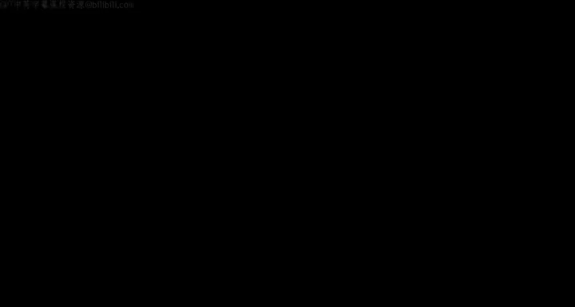
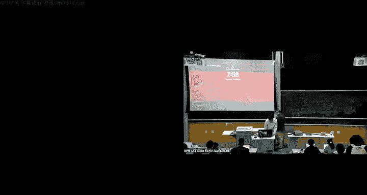
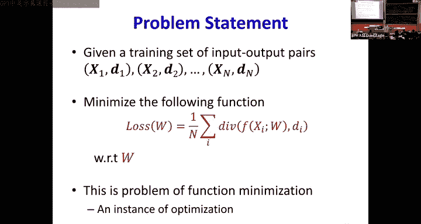
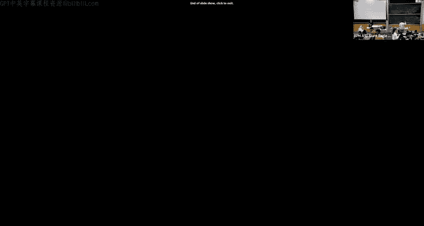

# CMU《深度学习导论｜CMU 11785 introduction to deep learning Fall 2024》中英字幕（deepseek - P4：[4]Fall 2024 Lecture 3.zh_en - GPT中英字幕课程资源 - BV1CfsReEEw8

也这明。系有。我以。Thank you。Okay， folks， you at the back。 Please shut your laptops， hello。Shut your laptops。

All of you。就是。That's that it's what about the rest of them。Okay， folks， so。Let's begin。It's weight，2。

1，3， and 2，1，4。I think the first one is 2，1，3 and 214。佢谢啊。Okay。Yes。If I'm critic。This is right。

 Double check。Okay。All right， let's begin。so话。In the next series of lectures。

 we will look at the problem of how to train a neural network。

Today's lecture will be describing the problem of learning， I will talk about the perceptron rule。

 I will briefly mention greedy solutions but I won't actually go over them and class they are on the slides and they will turn up on the quiz。

😊，And we're going to begin the discuss we' introduce the notion of empirical risk minimization to train neural networks。

So here's where we are。And the past couple of classes。Great， those are only two poles。

 what's the third？Okay， so we have three poles today anyway， in the past couple of classes。

 we've introduced what neural networks are。They are these layered compositions。

 networked compositions of really simple units， which together somehow managed to do a whole lot。

So we saw that these networks are actually they can model they can model any Boolean function。

 which means that if you give me a Boolean function， I can design a network for it。

They can model any classification boundary to arbitrary precision。

 meaning that if you give me a classification boundary。

 I can in theory construct a neural network that will approximate it with arbitrary precision and so also they can model any continuous value function。

Now， in each case， for the network to be able to perform these operations。

 it must have sufficient architecture， a sufficiently deep network where each of the layers is sufficiently wide and less sufficiently connected。

Now， given all of this。Here's what we found in all of these various AI tasks。

 the neural network is this magical box which takes an input and generates output。😊。

And so the box itself is a function。And of course， once we realize that this box is a function。

Then some questions pop up。 We are speaking of mathematical objects。

 whereas when I'm looking at this AI task， theres a game state going in and a game state coming out。

 these are not mathematical objects。 So how do we convert these into the form that can actually be operated on by functions。

😊，And how do we actually compose a network that computes the appropriate function So we have several questions to answer first is how do we represent the input and the output The input and output must be mathematical objects。

 they must be numbers， they must be vectors， they can't you know a game status。You know。

 we don't know what really a game state is， right， it has to be converted to something mathematically interpretable。

 and then the function， of course。😊，We are going to look at how to。

Specify the input and the output later in the course in the next lecture。Today。

 we are going to focus on the problem of composing the network that performs the。

 the exquisite function。Now， here's how we had defined the network。

 it was a network of very simple units。And the most basic。W。The post。The and。给你测字。Thank you。

So the perceptron we saw was this unit， which。Obtained a bunch of inputs corresponding to corresponding to each input was some weight。

 So it considered the weighted sum of inputs。And compare it to a threshold。

 And if it exceeded the threshold， it fired， that was the most simple version of the pericron。

If you take one step further， you can think of the percept drawn as computing an aine function of the inputs。

 Again， to remind you an aine function is the is the weighted sum of inputs plus a bias。

And then applying some kind of an activation on these I functions。

The simplest activation was just a threshold function on top。

But you could have other kinds of once we decompose the operation of the perceptron in this manner。

Where you first compute an I find value and then put it through an activation。

 then the activation function itself can be anything。So I can also redraw the perceptron， like so。

Instead of having a weighted sum of inputs plus a bias。

 the bias can also be represented as just an additional input that's pegged to one。

And the weight of that input would be the bias。 So very often in my pictures。

 I will not have an explicit bias of this kind。 In this case， you must assume that there is a bias。

 It's just that that one of the inputs has been pe to one and its corresponding weight is the bias。😊。

Now， the activation functions can be anything。 again， as we've said， they can be threshold functions。

 they can be sigmoids。 they can be other kinds of functions。 It doesn't really matter。

 But this is the， I mean， it matters， but not for the purpose of understanding what the perceptronance of this。

 So this is the basic unit。😊，But the function that we are actually computing is a network of such units。

 And we're going to assume that the network is a feed forward network。

 which means that when you process any input。That means that the network is directed。

 And when we process any input。Each new， each neuron or each perceptron in the network sees that input only once。

 There are no loops。 So the information flows from the input Unii directionally all the way to the output。

Now， when we decide that this is what structure must be。

 then the questions that we must answer when we are speaking of designing the network are， you know。

 the architecture itself， how many layers， how wide the layers are and so on。For now。

 since we are speaking of approximating functions， I am going to assume that whatever network we have is has an architecture that's capable of modeling the particular function that we are trying to model。

😊，Now， how that architecture has arrived at is something that we won't get into in today's lecture。

 That's a big heuristic problem。 You're just going to assume that the network has sufficient architecture。

And so， now。Okay。So now here is what the network is。 Its got a layered。

 it's a layered composition of these basic units。😊。

Every one of these units has some weights and a bias。 And so this entire network is， is a structure。

 mathematical structure that takes in some inputs。And finally， computes an output。

And it has parameters， namely the weights and biases of the neurons in the network。

 so you can represent the entire network functionally in this form， F of x semicolon W。

 the semicolon， anything that follows the semicolon in this notation represents a parameter。

 anything that comes before the semicolon represents an input。

 And so this is a parametermetric function， but parameter W。

The entire network is just a parametric function。So when we speak of learning a network。

 something that we will talk about more in in detail today。

 we are really speaking of learning the parameters W because we are assuming that the architecture of the network is given。

😊，And the question is， how do we set these parameters。

 W for the network to do whatever it is you wanted to do。So that's the setupback。 Any questions。

Right， okay。So， let me continue。啊。We've seen in past classes that the multi layerer perceptron can represent anything。

 Guys， if you don't have your name tax， please make one because I need to know who you are， right。So。

What this means is that regardless of the function you give me。

 I can always construct an MLP that computes this function since we are specifically assuming that the architecture that of network is given。

What this means is that we can always。Choose a set of parameters W such that the network computes this function。

But then， so this picture to the right represents a function in this case it's a two dimensional input。

 which the grid， the mesh represents the function， and I can always set the parameters of my network to the left the parameters w so that the network itself computes the function to the right。

😊，Now， how exactly do we construct this？ They have given given us a network。

There's a function that it must compute。How do I set the parameters W of the network so that the network computes exactly this function and not something else。

Now for very simple functions like this one where we have a diamond shaped decision boundary and we want the network to output a one inside and zero outside you can just handcraft the network。

 you can literally just set the parameters of the network to capture the different boundaries or the lot we saw how to do this。

Now， this is fine， but this only works for the most trivial of functions。

When the functions get more complicated， you're not going to be able to hand craft your network parameters so。

How。Do we actually design the network for more generic functions， how do we set up the values？

So this is the situation we have。 We have some function G of x， where x represents input。

We are given a network with appropriate architecture。And the question is。

 how do we derive the parameters W for the network such that the net。

 this network computes the function on the right。Now。Here's how I can visualize it。

The function over here， so the figure to the right is showing a one dimensional illustration where the input is one dimensional。

 but you have to you have to sort of generalize this and think of multidimensional inputs in your mind。

😊，So when I give you a function， G of x。If x is a scalar。

Then Gfx is going to be some curve of the kind。Now。

 the network itself is a parametermetric function with parameters W。

And for any specific setting of D。So this would be my GFX。

The network is going to compute some other function。 This is my F of。X， semicol W。

And so when we are speaking of training the network。We， we the question we are asking ourselves is。

 how do we set these parameters W， such that。The gap between the function that the network computes。

And your target function is minimized， in other words。How do you said the W such that。This area。

It's minimized。If that area goes to 0， then the network is computing a function。

Make sense to everybody， Any questions。Right。Now。In order for me to be able to specify this。

 I need to have a way of quantifying this area。In order to quantify the area。

 I first need to define an error。Which quantifies the gap between what the network currently computes and what you want it to compute。

 So we need to define an error function。Which I've just represented as error right now。

And the shaded area， of course， is going to be the integral of this error over the entire input space。

 So it's going to be the integral of the error。From over x。

 x going from minus infinity to plus infinity。 And our problem is that of determining the w that minimizes this error。

Now。What would be a problem？What could the problem with this very simplistic setup be。Anyone， yeah。

 the error function finding， I can define an error， right， The error has some properties。

 It has to be 0 of the two are the same and positive。 They not。 Yes， Virginia。

 don't know G I don't know what G F X is， right， so。😊，The problem is。For this to work。

 G of X must be specified everywhere。And in practice， we don't know what G F X is。So what do we do。

We're going to sample our function。 instead of knowing G of x everywhere。 We're going to sample it。

 We're going to collect a bunch of xs and that each x。

 we are going to get the corresponding G of x value。 So we have a bunch of input output pairs。😊。

Where you have the X。And the corresponding G of X， you bere basically reading the G X of the mesh here。

 And so all you're left with。There's the set of input output pairs。

 And from the set of input output pairs， you will try to learn the function。

So if you go back to our original picture。This is what we will have。😊。

Instead of having the function G of x everywhere and being able to quantify the shaded area。

All we will have is is a bunch of empirical， an empirical collection of inputs。Xs。

And the corresponding Gs。Which are the value of the function at these x's。

And now your network is going to compute some other value at those inputs。

 And so instead of trying to minimize the entire shaded area。

What we will do is to minimize the total。Lent of these red lines， the error， the average error。

Of the network over the collection of samples that we've got。Now。

 it's very easy to collect set samples。 You're basically page is going to be collecting input output pairs for your。

 for your data， like you know， images and their captions， speech and its transcription。

 So sampling the function is very easy so we can compute this function。😊。

Compute this empirical estimate of the error。And then subsequently。

 we can try to estimate the parameters w that minimizes this empirical error。😊，Now。

 will minimizing the empirical error necessarily also minimize the actual error between the。

Network and the function you want。Yes or no。Yes， yes， will that。It's a fair assumption to make。

It's not a fair assumption to make。 It's an assumption that we make， right。

 if if I consent my W values to just minimize the length of those red lines。

You are hoping that in so doing， it's going to actually minimize the shaded area。

 There is no guarantee that it will do this。Right， so。

We are actually going to be minimizing the empirical error。

 but that's not what we really want to minimize。 We want to minimize the total error。

And so here is what our problem collapsed to。We are given a collection of training samples。

 basically samples of the function geoex。We are computing the empirical error。

 which is the average error between the network and the actual function over this training collection。

And we are going to try to find the function network parameters such that this average error is minimized。

And we hope that if we do this right， that whatever function the network learns the network represents is going to be true everywhere。

 meaning that the network parameters that we have determined to minimize the error between the network output and the true output at these locations。

Of such that the resulting function fits G ofx everywhere。That's just a hope。

 but there's no guarantee。Questions。No， okay。So the story so far。

 learning a neural network is the problem of determining the parameters of the network。😊。

The rates and the biases。That are required for it to model a desired function。

And the network must have sufficient capacity， meaning sufficient width and sufficient depth。

In order for the network to， in order for us to have a chance of actually learning a network that captures this function。

 we are assuming that it has sufficient capacity。 So the problem of learning is simply that of determining its parameters。

 such that as error is minimized。Now。Ideally。You want to optimize the network to represent the desired function everywhere。

But this requires knowing the function everywhere。 So in practice。

 what we do is to draw input output training instances。 So these are what the training instances are。

 These are samples of your function。😊，And we are going to estimate the network parameters to fit the input output relation at these training instances。

 And we hope that when we do this， the resulting network fits the function G of X everywhere。😊。

So do you mind shutting your laptop back there？有。Yes。Thank you。So。Do you have a first spoon。

That's 205 and 206。太门太门。So。Is everybody done？Most of you done。

 What's the answer to the first question？And second。The first statement， is it true， second。

Third and fourth right so since neural networks are universal approators。

 any network of any architecture can approximate any function this is not true we saw this in the last class。

On the other hand， we so what this means is that the network architecture must have sufficient capacity for it to model any given function the network is actually a parametermetric function or the parameters of the weights and biases。

😊，And these parameters must be learned for the network to best approximate the function。

 even if the network doesn't have sufficient capacity。

 if the architecture of the network is insufficient。

 it can nevertheless be learned to approximate the target function as closely as it can given that architecture。

 which is why we are not going to explicitly delve into how to set the architecture。Now。

 the parameters， on the other hand， can obviously not be perfectly learned from just a few samples in principle or。

😊，In reality， you need to know the function everywhere。 We just don't know it。

 And so we're taking a guess from the few samples that we do have。So let's begin with a simple task。

 They're going to try to learn a classifier， which is simpler than learning regressions。😊。

This was amongst the earliest problems addressed using MLPs。

 and so that's what we will consider specifically we're got to consider binary classification。

 but this generalizes to multiclass classification。😊，Now， in binary classification。

 what is the desired output of the network， It's either  zero or one。 You have only two classes。

 classes，0 and 1。So what would the error be。If the output of the network is the correct class。

 there is no M。If the output of the network is an incorrect class， there is an error。So here。

 if your target function is the one shown by the dotted line。Now， the output can only be0 or 1。

 and I'm showing that you one dimension of input。The network functions shown in green。

Is going to come for the wrong value of w will compute incorrect outputs at a certain number of locations。

And so the total error over here is going to be the number of instances on which。

The network has made an error。 So it's going to count the number of orange bars。 It's going to count。

 The error is the number of training instances where the network output did not match the desired output。

When I want to learn the classifier， what I'm really speaking of is learning these Ws。😊。

Such that the count of these errors shown here as a formula is minimized。Now。

Let's start off by the oil， considering the original multi layerer perceptron as defined by rosenbl。

Now， in Rosenblt's original model。The basic unit had a threshold activation So we each perceptron。

 each unit computed an aine function of inputs and compared it to a。To0 compared theine value to0。

 if it was positive， it was greater than 0， the output was born。😊，If it was less， the output was 0。

And our problem now is to train this network of such basic units。Using just some training data。

 collections of inputs and outputs。Now， the simplest multi layerer perceptron over here。

 So this was what rosen blots。😊，Model looked like each of the units within the model was just this basic threshold。

Treshold unit。Now， what is the simplest such model。

 The simplest such model is just a single perceptron。 instead of a network of such perceptrons。

 I can just have one perceptron。 So if I have just one single perceptron。

They we know how it operates。A single perceptron compares the weighted sum of inputs to a threshold。

If the input is greater than the threshold， the output is 1， otherwise it's 0。So， the boundary。

Between where the output is 1 and the output is 0 is where the weighted sum of inputs is exactly equal to the threshold。

 So what does that look like， What is the boundary over here。Anyone？The boundary is a hyperplane。

 The function is a heavy side function， right， So you're basically the speaking of the unit looks like so。

要 see。Samation W I。X I， greater than threshold。 This is your question。

And if it is greater the output is 1， otherwise the output is 0 and the crossover happens where the crossover happens where summation w I X I exactly equals t。

😊，So this is the equation for a hyperplane。 And that's why the function looks like a heavy side function。

 There's a hyperplane， all inputs on one side of the hyperplane。😊，Are0。

And all inputs on the all result in an output that0 zero for all inputs on the other side of the hyperplane。

 the output is one， right。😊，Now， this is the function that we would like to learn。

 if I'm just learning the simplest。Plsify a network of just one unit。

Except that we wouldn't be given the entire。 So when I'm speaking of learning this function。

 I'm sorry what I'm really speaking of is learning the weights。And the threshold。

 except you' are not really really going to be given the entire function。

All you would be given is a bunch of training samples of the kind。 some。

 some collections of in collection of inputs where for some inputs， the output is 0。😊。

And for other inputs， the output is one。 So you just be given those colored dots。

 the red and blue dots。 And from that， you have to learn。The entire heavy side function。

So this is the problem we have。We are given a bunch of training samples。I going over there。

And from this training sample， we have to learn the heavy side function。

 But what does this actually mean， we want to learn the hyperplane。

That separates the positives from the negatives。 So in other words， we want to learn。

The equation for this boundary。Such that this boundary separates the positives from the negatives。

 So and the equation from the for the boundaries entirely specified by the。Weights and the threshold。

 right？And。Let's see how we can solve this， but before we do this。The you know。

 what kind of a function is this when I actually learn this boundary over here。

This has the structure。The boundary submission。Ii， W I X I。Plus b equals 0， where b is minus t。

 right What kind of a function is that？M。That's an ae function。 It will be a hyperplane。

 but will the hyperplane go through origin。Okay， so I would like to convert this to a linear function。

 What's a linear function。どすはどするとあるか。Now， in order to sort of understand how these things work to simplify you our interpretations。

 it's always much more convenient to work with linear functions。So， this was your。Aine function。

So here's what I can do。I can augment the input by a single value of one。Now， the corresponding。

Weight of that input peg to 1。Becomes the bias。 And now。

 if I think of the augmented input as the new input， the function suddenly became。Linear， right。

 How did I convert something that was an AI into a linear function。What magic happened？佢系呢。哎。

So what time am waiting。Can you somebody said something on Zoom， What was that？

So here's what happens。This is x1， this is x2。And then I added an x3 whose value was and always one。

Right， so that means now I'm working entirely。Within this plane， where the x3 value is 1。

And in this plane。My boundary doesn't go through the origin。Because on that plane。

 it's really a sappine right， But then when I look at augmented input。

 I can draw a hyperplane which goes through through the origin which slices this plane at the boundary。

😊，And so although the intersection of my hyperplane and the， you know， x 3 equals plane。

 one plane is a line。That doesn't go through origin。

The actual decision boundary that I that I came up with in this augmented space actually goes through origin。

That makes sense to everybody， right， And so that's how I convert something that's a fine to linear。

 And now I can work with linear stuff。😊，Now。Questions。Can you explain that Okay， so。

Let's look at this one here， right。And two dimensions。This line doesn't go through origin。

And I have some pluses here。Maybe and some minuses here。Now， this is a two dimensional input。

 x1 and x2。Suppose I add an x3 equals1。As my input。So， then。Now this is x1， this is x2。This is x 3。

 and x 3 is always respect to1。Right， so that means。

All of my data lie on this plane where x3 equals1。And on this plane， Iha classes。And minuses。

 that's basically just taking this entire plane and lifting it to x equals 1， right。

 So that decision boundary is going to be something like this。😊，That doesn't go through origin。

But I can draw any line over here and draw a plane through that line that does go through the origin over here。

And so by adding this x3 component whose value was one and lifting the plane off the， you know。

 lifting the plane up， I put myself in a situation where I could actually draw a new plane that went through origin。

 I converted the problem to linear。😊，And so now I can work with linear functions， right。Now。

Here's the thing。So I'm going to speak of linear functions。Andm speaking we。

 we want to find a function， a set of weights， W I。3。So we want to set find a set of weight W。

Such that summation WI X equals 0 represents the equation for a hyperplane that cleanly separates the positives from the negatives。

Now， I can write it somewhat differently。I can write all of， when I say。Samation。W X I。

this is the same as。This is showing it an explicit scalar form。

 but then I can write all the w I in a vector in vector form。😊，Which is W1。W to W D。

I can write all the x's also in vector form， x1 through X D。So if I write it like this。

 what is the summation term？我干嘅。It's the inner product between W and x。 right。

 So this is simply going to be。This term。As w transpose x。If I equate to 0。

 the boundary is w transpose x equals 0。对二。有的我出备咗不个我跟你语一个。We will get to this， right。

 I can write things in this manner。 W transpose x equals 0。That's my boundary。Now。

 when I tell you w transfer is x equals 0， what's the relationship between W and x。

If the inner product between two vectors is0， what is the relationship between the chip？😊。

They're orthogonal， correct。 So now we have this。If this is the boundary。Then。020。This。For any W。

This is my W。This represents the set of all X'es。That are。How are they are related to W。

Atgonal to x W。 So this is going to be this。Hyperplane of going through the origin of all vectors that are orthogonal to doubling。

Make sense。Right， now， if I have a vector on。This side of the plane， the same side as Doubling。

I have some vector here。What will the sign of W transpose x be？Anyone。我。

What is the inner product of two vectors。比合。How much then same direction It's going to be the length of the first vector times the length of the second vector times cost theta。

 right， What is theta over here。 Is it greater than 90 degrees or less than 90 degrees over here。

Over here， what is theta？So what will w minus plus x be positive right。

 if I have some x on this side let me call the say x prime on this side。In this case。

 what will w transpose x be？嗯。Guys。N because theta is greater than 90 degrees， right。

 So I can simply run a test。 If w transpose x is greater than 0 that represents this portion of the space。

 that's class 1。😊，FW transpose x is negative。That's class， right？It makes sense to everybody。

That's the first concept， and so I can just write it like so。😊。

W transpose x equals0 is the hyperplane。Comprising all x's orthogonal to W。

And everything that's in the same direction as W。Is going to result in a positive inner product。

 Everything that's on the other side of W is going to result in a negative inner product。😊。

Everybody with me， right， So now also， let's also look at one more。Question before we proceed。So。

Let's say I have a positive instance of x。So， I have some input。And I have some X。

I can draw various decision boundaries that keep X on the positive side， right this would be a。

A decision boundary that。Keeps x in the positive sense， so this is my X。

This could be another decision boundary that keeps X on the positive side。

 There are a whole lot of decision boundaries。That keeps x on the positive side。

 which decision boundary keeps x the farthest from it。Which one does。Somebody said。

 could you repeat that？好，各位。So of all of the various decision boundaries that I can draw。😊。

The one that is at 90 degrees to it。It is going to be the farthest from it， right。

 because for anything else， this distance is going to be smaller。Right。

 that makes sense to everybody。So in other words， for any given x。

 what is the optimal weight vector if。X is a positive instance。anybodybody。嗯。Come on， guys。

 you just answered me already。part of me。The blue dot product with x equals to 0。

 We wanted to be positive， right， So here's。If I have any given X。If I have any X。

The optimal decision boundary is。At 90 degrees to it， correct。So what is the weight reactor。好没。

Come on。 W up， guys。Wy case， what's the weight vector。What is the way？

Con the orthogonal like to the orthogonal is this， if this were the way to vector。

 then what would the decision boundary be。If this were the wake vector。

 what would the decision boundary be。This one， right， is that a good one？No， right。

 You agree with me。So if you want the decision boundary to be as far away from x as possible。

 you want it to be orthogonal to x。What is the weight vector that results in that boundary X， right。

 for any positive instance， the best possible weight vector。For the decision boundary is going to be。

X， can you say it aloud X。Okay， thank you。 If I， if x belongs to the negative class。

 what is the best way to factor。😊，Can we say that a lot？Guys， can you say minus x， Thank you， right。

 so。Basic idea。 If I have a positive instance。X， meaning。If I have an X。And this x belongs to the。

Positive plus。Then I want the weight vector also to be the same as x。

 because then that gives me this decision boundary。Right， on the other hand， if I have。

A negative instance， so。Over here。Again， I had x。But x belongs to the negative class。 This is x。

Then I want the weight vector to point exactly opposite to x that will still give me this decision boundary and keeps x as far away from x from the boundary as possible。

 But now the inner product is going to be。😊，Megative， right。C clear to everybody。

This is the basic principle that the Perceptron learning rule is built on。So here's how it goes。

 right。Im given just this collection of dots and I want to find the find the decision boundary that cleanly separates the red and the blue dots and I'm going to assume that the red and the blue dots can be separated by a hyperplane in other words they are linearly separable right。

😊，So I want to find the W。Such that W transpose X is positive for all the red dots and negative for all the blue dots。

There is a close form solution to it， but the popular solution originally originally proposed by Rosenblt is an online algorithm。

 which is the famous percetron algorithm。😊，you initialized W any odd how？

And then keep incrementally correcting it until classification errors are minimized。😊，Also。

 we know that。For any positive instance， x。The optimal weight vector is a X itself。

 with maybe some scaling。 for any negative instance， the optimal vector is。-6。So。

You start off with some W， you begin classifying all of your training samples。

If you encounter a positive instance， that is misclassified。

Then you drag the weight vector towards the optimal weight vector for that positive instance。

 You drag it towards x。 and you do this by simply adding x to w。😊。

If you get any negative instance that's misclassified。

 then you drag the weight vector towards the optimal weight vector for that x。😊。

Which is to say you drag it towards minus x。 You subtract x from W。

Make sense right and so here is how the heres the perceptron learning algorithm。

 you are given some collection of training samples。😊，I'm using a plus1 and -1 representation for。

For arithmetic notation， but the pictorial illustration should be clear enough。You initialize W。

 and then you cycle through the training instances。 skip the arithmetic。 Here's what it looks like。

 I'd have a collection of positive and negative instances。😊。

I initialize my W that gives me some decision boundary。

 I begin checking all of my training instances。And eventually。

 I'm going to find a misclassified training instance for this for this misclassified training instance。

 what is the optimal weight vector。😊，For just this guy。That's going to be that way， right？

 And so I'm just going to add that to the current rate vector。

 And that gives me a new weight vector and a new decision boundary。Right。

 now I check all of my training instances again。And now maybe I find a positive instance that's mis。

 It's on the wrong side of the boundary。What is the optimal weight factor for this positive instance。

It's going to be that vector itself。So I just add it to the weight vector。 I get a new vector。

 I get a boundary in voila。 I have a perfect decision boundary。 So long as the。😊。

Data can be separated。Bioline boundary。This algorithm is guaranteed to converge in a finite number of steps。

It will not cycle。So the classes are linearly separable。

 it's guaranteed to converge in a finite number of steps there's a very nice little proof have well have the proof Apa as extra reading on the website if you are interested。

😊，But here's the situation。If the classes are not linearly seable well， for example。

 if I have a red dot on the blue side or a blue dot on the red side。😊，Will this ever convert。

Yes or no。 Why not。There's always going to be an instance that's misclassified。

 you're going to be chasing back tail all the time。Right so this will not converge。

 the perceptron algorithm will not converge。 And so here this is what we have when we have a very simple problem of just one perceptron。

😊，Now， even if I assume that the data are linearly separable， if the data are linearly separable。

 I know I can find a boundary， but I have to search a bit。Now， let's go to something more complex。

Like this double Pentagon problem in the double Pentagon problem。

 I know that with that architecture to the left， I can construct。

A network that exactly classifies this double Pentagon boundary。

 We've seen this in ppa classes and the way it would do it is that， you know。

 each of these perceptrons。😊，And the lower layer is going to capture one of the boundaries of one of the Pentagons。

 The next layer， you know， one perceptron is going to capture one Pentagon。

 the other is going to capture the second one。 And then you add the two。

 And so you get the desired decision boundary。Except that when you're trying to train this， you。

 want youll just be given these dots， right， You're just going to be given these dots。

 You have to learn the boundary。Now， can I apply。The perceptron rule that we just saw to learn these boundaries。

To make this more obvious， let's just assume that some are， you know。

 I just got this collection of red and blue dots。And then some oracle came along and told me what the remaining 9。

Perceptron the weights the weights for the remaining 9。9 perceptrons in that layer are。

So I'm only left with a problem of learning the weights for the 10th perceptron。

 which I've shown en circled。😊，Can I。And the training data I have， of course， are these， right。

 the red and the blue dots。Can I learn that perceptron from this data， Everything else is given。

 The entire network is given。But whoever the oracle just failed to give me one perceptra。

Can I learn the perceptionceptron from this data。Yes or no。 can I。Who says yes， raise your hand。

Who says no and why are you guys undecided？You had the back。 Yes or no。Here at the back。

Do you think it can become determined from just this data？Yes了。No， okay， why not？

What was the requirement for us to be able to learn a perceptron。

 The data had to be linearly separable。 Are the classes linearly separable over here。You know。

 the weights of all of the other percepts。Do those specific boundaries。

 and then it can become a linear。 Is it， How do you， How do you know， right。

 You can make grow all the other boundaries。But if you want to learn this thing。

 what would you have to do？Have we cut on of that dimension， pardon me？

I read know that I mention that still doesn't help， does that make this classes linearly separable？

Yeah， what would you do How would you do that？YouI'm giving you a very simple example， right？😊。

Anyone make it a order function。 So yes， you can introduce some nonlinear linear to。

 This is what my network is， right， This is very trivial。 So here is what I would need to do。

 If I want to learn this perceptron， I'm going to have to relabel some of those blues。😊。

So that the two classes now become。Linearly separable。

 And then and only then can I learn the positron。There's no other way for me to learn the perceptioncept plan。

Which instances do I re label。how do you know。Remember that if you mislabel one instance。

 the entire network is off。How would you know right。

 so here's a poll and then we'll get back to that questionz。How is this。对。3ty seconds。请审到长清楚经。对。Okay。

 guys done？What is the answer to the first question？Okay。

 the first statement and the second question。Is it true or false？ And the second one， right， so。

Given the data shown on slide， well that's not 6068。

 and given it all but what the one neuron highlighted in yellow are already correctly learned。

 you cannot learn the perceptron， you cannot use the perceptron learning algorithm to learn the one remaining perceptron。

 it is not possible。😊，And the reason is， perceptron learning requires linearly separable classes。

 but the data are not linearly separable。😊，And so if you really want to learn the perceptron rule。

 you are going here's what youre going to have to do。

 youre going to have have to begin relabelling some of the instances。😊。

And then learn the boundary and the correct solution for you is that you don't know which label to instances to re label。

 So youre going to have to check you know that there is a perfect that perfect classification is possible。

So you relabel the data instances in every possible way。

And try to learn a decision boundary until you find a relaying that gives you a decision boundary that gives you the perfect classification for the entire training data。

That makes sense。Right， so。啊。The individual classifier， so this labeling will not work。😊。

The individual classifier will need this kind of labeling， which is not given。😊，And so。

We actually have to figure out how to relabel the data in order to learn this classifier。

And this business of figuring out how to relabel the data。

Is combinatorial if I have n training points， I need to look at every in every one of the two to n minus one possible ways of relabeling the data。

Because some blues may have to be reed relabeled to red， some reds may have to be relabeled to blue。

 and then you learn the boundary and then you check on the entire training data。

 whether the final classification output is correct or not。And that's a combinatorial problem。

 And so。For a single line， we have to try out every possible way of re labelbeling the blue dots。😊。

Such that we can learn a line that keeps all the red dots on one side。And。

That's when I've given you the entire network。If I start off， you know， W Raap， no neuron is known。

 I've given you the correct architecture。Here's what you would have to do。

 You would have to look at every possible way of re labelbeling the data for every one of the neurons in your network。

 such that when you learn the boundaries for each of the neurons。

 the resulting output of the network is perfect。😊，And this is a combinatorial search。

 you' are not going to do it in any reasonable amount of time。Its。Not going to work。And so。

For even this very simple double Pentagon problem。We must know the desired output of every neuron for every trading instance。

 Basically， how to label them。And we have to do this as that when you combine them all。

 the overall decision boundary the double Pentagon。This is a combinatorial optimization problem。

 And if you lose， if you make a mistake on one just one training instance。When you relabel。

 your entire classifier is going to be junk。And so。This is the problem。

 training this network using the perceptron rule is a combinatorial optimization problem。😊。

We don't know the outputs of the individual neurons for every one of the training instances。

We need to relabel them and search through the space。

 so we must also determine the correct output for each neuron in every training instance。

 which is at least exponential in the size of the inputs。😊，And so this is not a feasible solution。

And so this actually sort of froze research into multi layerer perceptrons for a very long time。

 People realize that， you know， the early the original perceptron and M LP。😊。

We are based on the simple linear classifiers and the threshold activation。

And very soon people realize that the problem of learning an individual perceptron may be tractable。

 but if you want to learn an entire network， you run into this combinatorial optimization problem that cannot be solved。

 And so a variety of greedy solutions were proposed like Adeline and Madeleline and a bunch of others。

 Bernie Wirrow。Who's still a prof in Stanford。And who once to a couple of my students。 But anyway。

 I haven't forgiven him now。These were what persisted for almost three decades。Before。

Paul Weboose is it？In MIT， he figured out that there was an alternate way。

 but it was in the early 70s， and there was another gap of 15 years before Jeff H。

Saw the value in verbos's thesis。From 15 years ago。So what is the solution。For that first。

 here's the story so far。😊，Learning a network is the problem of learning weights and biases to computer target function。

 assuming the network has sufficient capacity。In practice。

 we learn networks by fitting them to match the input output relationship of training instances。😊。

Drawn from the target function。A linear decision boundary can be learned by a single perceptron。

In linear time， really。If the classes are linearly separable for non linear decision boundaries。

 we need networks of perceptrons， but training and MLP with threshold function activation will require the knowledge。

Require knowledge of the input output relationship for every training instance。

 for every perceptron in the network。😊，And these must be determined as part of the training。

And for threshold activations， this is an MP problem。 It has MP complexity。

So the realization that training an entire MLP was a combinatorial optimization problem stalled the development of neural networks for well over a decade。

😊，Until we had this little insight。And what is that？Here's the problem。

What we are really trying to count is the error。 How frequently is the network correct。

 How frequently is it drawn。 Do you have a bunch of training inputs。

And the output must be either 0 or one for these training inputs。Then at each of these inputs。

 you can compute the output of the network。And the output of the network may be either right or wrong。

 and we are counting the number of misclassifications it makes and then going to set the parameters。

😊，But now， let's say。I have this training data， X1 through x 5。

And the dotted line is obviously the correct decision boundary。😊。

Let's say I have chosen built my network so that it learns。The green。

 it represents the green function。So the green function is going from 0 to1 at some point。

It's making two errors。 Now， if I move this threshold where it moves from 0 to 1， left by a little。

Will the number of errors change。If I move it right by just a little。

 will the number of errors change。I have to move it a whole lot。

 it has to cross a training point if I move it just per up it just a little bit。

 the number of errors will not change。Right， and that is the actual problem。 So same thing over here。

If I'm trying to learn a perceptron of this kind in multidimensional space。

I'm may start off with an initial boundary。And。It is going to misclassify some instances if I rotate the boundary a little bit。

The total number of errors will not change till the boundary actually crosses and is classified。

Training point。So little vigs of my bar parameters will not result in any change of the error。

And that's why we really can't optimize things using incremental steps。

There is no indication of whether I should rotate the weight in this direction or this direction because a little bit of rotation this way or this way doesn't really change there。

😊，And when you go to more complex problems like this。😊，It gets even more complex， complicated。

 you can change the parameters of the individual neurons quite a lot。😊。

Without changing the overall error。 And so you won't even know if the changes that you're making are going in the correct direction or not。

So this makes it really challenging。 In other words， if we were using threshold activations。

 the MLP is a function which has zero derivative almost everywhere because I can change the parameters a whole lot and the error doesn't change。

😊，And then whenever the T the boundary crossed as a misclassified point。The error changes a lot。

 And so you have a small number of points where the derivative is infinity。

And are points where the derivative is0。 So this is basically a very ugly function to work with with no derivatives where it is interesting。

So given this， how would we change the problem。Here's what we are going to do。

We're going to change our way of computing the mismatch such that modifying the classifier slightly。

Lets us know if you're going in the right direction or not。So here again。

If I move the green threshold left or right， it doesn't tell me。If my errors are decreasing。

 so I could move that green threshold a whole lot to the left。And the error would not change。

 So it doesn't tell me that this is the wrong direction to be going。

 And I I could keep going that way， right， So we're going to change two things。

 We're going to change the activation function。 And so being a threshold， we're going to make it。

Very smokingy。And we are going to change。The manner in which we count error。

So here are the two things we do we are not going to use a threshold activation anymore。

 we are going to use an activation function that varies smoothly which could be a sigmoid typically if youre performing classification。

 but inside the network you could have other kinds of activations。😊。

And the neuron is going to be differentiable with non zero derivatives over much of the input space。

😊，Now， having a non zero derivative means that you know how much a small perturbation of the input will perturb the output。

And this enables us to or you will know how a small perturbation of a weight will perturb the output。

 and this enables us to estimate the parameters using gradient descent。😊。

And the other thing we're going to do is to change the manner in which you count the error。

 So to go back to our illustration。Over here， these were my training data。

The red and blue dots sum had training data。 and if the current network was this dotted line over here。

A threshold T 1， if I move the threshold all the way back to T2。

The total error is not going to change。 So this doesn't tell me that moving from moving the threshold from T1 to T2 is a good thing to do。

Instead， we are going to change the activation function to something of this kind。

It's not a threshold anymore。 It's in this case， it's a sigmoid， which goes smoothly from 0 to 1。

Number one。And here you can classify the output as a 1 whenever the function is about 0。

5 and 0 when it's below 0。5。 So you're still performing classification。😊。

The second thing we are going to do is that instead of simply counting the number of misclassifications。

 we are going to。Replace that by the distance。From between the target output and the actual function。

 So instead of simply counting misclassification errors。

 we are going to take the total length of the dotted lines， which is the different， which is the。

Distance width agree between the target output and the actual function。And when I do this。

 then you can see。That if I slide this function leftward like so。Then， the total。

The total length of the dotted lights actually decreases。

And so this gives me an indication that moving left is a good thing to do。

But observe that this is not really the problem that we are trying to solve。

What is the problem you're actually trying to solve？Number of mis class。

 We want to minimize the number of misclasss。 This is a。Proxy。

Will minimizing this proxy necessarily also minimize。The number of errors。嗯。Not necessary。

 can you give me an example of how that would have？Or not， yes。If you move to the left。

 there are certain points of the glue， which will like bare length p trees from the。K为就不喜欢音乐了。

So I'm not sure if this is what you mean， but consider this example， right？Here。

 when I begin misclassifying counting the。Total distance。So， let's say， I have。This is my data。

 and I have my。Class  zero is out here。And class ones out here。

And let's say I have a whole bunch of these， a million of these guys or a billion of these guys out here。

Right， each of them is going to have a very minuscule distance from the curve。But cumulatively。

 the distance is going to be a lot。So these guys over here。

 just in order to minimize the distance between these points and the curve。

 So if I plot my curve like so。The curve never really goes to one。There's always a small distance。

 And if I have a very large number of positives out here。

 these things will want the curve to be closer to one。

 And how do they make the curve curve closer to one。😊，They're going to push the curveve。Out this way。

Which will end up in misclassification of a。Of the blue dots， That makes sense。

So you are very sensitive， so we are working with proxies。

And proxies optimizing this proxy is no guarantee that the actual。

F that you're trying to solve will be solved。Nevertheless。

 we are going to have to work with proxies because working with the actual function results in a combinatorial problem that cannot be solved。

😊，对。That。Make sense to everybody questions。没有。It doesn't matter so long as you know the distance is not the moment the distance becomes 0。

 you have a zero derivative。Which kills you。 if you have a nonze derivative。

 you will always have this issue。Okay， there's a point。对。I will give you。2 minutes for the spoil。

 because there are many options，90 seconds。空。Okay， time's up， guys。

 but I can give you another of 10 seconds。后嚟。Anybody want to answer this said Guinea？

The first statement of the first question is a stroke。What about the second one。Third， fourth。

There was no fourth， okay。How can you say yes， okay。

 in the second question is the first statement true。😊，Second one， and the third。Okay。

So for the second one， in all， the crossover point was 05 until the 05 point actually crosses。

A misclassified point。 The actual count of errors will not change。But what will change is your proxy。

Which is the total distance。 So that actually remains true right And so here's what we have increasing or decreasing a threshold will not change the overall classification error unless the threshold moves past from as classified point。

😊，And you cannot know if a change moves it in the correct direction that will result in。

Eventually results in overall decrease at the n。😊，And so there's no derivative。

 the derivative is either0 or infinite de， the derivatives don't give you any information。

Whereas if I use sigmoid activation， firstly。Misclassifications， I mean。

 the actual count of errors will only change when the 05 point。Goes past a mis classified instance。

Nevertheless， the total distance or the value of the function from its target value will change as you move the function left and right。

 And this gives you a nonze derivative。 If I look at this total distance。

 this has a non zero derivative with respect to perturbation of the parameters。 that helps us。😊。

Figure out how to change things。So the two key requirements for learnability are， firstly。

 the activation must be continuously vary。 It must be differentiable。 and secondly。😊。

The error function must also be continuously varying。

 A small change in your activation and the function must result result in a measurable change in the。

😊，Error， otherwise， you can't really know which way to go。It makes sense to everybody yeah。Okay。

So let's look at continuous weighting activations。You have obviously。

 you can't be using a threshold activation。 It has zero derivative or infinite derivative。

 So we need one of the other kinds。 We like using sigoids。

 We want activations that are differentiable。😊，That are continuous。

And differentiable almost everywhere。 I say almost everywhere because this function。

 the red curve is not differentiable at。X equals 0。Nonetheless。

 it has something called a sub derivative， which， which gives me some kind of a bound on the derivative。

W which we will see in the next class。And so you still get some notion of which way to per up the parameters。

And so you want activations to be differentiable everywhere。

 And one specific activations that's particularly interesting is the sigmoid。

 The sigmoid is one over one plus eraase to minus Z。😊，Now， if Z is a very large， negative number。

 if z is minus infinity， what does this become。E raised 2 minus z E raised 2 infinity。

 which is infinite1 over infinity is 0。 So this becomes 04 when z is a large negative number when z is a large positive number。

😊，E raised to minus infinity is 0。 So it's 1 over1。 This becomes 1， right。

 And so this function is 04。😊，Very large negative inputs。 It's one for very large positive inputs。

 And in between it very smoothly， it gives you the sigmoid。😊，And the sigmoid。

 so has a very nice interpretation。 Where did I keep my， Where did I keep my chalk here。😊。

So just to go over that。If I say。Just to write it down。If I have one over。

1 plus e raiseds to minus z。For z equals minus infinity， that's way out to the far end。

 this is one over one plus e raised to minus of。Minus infinity， which is。

1 over one plus era raised to infinity， which is what？1 over infinity， which is 0， right？

And if Z goes to。Plus， infinity。This is one over one plus era raiseds to minus infinity。

 which is1 over。1 plus0， which is one。So， and in between， the three east continuously。Now。

 this has a very nice interpretation the how the interpretation is arrived at is on the slide。

 so please take a look。😊，Which it can be interpreted as the a posterior probability。

That the class value takes class takes the value1。Given the input。

We will revisit this topic in a lecture several weeks from now， but if you want a quick sneak peek。

 take a look at the slides。And so we'll return to the fact that perceptrons。

With sigmoid activations actually model class model class probabilities in the later lecture。

 but for now moving on。😊，Here's what we have。The perceron activation is differentiable。

The error that we computed is also differentiable。 What does it mean for something to be differentiable When I say something is differentiable。

 here's what we are speaking of。 We are saying that。If I see。You know， why。If y is a function of X。

Then I'm saying that Dy over dx is defined， it has a value that I can know。And it can take a value 0。

 but we we， but we would， we don't like 0。So when we speak of differentiable， we are。

 we are speaking of functions that。Not only have measurable d over dx in our context that this dy over dx a is a non0 value that is in our context right so lets say this is some value C。

Some value whatever。 Let me call this a， which means that it tells me。

How much a small perturbation of x will result in a， you know change Y。 You know。

 I get this d y equals a times d X。So。For a function to when a function is differentiable。

 it tells me how much a small perturbation of any input to the function。Will per of the output。Now。

 in this case， our inputs are a weighted combination of know x's and ws。

 So this means that if the activation is differentiable。

 it will tell me how much a small perturbation of the weight。😊。

Of the incoming weight will result in a change in the output of the function， right， exactly。

 And so this means that if It I have a perceptron of this kind。If sigma is differentiable。

 then I'll get some idea of how changing this W a little bit。Will' change why。And subsequently。

 when I have， know I have the chain rule over here， we'll get back into it， you know。

 go into it in a little more detail later。 But what this means is that。

Because the function is differentiable， I am able to quantify how much a perturbation of w will perturb y。

😊，Which means in this network， I will be able to quantify how much a small perturbation of this W。

Is going to per up the output of this guy。I'm also going to be able to quantify how much a small perturbation of this guy will perturb this output。

😊，And how much a small quant perturbation of this ga per this output。

And because the subsequent activation is also。😊，Differentiable。

 I will be able to tell you how much small perturbations of these guys。Are going to change volume。

And so if I change them all together， I can tell you how much a small perturbation of this 1 w is going to change the y at the very end of the network。

😊，And so I will be able to tell you that increasing this w a little bit will increase y。😊。

Or decreasing it will increase why this information is something that I can compute。

And that's not just one weight。 That means the entire function is differentiable。I can compute。

 I can tell you exactly how changing any individual parameter of the network is going to change the output。

So f of x semico w is now differentiable with every respect to every element of w。

And exactly how these derivatives are obtained， we will see later。😊。

The second one is the continuously varying error function。This must also be differentiable。 Why so。

 right。Because。You want to have the error between y。

 and it's not enough to say that perturbing this W perturbs y。

I also we need to be able to compute how much perturbing this w perturbs the error。

And so you want the error to be differentiable。Now， given all of these。

 this is how we' are going to define our error function。

 We define define it in in terms of a divergence function。

 Our divergence function has these properties。It takes two inputs。 in this case。

 F and G and the divergence will be 0 only when f equals G。When f doesn't equal G。

 then the divergence is going to be positive。Regardless of whether x is greater than g or less than G。

 if the two are not the same， the divergence will always be positive。 And finally， of course。

 we are going to define our divergence function so that it's differentiable with respect to F。

So that we can chain things together to compute how much changing an individual parameter changes the overall divergence。

This Davidence corn here。Theres a question from Zoom can and we primarily let me make a good choice validation or some status properly。

So take a look at lecture two for what is a good activation function we'll deal with this later in the cluster。

 right？😊，Now。So the divergence function quantifies the mismatch between the network output and the target output。

And for classifications， this is typically not the error but a proxy。

Right so how does this look when your function F， your network has the capacity to represent x。

 this error is now a divergence function and the shaded area is simply going to be the integral of the divergence function but then we make one more small change。

And the changes。You don't need to minimize the shaded area everywhere。

Let's say you know a priorityi that x can never take extreme values。

Then do you really need to consider。The error in those regions。You don't， right。

 you only need to consider the error。At the x values that are actually likely to happen。

 or more generally， what we want to do is to weight the divergence at any x with the probability of that x。

 So the more probable a specific x is， the more probable。

 more frequent a particular input happens frequently a particular input happens。

 the more importance you want to give the divergence at that input。😊。

And so the actual objective that we will try to minimize is this guy。

 which is the integral over the input of the product of the divergence between the。😊。

Output of the network and the desired output of the network are that x。😊。

Multiplied by the probability of the x itself integrated over all of x。

 This is the expected value of the divergence for those of your Honoia statistics。

 This is the statistical average of the divergence of the entire input space。

 And so what we really want to do is to minimize the W to optimize the W。😊，To minimize this。

 expected。Divergence。But then once again， we have the issue that we don't really know G。

 We only know we， were only able to collect some samples of G， some input output pairs。And so。

Rather than。Minimizing the expected value of the divergence over the entire input space。

We will compute we are going to minimize the average。Diveence over all of your training samples。

 But then something magical happens when you collect training samples。😊。

When you collect training samples from a natural process in a natural manner。

Then you're naturally going to get more samples from more more probable。

Regions of the space and fewer samples from less probable regions of the space。

 And so this empirical estimate。ForFor the expected divergence。Naturally gives more importance。

To more frequent access and less importance， to less frequent access。And so this is what we will be。

 we will actually be minimizing。 This is what we call our loss。Our loss is the empirical estimate。

Of the expected divergence between the output of the network and the desired output of the network。

 is's our empirical risk。For a given collection of inputs X。X is given。

 So the only thing that can be changed is w。And so this loss function is actually going to be a function of W。

😊，And we will be finding the W that minimizes this loss。So this becomes a problem of。Function again。

 the empirical risk is only an empirical approximation to the true risk。

Which is the expected divergence。 Keep that in mind， right。And so this becomes。

 this is the overall problem statement we end up with。 You're given a collection of。

Input output training pairs。 and you computed the compute the average divergence。

the entire training set， which is your loss。And you minimize this with respect W。

 This is a problem of function minimization。 We will go over this in the next class。 I'm behind。

 So the summaries on the last slide， please go over it。 Thank you。 I'll see you in the next class。

Itかさい。か。いきまはい。慢慢分。そ。系个。我。It all。

