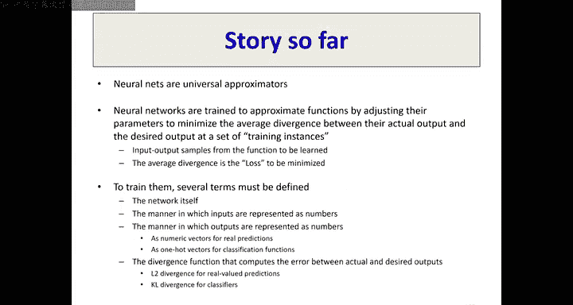
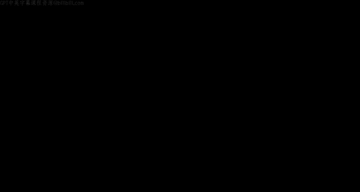

# CMU《深度学习导论｜CMU 11785 introduction to deep learning Fall 2024》中英字幕（deepseek - P5：[5]Fall 2024 lecture 4.zh_en - GPT中英字幕课程资源 - BV1CfsReEEw8

我冇继绍啦。Okay。Do you do your microphone。O。check check。One， two， check， check。他就是。Of course that we。

过之前在跟你。

Okay。Good morningning， everybody。And with the usual story。Tend off your laptops here。は。Okay， folks。

 the usual story， shut down on your laptops， your phones。

 the lot once you're done with the attendance。It's a very sparse crowd repeats。

There was an announcement that today was a class。 So we should have had most of you in class today。

 I mean， Fridays are mandatory。 They're not optional。

So that's a bit disappointing that most of you are not here。Regardless。

 we're going to have this lecture。And the materials of this lecture will turn up in the quiz。

 which means that if those who are not here are going to have to watch the video。And you get him。

 you know。That didnmark yes。Pard of me。It's not doesn't matter。 It's a Friday， right， okay。That's so。

All right， here's where we were。We've seen so far that the problem of training a neural network is one of empirical risk minimization。

 we are given a collection of training points。Each one comprising an input and the target output。

And we define a loss， which is the average divergence between the actual output of the network and the desired output of the network over the entire training set。

And we learn the network parameters to minimize this loss。 And since the x's are given。

 this loss is a function of only the。Network parameters and everything else。

 This is a problem of function minimization。So we're going to take a quick look at function minimization。

Firstly， before we begin。Does anybody know what a derivative really means。

 So how do we define a derivative。Spe， a slope。B of chain Xiao。All of these are good definitions。But。

The appropriate， the correct definition is， if I have some function。F effects。Then at any given x。

 if you perturb the x by a small amount， deelta x。This is going to result if you go from extra to delta x。

😊，This is going to result in a small。Change。And why。And the， the derivative at x is defined。

As the multiplicative term that multiplies the small perturbation in x。

To obtain the corresponding perturbation and why。Now。This is the only correct definition。

 This kind of applies globally。But if you have a function which is a scalar where y is a scalar and x is a scalar。

Then we can write it like so。Alpha is going to be a scalar because if x and y are both scalars。

 Delta y and deelta x are also scals， you can divide a scalar by a scalar。

 And so we like to write the derivative as D y over D X。😊。

But a more reasonable representation is F prime of x。 Why would that be。Anyone。

Why would F prime of x be more appropriate than D over Dx？Yeah。workingす。すごくな。R。

If you're not working with scalers， it's a little weird to have that have that ratio。

 But then more importantly， it indicates the fact that。This。

Theres a function of x at a different location in x。

 that derivative is going to be entirely different。 So you like。

 we like to have our representation to be very explicit to indicate the fact that this this。

 this multiplicative term is a function of x。😊，And so now we get this property。This is answer this。

 this derivative is just ratio。So if a small increment in X。ItReult in an incremented y。

What will the sign of the derivative be。好。Can we hear that loud？Right， thank you。 So in that case。

 this guy is going be for， for， for an increasing function。

 that's the slope is always going to be positive。 On the other hand。

 if a small increment in x results in a decrement of y。😊，What is the sign of the derivative negative。

 right？ Thank you。 And so and now if you have a function which is kind of increasing and then starts decreasing and it's continuous and differentiable。

 then your slope is going to be positive for a while as the function is increasing。

 and then suddenly the function stops changing。 and then the slope is going to become negative。

 And because everything is continuous， it means that for the briefest。😊。

Moment right at the very peak， the derivative is going to be。0， right。

So those points where the function goes from being increasing。To decreasing that is a local minimum。

 local maximum that's called a turning point。 Similarlyly。

 the function goes from decreasing to increasing， that is also a turning point。

 and at turning points， the derivative of the function is going to be0 is going to be locally flat。

Now， if I have this。Notation of dy over dx。Works。When x and y are scals。

But then let's think of a multivariate function where x is a vector。And why still a scr。

So in this case， the function is going to have a shape of this kind。 They maybe， you know。

 then put a two dimensional。 You could have a have a function that looks like a bowl。

But when the input is a vector， how do we define the derivative？

We' are going to still use the same notation once again， at any x。

I can take a small incremental step， Delta x。So we have y equals f of x again。But F of x x。

 I'm going to assume is a。Colum vector。Which has components， X 1 through。XN。Then。Once again。

The derivative is defined as the multiplicative term that multiplies a small increment in x。

That gives you the corresponding increment in y。售后。Alpha delta y is going to be alpha times deelta x。

But what is Delta x， What kind of variable is deelta X， Is it a scalar。Yes， no。

 no X is a column vector， right？ So what is Delta x going to be。Also a column vector， right。

 So Delta x is going to have the form。Delta x1。To Delta X N。What is thatta I。Scalar， right。

 So given this。What is Delta by。Thank you。 What is Delta， What is alpha going to look like。

Delta x is a column vector。Delta Y is the scalar。 So what does alpha look like。

 Alpha is going to be a row vector。 So in this case。Al far is going to have this form。

Alpha 1 through alpha n。And I can write Delta y。Equals alpha 1， deelta x1。With alpha 2。

 Delta x 2 and so on。 So here's the thing。 When your argument is a column vector。

 the derivative is going to be a。To row vector。 If your argument were a row vector。

 what would the derivative be。Colllum back then。 it would have to write multiplies that making sense to guys。

 right， And so one one more thing。If I'm at any point， X。

Is there only one direction in which I can put back。Yes or no。 right。

 I can actually take a step in any direction。From any point。

So one particular direction could be would be one where I only change this guy。

And the rest of the steps are  zero。 This is also an increment。In this case。

 what is the change going to be， What is Delta y going to be。From the formula。in this case。

 this is just going to be alpha  one。Delta x1。 So this is what is called。A partial derivative。

Of y with respect to x1。 It is how much y changes when all the other x's are fixed and only x1 is perturbed。

 And so using this notation。Your derivative， your increment and Dlta y is going to be the partial derivative of y with respect to X1。

Times delta x1。Plus the partial derivative of y with respect to x2 times the delta x2 and so on。

This scared everybody。Yeah， okay。And so I can write it like so。 I'm going to represent my。Devative。

Using this。啊啊。This inverted triangle called a nala。 This is a derivative of y with respect x。

 The subscript X shows you that as the derivative it's。The derivative is with respect to x。

 And this derivative is going to be what's it gonna to be。 What kind of a structure。

If x is a column vector， what is this derivative again， It's a row vector。

 And the entries are the partial derivatives of y with respect to x。Now。

 how many of you have heard the term gradient。Most of your house。 now， the gradient is a vector that。

哦。So the gradient is a vector that's actually that lives in the same space as the original data itself。

So then if their data are column vectors。The gradient must also be a。Column vector。

 it's defined as the transpose of the derivative。RightIt's number one。 So so far so good。

I have Delta y equals。The derivative times Delta x， or alternate， the time， you know。

 the inner product between the gradient and Delta x。

So we know how the deter the gradient is defined arithmeically， but what does it really mean。

 What is the gradient Any know。Detection direction of the steepest kingdom。

 That is the direction of the steepest increment。 And and the reason for that is simple。

If I have a function。At any point， X。The gradient is a vector。That's a vector of partial derivatives。

 right， And my Delta x can be in any direction。This could be my Delta x， or this could be my Delta x。

 it doesn't really matter。And if you observe Delta y。Was defined。As the gradient。Times Delta x。

 This is the inner product of the gradient and Delta X。

 What do we know about the inner product of two vectors。The inner product of two vectors is。

Defined here， as we all know， as the magnitude of the first vector and the magnitude of the second vector times。

The cosine of the angle between the two vectors。 So if I'm taking a fixed size step。

Then there are many directions in which I can take the fixed size step。

When in which direction must the fixed size step B for this inner product to be maximum。

In the same direction as。InAs the gradient， right， So in other words。

 if you take a step in the same direction as the gradient。

 that's when the inner product is going to be maximum， right， And so the。啊，Gient。

Is the direction of the maximum。Fostest change of the function。I that everybody。But， okay。And so。D。

 Y or D F。It' is going to be the inner product between the gradient and Dx。

And this is sensor so the gradient is the direction in which the function changes fastest。

 and the magnitude of the gradient tells you how fast the function changes。 It has two components。

 The direction and the rate of change itself， the magnitude itself， right。😊。

And so when I have a function of this kind at any location X。

The gradient is the direction in which the function increases fastest。

If I'm looking for the direction in which the function decreases fastest。

Cor is that guy taking notes？are you taking notes， please shut your laptop。Yes。O。

So what is the direction in which the gradient decreases fastest？I mean。

 the function decreases fastest。 It's going to be the exact opposite direction， right， so。

Moving in this direction increases the function fastest。And moving in this direction is going to。

Decrease the function， fastest。Right， and if you have a。Turning point。That's where at that point。

 regardless of the direction in which you're moving， the function does not change。

For the four really tiny。Movements。 And so the gradient at the turning points， are going to be。0。

Now there's another property of gradients that we often use。That if I take a level set of a function。

 Does anybody know what a level set is。So right， So if I think of a two dimension which function over two dimensions。

 it's going to be some surface， maybe like this。I can slice it at a particular height。

 And if I slice it at a particular height what I I gonna say， I'm gonna just see a bunch of edges。

 right， Those edges represent the level set at that it represents a locus where the function value is constant。

And the gradient is always going to be orthogonal to every level set of the function。嗯。Every， Yeah。

 okay。There's another property of。Multivariate functions which characterizes how how it changes called the hessian。

 the hessian is a matrix where the IGth entry of the matrix is the derivative of the function with respect to X and X J the second derivative with respect to X and Xa this is just a definition there is more about hessins in the slides please take a look。

So， here's your first part。Okay， for the first question， do we have people on Zoom？😊。

Its there must be people on Zoom， considering there's nobody in class。The first question。

 there are four three options。 all three。 I need someone on Zoom to tell me they're right。

 is the first option correct or wrong。 somebody on Zoom。I think it's correct， right？Yes。

 for Michael Blue movies。Thank you。 What about the second one？Also correct。Not sure。Okay。

 can you say does somebody in this room want to answer is the third option correct？That's correct。

The gradient is the transpose of the derivative。 right， I cheated over there。 Okay。

 what about the second question。 What's the answer， guys。100。Thank you。 right， So you get the idea。

So let's move on， we are talking about the problem of optimization。😊。

And the problem of optimization is this you're given a function which increases and decreases and optimizing the function often deals with finding either the maximum value or the minimum value of the function。

 So there are two aspects to it finding the value of the function itself and finding the location。😊。

At which this maximum or minimum is achieved。So。In our case， since we are trying to minimize losses。

 we are going to be speaking of minimum。And so here is how here is the problem we have trying to find a minimum of a function。

 And how did we solve this in school。Mmh。啊， we。So guys， can you shut your laptops if the。Please okay。

Weve got half the poll， right， but there was a poll here。 Why did I get a poll。I， sorry。啊。

This took me my by surprise。 I was here。 just bounced， okay。That's， that's okay。

 How do we compute the this， the， the minimum of a function， Any remember。嗯，对。

Seid the derivative equal to 0， iss that sufficient？No。

 what else must we check the second derivative of the function， right。

 So we are trying to check that F prime of x equals 0。 And specifically。

 if you are looking for the minimum， you want the second derivative to be。Positive。

 why would that be， right？Let's take a look。Now， I have， if I have a function of this kind。

 then over here， if I look at where the at a maximum。Oh wow， look at the negation， right。

 So if I have a。If if I have a maximum， the slope here is going to be positive。

Becomes 0 here and then becomes negative out here。 So if I were to plot the slope。

And with this point here。To the left of this point， the slope is going to be positive。

To the right at the point， the slope is going to be。Negative， right。

 What is the slope of the slope at this point。It's going from positive to negative， right？

 So what is the， what is the sign of the second derivative negative， which is why at maxima。

 the second derivative is going to be。Negative， right， Similarlyly， if Im， if I have a minimum。

 the slope is initially negative， then it becomes positive。So if I plot the slope。

 it's going to go from negative to positive。Which means that the second derivative is going to be。

Positive， right， so。That's why the check we run is。

All the maximum and mini are both turning points and the derivative is going to be0 in both cases。😊。

The second derivative will be negative for。Maximma。And mini and positive for minima。

 And so in school， you learned that。When you want to check solve for the minimum of a function。

 you're going to equate the derivative to 0。And then you're going to find whether the second derivative is。

Positive or not。 if it is positive， it's a minimum， otherwise it's a maximum。 So this is easy enough。

But then， you know， derivatives are ugly things。So derivatives can go to zero in all kinds of situations。

 For example， if I have a function of this kind， this is an inflection point。

 So at a maximum that's a turning point。 The function went from being increasing to turning around and start decreasing at a minimum。

 the function went from decreasing and then it turned around to and went back to。😊，Being increasing。

 which is why the derivative was where， you know， since the slope has changed from positive to negative。

 it became 0 at the turning point。But then here is an inflection point where the function was decreasing。

And then。Briefly paused， and then continued decreasing。So in this case。

 what does the derivative look like if I plot it？Here's what you are going to see。I have a function。

That's decreasing and then sort of slow down and then continue decreasing。

The derivative is negative here。It's negative here。 And here is 0。

 So what will the derivative plot look like。Anybody。Yes。What's on the slides， right。

 the derivative is going to be negative。But it's going to become less and less negative as I approach this inflection point。

At the inflection point at a0。But then it goes back to being negative。So。

 unlike the previous case where the derivative crossed over have axis here it does not。

 so what would the second derivative be over here？😊，It's going to be 0 at in the inflection point。

 the second derivative is going to be 0。 So it's not sufficient to just check。

For the second derivative in most cases， functions can do horrible things。Right。

 and it's a little And when you begin looking at functions of multiple variables。

 it gets even more hideous because in when I'm looking at a turning point for a function of multiple variables。

😊，When I have a minimum， then it doesn't matter which direction I'm approaching the minimum from initially the function will decrease and the function will increase。

 if I approach the minimum from a different direction， the same thing happens。

 the function will initially decrease and then begin increasing。

 but then I can have other kinds of functions。😊，Of this sort， did I。What happened？

 How did I lose my chalk。So， where。I could have behavior of this kind。Where the function， maybe。Thus。

So the function is like a bowl。I mean， it's like a saddle。So then what happens。

 This location is strange。If I approach in this direction。That is a minimum。

If I approach in this direction。That is a。Maximum， right。

 And so these are strange locations where depending on the direction。

From which you approach the function from the the location， the behavior of the function changes。

 Those are not minimalma and。Those are problematic。So when I have functions of multiple variables。

 you can still or the opt are still turning points。

Which means regardless of the direction in which I approach it from。

 it's going to be the function will begin changing its slope。And so at the turning point itself。

 the gradient is going to be 0。And so if you want to find out where the function the location of a minimum。

The least you can do is to find the location at which the gradient is 0， but that's not sufficient。

You want to also， as we saw， as in the case of the scalar。

 you want to find the how the second derivative behaves。

 and the second derivative captures the as captured by the Hessian。Now， what is the hessian。

 We just showed you the Hassian matrix， But then the Hassian matrix has an interesting property。

 The eigenvectors of the Hasian matrix capture the main directions of change。 here， in this case。

 one direction is like so。 The other direction is like so。 They are orthogonal to one another。😊。

And the。Eigenvalue of the Hessian gives you the second derivative in that case in that direction。

 And so in this function， what are the eigenvalues。Of the Hassian going to be at this location。

Besides science。Can anybody tell me。Yeah， one is positive， right， for this guy， for this direction。

 the eigenvalue is gonna be positive。For this direction。

 the eigenvalue is gonna to be which negative。 And so if you want to actually check if a function is an actual minimum。

 you'd have to check the hessian。And you'd have to ensure that every single eigenvalue is。

What would that have to be？Positive， if it's not， then it's not a minimum。 It's it's。

 it's likely a saddle point。It makes sense to everybody， right， okay。走。Now， this。

 there's an example on the slides where you actually work this through this kind of an optimization where you compute the gradient。

 you equate it to 0， you find a solution。 then you check the hessian at that point and the eigenvalues of the Hessian to ensure that it is indeed a minimum。

Or a maximum。 But then more generally， you're going to get some very nasty functions of this kind。

 And for functions of this kind， you can't really just compute the derivative and  equi to0 and you know。

 figure that you've gotten got into wherever you want to get get to。 So in these situations。

 we need to have iterative solutions。😊，We begin with a guess。For the optimal x。

 the x at which the function is minimum。 So you start off at some point， maybe x 0。

 And then we will look around and check if this， indeed is a minimum。 So what would the check be。

You can just check if the slope is zero。 If it's not。

 it means that you have there some other point you must move。 And so you take a step。

Then you repeat the test and you keep doing this until you arrive at a point where the function is flat or any further steps。

 don't change the function。 And， of course， you've got to figure out which direction to step in and how big the step must be。

 These are issues。 But this is the iterative solution to finding。The minimum。 Now。

 let's consider specifically the direction in which you must take this step。

 So let's say I have a function of this kind。 I start off with an initial guess。At some point。

 And then I find that the slope at this at this， I'm trying to find a minimum， right。

 And so at this initial guess， I find that the slope is positive。😊，If the slope is positive。

 will taking a step forward， incrementing x increase the function or decrease it。Increase it， right？

 So which direction must I take the step in to I must go backwards。 On the other hand， if the slope。

 if I take this step， if， if the slope is negative。Then if I take a， simple step forward。

 will the function increase or decrease。 So what is the correct direction to move in。Forward， right。

 So the in the scalear case， here is a simple trivial。

Solution for how you can begin approaching a minimum。Had the current solution。At the current guess。

 you check the derivative and the derivative is 0， Then it's maybe a minimum。 Otherwise， you can。

You can check the sign of the derivative。 If the sign of the derivative is positive。

 you want to take a step back。If the sign of the derivative is negative。

 you want to take a step forward。I can write this without an if clause in a single step in this manner。

 I can just say that the new estimate is going to be the old estimate minus the sine of the derivative times the step。

 Why minus this way， if the sign of the derivative is negative。 minus and minus become positive。

 you're going to go forward。😊，Whereas the sign of the derivative is positive。

 then you end up taking the changes negative。 You go you go backwards。

 And so this would be a very simple rule for ensuring that you're always headed in the direction where the function is decreasing。

And， of course， I can。Now I can make one additional assumption。 we like nicely behaved functions。And。

A specific kind of a nicely behaved function is a function that looks like a bone。

So if I have a function that looks like a bowl。And。Im doing this incremental stepwise。

Progression towards the minimum。 Now， out here， the slope is very large。So， at this point。

So if your current estimate is here， do you want to take a large step or a small step。A large step。

On the other hand， if you're out here。What kind of a step do you want to take？A small step。

 So in other words， wherever the magnitude of the slope is large， you want to take a large step。

Wherever the magnitude of the slope is small， you want to take a small step。

If you want to be careful， so I can factor that in。And I can just say that the steps。

 which is not only。Proportal to the negative of the sign of the derivative。

 but to the negative of the derivative itself。 So this ensures that not only are you going in the correct direction。

The step size depends on the slope。This makes sense to everybody right and so this is the famous gradient descent algorithm x k plus 1 is xk minus some multiplicative factor called the step size times the slope。

So then， but this is for a scalealar。So we are not really doing gradient descent。

 this is more like a derivative descent。😊，For multivariate functions。

 it actually becomes something slightly different this。Paul should get it。This is a repeat， right？一年。

But there's a reason I'm repeating this poll。ok。Which of the statements are true。听。嗯。因。A and B。

 right， So this is now。The derivative。 So now， if I am trying to。Optimize a multivariate function。

And I'm at some current location。 and I find that this is not the minimum。

Which is the most promising direction in which I I I must。I'll modifyify my estimate。

I must go in the direction where the function decreases fastest， right， What would that be。

 the opposite of the derivative of the gradient。 And so here's what we will do。

The gradient is the direction in which the function increases fastest。😊。

The negative of the gradient in which is the direction in which。It decreases fastest。

 And so our update tool is going to be this。 If I want to decrease the function。

 minimize the function， I'm going to take a step。😊，Against the gradient。

If I want to maximize the function， I'm going to take a step。In the direction of the gradient。

So since we are generally speaking of minimization。

 this is the rule that's going to be of interest to us。 And this is the gradient descent algorithm。

 Now， why gradient descent， Because you're always taking a step against。The gradient。Make sense to。

And so the gradient descent algorithm takes incremental steps against the gradient。

 When do we stop taking steps。When the gradient becomes 0。But。Here's a surprising fact。

 Check for when the gradient of the slope becomes zero is probably now the best thing you can do。

 So a better thing to do is to actually actually check the value of the function itself。😊。

And if additional steps are not changing the value of the function very much。Then you're done。

 you can stop。走。Here's the overall gradient， decentcent algorithm。

You start off at some initial point x 0。 you're trying to minimize the function F x of x。Then。

 at each point。You take a step x k plus1 equals xk minus some multiplicative term times。

The derivative transpose。 Why have I written the derivative transpose gradient， That's the gradient。

 The derivative itself is a row vector。 right， So here's a general property that I want you guys to remember。

 If I have y equals。😊，F of X。If x is a scalar， the derivative is going to be a scalar。

If x is a column vector。What will the derivative be if x is a matrix。Of N cross M。

What do you think the derivative is going to be it's going to be the transpose it's going to be an m cross n matrix this is a general property the derivative is always going to be the same shape as the transpose of the argument when we speak of the gradient the gradient is the transpose of the derivative its going to be the same shape as the argument itself right and so this is what we do and we keep taking these steps until the function function no longer changes。

Now， how well does this behave， if you have bold shape functions of the kind to the on the top。

 then gradient descent will cleanly converge to the solution on the other hand。

 if you have uglier functions of like the one to the left。

Then gradient descent can do all kinds of things。 It can get stuck。

On a saddle point or one of those local minimum inflection points because the function has sort of slowed down over there or it can go into local minima。

 There are other points where the function is lower still， but then you just got a local value。

 these things can happen and in particular， if it's a local minimum。

Then so long as you start in the vicinity of it， you're going to end up over here。

But these inflection points are strange。If you started to the left of the inflection point。

 you're not going to go there。 If you start to the right， you're going to go there and get stuck。

So gradient descent can have unpredictable behavior。凭什么？嗯。Okay， anybody want to answer this question？

Here see。Exactly opposite the direction of the gradient at x 0， right， easy。

So that was a detour and a gradient descent。But what was it we were really trying to do。

 We were trying to figure out how to optimize a neural network。

 So let's go back to our original problem。 you're given us training set of input output pairs。

 we defined a loss function， which is the average divergence across the training set。And。

This loss function was only a function of the parameters doubling。

And we wanted to minimize this with respect to W。 So can we apply gradient de here？Yes， no。

Can I hear at no order， Yes， Thank you。 right， And how would you do this。Again。Anyone。

so you would start off exactly this has before。You're going to start off with an initial gas for W。

And then at each point， you are going to compute the gradient of the loss with respect to Aling。

And then you're going to take a step against the gradient。But then it's something that you want to。

听到。There's a little bit of intuition here that I would like you to carry with you。

The gradient is a vector of partial derivatives with respect。😊。

The various parameters at the end of the day， What are we really doing， You're looking at the loss。

by。The W I， which is。WI is the individual is up the partial derivatives， right。

 Ws are the individual parameters of the network， and we are always asking ourselves。

Does increasing this parameter， increase or decrease the loss。 That's all。 It comes down to this。

 You look at each parameter and say， will， increasing this parameter。Increase or decrease the loss。

 And if it turns out that increasing the parameter will decrease the loss。

 you're going to increase it。If it turns out that decreasing the parameters is going to decrease decrease the loss。

 you're going to decrease it， That's it the。At the core of it， that's all gradient descent is about。

 We write a lot of very complicated math。 But the intuition is you're just checking the derivatives to see whether。

You know， in increasing the each， the parameter will decrease the loss or not。

 And depending on whether what happens， you're going to modify the parameters。So。Anyway。

 so this is basically what we want to do。But before we go about doing this。

 we have to set up the problem。And here's the problem setup。We have a bunch of input output pairs。

Cl each training instance has an input x and a corresponding output。

I've called it D because D is the desired output。 This is the actual function G that I showed at previous this class。

Which is distinct from the actual output of the network。

 So each training instant instance is an input X and the desired output of the network。

We have a collection of those。The loss。Is the average divergence between the actual output of the network。

 F of X， commma semicolon W and the desired output D。And this loss is what we want to minimize。

 Now that I'm just stating it in this manner iss not really， you know， come enough。

There are many things we must specify。 What are these input output pairs。What is this function F？

What is this network。What is this divergence， We have to define that， too， right。

 And without defining all of these， we cannot really。Perform this optimization。

And so let's start off by first looking at what is this function F， This function F for us is a。

A neural network。Specifically， you're going to assume for now that it's a multi layer peritron。

 but the concept generalizes to any kind of neural network。And the thing is。

 the key point is that it is， it's a directed network。

Where you have an input and the input flows through the network through a bunch of hidden layers and eventually arrives at an output。

So we're going to assume a layer network。 as we saw earlier， every network is layered。

But what I mean by saying a layer network of this kind is that all the output neurons are the same depth。

 I mean， I can always draw a network but different output neurons are different depths。

 but those are ugly for ugly networks。 So we are going to assume that all the output neurons are the same depth。

And the inputs are really just inputs。 There is no neurons。 There are no neurons at the inputs。

But from convention calls them calls the input the input layer。

So we're going to call that the input layer。We're going to call the output neurons。

 the output layer and everything in between is called hidden neurons。 These are hidden layers。

 There's nothing hidden about them。 You can inspect them。

 The reason we are calling them hidden layers is that the individual outputs are not specified。

 You don't really care。 like in the care of the case of the X R。 You don't really。

 you're not really worried about what the intermediate neurons generate so long as the final output neuron correctly computes the X R。

And so。What that's the structure。 What about the individual neurons themselves。

We're going to assume the individual neurons have the structure of the perceptron we saw earlier in fl。

Where you first compute an ae function of the inputs。

And then you put this halfine value Z through an activation。

Where the activation could be a sigmoid or a relu or anything else。Now， more generally， that neuron。

Could be any differentiable function of the inputs with some parameters。And so in some cases。

 we will also use this more generic。Case of of a neuron。 But this is the most standard neuron。 Again。

 our neural networks are complicated networks of simple units。

 And so this unit is about as simple as you can get your。嗯。question is a multi layer。To a for。

a multiier layer and perittra is a feed forward network。 in this case。Things are going same。

 Things are being processed sequentially。And so。We are going to assume。This kind of perceptron。

 unless otherwise specified and the parameters of the individual perceptrons are they。

weights and the biases of the perceptron and so the overall network and overall network is going to be a collection of these network of these perceptrons and the parameters are the set of weights and biases for all the perceptrons in the network。

And what about the individual perceptrons themselves， they can have different kinds of activations。

 the most common activations are the sigmoid which goes smoothly from0 to 1。

 as we saw in the last class， the tanh is simply a shifted sigmoid which is centered at 0。

 so instead of going from0 to 1 it goes from minus1 to 1。😊，We have seen the Relu。

 which is negative which is zero for negative inputs and the same as the input itself for positive inputs and the smoother version of the RELlu。

 which is called the soft plus shown by the blue curve。Now， in each case。

 we need to also know what the derivative of the。Actation function is going to be。

 and it's easy enough to figure out what the derivative is by the inspection so。Use this if I have a。

 if I have a function of this kind， clearly， the derivative is initially 0。It's also finally zero。

 then in between the derivative is going up and then it's coming back down。And for the sigoid。

 this peak value is going to be 025 for the1 the10 H， the peak value is going to be one。 Now。

 if I have an activation function of this kind。What does what will the derivative look like。Anyone。嗯。

The the slope here， What does the slope look like，0。 And what happens here。

 So that's your derivative， right， and for the soft plus， which looks like。

 So what do you think the derivative is going to look like， It's going to be。

The derivative will be the sigmoid。 right， So I have the formula。

 But you can actually sort of look at the activation function and get an idea for how the derivative behaves。

You can also have these things that we call vector activations。 Now。

 in all of these activation functions that we've looked at so far。😊，The activation function。

Takeakes in。A single。Inport。And generates a single output。 So you had this aine value z。

Going into whatever activation。And it generated a fine value y。 the the output of the activation Y。

 So if the layer had。Many neurons， each of them had its own Z value， right， Z1， Z2， Z 3。And。😊。

Each of them was operated upon individually by the corresponding activation。

 and you got a bunch of outputs y。But then there's a different kind of operation where I can just say that the set of these goes in。

 please don't travel。The set of these goes in， which is。Z 1， Z 2。The 3。And a set of wise。Comes out。

What is the key distinction between these two。These two two different kinds of activations。

The key difference here is that if I modify Z1。Only y one is going to change。

 The rest of them will not change。Whereas in something of this kind。

 if I modify Z1 in the most generic case， you're going to have to assume that every one of these outputs changes。

So this is why I'm calling it a vector activation。A vector goes in， a vector of x goes in over here。

 a vector of y comes out。😊，And perturbing any input can perturb。All of the outputs。So。

The most common of these vector activations is the so called softm。 the softm has this property。That。

Again。A bunch of Z's goes in。Z 1， through。Z n。And a bunch of flies come out y1 through y Y N。

But the vices are related to these in this manner。Right， eye。Equals Ease to the I。Divided by。

Sumation over J， Ease2， Zj。So you're exponentiating each of these theses。

Then you are normalizing them to sum to one。 So the set of outputs are all。

Always going to be non negative。And they're going to sum to one。 So what does that look like。

 You have a bunch of numbers。That are always non negative and sum to  one。

 That looks like probabilityba。 So this computes something that looks a lot like a probability distribution。

 But then look at this。 if I increase Z1。What will happen to y 1， Will that increase or decrease。

Increasing。Guys， if I increase z1， will y1 increase or decrease。Inrease。Does everybody agree？Right。

 but if I increase z1， what happens to the otherwise will they increase？Yes or no。

Can I hear a collective no， Okay， louder， please。Thank you。Including you guys at the back。

 the next time I'll like tutorialial as well。 So why will the rest of them decrease。点当。

Because they are normalized， if something goes up， something has to else has to go down because theyre all sum to one so。

Is the derivative of y1 with respect to Z1 positive negative。你发现。Can I hear a loud positive。Okay。

 and what is the derivative of y 1 with respect to Z M。Native， because if I increase the n。

 then y n is going to increase， which means y1 is going to go down。Right。

 so every Z influences every y。Make sense， everyone right So that's a typical we're got to see more of the software software later。

 And so in a typical layer network， I can just think of each layer of perceptrons as just being a vector activation。

😊，That's a perfectly acceptable interpretation。 But then if I think of the the。Layer。

 every layer is a vector activation。For layers， we just have these。

 which are just compositions of little little maybe relus applied to E Zs。

 It just means that the cross derivatives are 0， modifying z1 only modifies y 1。

 whereas whereas for layers where you have activations of this kind。

The cross derivatives are going to be non0。 modifying z1 is going to modify by 2 as well。对。

So we've specified F。There were many things to specify， the function F。

And the function F is a multilayer perceptron where the individual perceptrons first computed an aine function of the inputs。

And then passed it through an activation。Then啊。And。

The entire network itself was a network of such per drugs。What are these guys。

 the input output pairs。Now， for this， we have to consider that there are three different things going here that。

Figure。1 is the input itself， R。And I think guys got me， guys want to go wash your faces。

 he's falling asleep。Go ahead and wash your face。 Yeah， Yes。

 I have a question regarding the vector activation functions。Why are they necessary。Why is it。

 we will say O。Okay， so they are typically used in the output layer。😊。

When you're performing classification， let's say you're choosing between 100 classes。

If you increase the probability of the first class。

 what happens to the probability of the second class？嗯。So at the output here。

 you almost always have vector activations。Let answer a question， okay。

So now there are three different things we want to specify I。 We want to specify the input X。

 We want to specify the desired output y。And then we also want to specify the actual output of the network network web。

And so。Any input output pair has an x in a D， but implicit there is also corresponding y and all three have to be defined。

😊，X can be a vector。It's a vector of inputs。 The desired output D is a vector。

And then the actual output of the network is also a vector。 So all three must be specified。

 and well have collections of these。So when I have many input output pairs。

 each instance is going to be an input vector and a corresponding desired output vector。

So what is the input the input now we remember we're dealing with with numbers so it must be a vector of numbers and these are often very easily derived so it could be a vector of pixel values or it could be a vector of speech features derived from a speech signal or it could be a vector of something else like numeric vector based representation of text so even when you are dealing with text eventually you're going to have to convert it to a numeric vector representation in in order to feed it to the network。

😊，So， that's the input。What about the output。Now， if the desired output is real valued。For example。

 if I'm computing a regression。Then the output and let's say I'm computing a scalar output like I'm looking at a whole lot of numbers and then I'm just predicting maybe the stock price for some stock tomorrow。

 It's a scalar。 So in that case the desired output is going to be a scalar and clearly your network is going to have just one output neuron which is predicting this real value for the output。

And。Even this in the real case， you can have a real valued vector output for example。

 if I'm predicting the entire stock market。Then the neural network is going to have as many。

Output neurons is the number of stocks you' are considering and you're going to the output is going to be a real valued vector where each component corresponds to one of these outputs。

 So in the real valued case， it's very easy again， the number of output neurons。

 the number of outputs of the network， I must be the same as the number of desired as the dimensionality of the desired output of the network。

Or the number of elements in the desired output。Now。If I'm performing classification。

 like a binary classification， is this a cat or is this， is this not a cat。

Then any time you present a training instance， you're going to give it maybe a picture of a cat and then the desired output is one。

😊，Or you might give it a picture of a table， and the desired output is a 0。

 So you're going to hand you， We will need a binary representation。Of the output。

And since there's only one output coming out。The neural network itself is simply also going to have just one neuron。

And what kind of neuron will it be typically we will here have a sigmoid activation for that one neuron。

 a sigmoid activation goes smoothly between 0 and 1 and the value that it produces is can be viewed as the probability。

😊，That the input is the desired class。 So you give it a picture。 It's fuzzy。 You know， this。

 the output says， what is the probability that the pick， this is the picture of a cat。Now。

If so we can think of this as。P of y equals one given x。 That's what the network computes。

If I have a multiclass output like I'm computing an output the network must decide if the input is a cat。

 a dog， a camel a hat or a flower so specified a number of different classes and the network must choose from one of these now cat is not really a number so we must convert this thing to a numeric format first。

So here's what we will do。We are going to use what is called a one hot representation。

And we will arrange。All of our classes in some pre specified order。

 so I might say that I'm going to arrange my five classes， cat dog， camel。

 hat and flower in that order。And now， so you know。Cat。Dog。开门。Ht。flower， right。Now。

 when when I get a training instance， which is a cat。And I can just。

 what I will do is that this is a one for a cat and zero for all of these。

Because a cat is not a dog or a camel or a flower。So， this。Will be my desired output。

A one in the first component and 0 elsewhere。 This is a one heart representation for a cat。

 If my training instance is a camel。There's going to be zero for cat and dog， one for a camel。

 zero for a cat and a flower。And so this is a one heart representation for Caml。

 which is zeros everywhere， except the in the index of the target class where the output is going to be。

Desired output is going to be one， right， This is a desired output。

 And these are one heart representations。Or a one hot vector。What about the network in this case？😊。

Here。She wants the network to output。啊。So the p numeric representation。

Of of your classes is a one hot vector with as many components as。The number of classes。

 So the output of the network too is going to have as many components as the number of classes。

And specifically， we will have a softmax output。And the ideal output is that you know。

 whenever the network sees a cat， it' is going to put give a one in the cat position in zero elsewhere。

😊，But is that what it will really do， it's never going to be so sure。So we will actually use a。

 we'll try to compute a probability。We are going to use a softm layer。Where the outputs sum to 1。

And the output will be the probability of a cat。So the output so this is going to be here the。

This first element is going to be cat。Dog。Camel hat and flower， right？And when， when the input。

 when the network sees。A picture of a cat。 ideally， this must be 1，0，0，0，0， but more realistically。

 it's going to compute a bunch of numbers， which all sum to one。

 And what these numbers represent are the probability that this input is a cat。

The probability that it's a dog and so on。 And ideally， the network is really。

 really sure that it's a cat， and it assigns a probability of one to cat and 0 to everything else。

 But more generally， it will not。 And that's why we use the softmax。😊。

Actation in this case so that it can compute the probabilities of the classes。 Once again。

 the I component of the output is is the posterior probability of the class given the input。

Was that a question？我这个这个说。So that's what would you expect。

 The area of making a unique classification once you begin looking at。

Problems where you have multiple target outputs。Then the network must be differently designed。

 It's a slightly more complex problem。 It can we dealt with。But not exactly in this manner， right？

Post on Piazza， I'll tell you。And so。You know， when I'm training。

 had we given a bunch of inputs and outputs a typical problem statement。

 You'd be given a number of training data instances， E G images of digits。

And information about which digit the image represents。If you're performing binary classification。

 you know， you're just going to have along with each training instance。 I this the digit2 or not。

And that would be a training data。If you're performing multiclass classification。

 if you're going to say that first digit is a number 5。 The second one is the number 0 and so on。

 and then。These are the training data that you would use。

So this would be a binary class problem where these are the data that you would be provided if you're trying to decide if if the input is the digit2 and here the network is going to have only one output。

Which outputs the probability of the digit too。And here when I'm actually trying to recognize the digit。

 then the network is going to have as many outputs as。😊。

The number of digits that I'm trying to distinguish between。You would have a softm output layer。

And the training data are going to comprise images of the digits and the actual class， the number。

Which you will convert to a one hot vector when you actually begin feeding into the network。

We have specified。We have specified the input， input output pair， weve specified the function F。

 but there is one more thing to specify。The divergence we got with without specifying the divergence。

 the whole thing is。Not specified。And so， again。We have requirements。The function f。

 the activations must be differentiable， they must be differentiable because you want to know how much a small perturbation the of any given parameter will change the output of the network。

😊，But the divergigence function must also be differentiable。

 We saw this in the last class because you want to be able to compute how much perturbing a specific parameter a little bit。

Will change the overall loss。 And if the divergence function is not differentiable， this。

The result of perturbing the the result of perturbing any parameter cannot be computed。

 The outcome of perturbing this。You know how this modifies the final loss cannot be computed。

 So the divergence must be differentiable。So for the loss to be differentiable。

Divergence must be differentiable。 This is key。Now， here are some examples of dive structures。

If I'm making p numeric predictions。The the most common divergence is simply the。Squad error。

So why this squared error， you will see， you know， it's very easy to see why， why。 first。

 it's going to be half。Of the squared squared norm。 So I have a desired output D。

The network actually produces an output y。 So component wise I'm going to take the difference between the desired output and the network output。

 I'm going to square it。I'm going to sum these。 and then I'm going to divide by 2。

That factor of one by two is part of the so called L2 loss in the context of neural networks。 Now。

 why do we need this one over two。This one over two is just to take care of derivatives。

When I compute the derivative of this loss with respect to the output of the network。 now， again。

 we'll see this in the next class。When we compute the when we want to learn。The network parameters。

 here's what we would do。 I'm going to have。Layers to my network， these are all my rates。

And then eventually， I'm going to have the output layer。And then I'm going to compute my loss。

So when I wanted to figure out how much this。Changing this parameter changes this loss。

 Here's how I'm going to do it。I'm going to decide determine how much changing this guy。

Perhaps this one。How much changing this guy here changes this。

 How much changing this guy here changes this。 And then I'm going to have it chain the whole thing。

Going from the output today。All the way to the parameters I'm trying to adjust。

 So the very first thing I need to be able to compute is how much perturbing the output of the network。

Will change the loss。 So I need the。Lss to be differentiable with respect to the output of the network。

And so here we are looking at the derivative of the loss with respect to the Y I。

And what is the derivative or the loss with respect to the vis？If I defined。My loss as。

Y minus de squared。What is the derivative of this with respect to why？Two times two times。

 So there there's this factor 2。Which we do not like。 So if I define our half over here。

 this cancer is up， you're left with y minus- D。So now， is this y minus D or is it D minus y。

After all I'm squaring it， it won't make a difference to the lost， right。

So should it be y minus D or should it be d minus y？关月。Y minus d for the derivative to be positive。

 Can somebody， you know， how can you be switched。So if this ever confuses you。

 then here's a very simple way to look about it， think about it。If y。Is。Less than the， so。I have I。

So y minus D， if y is less than D， right。B。Do you want to increase y or do you want to decrease y？

You want to increase y， right？ So when y is less than D， you want。啊。

What do you want the derivative to be？You want to say that increasing y decreases the loss， correct？

So if y is less than D， do you want the derivative to be positive or negative。

 negative negative and is y minus d negative or positive。Remember。

 y is less than D is y minus d negative or a positive negative。 So does this have the correct sign。

 Okay， if y is greater than D。Do you want to decrease y or increase y？decreasere wise。

 So what do you want the sign of the derivative to be， positiveus。Does this have the correct sign？

So it's y minus d and not d minus y you can sort of just look at it and figure it out by thinking of how this influences the updates right that makes sense to everybody and so that's why this derivative is y minus D and observe that this is just the error between the output of the network and the desired output of the network。

So that's why and so why this is why back in the day when they spoke of how to train a network they call it error back propagation。

 we'll talk about back propagation in the next class。

 but the term that you're actually capturing the derivative is the error。

And so that half over there makes sure that you're just getting the exact error， not a scaled。

Vion of the error。Now for a binary classifier。😊，The output is either1 or0 right the desired output is either one or 0。

 but then remember for a binary classifier how many classes do we actually have Professor I have a question here why are we differentiating the y why not but we are differentiating by w right？

😊，So y is a function of w。 So you're going to have to， to differentiate with respect to W first。

 you need a derivative with respect to Y。Okay， right， okay。

So now when I'm performing binary classification， how many classes do I really have。2， right。

 So when I say that， this is， if I give you。A positive instance of a class。

 the two classes are yes class and no class。So if I give you a positive instance of the class。

 it's actually implicitly the vector 10。If I give you a negative instance of the class。😊。

It's actually implic implicitly， the vector 01。And here， if the network is only has one output。

But it's actually generating two outputs。 What are those。Yes， it's generating two probabilities。

 It's going to be。 it's generating the probability of the class。

And it's generating the probability of not the class。It just happens to be。Y minus B ofc。

That makes sense to everybody。And so here we are going to define a the divergence。Which is minus so。

So， this is D。The desired output， which is either 1 or 0。

 and the second component is going to be 1 minus d。😊，Which is the value assigned to the second class。

 This is going to be y， which is the actual output of the network。 And this is going to be1 minus y。

 which is the probability assigned to the。Implicit class。The negd class。

 And so the loss is going to be D times。Log of fly。Plus 1 minus d times log of 1 minus y。

 the entire thing negated。So minus d log y。-1 minus D log 1- y。 that makes sense。To everybody。

This is the Kback5 divergence。 And then now I can take these is going to be either one or 0。

 It's a desired output。 If it's a picture of a cat D1， if it's not a picture of a cat。😊。

1 minus D is one， right。 So if you look at the derivative。

 if I take the derivative of the divergence with respect to y。When D is1。

 it's simply going to be minus of 1 over by because the second term becomes 0。When D is 0。

It becomes just。1 over1 minus y， because the first term becomes 0。Right， and then again。

 let's look at some intuitions over here。 I may run over a few minutes。 Guy this bear with me， okay。

Now， if the desired output is one。And if why is。Do you want to increase y or decrease y？对。

increasere y， right？ So what do you want the derivative to be negative or positive， negative， right。

 because you want to say that when I increase why the error goes down。What does this look like。

Observe that -1 over y is always going to be negative。But the desired output is 0。

 Do you want to increase y or decrease y decrease So what do you want the sign of the derivative to be。

 positive。 Is it positive。Right， so you can just look at these  derivatives。

 and you can see that these behave properly。Right。对。Now。

 there's something very interesting over here。Now， when I plot this。

This function this is the KL divergence。For the binary class。

So the first picture is now why the K divergence， I could very well use the Euclidean。

 the L2 divergence， even in the binary classification case。😊。

So why are we using the kl divergence and just not y minus D squared。 I could do that， right。

 So here's what。 So here is the here is a plot of the k divergence when the desired output is 0。

This is the Euclidean， this is the L2 loss shown by the red curve。

The blue curve shows the kale divergence。 Now， if it's not a cat。

And if the network is 00 person certain that it's a cat， how wrong is it。

 Is it just slightly wrong or infinitely wrong。Right。

 so also if it's a cat and it's 100% sure that it's not a cat。That's infinite infinitely wrong。

 right， And so the K divergence actually captures this very nice property。

That in the case of probabilities， being 100% certain of the wrong thing makes you infinitely wrong。

And you have to change the earth， you have to move away from that solution really， really fast。

But then this also has this very interesting thing。Let's say the desired output is 0。

And the actual output is also0。Right， so if the desired output is 0 and the actual output is also0。

 is what is the slope。Is it zero？This is the desired output is 0 case。What is the slope，1。

When the desired output is 1， what is the slope？Is the slope0 at the correct answer。No， no。

 is the error minimum at the correct answer？Yes， right， so as you can see over here。

 although the error is minimum at the correct answer。😊，The slope is not。

And so what does this tell you， Is it sufficient to simply verify the slope。

If you're doing gradient decent， can you just check the slope and say I'm not at the correct answer？

You have to actually see if the actual error is changing because when you're at the boundary of the you know。

 feasible set， slopes need not be0。That makes sense to everybody。

Right so this is for the two class case。So for a binary classifier， you know。

Even though the divergence is zero at the minimum， the slope is not something to not， right？

For the multi class case， this is just an extension of the same thing here in the two class case。

 we just had two。Entries in the desired output。Implicitly， the two in the binary problem。

The desired output was either was just。Are there a10？Aut doesze 1。In the multi class。

 And so then correspondingly， you had an output， which is why。1 minus y， right。

 And so you multiply this with the log of this guy， this with the log of this guy。

 and then you just added the whole thing up。In the multi class classification case。

 this is just a generalization of the same thing。 So in the multi class classification case。

You no longer， you no longer have an implicit class。 every class is explicitly represented。

 and so you're going to have。A desired output。Which is a one hot vector of some kind。

 and then you' are going to have an actual output。Which is。A vector of probabilities。

And then they k divergence。Is going to be defined as。The desired output。Times the log。

Of the actual output for the class， summed over all the classes。That makes sense， right？

 So it's simply， but then。When you look at it， only one of these guys is one， correct？

These guys are0。So what does this term end up becoming？Does the log of the probability。

 negative of the log of the probability assigned to the correct class。

And observe that this becomes 0 when is that becomes one， right。

 So the divergence in this case is simply going to be minus。Summation。You know。

 work through it as just minus log y see。Okay， but the more generic formulation over here。

 which is summation。D I log， D I minus emission， D I log Y I is also sometimes used when you use something called label smoothing。

 which youll encounter in your class。But the simplest solution is just that the negative of the law of the probability assigned to the correct class。

Is the loss。And minimizing this loss means you're maximizing the probability assigned to the correct class。

 Something crazy happens here。Is this guy a derivative a function of the probabilities assigned to the non target classes。

No， right。 So if I take a derivative of this。Laws with respect to the output of the network。

How many nonze elements will it have？Just one， just one， right。

Because it is not a function of the probabilities assigned to the。Non target classes。

 So you're going to have quite simply。对啊。嗯。The output。If my output is。Y 1 through I N and classes。

 my desired output is going to be a bunch of zeros in the1 in one place。

The loss is going to be simply。The negative of the loss log of Y I， which mine， which means。

Divative of the loss with respect to y transpose， which is the gradient。Is going to be。

Zeros everywhere。Because this is not a function of any of these terms。 And for this one term。

 what's it going to be？Again，That's log of minus log y。

 What is the derivative of minus log y with respect to y。1 minus。One over。B eye， right， so again。

The divergence is just going to be the。Have only one component， which is not 0。

 which is -1 over y for that component。 And interestingly， you will see that again。

 this is always negative， which means you are always being told to。😊，Exqui why。O。So。Great。

 and once again， you'll observe that this derivative is not0 when the answer is correct。

When the answer is correct y is1， the derivative slope is actually minus1。

 So just looking at the derivative is not sufficient。😊，So one。

 one final give me a couple couple of minutes more first in your when you actually begin working with neural networks。

 you're going you're not going to encounter the K diveence。 You're going to encounter cross entropy。

Cross entropy， k agence is a sum of two terms。 Its going to be sum D I log， D I minus D I log Y I。

 That first term doesn't is not a function of Y。 You can get rid of it。Moreover。

 when the classes are represented as one hot vectors， summation D D I log D I simply becomes 0。

 So you're only left with the second term， and the second term is the cross entropy。

 So the two are strictly equivalent。When you're using one hard representations of classes。

 which is why we speak of cross entropy laws。And then there's something else that's very interesting。

In that， when I am computing the derivative of the divergence with respect to the parameters of the network。

I can， I can compute。 So here is how it goes。 I'm going to。I wont prove this。

But the way you would do this， you have your network。

And the network first computes an aine value Z at the output layer。Which is a vector。Then。You know。

 this is Z。 You compute soft Mac。And then you get a bunch of values Y。 And these are putri。

Cross entropy or KL divergence laws。And then you get a loss。

We just saw what the derivative of the loss is， with respect to why。

But then if you compute the derivative of the loss with respect to Z。Itch is the aine term that。

Go goes into the soft match that it turns out， is simply y minus D once again。

And so the derivative of the loss with respect to。The input to the softm simply ends up being the error all over again。

Which is why we like to use the the cross entropy laws。In the case of far。Classification networks。

 So both for L2， for regression。And classification。

 if you use the L2 loss with the 1 over 2 factor for regression and the cross entropy loss。

For the for classification， the divergence of the laws with respect to。

The aine term before the final activation is simply going to be the error。For regression。

 the final activation is just an identity for classification。 It's a soft max。

 but the divergence is always just going to be the error。 And this simplifies the arithmetic so much。

 We don't actually have to mess with。😊，Working things out。So we've specified all terms over here。

And in the next class， I'll skip the pole。We will continue with how to begin， how to compute stuff。

 how to compute derivatives in the next class。 Thank you， everybody。

Can you stop the recording？

Just's next。