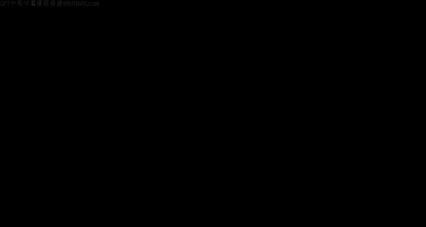
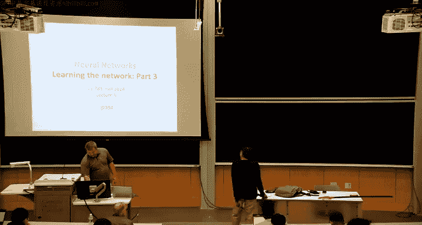
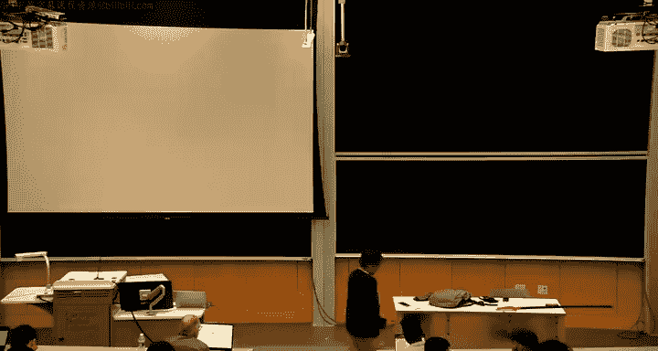
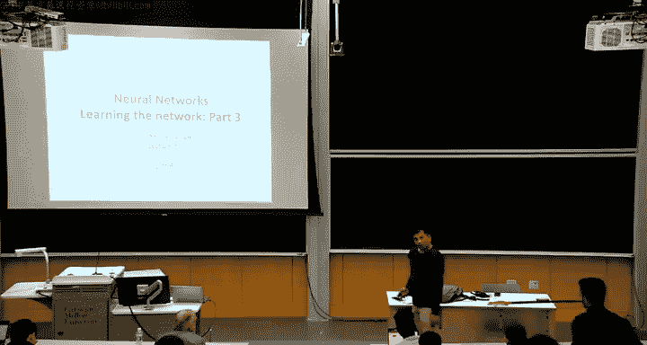
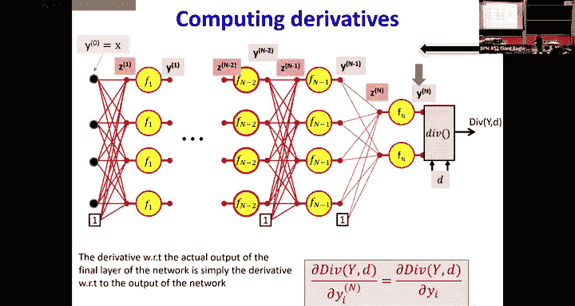
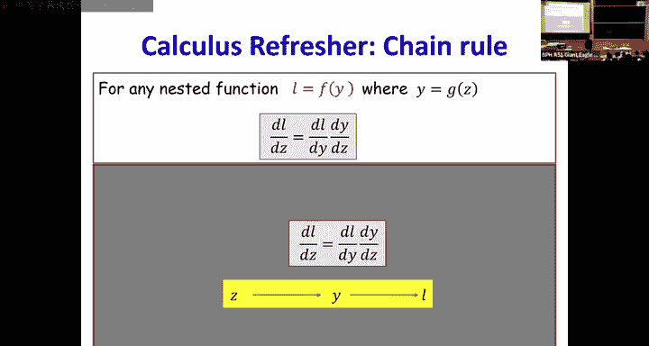
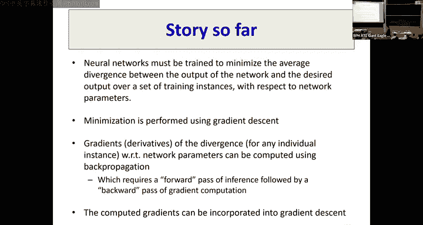

# CMU《深度学习导论｜CMU 11785 introduction to deep learning Fall 2024》中英字幕（deepseek - P6：[6]Fall 2024 Lecture 5.zh_en - GPT中英字幕课程资源 - BV1CfsReEEw8

。吃放车。I is the wrong。Microphone from myphone。好来装。但什么。Check one， two， check。嗯。这个好意思。まあ。嗯。见讲。エルシの本場。209。

Thank you。で是。気ち？我开放的。可能。Yeah。check check。Thank you。Can you help me？Yeah。There's some noise on。

All right， everyone， the usual stuff， please shut your laptops。We have phones， everything。

And those of you who are not in the classroom shame on you。 You should be in the classroom。

 I'm not winter。 I'm here。 You should be here too。 It's almost winter。 It's autumn， right anyways。

We have 3，50 people in class。 There are barely 50 people in the classroom。

 I'm not convinced that the rest of you are all watching。So since the enrollment period is up。

We will be posting。

Attendance， you mind shutting your laptop。 please。 Thank you， all of you。

And we will be enforcing attendance here or not。So we're going to continue our。

A series of lectures on training neural networks。Do we have any questions from the past couple of weeks。

Any questions， none？So again， your name tags， if you please。

Here's where we were when we last checked we found that training neural networks through empirical risk minimization was set up as follows we were given a collection of training instances comprising input output pairs and so you had each training instance had an input X and a desired output the output output that you want the network network to compute。

😊，And we defined a divergence between the actual output of the network。

And the desired opportunity do you mind shutting your laptop， please。

 please do not open it if you want to open your laptop， go outside， finish your work and come back。

 right？So we defined a divergence between the desired output of the network and the actual output of the network。

😊，The loss was defined as the average of this divergence over the entire training set。😊。

And this loss， once the training set is specified， the loss is just a function of the。

network parameters W。 And so this is what we would minimize the loss with respect to W。

 where the network parameters comprise the set of weights for all of the perceptrons in the network and their biases。

Now， before we continue， I'm going to introduce some notation。

We are going to be representing weights as W biases is B。

 and we are going to assume that the network is layered， weve described layers before。

 and Ive also explained what I mean by a layered network。😊，So， the input。Is going to be X。

 but often we will also just represent it as Y I superscript 0， which is to say the0 with output。

 This is pernotational convenience。 Then the weights。😊，To the I layer。

Are represented by a superscript I。 So the weights to all the neurons in the first layer have a superscript 1。

 The biases have a superscript one， as well。The bias to the J neuron in the first layer is B subscript J superscript 1。

 So the subscript in the case of the bias indicates the index of the neuron。In the case of Ws。

 there are two subs， ING。I is the source neuron， J is the target neuron。

 so it's the weight from the Ih neuron of the previous layer to the Jth neuron of the current layer。

Now， so when we want to perform gradient descent， when we want to minimize the loss。

 we are going to do so using gradient descent。😊，This is how we saw we'd do it。

 We would initialize all of our parameters， and then we'd iteratively take a step。😊。

In which direction。oppositepppoite the law gradient of the loss with respect to the parameters。

 So at each step。The weights are going to be updated against the gradient。And again。

 is the gradient the derivative of the loss。Is a transpose of the derivative， the way we define it。

 And so we're going to keep doing this until the loss no longer changes。 Why are we。

 Why do we have the check on the loss and not on the derivative。Anybody。Do you remember， yes。

minimizeま。The loss can be minimized even when the derivative is not 0。 We saw this。

 the boundaries are the feasible set， the derivatives may not be 0。So。Now。

 if I want to expand this out。Here's what it's going to be。 There's your loss again。

Let's say it's the average of the divergences over the training set。😊。

And wed initialize all the parameters which are the weights and biases。

 I'm going to assume that the bias is also represented as a weight。

 which means that I haven't introduced an additional component。😊。

To the inputs switch whose value is fixed to one。Andand。

We know that the gradient is simply a vector of partial derivatives。

 So which means that all that gradient descent is there does is。

To adjust each parameter in the direction where the is guaranteed or at least locally to decrease the loss。

 So for each parameter， W I J。We take a step against the derivative of the loss with respect to that parameter。

So this loss， the derivative of the loss with respect to network parameters。

 WIJ is what we need to compute。😊，Now， how do we compute that。

 That's what this lecture and the next lecture are all about。So once again。

 the loss is the average divergence over the training set。

So if I take the derivative of the loss with respect to。Any parameter？

Then due to the linearity of summation， this means that this is just the average of the derivative of the divergences for individual training instances。

With respect to the parameter。 And so what we really want to compute is this term here。

 which is the derivative of the divergence with respect to。Individual network parameters， WIJ。

So we can see how we do this。Any questions？Any questions on Zoom？No， okay。

 so we're going to take a slight detour at this point and begin looking at， wait a minute。

We're going to take a look at some simple rules of differentiation。 If I can find myself a cha。 Yes。

 cha。Now。Consider any function y equals F of x。Do you remember how we define the derivative。Anybody。

So， anyone。就不是说UCD。The transpo， but at a final level， what was the derivative。

So if I had it's there on the board， if I said y equals f of x。😊，Then。

The derivative was a term that multiplied a small perturbation in x to give you the corresponding perturbation in y。

😊，This is something that must be burn into your mind because that's how we define the derivative you know。

 Dy over dx is improper notation for everything except you know scalar functions of scalar variables so。

😊，Not this I can represent in a specific manner。 I can say that the variable x。😊。

Influences the variable bar。And I'm going to introduce something called influence diagrams over here。

 Now， this edge over here also gives me information on how much perturbations of x will perturb by and so。

😊，These could be partial or full derivatives， but then this is how this notation indicates that perturbing x pertus y。

 and so specifically this means that if。😊，Every deelta X。Theres going to。Result in a deelta y。

 we are just using。So the little graph here you know graph based notation we have over here。

 the value of delta y is going to be the input to this edge multiplied by the weight of the edge。😊。

So this notation， any confusion about this notation。😊，No， so this is simple。

For any differentiable function y of y equals f of x with derivative d over dx。

 we know that delta y must be equal to for small enough perturbations of x。

 this must be equal to the derivative times delta x。 and so the influence diagram x influences y。😊。

This。Edge between x and y carries the weight， which is equal to the derivative of y with respect to x。

 and so。Just using this simple graph based notation。

 any perturbation delta x going into this edge multiplies the edge weight to give you the corresponding perturbation in。

😊，Now， here's a different function。Y is a function of many variables， X1 through X M in this case。

 using the same notation， what would the influence diagram be like Any， yeah。😊，那你也对。Exactly。

 so I'm going to have。X 1。X 2。X n。All of them are going to。Influence y using the same notation again。

 what would the weights of these edges be， The partial derivatives of。Y， with respect to X。

The corresponding X。And now， using the same。You know， the rules for graphs over here。

 What would Delta Y be。From this picture。So again， going back。

 this also means that if I have a delta y here， all of these have deelta x's， right。

 what would delta y be。😊，Subation of the sources。 This is going to be the total incoming。In。

 the total incoming information， that's going to be。You know， summation I。DY over Dxi。Delta X。

 everybody comfortable with this representation。We're going to see it a few more times in the next few classes。

And so here the， here's the influence diagram。The derivative diagram is going to look like so。😊。

Which gives you。There's distributed derivative rule， which all of us were familiar with from school。

Questions。Okay。So now let's look at a function of this kind。Where。Y equals。F of G of x。So here again。

 the influence x。Influences。The function G， which I can I'm also representing， I could have written。

😊，They introduced the variable， but I'm just going to call it G phenomenon。And this。Influences。

 I mean， x influences， G G influences y， right？😊，Was making sense to everybody。

What would the age weights be。Anyone。In this case， what would the age weight be。

 This is going to be D over D G。These are partial derivatives。

 but I'm just going to write full derivatives， and this would be D over Dx。😊，Okay， so given this now。

What is D in terms of。Or what is Delta y in terms of Delta G？It's going to be Dy over Dg。

And times thelta G， correct。What is G in terms of x？Dg over d x times。There are the x。

 So plugging this， this over here， I'm going to get。D I over。The x had Dg times Dg over Dx。Delta X。

 correct。So if I were to combine all of these。What is the edge weight over here？Anybody。What is that。

That's going to be this time over we're here， correct？So， this is。Dy over DG。DDG。Over D X。

 And this is the derivative of y with respect to x。 This is the what role as this。

This is the famous chain rule。 If you just draw the pictures out， it makes sense。Right and now。

 so that's what we've got。😊，没有。Now， suppose they have something of this kind。

Y is a function of many functions？Each of which is a function of x。

 then what would this diagram look like？😊，Anyone。It in the laserzor here。

What would this diagram look like。我西装。got put gone。Okay。There's got to be is yeah。Explain。

So this is going to look like so right， I have G1 through G N all being。Functions of X。

So I would have x。Influencing G1。G2。Gan。At each of these， in turn。Is going to influence why。Right。

 everybody with me。What weights would these edges carry？AndThis is going to be。What is this one？

Y DG bond。This is D over。D G2。D Y over D G， N。 And what about these guys。已是你。Dg1。Over Dx， D， G2。

 over Dx， and so on。 So now if I were to write the Delta y。Out。What is Delta y？Anyone？

Can you say that again loud， please， This is going to be， you know， first。

 this is going to be D y over。D G， I， Delta G I。But then we know that Delta G I is simply。

DGI over D X timess theta x， right， So this is。B the eye over。D x delta x。

 and so if I write the whole the relationship between y and x down， this is what we get。So。

 this is our。You know， what is the derivative rule over here， If I were to write it down。

 that's simply going to be the sumish the。Deivative of y with respect to x。

 There is a sum over all Gs。Of the product of the derivative of y with respect to G and the derivative of G with respect to x。

You can derive this using math， but once you actually draw the pictures， it becomes quite obvious。

 right， questions。😊，Any questions？Okay。And so for any nested function for L equals f of y where y is d of z。

 we know that Dl of Dz over Dz is D over dy times d over Dz。😊，And， you know。

 for any function f equals function or any function of many variables where all the variables are a common function of x or function of x。

😊，Of a common variable X then。😊，The derivative of L with respect x is simply the distributed chain rule where you sum the products of partial derivatives over all of the contributing。

😊，Functions。R G， right。Okay， questions。No。So this is。So now thats just a little background。

 Our problem is how do we compute the derivative of the divergence with respect to individual network parameters again。

 this derivative tells us how much perturbing the parameter is going to perturb the divergence if increasing the parametering reduces the divergence you want to increase it。

😊，On the other hand， if decreasing the parameter reduces the divergence， you want to decrease it。

 right so。😊，The first is a part。对。嗯。Okay， guys， Time's up。 someone on Zoom。

 Can you answer the first question。Zm。The first question， par of me。Okay。Over here。

The lady at the corner of the laptop open can you answer the second question？Okay。P of me。Second one。

Second one is true。You really should keep that laptop shut and pay attention。 So the first one。

 the the chain rule of derivatives can be derived from the basic definition of derivatives。

And the influence diagram graphically shows all paths and variables through which one variable influences another。

 right， That's all that's all we have covered so far。

 So now let's go back and look at how we can compute derivative。😊。

I'm going to use this little illustration over here which is a very simple network of just two inputs it has two hidden layers and let me expand on each of the perceptrons in the network。

 each of the perceptron has two stages of computation first to compute an aine variable and then the aine variable is put through n。

😊，Actation function， right， And so。If I were to annotate all of the parameters of the network these are all the weights and here I' am not explicitly introducing a bias I've just added an extra component1 at every layer so the weight of that extra component showed by the little red box should give you the bias this is just for notational convenience so in every case this term here。

Which starts from the zeroth， which has the zeroth index in the first location。Represents the bias。

And。Let me also annotate the remaining variables so the z's represent the aine variables that had computed from the output of the previous layer。

 so z2 superscript 1 represents the aine value at the second neuron of the first layer So J in general Z subscript I superscript J is the aine value at the Ih neuron of the Jt layer。

And so also， why？Represents what we get when you apply the activation function to the Fine value。

 So why subscript I superscript J represents the。Output of the I neuron in the jet layer。

So we are annotating every single variable of every single neuron explicitly in this manner。😊。

And now the output of the neuron of the network can be compared to a desired output you get a divergence and our question is how does perturbing any weight say this one？

😊，Influence the final。Divergs， this is what we must compute。

But the way we will do it is that we got to that we will work our way backwards。

 So the first first thing we will do is to determine how much perturbing y。😊。

Willll per up the divergence。But then we will combine that with how much perturbing Z perturbs y。

 and then chaining the two， you can figure out how much perturbing Z perturbs the divergence。

 And then you can take a step back and so on。 So in order to compute all of these derivatives。

 you need to know。😊，Each of the intermediate variables again。

 we know from the last class and from the various pictures we have drawn that the value of the derivative depends on where you compute it。

😊，Which means that we need to know。All the intermediate and final output variables。

 all the z' and ys of the network for us to be able to compute they。😊，De。

So the first thing we will do is to compute all of these intermediate values because we will need them to compute the derivative。

 this is what's called a forward pass。And let's see how that's done。

If you are training the network you would initialize you。

 you would have initialized all the parameters of the network。

 if you are in the process of training the network， they will you may have updated these parameters。

 but at any given time。😊，All of the network parameters will have some value。 Sha yet。

 Do you want to go wash your face or something。二。So。Again。

 we are going to use the same I'm explicitly introducing the bias again。Im going to be。I mean。

 the0 term is the bias。 So I'm just introducing this one and the bias is its weight and input is going to be represented as the0 clear。

 So it' just Y I superscript 0 just for notational convenience。 And then once I do this。

The aine value at this neuron is simply going to be weight the first input times this weight plus this input times this weight and so on。

 itd be summing over all of the inputs to the neuron and you'd be taking a weighted sum so z1 superscript I is going to be the summation over all inputs of w all inputs I of wi1。

Times the input by I， the superscripts is take care of the layers。

 So there's nothing particularly complicated about this equation。

 So I don't have to go into this in detail。 Do I。Easy enough。

 So we can repeat this computation for every single neuron and the layer。 And thereby。

 you' would have got obtained the。Havelf find values for every neuron in the first layer subsequently。

You can just apply the activation functions。For all of these neurons。

 And you're going to get the outputs。Of the neuron for the first layer。 So very easy。

 The computation is very simple。 indeed。 And then I can keep repeating this process。 Now。

 I can compute the a find values for the neurons in the second layer。😊。

Using the y values output by the first layer。And then I can pass those through an activation and keep doing that until eventually I get the output of the final。

Layer of the network， which is the output of the output of the network。

 So if I were to write this down as pseudo code， this is what it's going to look like。

 I'm going to go through the layers。 K represents the layers。Y I 0， this the。

 the0 player values are just the inputs。And then for each subsequent player。

I compute each I I loop through all the neurons。For each neuron。

 I compute the aine value as the weighted sum of the outputs of the previous layer。

And then I apply an activation to this find value to get the output of the neuron。

When I'm done computing this， I'm going to have the both。

 the Fine value and the output of every neuron of every layer。😊，Questions？Yeah。

 should we just be out the advice， I mean， the notation doesn't have like a knife。

So the vice term the bus term is the zero over yeah。 Yeah， the little red box in the rotation。

 like some over eye， like we just assume that you know from。

There's't an additional term that we include in sumations。For the bias is。

 So the biot is just folded。 And if I go starts from 0， I have the bias folded in。

 this is just notational convenience。 That's it， right。

 I keep switching back and forth because it depends on how much space in my I have on my slides really。

 So you must forgive me for this。I can write the pseudocode for this very easy again。😊。

I have said why yj is0 equals xj for all of the input dimensions。

 we look through the neuron through the layers within each layer。

 we look through all the neurons for each neuron you compile to compute the aine value and then pass the aine value through an activation to get the output of the neuron。

😊，And the output of the final layer is just the output of the network。退不。

And so we have now computed all of these Z and Y values。

 We must now use these to compute derivatives， going backwards。Now。

 the way we will compute derivatives is as follows。😊。

We will start off by first computing the divergence。

Between the actual output of the network and the desired output。

Then we take a step back and determine how much perturbing the output of the network will perturb the divergence。

 So that's going to give us the derivative of the divergence with respect to the output of the network。

And then we take a step back from there and we compute how much perturbing the Z N will perturb y。

 We have already computed how much perturbing y will compute perturb the divergence。

 So chaining the two。 we get an idea of how much perturbing the z's will perturb the divergence and we can keep doing this going backwards。

 we will go back and compute the derivative with respect to these weights again。

 we can use the same principle and then。😊，Compute the derivative or the divergence with respect to these vis and these Z's and these weights。

All the way back to the beginning。 So since we are compute starting the derivative and this is how we must do it。

 You cannot compute the derivatives going forward。😊。

Because we need to know how you know how much these perturbations are going to influence the final output so you have to start at the end and so since we have computing derivatives going backwards。

From the output to the input， this is called back propagation。Now let's actually go through the。啊。

 mat。So。First。We assume we have the divergence。Then。

The divergence function is something that we design and for each divergence。

 if you were paying attention in the last class or if you saw my piazza post。

 you know how to compute the derivative or the divergence with respect to。😊。

The output of the network。That's just the。Divtor or the data。 I'm just assuming that this is given。

Because every divergence has its own derivative。What we and subsequently。

 we are going to apply the chain rules that we just saw。

The one that we will apply most is this one。😊，That if we have L equals F of y loss the function of y。

 where y is a function of z。So the loss is the function of the output of a network of the neurons and the output of the neuron is a function of the。

😊，I find value Z。 So in that case， the simple chain rule tells us that the derivative of the loss with respect to Z is a derivative of the loss with respect to y times the derivative y with respect to z。

So let's apply this over here。 Right， weve already， we're going to。

Compute the derivative of the divergtence with respect to these y and the Z。

 But then applying the chain rule， that's just for each Z， that's the derivative of。

The divergence with respect to y。Times the derivative of y with respect to Z。

That's says the chain have， know backwards for reasons you'll see， okay。

And this derivative of the divergence with respect y was already computed because we assume we know this。

 So the only thing that remains to be computed is this guy。

 What is the derivative of y with respect Z。But this is easy。

 This is just the derivative of the activation function computed at the Z。😊，And this Z was computed。

During the forward pass and so I can plug that value right here and now trivially enough。

 I have the derivative of the divergence with respect to the aine values。At， at the。Output layer。

Any questions？ Yeah， we computed the Z values， right， We know the Z。This was computed。

And so we need the derivative is going to depend on the location。

 be dependent on the location where you computed。 and so this was computed， right。Now。

 the next thing we want to do is to go back and compute the derivatives with respect to these weights。

😊，Now， using the chain rule again， the derivative with respect to any weight WIG。

For the n layer is simply going to be the derivative again。

 the weight WIj influences the z right so this is going to be the derivative of the divergence with respect to z。

😊，Times the derivative of Z with respect。The wait。That here to everybody。

And this first term was just computed。So the only thing that remains is this one。

What is the derivative of Z with respect to W， I J， Now， Z is an aine value， And we know that。

In this case， I'm calling that ZI Zj， right？😊，すごいテだな。A bunch of inputs。 And if I'm looking at ZJ。

And if I want this derivative from。This WI， which comes。W I J， which comes from input I。

So ZJ is going to be。WIj times X， which is this term。Plus， a whole bunch of other guys， we don't。

Depend on W I G， plus something else。Lets I just call this somewhere， O。As for something else， okay。

Now， what is the derivative of ZJ with respect to W I J in this case。Can you say that a lot， please。

M， that's。This is I， right， this is just Xi。So the derivative of ZG with respect to WI is just Xi。😊。

This。Ithi just happens to be。The output of the。Ith neuron in the previous layer。

 which is y I superscript n minus-1 in our case， which was computed in the forward pass。😊，Already。

 And so I can just。Plug this value here。 So the derivative of the divergence with respect to WIj is Y I from the previous layer。

Times the derivative of the divergence with respect。Z J。 So in general。

 if I have a connection of this kind。I have。Y I and minus1。W， I J。This is ZJ。Now， eventually。

 Zga is going to influence the divergence。So I can say that the derivative of the divergence with respect to。

W Ij is going to be the derivative of the divergence with respect to this guy， Zj times。

The input to the connection。By I。 And so also the derivative of the divergence with respect to why I is simply going to be。

 what's that going to be。In this case。I don't think it's very clear what I've written。

 let me draw this more carefully。So if I have。Why I。N minus1。And this。

Has a weight to W I J from the I compute Z， J， N。And these year， eventually。

It is used to compute the divergence。Then the derivative of the divergence。With respectpect to。W I G。

Its simply going to be the derivative of the divergence with respect to Zj。And times what？

That's simply going to be W IG。corrrect。😊，What about the derivative or the divergence with respect to YI in this case？

Sorry， this is going to be Y J Y I right， correct。 What is the derivative of the divergence with respect to Y I。

Use by symmetry， that's going to be。Yeah。Because these two are getting multiplied， right？😊，So again。

 the second one is not so simple， but here's this first term。 We've already seen this。

 What is the derivative of the divergence with respect to W I J， It's a derivative。

For ZI times Zj times Y I。But then when you look at the derivative of the divergence with respect to。

This term here。 wait a minute。Any of the y， it gets。More complicated。

 Now we have to consider this distributed channel。So if I have a function。

 if I have any variable x which influences a whole bunch of functions。

 all of which influence the final loss， then youve got to sum the derivative over all of the outgoing as。

 So in our case， if you look at this one here， this Y I influences all of these Z's。😊。

All of those are in turn used to compute the final。

Divergence and so if I want to compute the derivative of the divergence with respect to this YI。

 I have to sum over all the Z。And what I'm summing is the derivative of the divergence with respect to Z。

Times the derivative of Z with respect。Y I， right， So it's not as simple as what I just wrote。

 And what is the derivative of Z with respect to Y I。好。Right。

 this term is already computed and because the derivative Z is simply W I J times。

YI times other terms。 So the derivative of Zj with respect to YI is simply WIj。

Which I can plug in over there。And that's going to give you my。Divtive rule 4。

Computing the derivative of the divergence with respect to YI。This makes sense to everybody。

 I know I got a bit tangled， but there's nothing particularly complicated about this。Questions。Right。

 no， okay， and so I can use the same rule to compute the derivatives for all of the yI's in the penultimate layer。

😊，And once I have done that， I can use those to take a step back。And compute the derivatives for。

The Z's， the find terms simply by multiplying the derivative for the of the for Y I by the。

Derivative of the activation functions。And then once I have those， I can take a step back。

Compute the derivatives for the weights and the derivative， again， for any weight W。

 I J for the n minus-1 layer is the derivative。Of the divergence with respect to Zj for the n minus1 layer。

Times the Y I for the n minus to a player。And so I have the derivatives for the weights。

 then I can take a step back and use the same rule as before。😊，And compute the derivatives for the。

Whyise and so on。 Now there's something into so， and I can do this going all the way backwards。Now。

And I can even compute the derivative eventually with respect to the input of the network。

Sometimes we want to see how much perturbing the input changes the loss。

 And there are situations where。That's required。 we can compute it。

 So if I write the whole thing down， here's what the pseudocode would look like。First。

 you assume that you have the derivative of the divergence with respect to the outputs of the network。

Then multiplying that by the derivative of the activation function for the output layer。

 you get the derivatives with respect to the ahi and values at the。Output of the network。

Subsequently， here's the interesting thing。 I keep going back at each time I compute the derivative with respect to the y。

Then take a step back， compute the derivative with respect to the Js。 and then。Also。

 compute the derivatives with respect to the weights。 And here's what you get， the derivatives。

Of the divergence， with respect to the vice。Is a simply a weighted sum。

Of the derivatives of the divergence with respect to the subsequent Js， these。

So when I'm picking a step back。Computing a derivative with respect the y is simply a weighted sum of the derivatives of the next layer。

😊，Computing a derivative with respect to the Z simply multiplies by the product of an by the derivative of the activation function。

 the one off。😊，Is the derivative with respect to the weights。

Which is going to be the derivative for z times by， right？😊，So if I write this pseudo code。

 this is what it looks like。For the output layer， I can compute the derivative with respect to。

Of the divergence with respect to device。 And then finally。But they have fine terms。

And these red terms in red are where we are computing derivatives for the parameters。

 We just saw how to do this， but the rest of it looks a whole lot like what you would do in the forward pass in the forward pass。

 what did we do We computed aine terms as the weighted sums of the outputs of the previous layer。😊。

And then we applied an activation function to it。In the batch。 So that this。

 this is what the forward pass look like。 At each point， we computed。

A weighted sum of the outputs are the previous layer and then applied an activation to it。

 That's exactly what we are doing here。 except we are doing this going backwards。

 using exactly the same weights。😊，We are computing a weighted sum of the derivatives。

At the next level of the network。 And then we are taking a step back。

 And instead of directly applying an activation function to it， we're just multiplying by the。

Divative of the activation function， because these are derivatives。 Now， it's f prime rather than F。

 But it's essentially the same as the forward pass with the network flipped。You know。

 the network flipped and the activation functions are replaced by there。😊，Datives。

And just the one off computation is they are derivatives for the weights themselves。Any questions？So。

哦。哈。So use your 30 seconds。 we'll give you another 15。嗯。

I think most of you are done so people on Zoom can you answer this question is the first statement true？

好，尽量。Okay， what about the second one。jobs。What about a third one Yes So back propagation is this process where we propagated derivatives backwards。

 It's the mechanism that we use to compute derivatives。

Back propag is not the training algorithm back propagation is merely the procedure that we use to compute derivatives。

 those derivatives are plugged into other rules like this gradient decent rule to actually update the parameters。

😊，Okay， everybody clear about that。 yes。 during the forward we use so that we use activation function essentially back。

So that change can be anywhere on the curve if we are taking curve， I think。Initially。

 that change and before anyway， because there's a change。I'm not sure I understood the question。

 can you clarify？Let's say we have a curve， we have di in the patient or stroke。

 so can be seen at some particular patient。So for a particular bid， we can have that same derivative。

My a book based history。So if you think of it this way。😊。

So let me draw my loss function as a function of the weight。So this is my rate。Anyway。

 and this is my loss。My loss is going to be some funny cooker。

So at one point we really need to know where we are， this is not just a function of w。

 it's also a function of other things like Z。Just looking at the weight is not sufficient is to tell you what the z values are the inputus。

 the space is multidimensional right， And so the first thing we are going to do is to use this weight to also determine the Z。

And that's going to give you the precise location。 Only then can you actually check the slope。

So that's what the forward pass is doing。Did that answer a question？O。So。

Weve made some assumptions so far。That the output of one neuron directly affect the computation of other neurons in the same as previous layers。

That inputs to neuron only combined through weighted addition and that activations are actually differentiable so。

All of these conditions are often not applicable。 We won't con discuss all of these in class。

 but these exceptions in class。 but they are on the slides。 We will look at a few exceptions。

 The first is vector activations， which we have already encountered。😊。

Now we have seen that in the the way we've disdified the network。

 modifying one a find value only modifies the corresponding output。

 but in the case of vector activations。😊，We can have an activation where modifying one A and value changes all of the outputs we looked at one particular example in the last class which was it softm right and so heres what would happen in the case of the scalar activations y equals f of z d or dx D is just f prime。

😊，Over here， you have a vector of y' and a vector of z'。😊。

And so the way to think about it in the scalar activation， each Z influences one y here。

 E Z can influence all the y's and each， you know， and each y is influenced by all the。😊。

So here in the case of the scalar activation when I'm going my backwards I'm computing derivatives。

 if I want to compute the derivative with respect to any particular z。

 I just have to go past this one line it's a derivative of the divergence with respect to y times the derivative of y with respect to z。

😊，But if I have a vector activation， things are slightly different。

Because each Z influences every one of the vice。And all of these vices eventually influence the divergence。

And so if I want to compute the derivative of the divergence with respect to any particular Z。

 I'm going to have a sum。Over all of these termsumps。

And so the derivative of the divergence with respect to Z over there is going to be the sum over all of these。

😊，Outputs of the derivative of the divergence with respect to the Yi。😊。

Times the derivative of Y I with respect to Z。So it becomes a bit more complicated。Now。

Let's take a look specifically for the case of the softmax。😊，In the case of the soft max。

 we here's the equation for the softm， we know it。😊，For any particular YI。

 it is going to be the exponent of the corresponding Z。

 you exponentiate the ZI and then you normalize the whole thing to sum to 1 right。😊，Now。

 as you can see。Every single Z influences each y。Now， and each Z influences everywhere。

So now if I want to compute the derivative of the divergence with respect to any given Z。

 I have to compute all of these derivatives。The derivative of each。One of these vis。

With respect to Z now it's easy enough for us to derive these derivative rules。

 but I'm going to ask you a question that we we've already got the answer to in the last class。😊。

What do you think the sign of the derivative of Y I is going to be with respect to Z。

Of the corresponding Z。If it's just a straight line， if it's this one。Just this one。

 What is the sign of the derivative， positive。 What about this one， negative， right。

 Because increasing N E Z increases the corresponding y。

And increasing any Z decreases the corresponding y。 And so indeed。

 that's what the derivatives look like。 So the derivative for any， now， there's another thing， right。

 If Y I is close to one， there isn't a lot of space for it to move any further。😊。

So increasing Z is not really going to change Y I a lot。Similarly， Y I is。 So y is very close to 0。

 If it's way out， it's very small， small changes and y is not I not gonna change Z very much。

 And so the derivative has this property for the pass through。 It's positive。😊。

And it's going to be y times 1 minus y， which captures the fact that this equation actually looks like this。

For any given input。For any given specific output， Y I。If I have fixing all the others。

If I fix all the other z and change just that one z。That's going to look like。A sigmoid。

And so way out to the left。😊，When Y is really small， the derivative is really small。😊。

When is when y is 0， when y is1， the derivativeta is。😊，0， also， it's only in between。

Where Yi is distant from both0 and 1， that it has a significant value。

 And so you can see that from the equation。 it's Yi times。

1 minus y I it is positive and has this property that it basically goes to  zero and at both extreme values of y and takes meaningful value values only in between。

😊，Now， if you look at the cross derivative that all that looks like minus y I times yj。

 you can intuude it similarly。 But the first most important thing to do is to see。

 to see is that it is negative。😊，Right， and the larger it is。

 the more negative it is because the further the faster you want it it changes。😊，So， Christians。

And so this is what you would plug in to the formula。

 If you were computing the derivative of the divergence with respect to any given， why。Now。

This was the softm。 There are other cases of vector activations that are on the slides。

 Please look them up。 They will appear in the quiz。 Okay。

 there's another kind of activation which which is of interest to us， which is the relu activation。

 This is not differentiable at a specific point。 Where is it not differentiable at zero because it's got a corner。

😊，So in this case， if you go through the theory， they're going to tell you to look at something called sub derivatives and sub gradients。

😊，So what exactly are。Sub gradientdients and sub derivatives for convex functions if I have a function of this kind。

A corner， then。When you look at a continuous function， it's just the slope of the tangent。

 But there's no unique tangent out here。On the other hand， I can draw a whole lot of lines。

All of which。Basically， just touch the function at this corner。Without actually crossing it。

The slopes of all of these lines are called sub gradients。And so you can use any one of those values。

And your gradient update rule。 But there's a slightly different。We are looking at it。

So here is your re， again。You can think of the relu as a function which rotates from 0。

Slope 0 to slope 1， instantaneously。If I think of it this way now， how do we define a derivative。

 A derivative says how much y will change for a small perturbation and x。

 Suppose you're arriving at this tello from the left。

Will a small perturbation N then input z change y？So what will the slope be if you are arriving from the right。

 will a small increase of z increase y。And what's the slope。

And so you've gone suddenly from slope0 to slope 1。

 but you can think of the function as rotating instantaneously。😊，From a slope 0 to slope 1。

 in which case， if I think of the the derivative， it's going to be something like this right at 0。

 it went all the way from 0 to 1。 So if I ask you specifically， what is the derivative at 0。😊。

Any value between 0 and1。Is appropriate because you could have captured the function at any point in its turn。

Typically， we're going to use the extreme value one because you want youre performing gradient descent。

But this is just to give you an idea， right。There's the other other kind of activation。

 which is the max which we will often encounter。 And that is where there are a whole bunch of。

And put。Same x of Z1。Z 2， and so on， Z N。So in this case。

 let's just say that the maximum value is Z N。So this is the M。Then in that case。

 will perturbing Z1 change y。Yes or no。 good small pertuation small。 the maximum value is Z N。

 that's the output。So will perturing Z1 change y。It's it's not the maximum value。

 If I'm looking at really small perturbations。eventually I can find a small enough perturbation that it doesn't cross the end。

😊，Does that make sense。If you're not， currently the maximum value。

Then changing that value is not going to change the output。

 So what is the derivative of y with respect to Z1。知道。

What is the derivative of y with respect to Z N， So it's going to be one for just the maximum term。

And0 for everything else， right， and so。That's what he will get。 And so here's a little quote。Now。

 this is actually another special special case of a sub gradient but yeah。😊，なたり。是。Okay。

 that was easy， I think most of you are done， so can you give me the answer to this one？😊，Anybody。

 So Maria， is is the first statement from。但是并没有。What about the second one？What about the third。

Sportk。5th，6。Because z3 is the largest value right so the derivative with respect to z1 and z2 is going to be0 and the derivative with respect to z3 is going to be。

😊，What。Questions。Okay， and so here's the backward pass and the backward pass， if you have。

If you have activation functions which are not differentiable at some point。

So long as the function is continuous， you can always compute a sub derivative of sorts and you can use that。

😊，InIn the place of the derivative。So the overall approach for training is as follows。

In the forward pass， you're going to pass the instance forward through the net store all the intermediate outputs。

In the backward pass， we are going to sweep backward and iteratively compute all derivatives with respective weight。

😊，The actual loss is the sum of or the average of divergences over all the training instances。

 So the gradient over here is also。😊，The average of divergences were in all the training instances。

 back propagation， the rules that we just saw tell you how to compute the divergence for a single training instance。

 You would have to accumulate these over all of your training instances， Comp the average。

 and that's what you would use。😊，AnyR。Ne updates。 So training my backdrop。During the forward pass。

 youd be computing all the intermediate values for your entire training set and the loss during the backward pass you'd be computing all of the derivatives。

Computing the average and using that in your。Gient， recent。So。Questions。Yeah。分之的。

冇啲意思实出四 point point听你。先有啊。when you're averaging， it doesn't matter whether you're summing or averaging。

 that effect， that influence remains the same， right， regardless。reing would be like super big。

These things will affect it as indeed， right， but that's what you have。You're correct。

So now here's the thing。 Have you sort of explained the whole thing variable by variable。

 but you never really perform the computation in this manner。 What the way we do it。

For layer networks， it is generally simpler to think of the process in terms of vector operations because arithmetic is simpler and fast matrix libraries make operations much faster。

😊，We can rest rest the entire process in vector terms。

 And this is what we will use in any real system。 So let's look at one layer of the network。

I have a picture on the slides， but let me draw this anyway。If I've got one layer of the network。

 I have。四。Y 1 through y n。In the previous layer。And maybe Z1 through。The M in the next layer。

Then for any particular Z I， I'm going to the actual for any particular neuron。

The Z I values computed as a weighted sum of。OrThe outputs of the previous layer。

 So I can write this as。Z I。Equals。Samation J。Wji i。W so。

The weight from the Jth input to the IF neuron is just written like so， right。

 So now here's what I can do。I can put all of the vi。In a vector。Correct。And then I can write ZI。

Like so。If I want to if I want the equation， what something multiplies this。

Vectctor of y to give you， give me Z I。 And what is that Let's go。

 what kind of weight vector It's going to be a row vector， right， It's going to be。W 1， I， W 2， I。

WN I。So I can just write it in this manner， right。Now， suppose I wrote this for all of the。

Z 1 through the M。Then。This is just a collection of z values corresponding to every Z is a rh。

Which is going to be the row of weights。For that Z。Right， so this would be w11。W 2，1， W N1。

 because it's the weight from the n input to the I output， right， This is going to be。W2，1， W22。W。

Sorry you， I it no， it's one，2。2，2， and2， and so on。

So I can write the whole thing as a weight matrix where the I through of the weight matrix represents。

The set of weights to the Ih neuron。Does that make sense to everybody？😊。

I see some questions on faces。 Did that make sense？So also。

 I can write the biases for all of the neurons as a vector。😊，And this manner。

So once I write it this way。I can just say， plus。B1 through。Yeah， right。If I have。

Does this make sense。So if I write this entire thing as a vector Z and this has a wave matrix W。

 this is a vector y， and this is a vector B， I can just write。Z equals w y plus B。Does makes sense？

And of course， now I can apply activations to these theses to get the。😊。

And so we've done the whole thing in matrix4。😊，Presence。Yeah， yes。

 the y is the output of the previous layer， right。So this is what we will actually use and once I write things in this manner。

 then its very easy to compute the forward pass all of this crazy loops that he wrote。

 they don't have to be figured out at all， I can just set y0 as then input x y1 is simply z1 is simply w1 y plus b1 where w1 is the matrix of weights to the first layer。

😊，I'm not Ive have sort of start switched to using layer indices as subscripts because it's more convenient。

 But then why Z1 is just W1， y， y 0 plus B 1。And then。Yhy1。Is simply F1 of Z1， right？

And then Z 2 is just W2 times y 1 plus B1， B2。And then y2 is just F2 of Z2。And so this is easy。

 right， I can go all the way to the end， I can get the final Z and the final line tria。😊。

And so when I write the forward pass in this manner， this is so much cleaner。

I can just write y 0 equals x。And then each Z is simply W times。

Well each layer Z is simply the weight matrix for that layer times the output vector for the previous layer plus the bias。

And the activation for each layer is simply the activation function of of that layer applied to Z。😊。

So if I write a pseudocor。It's very clean， much simpler。The challenge， of course， is that， you know。

 what does this mean， You have to begin thinking about calculus in terms of。Marices and vectors。

 how many of you are really comfortable with that？Some of you， right， but the rest of you guys。

 you're probably wondering what's going on。It's very easy。 There's nothing particularly complicated。

 So before I present the backward pass， I'm going to give you some ideas of vector calculus。

 And for vector calculus， we go back and remember something。😊，It's very simple。

 The rules for vector calculus are exactly the same as those for scalar calculus in the sense that if I have y equals。

F Z。Then deelta y equals the derivative of。Yhy with respect to Z times Delta Z。

 this is the same rub that we used for scalrs。And which is why。When Delta Z OK。

 so this tells us two things。😊，Qu。So if y is a scalar and z is a vector。

 what is this derivative going to be？😊，Using this rule。So if， so Delta Z is going to look like right。

 Delta Z 1。Delta Z N。This is Dlta z。If y is a scalar。Then Delta y is going to be。

A row vector times this theelta z。If why is a vector。What is the intermediate town going to be。

 iss it square。 It's going to be a matrix。 It's going to be an M cross N matrix。

But then what is the specialty of this matrix， You can， you don't need to think of y as a vector。

 You can think of why。Ass。A vertical arrangement of。Scals。Correct， and in that case。😊。

What is the corresponding。Row of this make matrix is going be of this matrix going to be。

It's going to be just the direct of this Y I with respect to Z。Right。

 and the derivative of any scalealar with respect to Z is going to be a row vector。And so。

 each row over here。Is going to be the derivative of the corresponding y with respect to Z。

Do that make sense？And that's just a vector of partial derivatives of the Y I with respect to all of the Zs。

 This is the Jacobian of Y with respect to Z。So again， once again。

 you see that the simple rules that we saw yes still apply。Right。

But then I can also draw the influence diagrams just as before， once I figured this out。

 I can say Z influences y。😊，And the edge from z to y carries the derivative。For。

Of y with respect to Z。 And so once again， this means that。

Delta y is going to be this derivative times Delta z。😊，Right， nothing changed。

 This is the same picture as before。And so this is just defining the Jacobian， as we just saw。Now。

 the Jacobian in， in the case of scalar activations of this kind， I can think of this。

The activation function， which applies to the vector of z's to give you the vector of y's。

As a vector function itself， except that each y is now influenced just by the corresponding Z。

 So in this case， the Jacobia is going to be a。Dagonal matrix。

 whereas if you have something more complex like a soft max， the Jacobian is going to be。

Our full matrix， right。But other than that。Everything else is the same。 stays stays the same。 Now。

 this so now I can go on and。Talk about special cases。Where did I keep my cha here。Standard question。

食块师。Z equals。W y plus B， right？Now， we wanted to see。The way we define derivatives。

 Delta Z is something times Delta y。If I perter vi a little bit。

That is going to result in a perturbation in Delta Z。😊，What is the term that must multiply Delta y？

Over here。 that's going to be the weight matrix。 It's very easy to see， right， because。给你不回。

I can see this easily enough， z plus deelta z。Equals w times y plus。Delta y plus B。

 So the derivative of z with respect to y is simply going to be the weight matrix W。Right。

 what is the okay， What is the derivative of Z with respect to B。So I said deelta z。

Equs something times Delta B if I perta B a little bit， Z changes。Right。

 so what is this term that multiplies Delta B。所以。It is just an identity matrix because every perturbation of B results in an identical perturbation of。

😊，ZSo the derivative of Z with respect to B is and identity matrix。😊，Everybody with me。

Now we can we can go ahead and also have the chain rule as before。Which， and here。

 please keep track of the。order in which we mounted my things。I can see。X。Influences Z。

Influences why。These all are vectors。So what were these edges carrying over here？

This is going to be the derivative of。Yhy with respect to Z。This edge is going to be the derivative。

Z with respect to X， everybody with me。Right， and I can write。Delta y。Equals。Times。Belta。

Right and on this side I can write deelta z equals the derivative of z with respect to x。

Times Delta x。So connecting the two up， what would I get？Anyone。I'm going to get Delta y。Itqus。

The derivative of y with respect to z times。The derivative of Z with respect to x。Times deelta x。

Everybody clear。Can I change the order this of multiplication over here？嗯。Can I change the order。

That will not give me the rule that I just wanted， right？Because Delta y is a function of Delta Z。

 Delta Z is a function of Delta X。 So that is the order in which it must be multiplied。 So as I go。

From here， backwards。The derivatives extend。Outwards， so every time I take a step back。

 the corresponding derivative gets multiplied to be。Right or left。Right， okay。So。

This is just a simple chain rule for practice。Now， I have the extended chain room， right。

 I can just extend this and say。You guys help me。 Now， I'm not going to solve。 I'm。

 I'm not going to say anything。 We will wait a few minutes till everybody gives me an answer。

 Someone gives me an answer。Suppose。I have。Something of this kind。Where x。Influences Z1。Influences。

R run。Influences Z2。Influences y2 influences some scality， right。

So then what would these edges carry？Anybody。What is what does this edge carry？

This is derivative divergence with respect to Y。 What about this one。Y2 with Z2。This is。Z2 with y1。

This is。Y1 with z1 this is。V1 with respect to x， okay。So now。

What is the derivative of the divergence？With respect to Z2。我 to clever。

What would this be derivative div respect to Y2 derivative or derivative of y 2 with respect to C2。

And doesn是。So the derivative of the divergence with respect to Z2。

You're going to start from the right end， right？So this is going to be。

The derivative or the divergence with respect to y2 times the derivative or the of y2 with respect to z2 z。

Y。This may make sense to everybody。Yes or no。 right， Okay。

 so now what is the derivative of the divergence with respect to。Why one。Using the same。그。

What is it going to be anybody？In the back。Someone want to answer this。Isaac。O， not clear。

 Where did I lose you。他做到那个资嗯。So where did I lose you， I have a minute， a couple couple of minutes。

 So exactly， I can go back， Tell me。不了我还全不了。Okay， somebody else。Dnell， can you answer that。

 You just need to multiply。So any so this I can think of like so right so the derivative to compute the derivative of the divergence with respect to y1。

 I can just say y1。Influences Z 2。Influences the drivers。Just keeping everything in between。Correct。

And so the derivative of the divergence with respect to y 1 is going to be the derivative or the divergence with respect to z2。

😊，Times。The derivative was Z2 with respect to。外弯。I keep right multiplying。

Each time I take a step back， and this is easy for us to see， right， This is going to， if。

 if you just。So， and this term。Was just already computed。

And so the derivative of the divergence with respect to y2 is simply。The Nabula term over here。

But then if I want the derivative of the divergence with respect to Z 2。

 that's going to be the derivative of。For y 2。Times the derivative of y2 with respect to Z to， right。

And then if I want the derivative with respect to y1。

 I can look at the simplified diagram here where y1 influences z2， which influences D。😊。

So this is going to be the derivative to have D with respect to z2 times。

The derivative haveze2 with respect to。Y1， right？And then。

If I want the derivative with respect to Z1， I can draw this simplified picture here。😊。

Whereas z1 influences y1， which influences D。So that's going to be the derivative of D with respect to y1 times。

The derivative of 51 with respect to Z。But each step。

 I just have to look at the next variable and forward influences， the final divergence。

 So each time I take a step back， all I am doing is multiplying the latest derivative on the right。😊。

By the new term。That makes sense。Right， to you guys。Okay。So。One final thing。

So we have this just for just for。The to summarize。

 if I have z equals w Y plus B and then Z finally influences my divergence。

Then this means that the derivative of the divergence with respect to y is the derivative of the divergence with respect to z times the derivative of z with respect to y。

 but that is just the weight matrix。Right， so also。

The derivative or the divergence with respect to B。

Is going to be the derivative of the dives with respect to D Z times the derivative of Z with respect to B。

 which is just。The derivative was。The divergence with respect to Z。There's one final funky term here。

Which is， what is the derivative of their divergence with respect to this weight matrix doubling。

And that ends up being a little wonky。😊，To think about how's derived。

 you'd want to unravel the weight matrix to a vector and work its weight， work your way through it。

 But in this one case， it turns out that the answer of the derivative of the divergence with respect to the weight matrix is going to be the input y。

😊，Times the derivative of the divergence with respect to Z。 Now。

 one of the things you want to do is to ensure that the matrix sizes are right。So， here。啊。

I'm probably going to go a few minutes over and annoy my， the next instructor， but。Let's see。

If I have， y isn't。And cross one vector。Z is say an m cross 1 vector。 What is the weight matrix？啊。

It's going to be。M cross hand， right。And then this say influences the scalar。D。

 what is the shape of the derivative of D with respect to Z。If z is m plus 1。1，1 cross n， right。

 So the derivative of D with respect to Z is。One cross。M。

 so what is y times the derivative with respect to Z。This is N cross1。Times 1 plus M。

 That is n cross M。Which is the transpose of this guy。Right， so you can check the sizes。

 So that's simply the derivative of。D with respect to the weight matrix。

 is simply going to be the input to this edge。Times the derivative of D with respect to the output to the edge。

Everybody of me And so having set all of these up。😊。

I can just go ahead and apply this for my to my network。 So within each layer， this is what we had。

Y k -1。Multiplily Wk added to B K to give you a Z K。 So this means that in know。

The derivative or the dive of divergence with respect to y k -1 was。

The derivative with respect to z times the weight matrix。😊。

And the derivative for the bias was simply the derivative of the divergence with respect to Z。😊。

And the derivative with respect to the weight was simply this y matrix。😊。

Times the derivative or the divergence with respect to C for any given layer。

And so now I can just work my way back。 Right， There's a poll。 We'll skip the poll for now。

 Please check it out。 They on the slides。😊，Actually， I'll give you a minute after the。 this is done。

 So here's what I can do。Here's my network again with all the variables in vector format。

I can define my divergence。This is my chain of。Influences in this picture。

 And so I'm going to be representing using this in this in inverted triangle notation to represent derivatives everywhere。

So here are all the derivative。For every single edge。

 But then the thing to note note is the derivative of each y with respect to Z。

These are all Jacobians。Because the derivative of the activation output of the activation function with respect to the input of the activation function。

 Sir， and the derivative of each Z with respect to the previous y， that's just the。Rate matrix6。

Right， and so this is what the actual influence picture looks like。

And then when I work my way backwards， you know， I can keep right multiplying derivatives， right。

 I have the derivative with a divergence with respect to this y。Right， multiplied by this Jacobian。

And then。You know， at this point， I have the derivative with respect to Z。

And now I can take a step back。And write multiplied by the weight matrix to compute the derivative with respect to the previous y。

😊，And then using the other crazy rule that we just saw。You know。

 I need to compute the derivative for the weights。And the derivative for the weight is simply going to be。

This y times the derivative for the Z， as we just saw。 So that can just be plugged in。

 The derivative for the weight is y times the derivative for z。

The derivative for bias is just the derivative for Z， right？😊。

And then I can just keep working my way back all the way to the beginning。

 using these very simple rules。 And so here is the overall。Backward pass rule4。

Computing derivative is for。Going backwards to the network in vector form， it's very simple。

I have this in pseudo code I have a couple of slides you know here's how you set up for binary classification is just binary labels。

 you do a forward pass and a backward pass for multiclass classification these are multiclass labels and were going to use the arithmetic we just saw to perform back propagation。

😊，Stop here。 Thank you all very much。 Sorry for going over a couple of late a couple of minutes。

The story， neural networks are trained to minimize the average divergence of training instances。

 it's performed using gradient descent and gradients are computed using back reations。

 right Thank you。😊。

Okay。