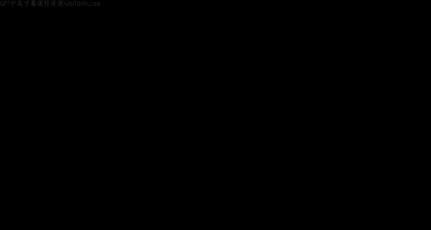
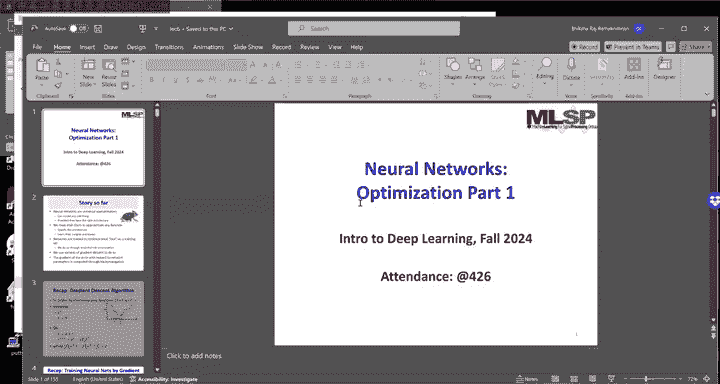
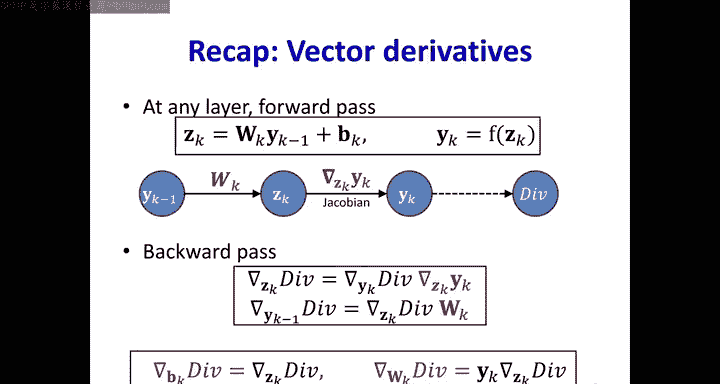
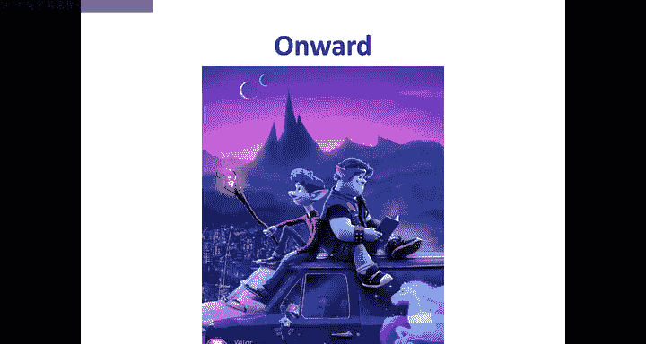
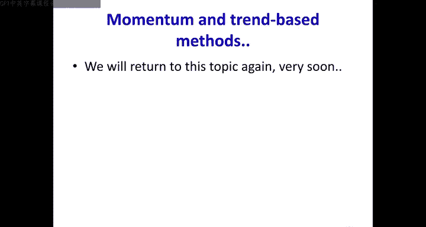

# CMU《深度学习导论｜CMU 11785 introduction to deep learning Fall 2024》中英字幕（deepseek - P7：[7]Fall 2024 Lecture 6.zh_en - GPT中英字幕课程资源 - BV1CfsReEEw8

Chrk trickrk。可。

我。这个说。未来一。は。Thank you very much。え这。Morning John。this same。Okay guys， please get your name tags out。

 all the usual stuff， your laptops。Must be shared if you may。Funning soon。嗯。Allright， okay。

Make sure to time the ball。Make sure to time the poles。M。Take it。60 seconds。Allright， let's begin。So。

We are continuing on our series of lectures on training the network。

How many people do we have on Zoom。Okay， not bad。 That means that about。

200 people are missing from the class。 We will take attendance， right， So the attendance4 is 426。

And here's what we have seen so far。That neural networks are universal appromators。

 they can model any odd thing。😊，Provided they have the right architecture。

We must train them to approximate any function， meaning you specify the architecture and learn their weights。

 The networks are trained to minimize the loss on a training set now。

Does this guarantee that it learns the correct function。Minimizing the loss on the training set。

 what do we actually want to minimize？Is that what we want to minimize。Can you repeat that， please。

The area between。So you want to minimize the overall error between the expected divergence between the actual function。

But you want a model and the output of the network itself over the entire space。

 whereas what we are really doing is minimizing this error over a small number of training points and we do this so this is empirical risk minimization and we use gradient of gradient descent to perform this minimization and the gradients are computed using。

😊，What are they computed using？Back propagation， right？So here was your。Set up。

 we were given a bunch of training points， we defined a loss over all of these training points。

 which is the average divergence over the training set。😊。

And you initialized all your network parameters。😊，And subsequently。

 you iteratively computed the divergence of this loss with respect to。

All the network parameters and the gradient of this divergence with respect to network parameters and then you took a step all the network parameters are updated by taking a step against the gradient and for this we needed to perform this we needed to be able to compute this derivative term the derivative of the divergence with respect to network parameters and this was computed using back。

😊，So。Now， here's the other recap。We looked at vector update rules。Finally， and just， you know。

 it's worth spending a second or two on this。😊，As you go through the network at every layer in the network。

The previous network layer output y k minus-1， which represents the vector of outputs of the previous layer was used。

😊，To compute the aine vector。At the cat layer。 And what was the formula for this， Any remember。

What was the formula for Z K as a function of y K -1？没 yeah。So， we had Z K equals。

The weight vector times y k minus-1。Is that it。As the bias。 right。

 if you have the biasce has a separate vector。 So this was the update rule where you computed the the W。

 the weight matrix multiplied the y vector to give you the to give you the you have find vector Z。

 And then what happened to the next step。😊，From this， we computed。

The output of the y layer and what did we do for this。The activation function， right？So。Y k equals。

Just using these two rules at each layer， you could just keep stepping forward。And now。

 if I very draw influence the dependence。Each y K -1 influence the corresponding Z K。

 which influence the corresponding y K。 and this happen happened。 And then eventually。😊。

The final output of the network was compared to the desired output and this。😊。

Every Y K eventually influences the divergence。Right so if I were to write down the。

Divatives on this picture。This guy over here is going to be。

Whatever the divergence that you might have computed or whatever the derivative that you might have computed of the divergence with respect to YK。

And then。What was the derivative that you had out here？On the edge。Which linked Z， K to Y K。

 What was that。Guys， yes。How did we represent that？Come on， help me， Philas。So Migu。

 you know the answer to everything。So this would I've been。Y，all UYK。And if Vaki and Zk are vectors。

 what is that？I'm。This is going to be the Jacobian， right？啊。Does everybody remember this right？

 and what is the derivative here。😊，TheThe weight matrix。And so this was very simple， right。

 And then when we were everybody remember this， I hope you do。😊。

And then when we computed our derivatives going backwards。😊，You would compute a derivative on here。

 so that would be just you know the derivative of the divergence with perspective。😊，Y K。

 and then what was the derivative of the divergence going back to Z K。Anybody remember。What is that？

Product product。 And so the derivative of the divergence with respect to。

Z K was a product product of what and what。Mmhm。Can you say it aloud， please？I do okay。

D of the divergence with respect to。W k。Times what。The derivative of Y K。With respect to Z K。

 And so this， all we did was。M right， multiply the current derivative or the derivative for that particular link was the Jacobian。

And then if I wanted to take a step back。And compute the derivative with respect to。

Well I came minus-1。What did I need to do？Anyone remember this？What was this。Helping guys。

Sav Guineny， what was it？现在可。Pardlia， can you say that a lot， please？The summation。

Product the product。 So this was going to be the derivative of the divergence。With respect to Z K。

Multipliied， right， multiplied by the。明。The， what is that term， W K。

And so this you just could iterate you could just step back through the network。

 whatever derivative we had over here， you write multiplied it by the Jacobian to get the divergence here。

😊，Whatever derivative you had over here， write multiplied it by the weight matrix to get the derivative at by K minus1。

 you could keep stepping back。😊，Right， and then you had two more things to compute。

And the two things to compute where。The derivative of。The divergence with respect。Any bias vector B。

 what is that？So over here， if we just look at this。I have this relationship。

So what was the derivative of the divergence with respect to the bias Bk？What was it？哦。对。嗯。

What was the derivative of the divergence with respect to BK？Yes。

 this was as the derivative of the divergence with respect to。Zkey。Do you remember that。Does anybody。

 everybody remember that， Ray， you can you raise your hands even if you don't， you can lie to me。

 please raise your hands if you remember it， all of you。😊，Right。

 and those of you who haven't raised your hand， please raise your hand straight， so you go ahead。😊。

And you haven't remembered it。 have you。So never mind。 still lie to me， please。 Okay。

 and what was the derivative of the divergence with respect。😊，WK over here。We saw this rule too。

 right and we saw that the derivative of the divergence with respect to Wk was the was y k minus1。😊。

Times。The derivative with respect to Zk。Right， so this was。At any edge。

 if I have an edge of this kind。Z going to y。And then this goes on to the divergence with the W here。

 then the derivative of the divergence with respect to。W was going to be sorry， why。F to Z。

Was simply y times。The derivative of the divergence with respect， so。

The variable at the beginning of the edge times the derivative of for the。

Variable at the end of the edge。So that was a simple rule that we had。That， I mean。

Is there a faint recall that this must have， This was mentioned towards the end of the last class。

 I'll make a post about this on Piazza。 Please take a look。 This is in your homework。

 You should have known this manner， right。And so we just had the and asked you to call for back propagation。

Where you just compute a fast forward pass and then in the backward pass at each step as you compute the derivatives backward you keep right multiplying by the Jacobian and by the weight matrix and in order to compute the。

😊，Actual derivatives with respect to network parameters。

 The derivative with respect to B K is just this。The derivative with respect to WK was。You know。

 the y at the previous layer times the derivative respect to the Zki。So。

It was on the slide， but you guys didn't。Read them out， Okay， here's a point。s top。

Okay guys time's up can anybody want to answer this is the first statement correct？😊，Second， third。

Fourth， okay， right， And so again， just okay so。Can you turn mic off。

 please if you're not answering the cluster here， once again。

 we were just using the chain rule if I write it and scale it。😊，We just read。

Ands simply the derivative of the divergence with respect to。Y K times D Y K over。D Z K。

 this is just the scalar chain rule。 and what we saw over here was the vector form of it where instead we had the derivative of the divergence with respect to。

Y times the derivative of y with respect to z it' is exactly the same as the scale of Cha。

 nothing changed， except now there these things are vectors and matrices and this is the rule that we keep going following all the way back okay。

😊，So。Let's move on。 Yeah， was there a question。

So。Weve sort of looked at back propagation rules to compute derivatives and we know that back propagation computes derivatives for gradients which are employed within the gradient deral right so the question is does this actually work does gradient descent converge and give us the correct answer what are the rates and how does it converge were going to look at rates restrictions Hassians。

😊，And in the next class， we are going to look at ways speeding this up。

So heres the first question is back prop always right。

 So for the longest time the term back prop is actually used to to refer to the gradient decentscent algorithm itself。

 Do mind shuting your laptop there yeah which。😊，Which we used to update the parameters。

 although the backdrop is only used to compute the gradients。

 which is used inside the gradient to central。 So this is the of minor abusive terminology。

So the actual question is， does gradient descent find the correct solution？

When it finds the actual minimum of your loss function。😊，And for this again， remember this。

What we really wanted to do was to minimize the error count as we saw in the upper picture。

 but what we really do， what we did was to compute a proxy for this error。😊，Bye。啊。

Changing the activation function to something differentiable and changing the manner in which we computed the derivatives to also some something。

😊，The the error to also be something differentiable。 And this has some consequences。

 So that's so let's go back and look at the problem of classification in classification problems。

 the classification error is a non differentiable function of the weights。😊。

And so the divergence function that we minimize is only a proxy。

For the classification error and minimize the minimizing the divergence may not。

Minimize the classification error。Also consider the simple example。

 Let's say I I' am performing a binary classification task。

 and I have a collection of data from both classes。 So the red classes and the blue classes。

 But the were you there， Do you mind turning your phone upside down place。😊。

Go to do you mind flipping it face down。 Thank you。Right， so， so let's say I have a collection of。

 no， the person behind it， right， And please shut your laptop there。 Thank you。Rules of the class。

 Okay， let's say I have a collection of red dots， red instances and and blue instances。

 a very large number。And they are nicely linearly separable。

 So if I were to use just a threshold activation with the perceptron rule。

 would it find a decision boundary。 Now， if I were to perform gradient design to compute。😊。

They minimize the total loss。 would it find a decision boundary。Also， yes， right。 now。

 And the two are likely to be the same。 They're not going to be very different in this situation。

But then I add one little new training instance， this red dot。

The two classes are still linearly separable。 Will the perceptron rule find a linear decision boundary。

 It's going to give you something like this dotted line， right， What about gradient descent。

What will it give you， Will give， Will it find this line。

So let's assume that I have a million of those red dots and blue dots。

And I just had this one little red dot。How much will it affect the overall loss。Trivial。

 so will gradient descent swing around to a completely different solution。

 it will not right gradient descent is probably going to perturb the solution just a little bit。

 and that's it。😊，So although the solution exists and is within the class of functions。

 that is modelable by the network。😊，Gradian descent will not find it。

 So or let's say I perturbed instead of this red dot here。 I moved it here。Once again。

The perceptron learning rule is going to find the decision boundary。

 creating disscent is just going to move things a little bit。

 and it's going to make an error on that one instance。😊，And or if I put my spoiler， this extra dot。

 which I' am calling the spoiler out here， the perceptron loan rule again。

 the classes remain linearly separable， so the perceptron rule is going to find the separator， but。😊。

Gradian descent is not。Again， the solution lies within the class of functions that can be modeled by the network。

 It's just that gradient In decentcent won't find it。 So as I keep moving that dot out。😊。

The perceptron rule chases the solution because a solution always exists and finds it。

 but there is no guarantee that the gradient descent technique which uses the proxy loss function is actually going to find this solution。

 So is this a good thing or a bad thing What do you think。😊，嗯。😊，Are you sure。Yeah。

 it's a good thing be over。So it's actually a good thing。 Why is that So The， you know。

 the perceptron may change greatly upon adding just a single new training instance。

 I could have a billion of those red dots and blue dots nicely separated。

 And then I just add one little instance out here。 And the perceptron rule is going to swing around and give you a completely widely different solution。

 whereas gradient descent is going to not change very much， so。😊，The percept rule has low bias。

 meaning if there is an answer， it will find it。But it has high variance。

 meaning I can move just one training point。And the solution is going to change wildly so I can make the solution change swing crazily by just moving one little training point around。

 so it has very high variances。 it swings around you know it is very sensitive。😊。

But it has low bias in that it all it iss always going to find the correct answer if it exists。

 whereas the gradient decentcent approach。😊，Is not zero bias。 You know， I can move one point around。

 and it's not going to move very much。 and it will make mistakes very often。

But it's not going to be sensitive to outliers and noise and so。

Backrup or gradient decent prefers consistency over perfection。 It is low variance。

 and this is something that we actually like。😊，Now， this is for a simple linear classifier。

 even if I have a nonlinear classification problem of this kind。😊，The perceptron。

 the the new multilayer perceptron would find a decision boundary like this red one here。

 adding one extra dot。In the wrong place is not going to make change the entire task solution。

 It's only going to change it just a little bit。And so backdrop or rather gradient descent using gradients computed using back will often not find a separating solution。

 even though the solution is within the class of functions learnable by the network。😊。

This is because the separating solution is not a feasible solution of the loss function。😊。

And one the resulting benefit is that backdrop trained neural network classifiers。

Have lower variance than an optimal classifier for the training data。

The optimal classifier for the training data may be able to separate the classes。

 but then it' is going to be very sensitive to the specific set of training points you have。😊。

Various back whereas back is going to not be so sensitive。 Any questions。Questions。Okay。哦。佢啊。Yes。No。

Tll me this。Is this behavior something acceptable to you？Well， that how you。And said no。

 but this is the data I'm giving is it acceptable？No。いです。Why， because this is。

 you know that one dot just could just be an outlier in your training data。

 you're going to be chasing outliers all the time。 So our preference is to have consistent。😊。

Solutions， which don't change it tremendously。 We will look。

 We will see this we will see more of this in。A few classes from now。

 maybe in the next lecture or the one after that， okay。So can somebody answer this question for me？

True or false。 Okay， Thank you， right， minimizing the differentiable loss function minimize classification error。

😊，Here's the other problem。In all of this， I'm assuming that the loss function has one nice。

 clean minimum。The loss surface can be hideous like this one over here， lots of valleys。

 lots of little local minima， which one are you going to find all gradient descent does is to walk down is is going to walk down into the locus the closest local minimum and what is the loss surface actually look like there are the many。

 many papers on the subject and almost all of them indicate that the loss surface has far more saddle points than local minimum a saddle point is one where it's a minimum in one direction but not a minimum in the other direction like the picture over here like a saddle a saddle is a minimum in this direction but not a maximum in the other direction right。

😊，So the slope is zero and the surface increases in some directions and decreases in other directions。

😊，Now， gradient descent。It is going to if you started off out here。

 gradient descent is going to find its way to this point where the derivative is 0 and it's just going to get stuck there。

😊，Also， when you have lots and lots of local minimum。Then for very large networks。

 the theory seems to indicate that all of these local mini are roughly equivalent and they're not very different from the global minimum。

 This doesn't hold for small networks。 So in this case。

 fine arriving at a local minimum is not a terrible thing to be doing。But again， the question is。

 do we really want to do this？So。What we've seen so far is that neural nets can be trained via a gradient descent where backdrop is used to derive the derivatives。

😊，Backrup is not guaranteed to find a true solution。

Even if it exists and lies within the capacity of the network to model。

 because the optimum for the loss function may not be the at the true solution。

 the true solution is being their ideal classifier， right。😊，And for large large networks。

 the loss function may have a very large number of。

Unpleasant saddle points or local minima which kept backrup might just end up stuck in。So。

 let's take a look at。You know， what kinds of things can happen。So so far， we assume that you know。

 training arrives at a local minimum， Does it even arrive at a local minimum。

 Let's ask that question first。Does it converge And if it converges， how long will it take。 Now。

 MLlP are really hard， hard functions to analyze the complicated nonlinear functions。

So we use this well known street light effect。 we're all familiar with the joke where some guy loses his keys in a dark plug and is found searching for them under a street light。

And when the policeman asks why， he says， well， at least I can see things here。

 So this is basically what we're going to do。We don't know how to analyze complicated neural networks。

 We know how to analyze convex functions。 So we're going to analyze convex functions。

 and we're going to sort of pretend that whatever we've learned over here applies to the more more complex case。

Now， what is a convex function， does anybody know？What's a convex function。Yes。

 the function where the line segment between 92 points lies completely above the function itself。

 Thank you。 So a convex function is。A function of this kind， where。If I just。Draw the function。

And if I take any two points on the function。And draw a straight line between the two。

Every point in the straight line is going to be about the function。

 It doesn't matter which two points I take。 For example。

 if I took this one and this one and drew a line。The line is entirely above the function。

 So this function is convex。 Now， if I have a function of this kind。Is this convex。都收到了嗯收到了。

Aard of me， is it context， guys？If I took this point and this point into do a line is it about the function so is it convex no so you get an idea for what a convex function is there is there's a corresponding notion of a convex set a convex set what the supplying the same concept what will a convex set be。

Anyone。Se of pointsSo if I have a set。And the set says that if I take any two points inside the set and draw them up。

 connect them up with a line， every point in the line lies within the set is is a convex set。

 so the sets to the top are convex， the set at the bottom is not convex。

Because if I can draw take two points and connect connect them up and the line goes outside the set。

So we're going to deal with conx functions。Now， this is also the notion of convergence now。是。

If I have a function and I'm performing gradient descent。

The principle that I sort of whowin you with。Was that if I keep stepping against the derivative。

Eventually， I'm going to get at the minimum。 Will that happen。

 So let's say I have a function of this kind。If I keep walking against the derivative。

If I keep taking small steps， the hope is that eventually you arrive at this point。Kind of。You know。

 in a systematic manner。But what you could do is to me， you know， worse things can happen。

 Your initial step could be too large。 So you overshoot。

Then you will have to come back and so you can also arrive at the solution by oscillating back and forth。

😊，And the initial step is way too large。 you can just。Completely over。

 so you can have different kinds of behavior。You can。Just converge。Cleanly to the solution。

 or you can come close to the solution and keep bouncing around that jittering。Or you can even diver。

 You can just completely go away from the solution。

So what are the conditions under which these things can happen？For this。

 Im going to look at quadratic functions。 What is a quadratic function， anybody。

What is a quadratic function？With problem than greater than two。 iss there a quadratic function。

 a quadratic function is a function that's exact has the form。😊，Y equals。

I I have this term half here for convenience。E squared plus。B X plus。

So what will the shape of this function be。Eible it's going be a bowl。 A。 It's gonna be paraboloid。

Right， it can be a bowl down or it can be a bowl。It can be a bowl going upwards or a bowl going downwards。

 When will it be a bowl going upwards。With a minimum。A is positive。 So phase is positive。

 This is then for positive A， this is going to look like， so。😊，With the world going upward，s correct。

So does it have a unique minimum。Yeah it's quadratic。

 You all know how to solve for the minimum of a quadratic function。Minus B。

Plus a minus square root of B squared minus4 a， right， or2 now so。That's。Meat， but suppose。Okay。

 let's take another thing thing topic。 How many how many of you are familiar with Taylor series。

What is a Taylor series。function business based on order。

So theless series approximation of Taylorless C is a series approximation of a function。Where。

You can pick。Any point， if I have a function F。The function may have some shape， right。

 I can pick some x。0。And I can see this is。I can write f of x as approximated by。F of x 0。Plus。

X minus x0 times。F prime of x 0。Lets off。F double prime effect0 times。X minus x0 squared plus。

1 over 6。Third derivative。It's a series approximation。Everybody remember this。

 he must have encountered this in school， right？So this is， and when will it be。Exact。

What is the specialty of this Taylor series。不行。So the specialty of the Taylor series is this。

If I just take the first term。And I trunet it after the first term。

The Taylor series approximation and the value of the function are both correct at x0。

If I trunet it after the second term。Meaning just。Make it a line， right。

 that's going to be this approximation。The slope of your approximation and the value of the function itself。

 both of them are going to be accurate at x0。If I truncate it after two terms。

What is the corresponding generalized extension？It will be a parable about the slope。

The value of the function， the slope and the second derivative the function will both be the same as that of the original function at this location。

 right？😊，Everybody。Get that。Okay， so now。If I took a quadratic function。Of this kind。

And took a Taylor series approximation around any x0。

How many terms would the Taylor series approximation have？对。嗯嗯。😊，3， y 3。To approximate Abola。Why 3。

 why only3。Yeah， the third derivative of a quadratic function。

 What is the third derivative of a quadratic function，0。

 So they are theyre only going to be the first two terms。And in this case， is this guy over here。

It doesn't matter what x0 is。This is going to be the Taylor series approximation。

 Is this an approximation？😊，At this point will this be an approximation it' is going to be exact right because this is a quadratic function。

 the two sides are guaranteed to be the same。And so it， I can take in this function over here。

I can start off at any x0。 if I Taylor series approximation for it， it's going to look。😊，Like Sir。

Has everybody with me。 That makes sense。You guys are the back。Makes sense。 Okay。

 so now can I minimize the term to the right。How would I minimize it？Help me。So she。

 how would I minimize this。你觉。Differentiated。Okay， can you help me differentiate it if I differentiate what's it going to be。

s what's it going to look like。F B F。Over D F x。What is this。Continue。A exQ。So， this is going to be。

F。This， the derivative of this term is 0。 It's right。 It doesn't matter， right。

 The derivative of this term is going to be。Just f prime of x0， correct。Yes。😊。

And what about the second term。诶。Plus， F double prime of x 0。Times x minus x 0。

That is the derivative of f， correct， to say everybody with me right， And if I equate it to 0。😊。

I should get the location of the minimum， assuming it's a about。Yes or no， okay。

 so what will this give me？I can write this as x minus x0 equals minus of。F of x0 divided by。

F prime of x 0 divided by f double prime of x0。Correct。Which gives me， of course。

This very simple solution。Wtches。X equals。X，Minus F prime of x 0。Divided by F double prime of x0。

This is the X at which。The function is minimum。嗯。Right， yes or no。Who says no？ Yeah， one is thes the。

我也是在这里。不个说。Are you sure。I just computed the derivative。And I've equated the derivative to 0。

Where is the derivative 0？For a quadratic。Please feel。Yeah， where is the derivative 0。The minimum。

What does that X hat？When I equ the derivative to 0， that is the minimum correct， yes or no。对。

I've literally just solved for the， look， the minimum。Okay， so we spend a lot of time on it。

We know how to。 So here's the equation of a quadratic and。Here is。

 I can solve for the minimum minimum of a quadratic quadratic trivially enough。

 but I can also try to walk down。The quadratic using gradient descent。

 start at some initial value and then keep taking steps in this manner， right？

So if I were pass using gradient descent， the iterative update is going to be wk plus 1 equals wk minus8 times。

😊，The derivative with respect to x add Wk。Everybody with me。Is that a step size？I mean。

 how fast does it converge？嗯。If step size is ata is small， will it， will it take a lot of steps。也是。

Okay， is there a step size where it way it will converge in one step？哦。Yes， what is that step size。

 Is there an answer on the board for this。あ。Is there an answer on the board for this？What is answer？

So this is simply， I can write this as X hat。Equals x 0 minus Eta times。F prime of x 0， correct。

 That's what this is。 And if Eta equals one over the second derivative。

 you're going to get there in one single step。 that makes sense to everybody。Okay。

 so just writing this thing out as a derivative， if I write the quadratic as half AW squared。

 the second derivative is E。😊，And so just step size， which equals a in worse。

Inverse will get you to the optimum in a single step。Everybody with me。Okay， so just using this。

Suppose， I have。A quadratic， I'm spending way too much time on this， but let's see if I can hurry up。

 Suppose I have a quadratic of this kind。😊，I start off at some point。X0， right？

And then I just use the update rule， which is xk plus1。Equals x K minus。E r times F prime of X K。

 This is your。Standard gradient decent rule， right。If Eta equals1 over F double prime of xk。

How many steps will I take to get to the minimum？Just one， okay so。Directly out here。 if Eta is。

Less than。1 over F double prime of X K。What happens？Will I get to this solution in one step？

So then what what must I do。那里。Take additional steps right so this is my optimal step size guaranteeing solution in one step if I do this。

 I'm going to be doing this。😊，Correct。What F Eta is。Greater than one over F double prime。

What will happen， Then I'm going to go。Here。And then I'm going to now the derivative will point the other way。

 right， And so I'm going to be doing this。Is there a step size， which is bad？Mmhmm。

Like a really big one。How big。 Yeah， maybe like times if I take a step size， which is two times。嗯。

Two times one over F double prime。Where will I end up exactly on the other side。

 and then I take a step back， and I'm going to keep bouncing back and forth。

 And if it's greater than two times， I'm going to go up。😊，Right。

 and so this is basically what will happen。The optimal step size is one over the second derivative of the quadratic。

And if you have exactly the optimal steps that you're going to get to the solution in one step。😊。

If its smaller you are going to take many steps and the smaller the step sizes。

 the more time you' are going to take to converge if it is larger you' are going to overstep。

 but maybe you will oscillate back but if it gets larger and larger the amount of time you are going to take to get to the optimum is going to keep increasing and then when it's twice the optimal step size you' are never going to get to the minimum anymore。

😊，If it's greater than that， you're going to blow。 You're going to walk straight out of the minimum。

 So guys on Zoom， can you actually please mute yourself， Thank you， right。😊，Okay。

 this makes sense to everybody。Okay， now this is for a scalar function， right？Now。

 if the function is not quadratic， let's generalize if the function is not quadratic。

 I can still use the same principles and what I can do is I can take a quadratic approximation at each point。

😊，And my step size equals the inverse of the second derivative at each point。

I'm at least locally going to get to the optimum。 if it's more than twice that。

 I'm going to just the the iterations are just going to blow up。😊，Okay。Everybody with me so far。

 okay。😊，Now， this is for we can get diverggens of Eta as greater than two times Eta R。

 That's for a scalar function。😊，But what if you have a multivariate function。

So suppose I have a function of two variables。And let's assume the thing is still quadratic。

So what would a function of two variables look like？Let me plot this。

A function of two variables might be。F of x 1， x 2。Equals half。A11。X1 squared plus B1， x1。Plus， half。

A2，2。This is x1 squared。 Yeah， X2 squared。Lets be 2 x2。プラスシ。

So it' is going to be a sum of two quadratics and then this is assuming that the coordinates or access aligned this is the simplest case。

 but it' is good to analyze this right so now it is a sum of two quadtics if I were to plot it。😊。

It's going to look something like this。Where you can， you know。

 it can also be at an angle in which case， you know better have a non diagonal hesian。

 but wet and how that maps out this is on the slides。

 It's good to just analyze this axis aligned case。 look at what happens。 If I draw the level sets。

 the equal value contours， they are all going to be ellipses。😊，Because if I， if I fix x2。

Then this guy is going to be some value， which is just a function of x 2 for different values of x 2。

 this is going to change， which is just a constant， as far as x1 is concerned。

But this portion of the curve is not going to change。 So for different values of x 2。

If I take a slice， I had different x2s。Each of the slice is going to look like a bowl。

The heights of the bowls are gonna be different。RightSo also if I fix x1。😊。

Then it's just going to be a function of x 2。 So for different values of x1。

 if I took slices at different x ones， each of those is going to be a bowl。

The heights are going to be different。 The mini always going to be at the same point。

 The mini always going to be right in the center of the ellipse。Right。Okay。

 so now let's just consider this case。I'm going to be。 This is a。

So let's say I have a function of two extras， right， two variables。😊，Now， over here。

 what is the optimal， If I'm performing gradient descent， what is the optimal step size for x1。

1 over a11。 What is the optimal step size for x2？1 over a 2，2， right？ So now， let me say。That。I have。

 This is my。Function。And let's say I start at this point， okay。If I take an optimal step size for。

X 1。Then what will happen？But to the solution。Along x 1。Its going to arrive here in a single step。

Right， does that mean that along x 2 is going to arrive here in a single step also。Right。

 what could happen？Anything can happen。Why？Each of the two will have a different optimal step size。

And。In our gradient decent rule， we have the same step size for every component， correct？

So just gradient descent basically is always going to take a step perpendicular to the equal value contour because we know the gradient is orthogonal to the equal value contour。

😊，And so we always take the same step size for every single component。

 We know this from the gradient de rule。 And so that's going to be lead to this problem。

 The optimal step size can be different for different directions。😊。

And an optimal step size in one direction can cause。All kinds of behavior in the other direction。

 So let me just。Try to draw this with pictures again， right？First。If a11 is large。

What does it tell me is the bolt steep or shallow。Steep along x1， right。

 because a small change in x is going to cause a large change in。The and why。

 And so should the step size be small or large， if A 11 is large。

Because the function is very steep and y c versa， right？😊，lets啊。Graw this picture。是。And see。I have。

A figure of this kind。 And let's say a11 was 2。And a 2，2 is。Pot5。

 What is the optimal step size along x。嗯。This is 0。5 right。

 What is the optimal step size according to this guy？Okay， so now this is x1。And this is extra。So。

 let's say。I take a step size， which is， say 025。 What will happen。 I start from here。

 If I take a step size， which is 025， what will happen。这个。It's， it's going to be lesser than。

The optima for both of these guys， right， So what would happen？😊，It's going to keep。对。

Converging to this， right， suppose my step size is exactly 05。 What happens。被。It's going to for x1。

 It's going to go here in one step。But for x2 you are going to take a small step。

 so the very first iteration is going to take you here。

And then it's going to go down slowly in this direction。Right， if the step size is say。One。

 what will happen？it's going to go。Here。And it's going to do something like this， correct？

Because it's still less than0 will it。 If the X step size is one， what will happen。

It' is going to go here and then for along the x direction， it is going to keep oscillating。😊。

So actually， it's going to go and do something like this。

It will eventually get to the optimum along the y direction， but along the x direction。

 because the step size is。Twice 。5。It's never going to converge。That makes sense to everybody。 right。

 So here's the behavior that you would see。You can get up end up with all kinds of patterns。

 You want the things to converge as fast as possible。

 meaning you want the step size to be close to the optimal step size for every component， right。

 On the other hand， the optimal step size for one component。

Can cause divergence in the opts in the in the along the other component。

 Did that make sense to everybody。So what is the condition that you would need to impose for guaranteed convergence？

Leer this， lesser than board。 the opt， the step size must be smaller than the。

The two times the are two times the optimal step size4。Actually， if you want the fastest convergence。

😊，You want us to be in all。If you want the slope in every direction to be the same that the。

Cvature in every direction to be the same。 But at the least。

 you want the slope to be the step size to be smaller than two times the optimals。

 the smallest optimal step size。Right， so you want this to be small。

 the less than these optimal twice the optimal step size for the steepest direction。

What can the consequence with this be？I can find the step sizes for all the directions and make it smaller than the optimal step size for the steepest direction。

 What will happen to the other directions。overall learning would be very slow because they're going to get because things become very。

 very slow。 where if I have a net， if I have。A functionun of this kind。

Where it's very steep in this direction and very shallow in this direction。

Making sure that I converge in this direction makes。

Result and essentially no movement along at all along the Y direction。So。

You have this behavior where you want these step size to be less than twice the optimal smallest optimal step size。

And。This makes the learning very， very slow， right。And if you， if it's。Now。

 this also holds for non quadratic functions for any non quadratic function we can do the same thing。

 I can come up with a quadratic approximation using Taylor series。😊。

Even even I when the function is multivariate， the Taylor series approximation for non quadratic functions is going to have a hessian as the second derivative。

😊，But otherwise， the whole thing still works， right， And then once again。

 you're going to find that you have， if you look at the hessian of the function。

 the eigenvalues of the hesian of the function give you the the curvature along different directions。

😊，And you want the second， the step size to be smaller than。

The twice the smallest optimal step size in any direction。So。Here's what happens。

Convergence behavior has become increasingly predictable as the number of dimensions increase because as the number of dimensions increase。

 you really have no idea of what the different curvatures are。😊，And for the fastest convergence。

 ideally， the learning rate must be。😊，Close。To both， ideally。

 the curvature will be very similar in all directions。

And so for the fastest learning to get to the optimum very fast。

 you want the step size to be optimal， closests to both the largest optimal step size。

And the smallest optimal size。This can only happen if the two are very similar， right， So in general。

 some you know， if this guy。If the ratio of the largest optimal step size to the smallest optimal step size is very large。

 that means convergence is probably not going to happen in a hurry。

Because convergence in one direction ensures， you know。

 very slow convergence in the other direction or divergence in the other direction。

So you want the ratio between the largest and the smallest step sizes to be。

Ask close to what value one is possible in general that won't happen。

 This is something like a condition number， must be close to one for fast convergence and there are a whole bunch of slides discussing this。

 yes。嗯，那注一能的固定条就。もあ step size。我叫 miss。Would that be gradient descent？That's still converge。

But that's not really gradient descent。 gradient descent is really taking this step against the gradient。

Which say that all the step sizes are different， right， And so you're absolutely correct。

 If you had different step sizes for different directions， then you can。

Kind of try to make an opt take optimal step sizes in each direction。

 It requires computation of the second derivative along each direction。 That's really hard。

And because。Back propagation only computes the first derivative， not the second derivative， right？

So there are all kinds of approximations for it， but here's the point。

That there's a reason convergence is a challenge in these in these networks。

 There are parameters with millions of billions of parameters。

 and there's no the optimal scan you at the back the shutdding your laptop。

You're welcome to work on your laptop， go outside and do it， right。This is。

But the know convergence in one direction does not guarantee convergence in the other direction。

 that's a problem。😊，But there's another thing。😊，Much of the analysis we saw was about trying to ensure that we sort of arrive at the minimum。

 you know， in a uniform manner。Is that even necessary。Now。

 what really happens in a standard network is your loss function is going to be something like this。

So if you start off at that point。In the small local minimum， if you ensure convergence。

 you are going to arrive at a really bad local minimum so over here。😊，Is convergence。

 is divergence a bad thing。Right， but is continual divergence a good thing。

So what would you want to happen？You want to get out of the small part and into the big part。

 So the way you would do it is to start off with a large step size。

Which makes sure that you begin stepping out of all of these little valleys。

 and then you reduce the step size with iterations。And if you do it just right， eventually。

 you're going to end up in。The deeper largest valleys。And the large and the deepest valuess。

 the assumption is that the deep valleys are really wide。 And so if you keep stepping out。

And keep decreasing your step size eventually where you will be stuck is going to be in one of the deepest and widest valleys and getting to the bottom of that is a good thing so the。

Best thing to do is to have a decaying learning rate。

 start with a very large learning rate greater than two。And， gradually。Reduce it with。

Rer than two in a normalized sense。 and then gradually reduce it。With iterations。

 and there are very many ways of doing it。 So you might have encountered some of these in your are homework。

😊，That you decaycate linearly with the number of iterations you can decaycate quadraically。

 you can decaycate exponentially for what you do in your homework which is stochastic gradient descent。

 there are other criteria that people will encounter when we begin talking about SGD in the next week。

😊，And those must be satisfied。Questions。Can we analytically show that we're more likely to end up in a lesser global minimum if we use it a can。

 is just a practical thing that you can actually show it it says the math is a bit complex I mean with the appropriate assumptions。

 and so there was a yes。😊，My questions about the warm of I mean。

 I in transformer context to a lot of them。does matterSo again。

 we don't really know what the optimal step size is。

 so the entire warm up is about trying to eventually get into a place where you can。

Start off from and get to the optimum from。 But again。

 you don't really perform training in this manner when you train transformers。

 you perform mini batches and。stochastic gradient descent and we'll deal with that next week。 Yes。

 so the scenario in two dimensions should be circle exactly and possible like or So this is to do this。

 you would have to transform the speed， the function using the inverse of the Hassian that gives you Newton's update rule。

 but computing the hessian for a two dimensional function is easy for a million dimensional function is quite impossible。

 And inverting the hesian as hardest。😊，Right， so。Any other questions， Yes。

 I just thinking about something about increasing the size of have or increase like the incidence of saddle points。

 the I'm just trying to imagine like this。 This is the increasing the like this。

Strategy of like starting with a high learning rate and kind of sort trying to jump around find one of these valleys。

 but。It just seems like。Does that help with the like escaping the saddle points。

 And I don't know if I thinking about the。The optimization space when we have the actual networks is helpful to think about the two dimensions。

 If you're just thinking of plain gradient descent。

 that's not really going help you escape the saddle points if you， I mean， it does， to some extent。

 because initially you're likely to get out of saddle points。

 But if you're stuck in the vicinity of a saddle point with a small enough step size。

 you're eventually going end up stuck at the saddle point。Right， so this is a challenging problem。

 we'll see some more of this in the next next week。Any other questions？Okay。

So gradient descent can miss obvious answers， but we saw this may maybe a good thing。

 like in this case， right and convergence issuesbound the loss surfaceers can have many many saddle points。

😊，And all the， perhaps， you know。Not so many bad local minima gradient decent can stagnate on saddle points。

What is this。And。Vilular gradientian descent may not converge or may converge too slowly and the optimal learning rate for one component may be the inappropriate for the other component so who was it was it two who mentioned we should have suggest that we could have different learning rates for different components some day。

😊，Yeah， okay I kill dead。 I now Some there along that line。 Okay， whoever dead， right， so。啊。

That makes sense， right， but then again， what do we know about the optimal step size for any component？

We are not computing second derivatives。So this is going to be， this is really hard。

 Comping second derivatives is very， very expensive。😊。

Its it takes the squared as many computations as computing the first derivative。

 We don't want to do it。 yet we want to keep track。

 We want to have different step sizes for different components。

And we want to keep track of how things work。 So a lot of work goes into trying to figure this out。

And first。Yeah。Okay。Someone on Zoom want to answer the first tell me the first。Statement is correct。

Is there anybody on Zoom？那这个一你。Yeah。What about the second statement？老松。And the third one。看。

Right so step state the sizes that are greater than twice the inverse second derivative can cause gradient descent to diverge。

 this is not a bad thing， it can help you local escape local minimumma。😊，On the other hand。

 with the optimal step size， you know， you can actually get there in a single step。

 So you don't need decaying。Learning rates， even at the fixed learning rate。

 you could get to the optim。So the story so far， we found divergence convergenence causing learning rates may not be a bad thing for ugly loss functions。

 decaying learning rates provide a good compromise。😊。

But many of these convergence issues arise because we are forcing all components to have the same learning rate step size。

😊，开杯。Moify this right so if I take a step back the problems arise because of requiring a step fixed step size across all dimensions because we want to perform gradient descent and gradient descent makes sense in high dimensional functions because that is the easiest thing to be doing computing derivatives is easy。

😊，But then let's try releasing this requirement that every single component must have the same step size。

There were lots and lots of ways of doing it， and the two things that are on the slides are R prop and QuickP。

😊，Qu r crop。Get rid of the derivative altogether and just uses a step size。

So uses a sign of the derivative， quick prop tries to estimate the second derivative。😊。

Except the way it does it is by looking at differences。 So if I take two steps。

 then the first step gives me a notion of a distance and a change in loss。

 The second step gives me a notion of a distance and a change in loss。 So from each of the steps。

 I can get a notion of a derivative， a slope。An approximation to the slope。

 And from the slopes at two consecutive steps， I can get an approximation of the second derivative。

And then I can use that to optimize my step size in along each component。Quick Pro is on the slides。

 I'll just talk about Rrop because it's a really， really easy concept。😊，Here's what we're gonna do。

It's a resilient propagation algorithm， it's very simple。

 and you follow this independently for every component， you can find it in Pytorch。😊，At each step。

 you're going to each time for each component。You're going to do something very simple。

 You're going to say， should I be going forward or backward？How would you do that？

I can just look at the sign of the derivative， right， if the derivative is positive。What must I do？

Take a step back if the derivative is negative。 take a step forward， right。

 So let's say I check the derivative now， and I find the correct thing to do is to go forward。😊。

So then I can go forward。But then I go back and I check the derivative again and I say the correct see that the correct thing to do is to still to go forward。

😊，Am I going in the correct direction。Yes or no。Right， why， am I going in the correct direction。

So does it make sense for me to increase my step？Because I'm doing the right thing。

 So the next time I take a larger step。And then I check my the derivative again。

 and I'm still going in the correct direction。 Then I can take an even larger step because I'm doing the right thing。

 right， But what will happen if I keep doing this。Your I will overshoot， right， So very simple。

 I check the derivative。 I take a step。I'm going in the correct direction， I take a larger step。

I'm still going going in the correct direction。 I take an even larger step， and then I overshoot。

So if I overshoot， what would he do。Mmhm。ctor， yeah， different minimum go to No。

 but I overshot the minimum， right， What would be the correct thing to do。

 Go back and take a smaller step。Right， because obviously， I've gone past so I can go back。

 It's a very simple。Algorithm， right。 So that's what we do。You start off at at initial value。

 and this is done component wise。And you take an initial step， Delta W against the derivative。

 if the derivative ask you to go forward。 you go forward。 If you have ask you to go backward。

 you go backward。And then。So the orange arrow shows the sign of the direction of the derivative。

 the red arrow shows the direction in which you would be moving。Then you arrive at a new location。

And then you check the derivative， and the sign of the derivative has not changed。

If the sign of the derivative has not changed。You are going in the correct direction。

 so you increase your step size by some factor alpha。Then check the sine of the derivative again。

 if the signine of the derivative has not changed， you increase your step size once again by a factor alpha。

Keep doing this。 Eventually， at some point， you're going to overshoot。Now。

 the sign of the derivative was changed Earl， the derivative was positive， negative。

 Now it's become positive。 So what would you do， You go back。😊。

And then you multiply your previous step size by some factor beta。To shorten it。

So it's alpha squared beta， and that's the new step。then from there， you know。

 if you're going the right direction， it can increase the step size and so on， yes。

 you per component per component。So every component now has an independent。Udate。And this really。

 really works。 It's amazing。 It works as well well as very often works as well as many of the fancy learning algorithms you find in Pytorch and in the literature。

😊，And it's surprising to me how infrequently people use A because it's it's just so intuitive and so。

It's a book， right。Questions。Yeah， but you might have the case。

 if you move like too large and the others I also， you calculate the derivative is also the opposite。

 like。Go to the left direction。 and you will just ignore the like a minimal point in the middle。

 right if so。You are asking about a situation where I have。我。

Maybe something like this and I've gone all the way。All the way here。That can happen。

But it's very unlikely。Yes。いそも他て。咁でただ系度。You still get stuck at local minimum。

 but the one thing is the step sizes keep increasing so the likelihood of getting stuck at a local mini are just smaller because you you know eventually your step sizes are large and when they begin shrinking because you're going back and forth youre probably at。

😊，A big global minimum。Questions， yeah。But how do we know in what situations it'd be like effective to use this？

Optimization rules are you know， there the many different optimization algorithms。

 so I can't give you any rule of thumb for this， I wish I could you just try is except that this is really simple a I way to be coding it coding the other optimization algorithms is really painful this is trivial。

😊，Right， but the thing about this is that because you keep going forward and taking larger steps。

And eventually， the moment you begin shrink， you begin shrinking your steps when you're overshot。

 So this is very likely to to eventually end up in a very broad。

Minimum and broad minima tend to also be deep minimum。

 And so it's my very likely to actually end up at a good local minimum， if not the global minimum。

 Yes， me right I said like that。ThePro。The minimum center will be。Like broad as well right。

The broader the art， the deeper， I don't know， but so it seems like the worst case is to get stuck in a subtle way。

So if you get at a saddle point， you know， you could end up in the wrong place in one direction。

 but because you're moving in the other direction， you're going to get of it get out of it。

each component is changing， so the net is going to be away from a saddle point。

This works nicely with saddle points， yes， David。What's the advantage of。

Returning to your previous location rather than just stepping， you could do that。

 There are many different heuristics you could apply。Right。So。

You can can say I'm overshot and then I'm going to turn around and。是啊。Take a smaller step。

 nonetheless。And all of this does happen。 there are different variants of this basic rule。

And all of them are strictly equivalent。InTime of performance。So。Here does the。

The pseudo code for it， I won't go over it typically you put have a cap the steps so it doesn't get too large or too small。

And it still needs the computation of derivatives。😊，Because you need the sign of the derivative。

And the derivative is computed using。How would you compute it。Backrup， right？It's a remarkable。

A remarkably simple first order algorithm that's frequently much more efficient than gradient descent。

😊，And makes only minimal assumptions about the loss function， no assumption about convexity at all。

There's another， yeah。哦。哦。Any questions so far， guys。 Okay， Time's up。 someone on Zoom。

 can you tell me。Which of these statements is true？Zm。

Is there anybody on zoom first one the first one one thank you I think we're going to have to begin issuing numbers from the next class folks on zoom are not maybe paying attention so one of the things we do to make sure that you guys are engaged is to give each of you a number。

And are a nickname and I'll call out the nickname， and we have to answer。And if you don't answer。

 when I call out your nickname， you're Mark absent for the class。So our star。

 our proper river to the early estimate and take a smaller step。

 or the other heuristics you can employ。The others another variant is quick drop。

Which uses Newton updates except that know computing second derivatives is really hard。😊。

So it computes an estimate for the second derivative for each component。

This was invented by our own Scott Felman， and it's still one of the fastest training algorithms for many。

 many machine learning problems in particular for neural networks。

 And I'd recommend that you actually try this。'， it's all on the slides。 And so this。😊。

Gradian decent can miss obvious answers， this may be a good thing。

Vanular gradient descent may be too slow or unstable due to the differences between dimensions。

Second order methods， which look at the second order， second derivative。

 can normalize the variation across components that's in on the slides。

This a quick prop is one of these， but they' are very complex。

And adaptive or decaying learning rates。Can improve convergence， like in the clay case of R prop。

 But in every case， you really want to decouple the dimensions in order to ensure that you get your answer faster。

Now。But then there's another approach to this。 There are extensions to the basic gradient descent algorithm。

 which also。Sort of follow the principle of TD coupling。The directions。

And all of them follow this very simple principle。Now。Let's see。I have a bunch of slides。

 but we're going to revisit this topic in the next class。And stuff。Going over the slides。

 let's say I have a objective function of this kind and say， I start off at this point。

And then I find myself doing this。 If I just use simple gradient descent。I find myself doing this。

 I find myself。What have I learned from this。Yes，ge in I converge in my y direction and in the X direction。

 I'm oscillating back and forth。 Now， so suppose I would allow you to decouple the。😊。

And learning rates in the two directions。 What would you do？

I would make the learning rate and the x direction smaller。

 You would make the learning rate and the X direction smaller。

 but you'd keep the learning rate in the y direction， right。

How do you know that the learning rate is bad for the X direction。帮死你。

Can you say that loudcill I can just look at the solution。

 I find that the solutions in the Y direction are just going there straight in one direction in the X direction。

 they are back swinging back and forth a whole lot， right。😊，So based on this principle。

 can you guys come up with ways of fixing？Changing the learning rate for each component。

Just the simple intuition。If the sign keeps changing or the for a component。

 maybe you want to reduce the learning rate， right， But is a sign sufficient。

 So would this be is this going to be the same thing as。This。Now。

 you also have to look at the magnitude， right， simple logic。

 they can just look at how it' is behaving with respect to each of the components。

And if in some components， you're getting a。Monoonic convergence or convergence。

 then whatever step size you've got is good if it's oscillating back and forth。

 maybe you are overshooting you have to decrease your。😊，St size。

 very simple logic and this once you actually think of it this way I don't even have to explain what we do next you guys can probably go off and come up with your own。

😊，Optimization route。Right a lot of what's there out there in the literature on optimizes and learning great schedulers and such like are based on the simple principle。

😊，But just to give you a quick heads up， the two simplest principles that we're going to look at。

 we're going to keep of track of oscillations， you want to emphasize steps and directions which converge smoothly and shrink steps and directions that bounce around and one way to do this is to maintain a running estimate of the steps that you have taken。

😊，So if I take a running estimate， So if I running estimate of the gradients。

So the gradients have multiple components， right？We know it's possible for backdrop computes the gradient for us。

So we just have， that's what we have to take advantage of advantage of。

 Eventually what back prop gives us is gradients。And so I can just keep a running estimate of gradients。

😊，Now， if I have if my solution is bouncing around in one direction。

Then those components of the derivatives are going to keep changing direction。

If it's going smoothly in the other direction， those components are going to keep the same direction。

 So what if I run a user running average， not just the current gradient。

 but if I maintain a running average of all of the gradients。

Then the directions in which I am always progressing smoothly are going to get emphasized and the directions in which I am going to where the the signine of the gradient keeps changing sign of the derivative keeps changing are going to get。

😊，De emphasized。And so the momentum method does something very simple。

 It actually maintains a running average of all of the steps。😊。

And it always updates using the running average。 And this naturally accounts for。😊。

It naturally gives you a varying learning rate in each direction。

And the extension to it is Nestrous method， which does the same thing in a slightly different way I'm just glossing over it because we will go over it in the next class。

😊，Because these momentum methods tend to be much more important when you're performing stochastic gradient descent。

And so once again， the basic idea is the same that you sort of maintaining a running average of the gradients。

And then update using the running average of gradient。Don't stop right here。

Neesttro the gradient descent and nesttros accelerated gradient descent are on the slides。

 please look them up because they may end up in your quiz。😊，But we will revisit them。 And， you know。

 looking at looking them up for the purpose of the quiz is a good thing because that means you are prepared for my next class。

😊，Any questions？Thank you very much。啊。

