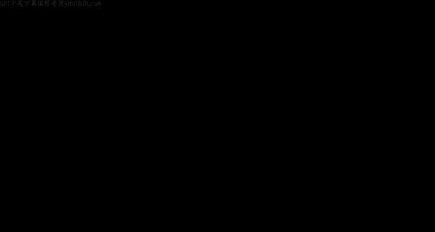
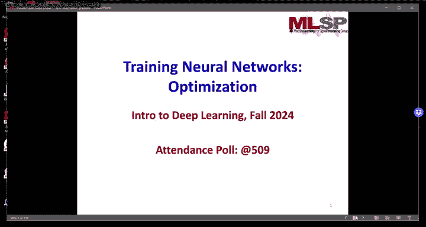
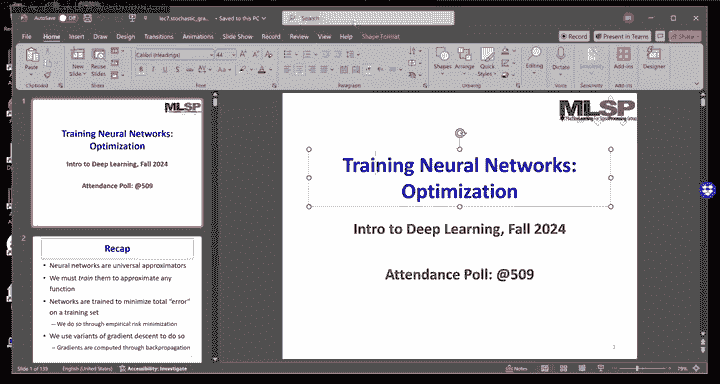
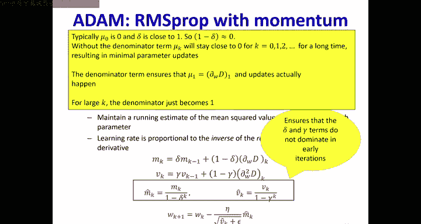
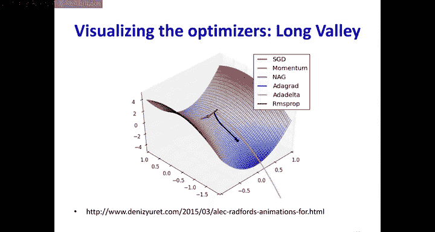

# CMU《深度学习导论｜CMU 11785 introduction to deep learning Fall 2024》中英字幕（deepseek - P8：[8]Fall 2024 Lecture 7.zh_en - GPT中英字幕课程资源 - BV1CfsReEEw8

嗯啊。Please get your name tags out， I still don't know who you are。

I want to the end of the semester but I'm going to。The classes is awful in today。

And I only get worse。So。There were the have polarta Pomons。If you haven't already got this message。

 you're going to get an email from us。I signing each if you are nicknamed。

Andname the nickname is because。It might be a number。

 but this is because people don't like to be called it by name。And through the class。

 I will call out ladies people。By name or by nickname， and you must answer whatever question。

And so you might be sitting at the back of the class or of Zoom or wherever else， but you would。You。

 you're just as likely to be called somebody anybody else。On the front match。And if you don't answer。

And it will bemark absent。You must answer every question that comes away and you might get multiple questions during the class。

 and these could come away at any time。Okay。Let me begin please check your laptops on that of good stuff。

啊 unlessless your。Looking at the attendance school。

It like to properly。

OK。嗯。Alright。Let's begin。We're going to continue our series of lectures on training neural networks。

 so here's where we were at the end of the last class， get your name tags up please。😊。

We saw early on in the first first week that neural networks are universal appromators。

 they can in principle approximate anything。😊，But they must be trained to do so。

We have an name tag okay， tell me your name sure that here everybody is k sure。

 please stand up and tell everybody your name。嗯。😊，I am sure thank you right and if you don't want to be called out that way if I come your way then you better have your name tag out。

😊，Okay。And then we said that neural networks must be trained to approximate anything。

And the way we train it， we have， we know what they we want them to compute。😊。

And we must adjust the network parameters。To compute what it is， we want them to compute。

 So here is the key piece that we must。Remember， if I can get a chalk。

Does anybody see a chalk here here， here's one。This is the bit that we're going to hang on to for a bit。

That。I'm just assuming a single dimensional input for illustration's sake。

 but we know that this is multidimensional。😊，And。You have some target function， which is unknown。

G Fx。And the network itself。Compute some other function。Which is。

Which depends on the current set of parameters。And what are we trying to actually。

Do when we train the network。What is the loss， That is not the loss， right。

 So what we are trying to do is to minimize。This area。Oh。Is this the divergence， however is this？你就。

M哼。😊，What did we say this was when I wrote it down。是。Yeah。

 it's the expected value of the divergence that entire area。行。

This is the F of x is what the network computes， G of x is。

The function that you're trying to estimate。And。We our intention is to minimize the area。

 the difference between the two。But then what do we actually minimize。没里啊。Is it like box。

Is that the proxy， what what else， so Ken， can you tell me what do we actually minimize？他很的。

The average of the hydrogen the sample divergence。 So we don't actually have this entire function。

 We only have， you know， when we cannot know it in most cases。So what we have is a bunch of。

Training samples。 And at each training sample you have， please do not slide。You have a。Gap。I mean。

 and so。We try to minimize the length of these lines， right？The average length of these lines。

And the intention and the expectation here is that if you minimize the average length of these white lines。

You're going to minimize the function you estimate will also minimize the shaded area， right。

So and the way we do it， we can the average length of these lines as a function of just the network weights。

😊，And so this average length， was what did we call that？😊，Somebody gave me the term earlier。Howj。

 what we call it。一。Yeah particular but somebody else gave me the name the loss， right。

 the average length of these lights is the loss when you minimize the loss how you expire。

 are you actually minimizing what we really want to minimize。😊，No， right。 So what we hope here are。

 And so this loss is what we minimize。 and we do so using gradient descent because it's an ugly function of the network parameters。

😊，And we found， as in the last class， the whenular gradient this can have all kinds of issues。

So better convergence methods you know can it may not converge at all， it may bounce around。

 it may get stuck in bad places， so better convergence can be obtained through methods that normalize variation across dimensions。

😊，We like to have large learning rates in the beginning that decrease over time。😊。

And methods that and coupling the learning rates in the various for the for the different components can be disastrous。

 So methods like R probe that decoup the dimensions can improve convergence。 And lastly， we didn't。

 We just touched on it。 momentum methods at end with。

Emphasize directions of steady improvement and deemphasize unstable directions can give us benefits。

So this is where we are and we are going to move on。

 we are going to be talking about incremental updates， we will revisit trend algorithms。😊。

And in the next class， we're going to go over some of the issues that that can be that affect。

How the model learns things and how we can improve the manner in which it learns the function that it must。

So let's look at incremental updates。Get again。As the problem。

 Keep in mind that what we really want to minimize is that shaded area I have on the screen。

But what we are really given is a bunch of input output pairs had a number of locations。😊。

And based on these， just on these few training samples。We want to estimate the entire function。So。

Here's what we did。We started with an initial guess。 I mean。

 regardless of the fact that we want to minimize the shaded area。

 let's focus on the fact that you' are just minimizing the the loss。

 which is the average divergence across the few training samples that we do have。

And so when we do that， this is what gradient de does。 We start off with an initial function。😊。

This when you initialize your network parameters， it to have it's going to compute some unknown。

 some odd function shown by the dotted red line。And this initial function is going to be lower than the target function at some training locations。

 and it's going to be higher at other locations。😊，And so we're going to adjust the network parameters。

To minimize the error over the entire training set。

 which means that the are adjustment will attempt to increase the value of the function where it lies below the target value。

 So it would try to increase the value of the function here and here and here。

And decrease the value of the function here and here。

 So you are adjust a network parameter minimally。And when you do that。

 you get a new pernial function。And then this new function has errors again all over the place。

 And so once again， you're going to adjust the network parameters to reduce the error at every training location。

 So to increase the。😊，Wellal you have the function where it lies below the target。

And decrease it where it lies above the target。 And we keep doing this。Until we。Until we converge。

Now， this is what we want to do。So there are two steps yeah。

 the first is what we really want to do is to minimize the shaded area。😊，But instead。

 were minimizing the average divergence。😊，And even so。

 what we want to do is to minimize the average divergence over all of the training samples。😊。

Because that's the only that's the closest you can do。To actually minimizing the shaded area。 Now。

 this is what we call a batch update。Where you are considering all of the training samples。

 the total error over all of the training samples。 And this is what we minimize。 And when we do so。

 it's adjusting the function at every。😊，Training instance。 so here's your first spot。90 seconds。

Is it 60 or 90。Was60 or 90。That students in Ki。So you have 90 seconds for the polls。

 Students on Zoom requested more time， so we will。Wai a bit。

And then I'm just going to walk down here and pick on random people。

Today I'm going to focus on people at the back of the room and you will answer the options。嗯。Okay。

 that's Isaac is the first option right， yes， and what about a second。I think so as well。And Uma。

 what about the third。And drove the fourth。Okay， so the actual loss function we try to minimize requires batch updates。

😊，And they minimize the total loss over the entire training data。Now， the batch updates。

optimizeptimize again， the first and the third statements， I just had the same thing， right？😊。

But they require processing the entire training data because you want to get the average error over the entire training data。

 what could the issue be with this？😊，Pty hand。你哪里去了？So。Today， what could I be with this。咁你讲咩叫啊出分嘅。你是。

There's something much。Simpler， right。You're going to have to process the entire training data。

 What is your typical training data size。对。m。😊，Is it small， iss it large。

 Is it intenses or is it in billions。It tends these to be in the billions。

 Do you really want to do this。You know wait to process until you process every single training instance before you update it does not make sense right so what would you rather do？

😊，Mi batch。 So what is the notion of a mini batch， right？ and why that's what we're going to look at。

 So what you would rather do is to just， you know， you can think of data as just coming in continuously。

 And as you see data， you would like to update your parameters an online process。

As makes makes a lot more， you know， computational sense。

 But then will that actually convince Virginia。When you say actual loss function。

 I was still talking about the individual data points because yes。

 the loss I said was the individual data points I correct， I did make the distinction。😊，Right。

So here's what we can do instead， let's go to the other extreme。Think of this you know。

 I like to use this， you know。Ma of trying to make make a shape out of party。Now。

 if there's some target shape， you want to make it look like a landscape or a doll or something。

 and then you have a lump of putty。In the ideal world。

 you just sprout a whole bunch of arms like a inner typicalpical Hindu guard。

 And then you'd be adjusting the putty all over the place all at once。 and then you can shape it。

 But you know， we cannot sprout so many arms。 So what do we do。

 We sort of poke it one place at a time， And when you do that。

 when you push things down at one place， they pop up at another place and you have to be really skillful at making sure that you make all of these adjustment adjustments。

 and what is the key to doing that。 If you're going to do this is just poking your putty one place at a time。

😊，You make those adjustments really small。 You tell， you have to be very， very careful。

 And so that's basically what we will do。You're going to adjust the function at one training point at a time。

 keeping the adjustment small。 You pick our location， you push it up a bit。

 Then you go to another location， push that up a bit。Then you come here here。

 the function is overshot。 You push it down a bit。 And then， you know， pick it on the location。 Now。

 the function is underndnderous under computing。 push it up a bit。 So one location at a time。

 you can just。😊，Keep doing this。And eventually， you' would have processed all of the training samples。

 And if you do this right， you can actually have adjusted the entire function with greater adjustment than if you have done a batch update where you looked at the entire training data before you made a single update。

😊，So here is what the incremental update process was earlier when you did a batch update youd have to go over all of your training samples。

😊，And compute the average gradient over the entire training training data before you made an adjustment。

😊，Now。You just go through your training data and at each point you just compute the derivative of the divergence for that one point and make an update instantly。

😊，Now。This doesn't mean that you just make one pass over the entire training data。

 You can actually do this again and again。 you pass over the entire training data。

 You make all a few little updates。 Then you go back and do it again。

 So the iterations can make multiple passes over the data。

 And a single pass over the data is what we call an epoch。 you' are familiar with this term。So yes。

 Professor Wood this result in overfitting。A would it？So again， think of the putty map here。

 you know， but think of the putty example， you're still trying to function。

 you're still trying to shape the putty into。Some landscape or a doll。

 are you going to adjust every single point， all the infinite points and the party or just some subset of points？

Got it。 Thanks， professor。 So it's a nice metaphor to think about， you know， shaping claim。😊。

So an epo with set with T samples results in T updates of parameters。

 We'll get back to this question。 You know， we'll discuss this in some detail in this class in the next。

 So here's what we are doing。😊，Every time。So we can do this many times。And each time you do it。

 it's one epoch。 And within an epoch， youre going through all of the training data samples。

 And each time you look at a sample， you're making an adjustment to the function。😊。

But then you can't just do this naively。any of yous actually played around with party and almost every one of us has in kindergarten。

😊，You know， you can't just keep poking at the same point， right， It's not going to work out。 Now。

 functionally in terms of functions， let's think of let's， let's look at a toy example。Now。

 any time you have a function， anytime you have a network network or any characterizationization of a function。

 it has some inherent limitations and what it can model。

 So let's just assume over here that the function I have has the slight curve shape。😊。

And now I want to adjust this function。啊 do。Compute these so that it best computes these four samples here and these four samples here。

 So the target values are all on the dotted line。The vertical lines are just showing you where they lie。

 right？So， if I start from the left and I begin pushing the function。

 correcting the function at the left， by the time I' am done correcting all four samples at the left。

 the function is going to pop up at the right。😊，What would happen now if I go to the right and adjust those？

It is going to pop up at the left right and then if I go back to the left and add those so it is going to go back and pop up at the right this ever stop。

😊，No， right， so what would be the solution to this？不什么是这个。

You want to do this randomly because there's no notion of left or right and high dimensional spaces and so we want to go through the samples if you look through the samples in the same order every time you are almost certainly going to end up at cyclic behavior。

😊，So we want to go through them randomly， maybe pick one sample up here and push it down。

Then pick one sample here and push it up and so on。 And so long as you are doing this。

Randomly enough， eventually it's going to adjust and give you the best fit to the data that you do have。

So if you go back and look at what how that changes a pseudocode within each epoC before you go over your data。

 you want to permute your data randomly now picking up a random data point is the same as permuting your data and going through it sequentially so because youre changing the order each time。

And so within each epoch， you want to randomize the order of the training samples before you go through it。

😊，And so the story so far in any gradient decentcent optimization presenting training data instances incrementally can be more effective than presenting them all at once。

😊，In principle。Provided the training data instances has are presented in random order。

 and this is the technique that we call stochastic gradient descent。

 the term stochastic arises stochastic I literally means random and so arises from the fact that we are presenting the training data samples in random order。

😊，And then you're performing gradient descent。So this is for any kind of function minimization function function optimization。

 in this case we are applying it to training neural networks。😊。

So why and when does the process of incremental updates work and under what conditions？😊。

So for the Y， let's consider a very simple example first。😊。

And I'm going to look at a very extreme example。😊，First， what exactly are we doing？

When I have a bunch of training data。The error at each training instance is different。

So the effect of adjusting the parameters is going to be different at each training instance and so if I have in my multidimensional space。

 if this is my the current location of my estimates， then the error，😊。

The effect of adjusting these parameters is going to be different。For each of my training instances。

 in one case， you know， it the the gradient may say going this way will reduce the error in the on the other training sample。

 it may say that going this way will reduce the error。

 So each training sample has its own different favorite direction。😊。

For adjusting the parameters and what we do is to find the average across all the training samples。

 and that red direction is the direction that we are taking a step in。😊，But now。

Consider an extreme case where all of my training samples are the same。Here。

Are these all these divergences going to be different for the training samples or are they all going to be the same。

 They're going to be the same， right， So would it make sense for me to go through all of my training data samples。

To compute my average divergence， it does not， right， Because if I look at this。

 all of my training data samples have the same divergence。 The average is also going to be the same。

 And so when I begin making adjustments。When I'm doing a performing a batch update。

 eventually I'm taking the average divergence over all of the training samples。

 It's like adjusting my trade。 my function by one little bit。😊，Like so。

Whereas if I made an adjustment after every single training data point。

 even if the actual adjustment size is smaller。😊，In a single pass through the training data。

 I'm going to be modifying the function a whole lot more。So啊。

You're going to get much greater net adjustment in one pass， through the data。😊，Now。

 this is for the extreme case where all the training data samples are exactly identical。😊。

But instead of being exactly identical， if all of them were perurbed a little bit。

 would this change the picture a whole lot？😊，Like， say this。Would this change the picture of her lot。

No， right。 So as I make them more and more diverse。

The benefit you get from just incrementally adjusting parameters is going to decrease。😊。

And at some point， it's probably going to vanish when the data points are sufficiently random。

 but still you get some benefits and you know some benefits in terms of computational ease。😊，So。

That makes sense to everybody？And so what are the considerations， you know。

 more formally for when it will work and how well does it work。For this。

 let's take a look at another issue。And here， in this case， I like to have simple illustrations。

Let's say I have this bunch of training data points shown by the black dots。

 and my model is trying to fit a straight line through origin。😊，To these training data points。Now。

 I start off with some initial estimate。And I am trying to find the line that minimizes the total error across all the training points when I fit it。

 so is the the average length of those perpendicular drops out to the line。Now。

 if I start off with my first training data point， what is the best。Line for that point。

 it's going to go straight through the line， right。And then I pick up the next one。

And the line is going to swing over to this next point。 and then I pick up the next one。

 and it's going to swing to that one。😊，Will it ever stop。

It's always going to be changing chasing the latest training data point。

 this process will not converge。So， given this。Right， I mean。This guy here， This picture is。

Very optimistic。 But this is really not what is going to happen， right？ So how， how would you。

Resolve this， anybody？multiple take the average of the loss。

Take multiple points and take the average of the loss。 How would you resolve it？Same， same。

Anybody else， yes， we update'm change it a little bit more in that direction。

But will that ever make it stop bouncing around？Yes。The way at which just decreases。 Thank you。

 right， This is basically what we want to do， right， the solution is。Update the model。

 but as you go through the data。You are beginning to trust where you are more and more and more。

And so。Initially， maybe you just go through the point。The next time around you have a large  error。

 you swing towards it， but you don't go all the way to that point。The next time around。You know。

 you swing even less and so long as the corrections you make keep decreasing with iterations。

 Eventually the corrections are going to be small and the function you learn is going to stabilize that something that maybe minimizes the overall divergence and so in the incremental learning。

 you want the update model to always minimize the error on the latest training latest training instance。

 this is what we are doing。😊，But then we must shrink the learning rate with iterations。

 for convergence。😊，And so the correction for individual instances with the eventual minuscule adjustments will eventually not change the function too much。

 and it will stabilize hopefully to something that makes sense。😊，Did that make sense to everybody。

Okay。So here is what the here is how it to modify your pseudocode again over the epox。

 the first thing you do is to randomize all of your data， this is essential。😊，And secondly。

 the learning rate with which you adjust your parameters has to keep reducing as you go through the steps。

😊，So what is the rate？At which this learning rate must converge。

Do we have any considerations restrictions on the behavior of the learning rate itself？So here it is。

 If I keep going through this， my learning rate is being modified in some manner。

So I have a C sequence of learning grades。E I， which may be you know， 1。9。

It's a series that keeps changing with iterations。So let's look at an extreme example。

 Let's say this。Is my？Opttimal。Value for a parameter。 So in the parameter space。

 that's my optimal value。 And let's say。This is my。Be你 show。But Im。Now。

The derivative of the loss with respect to the parameter has some value， right。

Is it ever going to be infinite？No no， we designed our loss and our activations to ensure that these derivatives don't blow up right so let's say I have a maximum value for the derivative。

And so。If the largest value for the derivative is some C， then。In how many steps。

 What is the smallest number of steps。In which I can get from point A to point B if this distance is D。

If this is D， what is the smallest number of steps in which I can get from point A to point B。

 D over C， right， but really。What is the actual step size？Ucussing this rule。

The actual step size is going to be。8 I C， correct。

So what is the total correction you' are making over infinite steps？

So it's going to be summation I Eta I， right， which is going to be c times summation I Eta I。

 this is the maximum amount。By which you are going to be able to adjust。

You cannot adjust more than this， right， and this has to be。Greater than or equal to the distance D。

 right？😊，Now， what is the largest value for D？You can't say you can be infinitely off， right。

Yes or no， right， so。And D can be as large。Or let me just call this equals， just to make。

Things nicer。 But D can be infinite， right。C is not infinite。 C is finite。

So what does this tell us about the summation of the step sizes？你是这没自己。对啊，没你也是意。

They should be able to be infinite at some sequence of step sizes。

 So what does this tell us about the sequence of step sizes guys yeah shouldnt go to zero but shouldn shouldn't go to  zero and sufficient。

😊，Can I multiply C？With any， so we know that D can be are as large as infinity， right？Ced finite。

Can I multiply C with any finite value and get infinity。So what must this be。

 This must be infinite also， right， So in other words， your step sizes may shrinking with iterations。

Nonetheless， it cannot be a。Convergent series and sequence， right， That makes sense。To all of you。

And the reason for this article was is that if it converges。

 then there are situations where you are never， ever going to get to your optimum and so you have requirements。

😊，Only me at step sizes。The sum of the step sizes must be infinite。

But then the easiest way to make the sum infinite is to make them fixed， but that's not a nice thing。

 right， You want the step sizes to shrink。 So how do you encapsulate that。

 The sum of the squared step sizes must be finite。😊。

So can anybody give me an example of a series where the sum of the series is infinite。

 but the sum of the squared sum values is finite？Yes。1 over x，1 over x， right， the harmonic series。

 What is。We know that。1 over x，1 over。N is divergent。1 over n squared is convergent。Right so this。

 it turns out， is actually at the very bottom its 1 over n raised to any alpha greater than  one is going to be a convergence series。

😊，But one over hand raised to any alpha less than 1 is going to be re or equal to one is going to be divrgent。

😊，But then， you know， it's going to be。In terms of square summation。

 it's not going to be It's not going to be converging fast enough。

 And so one over n is kind of the optimal。Sequence of step sizes。

Which ensures that over an infinite series it still sums to infinity， but it's square summable。

 there's a very nice paper on this and so if the loss is convex， if you follow these properties。

 this stochastic gradient distantcent algorithm will conversege to the optimum for nonconvex functions is going to get to a local optimum。

😊，And， in fact， all of the learning rate schedulers that you have。

When you work on your homework they arere going to have this property that in the limit they are going to sum to infinity。

 but you know theyre going to be absolute they are going to be absolutely absolutely divergent but square summable。

 Now you don't really need to have something that goes goes on as one over n。

You can actually have something which goes down this way and it has the same property。 So typically。

 this is what we use， right。Any， any questions。嗯。Like， why practice use stuff like。So in practice。

 you're never actually going to go all the way to infinity and so we are depending on some of the actual practicalities of。

😊，The problem itself。But in the worst case， that one gets you there。Right。

So let's see how well this behaves。 This is an example I pulled off the web for K means clustering。😊。

And you know how K means clustering works， you have a whole bunch of data。

 you have to cluster it into a finite number of clusters and depending on how you initialize it。😊。

You are going to get different solutions。 So over here， you know as you go through the iterations。

 the optimality of your solution is going to change。

 And so this was the actual solution for k meanss。😊，Regardless of the initialization。

 after if you've spent one and a half seconds on this particular data。

 the range of solutions you get have this variance in these squared loss and by the time you get to100 seconds or other end up at the same point so you can see that the solutions the training converges across the different runs。

With iterations， the vertical bars show you how much the loss value varies across different runss。

Now， the red one is exactly the same thing， but for stochastic gradient descent。

And which one converges faster， Which one gets to its you know， flat value sooner， The red one。

 right， because the x axis is is time。Before the batch value even begins its descent。

 the red one has already flattened out， so stochastic gradient descent actually converges much faster。

😊，But has it converged to the same loss？It's conversed to a much， much， much worse loss。

 and this is something that we will actually encounter。

So why does this happen that we will see in a minute。90 seconds。I think we've used our 90 seconds。

Can someone on zoom。Tell me if that first statement is true。Anybody on Zoom？Okay those correct。

Correct。Okay， what about the second one？All right。What about the third？Correct， and the fork。Okay。

 all of them are correct， right，tochastic gradient descent is an online version of batch updates。😊。

It can have oscillatory behavior if you do not randomize the order in which you present inputs and it can converge faster than batch up bits but arrive at a poorer optimum and convergence can only be guaranteed if the step sizes shrink with iterations and there are minimal requirements for how the step sizes may shrink。

😊，If they don't satisfy that， then your learning might never converge。Right， so now let's go back to。

Why this difference and how we can fix the sector the option we need the function not necessary。

 It's been converse to a local optimum。Just so long as the gradients are finite it。😊，Actually。

 it turns out that you can if you satisfy this property。

 it will converge to a global optimum for you know if your step sizes go down slowly now。😊。

Then there are guarantees that it will go down to it will go to a global optimum。

 otherwise it's going to go to a local optimum。嗯。Again。

 assuming that your functions satisfyes certain minimal properties。

So it's actually a very nice result。Back going back to the 50s， I think， or '60s。

I should post the link。 Okay， so now let's go back to our function。 again。

 here's what we wanted to estimate minimize。What we wanted to minimize was the expected divergence。

 the expected divergence is this area， the shaded area。But what we are actually minimizing is the。

Average divergence over there。Training data， right， So now let's look at this， the input。Has some。

Distribution。And so now， if I have。So this is my target function G。And。My chalks went over here。

The orange cha is on the desk。 Oh yeah， yeah。 Thank you。 I also find my pink one。 So。

 And so if this is my function F。😊，Now， if I randomly choose a training a sample。

 then on any randomly chosen sample。I'm going to get a divergence， right。

 if I keep randomly choosing samples。What is the expected divergence？そ要。

So this expected divergence that I was showing was basically telling you what this。

 that if I keep randomly selecting samples from my training distribution and then compute the average divergence over all of these。

😊，That is my expected divergence， right， and so。The expected。

Diveigence of x is basically what we are trying to minimize， this is the expectation。

But then is it always going to be the same， Is the divergence going to be the same at every point。No。

 so it's also going to have a。Varis， right， So the two characteristics for this are going to be the expected divergence in the。

Variance of the divergence of x。And now， if I look at this guy。If I look at one over N sum， I。

You know， diver gens。Of x I。Which is my loss。If I take the expectation of the loss。

 meaning if I say I have a whole bunch of points， I'm going to compute their divergence and then I average it。

 And if I repeated this experiment lots and lots and lots of times。

 what is the what is the average loss I would get。 So this is my loss。

And the actual value of the loss is going to depend on the set of training points I choose。

So the expected value of the loss。It's going to be。By the linearity of expectation。

Expected value of the。Diveigence of X of I。Each of these is a random sample。

 So what is this going to be。The expected value of any time of the divergence of any random sample is just the expected value of。

The divergence itself， right， which is going to be just。😊，The expected value of the divergence of。X。

Which is exactly what you had over there。Which is why we like to do this。 You。

 because in expectation， our loss is basically what we want to actually minimize。

We sort of believe that minimizing our loss will also minimize the actual objective。

But then what is the variance of the loss， again， what do I mean by the variance of the loss？

If I choose a different set of training points， I' am going to have a different loss right each time I choose a different set of training points I'm going to have a different loss。

 so the loss has a variance。😊，What is the variance of this slot？Now， here is a property。If I have x1。

 x2， and so on。If I have a bunch of different independent random variables， then the variance。😊，好。

X1 plus x2。There's going to be the variance of x1。Plus， variance are extra。

This is an easily shown property I am not going to show this。

 but the variance of the sum of independent random variables is going to be the sum of there。😊。

Varians， right， So what is the variance of the average of two independent random variables。Okay。Yeah。

 so if I take the variance of the average of two variables， which is variance of x 1 plus x 2 over 2。

 that's going to be one over 4 because variance does the squaring of。Variance are of x1。Plus， x 2。

Which is going to be one over4。Vance of x 1。Plus variance of x。Everybody with me。

 And if x 1 and x 2 are identically distributed， then this is simply going to be。You know。

 if I have half variance of x。 So in general， if I have n training points。😊，If I have n samples。

 what will the variance be。If I have n samples of the kind for variant of。

The loss of n n samples is going to be one over n。The variance of。The divergence of。X。

 this is what we get for our training data。 And so the expected value of our empirical risk is actually the expected divergence。

 which we actually want to minimize。 So the empirical risk is an unbiased estimator。

 meaning that on average， over many different training sets。

 you're always going to get the the average of the。😊，Loss that you'd get。

Over different training sets is going to be a true the actual objective that we want to minimize so So it's an unbiased estimator。

 but then across different runs。It's going to have different。Losses。

And so the variance of this guy is going to be 1 over n， the variance of the divergence。

 and n is the training set size of the number of training points。

 So as you keep increasing the number of training points。

 the various variance in the loss across different rounds decreases。😊，Now。If I'm looking at SGD。

 right， So here's what the variance of the loss is going to look like。 Vaance of the loss。Over。

Number of training toys。So at one。This is going to be just the variance of the divergence。

We saw this， right， And then it's going to come down like so。As an increases。

 So when I'm performing S GD。I'm still having， I still have the same point。

 I'm looking at the divergence for a single point。 The expected value of the divergence of V at a single point is simply。

The shaded area right， they expected divergence。 so this guide to the sample divergence is also an unbiased estimator。

😊，Or estimate the expected error。But the variance， meaning how much this loss changes from sample to sample can be huge。

 So if I have a very large training sample， the variance of my loss is going to be somewhere out here。

Whereas if my training sample is just a single one， my variance is going to be out here。

 which is why when I， you know， train across different rounds。

 when I'm performing stochastic gradient decent， my lost values is going to be bouncing all over the place and things don't converge Now maybe the math doesn't make a lot of sense。

 but but pictures do。😊，So the blue curve is the function G that we are trying to approximate the red curve is the function that is currently being estimated computed by the network。

😊，And the divergence。Is going to be the difference between the two we are trying to minimize the shaded area。

So let's say I have a small bunch of training points。If I have these training points， these 5。

6 training points， these training points are telling me that the function must go up here。

It must go down here。 It must go down here。 It must go down here and must go up here。

Right anyway the funny time the function is below the target， it has to go up anytime it's about。

 it must go down right On the other hand， if I chose this set of training points。

 a completely different set of six training points。😊，It's going to tell me that the function must。

Go up everywhere。Is that correct？There are places where it must go down right， On the other hand。

 if I had these as my training points。What does it tell me。The the function must go down everywhere。

 So the kind of adjustment you make is going to be dependent on the specific set of training points you choose。

Which is why you have so much red variance。😊，Between， you know。

 between the what you get when you change your training set。So what would be a good thing to do。

 how do you minimize this fluctuation？Yeah， take the large sample。

Just have a very large training set and you know， you are going to and then you know variations in the training set is not going to not going to result in large variations in the lossft and the behavior of the loss width。

😊，Change of parameter。It makes sense to everybody。Right， on the other hand。If I have only one sample。

 if my sample ends up there， it's's just telling me， I'm fine。If it's here。

 it says you've got to increase the function， if it's here。

 it says you've got to decrease the function。 And so the behavior can change wild because you're always looking at only one training point。

Which explains this picture when you're working with stochastic gradient descent at each time you're looking at only one training point。

So the loss is going to swing wildly from sample to sample。

 whereas when you are performing batch descent， you are getting consistent estimates every time。

 which is why although as GD will converge quickly because we made us learning great shrink and all the other things that can converge to a nasty location。

😊，So is there something that you can think of that gets the computational benefits of HGD。

 but not a nasty you know tendency to go to wrong places。24公。Not multiple points。

 but not the whole class right whole set， So SGD uses gradient from only one sample and so has high variance but provides significantly quicker updates than batch。

😊，So is there a good medium， I can pick random samples。 instead of picking one sample， I pick a。呃呃。

Set of samples。 And so maybe the first in my first step。

 I pick these three samples and make adjustments。Which gives me a new function。

 Then I take three other samples and make my adjustment。

 And then that are just my function and so on。 I can keep doing this， so。😊。

Here's what that make sense to everybody， right？And so here is what that behavior looks like now you are going to be within each epoch you are still going to be permeuting your data regardless of whether you are adjusting it one sample at a time or a small mini batch at a time。

 you don't want cyclic behavior so you must randomize the presentation of your data between epos but then within each epoch you are going to be operating on mini batches of instances。

😊，And adjusting from mini batch。 So if this is the case。

 what can you tell me about what is an optimal mini batch size。Anybody。

It should be good enough to represent the data。 So here is what you get， if N。

Is your actual total training data。Then the variance of the loss is proportional to 1 over n。

 so if you have a billion training points your weight the variance of the losses is very close to is proportional to0 it depends on the expected you know the variance of the divergence itself。

 right。😊，So you want your mini batch。What is the variance of the mini batch of the last for the mini batch。

 anyone。So for the mini bats again。The expected value of the mini batch again， is an， you know。

 it's an unbiased estimator。 The expected mini batch loss the div is the actual function you're trying to minimize。

😊，But the variance is going to be one over B。 So as you keep increasing the mini batch size。

 the variance of the loss from sample to sample。Keeps decreasing， right。

 And so if you have a mini bad size of one， that's your variance。 If you have a mini bad size of two。

 that's going to be 2， right。At some point， here mini batch becomes large enough。

That this difference is not very much。And so you want the mini batch to be as large as you can possibly fit into your compute because that minimizes the variance of the loss between mini batches。

Makes sense to。Right， so。Here was in on that previous example。

 this is what the behavior looks like with mini batches。

 And you can see how it consistently converges。 It converges to a loss that is very close to what you would get if you actually use your entire training data。

😊，You still have more variances because the mini batch size is smaller than your entire training data。

 so it' is going to fluctuate but not as much as SGD and where it converges to is also going to be pretty close to where you would converge to using the entire training data but is is going to converge there as quickly as you would if you were using。

Sttochastic gradient descent， right， Again， the difference is S GD is using one sample at a time。

 mini batch descent is looking at。Small collections of samples。And so， again。

We speak the convergence over here is defined in terms of overall training loss on the entire training data。

 all the plots that you plot in your homeworks， they are bogus。

 every last one of them is bogus because you are plotting the loss on the latest mini batch。

 What is it that you are looking guaranteed convergence for。😊，The loss on the entire training data。

 you're just sort of getting some guess at it。Still， you expect that to converge， right。

 That makes sense to everybody。Okay。So in practice training is usually performed using mini batches and you would like to set it to the largest that your hardware will support without compromising overall compute time。

 larger mini batches is less variance。😊，And also largest。

 larger mini batches means fewer updates per apo， which is also a convenient thing。

 Convergence depends on learning rate。 Again， even if you're working with mini batches。

 the learning rate has to shrink with iterations。 This is a requirement。😊。

And so we have various techniques like fix all， learning re thepohe plateaus and reduce it and so on。

 We have update， adaptive updates。😊，Where the learning rate itself is determined as part of the estimation。

But anyway here's a part。嗯。Okay。I think most of you must have read it by now， so June Kyang。

It is the first statement corrector falses。True。因 the car呢。What's your name。Ohnet Bennet， okay。

 so there was the second statement to a false。true think it's true， T。

 what about the third and you what about the fourth。Also to May know your name。 thank you。

Guys get your name tags out in future， so I don't have to ask you your name right。

 but it turns out the second one is cannot be true， right？SGD is not。Manyni bass descent were steps。

 bad size of one。Is exactly stochastic gradient descent。And so the second statement is false。

 everything else is true。Mini batch descent is also an online version of batch updates。

 except you're updating things after seeing batches of instances and with vector processing that's going to actually be much faster than SGD。

😊，So the story so far， presenting training instances one at a time can be more effective than full batch training provided they are provided presented in random order should be。

😊，For it to converge the learning rate must shrink sufficiently rapidly with iterations。

 otherwise the learning will continuously change change the latest training instance。😊。

And as GD estimates。Have higher variance than batch estimates。

Mini batch updates operate on batches of instances at a time。 So because they operate on batches。

 the estimates have lower variance than S GD。 And so in theory。

 the convergence rate is actually worse than S GD。 But then convergence is one thing。

 converging to the right。A good solution is a completely different thing。And so， you know。

 because you're able to back perform batch processing。

You can still get benefits you know with GPUs and such like and you can get to a better estimate than you would with just SGD Now there are problems where GD will give you a better solution solution than many batchs you will encounter at various points in your life。

 but anyway。😊，So moving on， any questions。Yeah what is online mean online is asked data that comes in。

 right， so。We think of it as streaming。So you could literally be just updating empty models as data keep streaming it。

什么？Yes。啊，我我都是没。So vector meaning for processing large amounts of parallel processing graphics。

 it's just a standard term。 So when youre doing when you're operating with GPUs。

 you're processing many different instances all advanced， right。So our many components， all at once。

 Again， terminology。 But you get the concept。Right。Okay， so now。Here's another thing。

 Let's go back to this business of of。Trends， we briefly discussed trends in the last class。

It turns out these are very important。Figuring out so one。

 and particularly when we are working with things like stochastic gradient descent or mini batch descent。

😊，Sorry。So anyway， guys。It's。😊，What happens is because your mini batches are changing from。

Iteration to iteration。 each time you pass through the data。

 you're working on a different mini batch。 You're working on a different sample。

 So even when you're performing standard gradient descent， we know that our。

The direction in which the divergence points。Can keep bouncing around when you are working on a completely different set of samples each time。

 this fluctuation is going to be much， much greater。😊，So we would like to be able to。Deal with these。

 And we run with all the standard convergence issues that we we end up with when we are looking at batch updates and so。

😊，We need to compensate for that as well。We use the same principle as before。😊，Now， if I've got。

 if I'm going through my data， then in parameter space at some point。Let's say this is my gradient。

 And that's the resulting step。 I have a step size， right。

 But let's say this is my gradient in the current on my current bass sample or mini batch。😊，Then。

I'm going to go here。Let's say this is my gradient on my next sample or mini batch。

 And then this is my gradient on my next sample or mini batch。 What are we observing。

 We are observing that the gradients are kind of consistent along the horizontal direction。

 and they are terrible。😊，Along the vertical direction， right。

 So how can I sort of try to compensate for it， A lot of work that goes on deals with dealing with this kind of fluctuation。

Where in some components， along some directions， they are consistent。

 along other directions they are bouncing around。😊，Now， here。If I were to take a。

Average of all of these guys。 What is the average gradient along the horizontal。Direction。

A little bit to the right。 It's going to be a little bit to the right， right， So over here， this one。

 this first one is going to be at step 1 is going to be this march。

 the second step is going to be this march and the third step。

 So every time it's going to have the same direction。

What what is the average gradient in the vertical direction close is going to be close to zero right So it makes if you begin looking at average gradients。

 that gives you a much better notion of which way you want to go and this is particularly you know particularly relevant when we are working with mini batches or。

😊，Or single instances， if I look at the average gradient over the entire training sample。

I'm going to get a gradient that's much closer to the gradient further。For， for the batch。

But then again， we don't not want to wait all the way to the end to figure out what the average gradient was。

 And even that gradient can have random perturbations and fluctuations。

 So what would be a good thing for us to do。😊，So again， thinking of it purely in terms of online， Im。

 if I want to compute the average gradient。But what are the entire batch？

But then I want to keep updating it， what would I do？呢点咩又佢做出。Keep a running average， right？

 So what I would do is something like this。I'm going to have。This one。This is going to be my。

Gradient sequence of gradients over all of my iterations， all of my mini batches。😊。

What I wanted is to compute the average of all of these guys。

 there are two purposes for this first computing the average over the apo gives me something like the average gradient for the。

😊，Entire batch， but then even apart from this， if I were just considering batches at a time。

Graadients， which bounce around， Tell me that you know。

 like even in this trivial problem that I show on the board。Tell me that in some directions。

 those gradients don't make a lot of sense in other directions。 They do。

 And so we want to compute the。Expected on average。Dta W。

But then you can't wait to compute the average deelta w before you make an update。

So what we will do is to maintain a running estimate Im going to say that。😊，Average。K of。

My Delta W is going to be。 There are different ways of maintaining a running estimate， right。

 So the most standard one is going to be some alpha times。Ad step K minus-1 of。That a W plus。

1 minus alpha。For the kid step， right？This is， this is the standard mechanism for using maintaining running averages。

 And so if you just maintain a running average of this kind， then。At each step。

 the actual correction you would be making is going to be with the current running average of the。

Graient。I see some frowns that makes sense。Right， how you sure。Yes， okay。So what did I say？

The lady there。You guys are looking confused。So I just want to make sure I haven't missed this。

 I have a a couple of minutes。直播了。Can you explain it back to me。So like with the waiting sum here。

 that's kind up maintaining the like the average。 It's it's maintaining a running average， right。

 And it's very easy to show why this running average works if I。If I have N samples coming in。Then。

 in fact， then。1 over n。Or the K samples one over K。 I mentioned I。 And we just call this。

 This is my diverg density I。This is my average after。K samples， correct， The average after。

K -1 samples was one over。K -1。Sation I equals 1，2。K -1， B I。So I have two different formula。

If I write this guy in terms of this one， then I can say average k。Equals k minus1。Times。Average。

K -1。Basically， it got rid of this division， which is just the summation。Plus。李。李 key。We working。

So I just scaled out the k minus-1， then added in the10 new instance and divide it by K。

Which looks like。K -1 over k。Average。K -1 plus。one over k理。Right， which looks like alpha times。

Average K minus-1。Plus1 minus alpha times。Thank you。So you get the idea。 right， I mean。

 if I did it right， that alpha is going to change with the number of samples， but this is。

 this is a simpler way of looking at it。 So the running average is a very easy way to。 Yes。

 so this formula over here sort of weights all the previous gradients equally don't want to wait like the。

😊，The， one of the most recent ones。 more。 No， you don't。 I mean。

 you're just running So you're maintaining a running average。 So this one over here will。

If my act actual alpha changes with K。That's going to be waitinging all of the samples equally。

 If I have a fixed alpha， that's not going to be the case。

 the most recent one is going to get more weight。😊，It's a good point。 But anyway。

 so this is basically what we are going to do。We are going to maintain a running average of the gradients。

 And so a different way of thinking about it is that。Now， what is the。Step we took at any time。

The step we took at any time was proportional to the running average of the gradient until that time。

 And so I can just say that I am using。Once okay， so I'm using。Let me call this Delta W as a step。

K is going to be some。Beta times Delta w of k minus1 plus alpha times the deelta w of k。

 So this is basically saying that this is the latest gradient， actually。

So this is the latest gradient。 and you're just taking the step size because the step size that you took was actually encapsulates the running average of the gradient until that point。

 And then you're just suming in the latest gradient。

 And that's what you would be doing to adjust your。😊，Do。Come up with a new new new update。

 This minus simply because you're taking a step against the gradient。

And so this is what momentum methods do。😊，You maintain。

A step size and the current step size is await weighted sum of this last step that you took。

And the latest gradient。And this is the new step that you're going to take。

But makes sense to everybody right and so typical value for this you can see this it's going to be some beta times the previous step size minus the learning rate times the current step size if you if this is what I sent you that stuff Purdue if there's anything in guys I don't I don't think you're speaking to me any mute it like the mute please that was my daughter hellello guys atoom like get a mut we just reach out to both but if you know somebody in particular should put a couple professors。

😊，Thank you。Guys， when you're in class， you're supposed to be attending class。😊。

I don't know what conversation you're having， I don't care what conversation you're having。

 please switch off your zoom， we'll mark your absent。And then go and have your conversation outside。

O。So。All right， did this make sense to everybody？And so again。

 this has this property when I maintain a running average。😊。

Then the running average is going to cancel out the swings。

In directions where the sign keeps changing wild。 And it's going to emphasize the steps in directions。

 which。Agregate， so this has this natural property， even for batch updates。

 And in the case of mini batch and stochastic gradient gradient updates。

 it also has the property of approximating the batch gradient。 Yes say much。😊。

Would did it present in a cold star problem， so let's say with the initial samples of our data？

The loss was less。Due to which the was No， so the the value of the loss has nothing to do with the gradient。

The gradient can， you can have a loss of zero and a very steep gradient。So。It won't be a problem。

Okay， now， so here is what the gradient update does。😊，The momentum update does。

 Let's say this was the last step that you took。Then you have a gradient at the current location。

And taking a step against the gradient is actually making you walk along the blue line， right。

 and then。To that， you're going to be adding。A scaled version of the last step that you took。

 And this is the actual final step that you take。 So look at the order of operations。 First。

 you've taken a step， then it's like taking a step against the gradient and then taking a step that's a scaled version of。

The last step that you took。There are two steps over here。

 The first is the step against the gradient。 and the。

 the second is the step that's proportional to the last step that you took。 I can change this order。

 instead。 So that's one， and that's2。😊，Instead， I can do this。 I can first take a step。

That's an extension of the previous step and then take a step against the gradient。

 I'm performing the same two operations just in different order。

And that's going to get me to a new point。 This is Nessterov's accelerated gradient。

And as so the formula are over here， this is like saying I'm going to be taking。

 I'm going to be extending my current step and computing the gradient of the new location。

 and that is the correction that I'm going to be taking from that new location。 So within each step。

 you're still performing the same to steps。 But then the order is different。

 And it turns out that this is actually much more optimal than standard momentum updates。

 here's a picture from hintton。😊，HereSo for example， this way， your last step。

 if youre doing a momentum update， this would be the gradient。

 and then you're doing a scaled version of this step， whereas if you are doing nestrops。

 you scale do a scaled version of that step and take the step down。 And as you can see。

 nestrops gets to the solution much， much faster。 it's probablyably more optimal under some conditions。

😊，So I tried reading this paper a long time ago and'm convincing myself。And the first statement said。

 you know， obviously， bh and made some mathematical statement。Then I couldnt understand it。

 so I took it to my student who had won a math omp。

And so he spent a full day on it and then came back and explained to me why it was obvious。But yes。

 it's there。Fantastic。Algorithm， and once again。This gradient。It's going to be computed using。啊。

That's the SDGD instance of mini batch laws， and the derivative is going to be computed using。😊，Back。

 both for momentum updates and for NAtros accelerated update。Allright， so here is the。I know。

So what happened over here？This is your standard gradient decentral。You have some initial W。

 and then you took a step。Against the gradient， the step was some learning rate times the gradient。

 except that the gradient that you use was no longer the latest sample gradient。 What did we use。😊，啊。

对。The running average。 That's what we used。 correct。 So。

 but there's another thing over here that you can also， that's also under control。 What is that， Eta。

 the learning rate。 So So the momentum methods fix this term。But then there's the second term， right？

Now。How does that affect things？Consider these three examples。 In all three examples。

 the running average the in the vertical direction is the same。

It is just that the swings are much greater in the right example than in the leftmost example。😊。

So would you still want to be following the running average of the gradient。

With the same learning rate in all three cases。Yes or no。What does intuition tell you。

Could we demolish thats more varying one。But smaller steps where it's varying a lot because you trust it a whole lot less。

 right？ So how can I quantify the fact that although the running average is the same。

 I I've swung around a whole lot more。没有。I can look at the variance。

 I can actually look at the length right， except if I just look at the length， sometimes it's up。

 sometimes it's down so I can just state me RMS value。😊，How much is how much the L。

 And so this is basically what we do， This is RMS prop。😊。

We keep track of the squared length of the derivative in each direction。And。

Then we compute the mean squared length of the derivative。And the mean squared。

 So here is what we would do。We are going to keep track of the mean squared length of the derivative and now the learning rate。

😊，Its simply going to be。Inversely proportional to the mean squared length or root mean squared length。

Of the step in that direction。 Now， observe what has happened。

 The learning rate for each component has changed。Youner no longer having a component specific learning grade。

 This is going back to what we discussed in the last class。 And so this is。Going to convert faster。

And。I also know the similarity to arop。Meaning， if you're walking along a constant slope。

Then the derivative is going to be constant。 You just have a constant step size， right。

 We are basically， moreover。When if if I'm walking along a constant slope， this term。

 the squared magnitude， the square root of the squared magnitude is just the magnitude。

 these guys will cancel out。 You are just always taking a constant step regardless of the slope。😊。

Just like an ad。Which is why it was called RMSR as an extension of Rrop。

So RMS S probably adapts this learning rate by total movement。We have two different things here。

 RMS Pro adapts Ata。And it adapts data to be inversely proportional to the RMS value of the。

Of the magnitude。Momentum methods adapt only the gradient。 So knowing this。

 you as smart young people， what would your next step be。Combine the two， right。

 If I combine the two， that gives me。Adam。So this is literally just this。

 Atom is a combination of atom is prop， and。😊，Momentum methods where I maintain a maintain a running average of the gradient。

 that is this M over here。I also maintain maintain a running average of the second mom。

 second of the squared derivative。Aot each component and the actual update rule is going to be using the running average of the。

Of the gradient asms direction。And component wise。 So this is going to be changing by component。

 I'm going to be using the R M S value as the inverse of the Rm S value is my step size 8 or the step size is going to be inversely proportional to the R M S value of the component。

 Thiss one extra magical term over here，1，1 minus gamma is to K 1 minus delta is to K。

 What are these things。😊，It turns out that typically all values are 0。 and in the beginning。

 So in the beginning， if you do this carelessly。Then you're going to get stuck。

 You don't really make any updates。 And so you have the scaling factor one over gamma is to K。

 which says that。These estimates。Are going to be scaled by a term which quickly which starts off close to zero and then quickly becomes one。

 so the scaling factor disappears here。Are we doing are we setting these values after each park or is are running through the entire we just run through right that's it because the step sizes are automatically figured out right and so you don't have to deal with optimizing things anymore so。

Typically， mu 0 is going to be 0。And Delta is close to 1。 So one minus delta is close to 0。

 So tip if you if mu 0 were 0 and you did not have this denominator term。

Then you're going to find that the running average is。Simply always going to be the latest sample。

 right， or just going state close to 0。 So you don't want this。 If Delta by 1。Then this becomes 0。

 This becomes one， and the mean will never update。And so you have this Delta a to。

And now， once you get the general hang of this， you get the general idea of these various optimizers。

 What are the optimizers doing， A， they are maintaining running averages of the gradients。

For two purposes， one maintaining a running average。Approximates batch updates better。

 Second is going to。Eliminate oscillations in nasty directions the other thing they do is to adjust the learning rate and the learning rate is adjusted to account for swings directions in which you have wild swing will have learning rate and lower learning rates in other directions are going to have higher learning rates。

😊，And so here's a poll。 we'll stop with the pole。There are some examples on the slides。啊。

Which is of how these different things behave， optimizers behave on different functions。

We can take a look。 You can find these online， too。这。Okay guys， for this one alone。

 I'm not going to give you that much time。 Can tell anybody tell me the first time is right。😊。

Second one， third。Third， true or false。Forth。And the fact。不清楚。Yeah。

 so only the first statement is false right and here are some examples。

 pictorial examples of how the different optimizers behave it is kind of pretty and you can actually look at is a crazy one see look at how SGD basically gets stuck in the saddle。

😊，And。RMS prop generally tends to be very stately when it has a steady slope。

Because the derivative terms cancel out and all you leftwith is a step step size。

 but the rest of them behave differently in but。Eventually。

 I think Nerous method actually tends to be the fastest to get to the optimum in most cases。

But in many cases， atoms is better， yeah。They do， right， They do。 Anyway， let's stop。

 Thank you very much guys。 The next instructor is going to be at any moment。😊。

他啡鞋列的。