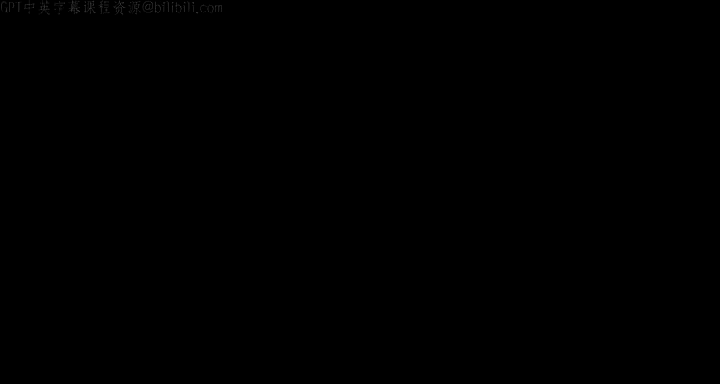
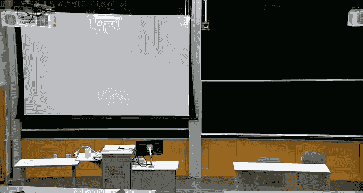
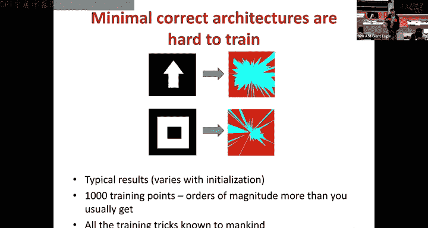
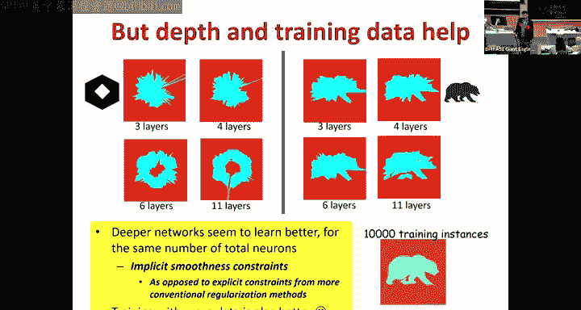
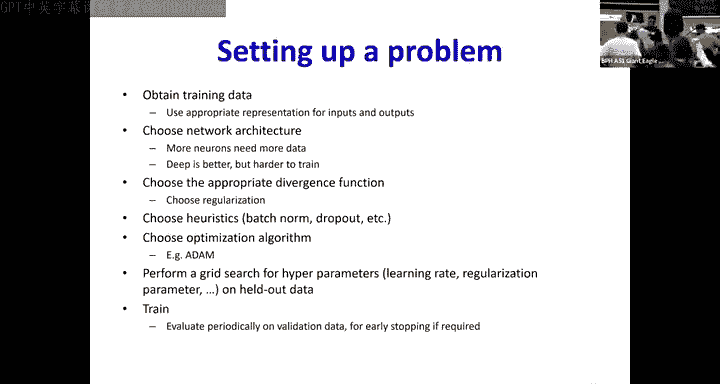

# CMU《深度学习导论｜CMU 11785 introduction to deep learning Fall 2024》中英字幕（deepseek - P9：[9]Fall 2024 Lecture 8.zh_en - GPT中英字幕课程资源 - BV1CfsReEEw8

あ好。死。Yeah。我こ告す。これな。在跟下。question， any question on there。只只一。Can you click it on for you？是。

I better to know。嗯。Thank you very much。All right， everybody。re月。Usual stuff， please。

Shut your laptops。诶。Get your name tags out， and。It is my team。Get on of money。Yeah。你真好。Coect。

 let's begin。This is the last of our series of lectures on。Training neural networks。vivo。好。

So here's what we've seen so far。We train a network by minimizing a loss function。

Our loss is a function of the network parameters， which computes the average。

Divergence over a bunch of training samples。 The specific set of training samples may change。

From step to step， we also saw that this loss is not really the function we want to minimize。

 what we really want to minimize is the expected dive。

 case sure you still don't have your name tag out okay。啊。就。

And we minimize this through gradient descent where we take iterative steps against the gradient。Now。

 we also saw that。In principle， you want to optimize the network parameter to update to adjust it everywhere over all of the training samples at each step。

 But this can be slow。 And so we use incremental update algorithms like stochastic gradient descent。

 and mini batch update could speed it up by updating。

The parameters using random samples chosen from our training set。

These are faster to converge but may but have greater variance from step to step and so may end up resulting in worse。

Solutions。And we also saw that trend algorithms， smooth out variations in the incremental update methods by considering long term trends in both the gradient and the variance of the gradient itself。

😊，好，好的音下。Square magnitude of the gradient itself。So we're going to look at a few more topics to close out this business of training。

We are going to look at divergences， normalizations， dropout， and a few other tricks。First。

The divergence。 Now， here is the loss。 The loss is the average divergence over a bunch of training samples。

And how well your network converges to its optimum is going to depend very。Seriously。

 on the nature of the。loss function itself。 we saw earlier during this course that some kinds of error functions were really not very useful。

Anybody remember an example， the step， you know， am I correct， am I not， you cannot differentiate it。

 I mean， you could， but the derivative is either going to be0 or infinite and they're not going to be useful in telling you which way to adjust your parameters。

 So the choice of loss function is going to be going to have a great impact on how well your network。

Drerinks。Ideally， the loss function must have a shape that results in a significant gradient in the direction of the optimum and not in other directions。

 You wanted to guide the algorithm to the solution。😊，So you can have lost functions of this kind。

 something like the a loss function like the one to the extreme left。

The jagged in nature of the loss function means that you' are really not going to do a very good job of optimizing your network。

 Those are the kinds of loss functions you do not really need。The one in the middle。

 it has a nice gentle slope towards the optimum。And then this slope speeds up right near the optimum。

 Would you call this a good loss function or a bad one。Bad， why is it bad。So。

 and what about the one to the extreme right？That's a good one。

 so this is the kind of behavior you want。If you have both of these are smooth， theyre continuous。

 they lead to the loss。 They have a global minimum。

 but in the first one out far away from the minimum， the slope is very shallow。

 You're going to take lots and lots and lots of steps to get to the vicinity of the minimum。

 But once you get there， the slope is so steep that you're going to bounce around and probably jump out of the minimum。

😊，On the other hand， the one to the right has this nice bold shape where when you're far away。

 the slope is large， you're going to take large steps。 And then as you approach the minimum。

 it begins to get shallower and so your steps become more careful。 So this is ideally。

 you want a quadratic shape for this function。 If it's more than quadratic。

 then it become become becomes too flat near the minimum。😊，So we want。

 these are the kinds of loss functions we need and。

We saw that we our primary loss functions are one of two， the L2 loss。

 which is basically just the quadratic error between the output of the network and the desired output of the network。

This is what we used when we were trying to predict real valued outputs。

Where the real values were not probabilities， but if you were performing classification。

 then what we wanted to output with probabilities。 And in that case， we use the KL divergence。😊，Now。

 why would we use the L2 loss， scale divergence and not the L2 loss。 Now， I。

 I've just explained the nature of the loss function that I would like to see。And here's something。

 If I look at x squared。This has a bone shape。And， you know， we like this。What about x races to 4。

 what would it look like？一天。X raised to 4 is going to。Look like this。

Right Xs to age is going to look steeper still。X ray to infinities is going to give you a vertical ball and a flat bottom。

 So in this case。Ass x has to4 better or worse than x squared。OK。W， why。这个 stable。It's steep。

 steep is good。 when it's far away。一。The problem is， when you begin to approach the minimum。

 the feds become so flat that the updates are going to be too small。

 And so you don't like functions of the kind。Now， let's look at these two loss functions。

 They are two loss in the K and divergence。The one to the left， one on top is your k dience。

When I'm trying to predict probabilities。You know， that's the one we said we would use The one at the bottom is your L2 loss。

 which of them seems to have the nicer shape。 B is done。What I just told you。嗯。😊。

It has the nicer shape。L2 seems to have the nicer shape， right， The k has this horrible flat。

Structure right near the optimum。 So if for example， if my desired output output value is 0。5。

 my target output value is 0。5 as I go away from 0。

5 B divergence just blows up and it's infinitely bad， right。Butas the L2 loss has a nice bold shape。

 So why do we use the K L as opposed to the L 2 when we are performing classification。

Anybody want to hazard a guess， you probably don't know the answer， but yes。所以不是。Partard of me。 Yeah。

 so。It doesn't matter。 It's still going to be， you know， it's going to be。

 it's going to have the structure。 So here's the thing。When you perform classification。

You start off with the initial portion of the network， which computes some kind of a vector。

 the penultimate layer of the network computes some value y。Then， you have。

And I find transform which computes the value Z， and the Z。Go through the soft nexts。

And this is the predicted onees， you know。And this， why is the predicted。

Probability output by the network。So what we are looking at over here is the。D diveivergence between。

The desired output。And the actual output of the network。That looks like the ball to the left。

And so if this divergence， if I use K N， I get this flat bottom shape。 If I use the L two divergence。

 Harry， I get the bone。But that is a function of this divergence with respect to this guy， right。

What about the function of the divergence with respect to Z。

It turns out that this has a surprising shape。If I look at that。When I look at K as a function of Z。

Then it has a beautiful bullshit。Whereas if I look at the L2 loss as a function of G Z。

 it begins to look like the flower。Now， tell me which and which one is the better。Divergence。Yeah。

 clearly， right， So it's impossible to look at local characteristics to determine how the overall characteristics are downstream。

And in the case of classification networks， clearly clearly。Can is the better divergence to choose。

And in fact， so here here it is for two dimensions。Again。

 the figure to the left gives shows you this nice bo flower shaped loss function as a function of。

The aine values Z。 if you were to use the L2 divergence between the output of the network and the desired output。

 whereas this figure to the right shows you the shows you the function divergence is a function of Z when you're using Kl divergence。

 and this looks like a ball。So which is why when we when we perform classification。

 we have the ability to use the kL divergence， and that is indeed what we will use。😊，Professor。

 why don't we use scale for the regression， as well。

So this only happens over here because the output outputs are constrained to sum to 1。

If you did not have that， this behavior goes away。对。

So you have the equivalent of a care divergence for terms that don't sum to one it's。

I forget the name name。It's a breakman divergence of some kind。And it will have a similar shape。

 But then it's not so nice。So。And know。L2 is not convex。

 while KL is convex when you look at it as a function of the aine terms。Now， we also saw this。

Both in your qui quiz， I think and， in the previous class that regardless of whether they are using L2 or K L。

Because the output activation for L2 is just the identity transform， whereas for the KL。

 the output activation is。The softm or the sigmoid。

 So we found that the derivative of the divergence with respect to。

The aine term Z was always the error。Which is why。Historically。

 back propagation has been called error back propagation because。

What is being back propagated once you get to Z is the error。嗯。O。I think everybody have would have。把。

Answered both。 Can someone on Zoom answer the first question。Some on Zoom。Would it be KL Kgen。

Because as far as the aine term Z is concerned， it's symmetric with respect to the way you know it's just the product of the weights and the output of the previous layer。

 so it's symmetric with respect to the weights and the output of the previous layer Z is just w times something right and so the behavior of the loss function with respect to Z is going to be the same as the behavior of the loss function with respect to。

The weights， it's also the same as the behavior of the loss function with respect to the output of the previous layer。

 So if this guy as convex with respect to Z， it's going to be convex with respect to W。

It's's also going to be convex with respect to the output of the previous layer。And so K L is it。

 right， Per L 2 is not。Now， this， this only works when you have a softm output layer。

 What about the second question。 Does someone here want to answer it。

minusSo for the most popular networks， the gradient with respect to the final La find value Z is y minus D。

 right， source saw this in the quiz。Okay， let me move on。 Any questions。Yeah。

 can you show one more time why if we know that we're complexs the derivative with respect to Z that we're。

Okay， because Z is w times y。IYeah， no， no， no， no， he sorry。Y and -1。 So Z is。WN Time。Y n-1。

 correct。So if it's convex with respect to disease it's， it's just a linear transform。

 It's like a rotation of the space in a rotation， right， when I when I'm doing WY， what is it。

That's just a rotation。 So if I just take， if I have a convex function on a sheet of paper。

 and if I rotate the paper， does it stop being a ball。Right， if you flip it upside down。

 now your lines are going to be underneath you。the whole point is this what kind of transform is this one。

What kind of transform is this one。Lium， yeah， it's just， it's。

 it's a rotation of the pay space or a scaling。 So think of a bowl on top of a piece of paper， right。

And。Because's one， right。So if I have a bowl suspended on top of this。If I rotate the space。

 will the ball stop being a ball？That's about it。 So any linear transforms such is rotations。

Translations and stretching， it's not going to change the shape of the book。

It's nonlinear stuff that makes things bad。Did that answer a question。Kind of， okay。

 put it on pi Piazza。 I will answer it， yeah。It's easy to show。没有。Alright。

 so what we did see is that gradient decent can be spared by incremental updates and in producing smooth updates。

 we saw this is the last class。 Our latest addition to this story is that the choice of divergence affects。

😊，Convergence， it also con and so it affects the learn network and whatever you can get from it。

Here's another important thing。 Were working with mini batches。

 We saw that mini batches are the way to go。What is the basic assumption when we work with mini batchges。

 anybody。We are performing random sampling。 when you perform， when you come take random samples。

 what is the underlying assumption that each sample is representative of the greater collection of data。

 So you expect that statistically， every mini batch looks like every other mini batch。

So if you were to plot a scatter and say two dimensions and each see each of those patches represents a mini batch。

 you'd expect that all of them sit in more or less the same location。

What will happen is that they're going to be different。

So now each mini batch has a shift with respect to every other mini batch。

 And you cannot say what the shift is。And this shift can be very large。

So when you have something of this kind， optimizing on winning one mini batch really does not tell you anything about what's going to happen to the function at large over the entire space。

So what we'd like to do is to kind of normalize the mini batches somehow use the local statistical characteristics of the mini batch to move it to a location where。

 you know， things look， things have a more global character。

 So we'd like to move every one of these mini batches back to where they should have been more or less。

Had they actually been truly representative。And we don't know where they must be。

And we don't know where they currently are。So both of these must be determined。

 And remember this can happen at every location because this neural neural network is a hugely non nonlinear function。

 If I start off with two points which are this close at the input， four layers down the network。

 they can be this far apart and it can start off with two points which are this far apart at the input and four layers down。

 they can be very close and so fixing things at one position doesn't mean that they stay fixed through the network。

😊，The the relationships stay fixed through the network。 In any case， we are left to this problem。

We want to drag all of the mini batches to some location where we think they， they now begin to。

Be more representative of the overall data。 Now， since we don't know where they currently are and since we don't know where that location is。

 we must estimate it and we do it into in a two step process。

Since you don't know where the mini batch currently is， you do know that each of them can be dragged。

So， you know， if we did this 9ly， we'd have to determine each of those four yellow arrows。

 That's not a very reasonable thing to be doing because each mini batches a different arrow， right。

So we are going to move every mini batch down to so that they are centered at origin and have a unit variance in every direction。

So this is something that you can do because the statistics that must be derived to move points to origin can be derived from the mini batch itself。

 They're just the mean and the variance of the mini batch。 once things are there。

Then if you have to determine one little shift， which moves anything that's at origin to the location that it must be。

And so this is how we are going to do this normalization to deal with the variations。

 the fluctuations from mini batch to mini batch。 This is what we call batch normalization。

So that makes sense to everybody。我跟据。So we are assuming that it's there is some statistical distribution。

 It's not that everything is centered of  zero。 and this particular set of values at that layer in that neuron。

Live somewhere。 We must find this place， and move there。睇。So。Okay， this one was easy。

Can someone on Zoom tell me the answer to this。你边。Could you repeat that， please。Mini batches。 Yes。

 indeed。 right。 So batch accounts for the covariion shift between mini batch。No会上会上识。

The place it doesn't suffice to say。That for。Given when taking mini batches in a data set， I mean。

 you said you just have to ensure that each of the mini batches have the same distribution， yeah。

AndI think， I think this would work if。As you they all have the same normal distribution。

 then the results in would be the same。 but is it possible that even though they have the same distribution。

 the sum of the entire asset has a different distribution。

 So what I'm trying to say is like do we ensure that each of the minibues mimics That's what we。

So we would like to have each of the mini batches mimic the global distribution。

 So that is the hypothesis that we began with when we began speaking of mini batches。

The reality is that it's a sampling process， no matter what you do。

 the mini batches are going to have minor differences。

 But then the reality also is that neural networks are hugely nonlinearar things。

 so they can magnify small differences into huge differences and also conversely shrink huge differences into really small differences。

 So while your mini batches might look very similar going in。

 So a few layers down the network you might find yourself in the situation that you just saw on the board in the pictures。

 And then you have to adjust them all over again。Did that answer your question？So thinking Yeah。

 so yeah。Byre there empirical studies on。It's very easy to actually come up with examples with that where that happens。

 right， So I can take， for example， A Reello。If I'm sampling data。

 something that's slightly to the right is always just going to， you know with a steep slope。

 anything to the right of0 is going to become。Get moved way out towards the boundary。

 anything to the left just get squished to 0。Right， it's easy to see。 You can come up with examples。

 It's very easy。 And because our activation functions are nonlinear， this happens all the time。

So again， batch normalization is a shift adjustment that happens。

That can that that can happen at any location。 But typically， here's where we apply batchno。

 We apply it to the aine value that goes into the activations。

But there' is some argument as to whether it must be applied there or whether whether it must be applied after the activation。

 they are different。😊，Vance to this。 But the concept remains the same。 And the concept is this。

You are going to work on mini batches。 So now each one of， So here's what the individual。

Neuton looks like you have a bunch of inputs coming in。You compute an aine value。

 which is a weighted sum plus a bias。And now， what we are going to do is that instead of just directly applying the activation to this aine value Z。

😊，We are going to be adjusting this a find value Z before you apply the activation。

 And this is the batch normalization。So over here， the first thing we do is to compute the mean。

 Remember what we did here in this picture。We first moved everything towards Santa。

 How do you move everything towards Santa。You compute the mean of the batch and subtract it from every instance。

 And now now the global mean is 0。 But then that's not enough。

 You also want to standardize the variance because different mini batches might have different spreads。

 And so how would you do that， How would you standardize the variance， Any。

 divideide by the standard deviation， right， So this is what we do。The very first step is。

 you compute the。Mean of the mini basss， the collection of instances。

 I'm not speaking of the components of the vectors。 I have a collection of vectors。

 So I'm going to compute the mean of the collection of vectors。 I'm also going to compute the。

Component wise standard deviation of the collection of vectors。

 It's better to think of this component by component。So if you can save。

 because if I do this as a network。Then here is what it would look like。

I have a bunch of neurons from the previous layer。And -1。 And at each。Neuron。

 I get a I I get a value Z。 I'm going to get this。Scalar Z4。Every training instance。

 So now it's a collection of skillers。 It's convenient to think of it that way。 right。

 So that's what we've got。 This is the mean of the set of skillers。

Then you compute the standard deviation。 I subtract the mean。

And then I divide by the standard deviation。 Now a collection of be is 0 mean unit variance， right。

But then I had to move the entire thing to a new location。And so， I have。

Started off with everything that's。0ero mean and unit variance。

If I want to move it to some new location out here。First。

 I have to scale it up to have the same size as this。So， so that you have， you have the right spread。

 And so the first thing I would do is I'm going to do some gamma times U are my standardized data。

Start off with something。 I standardize it。 It becomes you disease become you。 Then I scale it up。

And then， I add something。So the way I shift it to the new location is to first scale it up in place。

 add the origin and then add something to move it to the new location。

 and that gives me the adjusted position that makes sense for everybody。

So what are all the things that we would have to estimate for this to work。

You have to determine what the gamma is and what the beta is。

 How much do you skill it by and how much do you shift it that this is easy， right so。

I can read write like so。This is my normalization step。 Z becomes U。I scale it up by gamma。

 add my shape。 and now I Ive moved it to the new location。And。This。

 this simple step of normalization and。shifthiing。Destroyies the simplicity of back back propagation。

Why is that when I'm performing gradient， when I'm computing my derivatives。The way I did it。

 I compute， I had a loss， which was the average of the divergences for the entire mini batch。

 And then when I computed the derivative of the loss because of the additive nature of the divergence of differentiation。

 the derivative of the loss with respect to any pair parameter simply became the average of the derivatives of the losses for the individual training instances with respect to the respect to that parameter。

 This was。Easy to do。 And so I could just compute this derivative individually。

 for every training instance。Now， I can no longer do that。 Why。

 Because when I've done this adjustment over here。This adjustment， when I。

 the shift of Z to U has used a mean and a variance and the mean and the variance are functions of the entire mini batch。

So if I want to write it properly， this is what it is， right， And so。

Which means this is the actual operation that's going on。 There's a bunch of Z's。

 all the Z's for the entire mini batch。And every Z influences the mean every Z influences the variance。

 So if I perturb 1 Z， the U for the other other guys is going to change。😊，And so this is。

 if I want to actually draw the。Picture here。 This is what you you'd got。 you'd get。

You have the mean of the mini batch。 You have the varianceance of the mini batch。

This is the collection。 This is the entire mini batch。

Every instance in the mini batch is used to compute the way mean。

Every instances and the mean are used to compute the variance and the mean are the variances are used to normalize。

Every one of the youth。When you perform the standardization， the first step of standardization。

 and this makes adds complexity to the derivatives。So。Of course， when youre propagating backwards。

 this is easier propagating all the way till say this place。😊，It's going to be easy， right。

 adjusted location。 That's just a standard backdrop。Then going from here to here。

 I'm going to need to compute two derivatives。 I have the Z hat was。How did I hide this？

Gmma u plususス Rita。Right， and when I'm going backwards。

 I would have the derivative of the loss with respect to Z hat。

 So what is the derivative of the loss with respect to gamma for that instance。Come on， guys。

 This is easy。So， this is going to be。The derivative of the loss with respect。你试试干嘛。Gamma， right。

 is going to be。Times you。And the derivative of the loss with respect beta。

It's simply going to be the derivative of the mass with respect Z have。

 So we know how to compute the derivatives with respect to these parameters going back。Easy。

Yes or no。 Okay， so。That we can compute。So I can compute the if Im， you know， when I'm going back。

If I got a Z hat at compute and activation on it。So back propagation will give me the derivative of the loss with respect to Z hat just propagated past the activation。

And then I can take a step back and compute the derivative of the loss with respect to the parameters of the shift。

 the beta and the gamma。And then finally， I must compute the derivative of the loss with respect。

What's the next thing I'd need。To the U that goes in， right。

And so what is the derivative of the loss with respect to you。点有啲视场点。

It's just going to be and writing all over the board pardon me。

 but the derivative of the loss with respect to use I going to be simply the derivative of the loss with respect to Z hat。

Times gone on。嗯So。That's easy， right， that that was not complicated。 So if you guys have not。听到。

Are not awake yet。You're going to help me through the rest of this derivation， differentiation。

And I'm going to pick on random people in the classroom and on Zoom。

 So you better have your eyes wide open。Okay。😊，So。That means I can compute my derivative of the loss with respect to。

The use。 And so over the mini batch， I have computed the derivative of the loss with respect to every one of the use。

Going back。What must I do next， What is the next derivative I must compute。

To the derivative with respect to all of the Zs。 Okay， So is that going to be simple。O。Now。

 let's look at what happens here。I know， first。Yeah。不是。我我有是间。I okay。

 I'll answer it when I get back to the bottom， right， So okay， let's answer these questions。I。

 what's your name？Fanggu， okay， so what is the answer is the first statement in the first question true。

啊。Pard of me。The second one。 All right。 And Mary， since you shut yours。

What about the second question？It's true。 Okay， so， and。The first one。

 you got the first one wrong in batch knob the normalized due for N E Z depends on all the in the pre in the mini batch。

 right。It's not locally computed。And it's not that the Z come depend on all the other use。 Remember。

 the direction is going from Z to U over there， going left to right。So second， of course。

 the batch norm at any nu any location is really a vector operation。

 You have a vector of terms going in and the vector of terms coming out。

 And so this is the challenge， right， So let's look at how the derivatives can be computed。

Here is the complete。Set of dependencies。You have a bunch of views going in。Together。

 all of these Us are you you have a bunch of Z's going in。

All of these theses are used to compute the mean me。Then again。

 all of the Z and the mu are used to compute this sigma。And then when you find the normalized value。

 you you are subtracting the mean and dividing by the standard deviation。 So this means that。

In order to compute anyu， you are using the corresponding Z。

But you're also using the mean and the variance。 So this is the complete set of。Depenencies。

 the influences。For this particular computation， right。

 So now if I want to compute the derivative of the loss with respect to any Z like so。Now， for say。

 the the derivative of the loss with respect to Z1。This Z1 influences all of the use。

Which means that if I want to compute the derivative of the loss with respect to Z1。

 I have to sum over all of the use。 So it's going to be the sum over all of the use。

Of the derivative of the loss with respect to you， which we've already computed。

Times the derivative to a few with respect to。Z。And so which is the term that we must compute now。

Can somebody say it a loud。李。D U J by Dia。 Can everybody say that aloud， please。

 Which derivative do you need to compute the first term of the second， Okay， guys， please wake up。😊。

So this term is already computed。 This is the one that we need to compute for every I J pair。And so。

You folks at the back， you're going to be helping me with this， right。Let me look at this。

Let me look at this through line。So the true line is where U I Z I is used to compute the corresponding U I。

 So I and G are the same。Right， so that is this term over here。

 So if I'm looking at the relationship of any UI took the corresponding ZI， that relationship。

Ass given by this formula here， U I is Z I minus mean divided by the standard deviation。

 The plus epsilon is only to prevent division by 0， right。

So let's look at all of the ways in which the dependency happens。First。

 you have the what we are going to try and what is the derivative tell us。

 The derivative tells me how much does perturbing the Z I change the U I。Now。

 perturbing the Z I is going to change the UI through many different paths。Right。

 so the first one is this one。So if I perturb the I， you're going to get a direct influence on you。

And so you have one component。Which is the partial of view with respect to Z through the direct path。

Right， so E， can you give me another path。Over here， how perturbing U I could influence the eye。

就 the other啊。Which one。Can somebody else help her。Is it U B。Okay。

 so this is going to be through the means。 So what would that be。B uIB你UB。

So that's D U over B mu plus D mu over。B sigma， right， Z。 So you guys at the back。Maybe I can catch。

Yes。Sengu， can you tell me there's another any other hat from the input to the output。嗯。Sigma。

 So what would that be。Anyone want to help him。Yes。I work seems。查看。Beautiful， right。

 That's all it is。 So this is the complete said。 Is there any other pathlet。😊，Now。

 so if you want to compute the derivative off。Z U I with respect to the I。

 these are all the terms you want to compute。 This is the nice thing about drawing these pictures。

 Once you draw the picture， everything becomes very obvious， right， and so。😊。

Can you compute these individual terms？ Can somebody help me compute this first And。

 What is D U I over D Z I。我的关。关闭。Right， so。What is this guy here？Is it one。 So okay。

 now let me ask someone June June Kim， what is D U I or D Z I。気ち？One over sigma here。

So that's what I was yeah。Could you go back this slide for a second？

For the case where you're considering a derivative with respect variance。

 why isn't there a term for DUB with respect variance？

the derivative of sigma variance divided by derivative of thell get to that will get to that。

 we'll get go through this one step at a time。 right the first step So that's a good question and we'll get to I promise you。

 So what was the U I P I again our sigma So that's everybody that this is this is true。

 this comes from the highlighted the equation right So that。Second term， what is do you overbe U be。

 second can somebody help me much？呃，百分1。Come on， look at I know you're jumping。

 you know the answer what is the answer。It could be。我就 did by。如果。plus E is it one minus1 right。

 so that's going previous minus1 whatox must plus absolute。 So nothing like that in here。不经。Right。

 so what is the next stoneme to compute， I think you're。嗯。外复音。对。I think is one the。

While I'm getting this sorted out， guys， can you think of the other terms？

Because I'm going to be asking。可。嗯。3 takes2。比如说。跟其他地方快方。为什。😔，嗯。Thank you。 Okay， guys。

 what is the next term to compute。S。What is this one， what is that？What is the U over DI。1 over B。

 right， Str。 I have highlighted the equation very helpfully for you。

 New is one over B times the summation of。😊，All the Zs。Beautiful， have du dumped it here， right。So。

 no。There's one more time。This is the next step。What is this one here。康复。Well。

 it's D U over D Sigma squared。 What is the， what is the summary。 Okay， Virginia， you answer this。

 It's negative C， I minus U B over。You do this matter2 a half。 So two times。

That's just this guy here， right， So that comes from this。It's sigma squared raised to minus half。

So u times， it's going to be Z times you U is Z times sigma squared raised to minus half。

 skip the second term。 So it's going to be minus half times。

U times sigma squared raised to minus3 over 2。So。Everybody agree with this。Yes I no， right。

Raise your hands if this is okay with you。Okay， thank you。 Right。 So now that comes。

 leaves us with this last ugly turn， which somebody asked me about。And now。

 if I look at the dependence of Z。Of sigma squared。With respect to Z。

There are two incoming edges again。 So once again， you have to go through all the paths。

Sigma squared has a direct connection to Z。 So the first term is the derivative of sigma squared with respect to Z。

And the second is a connection through mu。 And so I had to consider。

The derivative of sigma squared with respect to mu times the derivative of mu with respect z。う。

Everybody see this， right， Okay， so what is the first term， What is D sigma squared over D Z I。我度系有系。

Anyone。 So again， that is that comes from this formula here。This one。

 so what is d sigma squared over DZI？So it's gonna be this one is going to be two over B times z minus me。

 right， easy。That was so easy to plug in。And so， that leaves me。Let me put this here。Now， let me。

 So now let's look at this one。 What is the derivative of sigma squared with respect in mu。

So go back and look at the same equation。 again。 That's the second equation， right。

 So So this is going to be。You know，1 over B minus2 sigma z minus mu。

 But now we have to sum over all the Z because， you know， the sigma appears for every single Z。

And what is this term over here。Just without looking at this board。

What is summation Z I minus mu where mu is the average of the Zs。是一种。意嗯哼。What is。

 what is the sum of all the terms after I've subtracted the mean。s0， right。Because what am I doing。

 I'm finding the center of all of the data points in moving everything to that center。

 And if you want me to prove this， then I say mu equals。 This is summation Z I。Minus。

 so there are B of these。Minus B times new。But what is sum Z I， This is B times meal。

Minus b times me， so you have zero。Because these， again， where did this come from。

 Because mu equals one over B。Sation pi here。 So that gives me this guy here。And this comes here。

 So let's cancel out and go to  zero。Everybody with me。 So this goes to 0。

 I don't need to worry about the second time。 And so here is this entire。Ugly。デレベト。Is it。

 is this ugly。was it hard to get。How many of you still think this was difficult to derive。

Raise your hands。Right。I mean， if you work through this step one step at a time。

 there is nothing particularly complicated about this， right， We could just work our way through it。

 and you get the answer。time together time。Can you ask you rather than apply the quo？哦 since至是。

Is a caution。 It's not like a dirt。I am not sure I fully understood the question。

 So if you are looking at this， are you speaking of this guy here。Of the general education。

 the last time we dealing with the sigma B。It starts some the database rather than having to apply the course。

Because you are essentially having a function based on Z over another function。Right， and safe。

So you could。 Yeah， button again。The derivatives are going to have all of these terms。

 whether they like it or not。 So we're just deriving all of the terms。

 I'm not sure let's take this on piazza because this might end up spending taking more time than we have。

 I'm sure it's it's a question everybody will have will deal with this on piazza， right。

Because the calculus of derivatives is a painful thing。 We get intimidated。

But then when you actually work these things out。 It's so trivial that these days， you can just say。

 you know。Write an autode， which computes all your derivatives。 So here's where we are。

So this was only for the， the derivative for the through line。The straight line， Z I going to U I。

Youd need to compute the same thing for the cross lines， right， like Z1 going to YouTube。

 What is the derivative of you with respect to Z1。 So in this case。

 what are the terms going to be anybody。From you you。So this is going to theo， can you tell me Yes。

 it's going to be U with respect to mu， mu with respect to Z and then u with respect to Sigma squared and sigma squared of respect to Z。

 right。And I won't work through this。 I'm sure you guys can do this all by yourself now。

 because we know how to do this。 And I'll just give you the answer。

 This is similar to the equation p equals0 without the through term。

 And the answer is going to be this， right。So so far， so good， we know how to de this formulaa。

And so the derivative of U J with respect Z I is going to be this first term if J equals I and the second one of J is not equal to R。

 okay。And let's plug all of this into our。Lo function。The derivative of the loss。

 with respect to any Z。Is going to be the sum over N Z I is going to be the sum over all the use。

Of the derivative of the loss with respect to that you times the derivative of the youth with respect。

The could be target Z。And if I write this out。Up there is the equation for the derivative。And。

 and so let me plug all of this， this guy here。Into my derivative equation。

 I'm not going to work this out。 You're going to have to believe me because it's fairly straightforward。

 And so this is what。The derivative of the loss with respect to any Z I looks like。 now。

 it's a complicated and ugly looking equation， but it it it tells us some。

 gives us some very interesting information。 Where did I keep my track。I did on the board， okay。So。

Let's consider a case where my mini batch consists of the same training instances instance repeated over and over and over again。

Right， say if that happens。Then I should be able to write。Simply。The derivative of the loss。

With respect to any UI is simply going to be the derivative the loss with respect to you。

Because all the training instances are identical， correct？So， that first term simply becomes。

The loss over you。Times one over。Square movie square。Too lazy to write the epsilon， okay。

What does the second term become？What does the second term become？Anybody want to help me。

The P that integral over the second term is going to be one over B。

Times1 over square root ofigma sigma B squared。Times I equals one to B。Simply D loss over D U。

 because all of the Uis are identical， right。And so what is this one here。

 I'm just summing this B time。 So this is the same as B。Multiplying this by B， right？ And so the B。

 these go away。And so， there。Is the second time now any different from the first time。First job。

So what will happen to the first two terms。They'll cancel out。 right， What about the third term。

 What does the third term look like。Over here。So。For the third time again， I can write。

Summation there's a whole bunch of b outside。And then there's a summation。Be lost over。你由知。

Z Z J minus me， right， But D loss of D J is is the same for all the Js。 So this comes out。

So this is the lossover。The you time submission。ZJ minus me。Right， and there's。

 and there's some traditional stuff outside。 What is this guy here。You0。Right。

So what does the third term become？0，So what happens to this derivative if the entire mini batch is identical。

What happens to the derivative， guys， Can everybody say this a allowed。

 What is the final value of the derivative of the mini batch only has the same instance instance repeated over and over。

 Thank you。 right， So this is the one of the issues with。😊，This kind of batch normalization。

 the implicit assumption in batch normalization is that there's diversity in the mini batch。

The moment the diversity in the mini batch disappears。Firstly， not do we get。

 not only do we get these huge covariate chefs。When you are passing the derivatives back through the mini batch。

 they can just disappear and go to 0。So it's very important for the mini batch to actually have diversity。

 And then when you do， then the derivative of the loss with respect to each of the Zs。

 where the Z is are aze for the mini batch can be computed straightforward， yes。

Apps that only use the consumer。I'm sorry can you say that up Is it really like practical and that it's a random sampling that you're performing。

 There's no guarantee that it won't happen right， so it's unlikely。

 but these are things that you would have to watch out for。😊，And to answer your question previously。

 this was the same thing that someone else had asked why do we need to go from U to Z。

 Why do you need to scale and shift， The assumption is that at that at that location in the network。

 the natural distribution of the variables lies somewhere we just don't know where。

 but it's unlikely to be at zero。So we're trying to find that。

Me more becomes a two new variable to move it there。Okay， so。This is for people on zooms。

I'm giving you guys 60 seconds。That was great。嗯。Okay， that's easy。 Someone on Zoom。

 can you answer the question。Zm。Anybody on Zoom true？

Right batchs norm effectively blocks black backdrop and prevents gradient computation if all the instances in the mini batch are identical are very similar。

😊，So， yes， why very similar。 So very similar is that basically。Look at all of these terms。

 these terms， if they're all very similar， This is going to go almost to 0。

 These guys are almost cancel out。 So the derivative is going become small。So。If they are identical。

 it becomes identical0 equal to 0， the less diverse they are。

 the smaller the derivative is going to be。Okay， and now so this is so far so good。 Yeah， how do。

So1 and 0 would perfect， yeah。Assume that， you know， you let it move， right。

 So you've got  one and 0 would be assuming that it stays right there。

And then you let the training figure out where it goes。

Is it too expensive to take the average over all many matches？

And be like the first time you're training， you're not going to know where things are anyhow， right。

 So it will be noisy， but yes。除了。普分7。してし。た。So the point is you want to make sure that your mini batch has diversity that way it will not prevent back propagation。

 So this is about the design of the mini batch itself。And so here's the other thing。

 This was during training。 But during when you performing inference。There is， you have no idea。

 you're not working with mini batches。 You're working with one instance at a time。

 So what is the mean， Where the mini batch， the batch norm has these has these two parameters。

 the mean and the variance。 Where do the mean and the variance come from。So for this。

 since you're working with one instance， as at a time。

 there is no notion of a mean of a batch or a variance of a batch。

 And so this has to be sort of guessed。 And so typically。

 what you would do is once the network is fully trained， youd pass all of your data through the。啊。

Network， and each mini batch is going to have its own variance and its own。Me。

And so the overall mean that youd compute， you， you come up with a hypothetical mean and a hypothetical variance。

 had this instance being part of a mini batch。 What would the mean have been。

 Had this been part of a mini batch， What would the corresponding variance have been。

 And so that is simply computed as the average mean。

And the average variance of all of the mini batches in your training data once the model has converged。

 Now， you don't actually do this， you know。好。And quite in this manner， youd。

 you'd maintain in running estimates of the means and the variances。

 And how you do this can greatly affect。How well your model works。 And， in fact， in Pytorch。

 weve run into various issues where if you just set the flag wrong。Then just using v normal killer。

In French， although things look very beautiful and training。 So you must be careful。

And she would be the person to tell you all about it because she has suffered greatly。H。😊，Yes。

Will repair using the mainland standard division from the training set。

 And let's say if in the test set， our distribution is slightly different。

 So wouldn't it cause some problems It would。 It certainly would， right。

 So this this is the best guess that you're taking。 that's about it。 And one of the so for yeah。

 you know， in Pytor， for instance， if I pass a batch of samples。Through the， through the network。

In training mode and an inference mode， in training mode it's going to use the mini batch mean and the mini batch variance to compute the parameters and the loss。

 An inference mode is going to use this running estimate。 And so here is one instance where。

 you know， in a standard network。But it doesn't really matter whether you working in training mode or inference mode。

 the output is going to be the same。 But once you introduce batch， that goes away。

And so nasty things can't happen。对。你 and本超 would be a chef go between all the me batch。

The gama and the beta。Professor， can you repeat what inference mode was So the inference mode is where you're actually when you're performing when you're using it to actually perform classification。

 then the then the new and variances that you would use are the ones that are that that are currently on the slide。

 the ones that you aggregated as running estimates during training。Whereas in training mode。

 you would actually use the mean end variance of the mini batch itself。So in inference mode。

 you're assuming that you， you don't have have access to anything of this kind that every instance is an instance unto itself。

And so you have to use guesses for the means and the variances， and that causes problems。

There was another question。Yeah， I had on the the Baybe bottom line， okay。好 so。

And batchm can be applied， you know， to some layers of some selected neurons。

 The whole point of batch norm is that it's not enough to apply to ones。

 even after you standardize things， there's still some fluctuation。

 And then as you go through the network， those things can get magnified。

 So you have to keep doing it again and again， right。

 anecdotal evidence is that batch norm eliminates the need for dropout。

 If there are lots of rational reasons for this。 I haven't yet discussed dropout。

 but we can discuss this on piazza。 if you're interested。And to get the maximum benefit from batch。

We need to it turns out that we need larger learning rates because you're normalizing everything。

 the derivatives you know， behave more nicely so you can increase the learning rate and have things converge faster。

 and you need randomization of the data for this thing to work as we saw every but batches look very similar。

 the gradients can vanish。 and here's the first paper on batch normalization by E of and executive And they show how once they use batch norm。

You get to the same。You get to better solutions after just a few steps， than you would after very。

 very， very many steps with hard ba， so。It really helps。 And you。

 you're gonna to be using this in your hum， right。So to add to our list of lessons。

 covariship between training and test can cause problems and can be handled by batchche normalization。

There's another problem。Which has to do with。The fact that I've been lying here。So when I lie。

 when I say I， I've been lying to you， this is。I've been drawing pictures like this， right。

Where I say you have a bunch of training points and。The training points。

 if I just fit the data on the training points， this should be enough。

 I can hopefully estimate my function。The and so all we did was try to minimize the total error on the training points。

L to account evidence。There's nothing stopping the function from learning something of this kind。

 right。It could just fit the training points perfectly well。And everywhere else。

 it can be completely gobbled e。 So how do you prevent something of this kind from happening。

You need additional smoothing constraints that will fill in the missing regions， accept。

And how can you do that to see this， let's take a look at this very simple problem where I have a one dimensional input。

 I have a fairly complicated network， and the outputs are either0 or  one。Now。

 in this kind of a situation， we saw that what you really want to estimate is something that looks like a sigmoid。

But there's nothing。 You remember that our neural network is a universal approximator。

 There's nothing stopping the network from learning this function here。

Which of the two would you prefer， The purple one or the blue。Right， the purple is kind of， I mean。

 maybe there are situations where the purple makes more sense But the reality of it，s， that's really。

 that's what you'd call a terrible overfit， right。What you really want is the statistical estimate that you get from the blue blue curve。

So， why。Is this function able to compute the purple curve。That's because。The network itself。

 every neuron in the network is able to compute functions with those extremely steep slopes。😊。

And to give you an idea， if I， if I were just using a sigmoid， a sigmoid smoothly goes from 0 to 1。

But then the sigmoid has this。Perrameter W。And as I increase W。

 the sigmoid gets steeper and steeper and steeper。 and the limit when w becomes infiniteity。

 the sigmoid is just going to become a a step function， right， So if you want to prevent the sigmoid。

 this is going to be true of every activation function you use。 If the slope is very large。

 it's going to eventually become just give you a discontinuous function。

 And so that is why the network can can learn something ugly like this， right。😊。

So if you want to prevent this from happening， what would you do。对对对。

You want to make ensure that the weights don't get too large。And so you impose a constraint。

You you know， steep changes that enable overfited responses are facilitate facilitated by neurons with large W。

So you want to constrain the W to be low。And this forces lower perceptrons and smoother output response。

So how can you do that？Your standard loss is simply going to be the average of the divergences for all the training instances。

 Now， you add a second term。 You say that it's not sufficient to just minimize my loss。

 Also ensure that the square norm of all of my weights is is as small as it can possibly be while also minimizing the loss。

 This makes the weight smaller。 It makes the function smoother。and a slower。

 And so this is less likely to give you the ugly kind of overfi that we just saw。

And this doesn't real and lambda over here is how is basically a parameter that determines how important it is for the weights to be smart。

This doesn't really change our update rules very much。 So Le Hong。You w to go and wash your face。So。

How does it change our learning rules。It's this was a new。 This was the old loss。 This is。

 that's just this。 The new loss also has a second term。When I compute the derivative。

 the derivative is the。Average derivative of the divergences plus。

 and now because I have half lambda times the squared norm of w。

 what is the derivative of the square norm of w， It's just W itself。So， it's lambda， and。

And because I have a half the two cancels out， you just get lambda times W。And so， when I adjust my。

So the derivative of the modified loss is the traditional derivative compute using backdrop。Plus。

 lambda times the weight parameter itself。So if I take this step。W equals w minus8ta times this guy。

It's going to be W this。Lambda here if I can， if I write it， it might be simpler。

 but then I had to find my chalk。S。Yeah。We had W。Is w minus8 at times the derivative of the loss。

Which was w minus Eta times the I'm calling this the backdrop。Divative that you got。

When you perform backdrop。Minus。Plus lambda times W， right。

Because this was what you got from the second term。

Which which said you have to minimize the length of W。And if I just put these together。

 this is simply。1 minus lambda times w。-8 at times your back back desert。系。

The Saintin would be outside。But against。So you get the idea， right。

 So what happened over here if I simply multiply my current W。By scaler。I shrink it。

 and then I add my derivatives。 I get the natural outcome that。😊，It not only learns the parameter。

 It also ensures that the parameter is as small as it as as it can possibly be。

 You encountered this in your homework。 What did we call it。We call this something， right。

 What do we call it， Not just regularization。 We had weight decay。 We call this weight decay， right。

 because the1 minus lambda term shrinks the weights before you add the corrections。

Was that intentional that the way that we penalize our loss function leads to this？Questions。ok。

So this was just a standard modification here back for a approval。We just got1 minus lambda times w。

Times the correction， okay。And the other way you can actually get smoothness is by just adding many。

 many layers。 Typically， your rates are going to limit the slope of the function。

 So the more layers you have， the smoother the function is going to be。

 So for the same number of parameters， you know。😊，Having a larger number of layers is going to give you a better。

Estimate， we have a little example here where we were trying to。

Compute functions for these two different decision boundaries。And if I do this carelessly。

 the decision boundaries that you actually learn。Are the ones to the right。 These are the optimal。

With networks， which have the capacity to learn these functions。 They just give you this garbage。

Whereas， you know， if I do things differently， here are a few different。啊。

Decision boundaries I'm trying to learn。 In every case， I have 616 neurons。So in the first one。

 I asked to， if I modeled this function using three layers of 2，20 neurons。

 this is the boundary you get。This is a four layers of 15 neurons。

This is6 layers of 110 neurons and and 11 layers of 60 neurons。

 And you can see that as you keep the same number of neurons as you make it deeper。

It keeps getting better and better estimates of the actual decision boundary。

 That's because if you redistribute the parameters for the network to be deep， rather than wide。

Then the depth by itself introduces a regularization that makes sure that you learn things properly provided。

 you can learn。Profesor why does the depth introduce regularization。

 So we'll get to this in a few lectures when we are talking about gradient decay and such like。

 So hold on to this question， either post this on piazza or remind me in a few lectures okay。

申 questions。with example you gave on weight decay， does it mean that when you're not using an activation like sigmoid weight decay may not really necessary。

 Does it mean that or does it apply to all。This is going to apply to pretty much any activation。

 because if you increase the weight know arbitrarily， the functions can become very steep。

 And that's what you're trying to prevent。可。Okay。So。Now， they。

 there have been other techniques that have been proposed to improve the smoothness。

L1 regularization of network activations， regularization of added noise。

 But I'm going to spend the last nine minutes talking about the next most influential。Procedure。

 procedure， which is dropout。Now， before we do that。Before neural networks became all the rage。

 a lot of research went on how you could train many net many machine learning models and ensemble them to get a better model。

 And one of the most popular methods is was's called bagging。 It has provable properties。

 and the way you would perform bagging is that you draw random samples from your training data。

And from each random sample， you train a different model。 And then eventually。

 you have a collection of models。And each model would give you some kind of an outcome。 You know。

 yes or no， whatever it is。 And then you voted across all of the models that you trained。

 And this was probably going to be better than simply throwing all the data into one big bag and training the model provided you did this right。

 So bagging was very， very popular。So hold on to this idea and just believe me that this works。

And then let's go on to this notion of dropout， right。So drop out。 well。

 during training in your standard training， you have a network of this kind。

For each input at each iteration， in a standard network。

 all the data is going to start at the beginning and go through to the end。If you use dropout。

For each input at each iteration， you're going to turn off these neurons with some probability。

 So maybe for the first neuron。You turned off this set， which I marked in black。

So the actual computation is only done with the rest of these neurons。

And then the next input came in。 And then you， so you're basically flipping a coin at every neuron。

And the coin has a probability of head alpha。You keep the neuron on if it turns up heads。

 Otherwise you switch it off。 So each input is going to see a different network because different neurons are switched off for each input。

And moreover， if you went through the training data in epochs。

The set of neurons that were switched off。When a specific particular input went through。

 the network could be very different than the set of neurons are per of the next time。

 next time it went through the network。And this has shown to really， really improve performance。

 So What really is happening over here。The pattern of drop node changes for each input in every pass through the net。

And when you， when you perform back propagation， you're only going to be performing computing gradients over the net that remains when things are switched off。

 So now， what is the interpretation of this， We all， we've all employed dropout in our homework。

What really is happening。Now， if you think of a network with。These many neurons。Then I can build。

 think of this in terms of bagging， right， I can build many different models。

 So I could build one model， switching this guy off。Just peelers off the network。 That's one model。

You this are the network。 That's a different model。 right？

 So how many different networks then can I compose just by switching things off on this network。

If I have any neurons。Two ray to n right so because each neuron could be switched on or off。

 And so effectively what we are doing is treating our network with n neurons as a collection of two ray to n independent networks which shared parameters。

 And for each input you're randomly sampling one of these networks and passing the input through the network。

So in the process， you're training this entire set of two ways to end networks all at once。

But you using your inputs。And so this is basically the same as bagging， right。

 You're training a collection of classifiers。And each of them is basically seeing a different set of inputs。

And then when you perform inference， you're going to perform inference using the collection of classifiers。

What's the problem with trying to do this naively。saying something。Two race to N networks。

 You can't possibly evaluate your input using all two ways to n。Neworks。

 so you're going to need an approximation， right， So this is one。

 There's also a second interpretation to this。 Why this works。If you just naively train your network。

There's absolutely nothing stopping your network from。

 from one layer of your network from simply being a pass through。 So， for example。This new。

 this layer might just learn to simply copy this input here。Effectively。

 removing the layer from the network。And so you might be thinking you are training a 16 layer network。

 but you're only training 14 because two of them just became passors。But then if you have dropout。

 because you keep。Occasionally， switching off these neurons。

The neurons are forced to look at an aggregate of information。

 And so you' are forcing them to learn richer denser patterns and and ensuring that they just don't simply do some layers don't simply become pasts。

Right， so this is the reason to be doing this。No。Do you mind switching your phone off。you know。

If you're looking at the phone， go outside and do it。Can you turn the phone upside down， please。You。

P it upside down。Thank you。Yes是。Here。you。Drop the same notes the whole。 No， no。

 every instance is going to be very different， right， So here's how you actually implemented it。

 I may go over a couple of minutes bear with you guys， so。You as you're going forward。

 you estimate a mask where the mask determines which neurons on just switching off and on。

 And then when you go performing back propagation， you use the same mask going back。Right。

 so just look through the slides。 I'm in a bit of a rush because the next examiner has a lecturer has an exam。

But one final thing， when I'm testing with dropout。Here's what we wanted to do。 We had。

 We wanted to take a collection of networks， and we wanted to get the average output across the networks。

 So we wanted to take the expected output。We the entire network。

 which means you'd have to pass the input input through every every network in the collection。

 which is going to be infeasible。 So we use a crappy approximation。

 We say the expectation of the network。Where the network itself is a function of neurons can be written as the network of the expectations of the neurons。

And so once I write it this way for inference， what happens is that every single in all I'm doing is that I'm replacing each neuron by the expected output。

😊，Using dropout。 And what is the expected output using dropout。

 Each neuron is actually now a benoli variable， right。

The output of the neuron was multiplied by some variable D。

 which became one with probability Al and 0 to probability 1 minus alpha。

 So they expected value simply。All four times。The output of the actual output of the network。

And so during inference， all youd need to do is to multiply all the outputs by alpha。

 and you're done。 Now， there are different ways of doing this。

 You can pre multiply all the weights by alpha and not multiply the activations by alpha。

During inference， or during training。 you can。Use alpha inverse times。

 the activation during training。So that you can just use the network access during inference。

 and all of them are equivalent。So。I have some pseudo code for this。 And some typical results。

 Dropout can really， really， really help， except it has this issue that it can conflict with。

Thatch not。So there are various variants for drop out， zone out， drop， connect， Sha out， white out。

 what have you， but they're always basically built on the same kind of principle。So the story so far。

Adding the final two lines， data under specification can result in overfied models and can be must be handled by regularization and more constrained architectures and dropout is a stochastic eras method that sometimes forces the network to learn most more robust models。

 There are other things， heuristics like early stopping。

 you test the data network on some validation data and the performance and the validation data begins to get worse。

You stop training。 The other thing that happens is that when you compute derivatives for some instances。

 the derivatives can become too large。 So we like to flip it。To prevent this from happening。

 otherwise， that one instance is going to cause your network to blow up。

If you have performed your training and you track your losses every now and then you'll see the loss boom。

That's because there are some instances in that mini batch。With ugly derivatives clipping。

 it will help。 We can create fake data by。Ding our data， various other techniques。

 they are all on the slides， most of them anyway。I'll stop right here。And in the next week。

 we'll begin talking about convolution on Ne。Please take any questions to Piaz。

あ。这。这。