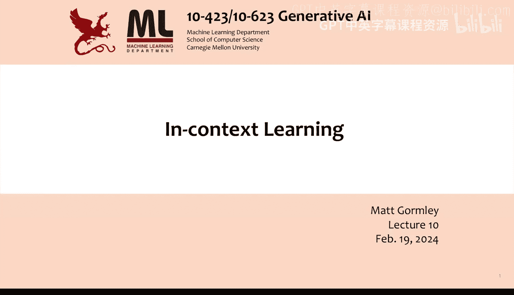
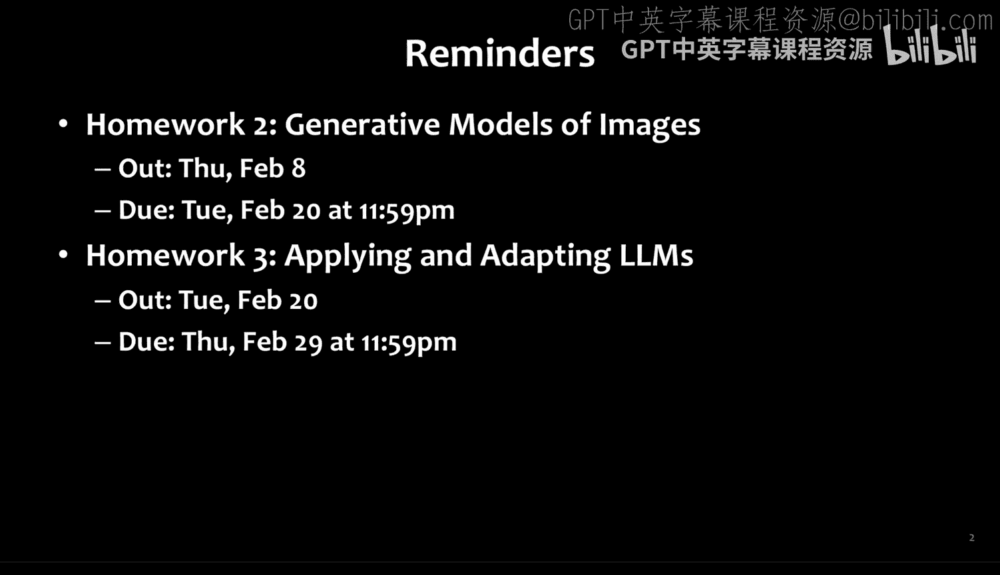
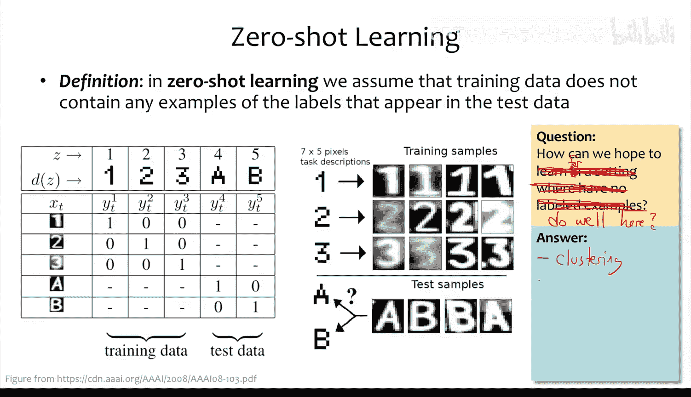
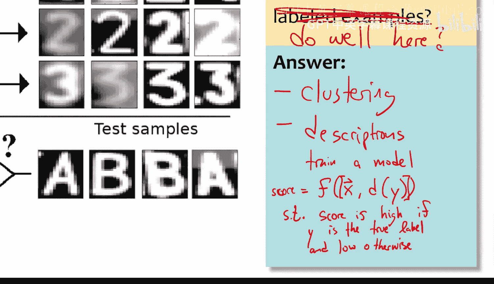
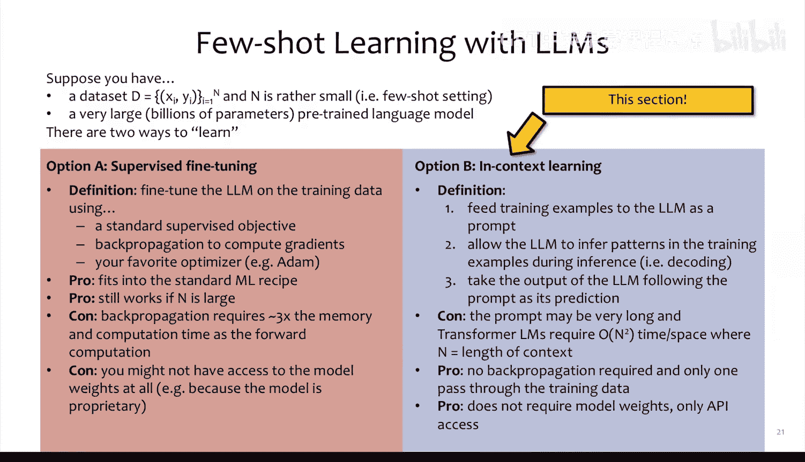
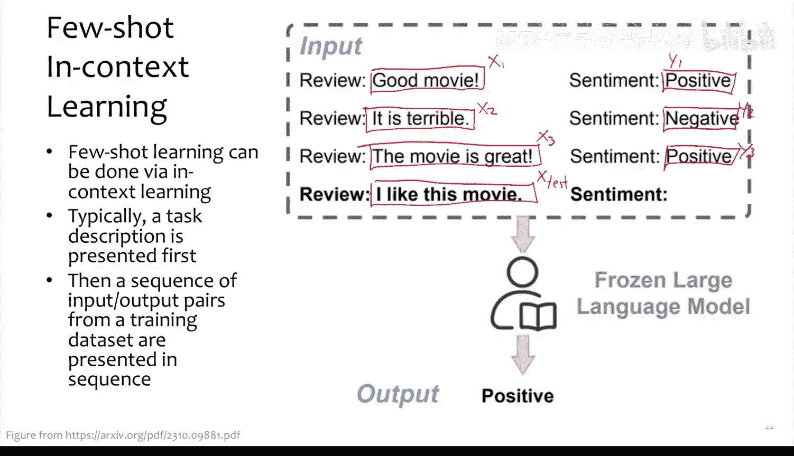
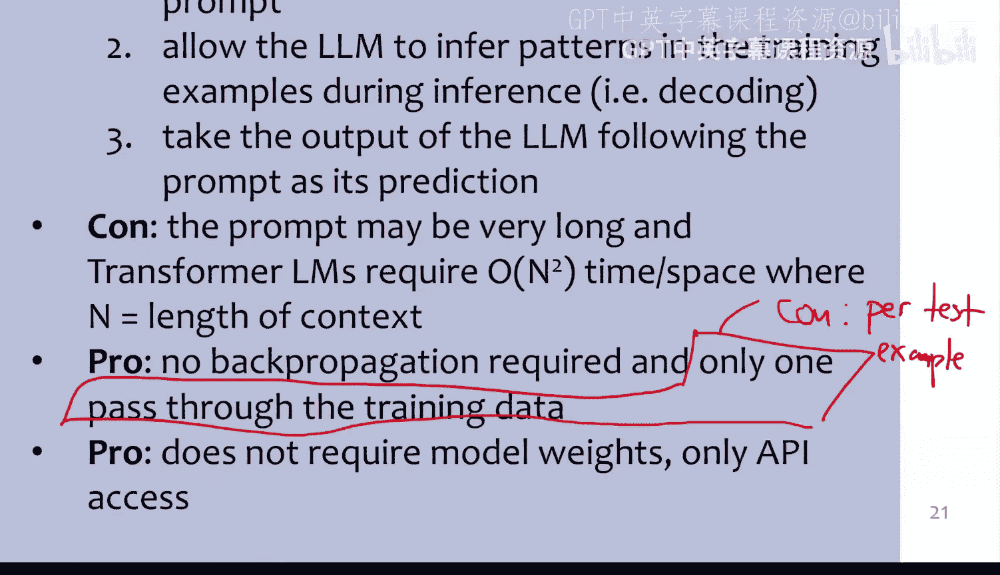
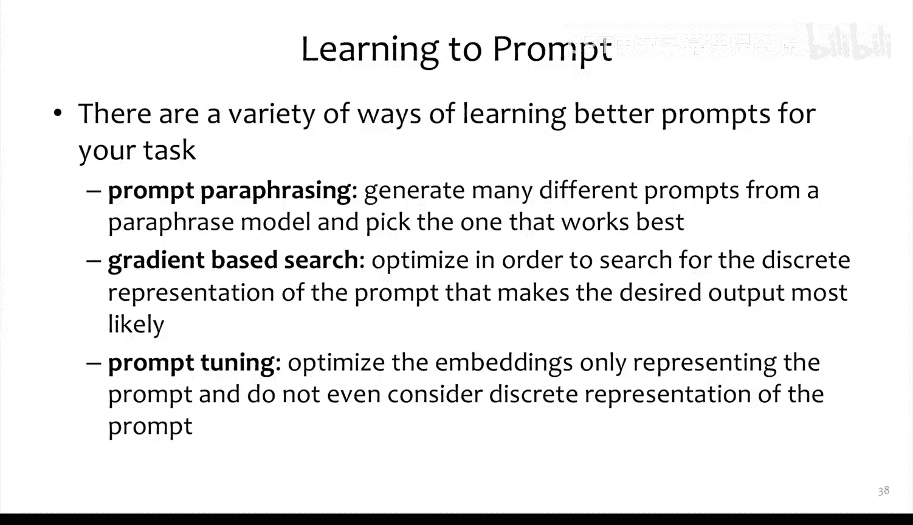
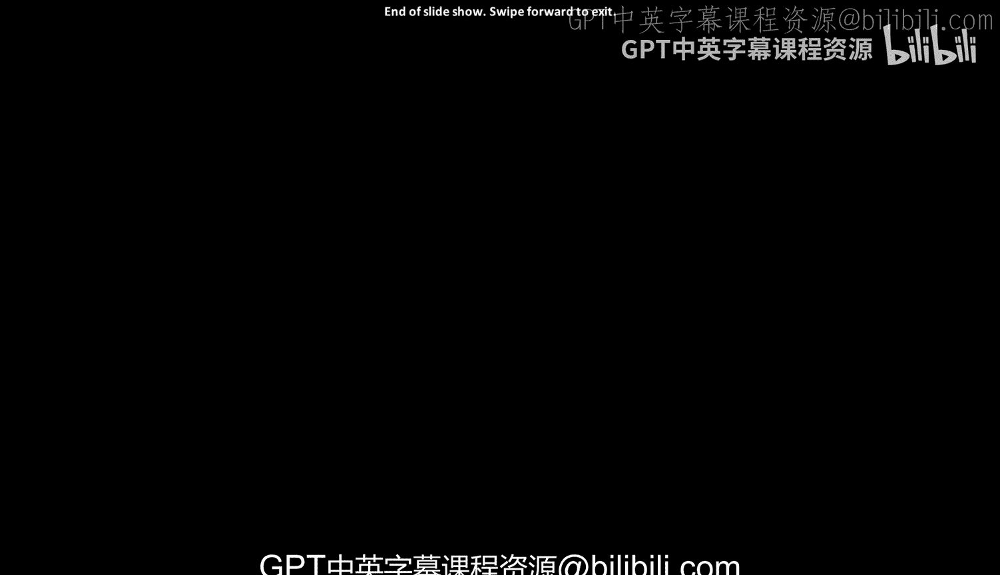

# CMU《生成式AI｜10-423 generative ai 2024》中英字幕 - P10：-P10-Lecture 10- In-Context Learning.zh_en - GPT中英字幕课程资源 - BV1CyC9BPEhG

So let's talk about in context learning。嗯。So here we're going to be sort of pivoting towards a new unit in the course。

 we're going to be thinking about how to take。Really。

 what we should talk about maybe now as foundation models and adapt them to different settings or to different tasks and today we'll really we we'll focus primarily on。

Large language models just because they're kind of where most of this work has been happening and then next time we'll come back and sort of mention how you could also apply some of these things in the context of vision models or vision and language models。

嗯。So here's the usual reminders， homework two， I think I had these dates， this date。

 at least for homework two wrong in the slides before it's Tuesday， February 20th。

 not today as the deadline。

And homework three will come out right after that and we'll be on these topics that we're discussing。

So。

I want to start with almost a little bit of a history lesson and that's to introduce two terms。

 zero shot learning and few shot learning。So Z shot learning， I think， showed up in the literature。

By that name in around 2008 or 2009。And。And the idea is very simple。

 so would say that in zero shot learning， we assume that the training data does not contain any examples of the labels that appear in our test data。

Okay， so's here's a simple sort of handwritten。Digit and letter problem where you could imagine that you have training examples like these ones and each of them has a label as either you know the character one or the character two or the character three。

And then we also have some test data that's labeled as A and B。And so the idea here is that。

You know youll have， you know， maybe a fairly large training set of a bunch of examples of what this character one looks like。

 what this character two looks like and three。But then at this time。

 you're given some A's and B's and you've never seen A's and B's before。

And now your job is to actually classify A or B。Okay， so the question I pose to you is。

 how can we hope to learn in a setting where we have no labeled examples？

Or maybe that's a poorly worded question， how can we hope to learn？Or less setting。

Where we have been enableded examples。Yeah this is a great so suppose we have so remember so let me make sure my question is clear let me just erase this question。

Learn。Maybe I should say let me rephrase the question， how can we hope to do well？😊。

right so what I'm saying is that like we're in this setting where we have only labeled examples of 1。

23 and now we're also trying to do well on AB so the autoencor idea is a good one right because for one it would allow you to take a bunch of images say you could go out and scrape the web of lots of images and you could train your autoencoder to build up sort of good representations of images in general and it could be a VAE。

 it could be a regular autoencoder， whatever it is。

 it could give us some representations and then we could fine tune on our labeled examples the one two and the three。

😊，Okay， so now we we have this classifier。 It's capable of。Deciding4 fs。Whether something is a one。

 a two or a three。What if an A comes along， how do we predict A？

such the great possible answer here so we could think of this as a clustering problem right and so once we've learned some latent representation of images now we could feed our test examples in and it could give us back some。

Some points in。Relatively lowdial space and then we could do some sort of clustering algorithm and say。

 okay， well there's a cluster of points here and there's a cluster of points there and we'll arbitrarily label those as cluster one and cluster two。

 and then there's unsupervised evaluation metrics for actually looking at you know if you have cluster one and cluster two。

 how well did you do in terms of the actual supervised labels。Okay， so this is one option。

 any other ideas of what we could do？So what if I gave you some side information？Like， for example。

 I gave you some information about how the handwritten digit was constructed so I could say something like that。

I give you some features。Of。Of the actual digit， I get almost a description of what it is that we're actually trying to classify so so maybe my description would include features of like does does the character include straight lines does the character include curved lines or maybe how many straight lines does it include and how many curved lines does it include？

Okay， so now armed with those sort of descriptions of。Our label space。

 could you do something differently？いや。It trained on like one， two， three on your hand data。

 but like。Pick up all those features really well， maybe to distinguish between A and B。

 you would have to like reconstruct some of those features so that using they're a really good feature。

Poifier for people。调查。Yeah this is a good idea， so let's let's actually sort of make this a little more a little more formal。

So suppose we have these descriptions， we could train。A model。The T in。Some。Vectctor X。

 that's our image。And then it takes in a description。Of。Our label Y。Okay。

 so you could think of these as like， I don't know， maybe the concatenation of these two things。

And what it returns is say。A score。And the score is something like。You could train it。呃。Such that。

Scocorre。Is high。But if。Why is the true label？And lo。Otherwise。

So your training data now looks a little bit different， right so you can feed in。

For example， you could feed in one with the label one， and that should be trained to have high score。

And then you could feed one with the label two， and that should be trained to have low score。

And then one with the label3， that should be pushed down right Okay， so now at test time。

 you give it this image A and a description of the label A。

 and you also give this image A plus a description of the label B。And now you get two scores。

 one for each of these descriptions， and you could just pick the description or the label that has higher score。

Okay。一个不す。guess like you want to pick the why that score。

 how is that any different than just having like an outside like a soft mask what were the possible？

Yeah， so the question was， how is this different than having like a function F where the output is a softm over these labels？

It feels like they're very similar， but now let's suppose that the description of your label is a string of text。

 of arbitrary length。Okay， do I have an example， Not yet We have like an example where this would come up later。

 So if your description of your label is a string of arbitrary length。

 that means there's essentially infinitely many possible labels。

Or at least there's infinitely many possible descriptions that could come along。And so in this case。

 you a softmax has a fixed dimension， and so ahead of time we need to know exactly how many labels there are。

 but in this way， if we're just assuming that we feed in a description of the label。

 then anytime a new label comes along we can just feed in that description of the label and hopefully our model can do well。

😊，So I happen to be collaborating with like some people at 3M that have exactly this problem because they're trying to do medical diagnosis code prediction。

 and so before， for example， the year 2020， there was no medical diagnosis code for COVID and so they you they have these models that are trained to predict many different diagnosis codes。

 but suddenly and unexpectedly there was this new code kept that started showing up and they had no training data for it at first。

So if they had a model that worked like this， then they could have just fed in a description of the COVID diagnosis code and their model could have started making predictions for that previously unseenly。

So this is sort of a powerful paradigm， but I think that it's also a paradigm that。😊，That is often。

So you really only want to be in you really don't ever want to be in this paradigm。

 you only end up in this paradigm if you're sort of forced to do it by something like you know the passage of time it's often more more readily the case that you know you could at least go out and find a few examples of whatever it is that you're trying to you know label or classify or whatever and so in few shot learning we assume that the training data does contain at least a handful of examples of each label。

😡，And I think that there's not like a clear definition of how many a handful actually means。

 but you know for the purposes of what we're doing here。

 you could think of this as like you know one， two， three， maybe four examples。

 once you get up to 10 or more examples doesn't feel very few anymore and so you know the how you could actually train a model for this sort of there's a lot of different ways that you could do it。

 here's one examples。😊，Which is that say you have exactly one label or one labeled example for each of your classes okay so in this this setting what we're trying to do is classify different types of dogs right so you're trying to differentiate between a German shepherd and a husky heres I don't even know if that's a husky but yeah anyway so。

So the idea here is that you could like we were talking about before。

 build an autoencoder or some other model that comes up with an embedding representation of your image。

And and then when a new test example comes along， you can feed it into that auto encodecor to get some embedding of this new test image and then you could compute the actual similarity between the test sample and each of your training examples and pick the one that is most similar or pick the label of the one that is most similar right so this is just essentially like a nearest neighbor's style approach to classification you know maybe the more common thing that was sort of being done in computer vision in sort of the the sort of。

Late 2000s was that you might have a large unlabeled data set and then you have a few labeled training examples for the classes that you want to predict。

 maybe just one。And so in that scenario， then you could you build up a really good say autoencoder or something like it that is good at sort of representing the actual data and then you could fine tune it or to supervised learning with this small number of examples to get better at it。

 and maybe you know in addition to labeled images of dogs you also have labeled images of say foxes and wolves or something like that。

 you might actually also benefit from training on these as well。

 even though they're sort of different labels and they might not appear in your test set at all。

 something that you learn about what foxes and wolves look like might actually sort of aid you in sort of building up the quality of the representations and the quality of the classifier。

Okay， so these are sort of the two settings and I think it's important to think about the fact that you people were doing this long before they were sort of successfully building generative models。

Okay so now I want to think about prompting， which certainly is very specific to generative models。

Remin yourself what it is that we're really often doing here with a generative model often we are training something like a language model to maximize the likelihood of our training data so for language specifically this is like you know we're treating them as sequences and so most of these models are conditioning on the previous tokens to generate the next tokens in an autoregressive way。

And so the whole idea behind prompting is that you could provide a pre flickx string。

To the model such that its most likely completion is the answer that you want。Okay。😊，So。

Let's just get a sense of what we mean here。So。The idea of this sort of conditional sampling is you know you're going to feed in some prompt like context and then sample from the model conditioned on that prompt right so I think we we asked you to do this on homeworkmark one where we said you know pick the your favorite first line of some Shakespeare play and then see what it spits out as a sample conditioned on that input right and so here is an example from G3 where the prompt was。

Was actually like。The。You know， the shadows on the way by Wallace Stevens as like a title and a poem。

 and then it started writing a poem in the style of Wallace Stevens。And。

And here the model was sort of able to pick up on the fact that maybe it already knew something about Wallace Steven's style and poetry。

 and so when it generated this poem， even if it didn't know this specific poem because maybe it doesn't exist。

 it was able to generate some text that was believably sort of something that he may have written。

Okay， but it can also be a little more， it could be more useful than this， so for example。

 you might feed into the model a sentence in Spanish。😊。

So here we're looking at one that was fed into Alma 2，0， this is the 70 billion parameter version。

And here。The actual prompt is say a Spanish sentence followed by just the words English translation and a colon。

Okay， so if you think about sort of our likelihood argument here。

 we would hope that the most likely thing to follow English translation colon would be an actual translation of the Spanish sentence right even though we haven't trained this model in any way to do translation。

 we would hope that this would work and indeed what we find is that the actual model output is the last owner of this property was a bachelor man who lived to a very advanced age and who had his sister as a faithful companion and housekeeper for most of his life。

The actual English source of this sentence is from sense and sensibility and it was really the late owner of this estate was a single man who lived to a very advanced age and who for many years of his life had a constant companion Alskeeper burn and his sister so I mean it's pretty close and。

😊，Y。So this is a slightly different setting where you might want to do something like question answering and。

Here， what we have is a snippet of text at the top。That that tells us something about。呃。

about this particular genus of flowering plants so it says something like you know rhockin is a genus of flowering plants within the family Planage Janeses native to southern Mexico and neighboring Guatemala they climb by means of twining leaf stocks et cetera。

 et cetera and and then at the end of this。What we did was write the word question colon。

 and we said you can find the purple bell vine in more than one country， true， false or neither。嗯。

And giving this to the model， it comes up with the simple answer colon true。

So I didn't write answer colon you know， it came up with answer colon true because， you know。

 it's often the case that you write question colon something and then you write answer colon something else。

And it also decided that it's pretty likely that answer colon true should be followed by explanation colon and then something else and it says the purple bevinine wrote a diground Nastro did it make that up or is that right Oh yeah。

 no it got that right is native to southern Mexico and neighboring Guatemala。

 which means it can be found in more than one country。Okay。

 so we would have been satisfied if it had just said true。

 but this seems actually a little bit better。嗯。This is just a sumization example。

 so here I fed in this sort of short start this is from。

From us at summarization data set of sort of short simple stories and and in fact。

 actually when I did make this example， I initially just wrote summary colon and honestly the model output was like not that much shorter than the original story once I changed it to one sentence summary it kind of came out recently。

😊，ItsAll right exactly， but if you go to that to the language translation thing。

 do we assume that the model knows how to translate from't know what that language is。

 but from that language to English， is it like if you give a new language。

 is it like you are learning that particular what language it doesn not translate？

Yeah so I didn't tell it anything about what that language that's Spanish and now so this particular data set this this gets into strange  territory so this particular data set opus books are public domain books and so it's。

What's interesting about this is this data set has existed before。

 and it's possible that Lama 270 billion was actually trained on like this exact data set。

 like it may have well shown up in the pretraining data for Lama 2。嗯。

Let say Spanish so we as moderners are transferred from next to publish。

We didn't care out how translate from Spanish， but if it give us Spanish context starts from。

 where the model figure out how to translate from Spanish to English with zero andma2 some of the data does include Spanish but。

也不见。These new leaders stage。啊。So like， are you saying like if you didn't show the model？

Any Spanish text。 but you showed it other texts that included English and French。

 And then you showed it some Spanish。 Would it be able to。

Kind of figure it out and translate it to English。I haven't seen that done。Yeah。

 so I think this would be super interesting to try。It seems so why might not people have tried this。

 at least for really large models？It's extremely difficult to know what is inside your training data because the training data is you know often measured you know around a trillion tokens or something。

 say it's only even in the  hundred billions there's so much text that even by automatic means it might be very difficult to figure out like which text is of which language and so。

So。I think that you could imagine asking that question of particularly local resource languages for which you know that there's there's only like minuscule amounts of that language in digital form on the web and it's possible that。

That the model could do something somewhat reasonable。

 but I think that it would struggle particularly because of how most of these models are tokenized。

 which is that most of them are tokenized via subwards and so you know I would guess that Utimo is like and Duno are actually full subwards in the model they actually are their own tokens and they have embedding representations。

 whereas for this like hypothetical language that say doesn't have enough。

That has like almost zero text in the training data。

 the words aren't going to have subward representations and so probably what you would need is actually like a character level model。

 but it might a character level model might actually be able to do it， I think。

Check can with the for coming。Yeah， I think it could definitely be possible if you were working with a character level model。

the respond go from at times， I will stick to the problem。Oh， yeah， absolutely。

 It'll totally go out of。 Let's see if we， do I have examples of。Maybe not， so let me。Yeah。

 I should bring some of those in。呃。Okay， so yeah I don't think I have I don't think I have have it like going off off the rails。

 but maybe we'll try to get you to do that on homework so so other things that a large LM could at least attempt to do。

So you could have it do things like you know factbased questions。

 you know we kind of saw this already organisms require energy in order to do what and then expect it to sort of follow that up with a reasonable answer it could also complete sentences logically so my body cast a shadow over the grass because you know which of these right the sun was rising or the grass was cut right so it could complete analogies is is sort of like。

completing sentences logically， it could also do reading comprehension in sort of the way that we were just looking at so all of these are examples of zero shot learning。

 but where we're using sort of a large language model that has been just simply pretrained to generate the next word。

What was you compare the model ofcing English。That was it。Like I think that。Like， I mean。

 this is a perfectly valid translation any any like translator。

 so I mean the last owner and the late owner， I mean they really are very semantically different right。

 the late owner implies that this person is now dead。

 whereas the last owner just they could still be alive。

 but other than that like the semantics are pretty right on。嗯 reckon。How is that？

So this isn't few shot， this is zero shot。嗯。So so what we're doing here right is all we're doing is we're we've trained this model just simply to like on a bunch of unlabeled text and so what we're trying to do now is think about actual tasks that are traditionally treated as supervised problems like if you think about how was Google translate trained it was trained on supervised examples right you know typically you know you go to the EU and you take all the proceedings of the EU which are translated to like you know a dozen different languages and for every sentence you now have its translation into you know a dozen different languages and so now you can train a model explicitly using those as training examples where the input is say in your source language and the output is in your target language。

And so what we're saying here is， you know， this model was not trained on explicit translation training examples。

 there were no like X Y pairs given to it of， you know， Spanish sentence and English translation。

And yet it was so instead it was trained just to maximize likelihood of sequences and if we wanted to do translation。

 it seems that it is at least like moderately capable of doing so。So I should note here actually。

 I think if we the thing that I didn't paste in that would have been interesting is if you paste in the English and then ask for the Spanish translation。

 it actually does not so well， that's because it doesn't actually have a lot of Spanish data in the training set compared to English and so I think it's generally like probably better at going in this direction than the other。

😊，So if we think about sort of question answering and summarization， the same thing goes here right。

 there's traditionally like large training data sets that are used to train a question answering system or a summarization system。

So。we could ask this question， why does this work？But like how is it that？呃。That。

That we could learn a trends that essentially this model could be effectively doing translation when it。

It was not trained explicitly to do translation。So one possible answer is， you know。

 if you look at the actual data， so this is from the GPT2 paper。

 these are actual examples of naturally occurring demonstrations of English to French and French to English translation。

 found in web textex， which is the name of the data used to train GPT2。

And so you know each of these is sort of a different example。

 right like I'm not the cleverest man in the world， but they。But like they say in French。

Juoszean inBu。So here， this is like a great picture of， you know。

 actually does anybody know where that that's from this is that might be actually like from a famous。

😊，And not that well read Anyway this is this is probably film like a famous book that appears or something like it that appears somewhere online。

 and even though this this is actually just like， you know， a quote of some character in a book。

 the character themselves is actually giving the translation of what they just said。Right。

So these are other examples， you know， in a now deleted post from August 16。

 this person wrote in French something which translates as something else， right？嗯。Okay， so in fact。

 so when the GP2 paper came out in I guess 2019。They were showing that it was surprisingly effective at a variety of different tasks in this zero shot setting。

So here the model that we're thinking about here is GPT2 it's 1。5 billion parameters。And essentially。

 if you think about like， how is it that we're？We're trying to to do this。

 you know its essentially like the things that we've seen right we're constructing some prompt where you know you're you have some input and some sort of task description and then we're trying to get we sample some output from it and。

And so here。呃。We're looking at sort of four different tasks， reading comprehension。

 translation summarization and question answering and on the X axis of each of these plots are the different sized versions of the GPT2 model so the 1。

5 billion version is the right most blue dot and then that's that's like GP2 large and then there's also a medium and a small version or maybe there's actually two mediums and a small and so the point here is that。

knowIn these horizontal dashed lines， they're sort of showing the performance of different existing systems。

And。And so like the skyline like for reading comprehension。

 the 90% level is human performance and yet we can see that you know with no training data whatsoever。

 it was already getting up to know 55% performance。

 which was on par with this doctor QA system that at the time was like a pretty good system for reading comprehension。

 and then similarly we can see sort of different examples of different baselines for translation and summarization。

😊，At the bottom， there is just another table showing further examples of sort of this performance and generally how like the larger the model。

 the better the performance in these zero shot settings。😊，Okay， so。

You may be used to interacting with large language models but often what you're interacting with are instruction fine tune language models so we'll go into some depth on what that is next time or the lecture after but the idea is you know models like chat GBBT orllma2 chat they've actually been fine- tuneed so that they behave like sort of chat assistance is you're just trained to produce text on the internet or in webtex and it doesn't mean that you'll actually be effective at interacting with a person as they might expect a chat agent to do and so these particular models actually expect some very specific prompt templates that sort of segment the prompt into different parts namely like a system part an assistant prompt part and a user part and。

Ss part is usually some description that is sort of a statement to the model of like what it is supposed to be doing。

 so like you are a helpful AI assistant and your responses should be fair and unbiased and you know you know very polite and helpful and then the instruction is。

Like the。The actual。嗯。Sort of part of this that should actually be， oh， I have this backwards， sorry。

 these should be swaped。So we're going to require。Yeah， so then yeah。

 so these the assistant and user labels should be swapped here。

 So the instruction is like what the user actually asks of the model model right so here organisms require energy in order to do what and then the assistant。

 the model itself should output something like mature and develop and depending on what model you're using。

 this is an example from Lama2 chat， this is an example from Alpaco。

 which is like another model from Stanford， the actual formatting of the system versus the assistant and the response are actually different。

 And so it's important that you're actually aware of this because when you interact with these these。

😊，Chat find tune or these instruction find tune models。

 they may actually be expecting this format and if you deviate heavily from this format。

 things could go wrong。So this also explains maybe why I was getting the particular results that I get which look quite different from what you would get if you had plugged this into say chat GT so if I take this same crs that we were using before for sumization and I feed it into Lama27 billion chat it actually doesn't just give me back a one sentence summary instead it says sure here's a one sentence summary of the story and then it gives me。

😊，I didn't actually even read these are these close， have an unfilled day at the beach。

I know this one sounds like I don't know， a little like happier and or something like that like this one sounds very formal gathering necessary items and driving there oh actually necessary items appears in both okay anyway so the point is that the instruction find tune model was actually trained to behave like an assistant right so its first response is sure and and here is a one sentence summary of the story。

😊，Okay， so finally now we can chat a little bit about， oh yeah。Yes。Not take an faculty perspective。

 it' more like depending on larger data point。If we train on larger data， what？6ポ。Butゃ。H段。我哋舍得。

So well， so this was telling us not about the amount of training data necessarily。

 but these plots were specifically looking at the different model sizes now granted the larger models I think were also trained on more data。

So it tends to be that maybe more data and more parameters tends to。

Imroved performance in zero shot settings。好冷妈。好，不好意思。Check。

WeStart getting to the same question that I。So that's a great question so I so you're saying like if you asked it a question like organisms require energy in order to do what。

 its response was organisms require energy in order to do what。Yeah。

 so I don't have a good answer for that but it's possible that there is a lot of repetition on the internet and so whatever you were asking maybe like。

😊，Maybe it was similar to some repetitive stuff that it had seen on the internet。B子。😔，So okay。

 so suppose you have a data set。X Y pairs and。You have capital N of these。 but N is rather small。

 So we're in a few shots setting。 and you have a very large， let's say billions of parameters。

 pretrained language model。 So I would says there's more answers than just two ways to learn。

 But I want to think about specifically two ways to learn。

 So option A would be supervised fine tuning where here we define this as your fine tuning the large language model on the training data using essentially like a standard supervised objective and then back propagation to compute gradients and your favorite optimizer。

 something like atom。So what's nice is you know， this is sort of a standard MLl recipe。

 it still works if n is large。😊，Some problems with it or bit back propagation generally requires you know three times。

The memory and computation time as the forward computation does。

 and so that might be sort of problematic if say the model the model does fit in your GPU memory if you're just doing inference with it。

 but maybe you actually need multiple GPUs if you want to do back propagation with it and。

Another problem might be that you might not have access to the model rates at all。

 maybe because it's a proprietary model and by some company that doesn't give them to you。Okay， so。😊。

So what is an alternative here so in context learning the idea is that you feed training examples to the large language models as a prompt and then you allow the LLM to sort of infer some patterns in the training examples during during inference。

And。And then you take the output of the LLM following the prompt as its prediction。 Okay。

 so it's just like the zero shot learning that we've been talking about。

 except now you're actually going to take these training examples and feed them in alongside the prompt。

And。You know， we call this in context learning。But it's a very different sense of the word learning than what we typically mean。

 right， So this is learning at test time。And there's no parameter estimation here right so we're really trying to draw this contrast of learning by parameter estimation option A and learning at test time option B。

😊，Okay， so what could go wrong well one thing that could go wrong is the prompt。

 if you have a lot if n is large， may be very long。

And transformer language models require big o of n squareg time and space。

 where n is the length of the context。So if you have 100 training examples and your transformer model is O squared of the sequence length。

 this could be a big problem。Some good things are that there's no back required and you really are only going to do at most one pass through the training data。

Effectively with the model。嗯。Also， this doesn't require you to have the model weights。

 you just need sort of API access to the model。😡，Okay， so in this section。

 we're going to talk about option B。

So。One way that you can do few shot learning is in context learning and so here we have an example。

Where they're actually doing sentiment analysis。And so the reviews okay these reviews are sort of artificially short just so that they fit nicely are things like good movie and so if you were the actual correct label y for that would be sentiment positive and then you know the next example is it is terrible and the true label is negative and then the movie is great positive and so on so if you think about what your actual training leader was。

 this was like example X1 and label y1 and then this was example。😊，Two so。X2， Y2。And then x3 and Y3。

And we've just encoded them as text。And then this last one is the actual test example。

 X test that comes along， and we put the same format for all of these so that sentiment colon will hopefully be followed by the correct output positive。

So but notice that there's no training here， right， we're just feeding this in as the prompt。

And we hope that by giving it examples of how to do sentiment analysis。

 it will do a better job on this particular test example。

So I guess I should make a caveat here， so I claimed that this only requires sort of one pass through the training data。

The K here。Is that this is。A per。Test examples。So you need to make one pass。

For each of your test examples。

And so that could get costly。So here， this is an example where we could think about how to do translation。

Right so so we're looking at a couple different settings so here this is the zero shot setting that that we saw before so translate English to French cheese goes to and then hope that it outputs。

Like what fromage or something I don't speak French and then here this would be a one shot setting so we're just giving it one example sea otter and then this little arrow and then the French translation。

😊，And then the few shots setting， we could actually give it three examples。

 so English and its's translation for three different phrases。

 and then the actual prompt for the example that we want to translate。😊，Okay。

 so this is in contrast to sort of the fine tuning setup where we could take those same three examples。

 but we would feed them in one at a time and actually do gradient updates to the parameters before finally just giving it the prompt for the thing that we care about。

Yeah。No一。パ。All of them the same time ended end up in context learning。

Compmpts all these three sample starts together。Do for the fine tuning setting？a shot yes。

 so this entire thing is the prompt this。This whole thing。Could be。

The text that is given as the prompt so technical they'll use the word prompt down here。

 but the way that we've been defining the word prompt。

 we would say like this is the or like this is the input。To the large language model。

 like this is what you're actually conditioning on and then sampling from there。那不要再。Yeah个。

So if you pass them separately， remember that like the the actual transformer language model only sees like the particular context that you allow it to see。

 So if you， if you give them separately， then you're just sampling。

Independent of these right essentially what we're trying to do is actually take this as like take this prompt as some Z and then we're trying to sample from my language language model。

Conditioned on Z。And see what text comes afterwards。Okay， so。fuion oh yeah。不知道。

actually looking back our trade gettings and something there。

 so in a way there's sort of like examples in the trade data that D this is referring to。

So how do we know that the the that we're not cheat basically great question So this is the problem of data contamination so this is like a really rapidly emerging space I would say and the short answer is that it's it's like extremely difficult to know whether your're。

😊，Test data appeared in the training data of the language model。

 but there are emerging techniques for trying to sort of guess at whether your test data already was in the pretraining data and it' it's at this point like sort of well established that if that test data did appear in the in the pretraining data then not only is that cheating right it's like it's not really zero shot in that setting that。

The model performance will be consistently better， but often not quite as good as if you had done fine tuning。

So what you could imagine is sort of happening is say all of these examples actually appeared somewhere in the1 trillion tokens of pretraining data for your model。

 well if they appeared like somewhere you know in the first third of those trillion tokens。

 it might be that in the second two thirds of the trillion tokens。

 you know in this sort of remaining 660 billion tokens。

 it kind of forgets a little bit about those examples like the gradient updates from those examples kind of get wiped out。

😊，And so the advantage then of fine tuning is that， you。

 these examples are now sort of recent gradient updates to the model。OK好的。不是。

I asked training dental them said like washing away the ratess。Yeah。

 possibly but and in some sense it may have not seen these examples so fine tuning might also be like training it in something completely new as well。

哎呀。The distribution of Z as I'll mix up a certain instruction not justistic matter。So。

not exactly foundation task， but it makes up some and Guangzhou other institutions as。So Z。

Do you mean like。If we had manipulated Z such that it was。Not translation。Yeah发。I start。

 let's find out or instead of work。Well when it a sample same way the access would work or we have to make sure that the distribution is consistent adverse prompt we。

At the trunk should be the first translation station。

 such mapping and machine are different tasks to look it。Yeah。

 so usually like the point here is that the actual Z that you're conditioning on is going to contain like examples of the task that you care about。

 if you included examples of like some other task that might have like little to no effect or it could like you know。

 push the model in a direction such that the likely thing to decode is like an alternation between answering a question and translating a sentence and maybe then the model would get thrown off or it would just do something very different which you might not actually want it to do。

Soum。There's some surprising things about how this stuff works。

In particular sort of in context learning can be sensitive to some things that you might not think it should be sensitive to one of those is the order that their training examples are presented right so here suppose instead of having sea otter first I had sea otter third right？

And I pushed the plush giraffe translation up to first。

 we just swapped them you would hope that the model will give you the same translation of cheese regardless of which order the first and the third translations we're in and yet what what we find is that then in fact the order of the examples that you present can lead to sort of wide variance in the actual predictions so here what we're looking at is over a collection of different models let's just pick one model this is a 6。

7 billion parameter model it's looking at the accuracy on this task in a four shot setting right so this is a setting where there's four training examples but you randomly permute the order of the training samples。

😊，And then look at the actual sort of variance of the accuracy under these different permutations。

And what you can see is that the variance is enormous， right。

 like most of the acuracies were in the range 55 to 80% accuracy。😊。

And this was just dependent on which order you presented the examples。Yeah。

You presented the permutations different as sequences you think that would because you're training on the same model and're just doing it all like one else or another。

 right？So there's no training here， I mean you're oh so you're saying no it's not anything for the at because this is in context learning。

 this is just evaluation， there's no there's no learning from one round to the next。Alllow the bes。

While going to output the same thing every time that least because we didn't have to take an average over same yeah exactly so you could imagine so。

Yeah， so。嗯。So the fact that we're getting these these little bucks and whisker plots。

 so you could create a box and like if say you only had four examples on which to condition。

And one test example。 so you get four training examples one test example you could actually create that box and whiskers plot just by looking at the。

The different permutations of those four and and evaluating its accuracy across each of those different permutations and that would be one box and whiskers plot what they're actually doing here is they're taking different subsets of four training examples。

😊，Doing the different permutations and then they're also doing that across multiple different test examples and train sets。

是啊，我出去跑到这里面跑边他过。对。Yep， or in the pre training， so before fine tuning。好。先生啊。吃完了。

Every time book is an instruction。咁咁十万星佢啦都把师人带啦。the wrong and。

use because far we didn't remember the previous context at that level。吃这个钟。

So unless you explicitly tack that on to this what we were calling Z。

Unless you keep on appending more and more context， then yeah。

 it's just it won't know anything about what happened before。

Because the model parameters are fixed right the model parameters are some vector theta and we're saying that in context learning theta is completely fixed。

 you don't change it at all， and the only thing that you can change is that Z that you conditioned on which is just a string of text and so it's just a question of what do you put into that string。

we have granted cheap achieve that input is now the function of time。

3 every time that we have to pass an entire thing， or will remember the for。

From that you past previously can understand that this is what I have to do and you're not task then。

Oh yeah so there's an efficiency trick which is that the embedding so the actual computation graph representation of this here if you're using the exact same in context examples。

 then like the computation graph up until this time step is going to be exactly the same and so there is like an efficiency trick that you can use which is as long as you're not changing that part then you can reuse that computation graph and not actually refresh it every single time。

😊，Oh， so it's been to observed that。Like the ordering image kind of add in some sense so like think like a chsy order you might guess so I'm wondering if there's like been research or maybe like some explanation for。

If you get better results by doing specific words and before we an example of a translation one where we're trying to translate cheese。

 maybe we put。Examples are we're transing blue towards the end which is yes。

 so actually I don't have on but。那 new呃。So a very doing this is。That。

ICL is sensitive to the examples that pick so suppose you only have space say you have100 training examples。

 but because of the context window you can only fit say 1024 tokens and so you can only fit say four training examples as context in that case it's beneficial to look at the thing that you want to translate and look at your training data and find examples that are sort of semantically in like a similar space to that thing that you're trying to translate and to pick out those things that are sort of similar to whatever it is that your test example is and so it's actually quite common to choose your in context examples based on your test examples。

And so in that sense， I think that， yeah， the order could be dependent on the test example。Sport。

The drop。嗯。I of like aus over where it's too many training examples where you don't be that much or you have little oh let think of that so。

Or that'll come in another slide。Not not this one so this is a different point so this is about the balance of say positive and negative labels so this is something that we just kind of know in general like if you fine tune a data set on an imbalanced set of positives and negatives say for sentiment analysis or something then then you can sort of skew your model in one direction or another and and so again here like you know if you skew the balance of positive and negatives in some small set of four demonstration examples then that can have an effect as well。

😊，Here this is just sort of a number of unique labels covered right so you know generally you would think like the and this is maybe sort of expected right the more sort of different labels that you cover sort it tends to be that the better your performances right so say you're trying to do news classification into different categories if you only give it two examples of categories that usually is going to be worse than if you had given it for different category examples。

😊，Right， so what's sort of surprising。Is that， you know you would hope that that the reason that in context learning is working is that the model is actually looking back at these training examples and sort of learning from them while it's doing you know decoding。

 but it turns out that you know like exactly what it's doing is still a little bit unclear。

 so for example， you would expect it to be important whether or not the training examples have the true label attached to them。

As opposed to a random one， but the effect of having random labels on certain data sets is like less than you might expect right so here what we're looking at is this is the accuracy on the meta ICL classification data set when your labels are 100% correct。

😊，Here's what you get if you just， let's say for the sake of simplicity that we have four in context examples。

 suppose you randomly pick one and for that randomly chosen example。

 you just randomly change the label to something else。

Okay the accuracy does not drop very much if you randomly change 50% of them。

 it drops a little more and then 25% and now this is the most interesting bar which is all of the labels are just randomly chosen in your in context examples。

😊，And yet it still does dramatically better than if you had given it no examples。

You can see that on some data sets， the drop off is actually like sort of more dramatic。😊。

And actually sorry， this is GPTJ versus meta ICL so these are sort of two different models on the same classification task and so here you can see the drop off is a little more steep。

嗯。So this goes back to sort of the earlier question here， which is。

you'd expect that having more in context training examples would always help。But in fact。

 what we find is often not often but for some tasks。

 as you increase the number of in context examples。

 your performance actually like plateaus or starts going down so here we're seeing the setting where you get up to 16 in context examples and it kind of maxes out and then you go up to 32 and the performance drops。

This particular these particular plots， I think are very heavily dependent on the actual model itself and can have a lot to do with sort of how effectively it was trained at sort of paying attention to things that appear in like the middle of a long sequence。

St like if I wanted to training professional generator to like tell sort of let know at just ended up giving the wrong sector。

So question。In context learning might might not be able to do that yeah absolutely and I mean it probably depends heavily like on the task itself。

 whether it's actually successful or not。Okay， so。You could also think about this emerging area of prompt engineering。

😊，So。So suppose you're trying to do news topic classification。And。

You have a model like OPT 175 with 175 billion parameters and you're doing zero shot learning。

So if we evaluate the model multiple times， keeping everything fixed， except for the prompt。😊。

We could ask， do？Do we actually get the same results？Okay， so。The answer is emphatically no。

So if you just give it the news article followed by one of these four prompts。

 here are the acuracies， so if the prompt is what is this piece of news regarding it gets 9 40。

9% accuracy， what is this article about gives 52， what is the best way to describe this article 68 and what is the most accurate label for this news article 71% accuracy。

So just changing the actual text promptump gives dramatic difference to the actual quality of the performance。

So this might lead you to then ask the question， how can we pick a good prompt and one answer is that you can actually pick the prompt that has the lowest perplexity or highest probability under the model。

 like you could actually ask your model， what is the probability of the sequence？

Of generating the sequence， what is the most accurate label for this news article？And then ask it。

 what is the probability of what is this piece of news regarding？And it's pretty likely， I mean。

 this actually reads very oddly that this would have higher probability than this one。

And that's exactly sort of what this paper found， which is that if you plot the perplexity of different prompts against the accuracy of the model when using that prompt。

 it tends to be that the models with highest accuracy tend to have lower perplexity。

Or at least that the really high perplexity prompts like what's this news have low accuracy？

And what's going on， what's going on is not a good prompt。And then this is sort of the same results。

 but for French word level translation here they're using B， which is a multilingual。

 explicitly multilingual large language model where it was trained on sort of a balanced data set of different languages and。

😊，And so you could actually then sort of look similarly here at different prompts and see that。

 you know sort of they one of their best prompts was the word for and then you put the source word dog in French is and then a little quote symbol and then ask it to finish and that's better then say dog is French for and then hope it to complete。

说不是什么？Yeah， perplexity is a technical term it's like two to the negative log probability under the model so what we're measuring here。

Is to say let。This string be。The vector P， and you could call this like P4 and this is。Fectctor P1。

And what we're asking here is。What is the log？Gbability under your large language model。

OP is not the greatest choice of a variable name， but we'll run with it。

 so ask it to actually evaluate these two quantities。爱的。😔，And then。啊。Pick。The one。

With higher probability。So perplexity is just going in the opposite direction。

 so you want perplexity to be lower。Eard lower， yeah。up。在吃饭。Like where is get from。

So you can always ask your autoregressive so I mean。

 one thing that an autoregressive model is good at is telling you what is the probability of a sequence。

And so you're asking the model what is the probability of the sequence and you'd get that just by multiplying the individual probabilities together according to the chain。

So that's how you would do it。Okay， so chain of thought prompting is this fascinating technique。

 so it turns out that asking the model to reason about its answer can actually improve its performance for few shot in context learning and so chain of thought prompting actually provides that reasoning in the in context examples so here the idea is say the question is the question that you want answered is the cafeteria had 23 apples if they use 20 to make lunch and bought six more how many apples do they have。

😊，Then you could give it an in context example that just says， you know。

 here's a different question and here is the exact answer。

Or with chain of fo prompting you could show it that the answer shouldn't just be given straight up。

 but rather that it should explain how it got there well here Roger started with five balls。

 two cans of three tennis balls， each is six tennis balls， five plus6 is 11， so the answer is 11。

And just by prompting it to express its answer and its reasoning， they found that。That， you know。

 poem with sort of standard prompting goes dramatically better when you include this sort of chain of thought prompting。

What's really interesting is that you don't actually have to have examples that include this kind of reasoning if you just do some prompt engineering and instead of saying something like you know okay。

 so here's the question a juggler can juggle 16 balls。

 half the balls are golf balls and half of the golf balls are blue。

 how many blue golf balls are there and then here the prompt is the answer Arabic numerals is，And。

It gives eight right so it gets it wrong So if instead you you have in your prompt answer。

 let's think step by step。It then continues generating text that contains the kind of explanation that you would typically see in chain of thought prompting。

And in this particular case， it actually does get the answer correct。Okay。

So essentially what this is sort of suggesting is that。The model does better。

 even if you just sort of prompted it to reason step by step。

Now there's and and this is this sort of holds up across like a variety of different tasks and data sets there's there's actually some argument to be made that part of the reason that it's capable of doing this is that it's actually。

😊，Giving the model sort of more time to reason about the answer。

 and it's actually building up in memory more space for the model to sort of do work that results in a correct computation of an answer。

So you might then think to yourself， gosh， this prompt engineering seems like a lot of work。

 it'd be great if I could offload that work to， I don't know。

 another model or some machine learning and that's exactly what people are doing so there's a variety of ways of actually learning better prompts for your tasks things like you just prompt paraphsing where you generate a bunch of prompts and just sort of pick the one that does best where you use a paraphrase model to actually generate those prompts for you gradientbased search is is actually doing optimization in order to search for like the discrete representation of a prompt that does well like an actual text string that does well。

😊，And you can do this partly because and words are represented as embeddings and you can find once you find a good embedding。

 you can find the appropriate nearby word， you can also do what's called prompt tuning which is where you directly optimize the vectors that would have been sort of the vectors representing the prompt and you have no prompt whatsoever anymore。

 you just have these vectors you have no idea what they mean but they seem to do well for your task。

So that's it for today and we'll pick up next time thinking more about adapters and parameter efficient fine tuning。

😊。

