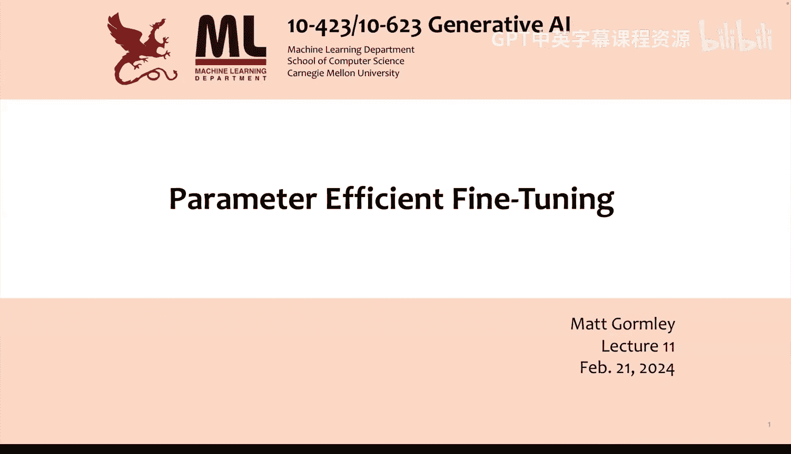
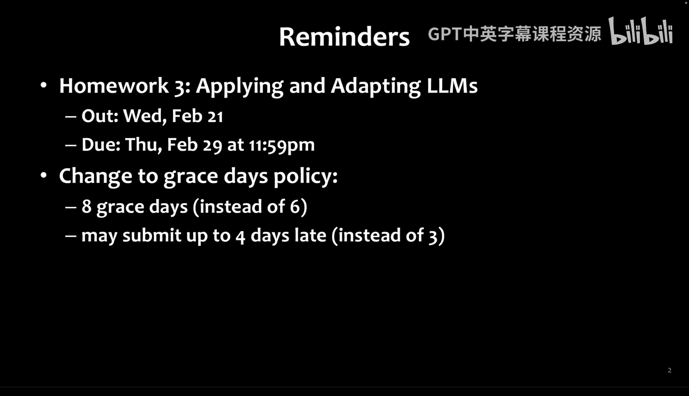
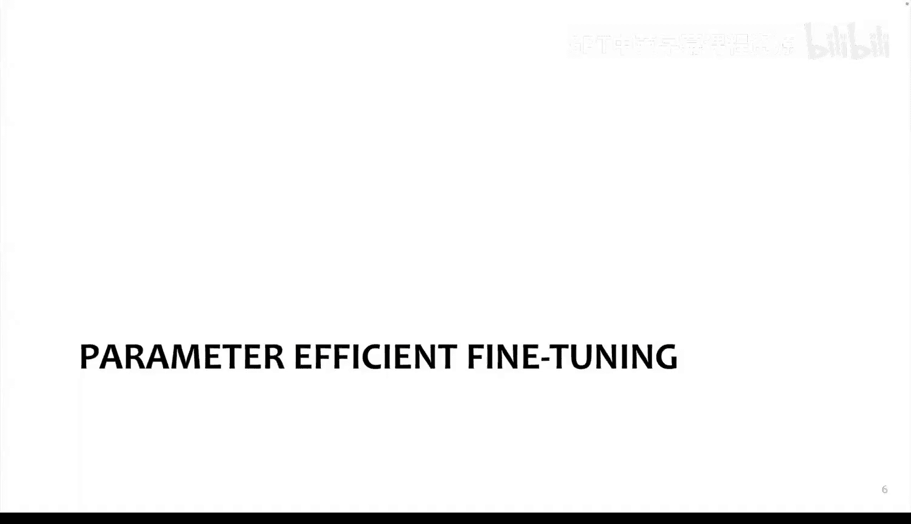
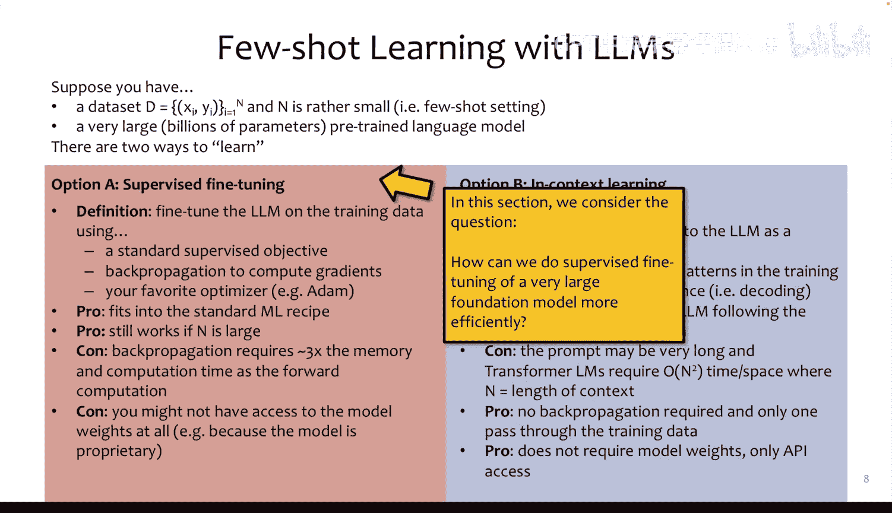
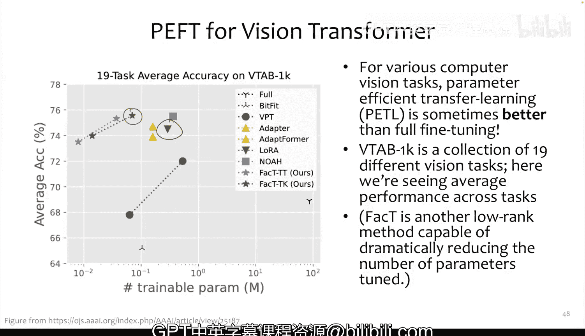
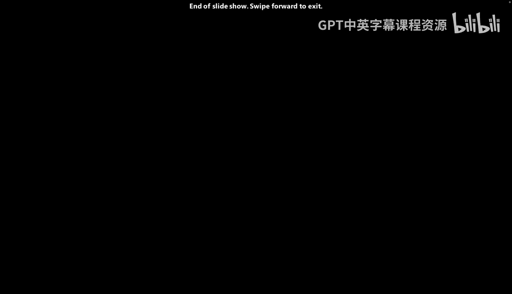

# CMU《生成式AI｜10-423 generative ai 2024》中英字幕 - P11：-P11-Lecture 11- Parameter Efficient Fine-Tuning.zh_en - GPT中英字幕课程资源 - BV1CyC9BPEhG

O。All， welcome everyone。Today in generative AI， we're going to be thinking about。😊。

Pararameter efficient fine tuning。And。As you can imagine。😊，The models that we've been talking about。

呃。A really large， like so large that。They usually don't fit in one GPU if you're not familiar。

 I realize I think I had a slide about this many lectures ago。

 I should have brought it back for today。But if you haven't looked at sort of the latest state of the art GPUs that are out there。

 you know， A100s or H100s are about as good as they get， and they tend to come in like two varieties。

 a 40 gigabyte variety and an 80 gigabyte variety。And that generally means that if you wanted to fine tune like a hundreds of billions of parameters model。

 you would need many of those GPUs and you would need to fragment your model across multiple GPUs okay。

 so the kinds of improvements that we're going to get out of today today's methods are on the order of like three times more efficient or something like that。

So this might in some sense， feel a little bit odd like why are we only going for a 3x efficiency improvement。

 you know， and in computer science， you're often concerned with like orders of magnitude kinds of improvements。

 but here because we're literally pushing the limits of what the hardware can do。

 a 3x improvement can mean the difference of being able to fit your model on one GPU versus maybe having to fragment it across multiple。

😊。

Okay， before we dive in， so homework three。Will be out， hopefully today and。

And then we made this change to the Grace Days policy you now have eight grace days instead of six and you can submit up to four days late instead of three and just oh also a reminder if you haven't filled out the sort of early course feedback form that we sent to you please do so I'm actually reading all of that and that's maybe possibly part of why I made these changes and so you should absolutely give you know thoughtful feedback there and where you know I'll probably maybe next week try to summarize some of that feedback and let you know how we're changing some things okay。

So what is perimeter efficient fine tuning well， I guess we should really start back here with this contrast that we had laid out between in context learning and supervised fine tuning and the idea that we had set up here was that fine tuning is just you know taking some pretrained model。

And。Tuning its parameters using some supervised objective function。

And the way that you do that is sort of the obvious thing that we usually do。

 you back propagate through the model， possibly with a different objective function than what your pretrain objective function was。

And then you that gets you gradients， and then you optimize using your favorite optimizer。

 something like stochastic gradient descent or atom。And so we said this is nice。

 it's kind of the standard MLL recipe， it still works if n is large。

And we'll see that's useful today。One of the big problems with it is that so in context learning only required a forward pass through your model。

But here we're explicitly saying you're going to have to do back propagation and typically back propagation requires about three times the memory and computation time as the forward pass。

😊，Okay， so this hopefully should reveal to you where we're going to get our three times speedup。😊。

It's essentially by making the memory and computation time for back dramatically smaller。对。

And as well you。You know， if you don't have access to the weights。

 then this entire lecture is irrelevant， so we're assuming that you're not working with some proprietary model。

Okay， so the key question that we're going to try to answer today is how can we do supervised fine tuning of a very large foundation model more efficiently？

So。

I guess one question is if it's inefficient， why should we ever bother with it at all。

 Why don't we just always do in context learning right so here's here's an argument in favor of fine tuning so this is just looking at G3 performance on two tasks these are recognizing textual entailment so it's asking whether one sentence entails another So this is sort of a logical reasoning task and humans tend to be very good at this but you know they can be challenging to to kind of think through and what we're looking at here is that in the first row we have few shot in context learning。

And on the second row， we have fine tuning。And you can see that the acuracies are dramatically higher with fine tuning。

Okay， so the question I pose to you is。Why would fine tuning of G3 do so much better on these two tasks than a few shot in context learning。

Any I get ideas？Sting conflict starting we're basically just trying to steer the existing model towards situations where it's more probable it'll get the right answers and this were actually。

Sort of maybe a model better at what we want。Yeah， so this is a great first answer。

 so in fine tuning we're actually adjusting the parameters of the model so that the model is good at the task that we want it to be good at。

😊，In context learning by contrast is basically just putting in some text as a prefix to your model and hoping that by conditioning on that text。

 you're now going to have the model like do some sort of inference as it looks back over that text that allows it to kind of observe some pattern and continue that process。

😊，Okay， any other thoughts？It's the previous lecture with the perplexity scores on the fine to model with the same property higher than the P shot model。

With the perplexity scores on the fine tuned model。For the fine tune。Interesting。

 you're saying like by fine tuning now our like the prompts that we use are now lower perplexity。

And so maybe and we said last time that lower booklaxity prompts were better interesting。

I don't know so。嗯。I'm not， I don't want to commit to that。Suggestion。

 because part of the reason that we were arguing that low perplexity prompts are good is because low perplexity generally means those prompts or something like them was more likely to have appeared in your massive pretraining data。

And so then using a prompt like that makes it more likely that you'll get the kind of response you want。

Here。If you're fine tuning on that prompt。You are lowering the perplexity on that prompt。

 but I would argue that。It might be that it's more about the parameter adjustment than the perplexity so like when you fine tuned with that prompt now the model has adjusted the parameters so that it knows what to do with that prompt and that maybe is more of the line of thinking that I'd rather adhere to here rather than the perplexity argument it's an interesting one and I'd have to keep thinking about it。

Okay， there's one other thing that I swept under the rug here， which is。

We didn't really specify what N was。Right。😊，How many training examples did we use for the few shot row versus versus the fine tuning row right few shot in context learning generally implies that n is small。

 but fine tuning here could have used the entire training dataset set。😊，Okay。

 and so one of the reasons that we might get dramatically better performance with fine tuning is because now we can use the entire training data set and not just a handful of examples。

Okay， so there is work that tries to do fair comparison of fine tuning and in context learning and in that fair comparison setting or the ones that they looked at。

 they also found that fine tuning generally outperforms in context learning for most model sizes and so here this was looking at settings where they were only using 16 training examples。

And what they're comparing here is the relative performance between each pair of model sizes。

 so here this is in context learning with。Six or seven different model sizes。

 and then here this is fine tuning with the same seven model sizes。

And so if you want a fair comparison in terms of model parameters。

 you could pick something on the diagonal like this 6。7 billion。Prameter model comparison。

 and you can see that it was 0。12 or like 12% higher score in accuracy in favor of fine tuning。

So that's a substantial improvement， 12%。And the blue shading is showing us all of the cases where the improvement in favor of fine tuning was statistically significant。

And so you can see that it's kind of overwhelmed by the blue。😊，The other interesting thing is that。

If you look at， say， one of these that is not statistically significant。

 like this here is a non significant difference， right？

But the model sizes are dramatically different。 So like the 30 billion parameter in context learning is doing the same as the much smaller 6。

7 billion parameter fine tuned model。OkayThis is by the way， why it is that GT3。5 turbo。

 which is what you're interacting with if you'reing with chat GPT for free much is actually Turbo right it's actually like a much smaller model than GP3 which is a model that we'll keep talking about that's like one point that's 175 billion parameters quite large。

Okay， so。The goal of parameter efficient fine tuning is to achieve good performance on some downstream task。

But really we want it not just to be good， but like comparable to the performance that you'd get if you fine tuned all of the parameters right that's usually kind of our our what we would think of as like our strong baseline。

😡，And we're going to talk about a variety of different approaches today。

 so the simplest of those is where you just pick a subset of the parameters to fine tune。😊，嗯。

And then the other methods that we'll talk about are called adapters， prefix tuning， and Laura。Okay。

 so we'll go through these one at a time just at a high level picking a subset is common to pick like the top layers of a deep neural network。

 we'll talk about why in a minute adapters are actually adding in additional layers to the model。

UCrifix tuning is sort of pretending as if there were like。

Basically a bunch of tokens that came before in a large language model setting and then you tune。

 but you don't tie them to particular words， you just let them be these vectors that you learn in a task specific way and then Laura is the one that we'll spend the most time on where we're learning this like small delta for each of the parameter matrices and we choose that delta to be low rank。

O。So let's start with the simplest one， so this is fine tuning the top layers is only okay。

 so here the whole idea。Is that when you're training a model so here I did the encoder only transformer on the right and you can see the objective function at the top so generally if we were doing full fine tuning。

 we would back propagate all the way down through and we would compute a gradient you know all the way down here for this like bottommost transformer layer as well as all the other ones。

But with this sort of picking just a subset idea， we could say keep all the parameters fixed except for the top K layers。

So now the gradient only needs to flow through the top K layers here。

 I'm showing K equals1 instead of like the K plus L total layers。

And so this is great because now we get reduced memory usage because we don't need to store the gradients for all of these low layers in the model。

 okay， so essentially you're getting a memory savings of like k over k plus L where K plus L is the total number of layers。

Okay。And this is really easy to apply to most deep neural networks if you have the model in hand。

 then you can just sort of tell it to stop the gradient at some point and that's about it and you just for most deep learning libraries this is pretty trivial。

Okay， why wouldn't we so you know， here we're saying we should。

We should fine tune only the top K layers。But maybe you're thinking， you know， well。That sounds nice。

 but maybe the top layers， if you're only fine tuning those you kind of like miss out like maybe it would be good to actually intersperse the the tuning like throughout the different layers like like what if you if you wanted to get the memory down by half what if you intersperse so that you picked out every other layer or something like that or every three layers so that way you can fine tune the bottom layers as well。

So why would we not do it that way？那不说他。How have we start in the memory of how long layers is important？

Yeah， exactly so if your strategy includes the bottom layer。

Then you still you don't get any memory savings because to compute the bottom layer。

 you're going to have to back propagate through all of the layers that come above it。

depends a little bit on the exact architecture of course。

 but that's sort of a general rule of thumb and this is so why we would prefer this the simple selection of the top layers so if I have a very deep network and if I just freeze all the layers down below。

Would that not mean that I am not really taking a lot of influence from my inputs？

Because back pro is stopped at the top layers， so that not mean my inputs are not really attended to that well as well。

Yeah， so I guess the hope here is that the model that you learned essentially came up with some really good representations of text in the low layers。

 or if this was for images， then good representations of image patches。

And that what you need for your task， oh， and I guess， so my picture。

 I should have modified this picture so。So that here I think I actually have this in another slide I just grabbed the wrong thing。

 So here our loss function is not going to be like some。Loss function that looks like。Like this。

 generally our loss function is going to be something like u like what we saw before where you have a label。

You know， like y equals positive sentiment or something if you're doing sentiment analysis and。

And then you have some cross entropy loss。On your label Y and your probability distribution here。

Call this why hat。So。So what we're saying here is we're actually fine tuning on some other classification task or something like that or a structured prediction task。

And that， hopefully。The actual representation of the text that you get out of those fixed or frozen bottom layers is actually good enough that all you need to do is figure out how to use those representations effectively and then build a good classifier out of it。

So so one perspective on what it is that the actual large language model is doing is it's just learning contextualized representations of each word in the sentence。

So we don't just have an embedding of the word cat。

 but rather we have an embedding of the word cat in this particular sentence。

 and then we can use that to good effect for the classification problem。

whether do they figure out where to put this like separation big question I have a plot that maybe will kind of help。

 but you could think of it like a hyperparameter， I guess。

Or you would look at your GPU memory and decide based on that。So okay。

 so adapters for adapters I just want to kind of like refresh what the transformer looks like okay so here's our transformer language model。

 here's our encoder only transformer right so the point is what we're talking about here is sort of agnostic to the particular type of transformer that you're using an agnostic vision and language I have discussion of vision at the end。

😊，So when you look on evolution， then it's obvious why bottom layer learns like these low level features。

 but why does it happen for health farmers？I think for the same reason。

 it's just that the actual mechanism by which we're learning。

Representations is a little bit different so on text if you were using a convolution。

 we typically call it a one dimensional convolution because you're basically taking each of if you take each of these embedding vectors and turn them sideways right now it's kind of like you have an image。

That goes from left to right with your words。And a convolutional model would just slide a single convolution across that sentence as it goes。

 and it would pick some window of tokens to look at it and it would slide across。😊，Okay。

 and unlike two dimensional convolution， it wouldn't like go down to the next row。

 it would just look at one row。And so the idea then is that one dimensional convolution is doing something kind of like sliding window attention。

 where it's just like building up a representation of like a small window of words and then sliding that down and what we're doing with transformer layers is just a little bit more sophisticated because now we get to look at the entire sentence at once。

 but the same intuition that we might build up increasingly complex representations of the inputs is still sort of applicable。

😊，Okay。Okay， so the idea of an adapter layer is very simple。

 this is the so when we talk about an adapter there are a lot of variants of this particular adapter。

 but here I'm introducing kind of the original adapter model。

 and it's simply a feed forwardward neural network。😊，With one hidden layer。😡。

And a residual connection。Okay， so we would say here we're going to have input dimension D。

To this little module。And that implies that the output dimension is also D。

And then we choose the dimension in the middle， let's say R。To be some value that's much less than D。

Okay， so if you think then about what this， this is called you know， feed forward down project。

 feed forward up project， what that means is that the actual rate matrix in here is something like of dimension are a w sub w it's a。

A matrix W， let's call it。Down project。And。It's a real valued vector of some dimension like D by R。

Whereas here， this is our up project。Linear matrix， and it's something like R by D。

And so the idea then is that when we take W transpose x。

 we're actually in the first case with the down project。

 we're getting back something that's much smaller and then in the upcase we're getting back the original dimension。

😊，Yeah，是谢谢。And this case what wasn there to single condition。

Good question so why do we have the residual connection here's I think it's generally like the case that so what I'm about to do is put this into a big deep model and it's usually the case that just the training dynamics kind of work out better where if you have that residual connection in place then at least initially like the gradient can just flow through all of these adapters linearly without worrying about that non nonlinearity in the middle and so the backpro error can kind of reach the low layers quickly so it's same reason that we always like residual connections。

Yeah， so the key thing is that we're trying to bottleneck。嗯。Here。

And that implies a small number of parameters。Total in this layer？

Whereas if you had instead just a single like D by D matrix that you were multiplying by。

 might that might be a very large number of parameters。Okay， so in practice， oh。

 I think I changed letters here， so let's just let me just。Fix that here。This R。

 we're going to use R later for Laura， look， so that'll be better。

That R is chosen such that R is substantially less than D and usually the adapter layers are going to account for only like half a percent or up to maybe 8% of the total parameters of the final model Yeah so basically go base like the those with this like any of not quite so what we're going to do is we're actually going to so here' we're looking at a transformer layer so let's just kind of inspect the picture with ignoring the green adapter boxes for a second So here in a transformer layer we have some input X。

And we multiply x by theW sub QWKWV to get our QKV matrices， those go into attention。

 and then I have this kind of outer box indicating that that's multi headeded attention。

And then attention goes to the add and layer norm， meaning we have a residual connection from X up to the add and layer norm。

 and then we do the layer norm。And then that goes into a feed forward neural network。

And there's another residual connection and another layer norm， and then finally we get x prime。Okay。

 so the idea of adapters is you take your regular transformer layer and you inject these new layers in the following two locations。

😊，And and so you pretrain your entire model without the adapter。

 and then after you've pre traineded it， you inject these two little adapter layers。

And because of how you've chosen R to be this， so D is just given to you now by the actual model dimension。

 but R is chosen to be really small。And。And then when we actually fine tune。

 we keep all of the other parameters that were pretrained， completely fixed。

And we only fine tune the parameters in these new little adapter layers。可。So in some sense。

 I think that to me anyway， the fact that this works is not entirely intuitive。So。😊。

I'll explain to Laura in a couple minutes。And I feel like I can give you good。

 strong intuitions for why it is that that works。Here， you know。

 I think when I first saw adapters I was like， oh yeah。

 that makes sense and then I started to think about it and and I think the more I've thought about it。

 the less it makes sense to me because essentially what we're saying here is that we have this like kind of fixed attention。

And it's going to produce for us some representation of the input。

And then we have all of these other layers like here， here， and here that are kind of。😊。

In some sense， expecting the output of attention to look a certain way。

And yet all we're going to do is like。Some nonlinear transformation of the output of attention and whatever that adapted form is。

 because of back propagation， we can choose that adaptation so that it moves it in a direction that makes this model more effective for our downstream task。

😊，Okay， so so all of this is to say， I think there is something like a little bit non intuitivetu about how it is that these could help。

 but the crux of why it works is because we are fine tuning it。

So if we were only like randomly initializing these parameters and then just hoping for the best。

 then you should expect this to fail horridly， but because we're fine tuning them。

 these parameters are only going to be adjusted so that the loss is improved for the actual task that you care about。

And as long as that's happening， then it's likely that we'll get good performance on held out data as well。

Okay， so let's just look at some some results with these adapters here we're comparing the adapter to this baseline of fine tuning just the top layers and the pretrained model that we're looking at here is Bt large this was。

I forget the exact timing of this paper， I think it was 2018。

 so this was kind of before large auto regressive language models had taken off and so the baseline is shown in blue。

And adapters are shown in orange。And so here what we're looking at is the average performance on the glue benchmark。

 which is a suite of a dozen or so different natural language classification tasks where you take in you know one or two sentences and you do different things like say。

 is this sentence grammatical， yes or no， or is this does this？

Pair of sentences does the first one entail the second or is the first sentence a paraphrase of the second sentence and so these are the kinds of benchmarks that they're looking at and what we find is that so if you look at the blue we have the number of trainable parameters on the horizontal axis and the accuracy delta from full fine tuning on the vertical axis。

So all the way over here， we have something something that should amount to like 300 million parameters。

 which is about how big Bt large is。And as we go in this direction。

Were fine tuning fewer and fewer top layers。 So on this extreme side。

 this dot corresponds to fine tuning only the topmost layer。 And then here， the top two layers。

 top three layers and so on down the line。And you can see that。

That there is some kind of inflection point like where even when we when we don't need to we seem not to need to fine tune all the layers of the model。

 like if you only fine tune you know， about half of the layers or something like that。

 you get most of the performance that you would get， if you were fine tuning the whole thing。Okay。

 what's really nice is that adapters don't exhibit this sharp drop off that we're seeing with fine tuning only the top layers。

And so generally， they， at least on this benchmark are performing kind of。

Almost at the level of full fine tuning， but with substantially fewer parameters。

 this is on the log axis。So here's another look at like a specific task in the glue benchmark called MMLI and here's coLA。

 which I think is grammaticality detection and here you can actually see that adapters are actually doing better than full fine tuning。

In this case。So something about having fewer parameters is actually beneficial for this and one reason that that might sort of make sense is that we're fine tuning these without regularization in general。

 and so maybe having fewer parameters to tune means less overfitting or something like that。😊，Well。

 are you still like adding private that also is inference window being slower？

Great question if inver slower absolutely yes， and so at test time your model is now slower because you've added these layers and we'll talk about like how much slower on a later slide。

😊，Okay。So I just want to very briefly mention prefix tuning mostly so that I can sort of present it in contrast to adapters and Laura。

ItI think it tends to。Like it's the the the method that I would advocate for the least I think it's the the most difficult to get working so the idea is。

It's fairly interesting。😊，What we're doing is essentially， we go into the model。

And we manipulate the attention by pretending as if there were sort of more tokens than there actually are。

And so essentially one way of viewing that is that so the queries。

 as we're doing autoregressive decoding， they don't change， right。

 that you're only decoding tokens that you actually care about。😊。

But what you're pretending is that there were a bunch of tokens that came before that you didn't decode that you're conditioning on。

 so this is kind of like a prompt right if you had a real prompt it would be the same as having additional entries in your key value cache。

Of course， for the prompt， you don't need the queries for the prompt in your cache because you're never actually going to because you're conditioning up。

So essentially， it's like adding a bunch of tokens that appeared to the left and then treating those as if they appear in every layer。

 but we're not actually adding tokens， we're just adding parameters that we can fine tune for this specific task。

So what we're looking at on the right is kind of this contrast of fine tuning for say some particular task。

 and the idea here is that regular fine tuning， if you wanted to take a transformer and use it for。

 say Trans and then for summarization and then for some is something like converting from one sentence form to another。

 then，You would need to completely independently train or do full fine tuning on three copies of that transformer model。

By contrast， with prefix。Tuning， you keep all of the parameters of the transformer。Completely fixed。

And you only fine tune these additional sort of extra parameters that you've tackgged on at the beginning。

 and so you can have essentially a task specific prefix， like one for translation。

 one for summarization， one for table to text， and those prefix parameters are essentially like a learned prompt。

Okay， so。So the sort of there's sort of two settings where you might want to do this。

 so for example if。啊。If you wanted to do this for an autoregressive model。

So that would be like a transformer language model then your prefix so you're you're basically going to have some。

Source text， like if this was sumization， it would be like an actual article and then some target text。

 which is like an actual summary of that article。She。

We're like essentially I don't export cameras and the effects does this affect that the positional encodeco is in test time？

Like， do we start off by like zero when we're？that's a great question so the question was does this affect our positional embeddings or do we kind of keep position embeddings the same so。

I'm not 100% certain of this， but my understanding of this was that you treat your position embeddings as you would normally without prefix tuning。

So essentially these parameters， they they're actually。

 you generally have different parameters for each layer。

So the PK and PV here are specific to this transformer layer。

 so the parameters at layer one are different from layer two from layer3 and so on。

 and generally positional embeddings only apply as input to like they're kind of layer zero right and so here because these are trainable parameters we never actually have real inputs that produce these parameters。

There's no actual like tokens that produce them and so there's no positional embedding either The thing that I don't know about is like what happens if you do relative position embedding sos that's the question that I'm not sure about I think people weren't using relative position embeddings when they were doing these models which transform layer once you still have to do that propagation you still have yeah so in this case you still need to back propagate all the way down but you don't need to back propagate into for example these weight matrices nor do you need to back propagate into the weight matrices of the feed forward layer。

So this is where maybe I kind of misled you guys in saying that there was no savings to be had with。

 say， picking every other layer for for choosing a subset of layers。

 there is actually savings to be had， even if you are back propagating all the way down because the memory consumption for you the parameters in this feed forward neural net and these attention layers can be itself quite large。

So for the adapters of you mean lower them， yes， you had it all the way down。And so so in this sense。

Yeah， maybe I should walk back a little bit my critique of interspersing the layers。

 but I think that for the big difference is maybe that，When you're doing this like top K layers。

The the savings that you get is like dramatically less than what you're typically getting with these adapter type methods because you're you're just taking like a sort of a fixed proportion based on like。

 you know number of layers that you choose。Whereas heater with something like adapters。

 we could choose R such that the actual parameters that are involved here are。

Are some like really tiny fraction of the total parameters。Yeah。

 as you said you still need to like backdrop through your inputs right to get like a DX basically and then you can then you go into only you only go into a window it your adapter search that's right that's right So so we are still backgroundinging all the way through。

 but the the like the biggest gradients are。😊，These weight matrices and the matrix inside the feed forward neural net layer and not we're not storing those and we're not updating those either。

Not required somehow to only compute the guard in respect W。Oh。

So the point is that the gradient is only going to flow through here。So you still need the gradient。

 say， of the loss with respect to Q， you just don't need the gradient of the loss with respect to WQ。

So that's where you can get some savings。And when it's the case that your parameter matrices are extremely large。

 that can be a substantial savings。Okay， so so the point here is just that。

For the sort of transformer language models that we mostly think about you'd have just one prefix。

 there's also sequence to sequence models which we haven't really talked much about that are essentially putting together an encoder only transformer with a decoder only transformer that gets to look back at the encoder and here you would kind of have two prefixes。

 one for the encoder only and one for the decoder。Okay， so now we can talk about， oh， yes。不。Next。

I think I have some results later in the context of Laura， so we'll see it there。

 and I'll also start by critiquing it as motivation for Laura。Okay， so。Okay。

 so just a reminder of like how large these large language models are。

 GBT3 as a good running example is 175 billion parameters。

That's a good scale to be thinking of also we've kind of looked at this before just like where do these 175 billion parameters come from so GPT3 has 96 layers。

😊，D model is。I 12，000 and it has 96 hits， so what that means for us is that those weight matrices that we've been talking about for attention the feed forward are kind of on the order of matrices that are like you know 12 12。

000 squared give or take。Okay。So。嗯。So we saw this before。

 there's this question though which is why don't large language models overfit when we finet tune them without regularization？

And this is something that was kind of baffling to people and then in around like 2018。

 and this wasn't just a question about large language models。

 this was kind of a broader question about large deep neural networks and there was this hypothesis that came out in around you know 2018- 20 to 2020。

 that these models are somehow intrinsically low dimension。😊。

So let's see what I mean by that so the motivation here is that maybe the number of parameters in a model is not a great measure of how many degrees of freedom are needed to successfully learn some problem。

😊，So。There's this question， how could we measure the number of degrees of freedom that you really need？

And so the idea of intrinsic dimension here we're looking at a definition from Lee et all is that you learn a neural network。

😊，Let's say that has some capital D parameters。But you learn it in a random。

 lower dimensional subspace， little D。And then you repeat that。

 gradually increasing the dimensionality little D。😊，So for example。

 you could start your little D at one and then go up by like factors of two or something and then once you hit some point where in the low dimensional D is。

😊，Is getting good solutions。Then you stop and you say that is the intrinsic dimension of the model。

And here， by good solutions， we mean like above some 90% threshold of the full parameterization。Okay。

 so if you were to do this empirically， and I haven't yet explained how。

 but let's see what the results would look like， you could make a plot of like validation accuracy against little D。

可以。And so。The skyline would be 1%。 that would be the performance of the fully parameterized model with capital D parameters。

And the threshold that we're going to aim for is this dashed line， the 90% of that full model。

And the question is， at what point little D do we get above that 90% baseline？

And here we're looking at this is results for MNIS digit recognition with a neural network that has about 200。

000 parameters。ButBut what we find is that the intrinsic dimension is only something like 750 parameters。

 so dramatically less。Okay， so then the question is， how do we learn in a low dimensional subspace。

 right？Okay， so this is one way that you could do it。Which is that。

You're going to need to evaluate the gradient。Of a loss with respect to some parameters。And。

And then take steps in the space of that theta， theta superscript D， capital D。

So one way to work with a random is to train in a random subspace。By doing this， you say， okay。

 we're going to let theta D instead equal the original theta D。Plus， so matrix P。Times a much。

 much smaller theta little D。Okay， so the idea would be that theta sub0 superscript D is a vector of all your parameters that is for that MNIS example。

 that's 200，000 parameters。And this matrix P is a random matrix。Okay。

 that projects from whatever your little D is， let's say 200 up to 200，000。

And so that allows you to train some really small number of parameters， theta little D。And。

And all you need to do is randomly generate so sorry let's be very specific here， so theta d0。

 which is like the full parameter vector is randomly generated and P is randomly generated。

And then we're just going to learn the parameters theta little D and see how big does little D need to be in order for us to do well Yeah in the previous though we are learning the network with be that I'm going just lower that I mean is this a because if we have the transformer then how are this do that。

So here。What you could imagine doing is so， so this this Mist example wasn't a transformer。

 It was like an actual feed forward neural net， right。

 So it was like you have some first hidden layer， and then you have， you know， fully connection。

 full connections here to a second hidden layer and so on to a third hidden layer and such。

 So let's say that these are like the parameters W superscript 1 for the first layer and W superscript 2 for the second layer。

 These are like matrices。So to get theta。Capital D。What we're saying is you could。Concatenate。呃。

A vectorized version of W1。And a vectorized version of W2。 So take W1 and W 2， their matrices。

 flatlaten them into vectors。And now concatenate those together。And so now if。

If the total number of parameters was 200，000， you have a single vector that we're calling theta D that is 200。

000 dimensions。So。So you could also imagine if you going in the reverse direction right so say I give you a vector of parameters theta D that's 200。

000 dimensional if you wanted a matrix W1 and W2， you could extract those from that big long vector right？

Okay， so if you think about this as a computation graph。

 what we're saying here is we're going to construct theta capital D in this way。

 take a random theta 0 d， add to it， a random p times a little tiny parameter vector theta little D。

Okay， that's going to give us a big long parameter vector and now whatever we need。

 if we need a W1 and a W2， we extract those and then build our full feed forward neural network。

Does that。Make a little more sense。Yeah。嗯。So the idea then is that you could now train that model。

 it would be strange to do this in some sense， but you can do it and you can actually from that learn sort of what it is at what point you've sort of projected down to a random subspace well。

 like that is large enough that you're actually able to successfully learn。Okay， so。

So for some transformer models， people did。Not exactly this is the sort of simpler technique。

 there's like this other modification of it called fast food that I'm not going to talk about。

 so they did very similar techniques to measure the intrinsic dimension of large language models。😊。

And what they found was that。So for the models that we're looking at here。

 Bert B had 110 million parameters， Bert large， 345 million。

And the measured intrinsic dimensions were sort of for these different tasks that we're looking at。

We're on the order of like  a thousand or some couple hundred of parameters。

So what this is suggesting is that。For these huge models。Maybe you don't actually need。

As many parameters as。As the huge model actually holds。Okay， and。So further。

 there are sort of other theoretical results that are sort of suggesting that。

The process of pre training might actually be finding parameters that have essentially low intrinsic dimensionality themselves。

 that the parameters that we're learning essentially lie on some lower dimensional manifold。喂。

So if you imagine the 345 million parameters， if there was some way that you could project them down to a lower dimensional manifold。

 then maybe you would still kind of retain the same performance， that's the hypothesis。Okay。

So now we can talk about Laura so their first motivation was this idea from Le etal 2018 that we just looked at and the following work on LLms that showed that。

😊，That the learned over parameteraized models seem to in fact reside on a low intrinsic dimension。

Okay so motivation number two is that for prefix tuning directly optimizing the prompt leads to these weird nonmonettonic changes in performance。

 so you would hope that as you add more performance you get or sorry as you add more parameters you get better performance。

 but that's not what people found sometimes as you add more parameters with prefix tuning your performance actually goes down that's not ideal。

The third motivation is that adapters and related methods introduce inference latency at test time and it's really nontri Okay。

 so let's look at some examples here， so if you have a large batch size like 32。😊。

Sequence length 512 and half a million parameters， then when you use adapters。

 the increase in test time latency is something like2 or 3%。Okay。But。If you have a batch size of one。

You get 20 or 30% additional latency at test time。Okay， so why is it that this would happen？

So when you're when you have a large batch size， essentially。

The fact that you're introducing all of these little layers means that you need to do a bunch of additional computation for those layers。

And you can't do the computation for， say， subsequent layers until you finish those layers。

And so what happens in when you have a large batch size is that like to some extent like those additional layers。

 they're really small and even though there's some serialism that's forced here。

 you're still getting a lot of other parallelism through the batch and so you end up like still pretty performant。

😊，But with batch size one， you basically have these huge differences in how much parallelism you get in like a giant attention layer versus a tiny little adapter layer。

😊，And so the tiny little adapter layer still， even though it only requires a tiny bit of the sort of width of the GPU's compute。

 it still takes about the same amount of time as a giant feed forward layer would。

So so think about this if you're on a GPU because of parallelism， matrix multiplication。

Can be really fast and really well parallelized。 So if your feed forward layer is huge。

 it might actually take about the same time as if your feed forward layer is small。

And so if you're adding a bunch of small feed forward layers。

 then that can really take you can really take quite a hit when you have a small batch size。Okay。

So these are why we might want to be interested in Laura， let's look at how it actually works。Okay。

 so。We're going to keep， we're going to assume that we have a pretrain bottle with weights W0 okay。

 and so specifically here， what I want to define is aura specific linear layer。

 and then we'll see how you use it in a transformer。

So we're going to assume that we pre traineded our model and we have in this linear layer。

 some pre trained parameters w0。They're going to be fixed during fine tuning。

What we're going to learn is an additive modification to those parameters that we'll call Dlta W。And。

Inspired by the fact that parameters seem to lie in a low intrinsic dimension。

 we're going to define Delta W。Via a low rank decomposition。Okay， that sounds fancy。

 but all it means is that we're going to multiply a long skinny matrix by another long skinny matrix。

😊，Or yeah， one of them might be turned， but yeah。嗯。P learning。And B and A are going to be learned。

 yes。So here when we say the product， b times a has rank R。

 it's because we choose the dimensionality of B and A so that the rank is all。Okay。

So let's look at a standard linear layer first。So a standard linear layer has some input X。

And some output Z。 and we're going to say that the input X has dimension K and the output Z has dimension D。

And that means that w0 must be d times k。对。So what does the Laura linear layer do， all it does？

Is it says we're going to define z now to be w0 x。Plus， BAX。那 that's。Okay。So。It's useful， though。

 to have in mind the picture of what's going on here。So。

The regular path through here is going to take X and often K and D might even be the same size or something like that。

 or they might be different。So the point here is that X if。

The linear layer is not going to sort of like dramatically change K down to D。

But rather that here because of the dimension of a being R by k。The sort of。

The result of a times x is an r dimensional vector。

And then we take that R dimensional vector and we multiply it by B to get back the big D dimensional vector。

Okay， so in some sense， this is really close to what an adapter was doing right。

 it was bottlenecking us down to a low dimensional vector， but here everything is linear。

The change to W is linear， the change to x by a BA is linear， there's no nonlinearity in any of this。

So the other thing to notice here is just that W0 x plus BAX is。

Exactly the same as W0 plus B times x。And so when you're actually implementing Laura。

 you're generally working with this form。Where you can add B directly into W zero。

 I'll say maybe I have a slide on that， I'll hold off on that thought。Okay， initialization。

 so to initialize the parameters of Laura， the sort of default thing is to do Gaussian noise for the parameters of a。

😊，And then to initialize the matrix B to be all zeros。

What this means is that as soon as when you start fine tuning。

 you're going to be backping through this Laura linear layer。

 keeping W is0 fixed and fine tuning B&A。AndBut the first time you use B and A。

 because B is0 doesn't matter what A is， BA must be all zeros。

And so that means that W0 plus B must be W is0。So essentially， on that first iteration。

 we're ensuring that the parameters are exactly the same as where they were at the end of pretraining。

So this is the interesting bit， we can sort of hot swap。Therameters in and out for different tasks。

And here's how this would work。So W0 and B have the same dimension。

So you can swap them in and out with addition and subtraction。

So what I mean is say you what you want at test time。

Is a standard linear layer with no extra sort of Lauraura bits on the side。

Then what you could do is you could define a new。Just regular old linear layer。😡。

With parameters W that are simply W0 plus B。And now you have exactly the same inference process as your original model。

 but you've modified the actual parameters of this specific linear layer。

 according to your low rank fine tuningnic。Okay， now let's suppose you wanted to switch to a different task。

 no problem if you have that giant model in memory。

 you can just subtract out the BA that you just added in from the current W。

And the result will put you back at W0。And now you could swap in， say some， you know， B。

 double prime， a， double prime for a different task。Co。Okay。

 so so all of this so far we've defined this just as a linear a special linear layer。

 let's think of how it applies to a transformer so first just a reminder of what the multiheaded attention transformer actually is doing so we have X coming in and then we have separate WvWK and WQ matrices for each of the heads。

And then we do the usual。QI KI transpose divided by the square root of decayK plus an optional causal mask times VI。

Sorry， passing through a softmax before we multiply by VI。

 and then we cancatenate things together at the end to take the different heads。Okay， so。

The idea here is that we add Laurara linear layers。

 but we're only going to add them to the actual attention linear layers。So remember。

 attention is comprised of three separate linear layers that take in X to get back QK and V。

And so what we're saying here is that the lower linear layers could replace every linear layer in the transformer。

 like， for example， the linear layers that are here。But instead。

 the original paper actually only applies Laura to the attention weights and leaves everything else fixed。

Okay， so you could think of this then as like everywhere that you had a linear layer inside。

Your attention， you replace it with a Laura linear layer。

 and each of those is getting different parameters。

 so there's different Laura parameters for the keys， queries and values。Okay。

 so what's really fascinating is that so empirically， at least for GBT3。

 they also find that it's most efficient to include Laura only on the query and key linear layers。

 so what we're looking at here is just at least for some tasks that you can get with just query or I did I write that wrong。

😊，Query and。Curty value。It looks like its query value is better on these particular tasks。

 but I thought that the convention was actually query key。

 so I'll maybe have to double check check my own statement here。

 but the point is they found that just picking two of the query key and value tended to work better than all three。

😊，Okay， so applied to G3， Laura tends to achieve performance almost as good as full fine tuning。

 but with far fewer parameters so here we're looking at the number of trainable parameters log scale on the X axis and then validation accuracy for different tasks on the Y axis so the blue dot in the upper right corner here is full fine tuning and so you can see that for wki SQL we get that。

😊，Laura like it's almost like flat performance， even as you go down dramatically through different numbers of parameters。

By contrast， if you look at prefix tuning， there's different techniques， prefix layer prefix embed。

 but basically you can see that there's almost like some sweet spot where if you add too many parameters。

 the prefix tuning actually gets worse。😊，So that was the phenomena that I was talking about before。

In this case， actually， it looks like adapters also have a little bit of that going on。

 but I thinks that particular result might not carry across all models， I'm not sure。Here for MMI。

 you can see that actually Laura and adapters are actually outperforming full fine tuning。😊，じ二。

Would be expected。Because it's projecting down to that lower mapfold or training only along that。

Would't be able to go all the way down to1。For the Rover example， like thousands。

Projection for I don't know the total number of all of those sum or would these significant it's going to be dramatically lower than 1000 wait till you see。

Oh， here it is。😊，So they looked at four different values of R， R equals 1，2，4，8， and 64。😊。

And you can see that for these tasks， let's just compare multinI。

 so if we compare the first and last columns， they're doing almost about the same performance between r equals 1 and R equals 64。

So like how is this even possible， I would guess that part of the reason that this is possible is that there is a large number of layers in this model。

 it's like 96 layers deep and so even though we're projecting down to super low dimensionality。

 I think that there's actually like still quite a large number of parameters that we're tuning such that can it can still do well。

😊，嗯。Yeah， so totally fascinating so for many data sets a rank of r equals1 is sufficient。

As well here what we're looking at is that Laura kind of performs well when the data is large or small。

 so this is taking one particular task for natural language inference and looking at the performance of Laura and say fine tuning in the first row with 100 training examples。

 a000，10，000 in the full 392，000 training examples。😊。

And you can see that Laura is actually sort of doing the best the best out of all the methods。

 both with 100 and with 392k， though full fine tuning for some reason is slightly outperforming at 1。

000 training examples。Okay， so now we can come back to this picture that we've been using to look at these different methods and you can kind of see the contrast between Laura。

 which is。😊，Add is basically adding in parameters to your weight matrices。Prefix tuning。

 which is sort of artificially augmenting your key value cache with additional parameters for words that weren't really there。

And then adapters， which are actually going in and sort of injecting additional layers into your standard transformer layer。

And so I think that the key feature of and here as well we can kind of see that the key feature of adapters and Laura are that both of them are doing this sort of bottlenecking behavior。

Okay so you can also do parameter efficient fine tuning for vision transformer。

 it's just another transformer model， but I think because it came later。

 you maybe the results were initially a little bit behind but since then there's been a lot of work on parameter efficient fine tuning for VIT。

 so this is an example of LN Laura。😊，Which is almost exactly the same as Laura。

 except that they added in layer norm here ahead of the AB multiplication。😊。

So like all of the things that we were doing with Laura still apply。

 it's just that they're doing this additional layer norm that seems to help。

 and and so the particular vision transformer， if you remember。

 is where we break your image up into patches you have a layer that linearly embeds each of your patches and then we use one dimensional positional embeddings and then we feed that into a many layers deep transformer。

And each of the transformer layers， just like what we were doing before。

 is adding to the multiheaded attention some Laura， but they also， you can see here。

 we're adding Laura to the MLP layers， so they were adding it to basically all of the linear layers in the model。

And。So I'm actually jumping now to a different technique called fact and I'm highlighting this one just to suggest that for various computer vision tasks。

 parameter efficient transfer learning is sometimes a lot better than full fine tuning so the task that we're looking at here is called VTab 1k it's a collection of 19 different vision tasks and sort of each of so the y axis performance here is averaged over those different tasks and so fact is another low rank method sort of very similar in spirit to Laura but you can see that it's actually sort of capable of more dramatically reducing the number of parameters that are being fine tuned such that。

😊，It's able to so here the red triangle is Laura。And then this is sort of maybe one of the best performing fact with like a。

With the red star here， and so they're getting another substantial decrease in parameters relative to Laurara。

So I think that the。The the sort of final takeaway is that as you drive down the parameters more and more。

 the actual like。Speed up or efficiency gains that you get tend to maybe actually be smaller and smaller and so the problem with this then is that you know if the speed up that you get with Laura with like you know this number of parameters versus this number of parameters is both going to be like a 3x improvement in speed and a 3x reduction in memory then you're probably just going to take whichever one has higher you know accuracy on your final task so I think that the latest papers that have been coming out like even just like this year at Nipps are now looking at different ways where you can actually modify the back propagation algorithm so that it is doing some low rank tricks to actually speed up the back prop itself so I think that's going to be kind of this is。

a very emerging area， but I think that'll be kind of like one of the next frontiers for parameter efficient and or I guess for efficient fine tuning where we don't just think about how to reduce the number of parameters。

 but we also think about how to actually make the back fast。Okay。

 so we'll stop there for today and catch you guys on Monday。

