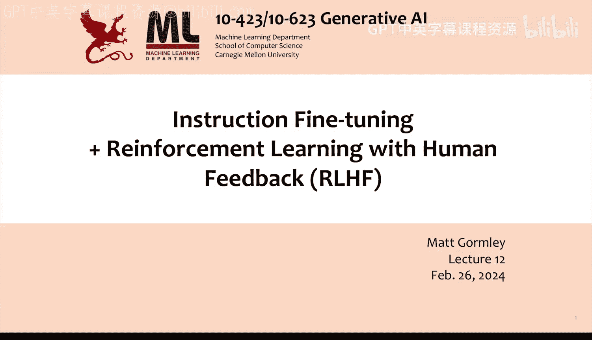
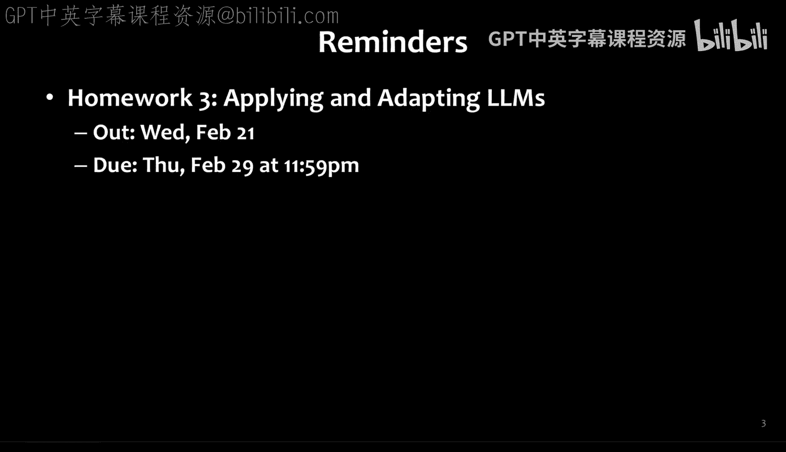
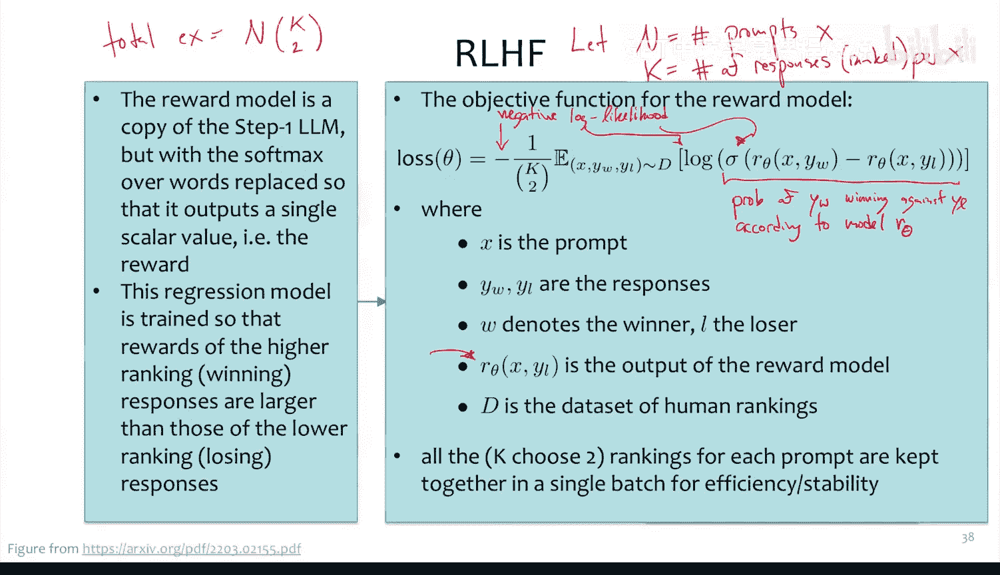
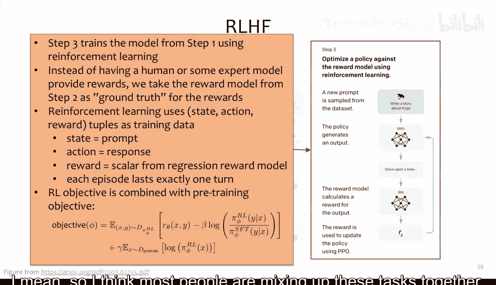
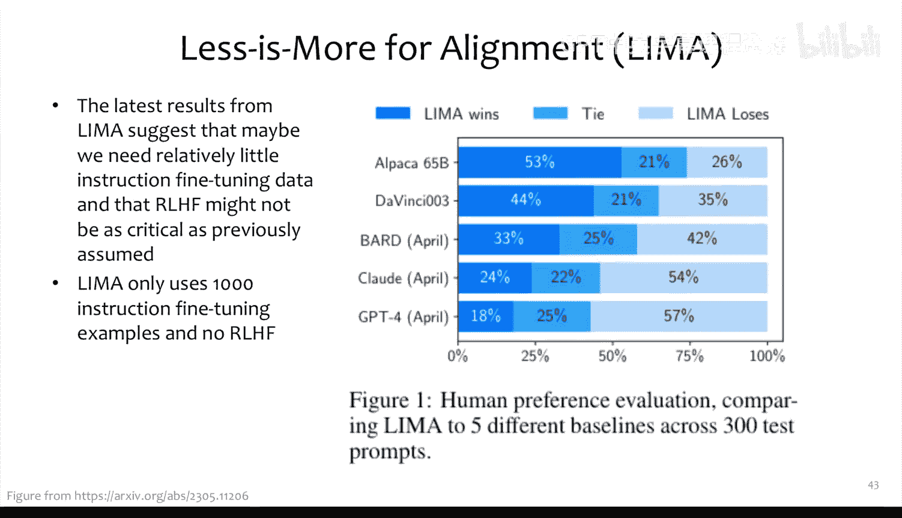
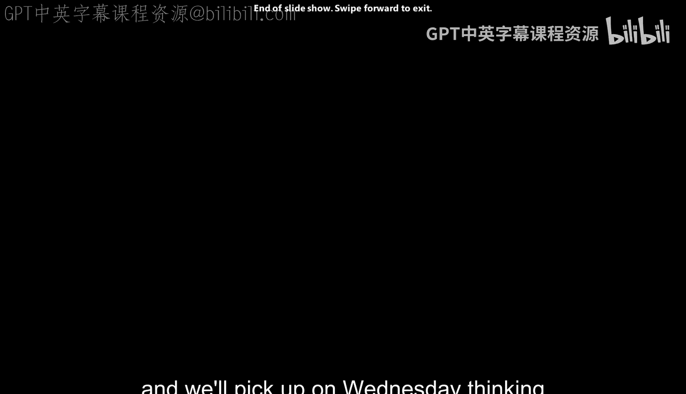

# CMU《生成式AI｜10-423 generative ai 2024》中英字幕 - P12：-P12-Lecture 12- Instruction Fine-Tuning + Reinforcement Learning With Human Fee - GPT中英字幕课程资源 - BV1CyC9BPEhG

All right， welcome back everyone。Thanks for joining today。

We are today going to think a little bit more about how to actually。Adapt。

Large models to the particular use case that you have in mind。

 and in particular we're going to be thinking about how do you make a chat agent。

 maybe one that deals with text or text and images actually behave in a way that sort of aligns with what a human user would actually want from that chat agent。

So to get there， we'll be thinking about two topics， one is instruction fine tuning。

 which we alluded to in our last discussion of in context learning。

 and then the other is reinforcement learning with human feedback。

 which provides another mechanism for actually training these kinds of models。Okay。

Homework  three reminder due on Thursday。

Okay， instruction fine tuning。😊。

We said last time that if you are say doing some prompting for a large language model。

 if it is an instruction fine tuned model， then it often comes with this sort of additional system prompt that appears before the actual instruction and it might be something like you're a helpful AI assistant is。

You know， and then it goes on from there and that this is sort of segmented out separately from the actual instruction。

 which might be say a question that you want answered or what have you。😊。

And so we saw this example of how you could use the same prompt in two different Lama models。

 one is just Lama 27 with 70 billion parameters and one is Lama 2 chat with 7 billion and that the actual model output looks rather different or well the summary looks rather same。

 but the model output looks different in that the response here is。Is starting with something like。

 sure， here's a one sentence summary of the story。Okay。

 and so to actually get this sort of chat like response。

We need to actually fine tune the model further so that it behaves in this way。

And that's what instruction fine tuning is。So the motivation here is that you want to build a chat agent and you have a large language model trained to reduce the perplexity of a large training corpus consisting of you know web text and articles and code and the whole idea is that it's actually trained to be good at predicting the next work。

That's what we're doing when we reduce the log likelihood of data。And。

Yet if you think about what a chat agent is supposed to do。嗯。

Assuming that your pre training data doesn't include a massive quantity of chat transcripts。

Between a helpful agent and another person then。This isn't necessarily what we really want。

Because a chat agent shouldn't merely sort of predict what comes next。

 it should know how to sort of behave in a conversational way。

 it should know when to stop generating this is extremely important right like the sort of standard large language model might not actually know when it is an appropriate time to or how much quantity to actually include in its response。

And so our goal， then， is that we want to。Do what's called alignment where we want to align the large language models。

With the expectations of a human user and generally for some given task and。You know。

 typically that task is going to be provided within the actual instruction。So the key idea here。

Is that we're going to build。呃。In some sense， this entire section of instruction fine tuning I should clarify here is almost entirely about this first bullet。

 which is how do you build data so that you can get this behavior to come out？

The actual technique that we would use， like the methodology is sort of dead simple。

 we're just going to fine tune the large language model on some training data。The big question is。

 how do you actually go about getting this training data？

Okay and this technique is going to go by many different names in the literature。

 sometimes instruction， fine tuning， chat， fine tuning， alignment， behavioral fine tuning。

 and so there's sort of lots of different ways that people are referring to this。

 but ultimately what it means is building a big data set of examples of the kinds of chat like behavior that you want。

 and then training your model on those examples。Very simple。Okay， so my question to you is。

How could we actually build a training data set for a chat agent？

Where could we actually get training examples of this？

 So remember that a training example basically needs to consist of like an X， Y pair。

Where x is the actual prompt。And why is the response？

And so this is sort of a toobar question you could answer by how you could actually get some。

Some prompts。Or you could answer how would you get responses once you have prompts？

Or a third kind of answer would be， how do you get both at once？Okay。

 so what kind of ideas do you guys have， how could we actually go about getting data like this？Yeah。

Hing on our resources， we could actually have like experts you know trying to get human。

 try and emulate this behavior and like go back and forth with another human。

This is what I would like you to do as my assistant。

Somebody that so you can have a human labeler create a prompt and then。A possibly different。

Human labor laborer。嗯。Generating。The response right so it could actually be the same person doing both of these or maybe it's two separate people and they're kind of doing it in like a back and forth interaction。

Good idea。😊，Other ideas。Could we scrap the web for conversational data and try to get that sort of pairs so that we can pay it on that？

Great so we could scrape the web。For conversational data。And this， I guess。

 could directly give us both the source of prompts and also the responses all in one。

 and so you could imagine like a particularly nice source of this kind of data would be these websites that like specialize in cases where a user asks a question and then a bunch of different people supply answers and not only that there's typically like you know if this is stack overflow or something。

 these different answers are up votedted or down votedted based on their quality so in the end you might even have sort of quality metrics for the different answers that come out which might be useful for I don't know。

 say reinforcement learning human with human feedback。Okay。Other ideas。

 where else could we get data like this？We can pro from search engines like with users like if you're googling just like steal people's search results or their prompts created search result。

 search queries rather。And I would say that one of the challenges here is that Google has kind of trained us to write extremely unnatural looking queries so for most search engines or most users the kinds of queries that we write aren't actually sentences at all or questions they tend to just be like kind of a mix of words and so possibly what you would need to do is collect those search queries and then like。

Adapt them to real sentences。Like maybe it's kind of obvious what the sentence would be。

 but the actual form of it might mean to be you know， manually adopted yeah what else。

We could give it a different term， but it one because of what is exactly what coming from and repair re is our so it could probably learn from that that we could learn from the how model on China from you could from the exam。

So are you saying？这不错好。In which it has gone so we probably can from the next time through the pump to all the model of things that should be nothing positive we。

As inSo are you saying that the model could。诶。So a quick first example。

 we could do a over leading space wrong， but in more than details that I'm making a shorter form and then that's how I think the bomb should be。

So maybe time that way streets。So if they be market。Yeah， so if you have an existing crumped。

You could。Feed it to the model and ask the model to basically paraphrase it。

 and now you get back a different prompt。Okay， so I like this idea。

 does anyone want to build on this idea further？Okay， sure。Like I've been working。

 I've been like creating prompts and then can it in a different way， I realize， okay。

 if I give it and look the model book for I better than human language， right？

Great great idea so you could yeah， so it could actually potentially be giving you back higher quality prompts。

Does anyone have other ideas for how we could get a model into the mix here？

 you could have a model that would give a war signal， which the model exists upon。

 using like rape working lighting。So this is a little bit different。

 so does that get us either a prompt or a response？Maybe not directly。

But it is a good idea that we could use RL here， yeah another India。

A generate a bunch of responses and then have someone like pick which one seems the best have a human pick basically。

Yeah。So we already have these massive pre trained model。

And we also know that they're good at in context learning right so what if。

Maybe we could say not just that the model can generate the response， but it could do so。

Say with the help。Of in context learning。So maybe we start out with， for example。

A small seed of human labeled prompt response pairs。

And we give those to the model as in context learning examples。

 and then we can actually ask it to either generate a prompt。Or a prompt and a response。

 Or we could give it a prompt and just ask it for response。

So there's actually lots of different ways that we could have the model start the model before it is instruction fine tuned。

 when it's just a base model we could use in context learning to actually have it generating data for us。

Okay。So these are all great ideas， let's actually look at some data because I think that it's actually informative to understand what it is that people are actually doing when they say that they have instruction fine tune to model。

😊，Okay so before we get there so let me just talk high level about data sets。

 so there's been a huge number of data sets for instruction fine tuning coming out and there's lots of different ways of sort of categorizing them and so what we're looking at here is sort of a timeline of different open source instruction tuning data sets and so each one of these rows is actually showing say you a collection of data sets like natural instructions from 2021 and then some model that used that data like geneative Bart and the actual size of the model whether it was public and。

😊，The number of examples in that data set and so the point here is just that the space has really grown to the extent that lots of people are kind of actively building a variety of different data sets。

😊，Okay so I want to kind of dig into a couple of these very in some depth the first one is from Instruct GT。

 which is going to show up later in this lecture when we're talking about reinforcement learning with human feedback so here this is the first sort of instruction fine tuned model that open AI released and or rather that they released a paper about and。

😊，The data set consisted of 13，000 prompt response pairs。

And the way that they actually got these was sort of well， there were two ways。

 one was they had human labelers that were tasked with writing an instruction prompt and then a demonstration response of how the chat agent should reply and then other prompts were actually sampled from early users of this open AI API。

And then those。Those prompts from that openaiI API before they even had an instruction fine tuned model。

 this was just when they had say a large like G3 model that was good at in context learning so those prompts were then handed off to labelers who wrote the kind of response that you would want a chat agent to have okay so all of the data for this is closed source。

 we have no idea what it looks like but we do know some sort of high-le statistics about it like the different kinds of use cases that we're showing up for this and as well there's been followup work that is open source namely this dolly data set which was sort of purposefully trying to create and open source followup to in G consisting of 15。

000 instruction fine tuning examples and the way this was created was this company databs actually wrote all of these prompt response。

By hand。And to incentivize their employees to do this。

 they set up a contest where like the top 20 labelers would get a big award and here they used the same sort of categories of tasks that were showing up in the in GPT data like open question answering。

 closed question answering， information extractions， summarization， brainstorming。

 classification and creative writing。Now， the fact that they created this is actually quite important for the following reason。

 so the instruct GPT data was closed source， but on the previous slide I showed you a lot of other data sets that are supposedly open source。

 right？😊，The catch is a lot of the existing open source data sets at the time that that Dolly was coming out。

 not Dolly， but Dolly。We're actually using this technique that you guys came up with。

 which is to actually have a model generate the responses for you okay。

 now the catch is if the model is generating the data，😊，Like a proprietary model like say G3 or G4。

 it was and I think it remains unclear legally whether another company can take those model outputs and train their own instruction fine tuned model on them。

And so there's this sort of bootstrapping problem that other companies have like， you know。

 there's all these public data sets that we researchers can do whatever we want with because we're not planning to make any money off this stuff。

 but if you're if you're actually in the business then。

There's this sort of downstream cascading effect of where your data came from。Okay， so this data。

 by contrast was completely without those sorts of hooks。So here's an example of。

Of the first category open question answering so the instruction might be something like what individual has won Oh let me pause here again。

 I'm literally going to go through all of these categories because I think it's actually valuable to see what these training examples look like so so this is what we're doing So what individual has won the most Olympic gold medals in the history of the games and the response written by human Michael Phelps has won the most gold medals of all time with 23 gold and in writing that response the employees at data breakricks actually had to be careful。

 namely they couldn't actually just type that question into chat G for risk of contaminating their own data so they had to like manually go look this up in Wikipedia or something。

😊，Here's some general QA， what is best PlayStation or Xbox。

 and then it goes on PlayStation an Xbox or two competing game consoles， blah blah， blah。

 which is best will depend on the preferences of the gamer etcter。😊，Okay。😊。

So here's a closed question answering task， so by close what's meant here is that there's actually some context paragraph provided。

And if you've ever if you've you know if you've asked questions of ChatgBT。

 this particular form of functionality is quite important right so Chat GBT might never have read the particular text that you want to ask a question about for example。

 and so here we're actually providing the text that the model is supposed tover refer to or the human in this case when answering this question right so the context is something like Readdding railway station is a major transport hub in Reading Berkshire。

 England it's on the northern edge of the town center near the main retail etc。

 and then the question is when was the first Readdding railway station opened。

Which shows up down somewhere in the middle of that paragraph and the responses the date on which it opened。

Information extraction can appear in a variety of different forms。

 but here's I think an interesting example of one， so the context paragraph is just sort of some historical information about various people。

 the instruction though is to extract all of the dates mentioned in this paragraph and then list them using bullets in the format date dash description。

😊，And so as a result， we get back some nicely formatted list。

 and so this is sort of starting to reveal the kind of the power of actually providing these sorts of examples right once someone has written an example like this now the model might be sort of better enabled to sort of answer queries of the same variety。

So brainstorming is another example， what are some unique curtain tiebacks that you can make yourself response there are many items that you can use to make a I don't even know what this is actually I just picked it because curtain tiebacks sounded sounded quite interesting and then I thought as I was reading it I would understand but。

😊，I don't。Anyway， so they get very technical as you can see。

 and the point here is that these examples， if you think about what it is that we're actually seeing in these examples。

 they're remarkably close to the exact kind of examples that we first saw you know。

 companies like Open AI using to tout the amazing abilities of their chat models， right？😊，嗯。

So the examples that they were using to show the world how great these models were very in domain。

 we could say。This is summarization where the context was actually too long to fit on the slide。

 but it was talking about prisms and it asks what is a dispersive prism and the response is a nice summary。

 classification is identifying which identify which instruments。

 which instrument is string or percussion， canara or Gock。

 and here it's sort of we're denoting this is a classification problem because the actual sort of domain of possible responses is restricted by the instruction itself。

😊，い。So in the brainstorming question， how is that brainstorming and not just a question answer question？

So yeah， that's an interesting point like why is this not just mere question answering so I guess。

So so if we read this， there are many items you can use to make a curtain tie back some ideas for this will include a chain。

 a circle and pin， jute rope， wooden beaded rope， a neck， a neckla， or braceless， a doork knob。

 a length of a leather belt。M creamme rope， wow， or a string of artificial flowers， right。

 So the point here is that like what they're providing is not just like there there isn't necessarily a correct answer here。

😊，And so you know the actual ways sorry curtain tie back at least my assumption here is that it's it's the thing that you tie around a window curtain to hold it away so the light can shine through and so I mean these are like some of these are like genuinely interesting like you could use a chain or jute rope right you know there's not like a correct answer for for what you could do here so that's the sense in which this is brainstorming。

it's thinking a different upload listed of given question。

 not just taking angle one but another answer。that's also a good point that there isn't just like one particular answer it's giving。

 but it actually like sort of by definition of brainstorming like it should be giving us a variety of different options very good point thank you。

Smerization classification， creative writing， write to haiku about how much I love pickles。

Chaesssed by sweet brine， you are crispy and crunchy， oh won't you be mine？

and then another creative writing thing that you might have seen in examples is like what should I do on a free afternoon in San Francisco and here it's giving like kind of an example of a plan for San Francisco。

Right。So the idea is that， okay， so that was a lot of examples。

The point here was that like having these training examples in front of you。

 you start to realize that like， you know， the behavior of chat GPT and the kinds of models that we've been interacting with is not arbitrary。

 it's extremely tailored to a particular sort of variety of interaction that has been written down by particular labelers right。

 it's not just that this sort of kind of interaction that you're seeing sort of appeared out of thinning。

Okay， so this is actually different a very different kind of data set。

 and it was actually sort of appearing around the same time or maybe even a little bit before these kind of hand labeled data sets were coming out and it's based on it was used to build this family of models models called FN or Fon T5 and other variants and。

But this data set compared to the sort of you know， 13 or 15。

000 examples we were just talking about consists of something on the order of like three and a half million examples。

And in a sense， all of these are actually human crafted examples。 So here's。

 here's how they could pull such a thing off。 The idea was that you build an instruction。

 fine tuning。Example by finding an existing data set and task。

That is common in NLP in natural language processing。

And you then write down a little template for that task to to take the training data from that task and sort of。

Transmutute it into something that looks like instruction fine tuning。

So these are examples of sort of different NLP tasks， things like common sense reasoning。

 natural language inference， reading comprehension， coreence。

 which is sort of identifying which pronouns refer to which people closed book question answering。

 summarization， translation， right， paraphrase， and so if you were to say， for example。

 take a task like natural language inference。Then a training example from one of these data sets。

Might look like this。Where we're seeing。A premise， a hypothesis， and the target。And。

So the premise here is something like Russian cosmonaut Valerie。

 Polakov set the record for the longest continuous， et cetera。

 And then the hypothesis is Russians hold the record for the longest stay in space and and the。

The target is either that the premise entails the hypothesis or that the premise does not entail the hypothesis and so what they did they then did was they took this single training example and they generated1 instruction fine tuning examples by writing little templates like this。

 so template one takes the premise text and it puts it at the top。And then it says， okay。

 then it follows that premise text with based on the paragraph above， can we conclude that？

Russians hold the record for the longest day in space， question mark。

And then it lists the options yes or no Okay， so another template that that we could instead use would be put the premise down and then say a new sentence。

 can we infer the following and then just list the hypothesis followed by the options yes or no。

And template three right read the following and determine if the hypothesis can be inferred from that right so each of these different templates is actually generating its a unique instruction fine tuning example and if there were say 10。

000 examples in just this one data set now we have 10 times 10，000 instruction fine tuning examples。

😊，From that from that process。Okay， so this is how you could actually get such massive quantities of instruction fine tuning data。

嗯。And and so all of these sort of different models have subsequently been built where you basically take some base model like GT3 Bom。

 T5llma， and then you do instruction fine tuning on some data set and you get back some instruction fine tune large language model。

 and if you want to kind of identify which are the instruction fine tuneed versions。

 then you either need to look for the word you know dash instruct in the name or the word chat in the name or you just need to know some details about the model to realize that they're actually instruction fine tuneed many of your training examples be representations of each other rather not the right positions but slight variation on the same concepts have like an adverse effect on。

The ability that is。Somebody1 times as large so the fact that they're getting like 10 different versions of the same kind of thing might actually make it a little harder to learn than otherwise。

 but I actually have some results at the very end of this slide deck that suggests otherwise。Okay。

Okay， so the last detail is that often the instruction fine tune models are much smaller than the largest large language models。

 ands it's commonly the case that that you can get quite far with， with a smaller mop。嗯。

So you can also do things with multimodal interactions and so this multi instruct data was created in a fashion very similar to Fon where they took 62 multimodal tasks from all these different data sets and constructed an instruction fine tuning data set that involves images so here you could be given an image and then say generate a caption for a particular bounding box that's indicated by the pixels shown right and so it puts a bounding box around that little part of the image and then the correct output should be blue and white tennis racket。

So here text localization is asking select the region that contains the text den and it's giving a couple different options and it should。

😊，I guess。Correctly identify this little word at the bottom。

 select the region of the object described by a blue train in the front。

 and it should identify again like you know the part that's actual an actual train and then finally something like given the content of the image do you have enough information to answer。

 is it a sunny day and you know here the output should be something like the questions irrelevant to the image right so now you can imagine a data set of some scale with sufficient training examples like this could begin to push the model towards an ability to actually answer questions about images as well so long as we actually have sufficient representations of those text and those images。

And then this is just a picture of all the different places where that multi instruct data set actually was sourced from。

Okay。So everything that we were just talking about here was just how do you build these data and data sets and then use them for fine tuning your model Okay so here I want to talk about an alternative。

To the sort of standard approach of just maximizing likelihood of the training examples。Okay。

 and that is reinforcement learning with human feedback。

So the instruct GPT model that I mentioned before was sort of the first to put this RLHF to really good effect for pre traininging a large GPT model。

And so the paper itself kind of claims that in human evaluations on our prompt distribution。

 outputs from the 1。3 billion parameter instruct GPT model are preferred to outputs from the 175 billion GPT3 despite having 100 times fewer parameters。

So this is a nice property and so what we want to do is actually kind of unpack how you could go about that and we're going to follow the sort of standard three steps of our our LHF and we'll look at each one in some detail。

 so step one is basically we're going to do instruction fine tuning step two is we're going to get a human in the loop and actually train a model。

That is good at scoring responses。It tells us how good a particular response is。

 and then step three will use that socalled reward model that we got in step two in a reinforcement learning framework to train the model from step one。

Okay， so let's go through these one at a time。So step one。

I really just doing instruction fine tuning on the 13 k training examples that we were talking about for in GPT and the whole idea is that we're aligning the model behavior with what we would expect of a chat agent。

But the diversity of the interactions might still be limited by the contents of the training data as well。

The model might actually sort of not know a lot about things that it shouldn't generate。And。

And so here， the output of step one is really just， you know， our large language model。

 like our transformer LM。And it's just been fine tuned。Okay。

 so step two is where things start to get interesting。 So now we take， say 33，000 prompts。

And for each one， we sample a full collection of responses from that instruction fine tuned model。

And。And then we hand those off to a human labeler。Who's typically given like k samples where k is some number in the range four to nine。

 this was the sort of the number that the folks at Open AI found was like you know kind of reasonable for a person to be able to digest if you go more than that it just gets unwieldy。

And so their job as a human labeler is to actually take， you know， if you have， say four， you know。

 so the prompt is something like explain the moon landing to a six year old and you get back four different responses。

 A， B， C and D， then their job is to rank them from best to worst right so they're saying here that D is better than C。

 C is better than A and A and B are really about the same。

 they kind of have they tied for the worst ranking。Okay， so。

So you could imagine an interface for actually doing this， this is actually not open AIs。

 this is anthropics interface used to generate an open source sort of RLHF data where now we can see like there's kind of this back and forth in multiple turns between human and assistant and then finally at the bottom we actually have something like choose the most helpful and honest response and they're presented with the two options and this likert scale where they're actually supposed to rate the quality of A versus B。

😊，And so in this way， the actual sort of ranking that they're coming up with is actually pairwise between。

 say， two responses。Okay。😊，So what is this reward model？嗯。😊，So。The reward model is really just。

A regression model。Its job is to take in a response。And return a score。

 you could think of the score as like a number from one to seven right like like here we're actually rating a pair of models。

But what we're saying that the reward model should return is not a ranking of these things。

 but rather just a number that says how good is this particular output， this particular response？

Okay， so so how would we define such a model， So essentially all you do is you take a copy of。

Say your step one large language model， or in fact， I think actually maybe I should I should。

Be careful here。So this could be。Or some other。Smaller model。

So I think in practice InstructCT found that or maybe it was sort of enthropic found that like you know if you use one of these enormous models it's essentially kind of like unnecessary and maybe doesn't even particularly help training and it just slows things down so you can actually get away with using a smaller model and you end up with you kind of equivalent performance so you take some big large language model and you remove the output layer which is a softm over your vocabulary of words so whatever that last layer is that generates words you remove that and replace it with some linear layer that just outputs a single scalar。

😊，Okay以。😊，And then you train this model。So that the rewards of higher ranking or winning responses are larger than those of the lower ranking or losing responses。

Okay， so how could we actually do this？Well， we need an objective function this is。

 but this is ultimately just regression right so we're so our regression model。Is。Our theta。

So it returns a single scalar。And we have a couple things going on， so X is going to be a prompt。

YW and YL are responses where the W and L are denoting winner and loser。

 so for a particular pair of responses given to us ranked by a human。

 we know one of them is better than the other。And so what we say is we're going to build this objective function。

Wherein for a particular a single prompt X。We're going to。

Compute something like the difference in reward。Of the winning response with the losing response。

Okay。And。呃。And then you could think of that difference as essentially like a relative rating of these things。

Okay， so if so what we want。Is for。For that relative rating to be a high number。Because。

That would indicate for us that the reward model is giving higher reward to YW than to YL。O。Now。

 what's interesting is sort of what else is appearing in this objective function。

So we're taking that score， which is。Just some scalar， right it could be positive。

 it could be negative， and we're passing it through a sigmoid to get back something like the probability that YW is better than YL。

 according to our model。And then we're working with the log probability of it。Okay。

 so this is kind of like you could think of this as like a kind of like a cross entropy sort of loss。

So this is。The probability。Of。YW。Winning。Against Y L。According。To the model。A theta。

And and you'll notice that we're working with a。Negative。Log likelihood。Here。

So there's also an expectation here。So the expectation is over the actual data set of human rankings。

So you could imagine that for every prompt X。There's some number of pairs。

Of like a winner and a loser。So how many different pairs are there？Well。

 if k is the number of responses for each prompt。Then k choose2 is the number of possible pairs that we we could rank right so if you have a full ranking of all k。

 there's actually K choose two different。Examples for that particular。For that particular prompt。

And now we're seeing that。That the objective function is basically from。So if we had， let's say。

Let sort of n equal the number of prompts。X and K equal the number。Of responses per prompt。

Then the total number of examples。Equals n times k choose 2。So that's what the expectation is over。

And the last sort of interesting detail here is that the first thing that they tried was actually just to take all n times K's two examples。

 randomly shuffle them， and then train the model， but they found this causes two problems。Number one。

 it actually made training kind of unstable， like each prompt is now like distributed throughout the data set with lots of different examples。

 so they found it was much more effective for training stability to take all Kcho two pairs of responses and put those together into a single batch。

This has an additional added benefit， which is efficiency。😊。

So why is it more efficient to take all K choose two examples and put them together for a single prompt？

Any ideas， yeah？我感这种。There's more consistency and someone you want to try to be most should have the same first part being like question or you know so the X part of what you're conditioning on right so the actual reward model itself remember is just a large language model you're feeding into it a big long prompt text X followed by some other response text。

 either YW or YL。And then you get back a single number from that。

And the observation is that they're consistent across X parts。

 and so you could reuse the first part of the large language model。

 the computation graph where that first X input is identical across these two。

 so you can reuse it across a winner and a loser and you can also reuse that X part across the K choose two different examples。

Okay。Questions。Yeah。对。we're just bargaining how rank。

 but the actual model itself is outputting a score。That's exactly right。

as you said the if fine task have a different task example one could be like a fine tu one I don't actually I mean。

 so I think most people are mixing out these tasks together。

 they're not doing it like one task and then another task。

 but I don't know that I've seen a comparison of like you know dispersing them not dispersing it's possible。

F out the fact prop and not the cheese part。So assuming your model is parameterized by theta and then theta is what's generating all of the responses。

 then how do you make it so that you reward。The right parts of the this is a great question how is it that we could be training this reward model when those same parameters are being used to generate the responses and the answer is there it's not the same theta so what we're saying here is that there's a reward model here。

That is some r theta。And that is based on some big language model。

 but there's the actual big language model we could call， say， P Phi， this is the LLM。

And that is a different distribution。呃。Then。A theta。So。So they're basically separate parameters。

 We first learn phi that actually generates the responses。And then we。

Collect a bunch of responses from Phi， feed those in to get a data set。

 and then what those are that's now a fixed data set manually annotated that we use to train our theta and our theta is now going to be completely fixed for step  three。

 which is where reinforcement learning comes in。Yeah。

That be like once you train like an accurate reward model， then you train Efi to maximize。

Like your current reward exactly right， so let's just pull on the slide。So step three。

I is going to train the model from step one so it's going to take p5 from step one。

 and it's going to keep training it using reinforcement learning and instead of having a human or some expert model provide the rewards we're going to take the reward model from step two as ground truth for the rewards。

And so。So now what we can do is we can have reinforcement learning， which needs as training data。

 state action reward tuupples。And so here our state is going to be the prompt。

 the action is like the actual response and then the reward is the scalealar from the regression reward model and each episode just lasts exactly one term right so if you know the language of reinforcement learning episodes could have multiple turns。

 but here we're just talking about one the training for your model see the input that test time that's very different from of it is the reward like。

So the training example looks like wildly different than the reward model has。

You train the reward using this yes and then when you do the third stage in RL。

 yes if the input to the reward model is very different from the train example of the reward model when it's the link Yes。

 so essentially the hope is that the reward model is good at generalization。

And so even though like it hasn't seen。All the examples of good responses that it's that if it's presented with a collection of responses that all look quite different from things that's seen before。

 that at least it could induce a fairly reasonable ranking among them， that's the hope。

that is a scale like just might be able to in。Y， just minus infinity， yeah。

 it's just a regression model。Okay， so then so then finally we have some objective here that is fine tuning those five parameters of the actual large language model。

 so this is different from theta and now we're denoting the actual language model here by pi sub phi right but this is just another large language model that generates a response given a prompt X。

And there's some additional details about how you should actually set up such an objective。

 it turns out that it's actually useful to combine the RL objective。

 which is on the top here with some gradients from the or with the actual log likelihood of your pretraining objective。

 there's something kind of about putting these two together that helps training。😊，Okay。

 so I'll leave off by kind of answering this question， does R LHF help and the answer is yes。

 it tends to increase the human perceived helpfulness and harmlessness of the model。😊。

OkaySo so basically what we're looking at here is you know。

 like the model without ourLHF and then with ourLHF and helpfulness goes up and down or harmlessness also goes up and then importantly it doesn't hurt the zero shot or few shot performance of the model on most tasks that you might care about。

So interestingly， RLHF is not actually improving the sort of ability of the model to sort of solve the kinds of challenging tasks like summarization and question answering and information extraction that we care about。

 it's just modifying the behavior of the model so that it appears more helpful and harmless。

Okay so the last thing that I promised I would leave off with was this Lima。

 so less is more for alignmentman， so there's this new paper that came out that suggests that maybe we actually need less instruction fine tuning data than we thought and maybe we don't need RLHF as much as we thought so Lima uses only 1000 instruction fine tuning examples very carefully curated and what they find is that they take a large lama model and fine tune it just on this 1000 instruction fine tuning example set and then they compare it to a bunch of other models and you can see that even against barred cloud and G4 which are these RLHF highly tuned models with massive training data sets from major corporations that this tiny little training data gets them essentially 50% of the time with barred for example or more than 50% of the time they're either winning against Bard。

Or they're tying against Bard。And same thing are roughly around like 40 or 50% for Cla and G4。

So essentially these sort of new results are suggesting that maybe that most of what we actually want out of the model is actually coming from the pre-training and this instruction fine tuning step and this RLHF step are really just making some minor tweaks to the actual sort of final behavior of the model that we want。

All， we'll stop there and we'll pick up on Wednesday thinking about text to image generation。

 thanks for staying three minutes late， see you guys then。

