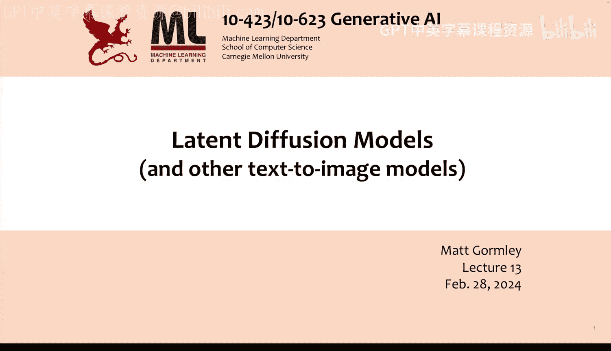
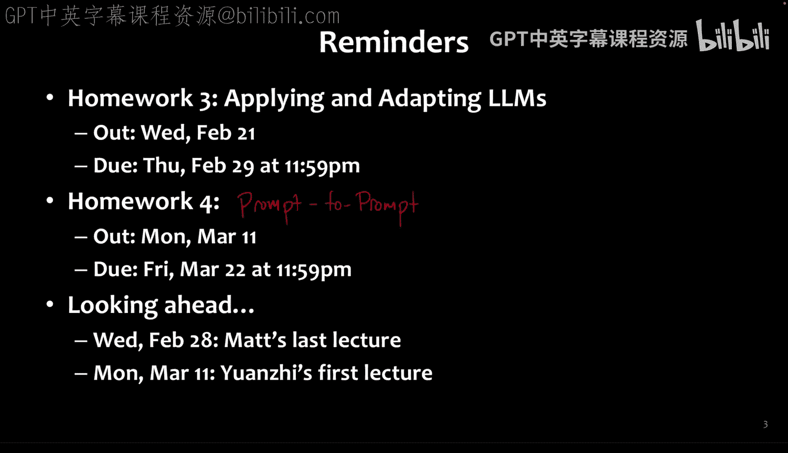
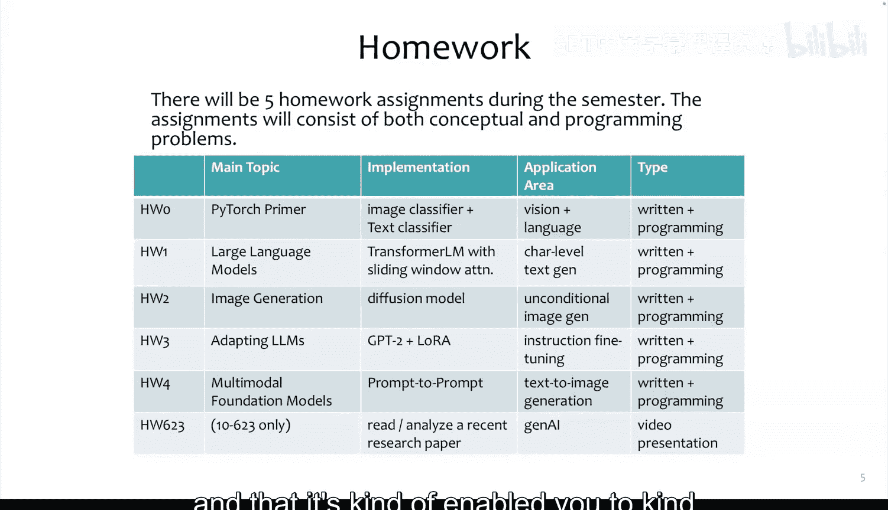
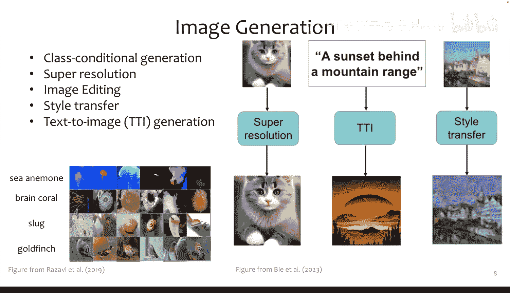
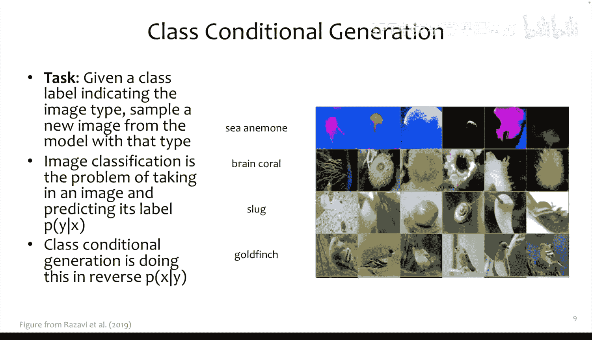
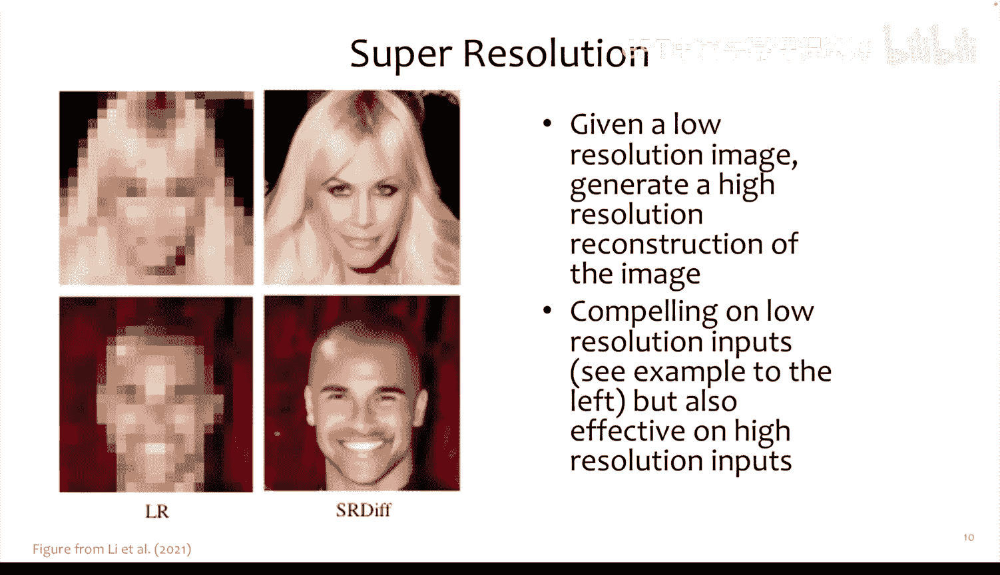
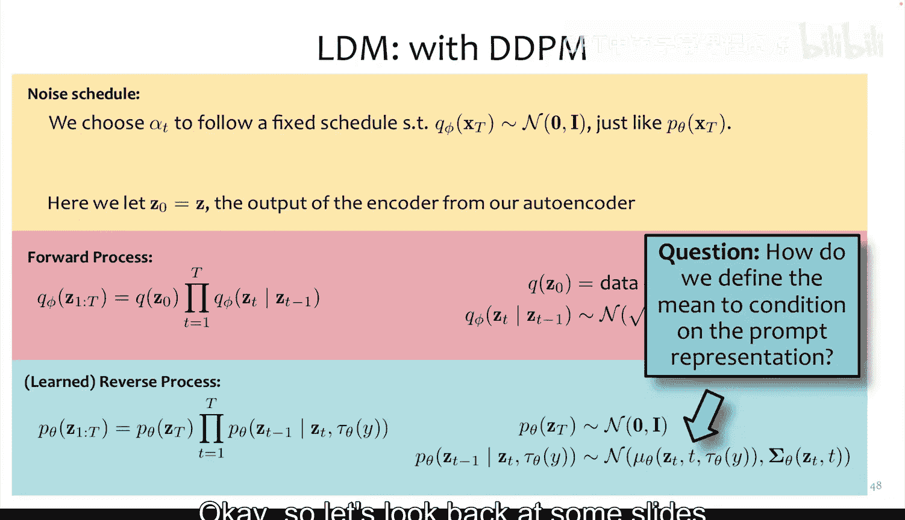
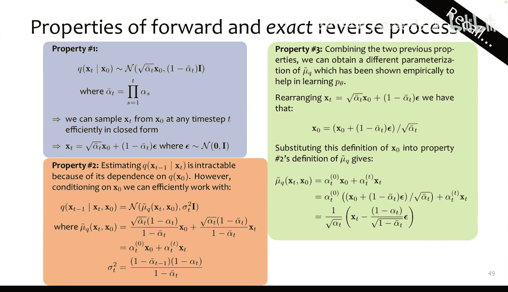
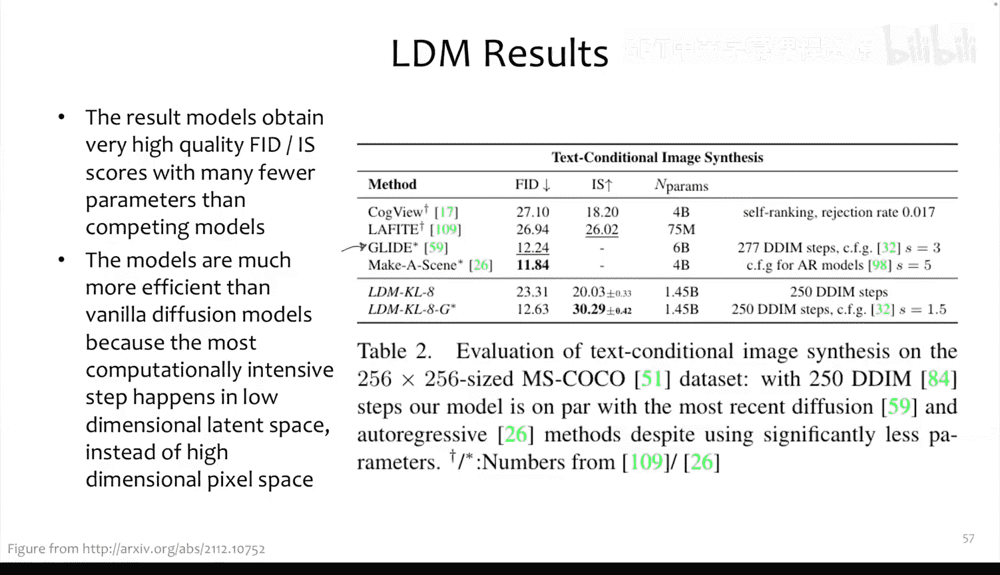
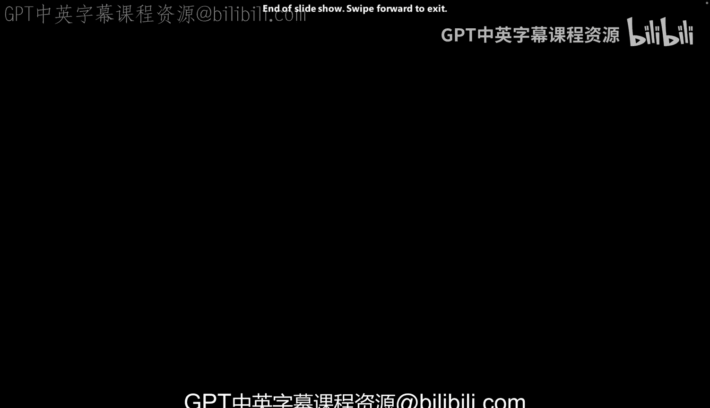

# CMU《生成式AI｜10-423 generative ai 2024》中英字幕 - P13：-P13-Lecture 13- Latent Diffusion Models.zh_en - GPT中英字幕课程资源 - BV1CyC9BPEhG

All right。Welcome back to JenAI。Today we're going to be mostly talking about a technique called latent diffusion models。

If you've heard of stable diffusion， this is the technique behind stable diffusion。And。

So stable diffusion is like at least in its original release was。

Was sort of the first latent diffusion model。But in addition to that。

 I think it's useful to kind of have at least a high level picture of some of the other text to image models out there。

😊，We won't go into those models in depth， but I'll kind of like present what the sort of range of techniques in use today are。

 and then we'll kind of narrow in on latent diffusions。Okay， so。

Homework three。Is due tomorrow， homework four is out on the other side of spring break。

And I guess actually， so I've been I had been leaving this blank， I think now。Well。

 don't hold me to it， but we're pretty confident that。

We'll be exploring a method called prompt to prompt。And sort of other aspects of image generation。

Looking ahead today is my last lecture for this class and on the other side of break。

 Huanzi will start picking things up which again， I think I mentioned this way at the beginning of the class but I'll just kind of given a brief introduction to him as well like for example。

 if you're reading the Laura paper you'll notice his name there and if you read certain G4 papers。

 his name will show up there as well， so he brings a lot of perspective from the collaborations that he's had with people at MSR and so yeah be it'll be great to。

😊，Have some new perspectives on this stuff。U so。

By way of also just kind of looking ahead， we've already kind of ticked off three of the four homeworks。

 three of the five quizzes we have an exam coming up on the other half of the semester。

 but most of our time will actually kind of go towards the project in the second half。And。

We' we actually I looked back at like what this slide originally said on the first day of class and we actually surprisingly adhered but pretty well to the plan that we had set out with and I think that was you know partly at the expense of your time to get you actually implementing these challenging things but I hope that that has been worth your time and that it's kind of enabled you to kind of go off and do really cool things as we move towards the project in the second half I think so we' we'll release we don't really want you to sort of yet be worrying about the project there's still kind of a lot going on in the course。

😊。

But so we'll hold off on kind of releasing full details about that later but this is actually a great time just to start talking with other people in the course and to start thinking about the kinds of things that you'd like to work on we kind of worked hard to try to show you a real breadth of topics here。

 I think that probably one of the main topics that we have not yet covered is sort of the systems aspects of taking these some of these models。

 particularly large language models and scaling them up to really。

 really large data and really large quantities amounts of compute so I think that that was sort of a strategic choice on our part。

 our expectation is that while it would be wonderful for some of you to explore the sort of scaling up aspects of generative AI。

 it seemed less like。😊，that that would be like a popular topic for projects。

So if you and then lastly， if you don't know people in the course， we definitely encourage you to。

To kind of get in touch we'll kind of to get in touch with other people。

 we'll use Piazza there's like a team finding thing that we haven't opened up just yet but we'll open up and we'll kind of use that as just a tool for facilitating kind of getting like a picture out of like hey。

 here's some things that I'm interested in and then other people can kind of jump in if you already have ideas and if you're not strongly opinionated about where you want to work。

 other people might have specific ideas that you could join along with。Okay， so。

Additional image generation is something that we've kind of alluded to。

 but we've not really delved deep into this topic。😊。

I guess this is sort of a picture that we've seen before of sort of different conditional image generation tasks。

 so class conditional generation is one of them， given a class label you predict or you generate an image of that type super resolution is going from low resolution to high resolution and then image editing includes things like in painting colorization and uncropping so end style transfer and then lastly text to image generation。

😊。

So so the most of what I'm talking about here today is really just about text to image generation as sort of a running example。

 but in fact essentially。😊，All of the techniques that we're looking at here generalize very straightforwardly from text to image generation to these other kinds of conditional image generation tasks。

 and maybe I'll mention that kind of towards the end once we've actually seen the models so that it kind of becomes clear but roughly the kind of key theme in all of these tasks is that you have some data that you're conditioning on。

 whether it's a label， an existing image with a mask or a text prompt。

 all of these things can be just represented as some data that your model conditions on when generating。

😊，Okay， so so I mentioned that I wanted to kind of give the high level picture of like the space of models out there and。

😊，So we're going to look at kind of three classes of methods here。

 so GAN methods for text image generation， autoregressive models。

 which here is maybe captured by these blue dots that are denoted as transformers since most of the autoregressive or all of the autoregressive models that I know of are transformers and then diffusion methods which latent diffusion models is an example of here in the center。

So。啊。So of these， the earliest work on text to image generation was actually coming out of GAN methods or kind of GN style methods。

😊，And。So here you can see that this was kind of happening as early as actually 2016。

 this is missing a paper that I'm about to talk about。And then。By contrast。

 the sort of transformer based models and associated autoregressive models really were primarily kind of around the time of vision transformers and then following up work on vision transformers for generation。

And and then the third class of models are those in the diffusion space and so here it's probably worth just noting a couple kind of interesting things one is that Dali was actually kind of one of the first in this auto regressive。

Space glide。嗯。Was one of the first in。The diffusion model space。U。And。

And then we'll also touch on Imogen and LDM in this as well。Okay。

 so what can you do with agan for text to image generation So。

 so remember that when we first talked about Gs， we said that。

One way that you could do class conditional generation is simply by having your generator take a label as input right so you could just take the label。

 have some one hot representation of it and pass it into your generator and now your generator is a function both of the noise as well as this label。

😊，And of course， also it's parameters。And so doing things in this way doesn't really change the behavior of the generative discriminative framework。

 it just adds more information and so if you wanted to do if you wanted to condition on text。

 could you could do that essentially in the same way， but where you have some，😊，Some function here。

 it's denoted by var Phi that。Actually takes your text in and outputs a vector representation of it。

 so where would we get a vector representation of text any of the like large language models that we've been talking about like a transformer encoder only model or a transformer or decoder only decoder only model。

😊，So this is a picture of the earliest generative adversarial text image synthesis method from read it all in 2016。

And you can see that basically what they were doing was was very similar to sort of what we had just talked about in terms of。

The the class conditional。Case， it's just that this function barfi was first taking the actual prompt and。

Obtaining some embedding representation of it。And then concatenating that in with the noise。And that。

That full representation of noise plus prompt embedding was then passed into the generator G and used to build up some fake image or some generated image X hat。

And then the discriminator was， so you can see here that this was kind of likevol a convolutional style generator。

 and then the discriminator was also a convolutional but the interesting bit is that part way through the convolution。

 they concatenated in again， that representation of the text so that the discriminator was also conditioning on this prompt。

 when it decided whether or not the input was a real image for that prompt or a fake image for that prompt。

And so now the discriminator is actually， since we're back propagating through this whole thing。

 it's actually working really hard to figure out， is this image that I'm looking at。

 a faithful representation of whatever that text prompt is。And so when you're jointly training。

 say the prompt representation model， Phi with the generator and the discriminator。

 now you could actually learn kind of all of these things together and the discriminator will force the generator to make use of that phi representation so that it produces images that are faithful to the prompt。

Okay， so the next sort of class of methods are autoregressive models and。

We actually saw one of these before party was the example of this。😊。

And the whole idea here was just that。That we take an image and we tokenize it into some discrete representation。

Say using something like a VQgan and and that discrete representation is now just like a basically just a codebook of little image patches that can be put together to reconstruct a version of the image so the point is that。

😊，We could think of this as， and we will think of this as an encoder。And a decoder model。

Where the encoder is taking the image。And converting it to some intermediate discrete representation。

And the decoder is taking that intermediate discrete representation and trying to reconstruct the original image from it。

So you could think of this just like an auto encoder where the latent representation is actually discrete。

And once we have。An actual way of encoding and decoding from this discrete latent representation。

Now we can actually cast the problem of generating a text conditioned image。As just。

An auto regressive problem， where we have the。嗯。The text prompt。Followed by。

The discrete representation of the image。So the point would be then for many training examples。

 we have the prompt followed by the discrete representation。

And so we pretrain the encoder decoder model， so we train that once。

 and that gets us this model that's capable of sort of doing good reconstruction from this latent space。

 and then we have this autoregressive model that takes as training examples。

Prorumpts paired with the discrete representation given by that encoder model。

And so the autoregressive model doesn't actually need to know anything about the it doesn't actually even necessarily look at the original raw image。

 all it looks at is the discrete representations of the image and learns a good distribution over those discrete representations。

对。Okay， so we'll actually kind of revisit this idea when we talk about latent diffusion models。

If has。啊他信下。So the is not exactly from the just the the so what I'm saying is just that the auto regressive part right so this is the auto regressive model。

Is。It's not ever looking。At the image itself。It only sees the discrete representation of the image。

So we do some价。Yeah， so the encoder takes you from image to discrete representation。

You just take for every prompt image pair， you first convert the image to a sequence of basically like image patch tokens。

And then you train your auto regressive model to generate from the prompt that sequence of image patch tokens。

对的。Like how comparable is the are the image has tokens to the workloadats we seen before they deeply compress yeah so I think that the。

I don't know the actual。Hearddy could book size， but I'm pretty sure that。

The latent diffusion model that we're going to talk about。

 which does use a VQgan as one of the options for how to build it， does a codebook of size 8192。

So that's actually a lot smaller than like a word vocabulary。I think that。

Heard of the reason for that。呃。Iss that？嗯。The actual decoder gets really good at sort of treating those discrete representations as just a semantic representation of like what the image is。

 and then the decoder gets really good at generating photorealistic or image realistic representations of those semantic representations。

Question so if I want to like generate an image based on a prompt now I put the prompt into the first transformer。

 but then what actually gets put into the I once through I1 through I am。

So if you want to generate an image， you're sampling from this model。

 so you don't put it so you put the prompt in and then you put the start token in。

And now you just start sampling， so you sample I1 and then feed it back in and then sample I2 and then feed it back in。

 sample I3 and so on eventually you will generate capital M of them and that number is fixed you can only generate one for each patch。

And then take those you take I1 through IM， you hand them to your decoder。

 and it produces an image from that discrete representation。

To the imager equal to organizer part is the loss function just like a standard auto encode loss function yeah so。

I think that the。The fact that it's called so there's like an adversarial component to it so it's not just an autoencoder。

 there's also like an adversarial component to the loss and that tends to be I think kind of important to getting things to work well so there is actually like I think a discriminator hiding that's not shown in this picture but。

To the discrete representation et as no it's all just learn discrete representation。

 that's all it is。Yeah， its good implementation on the image， so quite depending district script。

It was as well were going to build a reconstruction， so if this was X and this was X tilde。

Then step one。Is going to train。Train just this part。To like minimize reconstruction loss。

With some sort of adversarial component。And then step two is going to just use。嗯。

It's going to use the autoregressive。At plus the encoder。And we would just minimize。

Negative log likelihood。Of the sequences， which at this point are fully observed。

And then step three would be when you want to generate。And。You take this bottom part as input。

And step three is going to make use of the autoregressive model。And also， the。The detokenizer。

So that's how you would actually generate。我同。From that was really thick。Yeah。

 so when we're actually generating。As we said， we just take the prompt and the start of sequence token。

 and then we sample a bunch of little discrete tokens and then our decoder goes from there and takes those discrete tokens and generates a reasonable looking image from it。

Okay， so this is the second time that we've visited this slide and I tried not to teach it and then you guys made me talk all about it anyway okay that's great but maybe let's move on so。

😊，Diffusion， so this is where I actually wanted to focus today is text to image diffusion models。

 okay， but I still have yet one more sort of higher level just sort of quick look at a model。

 which is want I want to just sort of briefly mention Dolly too。😊，Okay， to understand Dolly2， though。

 we need to just just again， at a high level understand split。Okay， so C is not a generative model。

 but it's such a simple idea that I think we can talk about it very briefly just to get an idea of what's going on with it and then understand how it's used in Dolly2。

😊，Okay， so here's the idea we have a text encoder this is like you could think of this like a transformer language model。

 so this is a。😊，Transformer LM or something like it。

And then we have an image encoder and you could think of this as like a。A CNN or a VIT or。

You know whatever your favorite model is。And。And the point is that。呃。You can take a single prompt。

 feed it into your transformer language model， and that would give you back。

A representation of that one prompt。Likewise， you could feed a single image into the image encoder and that would give you back a representation of that one image。

😊，Okay， so what C does is in batches it。It collects together a series of。

Of representations of prompts and image pairs okay so if you have n pairs of imagess and prompts。

 then you get back n representations of prompts and n representations of images so each of these T1 through TN it's like a high dimensional vector and each of I1 through IN is a high dimensional vector and for the purposes of clip we ensure that they have the same length。

Okay。The reason that we want them to have the same length。

Is that we're going to construct this little matrix。By taking the dot products of all pays。Now again。

 this is just for a batch it's not like for your entire training data set。

 so this might be you know 16 16 by 16 matrix。And what we then do when training clip。

Is write down an objective function。That tries to push up the values along the diagonal。

 basically saying we want the text embedding representation。

And the image embedding representation to be close。

And then we can push down all of the other ones because we kind of want them to be farther away from each other。

 absent any other information。And so essentially so you can think of this like we're just trying to maximize the dot product of I1。

 T1， I2 T2， I3， T3 because this here is taking the text representation of the third prompt and the image representation of the third image and trying to push up their dot product so that the embedding representations are close。

Okay， so the real trick of clip because this is such a beautifully simple model。

 the only remaining trick is that you train this。😊，On 400 million。Pars。Okay。

 so by simply scaling this up to humongous scale， you get back some really powerful models and they can do a couple cool things so namely。

😊，You can actually now use it for zero shot classification of images， and here's how that works。

So you take in your image and you encode it and you get back one vector representing that image。

And now you want to know what is the label for this image？So you do some essentially。

 this is kind of like prompt engineering， where your prompt template is a photo of a object。😊。

That's the engineered prompt。 And now you fill in for object， either plane or car， dog or bird。

And if you had just those four possible labels。Then you would get back four different n equals four different labels。

And now you could just compute the dot product of your image representation with each of those prompts。

😊，And then you could pick the one that has highest score。Say it was a photo of a dog。

And you could say this must be a photo of a dog。That's the whole method。The beauty of this is that。

You don't need to specify a priori what your classification labels are。

You can just use it for zero shot prediction on any set of labels that you would care about and chances are your text encoder and your image encoder will have seen that label somewhere along the way。

 so calling it zero shot might feel like a little bit of a stretch but this is sort of how they couch the method。

And the last detail here is just that this model was so successful that people found tons of different uses for the text encoder and the image encoder that come out of this clip method。

 it's really easy to train， you can train it on any data。

 and so one use of that was actually for image generation。😊，And。So the trick was that。You could。

Ahead of time， train clip。Okay， so before doing any sort of text image generation。

 you just train clip and that gives you this nice image decoder and this nice text decoder。

And then you。You essentially train a。嗯。A diffusion style model so that。

So that you're using the actual representation of the text。To put like a。

Prior over the actual diffusion probability distribution。And to kind of say that given。

This particular text representation。嗯。😊，We， we think that the。The image representation。

Should be close to that。And so your prior is basically trying to nudge the diffusion model so that it's generating things that look like。

Images that would encode to that same representation。So。So this is the Dli model。

 but you'll notice that the。The actual diffusion decoder is still operating in pixel space。

Just as like what you were doing on homework too。嗯。So Imogen was another diffusion model。

 it actually came out before。呃。So I forget the exact timing of it。

 but it took a really long time for it to actually be released。

 the paper came out early and it was very clear from the examples that it was like this incredibly successful model。

 but Google was very careful about not releasing it and so there were like a bunch of DD models that got a lot more attention。

 even though this one was probably higher quality。So Imogen was simple in that it took a text to image diffusion model and then it coupled that with a pair of additional diffusion models for going and doing super resolution。

So the idea was you take a text image diffusion model。

 maybe kind of like the Do it actually wasn't quite like the Dolly one。

 but something like that and you take in your text embedding and you output some 64 by 64 image。

 right？😊，So。Then you give that 64 by 64 image to a super resolution diffusion model。

 which gives you back。😊，A higher resolution version of the same image。And then。

 and I still don't quite understand why they do this， but they do that a second time。

 and they go from the 256 by 256 to the 1024 by the 1024。😊，So。

There was something about like going straight from 64 by 64 to 1024 by 2024 that like was just kind of not as stable。

 there was something about like kind of having this intermediate size that was helpful。

 I don't have a great explanation for it。Why are we passing the extend bedding into the super resolution't that just an image be Oh。

 good question。 I think that the the the reason for doing that is so that。嗯。

It's able to kind of have the same access to this like rich text embedding that the original diffusion model did。

I think it maybe comes back to something about how we're actually sort of cross attending to that text embedding within the diffusion model itself。

嗯。But yeah， so there there are other methods for super resolution that don't give access to。

That like just take a low pixel representation of it。

 I think maybe just it's sort of easy to do and maybe having that little bit of extra information makes it easier for the model to learn。

Yeah。是。So suppose you want to do something like more open ended like maybe just pass an image and just say。

 you know describe a scene in this example， you're sort of like you have like all different objects you want to class。

 but something more of how would you do for trafficive learning on that problem？

So the point is that on this half of the slide， there is no learning。Okay。还几道号。好。m， so I mean。

 these prompts already like are or oh， what's the the？There is no prompt here on， I mean。

 it's it's just like generally like a。Like you could think of it more like an alt text description so like if you're so there's sort of different sources of text for images。

 but like the default one is for usually for purposes of supporting people with disabilities。

 there' there's often an image is accompanied by an alt text description。

Whi is literally like a long sentence describing what is in that image so that someone who's visually impaired can actually read or can read a web page and understand what's going on。

And so a lot of those descriptions do appear on like， you know。

 if you go to a company webage or something like that。

 you'll find that there's actually like pretty good compliance with with including those those kinds of descriptions and then there's also resources like。

Like flickr or something like that that have just users who describe their own images either through tags or through full sentences and so so the。

The actual text that's associated with each image and training。

Is already kind of just you know whatever you find on the internet paired with that image。

 and so it might mean that actually it's not a particularly rich description of the image。

And so there's actually other work。That， that finds that。

It's valuable to take an image text pair and use some other model that looks at your image and tries to generate like a richer description of it and then train models like maybe not necessarily clip。

 but like models like C based on those like enhanced descriptions。The for。

Well so the other model is just an image to text model。

 which is just a very different looking model and if you so you could we'll talk about those on the other side of spring break that's sort of the first topic is we refer to them as visual language models so they're like they're like large language models。

 but they can condition on and possibly generate images。And so you could。

You could think of this text though as not necessarily like it's whatever text is associated with the image on the web。

Samply the diffusion bottle and image it。So like what does the lower resolution image influence the midation model。

 does it influence the noise vector， the initial noise vector。

 or does it influence the transition problems？Oh， good question。 It's conated。

 So if you remember like。😊，Like what was my first I guess like we were doing in GANs where we were taking the noise vector and we were concatenating something like an embedding representation。

 that's the idea of super resolution models is you take the noise and you concatenate in a low resolution。

Version of that。The bar机的。Yeah， except now instead of text， you're concatenating in。

A low resolution image。And you're using diffusion instead of a gain style training。Yep。对啊。We以大这。

So go you said you don't need to file。Labels are the prior description label， right。

 So what is the prior。But。So the prior distribution is over the。呃。嗯。

It's over the actual diffusion reverse diffusion process。And。

So the actual like mechanics of exactly how I don't know how exactly。

Like the Dolly two priors were specified。But the intuition is that， you know。

 you have a probabilistic model of sort of next image given previous more noisy image and you can。

Just as you would。Multiply in a prior for any other probability distribution。

 you can multiply in a prior here that's trying to encourage。The the sort of next image to look。呃。

Look a particular way。我去己他。This is just showing like this is just sort of showing the actual like clip part。

 so above the dotted line is just the sort of standard picture of clip。And。

They're what they're trying to represent by that horizontal Laor with clip objective is just。

The actual thing here that we have dot products and we want those to be high when they're actually paired。

不是。Oh， the box above the prior。So。I think that's the diffusion process。

 I don't know why it looks fully connected。 there are actually some。What's that？No。

 I think this is a diffusion model there might actually be， I haven't read about them。

 but I think there are diffusion models that don't have like a full Markov assumption built in。

 but you can do because this is all variational， you can work with a probability distribution like this one that doesn't have the Markov assumption。

 and even though it's intractable to work with， you can still actually approximate it。Yes， yeah。

So imagine is the text emitting also concateedated onto the noise vector in the reverse process？

Is the text embedding concateated？I would think so， yeah， I think that's exactly， I mean， again。

 concateated， maybe I'm kind of being a little handwar here。

 maybe in fact what's going on is sort of cross attention。

 which we'll kind of describe when we get to LDM。Okay。So okay。

 one more question then we'll switchYeah so remember that what the clip objective is doing。

Is they're trying to。Yeah， I think that's right and that the the point is that what the clip objective is doing is for every。

Basically， for every image in the clip training data。It is。It's learning a text representation。

 So you kind of have to think of it from the perspective of multiple images， I guess。

 so in that text encoder embedding space， the prompts for。嗯。The the prompts for something like。

 you know， a dog running through a grassy field and a striped dog running through a grassy field。

 those are because of the club objective are going to have like。Nearby embedding representations。

And so the。The idea then of。Of this is that。You're actually。Sort of encouraging the model to。

To to kind of keep。Keep some like latent representation of the image in the diffusion process close to that text embedding representationffusion image right still so that's the decoder part。

Is that they're actually different。We haven't really yeah。

 I'm kind of getting ahead of myself because we haven't talked about latent diffusion yet。

 So there is going to be this other step where they go from。This vector back to image。

But that decoder is completely separate from the clip learned one。是。

This model is symbol of tail short language。Like migrationYes， that's true， it is zero shot。Okay。

 so lets let's jump into latent diffusion models because I don't want to muddy the waters with a poor explanation of Dolly too。

Okay， so the motivation for latent diffusion is the following。

Diffusion models are typically operating in pixel space。

 meaning that the actual so ignoring this picture of Dalhi that we were just looking at。

 most of the other models in this space were were doing。The actual diffusion。

 say if you wanted a 64 by 64 image in the space of 64 by 64 images。

So the problem with that is that training。Generally was taking hundreds of GPU days。

 so guided diffusion， for example， needed like somewhere up to 1000 V100 GPU days。

 Imogen needed like 1000 TU days。And then inference is also really slow。 so， you know。

 it might be something like 15 seconds per image on like a really high quality GPU with an A100 guided diffusion was doing like 50。

000 samples in five days。😊，So。Okay， so the key idea behind latent diffusion。

Is that you train an autoencoder so we' now we're going to kind of start to see some of these like very different ideas pulled together。

 you train an autoencoder， which is an encoder decoder model that learns an efficient latent space that is perceptually equivalent to the data space。

Meaning that you can go from the raw image down to the latent space and then back up and your reconstruction is pretty close to the original。

Okay， so then keeping the auto encoder fixed， you train a diffusion model。

On the writtenden representations of the real images。

So meaning that the encoder takes in the image X and it gives you back。A Z0。

 which is like your latent representation， and now you have a forward and a reverse model where the forward model goes from the latent representation Z0 and then just incrementally repeatedly adds Gaussian noise to get you to Z T。

And the reverse model， which is what we're going to learn。

 is going to start at the noisy T and go back to the latent representation Z0。Okay。

 so now to generate an image。We。Sample a random noise vector is ET。

And then we apply reverse diffusion。To go from that ZT in the latent space to a Z0 representation in the latent space。

And then finally， we use the decoder that we learned in the auto encodecoder step way up there to take z0 and decode it back to a real image X。

Okay， and then the last detail is we're going to want to be able to condition on things like prompts or other images or labels。

 and you can do that by cross attention in the actual latent space。Okay。

 so if you were to kind of like want an analogy for this， you could imagine that。😊，啊。Like， you know。

 maybe you have a hard time actually kind of like getting your ideas down on paper， right。

 like it's just like really hard to actually like。You know， for you。

 a paint a beautiful canvas that is like four foot by six foot。

You're just not that talented a painter that's okay。

 but but imagine that maybe you're really creative and and when you dream like maybe while you're sleeping right。

 you know， you're capable of going from sort of the random noise of your day to just sort of these fascinating surrealist images in your dreams right and and so you can start out at some。

😊，Some noisy。Representation and go to some really interesting rich representation Z0。😊，嗯。😊。

The problem is that you don't have any way of getting from Z0 to a painting。What you would need then。

Is the ability to take your latent representation， which maybe you could imagine is actually maybe you're a spectacular writer and so your latent representation is words right and so you can take this image that you have in your head and you can write it down on a page of text。

😊，Okay but you do it not with a thousand words because that would be equal to an image。

 you do it with a mere conservative 10 words right。

 and in 10 words you capture this incredibly surreal high level idea and you give those 10 words to an expert painter who can take those  10 words and generate for you a realistic image from。

😊，Okay， so this is the idea of latent diffusion。😊，Here it is in a more diagrammatic form。😊，So。

The idea here is that。We have。An auto encodecor that operates purely in pixel space。

 so it takes in an image X， it encodes it to some Z。

And then it should be able to take a Z and decode it back to a faithful reconstruction of X。

And the sort of dreaming part of this following our analogy from before is that once you have that latent representation。

 you can apply a forward diffusion process， which takes that encoded representation of your image and repeatedly adds Gaussian noise until you get some true Gaussian 01 distribution at ZT。

😊，So this would actually follow normal zero i。And then you have the reverse diffusion process that you're going to learn that goes from Gaussian noise all the way back to the latent representation Z。

And if you wanted to get a picture out of it， you would need to take the Z， feed it to the decoder。

 and decode to some faithful reconstruction of。So。嗯。So what about the text to image part？Well。

You'll remember that previously when we were doing diffusion。

The diffusion step only had something like P theta of Zt given Zt plus1。

You just conditioned on the previous noisy image and tried to like kind of remove some of the noise well now we're also conditioning on some y hat where why hat could really be whatever you want。

 but for text to image it would be an embedding representation of whatever your prompt is。

So where does that come from， you take your prompt y， which is something like orange cat。

 and you feed it into your say large language model， which will denote by Tu theta。

 so it's some function and Tu theta returns some vector y hat。

And now we're conditioning on that Y hat in the reverse diffusion process。

And we'll get at exactly how to do that conditioning in a minute。

Is Becky Wayhan coming from the starter Cus token at the decoding staff？After the other。

Like the end of sentence token or the start of sentence， like when we're passing an orange cat。

 is the LLM just like the encoder step of like a bar， was it bar。

 or birth implementation or is it just like the start of sentence token from a decoder only transform？

End the end it was the decoder only transformer then it would be an end of sentence I think that they I thought that they used an encoder only transformer here but they're using the CLS token but don't take that as fact I could be wrong it is a transformer language model it it's a transformer model I'm not 100% sure whether it's encoder or decoder but we definitely take like a CLS token there the last the last embedding representation of the sentence from the decoder the decoder only model。

What example is the latent space where are visit from the human itself？

So let's talk about the latent space， so the autoencoder actually happens completely ahead of time so you should think of the autoencoder as you would any other autoencoder so it's basically chosen so that it can do a good job of projecting your high dimensionsal image X down to some low dimensional latent space and then project back up with low reconstruction error。

😊，Like that is the whole goal。And the actual original LDM paper。St stable diffusion one。

 they actually looked at sort of two options here one of those was just a VE like model。

 so it's basically just like a regular autoencoder。

 but it's adding in this sort of additional regularization towards towards Gaussian a01 Gaussian。😊。

And then the other option is a VQgan， which is the thing that we kind of got bogged down talking about in the party model。

 which is where it's actually performing vector quantization in the decoder and using this discrete codebook representation of the image。

😊，But the point is that。Whatever。Autoencor you use here。It's fixed ahead of time or or rather。

 it's trained ahead of time， there's no text prompts involved， it's just raw images。

And then the parameters of this model are completely frozen。Okay， and and as well。

 it's generally going to be the case that this auto encodecor model is explicitly designed to handle high resolution ep。

😊，To hopefully handle high resolution images if you want them。And so the crucial aspect of that。

Is that sort of like a super resolution model， this decoder D and this encoder E are hopefully going to be。

Much more efficient than say a diffusion based super resolution model right they're going from this latent space up to a high resolution construction。

 but hopefully in a much more efficient way that does not involve that does not involve diffusion at all。

 so that's certainly the case with with LDM as it originally was introduced。😊，Okay。

 and then the lovely part is that you can reuse this encoder decoder model for all your subsequent LDM training。

 meaning you could just convert all of your images down into latent space。You could。

 I don't think people actually do this， but you could literally store the representations of all of your images in that latent space and then do all of your diffusion training。

Over those low dimensional representations of the vectors。Yeah。

Dimenssions is the leading space usually compared to the。

 let's say the number of pixels of the image。Good question。So I think that。嗯。

So I think that let's see if it actually so I think that C in this column is the compression ratio and。

And so。For example， if we zoom in here。Like if you do。

 so they didn't need to go like for very dramatic compression ratios。Um， but you can see that。

 you know， if they do a compression ratio of like 16 times。So now the。

The image is like really compressed and your FID score and your inception scores are not so great。

Whereas if you're at eight or four or three or two times compression ratio。

These scores are pretty good。So so this is kind of the range of compression ratios that they were looking at。

Y， so cooperation auto inputer features related to cognitive exhibition right。呃，高兴啊哼。😊。

And assume the sample that were given distribution of that sample not but if passing your distribution that is already from a distribution don we already move the distribution of the given samples from the VA the distribution over。

Over Z in the VE， according to the encoder model is not a。嗯。So it's a Gaussian where we've。呃。嗯。

So it's a Gaussian distribution over a noise vector。But then it's a deterministic nonlinear function。

 so if we write this down。So， Z。So for a VAE。We have that Z comes from。Normal zero I。But then that。

Your X reconstruction。Is deterministically equal to say， F sub theta。Of the。

And so the actual probability distribution over。Xtilda。嗯。It is not a Gaussian。Because we've passed。

The output of the Z noise through this nonlinear neural network。the decision。

So we know the input to the delivery of the system on got the distribution， right。

 but if you go back to distribution on the， we dont want the distribution of the sample input。

That you want to not approximate first place。嗯。Oh， so， but then。So you were saying bit。

 but then so we also have the encoder distribution。Over。So we have like Q of Z given x。And。

And this is the actual distribution from the encoder that we're working with。And。

So that is approximated。呃，别关系。Yeah， by a model that generates a mean and a variance for a Gaussian。

So9 is0 passing less two division model。So we know the input。So they put it re place。

We know that this something concern example。We know the input of the written space of given。

We know the could to avoid with given an image。So given an x， we know the distribution over z。

But we don't know the distribution that is。Just Q of Z。Because we would have to。Yeah。

 we don't have that distribution。Go兴。No， I think that。So here we're saying that this distribution。呃。

So the actual distribution over so。So what we really have is。Q of Z givenops Q of Z， given x。Sorry。

 this is like， let's say some。Other theta here？Times。Q of x， where this is the data distribution。

And then you need to sum。Or integrate over。Oh， like。So。So the expectation。嗯。Yeah。

 so taking this summing overall X。In your data set。Is going to give you back。Q of Z。

But we don't actually know。呃。This distribution。We don't we have a data set you could approximate。

You could approximate Q of Z by summing over your training data set。

But we don't actually know the true distribution over Q0 of x。

 and so to get know what is effectively Q0 of z， we would need access to Q0 of x。

 which we don't have。Does that make sense？Okay。So the point then is that the distribution over Z is not just a simple Gaussian distribution。

 it's modulated by the actual distribution over real images in the world。Okay， so the prompt model。

 this part is easy， it's just like a transformer language model or an encoder only model。

 we learn its parameters alongside the diffusion model。

 how to do that will become clear in a minute and the goal is just to build up good representations of the text prompts so that they inform the latent diffusion process。

😊，Okay， so。嗯。So here。We now can think about what the actual diffusion model looks like。

 and specifically it follows a DDPM model， so the kind that we're familiar with here。

And the forward process is exactly like what we know where we're just adding Gaussian noise。

 the reverse process is almost exactly like what we know with the caveat that as we mentioned before。

 we're now conditioning on why hat， which is the output of which is。😊，Equal to。Tal theta of y。嗯。

And so。So now what's left is to define P theta。Which is the distribution。

 like specifically P theta of Zt given Zt plus1 and Y hat。

Which is going to be slightly different than just the vanilla unit that we were using before。Okay。

 so。So DDPM inside LDM looks almost exactly the same as what we had before。

We choose alpha t to follow ethic schedule such that the distribution over Q of xt is normal。

The forward process。I just exactly like what we have in regular DDPM。

 the reverse process is identical with the caveat that now we're conditioning on T theta of y。

And specifically， the way that we're going to incorporate Tu theta of y。

 the embedding representation is by passing it into our learned function for mu theta。Okay。

 so the question then becomes。How do we define the mean e theta to condition on the prompt tau theta？

Great。😊。

Okay， so。Let's look back at some slides from just like regular old DDPM。

So if you remember way back when we were talking about this， we said that。

We could capitalize on the properties of the forward process to observe that the Q distribution when conditioned on a particular image x0。

 could be simplified down to a uilda Q that was alpha0 x0 plus alpha t superscript t Xt and a scalar variance。

And further that we could simplify that muttilde representation so that it was a function of xt and the noise vector epsilon that gave rise to xt from x0。

Okay， so we then said， okay， we looked at three different options for parameterizing mu theta and the third one was to build off of that mu tildeq representation and say mu theta of X Tt should be alpha t0 x theta 0 where plus alpha tt xt where here this x theta 0 is defined as the。

😊。

X 0 plus1 minus alpha bar X T epsilon theta of X T T。 sorry， this is。That's a type that this is Xt。

And then。Finally， where Epsilon T was defined by a unit。O。

So this was the reparameterization that we were using where UN is trying to represent the actual noise that gives rise to xt from x0。

Okay， so。What we do in latent diffusion then。Is define。Muth theta now conditioning on tau theta。

As a unit that incorporates cross attention。Okay， so the way this works is that sort of at each step along the way of。

Sort of going from the original input dimension down to a low dimensional representation。

 we have these kind of additional yellow cross attention steps that are looking back at the representation T theta of y。

Okay。And。When training this， we optimize。Both the parameters of the unit noise model and the parameters of this large language model simultaneously。

Okay， so。The actual cross attention， this picture is maybe not like。

So to say that these yellow boxes are the cross attention layers only is a little bit of a hand wave。

 in fact， those yellow boxes look more like this。In that they're actually like a full transformer layer。

Where we have layer norm and convolution。And then。Sort of like tea rounds of。啊。Of self attention。

 MLP and cross attention， and then reshaping in convolution。And so。The。The point here， though。

 is that。The cross attention is sort of the main detail here that allows us to do something more interesting than。

 you know， just adding like layer norm and self attention。

 these are important details that people found were helpful to get like a more effective unit model。

The real innovation was incorporating cross attention in this following way。So the cross attention。

I is like regular attention except that。The keys and values are different from the queries。

So the keys and values are chosen to be the actual representation of the prompt。

And the queries are chosen to be the current layer of the unit。Okay， so。

 so remember how we define attention。 We take in a Q matrix， a K matrix and a V matrix。

 and this part scaled dot product attention doesn't change at all。

 It's still just soft max of Q K transpose over the dimension of the embeddings。Square root。

Times the V matrix。And。And so。In cross attention， the key trick here is that。The queries。

Are chosen to be the。The actual representation from the current layer of unit。

 so this phi I of ZT is the current the IF layer of unit。

But then the K matrix and the V matrix are chosen to be tau theta of y。

 or rather a WK or a WV matrix times tau theta of y。

 so that we build up keys and values that are representative of the text。

And so what this allows us to do。sYou could think of the queries as now sort of representations of parts of the image。

And for each part of the image。We're multiplying Q times k to get like essentially an attention score for every part of the image。

And then pass that through a softm so that you actually get an attention distribution。Over。

Over the space of different parts of the actual text prompt。

So now we're not just taking a single vector to be representative of the text prompt necessarily。

 you could actually have a fixed length representation of the tokens of the text prompt。😊。

So that it say it could be like a 512 or 128 token representation of that text prompt。

 and you could actually attend， for example， to different parts of the text prompt in this way。Okay。

 so then。How do we actually learn this model the learning algorithm looks almost exactly the same as DDPM。

 so the difference is that given a training sample of Z0。

 we want the conditional the reverse distribution P of Zt minus1 given ZT and tau to be as close as possible to Q of Zt minus1 Zt a given Zt and Z0。

😊，And again， this kind of makes sense in the sense that we're trying to move these distributions close to each other。

 but we're trying to do so in this latent space that is induced by the distribution over images and by the encoder decoder model。

And so the only change to the training algorithm， this training algorithm。

 I think is exactly the same as what we had before。

 it's just that now we have a text prompt y for each X and。😊，Epsilon theta now conditions。

On the representation of that text prompt。With yellow boxes。

 what is the effect of the yellow box at layer I on the rest of the unit at i+ one and on like the yellow box at I+1？

The effect of。Like I guess I understand how the yellow boxes are computed by attending to fly hat but I guess like what is the role that they play in the compression and the decompression and the U Oh I see so。

嗯。So the role that they're playing is that so remember what it is that， oh， sorry， this is actually。

 this is wrong， this is epsilon。Not mu So the role that they're playing though maybe it's almost easier to think about the mu case than the epsilon case。

 so they are actually doing the epsilon case， not the mu case。

 but if it was modeling directly mu then then what it would be doing is it would be trying to make it so that。

呃。The mu that we output for Zt minus1。Is not just a distribution over sort of realistic like it's not just trying to figure out what noise to take away to get us to realistic images。

 it's trying to figure out what noise should we take away such that we get get towards realistic images that。

That would be the kinds of images that show up with this text prompt。

Because every time we are doing this reverse process， every time we're doing this gradient process。

 we have this extra information of the text and so the model is trying to be essentially as parameter efficient as possible。

 it's trying to make use of its parameters， however it possibly can to essentially like memorize the training data as well as it can that's what models are good at doing right memorizing training data。

And here， by passing in that representation of the text prompt。

 now the unit is actually going to use that to figure out how to subtract noise away。😊。

So that it moves the image towards things that are representative of that text。

That was a great question， thank you。Okay， so putting this all together。

 we have that the latent diffusion model。😊，Is。嗯。Is able to leverage this unit with cross attention so that in the latent space。

Were we're reproducing some Z that is close to the kinds of Z's that we saw with these particular text prompts in training and。

And then we can at test time， when we want to generate an image， we take in a prompt， we get a Y hat。

And then we condition on that， starting from the random noise， we generate some Z。

 and then we decode it to an actual image。Okay and then so I guess in some sense the results for this aren't like particularly special or something I think we've seen larger models than this one this was already from this was from 2022 or yeah 2022 so you know the caliber of these images isn't necessarily even quite on par with current sort of the very best stable diffusion models are the best sort of Dhi or Geini models but crucially it was doing so with dramatically less parameters so this model is you know only 1。

45 billion parameters。😊，And so when compared to。The the results of other models that had dramatically more parameters。

 they were able to get。Results that were either just as good are almost as good or better than those much。

 much， much larger models。So for example， gllide here is an example of another diffusion model that had like6 billion parameters。

😊，And you can see that its FID score was like 12。24， whereas their 1。

45 billion parameter model was like 12。63， so they were kind of on par with a model that had you dramatically more parameters。

So the main takeaway here is that these stable diffusion models that came out were sort of the first open source models for kind of high quality text to image generation that were available and they were accomplishing this at a scale that other researchers could actually build on。

 whereas I think a lot of the prior work in sort of high quality text to image generation had been sort of locked away and relegated only to people with like massive amounts of compute。

O。So we'll stop there for today and we'll see you guys on the other side of spring break。

