# CMU《生成式AI｜10-423 generative ai 2024》中英字幕 - P14：-P14-Lecture 13.5- Prompt to Prompt_2.zh_en - GPT中英字幕课程资源 - BV1CyC9BPEhG

Hi and welcome to Jen AI in this bonus lecture， we're going to be talking about prompt to prompt。

 which is。Very powerful way for editing images only through text。

Or rather through manipulation of the text prompt so recall we've talked before about conditional image generation we saw things like you know class conditional generation super resolution various styles of image editing style transferred text to image generation within image editing we mentioned things like in painting where you fill in missing pixels colorization restoring color uncropping where you kind of reconstruct missing parts of an image today we're interested in editing images with text and we're going to think about in particular this method called prompt to prompt that can take one image that was generated by some say diffusion model and edit it simply by adjusting the prompt。

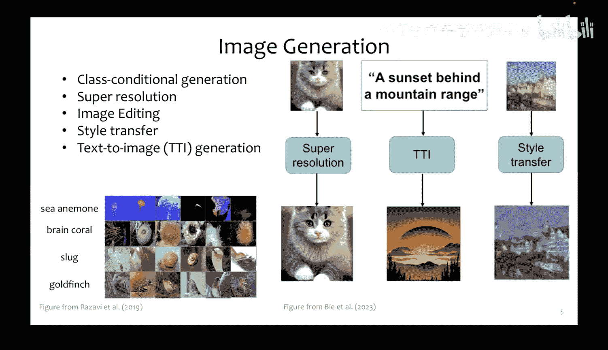

And so we'll look kind of at that and think about how this could be done。Okay。

 so the prompt to prompt method is fairly general but。

It's going to be carried out within a pretrained latent diffusion model so let's just recall what an LDM is so the motivation here was diffusion models can be really slow so instead of operating in pixel space we operate in some lowerdial latent space and the idea here is that then in that latent space we can actually sort of generate some semantic representation of the image and then we can decode it to an actual pixel representation of the image and so the way that this plays out is we ahead of time train two models one is an encoder decoder model that can take us from images to a latent space and then back to back to an image representation。

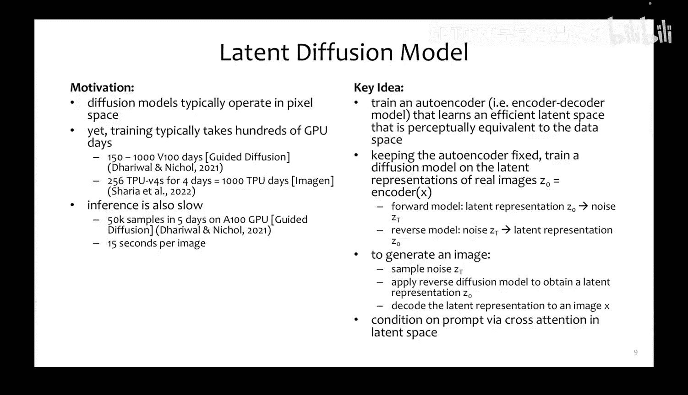

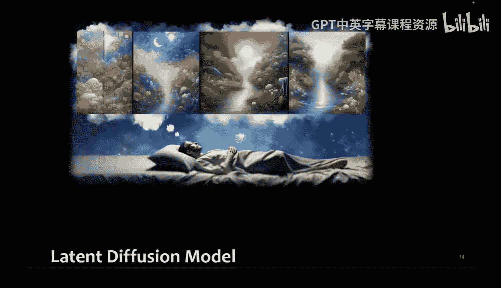

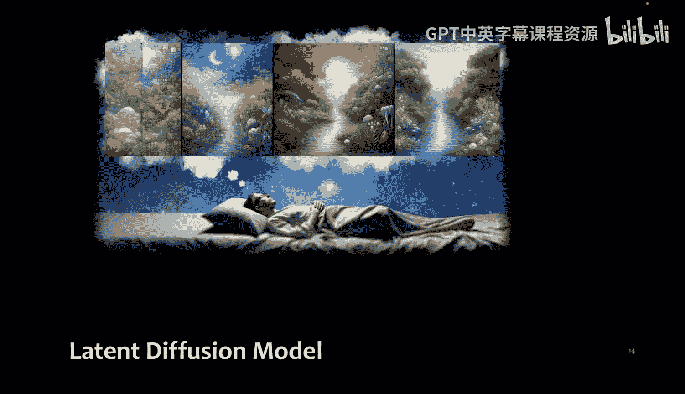

That's the encoder decoder and then the other model that we train ahead of time is a large language model that can take in text and produce some embedding representation of it。

Okay， once we have those two， we can train a diffusion model on encoded images。

 so we take each image in our training set， which is just。

Going to have say a text description and an image and we encode that image as some vector representation。

 we encode the image as some latent， and then we do diffusion going through the forward process。

 to noise and then back from noise to the latent in the reverse process。And。

And so the idea is that the autoencoder is going to sort of capture some useful space that will be low dimensional enough that we can work efficiently with it。

 the large language model is going to capture some lowdiional representation of the text that we can work with。

 and in particular that we can condition on using cross attention in the reverse process。

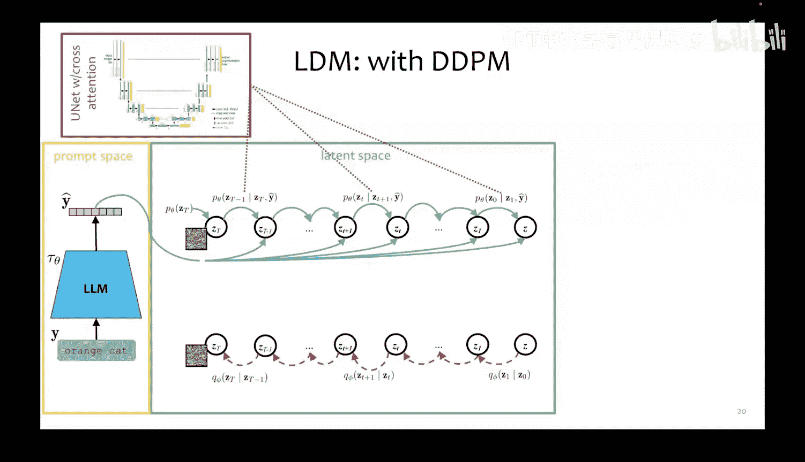

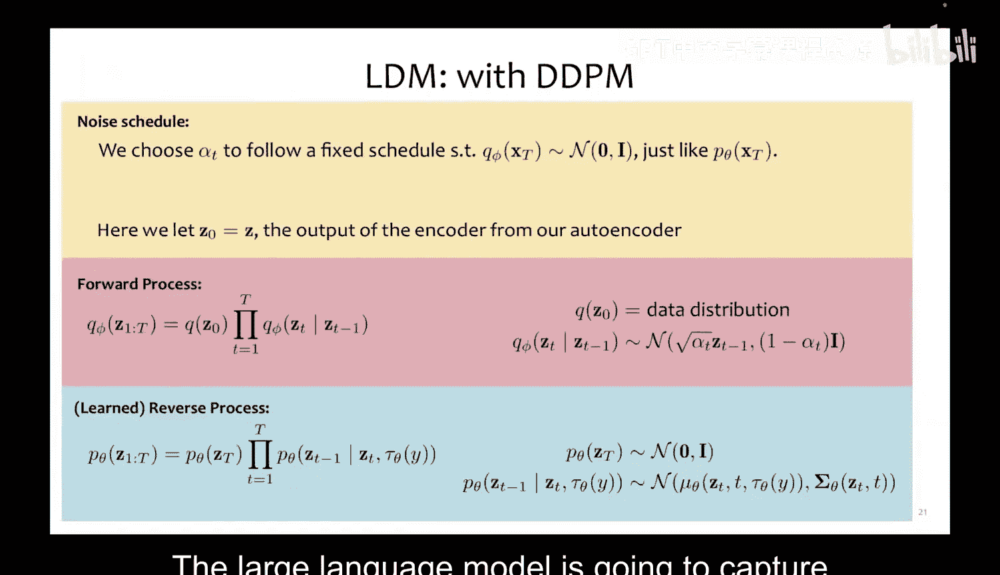

And so we saw that。

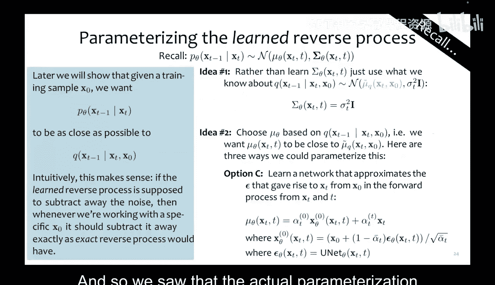

The actual parameterization for an LDM。

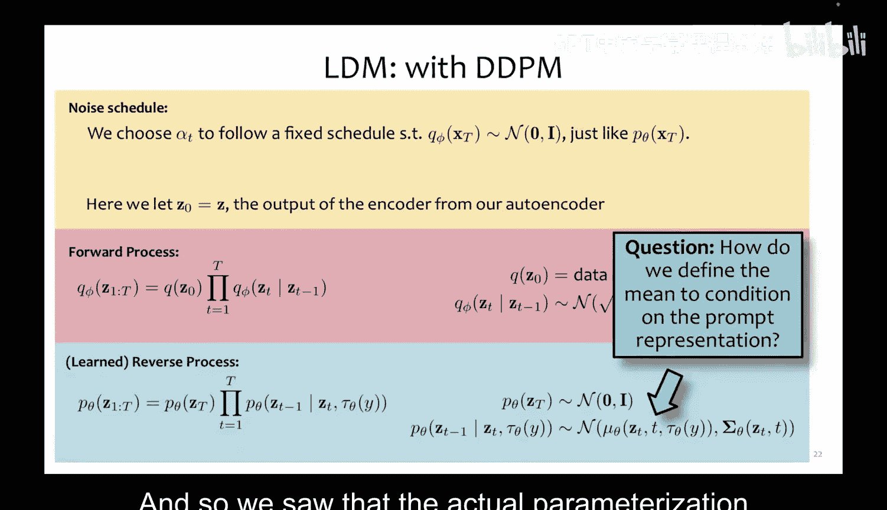

iss going to sort of follow what we have done before。

 which is define the reverse process in terms of some mu theta and the particulars of that mu theta might actually get kind of kind of complicated and resemble the option C that we looked at for sort of a standard diffusion model where the unit is actually modeling some epsilon rather than mu directly。

 but the gist of it is that the unit is giving us。Or at least that mu theta is some function of our unit and。

And further， the difference from how we were using。呃。

Unit model in standard diffusion rather than LDM is that now we're actually。嗯。

Also conditioning on tau theta of y the actual encoding of the text and we do that through through。

Cross attention， which we'll talk about more in a moment。Okay， so to learn this model。

 we do iterative training。Following the gradient of our loss function was just trying to move epsilon theta closer to epsilon Okay。

 so this is the latent diffusion model that we saw before now what I want to do is actually think a little more carefully about that cross attention that we were looking at。

So here is scaled dot product attention。You'll recall the scaled dot product tension。Is。Building up。

A representation of。Of scores by looking at the keys and the current query。

And those scores are passed through a softm to get attention weights。

And then the attention weights are used to take a linear combination of the values。

So in cross attention。We run the exact same process。

 the only thing that changes is where we get our queries。

 keys and values so in particular in cross attention we assume that we have two completely distinct inputs。

So one of them is this sequence of vectors y1 through y4。

 and the other input is this sequence of vectors x1 through x3。And you can see that x1 through x3。

Are used to construct both the keys and the values。So if you know， Xt was or xj was four dimensional。

And we wanted our keys values and queries to be three dimensional。

 then our WV matrix would need to be four by three and same for your WK。

We get our queries from the Y vectors， and so QT is WQYt。

 and here we choose WQ to be2 by3 so that it maps to a query vector that has the same size as the key vectors。

Okay， this is important because in cross attention， we're computing the。

The scores for the attention weights by taking the do product between QT and each of the key vectors。

So intuitively， you could think of。😊，Each of these three scores as。

Sort of how similar the corresponding key is to the current query。And the higher the similarity。

 the more we are going to attend to that particular value。Okay以。So。Just like。呃。

Regular attention we can do this in matrix form Okay， so to do that observe that。

Here we can take S41， S42， S43， and we can kind of push them all together into a single vector S4。对。

And then thats S4， that is the。The scores that are going to give rise to the attention vector a4。

Which is just the weights of how much emphasis to put on V1， V2。

 V3 respectively for the fourth query。Okay， so in the matrix version。😊。

We're just we're simultaneously computing。呃。All of the scores and all of the attention。Okay。

 so how do we do that， we start by taking x times Wv and x times WK to get our key and value matrices。

 and then we take matrix y times Wq to get our query matrix。And then just as usual。

 we take query times key matrix transpose。Where here the square root of D is just the dimension of the keys。

 queries and values。And then we take the softm of each row to get a。

And then we multiply a times V to get our output。Why prime？你可以。😊。

So you can see that really the only part of this。That is different from standard attention。

Is the construction of Q， K and V？The actual attention computation is identical to what we usually have。

Okay， so。With that in mind， we're now ready to think about prompt to prompt。

Okay so the background here is if you want to do some image editing there's a couple interesting ways that you could do this and here we want to focus on say sort of this family of image editing techniques that are kind of related to diffusion so one way that you could do that is you could fix your random seed right so this is a nice baseline。

Basically， you could change some part of your prompt， but keep the random seed fixed。

So essentially that means that you're keeping the noise at the start of the reverse diffusion process fixed。

And then you just run the diffusion sampler。So the problem with this is that the entire structure of the image could change really dramatically and it doesn't necessarily feel like you're doing editing at all it's just that you're。

Sort of generating a bunch of mostly unrelated images。And。So another way that you could do this。

 maybe a slightly more careful or intelligent way， is you could do something that is based on a mask okay and so this is actually a standard approach to text based image editing。

嗯。And。And the idea is that you're going to specify some。

Mask that picks out which parts of the image should remain unchanged。

And then the text prompt is going to inform how the unmasked part should be adapted。

Save by a diffusion model。So so here on the bottom right， if the inlet was this person of a。

This picture of a person sitting on a stump and the mask was the。Or or the。

The unmasked part is shown in red here。Then that means that we can。

Set as our text prompted something like big mountain and now that red region could actually be adapted so that whatever it was before now it kind of looks like a mountain in the second case it looks like you know we're changing the prompt to big wall and then then the third to New York City。

So what we see here is that the composition remains very consistent across the different images。

 this is blended diffusion and so there's a few more tricks here as well besides the mask。

 but on the left where we just did the random seed。

 the composition is really inconsistent the background is changing and some of these it's a whole cake。

 some of them it's a single slice of cake and some of them you can see the entire cake and some of them like the pepperoni cake you can only see part of it。

So in the fish cake case， there's actually multiple。

 so theres there's a lot of variation when you're just changing the random seed and you need something a little more sophisticated than that。

Okay， so prompt to prompt says you know this mask based image editing is great。

 it kind of gets us what we want， but you still have to specify this， this mask。

 so what if we could do away with the mask， that's the whole idea。😊，So。

The goal here is to edit only with text and have no mask requirement and the key idea is that we're given some pretrained latent diffusion model and we run the diffusion model with the original prompt。

And we store the attention weights and the cross attention weights。

hich is basically the attention weights of pixels back to text。

And then we rerun diffusion a second time。But with the edited gr。

The new prompt and we copy in the cross attention weights。

From the run that we just did of diffusion with the original prompt。Okay。

 so we have to be very careful about this exactly how to copy in the attention weights is sort of the subject of the rest of this lecture。

 depending on what kind of edit you want， you might want to manipulate those attention weights in different ways。

But one of the key things that motivates this is the method is going to have no training whatsoever involved。

 we're only going to modify how the samples are drawn from the pretranslatent diffusion model。Okay。

 so in the top reach top example， we can see we have this prompt that was photo of a cat riding on a bicycle。

And so the original image is on the far left。And then there are。Three other images。

Corresponding to three different pros。The first one would be photo of a dog riding on a bicycle。

 photo of a chicken riding on a bicycle and then photo of a squirrel riding on a bicycle right and so each of those we've swapped out the word cat for some other word and the method has actually done a really nice job of preserving sort of most of the structure of the image you can see that actually say in the third image with the chicken it actually looks like the ground has changed really substantially like maybe it's sitting on a table now or something but even that table is sort of at the same perspective as the cat。

2。So in the second example， we can see you know this basket changing to。From。

A basket of you apples to oranges， chocolates， cookies， and kittens。Okay。

 so how do we how do we do this with latent diffusion， So we're going to assume that。

We have already gone out and pretrained a latent diffusion model。

 so you already have all the weights of the encoder decoder model， the autoencoder。

 the large language model， and of the diffusion， the reverse processed diffusion model itself。

 the weights of UNNe。So you won't do any parameter estimation in this method。

So prompt to prompt is going to modify the cross attention。

Whi simultaneously is looking at the text encoding and the latent representation of the image。

 or really it's looking at one layer of unit。Okay。So。

To think about this a little more carefully we can go back to our diagram of cross attention so cross attention in LDM the。

The input that gives rise to the queries。Is some layer of unit right， You can think of this as like。

 you know， it's somewhere between the noise and the image。

's it's something some sort of vector representation in latent space。

The key and value matrices are built from the text encoder representation。Of the prompt。Okay。And。呃。

And so what we can do， though， is sort of conceptualize。嗯。嗯。

The actual cross attention as this matrix a right we really want to kind of like narrow in on that matrix A。

 the attention weights themselves because as a matrix， we can think of them as consisting of。

Sort of a bunch of vectors where if you take this set of three vectors。

They're in one to one correspondence with the words of the text itself。Okay。

 if you were to instead take these four vectors。You could think of that so again we're working in latent space so each of those。

You know， you could think of them as。Sort of in one to one correspondence with some dimension of the latent space。

嗯。Okay， so these are attention weights what can we do with them oh and the last detail here is just that we're going to be kind of in picture in the diagrams here we're going to mostly be representing attention weights。

For single0 attention， but really。The cross attention block is actually a multiheaded attention。Okay。

 so the。The prompt to prompt method。Here on the left we're looking at sort of the same high level description of it that we had before and on the right we're looking at an algorithmic description。

So the input consists of a source prompt y。And a target prompt y star and a random seed S and actually now now that I realize it going from one slide to the other。

 so we're kind of doing this annoying notation change。呃。

This is sort of a sudden notation change on the previous slide I was using X to refer to the representation。

Of the prompt， and now I just switched it。To why。So this is still the representation of the。

Prompt regardless of the letter Okay， so so this notation。

 but I guess maps better to the notation that we had for LDM。Okay。

 so we have a source tongue prompt y and a target prompt y star and a random see S。And。At the end。

 we're going to return one image that is a representation for the original prompt or source prompt and one image that is for the target prompt。

Okay， so we start by sampling our。Our noise vector is ZT with some random seed to S。And then we。

So we initialize。A Z star。Tea or or I guess this is even just。Zity。To。To be the。嗯。Initial。嗯。

Representmentation of our noise。And。嗯。And then we。We go ahead so the point here is that sorry。

 this this prime is。A table。Okay。So。Okay， so what we have then is that we're going to be running two diffusion chains simultaneously。

 let's actually maybe start by by looking at a little picture of this。

 so we're going to have two runs of reverse diffusion。

One of them is going to be over Z and one of them is going to be over Z star okay。

So we start by so this for loop is over the time steps of diffusion。And。

The first line the line six here is saying we're going to take in the current。Lant representation。

 CT， and we're going to feed it through one step of our diffusion model。Passing in original。

 the source prompt Y， the timet T and our random seed。

And we'll get back the representation Zt minus1。Which here is。

Just the latent representation at the next time step。And we're also going to return。AT。

 which are the cross attention weights。Posly multiheaded at time step。T or used at timet tea。Okay。

 so now separately， we're going to take the target prompt y and do one step of diffusion。

Using ZT star， the latent space representation for the target process。So that is going to give us。嗯。

A different。嗯。80 star。Which？Will。Allow us to。嗯。To work with the cross attention weights that would have been used by。

嗯。By the diffusion model with the target。Okay， so next we construct。

A hat T and this a hat T is going to be well in the simplest sense that it's going to be either a star T or A like we're going to pick one depending on the time step we'll get that we'll make that actually a little fancier in later slides but for now we can just think of this as this edit operation is's literally just looking at the time step T and saying。

 okay， you know we're if we've gone through half of the diffusion time steps。

 say tau was you know one half T then。We would switch to alphapha star T。

 otherwise we would be using alpha sorry， we would use a star T， otherwise we'd use A。

And then in line nine， what we're saying is， okay， now we're with our edited。Cross attention。

 we're going to run the diffusion model。Using。Our Y star prompt and our Z star T。But。

We are going to inject， that's what we're sort of symbolically trying to represent with this part。

 we're going to inject the cross attention weights。A hat T。Into this diffusion step。

And we will take as z star t minus1， whatever comes out of that。Okay。

 so here now it becomes maybe a little clearer why we were， for example， only returning。

A star t here and not Z star t minus1 because we're just kind of。

 I mean I guess you could think of it as we were returning both。

 but we wanted to discard that Z star t minus1 what we really wanted was the Z star t minus1 that comes from injecting this cross attention into the diffusion step。

去。All right。嗯。So now let's look at a picture， I think it's actually easier to understand this with a picture。

😊，We're going to do our first diffusion run here here we're going I'm going to lay this out a little So this was kind of like running the two diffusions simultaneously here in the pictures I think it's actually kind of a different way of conceptualizing it we're going to say let's run the whole first diffusion so we're going to encode the original prompt y orange cat as some vector and we'll run diffusion on y to obtain our attention weights 8 minus18 minus2 all the way down to a1。

And then we're going to take our modified prompt Y star。

 and we're going to encode it using the same large language model。

 so our modified prompt now is tabbyca。And you'll see here that we're going to run diffusion a second time。

And the first thing that we're going to do is we're going to reuse the same noise that we used in the first diffusion run。

Okay， so we'll copy that down to initialize。And then for some until we get to time step Tau。

Instead of using the actual attention weights that are computed in the usual way via cross attention。

We're just going to copy in the attention weights from above。

So we're just going to grab A minus1 and we'll copy it in and we'll use that instead of the actual attention weights and then here we'll use A minus2 and here we'll use A right。

And then you know we hit sometimes step out and then we switch to using the attention weights from this current run。

 so those are a star t minus1 a star t minus2 all the way down to a star1。Okay。

And you'll notice that this is one of the key takeaways here。

 regardless of which attention weights you're using， we are still attending to YSt。Okay， so。

We're only swapping out the matrix A， we're not swapping out the actual values that are used。

So regardless of which way we do this， we're going to be using the values that are based on tabbycat in the second run。

Okay， and then finally， if this is running in latent space。

 then we'd use a decoder to recover the pixel space representation from the late。Okay， so。

So why is it that this makes sense so what the key observation of prompt to prompt is basically this that。

Most of the structure of the image。Is happening in the early phases of diffusion。

And so if you can get。The actual cross attention。To be looking at sort of at least in a positional sense。

 the same sorts of words in the prompt。Then you can。

Generate a new image that will preserve most of the actual sort of composition or structure of the original image。

Okay。And so when we switch over， when when we allow the model to start using。

The actual a star attention matrices。嗯。What we're essentially saying is， okay。

 we've got most of the structure in place， now let's free up the model and allow it to sort of get more creative and attend however it wants to to this new prompt。

Okay。So you might be thinking， okay， this looks great。

 but what if the attention matrices are not the same shape？Great。😊。

So say our original prompt is orange cat sitting and then our modified one is big tabby cats sitting。

So。We don't actually have to worry we can actually just swap in the appropriate parts of the attention matrix so notice this the dimension in latent space is actually always going to remain constant so say it might be like 1024。

As well， the dimension in the text prompt space is also going to remain constant if you use a fixed length encoder so for example。

 if you use the clip encoder。For text。It assumes that every text input has length 77。

 and so if your input is orangecad sitting， you need to add 74 additional padding tokens so that you can actually feed that in。

I guess technically there's probably a CLS token and maybe an end of sequence token as well。

So maybe you only need 75 padding tokens plus those extra two。嗯。So that's great。

 except if you lined up orange cats sitting against big tabby cats sitting。

Then you'd you'd end up with an incorrect alignment， right if we just put。Big。Ty。Cat。Sitting。

Right now， whenever we were attending to sitting。We're going to attend to cat whenever we were attending to cat。

 we're going to attend to tabby， whenever we were attending to orange we'll attend to big and this padding probably had no attention and so it's just we never attend to sitting。

So if we don't do anything， if we just use that 77 by 1024 attention matrix。

Then we're going to have an alignment problem， the actual attention won't make sense。Okay。

 so what can we do the trick here is that we can copy over。

The attention weights for orange to both the words big and tabbbby in the attention weights。Okay。

 so in our example here， what I'm showing you is for orange cats sitting。

 we have our original matrix a， which consists of three columns。😊，And if it was 1024 latent space。

 then there'd be 1024 elements in each of those vectors。

Let's column vectors the the matrix a star is what you would actually get if you were just running standard reverse diffusion without any attention swapping and so that would be these。

These vectors。A star one， two， three， and four。And so what we're saying here is that what we want is actually to line things up so that sitting matches。

 sitting， cat matches， cat and orange is basically。

Matching both big and taby and so to do that we could construct a new matrix， let's call it a hand。

That。Takes the first column of a。And copies it down twice。可。

And so now this a hat has the same shape as a star。

But now if the attention weights were kind of sensible in the original orange cat sitting。

 then they should hopefully be kind of sensible in this modified a hat as well。Okay。

 so the thing is we actually need to do this swapping a lot。

 we need to do it for every batch for every head and for every time step until down and so。Here。

 there's a useful efficiency trick， which is that we can define a Ma matrix o。

Such that a hat is equal to a times the matter matrix M。Okay， so for our simple example here。

Our map or matrix would be rectangular， so it will have as its number of rows。

 the number of columns of a or the number of tokens in y， so it should have three here。

And then it should have as its number of columns four。

 which is the number of tokens in y star and correspondingly the number of columns in a hat。

And so when we multiply m times a， let's see what happens right so we take this first column and we line it up with this first row and essentially what it's doing is it's 100 so it's picking out this one and dropping it in here。

When we take the second column and multiply by the first or take stop product with the first row。

It's essentially taking another copy of one and dropping it in here。Okay。

 the third column thatt product with the first row is going to grab the six。

Since it's 010 and drop it here。And then the third。

 the fourth column is going to grab the 11 and drop it here。

And so if we continue this matrix multiplication now the first row multiplies by the second sorry。

 the first column of M multiplies with the second row of a。It's going to keep that process going。

 and we'll end up with it。A copy of the first column of a and then another copy of the first column of a。

 and then the second column of a and the third column of a。

And we got that through careful construction of this Ma matrix M。Alright。So。

It turns out that in prompt to prompt， we don't actually do this copying。Instead。

 when we want to take one word and split it over two。

 we actually define our map error matrix so that it kind of averages。呃。Over that space。And so。Here。

Basically， we don't want to like overempha whatever orange was attending to we want whatever orange was attending to to kind of be split across big and tabbby。

 and so instead of having a one。And a1， we replace that with a 0。5。5。 and now we get， you know， 0。

5 times the first column of a and 0。5 times the second column of a。Okay， so。嗯。

Suppose it went the other way， suppose why had big orange cats sitting。

And we wanted to edit it to Taby Catt sitting。Okay。

 so now we have more tokens than the original prompt than the target prompt we can just use a slightly different mapper matrix here right so now we have 05。

511。And you can see that this is basically for what it's doing is it's that 0。5。

5 is taking these first two columns。And。Averaging them into the first column of a hat。

 and then it's just copying。The third column here。And the fourth column。Here， oops， this is the typo。

 so this should read。11。12。13， 1415。And then corresponding， this should be 16。17。181920。Okay。

And so this is nice because now we're kind of taking the attention of big and orange and we're kind of merging whatever they were attending to into a taby。

Okay， so oh lastly， if for example， you were fortunate enough that you had the same number of tokens in your source and target prompt。

 then the Ma matrix is really just a diagonal matrix in that case。Okay。

 so this is this is a very general approach and it's actually important in cr to prompts to realize that even if you are only replacing one word。

You might still need to actually handle this case。Because that one word might consist of multiple tokens。

Okay， so for example。呃。Say you wanted to replace the word apple with。Watermelon。And let's just say。

 I think in fact， the clip tokenizer might actually tokenize watermelon as a single token。

 but let's say for the sake of example， that watermelon。

By the clip tokenizer happens to get or by some tokenizer happens to get broken into two tokens。

The subward water and the subward melon。Okay， so now even though you're only replacing the word apple with the word watermelon。

 the actual representation of these two prompts is in token space， not in word space。

 And so here we would actually have to be careful to。嗯。

To basically define our map matrix as we saw before so that we account for the fact that water。

 the water token and the melon token are both aligned to Apple。Okay。

 so this is not the only hyperparameter that you can work with。

So we can also swap from a hat to a star at different time stepss as we saw before。

 that's the hyperparameter ta， but we could actually generalize tau to something a little more powerful。

 namely we could。Swamp from a hat to a star at different time stepss for different words。Okay。

 so how do we do that well one way is you could define a sequence of new hyperparameter。

 one for each time step or rather one matrix alpha little T for each time step so you have alpha capital T all the way down to alpha1。

And the matrix alpha little T is going to control how and when we switch at time step T。

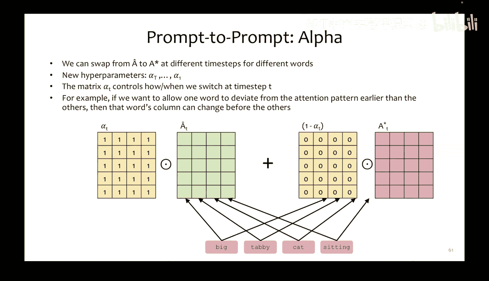

So for example， if you want to。

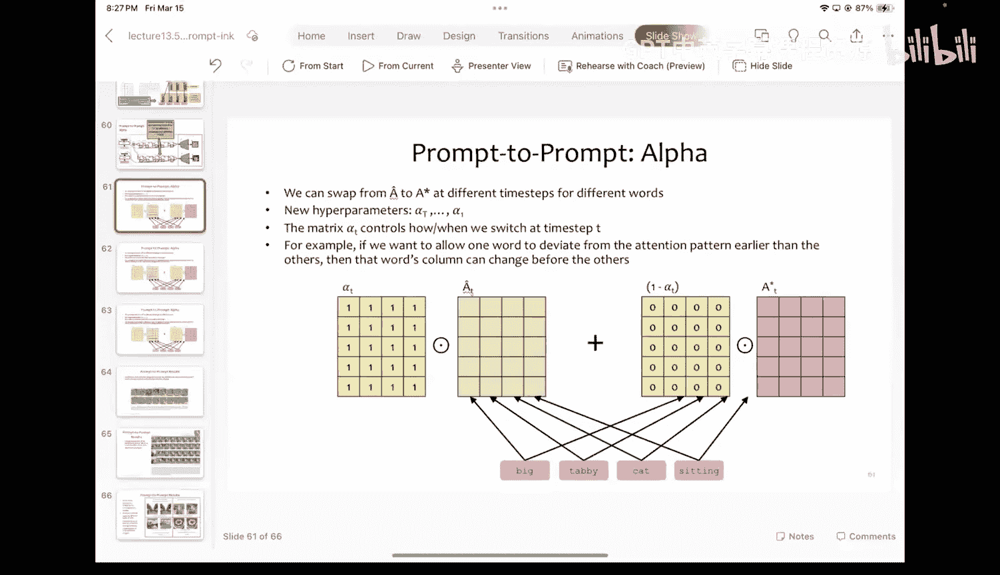

So the formula that we could build up here is just。Okay。Is just alpha T。Alpha he T plus。

1 minus alpha T。Times alphapha star T。对。And。呃，The point here is that。

SaSa you want at this time step T。To take just。A hat tea。Oh， and sorry， this is not。

 this is like element wise multiplication of these two matrices rather than matrix multiplication because since they have the same dimension。

so here you could just set alpha t to all ones and that would just give you a copy of a hat T and then one minus alpha t is at all zeros and so it just。

Remove a star T。Okay。So。嗯。Let's say at time step t minus one， now for this word taby。

 so these arrows should line up like this， they're just showing which words correspond to which columns of a star。

So。Here you could say， well at。Time step t minus1， maybe now you actually want to switch and let whatever tabby is attending to really start to vary in the diffusion process and move away from whatever was being attended to with the original word say it was orange in the original matrix and you want to to bring in this attention column instead。

 well now we could define alpha t minus1 so that it's all ones except for the second column which is zeros and now that's going to combine this second column of a star T with the first third and fourth column of a hat T。

Okay， and then maybe at time step alpha t minus2， you want to just switch wholesale to alphapha star and you could do that by setting alpha t minus2 to all zeros。

Okay， so this is now a rather powerful hyperparameter。

 and you can think of this as basically like we're specifying you know。

 at what point each of the words is going to switch from a hat to a star。Okay。

 so what can you actually do with this method， you can do some pretty amazing things。

You can for example， take a photo of a butterfly on a flower。

 that's the original image and then you can just start swapping in different phrases in place of on a flower so you could say on grass and you can see how its foot is actually kind of grabbing the grass there on the ground on the river on a fruit on a flute on a violin etc ce。

 and in all of these cases。The butterfly is actually being preserved really well。

 and yet there's like a lot of variation in sort of how we're editing the rest of the image in some kind of interesting ways。

嗯。So if you think about alpha or tau， this is actually going to be an example of tau and there's kind of a simpler example。

 so here we're just looking at how how you can vary like when to swap。😊。

Sw in a star so on the left side， this is like just。呃。

Oh on the leftmost side this is just a star so this is without any intention injection so if you do just a star that's basically just like a random seed baseline So if you take a photo of a cat riding on a bicycle as your source image right and replace bicycle with motorcycle you're going to get a wildly different image here Okay so if you do。

If you do just a hat the entire time。And you never switch to a star then you're going to get something like this right and you can see that the bicycle that the cat is sitting on。

 I mean it looks a little more motorcycle like now。

 but it hasn't really changed it hasn't allowed the the image to change much at all because we've been constraining the attention weights to be identical。

 entirely identical to this initial run of diffusion。

And so what we're looking at in between here are swapping。Over to alphapha star at different moments。

 so this is sort of a late swap to alpha star this is sort of swapping to alpha star halfway through the diffusion process and you can see that there's kind of like a nice spot kind of in the middle there where we've preserved the look of the cat quite well。

 but the the bike now looks much more plausibly like a motorcycle。In fact。

 the you can sort of consider the just a star versus just a hat thing maybe more carefully in this bicycle going to a plane airplane example where we can see that。

You basically need to switch pretty early to a star in order to get that airplane in if you wait until。

Too late to switch in。A star， it's already like established something that looks like a bicycle and it has a hard time actually sort of adjusting the structure of the image so that it looks airplane like。

So so far we kind of focused on just swapping one word or phrase for another。

 but prompt to prompt actually supports different types of edits。

 you can do sort of different manipulations of cross attention so one really interesting one is that you could just take an existing descriptor and the prompt like the wordced and you could just take its attention waiting and just dramatically decrease it。

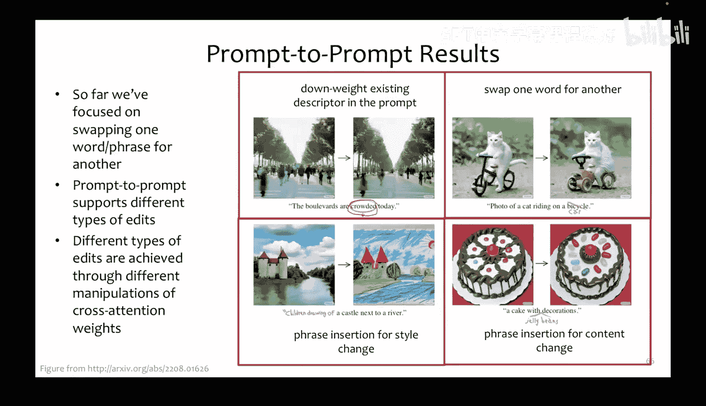

And so in doing so， you actually get back something that， you know。

 maybe the original image was rather crowded and the modified image is not so crowded。

You can swap one word for another as we saw， you can do phrase injection。

And you could do that in a way that actually takes something that looks more photoreistic and transforms it to a totally different style。

 and then you could also do phrase insertions such that you're sort of modifying the content of the image itself。

 but without an actual word swapwa。Okay so all in all。

 this is a pretty powerful method and maybe what sort of separates it from a lot of the things that we've looked at up until now is that it's kind of this interesting technique that works entirely without training so you're assuming that you have this pretrain model and then you're just doing this very careful manipulation so as to get back an effective new model that allows you to do some interesting things。

😊。

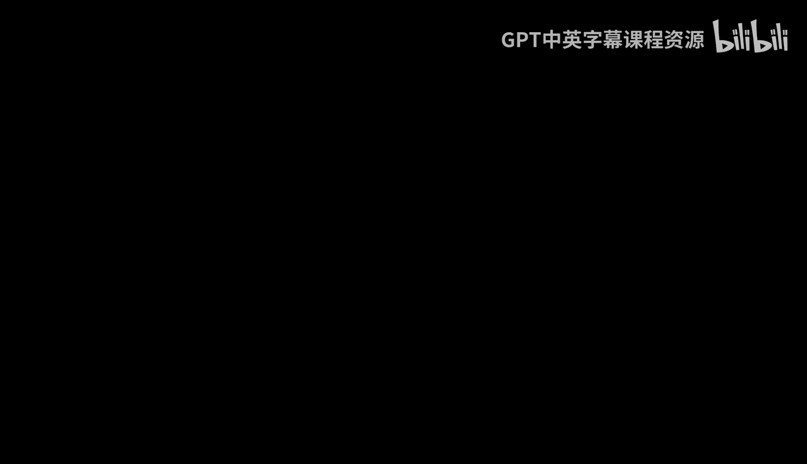