# CMU《生成式AI｜10-423 generative ai 2024》中英字幕 - P15：-P15-Lecture 14- Vision Language Model_2.zh_en - GPT中英字幕课程资源 - BV1CyC9BPEhG

Okay， hello， everyone。 let's get started。 Yeah， I will be your teacher for the second half of the semester。

 My name is Yuan Zhi。 I've been at CM MU for five years， and unfortunately， this is my last semester。

 I CM MU。 I'm leaving this semester。😊，After this semester。

 So this will be my last lecture or last series of lectures I see you。 Okay， previously。

 I've been talking about conx optimization， non convex optimization and intermediate deep learning。

 and now this semester， I will be talking about this new course called generative VI。 and you know。

 I have been doing handssung training of geneative models for a couple years。 Okay。

 so I we have developed a five series of models at Microsoft and we work with open eye to develop or to get some data for their G models。

 So I know some kind of what they are doing。😊，Okay， so you are。

 I hope I can teach you some of the tricks or some of the kind of， I mean。

 some of the dirty stuff for training geneative models that you won't typically learn in a lecture。

 Okay， but I am yeah， I will also cover the most basic stuff。 Okay。

 so if you have any questions about training geneative models。

 you can ask me because I've been training them for。y，佢 and I know how。

How to train them and how nasty it is to train them。Okay， so this lecture。

 we will talk about vision language model。 Okay， so vision language model is a new type of language model that becoming more and more kind of popular in the recent years。

 Okay， or just in the last year。 I mean， before last year， nobody talks about vision language model。

 Vi model is just a vision model， you take an image and you produce some labels for the image。

 And it has been very useful for like， for example， face detection， object detection or even like。😊。

I mean， actually， the biggest usage of vision model in industry is actually， I mean， you know。

 sexual content detection okay。But anyway， those are vision models。

 and then we have language models popularized by chat GT。 Okay。

 so we were actually the first people who has handsome someung experience of chat GT when open。

 I release it internally。 And you know， we wrote a paper called sparks of A GI about G4。 Okay。

 and those language models are really， really great。

 they can do a lot of reasonings and they can do kind of next word prediction really well。

 And in the recent years， people are thinking about what if we combine a vision model together with a language model。

 Okay so what if the language model， not only looking at a particular sentence。

 they actually look at image。😊，And then it output put some description of the image。He all。

Or you and talk to the language model， not by only providing like text input。

 but actually providing image input。😊，嘿。😊，So this goes to the line of work， which open。

 I believe in very much， which is AGI has to be able to take any sort of input。 Okay。

 so they think that AGI should be able to take input of any form and outputs， output of any form。😊。

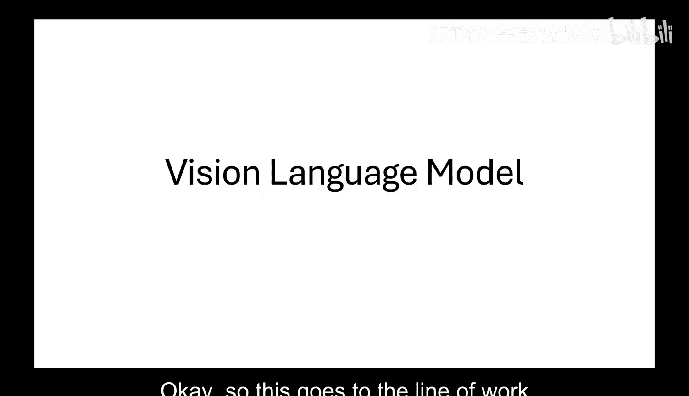

And by form here， we mean mostly audio， video， image， text， okay。And now， I mean。

 they have a very robust pipeline。 And also， I think Google also has a very robust pipeline that takes all those sort of input and put them in the same space。

😊，And then， the language model or。We shouldn't call it a language model。

 It's really a general intelligence model can take those input and produce the same type of output。

 which means they can generate audio， video， image， tag， etctera。Okay。

 so this is like their ambition for AGI， which is really a model that you can deploy in any place。

 I can be use to take any sort of input， even like reader input。😊。

And this insert into whatever your intelligence model and the model will do some analysis of that。

Okay， and we will only focus on the most basic part， which is images for this lecture。

 And we want to talk about audio input and video input in the next later lectures。 Hey。

 but spiritually， they are just the same。😊，ok。😊，So what is vision language model that takes image input？

Well， vision language model， I mean， if you think about it naively， you may think it's okay。

 It's just a language model that takes a natural image。 Hey。

 like a screenshot of this classroom and ask like what's going on in this image。

 and that thing is actually outdated。 He is this like things couple couple months ago。 Okay。

 so a couple months ago and run out nobody focus on those type of vision language model anymore。

 Okay， so they about vision language model that look like this。

 which can actually read like a description of the map and actually answer those complicated questions。

😊。

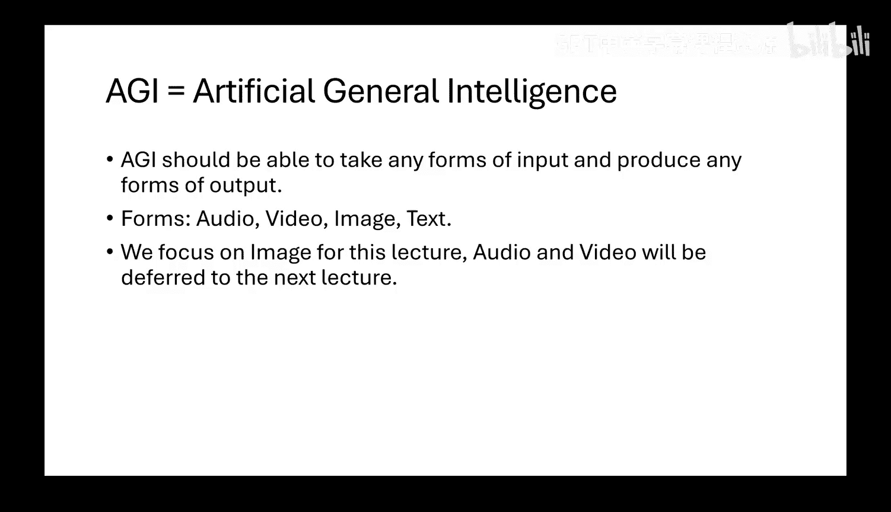

And you guys here， you really need the reasoning ability of language model， right。

 So things if you're plug into into a coal network， they can never solve this type of problem。😊。

Because those questions not only requires you to understand what's going on on the image。

 but also requires you to do some logical thinking。Right。

 and this is kind of the current focus of vision language model。And you know， at Microsoft。

 the application vision language model or the one P application is mainly。😊，Document understanding。

 Okay， so you take a screenshot of a user's document or user screen or a web page。

 and you put those structured document as the vision input to the model。

 and the model means to tell like， for example， what's going on in this particular document Like what's what。

 what does those P slides mean。Hey， or what is like， I mean， if I want to buy something。

 which button should I click on this web page。诶。😊，So here。

 I think when you think about a vision language model。

 you shouldn't really think about it like basically the classical convolution network type of vision model。

 Okay， those models are really just classifying a natural images like detecting a car detecting a tree。

 okay， or detecting like whether there are a people in this photo。 I mean。

 those are not what we want for vision language model。 Okay。

 we want vision language model to really be a thinking machine through looking at the picture。😊，诶。😊。

Any questions so far？So this is just a scope of vision language model。 I'm。

 I'm not saying vision language model cannot take natural input。

 but the natural inputs are really easy for vision language model。

 And those are already solved by coal network。 Okay。

 what cannot be solved by convol network is those things。

 we really need a vision language model to do it。😊，So how do we train our vision language model？

 How do we kind of。Make the language model being able to take a vision input。Okay， so first of all。

 I'm because I'm not very familiar with what you learned from this first half of the semester， so。😊。

Just going to ask， how much do you know about language models or transformers。So do you know toizer。

Yeah， tokenization and basic transformer layers， which are basically， theres an embedding layer。

 right， And there are transformer blocks。 and then there's an LM pad。😊，Okay。

 so youll know all of them， which is good。 That's all we need。K cool。

So what's the intuition for VLM or vision language model。

然 for a standard transformer based language model or text only transformer models。😊。

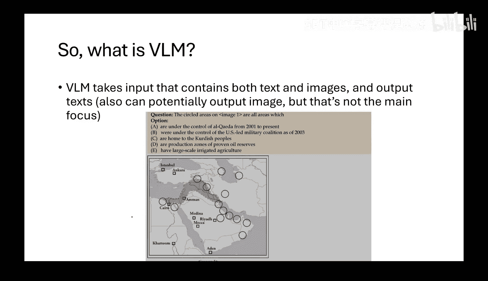

I mean， they take an input sequence of X， Okay， which is something like how to feed a peak efficiently。

 Okay， and then it transfer this input sequence of text to a lease of integers。

 which are called tokens。 Okay， so in some sense， the token or the lease of integers are acceptable form of input by transformer。

😊， your transformer doesn't take any form of input。

 It can only accept input that are a list of focus or a list of vectors。😊，诶。😊，So basically VLM input。

 we the first step is， we want to map the VLM input。

 which are interlaing of images and text into some acceptable form of transformer， because vision。

 the image is not an acceptable form by transformer。 K is not the lease of integer。😊，I mean。

 you can make that list of integers by flattening the image， but that's not probably what we want。

 because we lose all the spatial relation of images。😊，诶。😊，So basically， what's。

 what's the first type of ELM。 So VRM consists of。😡，I mean， essentially。

 you can think of B LM consists of two parts。 So there's a standard LM part。 Okay。

 and then theres a vision encoder part。诶。😊，And we encode part will take in as an input of image。

And need to offer something that are acceptable by L M as a input。 In that sense。

 it's just a list of integers。 K or some sequence of vector。😊。

He that are compatible as the input to a language model。诶。😊，And then you just， I mean。

 then the image token or the image thing is not really different compared to the text。

so you have or essentially what you would like to do。Or sorry I don't have it in that slice。

 but essentially what you like to do is， I mean， for example。

 you have some types here and then this is an image。😊，And thens some packs here。You know。

 for standard type space transformer， you would be able to。

 you would transfer this types into like a sequence of integers， right， Maybe this1，100，8，3。

 and you would transfer this types into a sequence of integers， maybe 11。😊，Okay， and 5， whatever。

And then this is like standard tokenizer。😡，Hey， and then theres a visual encoder。

That mapped this thing into essentially a list of integers， like 8，5，3，2，1。 He， I mean。

 I think speaking， this may not be a list of integers， as you will see in the later slides。

 But essentially， the spirit is just map to like a list of something。

 So you can feed those things into a standard transformer。😊。

Hey then like feed it into a standard transformer。Okay， so basically。

 this is like the overall intuition of VLM。 You can see it's quite simple。 Hey。

 everything is really just down here where you map the image into a sequence of integers or sequence of vectors。

😊，Hey， I mean， there are more advice BLM like Flamingo。 He， Flamingo is actually what Open eye use。

 but I mean， its it's actually by Google Ded， but is absorbed by open eye as usual。😊，Okay， so。

 but there there are a little bit more advice。 Okay， they have close attention between image and X。

 But I mean those things。Based on my experience， they are useless， hey。

 this architecture is good enough。😊，And this is what I think Jeremy and I use， he。K铺， yes。

Possible that the image encoder creates some imageste that are same as what has been created by the tokenizer Yeah。

 it's possible I mean， for example， this one maybe have a one here， which is the same as this。

大题 will actually go through different embedding for image and text。

 which I will talk about in later size。Okay， so you can view those images as having their own work。

So what are， I mean， you can see everything or all the things really boils down to this image encoder。

😡，Okay， so what are the types of image encoder or what are used as the image encoder。

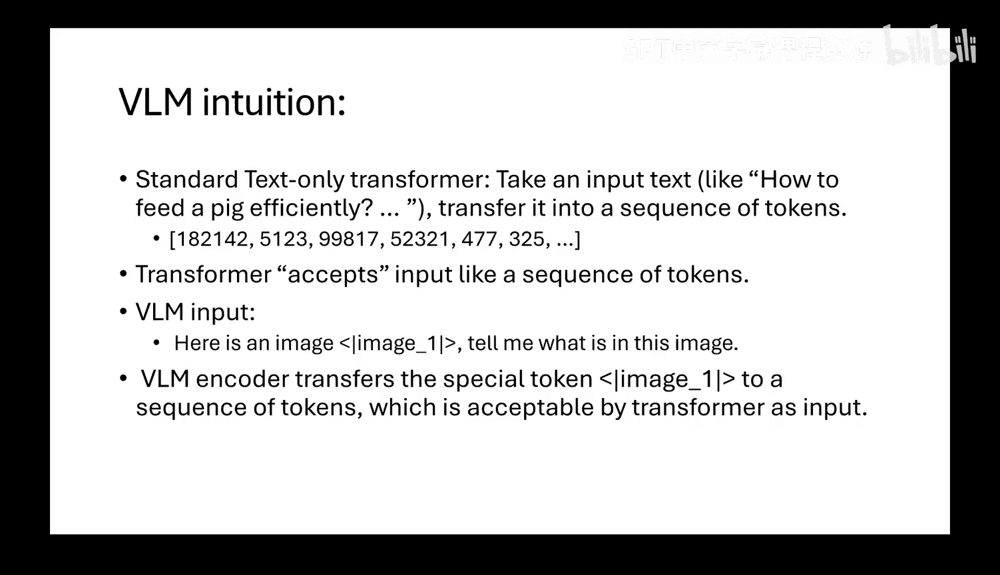

While roughly speaking， there are only two types of image encoders that are being used。

 There is a click based image encoder， which is used by open eye in GBV。 Okay。

 and VQ V AE based VRM encoder， which is used by Gemini。 if they didn't lie in their paper。

 which very likely they lie， but let's assume that they didn't lie。 So it's a VQ V AE，😊，But for over。

 that that one， I'm certain。 Okay， it's a clip。 So you， you can trust me。😊，Okay， cool。

 So what are these two type of encoders？ You see， they represent the two most popular vision language model。

 I mean， there's cloud。Recently， but I'm not sure what are they using yet。 So Im， I'm。

 I cannot really talk about it。 But let's just talk about these two type of visual encoder for the moment。

诶。😊，So the first thing we are going to talk about is the VQ VIE based Vi encoder。 I mean。

 VIE is not really needed。 It really the VQ part that is important for this encoder。系。😊。

So what is V V AE based image encoder or the VQ or whatever you can call it V game or V AE or V V AE。

 whatever。 And the V part is really important。😊。

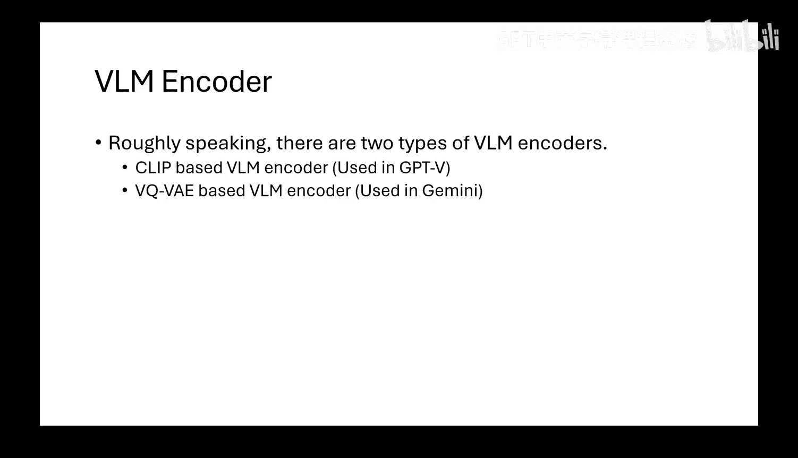

It's really just a model that encode an image into a sequence of tokens or sequence of integers。

 okay。So we， you can think about this as a model that takes one single image as an input。

 okay of arbitrary size。😊，And they produce a list of integers， okay？

And each integer is actually in the so called image work size。

 something like 8K for the original model。😊，And I think 8 case also the one used by party in Google。

 I'm not sure。 I remember correctly， but something like that。

 which is typically much smaller than the language model work cap sized。😊，诶。😊，So basically， I mean。

 its essentially this picture， right， you take an image and you use the visual。

 you use the VQ VAE or whatever VQ based encoder， and you actually map it into a sequence of inteachers。

😊，Okay， but the problem is， how do we make sure that the sequence of integer are reasonable， right。

 I can take an image， and I map it to all zeros。 It's a sequence of integer。

 And definitely we don't want to do something like that， right。

 We want the sequence of integers to be useful or to be representative of the original image。😊，ok。😊。

So here's basically what V V AE does or this where the A E part come from， which is auto encodeder。

 Okay， V A E， the V part stands for the variation of auto encodeder。

 but the variation is not very important。 Okay， you can just use an auto encoder。😊。

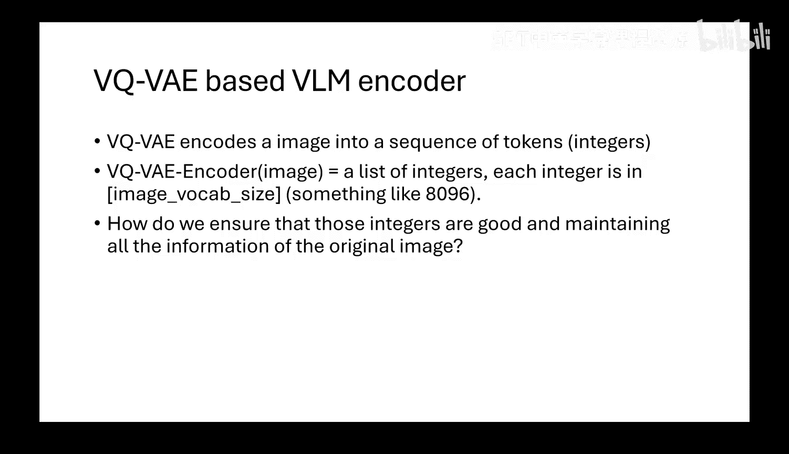

Okay， so roughly speaking， the VQ base VQ AE base model has a encoder， which is a vision encoder。

 and it also has a decor， which are trained simultaneously。😊。

So they want to make sure that for any image， if you go through the encoder。😡。

That maps the image into a list of integers。 and you go through the decoder。

 that map the list of integers back to the image。 You will actually get the original image back。😊。

Okay。😊，So basically， this means the list of integers that are produced by the VQ VAE encoding is actually representative。

Its very representative。 I mean， you can it contains all the information of the original image。

 So you' are able to recover the original image。 Okay so this thing that you put here beside a lot less conversion of the original image。

😊，It is equivalent to the original image because you can convert back the original image from it。诶。😊。

Any questions？Yes， I mean it's intuitively it loss size， but in practice， there will be some loss。😡。

Yeah， the equation is really the intuition。 I mean， in practice， you minimize the difference。

 but you are not really going to get the exact equal。Hey， have other questions？😊，太酷。So basically。

 we can sort of hope to recover the original image from this sequence of tokens。 Okay。

 so that's basically the goal of VQ。A yes。喂。So three years the friends on。If we want an output。

 probably the model knows the output should be an image file text。Because theers are different to。

So basically， I mean， you are saying， like once we have the sequence， how do we train the model。😊，啊。

What's the output is the output also a text the output is the sequence of tokens as the standard output of the transformer。

Will it be like how will we know whether it's token up it text our image？Yeah。

 that's a very good question。 So I will explain it later in the later size。😊，Hey， cool。

 any other questions。Hey cool。 So basically， this is the VQ V A。 I mean， intuitively。

 you are doing this thing。 Hey you take an image， you discreetize it into a list of integers。😊。

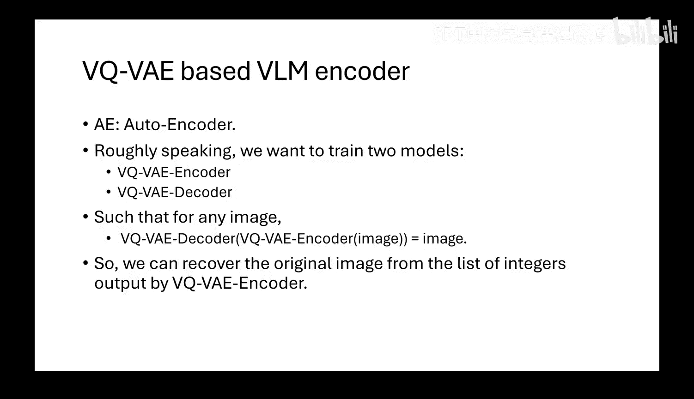

And then there's a decoder， which actually takes a list of indicator and actually recover the original image。

 and these two things are actually trained together。😊，嘿。😊，So what's the training objective， Well。

 the training objective roughly look like this， look like the following。哎。😊。

WellI'm not going to tell you the exact training objective because the variational parties a little bit complicated。

But intuitively， you can think about a training objective like this。 Okay， so basically。

 you have the decoder。😊，Of the encoder。Of the image page。A and then minus I2 norm squared。

 so this is expectation over all the images。 This is one objective。😊。

But then you realize that the output of the encoder is discrete， right。

 so this thing cannot be differentiated。😊，I mean， if you have an encoder that has discrete output to。

 then it has no gradient。 So you can really do gradient design on this objective。😊。

So how do you actually try a discretize or or trial encoder that maps the image into discretereetized tokens。

😊，ok。So heres basically the trick that people use to trade。Hey， which is。

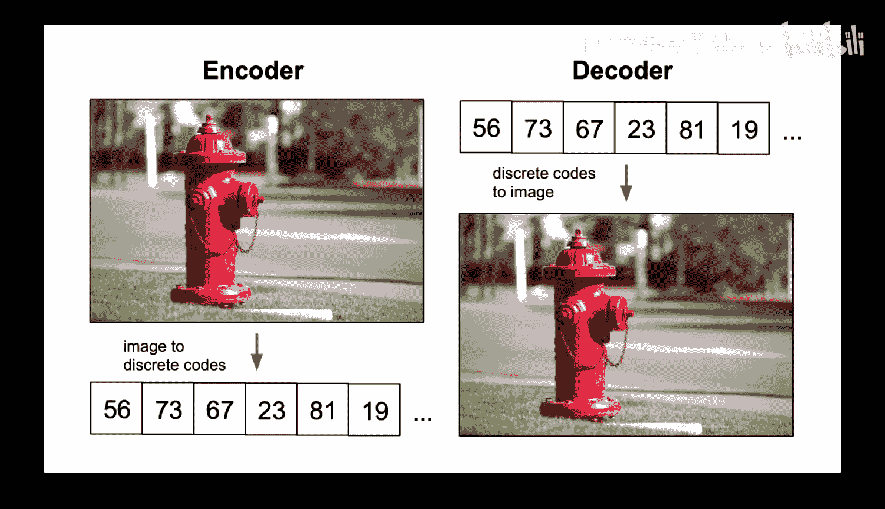

I mean， they use a fair kind of accelerate， training objective。K。😊，So basically it they are。😡。

So instead of using this encoder directly， he， they use something called， I mean。

 let's just call it encoder prime。Hey， so this thing is actually going to my image。

Into a sequence of vectors。Okay， so vector。1 vector2。诶。😊。

So this encoder prime is going to map an image into a sequence of vectors。

 and those vectors are in continuous space。😊，Hey， so they can be differentiate。 I mean， this。

 this is a defiable operation。 Okay， so this is a defiable function。😊，Hey， maybe I mean。

 let's just say it's defreable。Okay， so you have an encoder prime that maps this thing into a sequence of vectors。

 but now you need to map each vector into a discrete integer。😡，Right， so how do people do it。

 They actually maintain a site of E1。F E n。When this earn is equal to your image What size。😡，Okay。

 so they maintain a set of vector。He。😊，And then what they do is， I mean， at each step。

 youre actually mapping this vector。😊，Can you imagine this vector into swell the vector in this site based on the distance。

Okay， so let's just say this is your site of E。 Hey， this is E1， E 2， E 3，4。

 a certain step of your training。 And then you get a vector V 1。A or vector 1。

 this will be map to E1。He， and maybe you have a vice。Viter 2， this will be map to E3。Hey。

 and maybe you have a vector three here。This will be map to E2。

 and then youll have a vector for here。This will be卖 to1万。Okay， so at every step。Of your training。

Hey， your model encoded prime is going to map the image into a list of vectors。

 and then those vector will be mapped to the E I。 Hey， each vector will be map to the E I。😊，哎。😊。

Any questions？Yes。😊，好。This mapping is just an artme of the dec。

 so basically which EI is closer to you， you just map it to that。さ。

If there are actually two E I that has the same dec， you just randomly select one。

 But that is like almost zero probability event。😊，Thewhere on the like a supporting vector one and register to。

Yeah， that's fine， right， because you can think of those index will be your integers。

The impact will be your integer。 So if we one and we two are both close to11。

 then your in your final decoding， you will have like one， one here。Yeah， so this index here EI。

 this is like your to。😡，Or integer。 okay， and you have N tokens。

 which means n is your image work size。诶。😊，はい、Yes。our vocabulary and how roughly how large does it need to be to like thankfully reconstruct images yeah that's a good question so but the first step is you'll need to fix this value n and that's kind of our I think someone use an 8 k someone use 16 k。

And that's really like an arbitrary choice。 Yeah， I don't think there are two principal ways to do it。

 People just choose a favorite number。ok。Like you will see in many places in machine learning。

 people just choose their favorite number， yes。😊，Why is this approach better than just doing something simple and saying。

 like let the be give you like real numbers and then you just round it to an inger。I mean。

 you have to train， basically， you have to train the encoder， right。

 So this encoder takes I and might it to a sequence of tokens。

 but the layers of the tokens may be different compared to the side of the image。😊。

So in your approach， you are saying， what if I just flatten the image， anyway image I RGB value。

 right， And if I just flatten the image， I take the RGB value is a list of integers already。😊，Yeah。

 but here we really want the length of length of the output of the encoder to be shorter。

 because think about how long an image would be， right。So。I need a standard image。

So a standard image， right， let's say is 366 by 366， which is a very small image。😊。

But how many tokens are there if you just use the integer of the pixels。K are ra。

I think this thing is giving you un to the power of。5， right？ So this is like 10 K tokens。

 which is really， really too long for any acceptable usage。 right。

 You want to shrink it to something like10。😊，Hey， so you need to train the encoder part。

 You cannot just take an image。 Yeah actually， but what you said is actually used by some language model。

 which vision language model， which is called Fu Yu。 Okay， if you know Fuu A B。

 they actually just use a raw image as the input。 but that's a kind of a terrible model。 Okay。

 so we don't talk about it。😊，Yes。😊，So， when we do the training。

 I guess we need to first map the vector to the set to the final side。Yeah， so you each。

I mean initial of Eis are just randomly initialized。Yeah。Yeah， there are several sta la trainings。

 so step wise is。😊，Let's assume that initially your model is randomly initialized and the EIs are randomly initialized。

 and then map to a sequence of vectors， and then you select one of the EI of the sequence of vectors。

 and then youll need to update your EI。😊，So it's all adopted through the。So this one is updating。

 This one is also updating。 So the EI is are updating。😊，Yeah， so yeah I Sir。

 you can think of this as the embedding of the image vocabular。

 but they are not really used as the embedding of image vocabulary。

 They are just used as the inside encoder to actually get the actual tokens。😊。

So they are not using the in your transformer model as in in or as kind of embedding of the image。

they are just using this VQ VAE inside this VQ VA。we get how we input to the next。

 we talk about in the next slide。 that's another emdding。

 here we are only talking about how do you train the VQ V AE or train VQ AE model。Yes。

As vocabulary vector those。What is the subpackard with， not I anymore in the Dos function？

So this is one part of the loss function， This is the AE。So this is the any part of the loss。

 which is auto encoded。 So you need to you need to be able to decode your encoding。

 This is A E part of the loss。 And then that's a VQ part of the loss。

That I haven't really talk about， which deals with this discretization。Okay。

 so this is one part of the loss。 So your final loss is going to be equal to the AE plus VQ and the VQ part I haven't really talked about。

😊，Okay， so but now let's just be sure that we understand。

 So the model is going to map by image into a sequence of vectors。

 and then it will run this vector into one of the EI。 case some E I may get multiple vectors。

 K by each vector is going to be mapped to one of the EI。😊。

 and the index I here will be your final integer output of this encoder。诶。😊。

So basically here is how the model work and now the question is how do we actually train this model？

😡，So it turns out that the training is pretty simple。

 You just add the VQ laws into the training objective。 So what's the VQ loss。

Heavy kilo loss is equal to the following It the sun。

Over all the vectors I sorry all I in K he and vector I。Minus e of R of I。

Norm square where this R of I is equal to basically the。Or he Ar meal。谁？Of EJ minus vector I。Okay。

 so this R of I is really basically which vector are you， Are you mapping vector I to。Hey。

 so for example， in this picture， he R of one is equal to。1 and out of two is equal to three。

 because you are mapping vector 2 Gu Y3。哎，and R three is equal towo and R four is equal to one。

It's in this image。So basically， you are just adding this part to the laws。

 which is like a reconstruction laws。 So exactly， what this loss means is that the distance of vector I should be small compared to its mapping。

 So you really want the final thing look like this。😊，He， so there's E，1， E2， E 3， E，4。

And then all the vector that are mapped to E 4 is like centered around the E 4。

 and all the vector map to E1 is like centered around E1。诶。😊。

So your kind of discretization is pretty。Aerate， okay。

 so want to make sure that everything that are being discrete high to E1 are close to E1。

 everything that are being discrete high to E2 or close to E2， etc cetera。 Okay。

 so just add this thing into the laws。 And， of course。

 it contains an argument function that is not defable。

 but people just treat it as there is no gradient for argument。😊，Hey， I mean。

 the same thing you will learn for MOE。 There's an artrc max， and people also do that。😊，Okay。

 so there there is one part of the function that is still not defreshable， which is this same。

 but people just treat argument mean as0， the de derivation as0。😊，诶。😊，Any questions？And， of course。

 you can do something clever， for example， make this art me like a soft min。😊。

He or some probability I make it more defiable。 I mean。

 those are some upgrade you can consider for better training of a VQ AE。😊，Okay。

 those are standard tricks。But overall， is the big picture clear。 I mean。

 it's basically this model architecture plus this visual part of the loss。😊，可 AE。

 you have AE part of the loss， which is standard for any auto encoder。😊。

And then there's a VQ part of the laws that are special for。This， I mean， this deretization step。Yes。

😊，Enor anchor。That's a difficulty。S one the encoder yes encoded dash different encodes no。

 this encoded prime is a different encoder。 The encoder is equal to the in art process。Okay。

 so this encoder is equal to encoder prime plus the discretization。😊，And plus。

 you get the token from the index。Okay， so this encoder is equal to the entire process here。Okay。

 and the decoder is basically whatever model you would like， because。I mean。

 it takes this great type input and the output continuous stuff。 So it's defable。😊，Yes。

 does the model side on here based on unit size or is that fixed？Oh， yes。

 So that's a very good question。 So there are different versions of Ae。

 The one Google uses the K is dynamic， but it's not like continuous。 Okay。

 so they have some tricks that basically based on the aspect ratio of the image。

 They will reite the image differently。 and then that will decide the K。😊，Yeah， but for now。

 you can think about it as speaks。 So just for simplicity。 But in reality。

 there are tricks to make it depending on the size of the image。😊，Yes。

 it the VQ part of the law is trying to make the encoders output more discrete。 not continuous。

 Right， exactly， The encoder and encoder prime are closer。 Yeah， exactly。

 So the VQ part want to make sure that the encoder and encoder prime are closer。

So that's specific ittueration。 You want the encoder prime already output something discretized。

 so your discretization step is not losing too much。😊，Yeah。

 and the VQ stands for vector quantization， and this is a pretty powerful technique。😊，And， I mean。

 if you read the Gei report， they are saying that they use this thing。And I'm not at Google。

 so I don't know what they actually use。ok。😊，Hey cool。 So this is a VQ V AE model。

 And this sounds like a pretty good。 I mean， it's a pretty good thing， right。

 It maps the image into a list of vector or， sorry。

 list of integers that are exactly the same as what a transformer model would take。😊，Hey。

 so we got to this step。And now we get through this step here。 so now the question is。

 once we have this type of input， how do we actually train a vision language model。😊，Okay。

 so now everything are acceptable by a transformer。 So how do we train。😊。

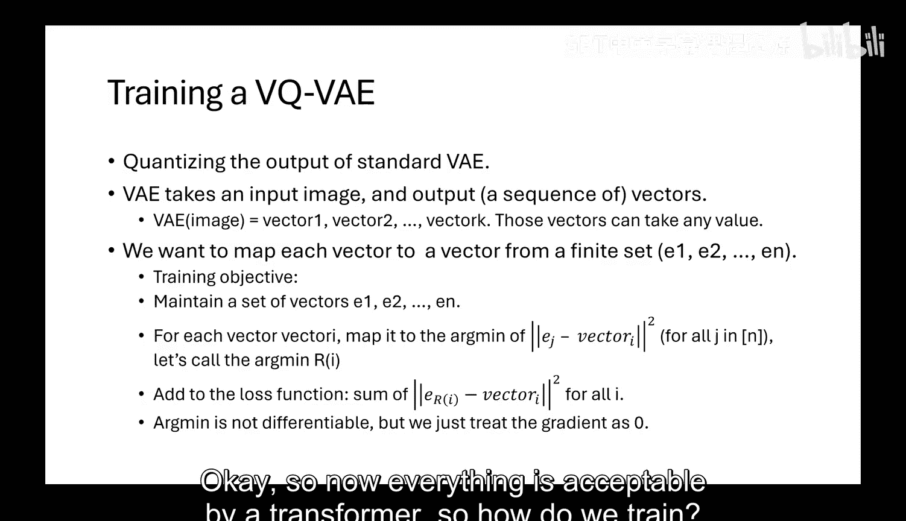

Now， the training looks very simple。系。😊，So all you need to do is to have a special。

Ebedding layer for image and a special L M head for image。Okay。

 so remote transformer models has thus has a in embedding layer。

 which maps the discretereized the tokens into vectors。😊，Okay， so what is a transformer。

 what what is a language model， a language model is really， you have an embedding layer。

And then you have。Whatever maybe 96 many transformer blogs。And then there's a L M hat。O。

 which is called language model head。 Usually the language model head is exactly the same as the embedding layer。

 K just the embedding layer transpose。😊，Okay， so your embedding layer is going to match the sequence of tokens into sequence of vectors that can be fit into transformer block。

 Okay， so what so here you have。😊，Stets of tokens。And output here， this guy。

Will be the sequence of vectors。哎。😊，So to try a vision language model。

 you are just going to apply two different embedding layer on text or image。 Okay。

 so your input is like you have a special indicator saying that this part belongs to image。😊，Okay。

 I mean， you can do that when doing the image encoding， you can that this part belongs to the image。

 and then you just apply a。😊，Differentent embedding layer here compared to the standard tax embedding。

诶早先唔睇定你啊想学你呢。This they are all linear。AIts just a different linear function that apply to the image。

Tokens compare to the text token。 So it's as simple as that。Okay， yes。By additional information。

So text you just wouldn't do it like based on the sequence order for email if you also do it based on the sequence order that's the simple solution while there are something that are more advanced。

But those are more use in this part。诶，手着按摩U型。This thing here is that positional ens are more or that one side。

 for example， toD positional en are more use here。But when you get that sequence of vector here。

 it's really you just use their kind of。😊，I mean， natural older。诶。😊，Any other questions？Yes。😊。

That's just this approach。 The next approach I've talk about is not going to dereitize it as inte。

Okay， cool。And yes。It is a worship all the lead。No elephant will be be the next。

That's when you do the organization。 I mean， when you do the organization， you have an image here。

 which has a special tag or image。 And once you detect， once your organizer detect this image tag。

 it will actually kind of， I mean， one solution is maybe you just insert a self token here or image begin token here。

😊，Andy you just insert this type of token here。 And once you go to this token。

 you know that now you need to apply for a different embedding。

Or you just remember like a so called embedding mask， which says， I mean， which put like 0 here。😊。

And one here。And Brazil here。 And once you apply the。kindind of linear transformation。

 You can go through the embedding mass有 order to switch between image and X。😊，Okay。

 and this embedding math is a standard implementation or many biian language model。Hey。

 any other questions？Okay， cool。 So for this L M head is the same。

 If you see that your next token is going to be image。

 you are going to use the image embedding layer transpose to predict the next token。

 If you see your next token is going to be text， you are going to use a text embedding layer transpose。

He， so for LOM head， you also have vision part and a tax part。😊，He， and for V Q V A， I mean。

 for V Q V A E base V L M， you actually have lost on both the image token and and the text token。

 Okay， so you are predicting the next。😊，I mean， you're predicting simultaneously the next image token and also the next text token。

嘿。😊，Any questions。Yeah， I mean， this is the VQ V A E based vision language model。 Okay。

 and we can see， I mean， its just using the V， using the yes。😊。

How do we choose the next children for the image。好。Because like for the test。

 we can have some software the。你你找过涛 how do你们 know的。The there are for all these kind of image time。

Oh， so the way you do it is you do auto regressive training。

 which means you are always going to predict the next token， given all the previous tokens。😊。

So for image part is the same when you get to this token。But那 when you get to8。

 you want to predict 5。And we'll get to5， you want to predict three based on all the past focus。

So it's a standard autoregressive training objective for language models。I mean。

 how do we know its state and So this image， this sequence of image tokens are what's produced by the the Hu Lie。

 and those are fixed during training。So the VQ part yeah。

 I should say that the Vi encoder part once it's twin is stay fixed when you twin the VLM okay so this part speaks。

😊，And when this， if this part is fixed， I mean， for every image。

 you might be to a sequence of fixed tokens， and those are known to you。😊，Because he。

So the vision the Vipart is trained separately compared to the language model。

 He is trained with this laws on some。On some destroying data set。

Because this data set you only need the image。 you don't need text。

 So you just train this vision encoder on image data like imagenet or line2 B or C 300 million。

 something like that。 Hey， you'll just train your auto encoder on this or a vector quantize auto encoder on this image data。

 and then the vision encoder will state fixed。 this one speaks。

 So those image opens they state fixed during training。 So youll know what's their next table。😊。

So the labels for the image these just from the， Yeah， just from the vision encoder。Yes。😊。

This might be an convenient question， but so we to what text is like or list。

Integers where each individual belongs to the word， let's say word。

So what is it should integer is a pixel or there a of pixel there's not a very good interpretation of the integer。

 but you could think of it as like some indicator for feature， for example， like the first integer。

 you can think of it as some object ID， for example， like what object does this image has。😊。

So those are abstract indicators。 They don't correspond to pixels or patches。

 They've corresponding to more like features。For example。

 the second indicatorteger would be like the color of this object。

That would be for the embedding the purple don't think where I'm asking it， but organizers。

 let's say like let's the mining with saw that。So each token gear would map mild with some token index and。

Me ondo so on right， so that's all we mentioned how mapping this token is clearly image。

Is anything similar how about？Oh I see you are saying for a vision encoder for this encoder prime。

 how does it produce the sequence of vectors？😊，都那。I mean。

 the tokenr is basically just based on the rounding of EI。Yeah， it's based on this index I。Yes。😊。

ThenSo only the argument part is zero， you still have the kind of the I mean you still have the loss for this part so for this part if you take the gradient there will be like the vector I minus this and times the gradient of vector I and then times the gradient of this R which is zero。

😊，But you still have the gradient of this vector part， which you can use in the training。Yes。

 any other questions？Yes。😊，I theer continuous input Why do we perform quantization is it for performance reasons it's mostly for generating images actually。

 so for you can see here， I can， I can predict the next text token and also my training objective consists of predicting the next image token right。

 this means I can actually try to generate image based on text description。😊。

Because I can apply the after I deco a sequence of image token， I can apply the decoder here。😡。

And get image output two。So this framework is actually very good。 I mean。

 that's why Google use it because it can actually do a generation of images or generation of tech。

 Having mean think about the open IGPTV model， it cannot generate images。

 but the German I can generate images because of the variational or the vector quantization framework。

😊，And the next thing we are going to talk about， which is a clip framework by open eye is not able to generate images。

 Okay， and they don't do likeer quantization。Any questions。北酷。

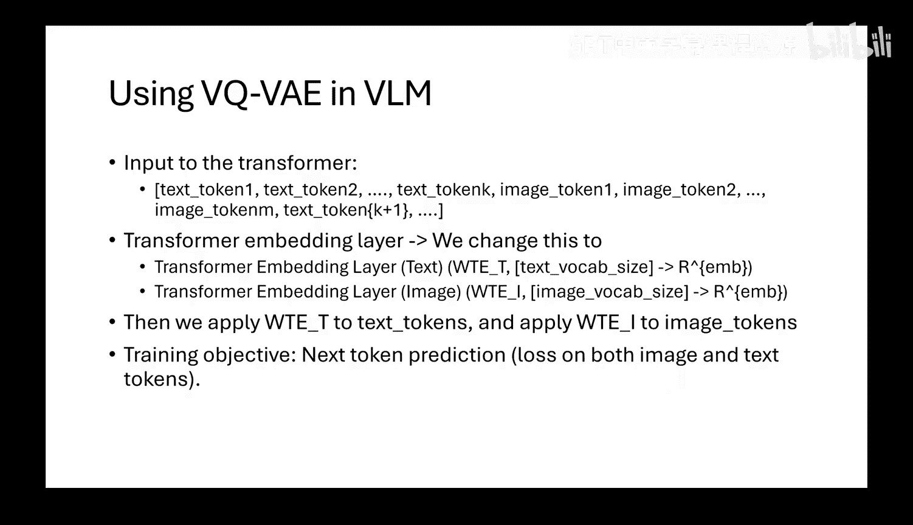

So now we are going to talk about the next our next image encoder， or next type of image encoder。

 which is clip based image encoder。😊，系。😊，So clear based image encoder is kind of completely different from VQ G base image encoder in the sense it's not going to produce discrete great ties or integer tokens。

 Its actually only going to produce image vectors， which are continuous。😊。

Wters on high dimension space。He， so raise啲 inside off。I mean。

 instead of transferring the image into a sequence of indicatorte。

 could actually transfer the image into a sequence of vectors。😊，Okay。

 so each image image is going to be transferred into a sequence of image vectors where each image vector lies in certain dimension。

 usually like。😊，运期企。And then， I mean， trim for trimm using the clip is almost the same。 Now。

 instead of having， I mean， instead of having like the VQ VAE based。😊。

transransformer embedding layer for image。 Now， you just have a different transformer embedding layer for image that match a vector。

哎 that match a vector from the clip dimension into the embedding dimension。😊，皮。😊。

So you see exactly the same。 but now because you don't have these three ties token。😡。

So you are not going to have an LM head for images。

 which means a training objective will be next token prediction only on text tokens。

 so there's no laws on the image writerss。😊，Okay， the image vector are only input and。

And they don't have loss on the output， Okay， so what do I mean like this？😡，Hey。

 so you have a chunk of tax tokens。And then an image。This is a image director。And then thanks。Okay。

 and this thing after going through our transformer。😊，Hey， before the LM head。

 So after going through the price0 blocks。Before theLM had， everything will be vectors。Right。

 this is like a white card。And of those are writers。

 and now you are only going to decode these vector using LM head and then doing the next token prediction on here。

 But when you hit those vector， you just ignore them in the loss function。😊，Hey。

 those vectors are just ignored in the loss function。 And then for these vector。

 you are going to decode them and then put a loss on it。😊，so for all the image part。

 after going through the transformer embedding， you just ignore their embedding in the loss。😊。

They they are only use。 The image are only consumed by the text part later。

But they are not directly in the loss。8y。😊，I any questions？Yes。

 think again again why we can't do generations know why are they ignore it again？Yeah。

 because those are writers， you cannot really。I mean。

 you can decode vectors but those vectors are kind of meaningless because it's not an auto encoder objective。

 There are just some vector representation of the image where it's very hard to actually recover。

 And also， if you want to reconstruct vector， you have to use all2 laws。

 It's not really compatible with the cross central belows of the original transformer。

 So it's very hard to balance like their ways because they are not even in the same scale。😊，Yeses。😊。

诶知道啲。被告的。Best telephone。Because does not。So。Right， so then output put are tag only。

 they cannot generate images。So you cannot really just take this part of the problem and hope that the generate image vector is not going to work。

 You have to start your generation from here， and it will generate those types。太酷。

Any other questions， yes。对。对。Yeah， we will use a decoder。 So we generate a sequence of image。 Okay。

 then we use a VQ decoder。😊，A VQ VAE decoder to actually decocode the sequence of tokens to the actual image。

So， we will use。The thing here， you will use this one to generate image。 Yeah。

 usually this is also a VIT。啊，vis transformformer。Yeah， follow。他。It's just hard to say， I mean。

 usually the creep models are much smaller than the AE models。😡，So because the AE model。

 they have to discreitize and they have to reconstruct。 So it's a pretty complicated model。

For example， the A E model used by Google。 I don't know what's the size。

 but their original model is like 20 billion parameter。 So 20 billion。Now。

 the clip model used by open eyes is like less than 1 billion parameter。

 so usually the clip model is much smaller because they don't need to deal with the reconstructionction discitization。

😊，They just met the image with sequence of vectors， which is a pretty easy task。😊。

Those two things together is 20 billion。啊帮。Only the encoded， I think probably half。

 I'm not sure if I remember correctly。Yeah， but it's a very large model。😡，Any other questions。太酷。

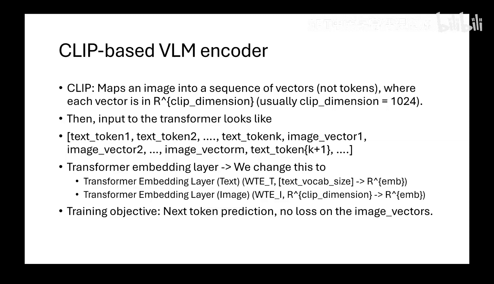

So what is a click training objective， Now， click training objective， you have to。

 is's not that image only training objective。 It's an image plus text training objective。😊，Okay。

 so click training your objective look like this。 So you have an image encoder that encode the image into a basically this like sequence of vectors。

😊，He， and the text encoder is also going to encode text to a sequence of vectors。

 You know the transformer before going through IM， it is a sequence of vectors。😊，Okay。

 and the image encoder is going to include image into a sequence of letters。

 and the creep training objective is really just want to make sure that the corresponding image。😊。

And call and tax， they have the same em。Okay， so your image encoder after mapping this image to the image vector and text encoder after mapping the description of this image to the text vector。

 you want them to have similar embedding okay so you want to say that I have an encoder that maps the image to a sequence of vectors and I have another transformer model or text encoder model that maps text into a sequence of vectors。

 I want to make sure that if the text and image are talking about the same thing。

 then their embedding should be the same。😊，Okay， for example。

 if the image is a dog and a tag says this is the image of a dog。

And they' are talking about the same thing so that embedding should be the same。

And if they are a different thing， for example， thing here， then their emdding should be different。

 as different as possible。😡，嘿。😊，谁先是 say。I have a image encoding and I have a text encoding。

 And if the image and text are talking about the same thing， then their encoding should be similar。

 And if they're talking about different thing， then their encoding should be different。

 It it's a pretty straightforward training objective。 right it makes a lot of sense。😊，Okay。

 and why is this string of that good。I mean， this training of vector is kind of ideal， right。

 You want to， I mean， because think about variational or think about vector quantize Ae。 I mean this。

Like as a student I there is no guarantee that those vectors are corresponding to some meaningful sequential structure that are understandable by transformer。

 right， It's just those vector you can reconstruct the image。

But there is no guarantee that they actually consist of any sequential meaning。But for cl。

It's guaranteed to have sequential meaning because the image embe the image encoding and text encoding are the same if they talk about the same thing。

 So text encoding obviously has sequential structure。

 And if the image encoding are the same as the text encoding。

 then it must also have sequential structure that are consumable by transformer。😊，诶。😊。

So this kind of approach。I mean fundamentally more principle in terms of the image encoding。

 but the only downside is you cannot use it to generate images。Okay。Questions。

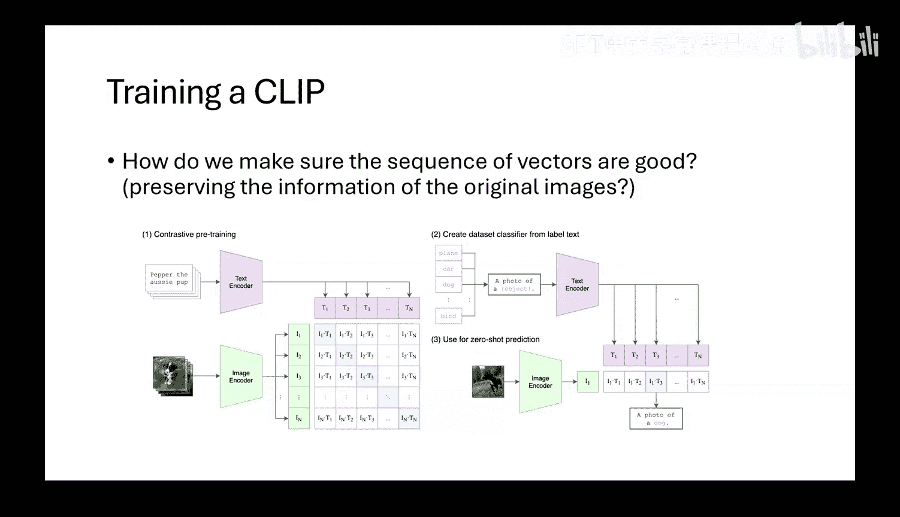

爱酷。So basically， I mean， basically， the training objective roughly look like this。 Okay。

 there's some augmentation that you apply on the image， but that's not very important。 Okay。

 so the real training objective is essentially this line。😊，Okay， so you want to maximize， basically。

 you want to maximize this objective。 I mean， this is exponential。

 which means you kind of want to maximize this one and minimize this one。😊， what does this mean。

 It means the clip embedding or the image encoder of an image。 Okay， is as close to the。I mean， tax。

Of or the corresponding types of this image or the types embedding of the corresponding image。

As possible。 so this is an image， hey， this is like the augmentation of the image。

 this is the corresponding text of the image。😊，Okay。

 so you want to map the image to some vector that aligns with the tax em。

That are met by some transformer architecture。And simultaneously， you want to make sure， sorry。

 there's some message。

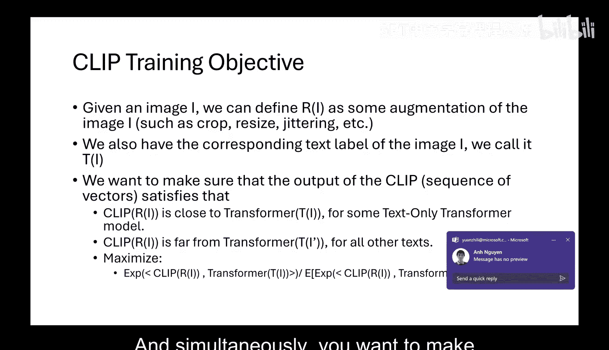

Okay， simultaneouslyim， you want to make sure that when the pulse is describing another image。

 you want to make sure that the text encoding and the image encoding are different。系。😊，So。

 for example， if you have an image about a car and your taxes， there's a car in the image。

 You want them。 They embedding to be close。But even the taxes， this is an image of a cat。

 you want very invitingvadding to be。I mean， destroy or anti close。

 you want to minimize this in their product。诶。😊，So quite intuitive。 I mean。

 in one sentence is just image， If image is the same as text。

 then their embedding should be the same。 If image is different from the text。

 then their embedding should be different。😊，Hey， that's space 8 eclipse， a trinial objective。

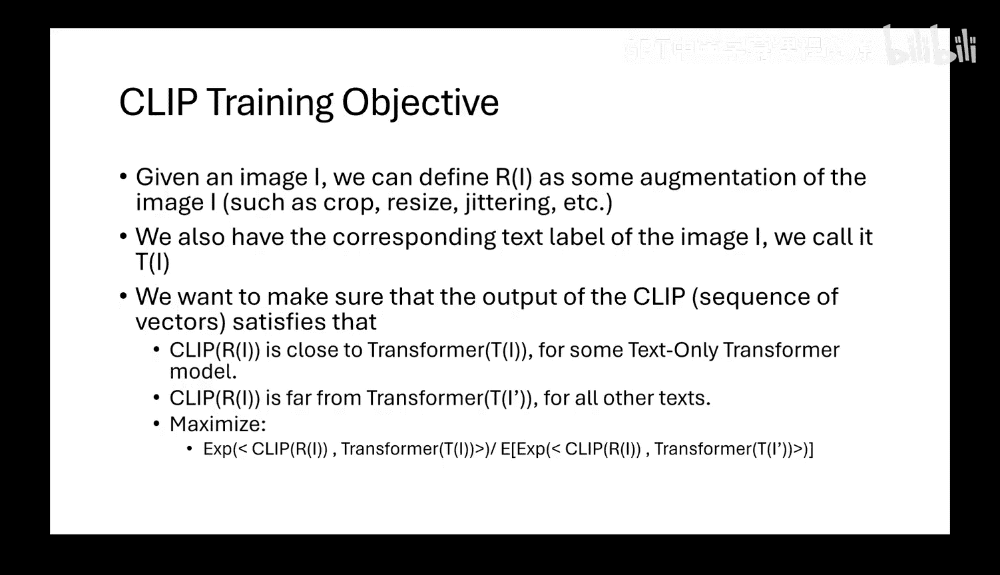

北 cool， so these are the two type of encoders。I mean。

 what's the advantage of this of the VQ V or VQVAE compared to C。Now for retail。

 the upside is it can be used to generate images， okay。

 because there's lots of image tokens and also it supports multiple resolution on aspect ratio and in different images can be map through different length。

😊，Hey， because this is like a reconstruction objective。 So even if you have different length， I mean。

 as long your decoder can deal with multiple length。 I mean， then it's fine。 But for C。😊。

You really need to fix a sequence as because you know， because you want to make sure that the image。

 the embedding of the image are the same as the embedding of the text。But for， I mean， but， I mean。

 text， you may have like 100 tokens or 200 tokens。 It's unclear whats the description length of each image。

So we need to prescribe something that map the image and text sequence of tokens to be the same length。

😊， so C cannot deal with variable length。 That's basically their fundamental limitation。Okay。

 Singapore here。 I mean， no matter how many tokens you have here， you can still reconstruct I。

 But for clip， you really need to make sure that image and text has the same number of tokens。😊。

And the only way to guarantee that is really just having the same。 I mean。

 just having everything to be the same less。😊，Can image your map to tokens of the same lens and text your map to token sequence of the same line。

诶。😊，But， I mean， clip， on the other hand， clip also have upside。

 which is their sequence of tokens is directly consumable by transformer because their。

 their image sequence of tokens are essentially the same as a text sequence of。😊，I'm sorry。

 that image sequence of vectors are essentially the same as a text sequence of vectors。😊，嘿。😊。

And also， the writer， including containss more information than the discretereetized vectors or discreetized token。

 right， the discretereetized token。😊，It's like a very loss。 I mean。

 although you have this training objective， but eventually it's kind of lo。

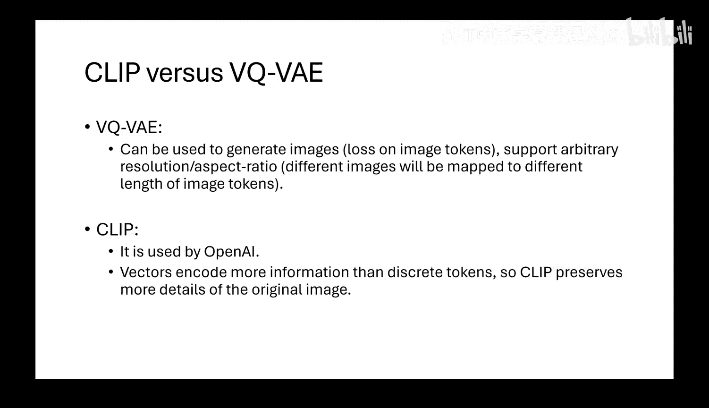

So for example， I mean， if you look at the reconstruction of VQ VAE， this is like a standard VQVAE。

 I think this is the first one。😊，I mean， this is the first VQ V AE that people have。 Of course。

 now we have better ones。 But just look at this VQ V AE reconstructioncon。

 The left one is the original image。 The right one is the reconstruct image。

 You can see roughly look like the original image。😊，Right，But theres many details that are missing。

 especially if you have texts in the image， then the reconstruction is pretty bad。

 It means those details are missing in the image。And those detail may matter a lot for understanding the image。

 Hey， for example， if you want to understand this plot， you have to know what are those tags。诶，把s in。

Li yeah， I mean， they are they roughly just missing， okay。被酷。So basically。

 those are the general overview of， I mean， vision transformer model can see they are pretty simple。

 Okay， they are， I mean， they essentially you just map images into sequence of nars or sequence of tokens and then feed into transformer。

😊，There is nothing special about vision language model。😊。

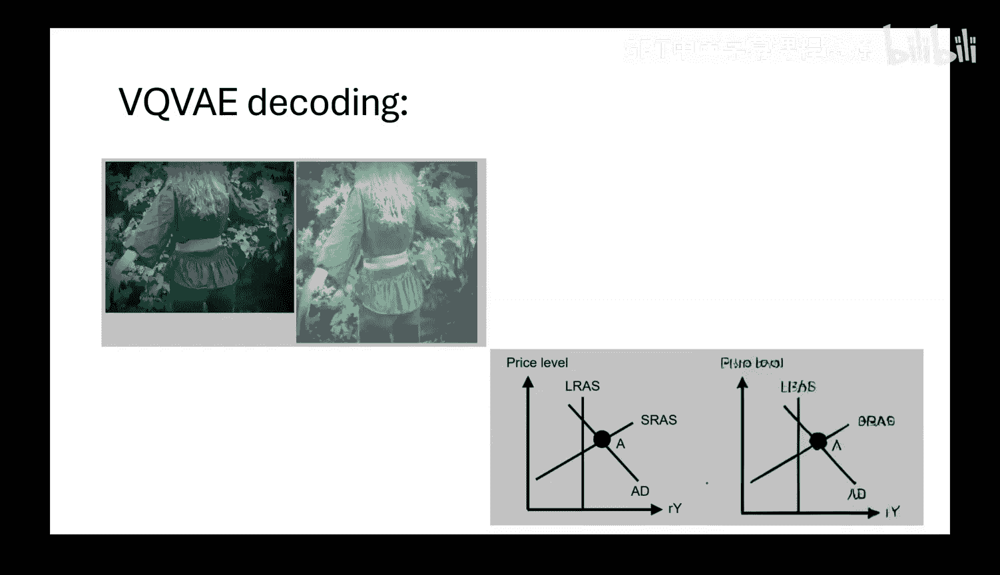

And the next thing I'm going to talk about is the training data， which is the most important thing。

 Okay， this training data is much more important than the architecture。 As you know。

 everything in in in modern generation model is about training data。 Okay。

 the architecture and whatever doesn't really matter。😊，诶。😊，So I don't know what German I O TVV。

 I mean。Or I know， but I can tell you， so。Assume that I don't know。 Okay。

 so I don't know what they they do exactly， but there are some standard training data。 Okay。

 so there are some training data like image caption pairs。😊，Like Googleogle image or bin image。

 basically这 if you do Googleogle image search， right， you just search， right。😊。

Give me a mi about a generative AI class， right？ then you see some Mi and mini will contain some caption description of that Mi。

😊，RightThose are standard training data。 It's like image option。

And then there are interlacing image and text training data。

 which are just standard website or Pf pages， archive papers， or like those medical things。

 They usually have a text。 and then there's some image here and then some text may describing the image may not。

 So the connection of the text and image are not that strong。

 But those are a very vast amount of interlacing image and text data。😊，Okay， and I手里的 key challenge。

I mean， really， fundamentally， the largest amount of data is the second one。

 but it's very hard to get from the Internet because you need to power the HML。 Okay。

 hopefully we will talk about HM paring in some lecture。

 because that's the most important thing in spinning transformer models。

 but the second thing is really the largest source and it's very difficult to get。

 because if you look at the raw H ML。 And if you look at the render HML in a browser。

 the image and text are nicely interlacing。😊，But if look at the wrong H M L。

 it's very hard to know what is the correct position for the image。

 It's basically just some URL hidden somewhere and H M L。 I mean。

 everyone use their customized grammar。 So it's very hard to parse。😊， but the second one is really。

 I mean， the largest source。 And then the third one are textbook exercises。

 which require some human collection。 So those are like。

 you have some exercise that contains a table， image or whatever。😊，Okay， and the first one。

 which is very heavily used in both Google and open I， is chart Q A or table Q A。

 They are synthetically generated because the table， you can synthetically generate a table。😊。

And you can generate table and use markdown to render it。And the tables are generated from text。

So you can use， for example， GB4 to actually write question about the text。But the。

 you won't really put the table there in your final training data。

 You would actually put an image of the table there。 The same as a chart。

 you can effectivelyly generate a chart。 You can askG before to write Python codes to generate chart。

可。😊，And then you can， instead of putting like the python code or actual raw data of the chart。

 you can put the image of the chart there。So this is a very large amount。 I mean。

 you can generate arbitraryrbitrly many， and these data are very important。😊，诶。😊。

And most type of training data is document layout， understanding or screenshot。

 understanding this requires human label。 Basically。

 you take a screenshot of the web page or screenshot of some document。

 and then you ask questions about， for example， I mean what。😊，I mean， what does this。

 What is this talking about or what is this web page about， I mean， if I want to do something。

 which button should I click on the web page or some layout understanding， for example。

 which part of the document is the head。 Okay， Which part of the document is advertisement。

 Which part of the document is the main context， Those are standard data， those are human labeled。

 or they are also very important， And then there's OR training data or optical character recognition training data。

 which are really just。😊，You have， you have， you have your latex compiler， right。

You can compile your latex into PDI。And your input will be a PF screenshot。

 and your output will be the rawo lateex。This is also very good as understanding my PF pages。

 And I those things are used in like G。 We， I mean， if you put that PDF into the play， I mean。

 open eyes chat playground， you can actually read the PF Be it is those type of training data。😊，Okay。

 that tells the model first translate the P F page into raw latex or markdown。Hey。

 and those data parts are also very important。 and there are some other data that I'm not allowed to tell you。

 but。😊，I mean， those are basically the common ones。给。😊。

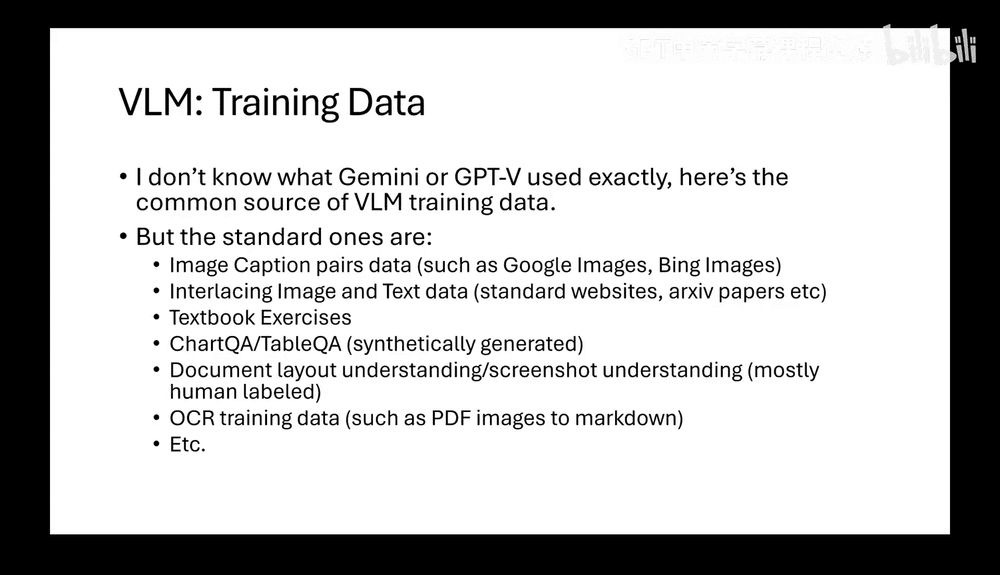

Yeah， and then theres some common benchmarks to measure mission language models。

 You can see those benchmarks are very well aligned with the training data， right。

 That's why I'm allowed to tell you。😊，So basically， I mean， let's chart Q A document Q A， right。

 text V Q A。 So are just， I mean， chart understanding， document understanding and OR data。😊。

And theres some OR data， O CR bench and visual detail understanding。

 This is a pretty interesting one。 It requires high resolution。😊，Okay。

 and then the most important one or the most popular one is the first one， which is called M M， M U。

😊，It's basically just college level screenshots or college level textbook exercises。😊，诶。😊。

So essentially， it's like this。 Can you give a graph of some function and then you ask a language model。

 like based on this graph。 What's a corresponding。😊。

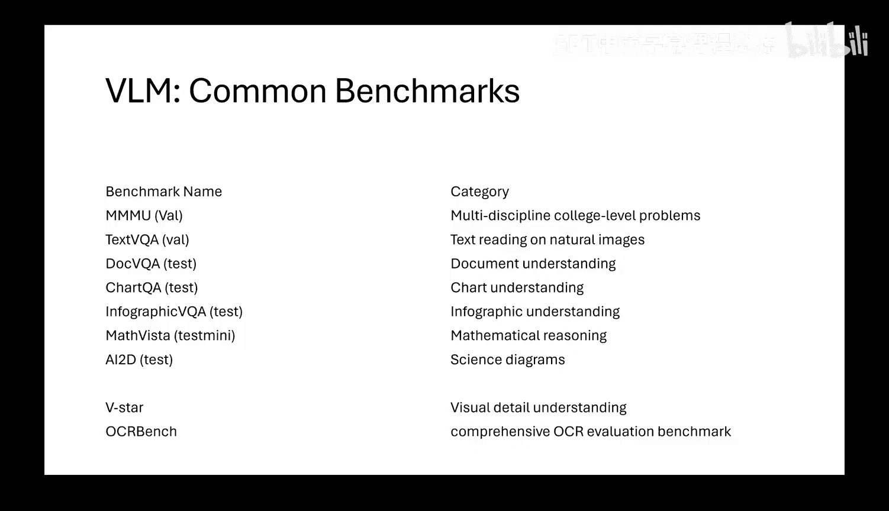

Intereggo， or you have a circuitca electrical circuit。

 You can see those questions are really difficult。 and the only way language model can solve those questions is because there are textbook exercise in the training data。

😊，Right the textbook exercise really contribute a lot to solving these type of questions。

 and they are really， really difficult。😊，Okay。😊，And I think that's all what I'm going to talk about today。

 Okay， so basically， in this lecture， we learned what is V L M， We learned two type of encoders。😊。

Okay， we learned the training objective， which is very simple。

 and we learned we give some brief overview of the training data and the benchmarks， okay。😊。

And hope you understand。 I mean， the all M is some very simple stuff， take。😊，Thanks。😊。

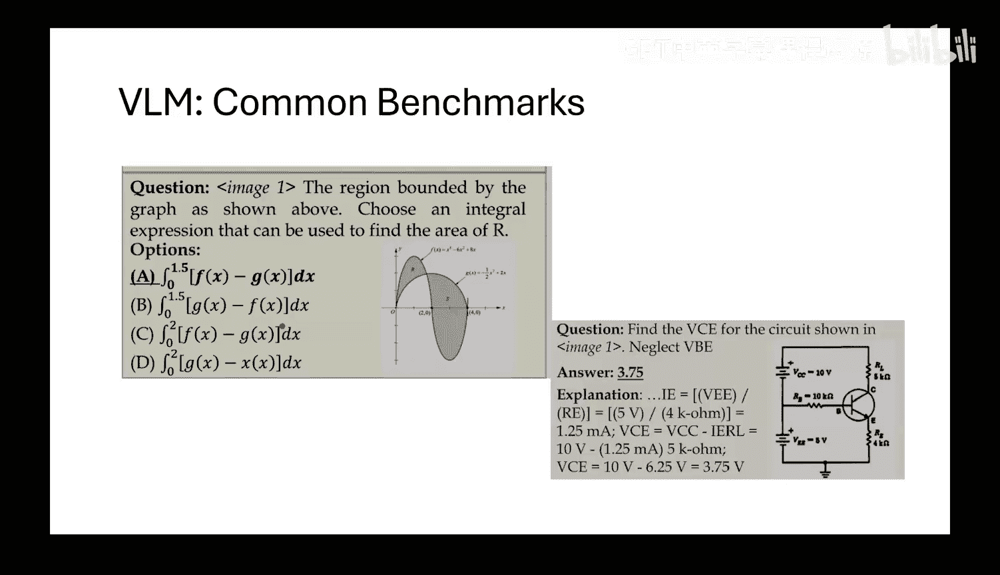