# CMU《生成式AI｜10-423 generative ai 2024》中英字幕 - P16：-P16-Lecture 15 - Visual-language models (Part II).zh_en - GPT中英字幕课程资源 - BV1CyC9BPEhG

Let's get started， Thank you everyone for coming to today's lecture。😊，And today。

 we are going to talk about something special， which is called scaling law。 Okay。

 so this lecture is very special in the sense that you won't be able to learn this lecture from any other places in the world from any other time because I'm leaving。

 So this is one of the only or the only lectures about scaling law you will probably here in any academic institute。

 Okay， but people are not going to tell you scaling law because scaling law is the most important thing in the world。

 and they want to hide it as a company secret。😊，And I'm。

 I'm also not allowed to tell you the actual scalingkating law。

 but we will touch some surface about scalingkating law in today's lecture。😊，Okay。😊，So this thing。

 I'm not sure how to turn it off。So basically what is scalingkating law。

 Well the scalingkating law means the following。 Okay， so training language model。

 especially in large language models is very computational costly。 Okay， so G4 is a 1。

6 training diameter model okay， and it's trained on， you know， something like 100 trillion tokens。

 Okay， so basically computation， very， very costly to train such a large model and such a of such a large amount of tokens。

😊。

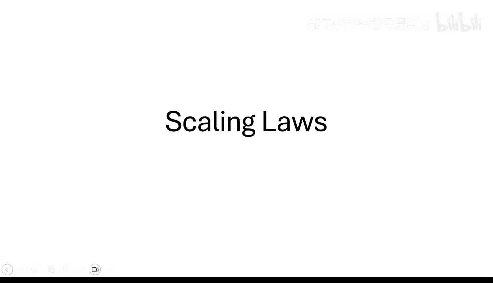

So， of course， as a company or any other places before you train the model。

 you have to have some budget。 Okay it's not like in Aria where you can just start your run without a goal。

 If a company you need a layers of approval， so you need to come up with some budget。

 you need to come convince the leadership that this is reasonable。😊。

 and also is convince yourself that the training or model size or training compute you are okay to this model really makes sense。

 okay。😊，So， for example， I mean， Google want to decide how much compute to be used in Gemin and Ultra。

 right， I， I mean， I really want the model to be like as large as possible。

 but the model cannot be too large。 if it has like 100 trillion parameters。

Then you won't be able to train it efficiently。 Okay， so you want to decide like。

 what's the optimal model size。 And for that optimal model size。

 like how much compute you would boot into that model。 For example。

 I want to set that like a three month period of training or like a year of training or maybe two weeks of training。

 Okay， so we want to understand those question before we actually train those large language models。

😊，So this is where the skating law is used when we try to predict the behavior of large language models by doing experiment on some smaller ones。

😡，Okay， so we want to be able to forecast like if I use a model of this size。

 if I use the other compute of this large， then how good a model I can actually get。😊，嘿。😊。

Any questions？So this is really the most important thing in training large language models。

 we really need those scaling laws。😊，So the scalingating laws has a lot of different versions in industry。

 Okay， so overall has a lot of， I mean， their own scalingating laws that project the contribution of some data for certain benchmarks。

 Okay， and those scalingkating laws， we are not really going to cover because they are too specialized and some of them are company secret。

 Okay， so we are only going to cover some general ideas of the scaling law or the kind of academic friendly scalingkating laws。

 okay。😊，Any questions？So we will talk about two scalingkating laws。 The first one is developed by Me。

 which is the capacity scalingkating law。 Okay， it's a pretty simple straightforward scalingating law。

 which says how large a language model needs to be in order to do something。😊。

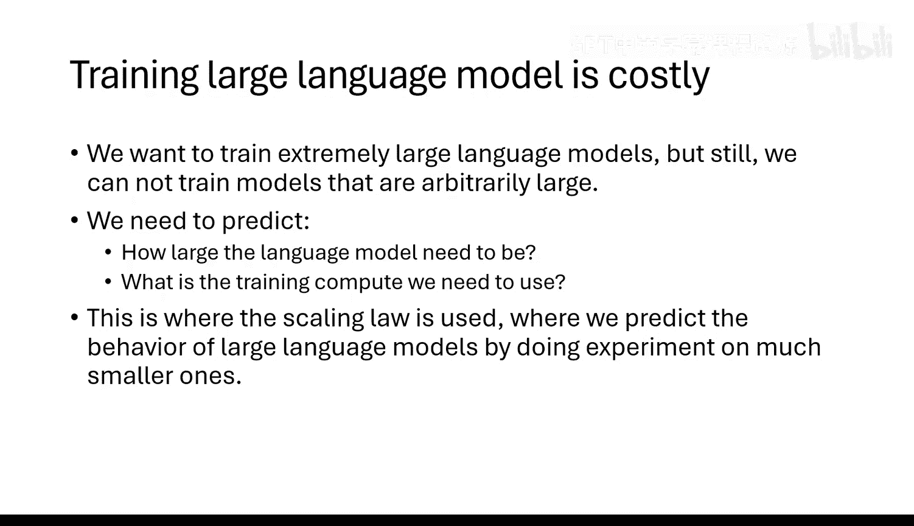

Okay， and to do something， there are different versions of the scalingating law。 And today。

 we are going be going to focus on the most simple version just to give you a sense of the scalingating law。

 which is memorization。😊， so the first scalingating now is going to talk about how large a language model need to be in order to memorize certain amount of knowledge。

😊，Okay， and the second scalingkating law is developed by Deep mind and it's going to talk about the computation or how long do we need to train a language model or how fast would the language model screen compared to size。

 training budget and etc。 Okay， so with those skating laws and a bunch of scientific study of the data。

 we can actually do some scientific prediction about the model size we need and also the amount of training pokens we need。

😊，哎。😊，So of course those two skating laws are the most general skating laws I mean in industries there are a lot of like more specific skating laws。

 they are about very particular behavior of language model on some very particular data set。

 but then overall they just share the same spirit， which is you want to do experiment on small setting on controlled setting and then you want to project your funding into like extremely large language models by finding the rules in those controlled setting。

😊，Or in those small scale setting。诶。😊，Any questions？Okay， so let's go with the first skating law。安家。

Which is language model capacity。 Okay， so this is probably the most easily understandable skating log。

😡。

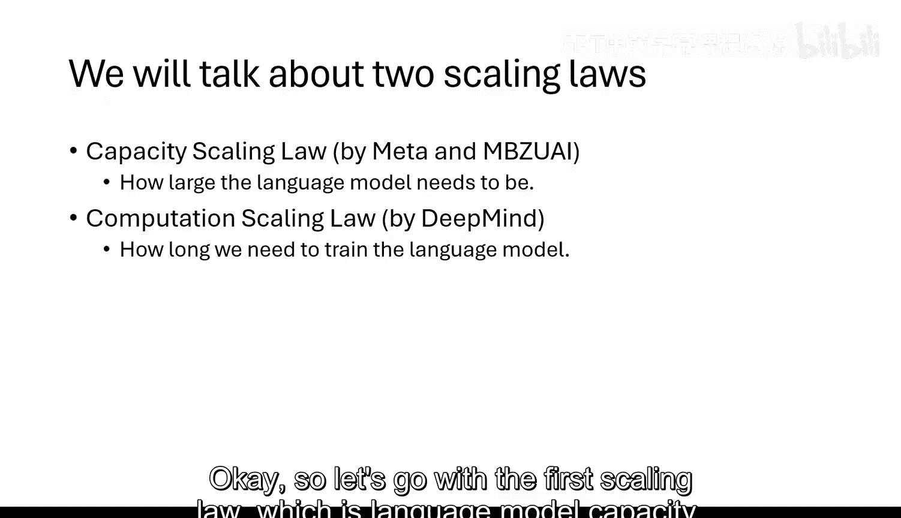

Okay， so basically it's a very simple question， which is how manufactureual knowledge can a language model memorize if the language model is of size M。

😊，Okay， so how many piece of actual knowledge can our language model memorize？so I mean。

 we know that as the language model gets larger and larger。

 it probably memorize more factual being able to memorize more factual knowledge。

 right because it has more parameters。😡，He， so this。

 you're kind of expecting some curve like this is a model size。😡。

And the knowledge that the model know。Hey you're kind of expecting some like increasing curve。

 maybe like this。😡，RightSo scaling line is really talking about what's a precise statement of this curve。

Okay， so basically what we are going to do is we are going to do experiment on model size of this large。

😡，He， so we do experiment here。And now we are going to project this the curve of this thing to here。

😡， for some model that are extremely large。😡，Okay， so this is really the spirit of skin law。

 you do experiment on a small scale of small models and then you actually catch some curve。

 you extrapolate the curve and you predict what would happen here。😊，诶。😊。

So I choose capacity as a skating law because it's really the most easily understandable skating law。

 but still it a little tricky tricky。 So feel free to ask me questions at any time。 Okay。

 so the lecture is going to be a little bit difficult。😊，哎。😊，So， I mean， if you know me。

I very rarely say something is difficult。 I always say it's very simple。

 So even I say is's difficult， its really not that easy to understand， okay。So basically。

 we are going to talk about what experiment we want to do here to understand the capacity scaling law of the language model。

 So basically， what is this curve going to look like。😡，And I mean， you say ex about that。

Kind of the first intu is this should be something linear， right。

 If the language model size gets larger， you should be able to， if it's like 10 times larger。

 you should be able to memorize 10 times more knowledge。😊。

 but we will see that there's many kind of additional factors here that can impact the model's capacity。

😊，系。😊，So how do we actually do experiment here， Like。

 how do we actually measure the amount of knowledge that the model can memorize。😊，系。😊。

So this thing is not easy to test， right， If you look at the GB4。

 how do you know then how many factual knowledge does G for know。

This is almost impossible to measure。So I'm going to talk about one particular approach of scalingkating law。

 which is we actually do experiment here on a more controlled data set。

 So we are not going to do the sating law on the kind of those Lama models or whatever models。

 because we are not able to measure the amount of knowledge as they measure。 They memorize。

 So we are going to do some experiment on controlled setting where we can exactly characterize the amount of knowledge that the model memorized and then we are going to MEM。

 Then we are going to kind of generalize these findings to real settings。😊，ok。😊，So， of course。

 factual knowledge is the foundation of human intelligence。 I mean。

 why do we care about the scaling law， Because really。

 factual knowledge is the most important part of language model。 right if you talk to G4。

 you feel like it's almost like a search engine because it knows all those factual knowledges。😊。

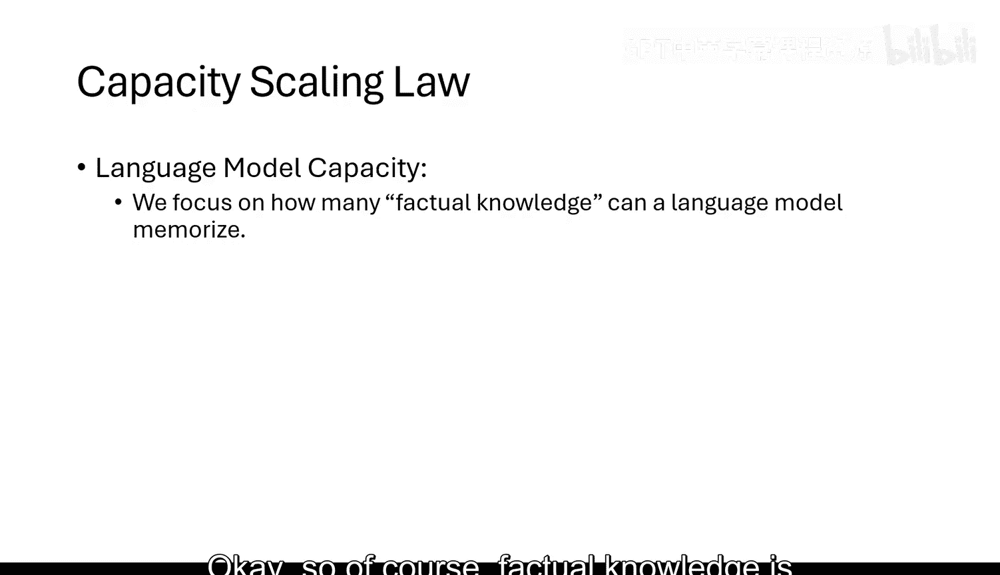

It's like a natural language search engine。 It memors much more knowledge than the ordinary human Okay。

 so factual knowledge is something like this。 Hey， you have a Wikipedia article about Harvard University okay。

 and this article contains a lot of fact knowledge。😊。

He says Harvard University is Ivy League University， is in Cambridge。

 is founded in some place and also is the oldest institute in the US that there are all factual knowledge and you want a language model to store all this factual knowledge。

😊，He， our question is like how large does the language model need to be you order to store those factual knowledge。

😊，诶。😊，So here we consider fact knowledge as the following。

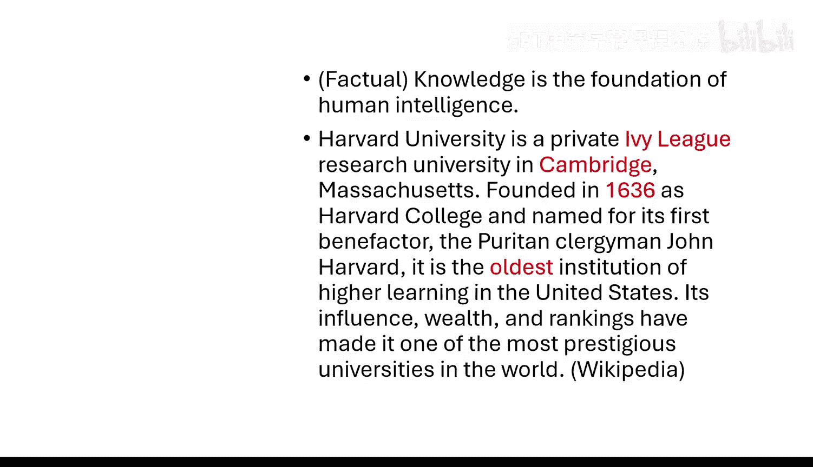

So we define factual knowledge as a name， attribute and value tuple。 Okay， so for example。

 theres power and location and and the value is Massachusettsus or Cambridge。😊，诶。So basically。

 this is your standard format that people use in knowledge base。 It's like a name attribute value T。

 Of course， they have something more， which is a name relation name。

 but we are only going to focus on those simpler ones， which is name attribute value。😊。

HeSo工这里你们 know how many P of this name attribute value Tple have a language model of size and memorize。

😡，Okay， so we put this knowledge that the model no， a precise definition。

 which is essentially commonly piece of those name attributes and value tu with the model memorize。😊。

诶。😊，As a function of M， as a function of language models， parameter M。嘿。😊，Any questions？So basically。

 this is a scaling line of the model's capacity versus the model size。嘿。

So how do we do this type of experiment well is again。

 if you do it our real data right on the whatever any model train on internet data。

 it's very hard to go through the list of name， attribute and value tuupils。😊。

It's almost impossible because if I ask you to write down a list of all human facts as name attribute value Til。

😡，It's almost an impossible task。Right， it's almost impossible to measure the model's capacity using this type of definition。

Hey。😊，So what we are going to do is we are going to do it on a more controlled setting when we only going to focus on biography data。

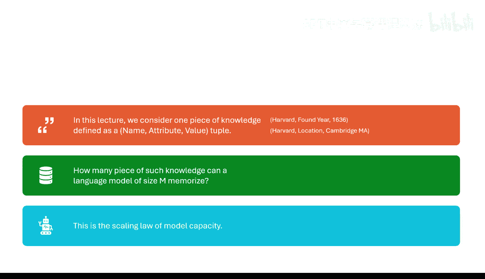

Okay， and they those are， I mean， those are not even real biographies。

 just kind of handcrafted biography data using like Wikipedia template。

 so basically in the biography data we。Its only like like basically6 attributes， okay。

So we take something like a Wikipedia entry and we only select six attributes from those entries。

Okay， so basically， do you have a person's name， and then you have its birthday。

 the actual value of the birthday， and then the birthday。

 which is the actual value of the birthday and then the university， the field of study。

 and then the company and company city。😊，Okay so for every biography data， we actually kind of。

Reduce it to this six field。 And we have like n biography data。 Okay。

 and the value of the attributes instead of coming from Wiki。

 we just make it randomly assigned because it's just a pure memorization task。 Okay。

 and then we control the number of attributes and number of names and etc ce。 okay。😊。

So basically the main question we want， we want to see in this kind of controlled experiment is really if you trim the language model on any of those biography data。

 if your language model is size I。😡，Then how many piece of bioography data can you actually accurately memorize after training。

哎。😊，Any question。Yes。😊，If two biographies are similar to each other。

 would we not expect less memory usage or free language knowledge Well I mean。

 it it's kind of hard to define what is similar because maybe the two bioography data only default by person name。

So there's， guys， you say if the biography data has such type of structure。

 then there is a more efficient way to encode biography。Right， so we， I mean。

 I will talk about later slices， actually some information theoretical bond。

 depending on the structure of the biography that you can say how large。 I mean。

 it is needed to encode those knowledge。诶。😊，Yes。😊，What's the difference between bios and bioR I mean it's one is fullyyn or the other ones synthetic but like what what's that significance and that's the term of bio and bioR Okay。

 you should just ignore these two sentences I mean。They， they。

 there doesn't have too much meaning here。 But you can think about it as like。I mean， there is。

 there's real biography， which we actually call the sentences from Wikipedia and then ask the Lama model to rewrite them。

 So they look more real。 Well， there's that real synthetic one。

 which is those sentences are just templated。 Yeah， so they completely remove the language diversity。

😊，So it's just a pure stream memorization question。Itさ。

'ly literally randomly choosing attributes from a set of 200 or1000 right。

 it's really just like how much strings， how much structure strings can language model memorize。😊。

Yeah， so this is a more simple form of capacity。Yeah， but as people see， even in this no simple form。

 there is a lot of interesting。😊，Things that we can get and a lot of conclusions that we can make。睇。

😊，So basically the scaling law here talks about how many pieces of biography knowledge language model of size M store。

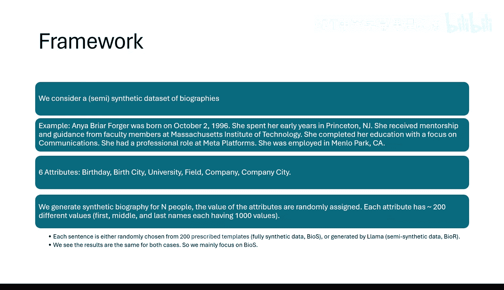

诶。😊，And。I mean， my piece of biography knowledge， we roughly mean this， okay。

 so after training a language model。😡，Okay， so after training the language model purely on the biography data。

 and plus some question answers。😊，That I'm not going to cover。

 but you should think about the training data of the language model is mainly just a biography data。

 and then we actually ask a model question like this。 For example， what's a birth date of this guy。

 What's the birth of this guy or where did this guy study。

 And we measure the accuracy as like exact match， So it's like。

 how many of those entries did the model actually answer correctly， Okay。

 as basically how much knowledge as a model start after training。😊，He。

 so it's a pretty simple approach。 We just trim the model on the biography。

 and then we ask questions to test how much knowledge does the model actually memorized。😊，诶。😊，Yes。

 you said you're looking at exact matches， but is is is there some like sense of memorization where you get like like close matches where like the birth date might be off by a day because like that one token is like off but the rest of your string is like Yeah。

 yeah， So exam match is the way that you should think about but the our actual kind of or the actual measurement takes into what you say。

 So it takes into like the socalled verplexity， which measures basically in exact match。😊，ok。

Any questions？太酷。So basically， I mean， to study or to exact scaling law， I mean。

 we have to define basically， we get some between the model， right。

 then we get those a or we get some proities。They will need to understand what's the minimum bit complexity for the models to achieve such opity。

😡，RightSo we need we need to understand， like， what's the minimum number of Bs。😡。

Does the model need to use in order to in those knowledge。For example， I mean。

 those those things are not really uniform， right， For example， if the model only。

 I mean the model can store the knowledge as a string。

 only can store the knowledge more cleverly as a student say， maybe using something like V RR， right。

 like homeman en。😡，Or something even more clever， which is did actually saw the birthday date first and then saw a list of people that has the same birthday right it's not like this person as this birthday。

 this person has the other birthday， they actually saw all the birthday and then the name of the people in the least associated with each birthday。

😊，RightThere are multiple different ways that the language model can store the knowledge。😊。

 and some ways， the model has solve the knowledge more efficiently。

 So in order to compute this scalingating law or this like knowledge at the model no。😡。

We need to find the correct measurement。we need to find the correct measurement for like the minimal heat complexity for every model。

To solve such a knowledge。Okay，I we want to compare the language models' capacity with the minimum models or the information theoretical requirement。

😊，Okay， so we really changed this thing to like information theoretical。Okay。

 so the number of bes that are information， theoretical。

 optimal model need to use有 to store those number of knowledge。😡，诶。😊，Any questions？Yes。

 are we trying to understand how much bits each knowledge requires to be included？Yeah。

 so basically we want to understand， I mean， we want to understand the model size versus the number of knowledge that the model know。

😡，Right， but the number of knowledge the model know is really measured by the information theoretical bees。

That that needed to encode those knowledge。 So this is our measurement。

Of how much the knowledge at the model know。 So we use the minimal number of bes information theoretically to encode those knowledge。

As the number of knowledge at the model no。Did we get that measurement by taking the knowledge the amount of knowledge the model knows and divided by the model size no。

 that deserves some mathematical formula after words is。

Okay so this is like theoretically computable quantity。😡，诶。😊，For for this particular biography data。

 that's why we use the synthetic data， because in real data it's very hard to compute compute this thing exactly。

 But for biography data， there is actually a mathematical formula to do that。😊，He， yes。

USize is that with that include the Arctic for the dough because I can imagine that would depend on a number of layers and not purely like parameters。

Yeah， that the question， as you will show， none of that matter is only normal parameter matter。😊，Hey。

 any other questions？Yes， how is the information。It's kind of similar from publicity。

 but that this B is an actual number。 Poplexity is like a measurement of accuracy。

 The B is a measurement of the size of the data。😊，So here we want to measure like the number of amount of knowledge at the model No。

 So it has to be something related to the size。😊，Olicity is a measurement related to the accuracy。

So you can think of this thing like the number of， basically like the number of people times perity intuitive。

 right， It's like the number of people times the accuracy， So it's not， I mean。

 it's some function of the propity， but it's not exactly perplexity。😊，Any other questions？太酷。

So basically， we need to compute this fund。 I mean。

 since this is not a theoretical computer size liker。 So I'm not going to。I mean。

 going to give you the the proof of this bond。 But I mean， roughly speaking the bond looks like this。

 and you can see there's many terms that depending on the publicity。

 which is like an exponential of the laws。😊。

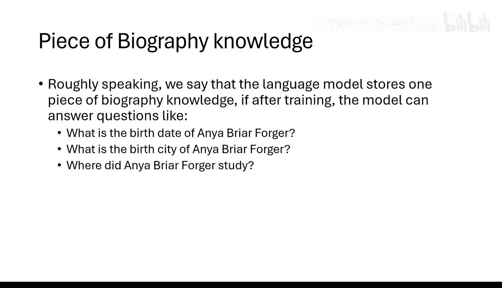

He， and the laws are actually compute split into multiple different parts。

 and also this one is like basically the block size。😊，And there's some other part， which is this。

 which is kind of like the number of attributes。 Okay， and this one is more like the length。 Okay。

 well， there are many times here。 but the bound， I mean， theres some bounds， but the actual， I mean。

 actual value in the bond doesn't really matter。 Okay。

 we just know that there are some bound that that are information theoretically tied。 Okay， because。

 I mean， you you look at the piece of knowledge here。😊，Hey， it's actually， I mean。

 it's not really exactly a function of N， right， So although n is here， right。

 N is here in all of them。😡，Hey N is here。 N is here。 I mean， there's some time without N。But。

 I mean， the number of knowledge that the model actually memorize is not exactly a function of N because there's some way that the model need to encode the。

 the actual attribute， the value of the attribute。 For example。

 if the value of the attribute only has like 200。200 possible values that each right see extremely large。

😊，哎。😊，Yeah， let me try to say it better。So， let's consider like。

Let's consider some hypothetical setting where the biography data actually actually contains like a person's driver license。

He， so we know that driver license is something very long， like WDKCR and whatever okay。

But let's say all the people only share 10 different driver license。Okay。

 so all of the like 1 million people， they only have 10 different driver licenses。

So what's a more efficient way to start the knowledge。 I like you want to compute， Con。

 you want to compute a map， right， which is still corresponding to this driver lesson。

 one corresponding to like R KEC C， whatever this driver's license up to 9。哎。😊。

And then for each person， instead of storing the driver's license， you just need to store like 0。

1 up to9。I know you'll need to additionally store this table。😡。

Right this table mapping the number to the driver's size。

 So there are some more efficient ways of storing the knowledge。

 That's why there are some term here That is not really a function of N。

 It's basically like you create this table of mapping。😊，诶。😊，I mean， for the biography data。😡，He。

 but anyway for， I mean， we just， we don't need to know what this formula actually mean。

 we know that this thing is actually information theoretically tied。 Okay。

 one on the right hand side is both a upper bound and a lower bound。😊，Okay。

 so there this is the optimal。Number Bs that you need to use in order to store those knowledge up to the accuracy of the model。

 which is measured by this lo。诶。😊，Hey cool。 So there's some formula here。 Well， I mean。

 we don't know where you come from。 or there's something like that。 Okay。

 so we know that intuitively， it means like， for example。

 if the model is if the model is more clever， it actually create those tables。

 we also take those into account。😊，诶。😊，And also， they are some time depending on the size of them。

Knowledge， right， for example， birthday， you need more bees to stall compared to field of study。

 right， Because birthday has more diversity compared to the field of study。

 So there are some terms like like this。😊，诶 like like the C term that deals with it诶。Yes。😊，Oh。

 I see it up。Function has only loss terms。And the definition says。

Number of business add to the biographic information。

So so where does the performance common official And yeah。

 it's like if you have a model that achieve this loss， no matter how you use。

 no matter what is your encoding and decoding algorithm look like。If you achieve this laws。

 then you need at least this number of bes。And that's also achievable。

 So it's both lower and upper bound。😊，So on the biography data， I you achieve that loss。

 you will need and only need this many days。He， for the optimal model。Hey， any questions？But yes。

 specifically for like this formula is specifically for this biography data if we were like a different model with our own like our own starting data for scale we would our own information variable Well。

 the formula is a little bit more general， for example， those D and T and L。

 which I'm not talking about， those are like hyperpara quantifying， for example。

 the average length of the knowledge and like the average different number of knowledge。

 So they can be applied to more general knowledges， those are like hyperparameters for your data。

 and we plug in thegraph， the hyperparameter for the biography data to compute this actual bond。

 but for other data that you can plug in your own hyperparameter I mean there in the paper by meta。

 there are also experiments that are。😊，O about like different hyper parameters。 they。

 they did like a great scale of all different hyper parameters for knowledge and found this formalized。

 like extremely type。😊，Yes。😊，Looks at what vaccine it is that's proper。

Knowledge model so why so the would be similar right but why use this complex Yeah。

 because it is almost publicity， but there's also， I mean。

 there's also some other terms like here that could matter for some common cases。

So in the like general， in the kind of middle range good case， the public is a good approximation。

 but there are some corner cases。So if you want to get a extremely nice scalingkating law。

 then we need to take care of those corner cases。 For example。

 the model is at the limit of its capacity that maybe this term is very close to this term。😊，Okay。

 so those corner cases are really important as well。And the publicity is true on the。

 like middle range， where。I mean， like like those N andD term doesn't matter compared to the laws。

Yes。😊，好不。Look like like what is the shape of the curve Yeah， I will talk about in the next slide。

 but now we just we know what's a measurement。Okay， so we know what's the measurement here。Okay。

 so this this in this x axis is really the or this y axis is really the formula。😊。

And the X access is the model says， hey， and we want to know what is this curve look like。诶。😊。

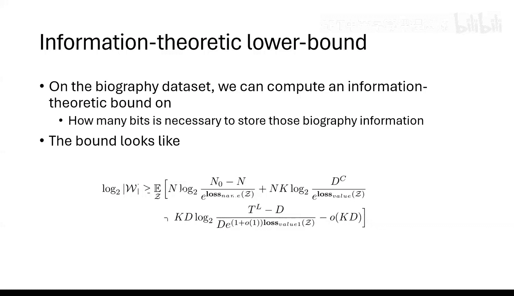

So basically， this is a curve。 He， you see that it is an extremely tight curve。

 So you see that there are some。😊，I mean， there are some like linear lines here。

 but this is because the model already achieve 100% accuracy。

 So it's not fully utilizing its capacity。 We should really just look at the upper bound here。😊，Okay。

 so the other one are the model that add the boundary of this capacity。

 which means the model is not large enough to store all the data。😊，Okay。

 so the kind of the horizontal line here is because the model is already large enough to achieve 100% accuracy。

 So then it start to plateau。😊，But we really want to look at the corner case here。 And you see this。

 this is a really， really tight line。 And this is these are transformer models with different layer。

Different number of head， different dimension。 You see all those small numbers here。

 They are basically like layer and number of heads。 so we see that it doesn't really matter。 I mean。

 everything in the corner case really just converge to the2 bit per parameter line。😊，诶。😊。

So how do we interpolate this result？So first of all， divide access is a formula， right。

 that's that's a size of the， that's a number of Bs for optimal model。

And X axis is the number parameters in the transformer。诶。😊，So this transformer is trend with IP 16。

 So its 16 B per parameter， okay， and。😊，And also trained for sufficiently long on the biography。

 data is trained for like100 K。Passes over the data。 Okay。

 so so it's your extremely well train transformer。 It's a lot size plateau for very long time。 Okay。

 so this is a limit that you can achieve， no matter how hard you train。😊，Okay， this is the limit。

 And how do we understand the limit， Okay， So first of all， the model is IP 16。Okay， so ultimately。

 if you actually achieve the information theoretical limit of that model。

 you should be able to store 16 beats per parameter。😊，Right。

 I think 16 means you have 16 Bs per parameter to represent the floating point。Okay。

 so 16 is your limit， but the model is not able to achieve such a limit。

2 is the maximum you can achieve with a transformer twin by other。Okay， but who is still very large。

 Its like one。 You you have one over8 deficiency compared to the information theoretical model。😊。

But it is still quite efficient。Okay， and we can see the scaling law is pretty high。

 it's fine like a model size from M26 to 1028。 So it's a scaling of 100。😊。

And this is large enough for us to project like if you keep skating up。

 we probably going to see the same trend。😡，可。😊，So now we can actually understand， he， so for this。

I mean， for this GB4 model。Hey， so it has 1。6 trill parameters。Hey， although it's an MOE model。

 I mean， MOE model， the scalingating law is a little bit different， but kind of similar to this one。

 So what。😊，Mem of bees would we expect GB4 to memorize。 It's like 3。2 trillion Bes。Hey。

 this is if you print this GB4 model optimally。诶。😊，So，3 PM2 trillion B。

What does this number actually mean？诶。😊，So how many bits of knowledge are there in all the textbook in human。

😡，Okay， so how many knowledges are there in all the textbook plus Wikipedia。

So I can give you a rough I。 it's not going to be very accurate， but the rough I look like this。

 Okay， so there are 20 k textbooks。😊，Possible on the Internet。Hey， so there are 20 k textbooks。Okay。

 and let's just assume on average， each text。😊，It's less than 1 million pieces。He。

 so this is a good estimation because one textbook probably has less than 1 million words。

 and each words probably not only going to carry more than one bit of information because a lot of words are repetitive and useless。

😊，He， so this is like our good estimation。And know how many piece of knowledge do we have in the entire human in all the textbooks？

Wow。If you multiply these two number， this give you 20 billion Bs。嘿。😊，So GB4 is 3。2 triM。Now。

 if you only want to know textbook， you only need 20 billion bit。😡，So GBE4 is a very heavy。

 very large overkill of what you would actually want。Okay， if you are able to achieve this。

 include try a 10 billion parameter model that be as good as GB4 or all the textbooks。

 which is probably the only thing we care about。😊，嘿。😊，So， I mean， in and Microsoft。

 we havem more accurate bound than this。 Okay， you can actually go out the textbook and compute the number of information for textbook。

 But this is a pretty accurate estimation， I would say。😊，Okay。

 so this this number is actually an upper bound of all human knowledge。

 and you only need a 10 billion parameter transformer model to memorize all of that。😊。

810 billion parameter， which is。100 times smaller than G4， okay？Any questions？Yes。😊，Yeah。No。

 for IP 32， we still going to be this bond。But for the next size。

 there's something more interesting yeah， but any other questions？😊，Yes。😊，I think。

Specific for all that is there an intuitive reason that it's2 bits per parameter No。

 I mean we will try to look for some theoretical explanation of this but now not really successful。

 but it's really magical study plateau at2 and it's linear。Hey， but this skating now is very。

 very useful， right， It at least tells us G4 is a very highly overki。

 and you really only need1 hundred times smaller model to do the same job。😊，Okay， but this is but。

 I mean， but why， why do we need GT4？😡，Well， there are some other reasons。

That we will talk about in later slides， yes。That the model would be using them the information theoretical like number of like the optimal way of storing that yeah。

 this is like this is essentially it like you'll put the you you'll take those textbook and you'll go through like being RAR and this is the size you'll end up with。

Yes。I all the dollars because。To memorize the sufficient。I mean， if you trim the model optimal。

 you would be able to memorize in roughly the most efficient way。 But in the later slide。

 we will talk about some reason why the language model will not do so。😊，But I mean。

 at least by Adam transformer architecture， you can do it optimally。

 but there are some areas in real Internet data that dislow model to do so。

 as we will talk about in later slides。😊，Yes， so you 32 it's the same。

 but if you go like one it down so yeah， that's the exactly night slice。Okay， any other questions？

系 cool so this is IP p  sixteen。😊。

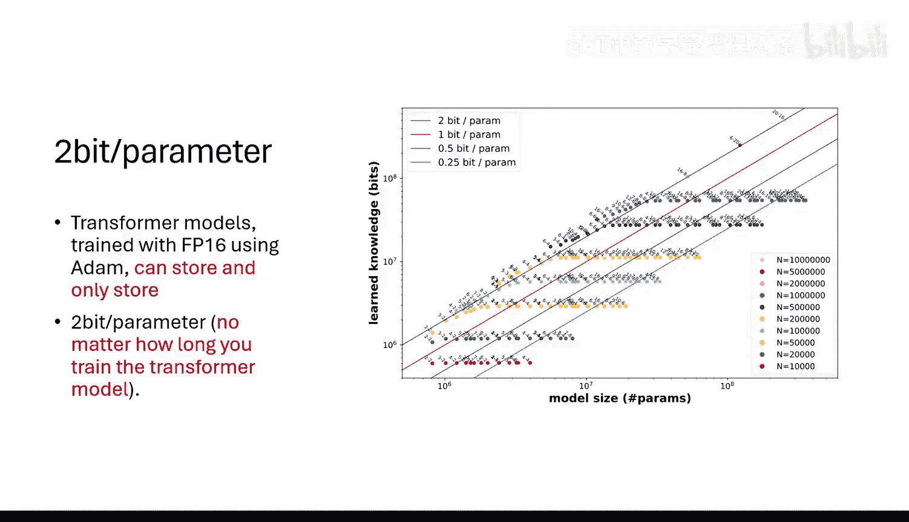

Well， the most interesting thing is the2 bit per is true， even with IP8 and intake。

So if we choses IP 16 and quantize to int8 or IP 8， we see the exact same scaling law。😡。

Okay and this is kind of crazy because IP 16 is optimal trend。

 You cannot improve the model's capacity with Adam or training longer。

 but you can improve the model's effective capacity by quantization。😡，This is kind of crazy。I mean。

 because I P 16， youre already trained optimally and I P 16 is two of I 8。

 but you see the same capacity with IP 8 compared to I P 16。 So， you know。

 from N media the H 100 actually support I 8 training。 and you know。😊，Now， maybe you don't know。

 but the the recent models are all trained by F P8。 Okay， so the neuraler models， including whatever。

You know， those recent models that are all by IPA。 And this is a very good support for IPA training。

 Can you really don't need I 16。😊，Api is all you'll need。

Because it doesn't really affect the model's capacity。😡，Okay， and this is really efficient。

 This is F8 and2 B per parameter。 So it's only one force compared to the actual information theoretical bond。

 So transformer is a very efficient architecture in terms of memorizing knowledge。😊。

only one force compared to information theoretical。Any questions。 I people Qua in4。

 you will lose a lot。 So I'm not going to talk about it here。 Okay。

 so in in the it is like the optimal you can get。 and people are actually doing I8 training for the new work models。

 And that's a main selling point of the H 100 GPU。 He they support I8 training。😊，O。我。Any questions。

So although I think I missed a last year， but。This scalingkating law applies to any model architecture。

 Okay， no matter is G T2， or is cogenhen， which is parallel or isma， which is gated MOP or is Mi。

 which is group query attention。 doesn't matter。 Any architecture， you see the same scalingk law。He。

 I saw as it a transformer。 Also， it doesn't matter what's the size of MLLP versus the size of attention。

😊，He， it doesn't matter。 So in the paper， there's all those ablation studies。

 but I didn't show it in the slide， but really model architecture doesn't matter。

 as I say the transformer is alteration between attention and MLP。

 even if you MP is are eight times larger than attention。 instead of four times larger。

 you see the same scalingkating law。😊，诶。😊，Yes。😊，Tecs affect this change when you move from higher position to lower position I mean this is the optimal you can do right this is already optimal so assume assume regular doesn't matter because this is already optimal it's not like you're losing anything。

😊，But models with power regularization P and F with that Ph perform I second so those training rise always may decay already so。

They are like already the all hyper parameters are tuned optimally。

 So they are you cannot really get better result by changing their hyperparmeter。

 So according to the author， this experiment alone costs like $10 million。 Okay， so this this plot。😊。

Yes。😊，好。So how does that。I'm not sure those1 B ML。 So I think 1 B is like very far from the capacity boundary。

 or they can be trained。😊，So I think those1 bit are more like 1 B update。

 not really storing the the bit for1 bit。 If you store the bit for one B。

 then you will actually lose a lot of capacity。😊，Yeah。

 then probably there are not at the capacity boundary。 So I is like the maximum。😊。

Like the or the lowest position you can go。 If you go to in4， you actually start to lose a lot。😊。

Yeah， I think this is a very interesting theoretical question。 I mean。

 it would be very interesting to actually prove this two bit parameter bound。

 But I think this is a very hard question。 I mean， I talk to people。 I Harvard that MP。

 those theoretical people。 I mean， they are super smart。 They don't know how to prove it。😊，海酷。

So basically， this is， I mean， this is an ideal scalingkating law， right。

 This is when we trim the model optimally， but in practice。

 we probably cannot spend like infinite finite amount of time to train a transformer model。

 We have finite computation。😊，So， I mean， as we were saying， GB4 it's an over fuel。

But why do we still need G4？But the answer lies in the nice kind of scaling law that we are talking about。

 which is computation efficiency。 Okay， so if you have infinite computation budget。

 then this scaling law is what you should expect。 But if you don't have infinite computation budget。

😊，And there are some difference in the scaling law。诶。😊，So first of all， this， I mean。

 it's not really infinite。 This is like 1000 passes over the data。

 but it is already achieving two bit。 If you go to 10000 passes or 1 million passes is not going to matter。

😊，Okay， so they need this。Here， the scaling law says。I mean， it's like training optimally。

 but eventually is enough， you don't really need infinite amount of training more like you need 1000 passes over the data。

😡，Okay， so onefold and pass all over to data。😡，I mean， which means。Think about it。来替儿。Okay。

 so let's consider this model。😊，诶。😊，So how many tokens would a model need to trade up。Okay。

 so for 20 billion。Bes， he， and probably translate to like roughly like 20 billion tokens in your data because。

 I mean， roughly one token tiny hole like one beat， although they are in what have size。

 but many tokens are useless。 So let's just say it's translate。

 So these 20 bees translate really translate to 20 billion tokens。 And you really need 1000 passes。

 which means you need to try out 20 trillion tokens。诶。😊。

So this is kind of the amount of tokens you would expect to train if you want to train the model optimal。

 So it's like optimal model。😊，10 billion parameters， You should train on 20 trillion tokens。

 something like that。 Okay， that's are given by this scaling law。

But what if you don't have the amount of compute， Maybe you cannot train for。😡，For。

 for a model of that law。诶。😊。

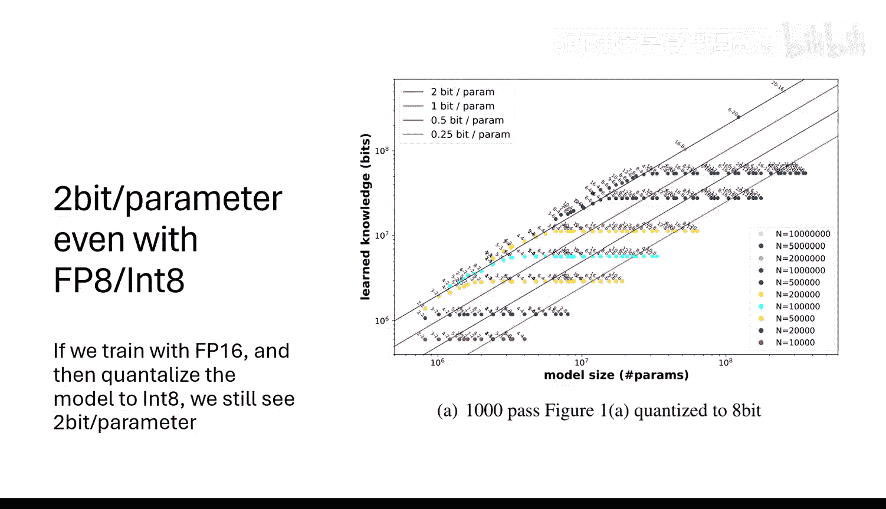

So， I mean， this scalingating law kind of roughly applies when there's 100 passes of the data。

 And you can see if you have 100 passes of the data， you are already lower than 2 feet per parameter。

 but still is like more than 1。5 beat per parameter。 so roughly tide。😊，Hey， so come。

 if you have 100 passes， you are fine。But what are these two plot to mean。😡，哎。😊。

So this two plot means your data is not only biography。

 is biography plus random entries from Internet， a random Internet data。Okay。

 so what does this mean in this one A of the data is biography。

 and7 over 8 of the data is a random Internet entry。

 So random thing like a junk that you don't want to memorize。😊。

You can see that the existence of of jumps actually reduces the model's capacity a lot or more。

 So its like it reduced or it makes the model very inefficient in terms of training。😊，Okay。

 so here lower8 of the data is is good and more 7 over8 of the data is junk。😊。

Then on the same are100 passes over the data， over the main data。

 which is about wealth you can see the capacity very， very low。哎 you are only achieving like very 10。

Rly like， I mean， southern one force is like rather 40 piece per parameter。So if your data has junks。

Which means if your internet data is not pure， it' not only containing knowledge that you want。

 but you also contain knowledge that you don't want。 For example。

 some random internet report of of a result of certain match。

 right those seem we don't really want our model to memorize those are useless or some like social security number of some particular person or basically a serious number of some particular product those are a lot of information。

 Well those are useless and the existence of those information on the Internet data actually so sound training a lot。

 You see you need like 800 passes over the main data or over the biography to get the same capacity or not even the same to get similar capacity。

嘿。😊，So what does this 800 passes mean， This means is 64 times slower in terms of training。

 because recall here。You have7 over 8， which are junks。 and one over 8 is the main data。

 So if you go through 800 passes over the main data。

 you actually go through 5600 passes over the junks。

 which means you in total goal through 64 times more token compared to this。

But it still remains efficient compared to the ideal setting。系。😊，Yes。😊，Curious。

 is there a relationship between the percentage of data that is junk and the amount of training more training is required to still reach the2 bit parameter efficiency yeah。

 was training on like 2000 passes would it be able to get closer to the two bit by efficiency that we want to see Yeah。

 yeah， exactly so I think in the paper it shows that there's roughly like a square relationship so if you have like alpha if you have alpha times more junk compared to the signals then you need like alpha square or more passes。

So filtering is really， really important。 If you have 10 times more junk。

 then that your knowledge youll need 100 times more training。😊。

So you really want to do filtering that give you of a quadraic speedup。😊。

Or 64 passes because 64 times more passes because the number of junk versus data is roughly like 8。😊。

Our total number of data versus main data is 8。 So say you need eight times more passes。

 but you also have eight times more data。 So it's like 64 times more compute。

So filtering is really the key to achieve the maximum capacity。

 If you don't really do well on filtering， So you need a lot more training。 Okay， so this。😊。

20 trillion token is assuming that you did the filtering optimally。

 but if you didn't do the filtering very well， then you need much more than 20 trillion token。诶。😊，北库。

Any other questions？But you， but also interestingly。

 you can see that these 100 passes are throughout the number of data。

 and no matter how many data you will have， you only need 100 passes over the data。

 It's not a function of the data。😊，Heい yes。Is there like an equivalent of this for like fine tuning where like say you're using like Laura。

 your like number of parameters would be like the additional matrices and then all your data that you're fine tuning on would be like there would be no jump because you're just fine tuning on。

Yeah， I think function tuning is closer to this case， but the lower weight is low rank。

 So it may be different compared to the transformer ways。

 I'm not sure how does the skating law apply to Laura， but that's a very good question。😊，Yes。😊，ァデの解。

And or any details so fast。Or I don a idea。All。I mean， depending on。

 what's your definitionmize of generalization， right， memorizing all the textbook knowledge。😊。

Its kind of generalization。 I mean， we are essentially in this framework。

 we are also not really talking about the exact word by word reciting of our training data， right。

 we are actually measuring the capacity by asking model questions。😊，So those are like。Some。

 something you should call it generalizable memorization。 That's what language model is about。

 They memorize the knowledge from the textbook and are able to apply the knowledge regardless of the way that you ask the model。

😡，So memorization of fact knowledge is the key for language model。

 You shouldn't think about it as like more like vision where generalization is the key for language model。

 really memorization is is more important， but you have to be robust in terms of memorization。

 meaning that you have to be able to retrieve the knowledge， no matter how you are ask。

But I can ask you， what's the birthday of this guy， I can ask you where。

 when did this guy born or tell me when is this person come to life。

 He all have a different ways of asking the question the model should be able to retrieve the knowledge robust。

 That's generalization， but is retrieving still come from memorization that the model needs to memorize those knowledge first。

😊，So that's what we talk about in this scaling law， which is the most important part。

He the robustness doesn't really require a lot of。Ameter。Hey， any other questions？

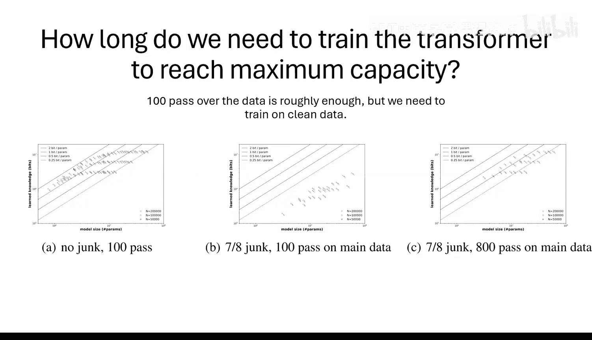

腿酷。So what's the im， There's a very cool implication here。😊，H is。

When we train how to train a language model， optimal。😡。

So when we double the size of the language model。😡。

We actually need to more than double the total number of training tokens to train the language model optimally。

 why， because when we double the size of the language model。

 we should be able to double the amount of knowledge that the model can memorize。Right。

 and we know that to memorize certain piece of knowledge， we need at least 10 passes。

 which is a constant。 Okay， so we need to double the number of training tokens because we want to go through twice amount of the data with the same passes。

 Okay， so we need to double the total number of training tokens， but in reality， I mean。

 in biography， everything is uniformly distributed。😊，But in reality， in Internet data。

 the knowledge are not uniformly distributed。 Okay， to me twice amount of knowledge。 I mean。

 the twice amount of knowledge are more rare， right。

 They appear with less probability on the Internet data。😡。

So which means to go through those data like 100 passes。

 you actually need to go through your in data more than like5 times more than two times compared to the smaller model。

诶。😊，So to train an language model， optimal， you have to follow this more than double rule。

 which is why， I mean， it appears me serious。 Like， for example， if you know。

 previously when we when people train GB is3， they only try out like 200 billion tokens while the model is like。

175 billion size。 But now when people train like Lama or Mitra， right。

 they treat like  a trillion tokens on a 70 model。诶。😊，And then， I mean。

 you training like if a salary model requires， like， for example，2 trillion。

 a trillion focus to be trained optimal。😊，就依服 go to science。

You should really trade out 20 trillion token or 80 trillion tokens。

 I mean you should really 10 times more than 10 times the amount of token to train them optimally。

So think about Lama， right， Lama 7 B is trained on two trillion tokens。

 While Lama 70 B is also trained on two trillion tokens。

So Lama 70 B is a much worse trend model compared to Lama 7 B。嘿。😊。

So if you want to train a Lama 70 B optimal， you really need to train more than 10 times the number of tokens compared to a 70 model。

 That's the implication from the scaling law。 Okay， we do get a lot of interesting conclusions。

From those scalingkating law， even if you only work on biography data。Okay。

 so that's kind of the key point of scalingkating law。 You work on something very simple。

 but you get a lot of useful observations to actually tell you what's the correct thing to do in the training。

😊，睇。😊，很酷。手备这里。I mean， basically， I mean， the question is。So basically if you want to train this。诶。😊。

So the question is， I mean。These are all about training the model optimally。Right， the question is。

 can we actually bypass this like 10 times more data scalingating law。

 or if you want to have a model that are that has like normal 10 times more knowledge。

 should I just 10 times the model size and 10 times the number of training tokens or they are better race to get such a model more or get them such a model more efficiently。

😊，哎。😊，So for example， I have a model right now I have a model that is of size 7 B and train on two trill tokens。

 If I want a model that memorize I 10 times more knowledge compared to my 7 B model should I train on a 7GB model on 10 times more tokens or are there any ways to do it more efficiently than this one。

😊，诶。😊，So this is a nice skating law I'm going to talk about。

 which is called Chinchilla skating law or the so called computation scalingkating law by Deepman。😊。

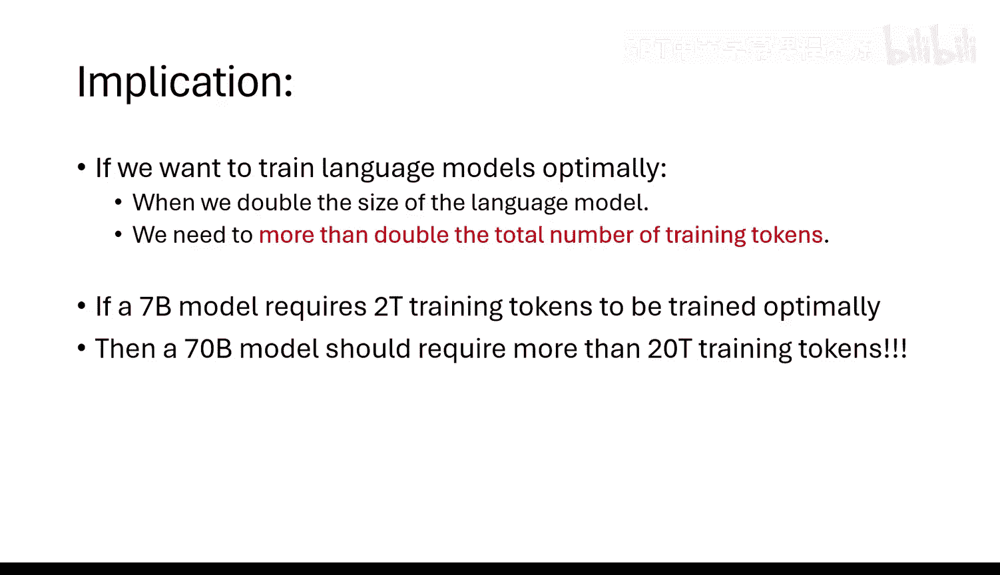

And the my observation is。If a language model requires of size x。😡。

It it requires K passes over the data to memorize all the knowledge in it。

Then if you p times the model size， where p is bigger than one。

Then it actually requires less than2 overp passes over the data to memorize the knowledge in。😊，Okay。

 so this is a very， very critical observation。😡，So what does this observation mean？😡。

So you have P times X the model size。 So to trim the model with the same number of its or same number of passes over the data is P times more expensive。

😊，But you actually requires more than p times less number of training data。😡。

So scaling up the model size actually makes the training more efficient。To achieve the same capacity。

Okay， so this G4 model， although is not really efficient in terms of。

Model capacity is actually more efficient in terms of training compared to this model。诶。😊。

So this model as the boundary case， is actually very， very hard to flip。😊，Well， on the other hand。

 if you scale up the model size to make it kind of overpell for the amount of knowledge you want to memorize。

😊，Then it's actually faster to train。嘿。😊，So this is the most creative observation it gives us support why do we want larger language model really because we are actually hyp computation limit。

😊，This is a crazy observation， but that's the truth。 Why do we want for larger language models。

s really because we are computationally constrained， so we need to scale up the model size。 Okay。

 sounds crazy， but that's the truth。😊，Okay， if you have computation of rules in it。

 then you can actually make GB4 much smaller， but because your computation comes。😊。

You have to use a larger model compared to the model that are at the boundary。😡，诶。😊，Yes。😊。

That's why I'm not sure because when they did the experiment， I mean， first of all。

 this is a best paper at I clear。 and when they did the experiment。

 they only do they do it on transformer models in particular， I think itGBT architecture。😊。

So we don't know if like the more the newer architecture。

 like Maba or or those state space model or whatever has the same or even MOE model has the same scalingk law or not。

Okay， so we are。 We don't know。 There aren't many experiment that repeat this for newer architectures。

 yes。😊，Yeah， I mean， if your P is larger than heads and it definitely stops， right？😊，So。

For language model overfieding is less a problem because anyway way you need memorization。

 If you memorize the entire textbooks， this is good， right。

 you don't consider that as overfeing because anyway for human。

 we are also doing memorization for most of our study。 It's never like， oh。

 I read too many textbooks。 I'm overfiing。 right， There is no such a thing for human。😊，Yes，Yeah。

 of course， it's nowhere nearly trend optimal， right。

 but it's really because the computation constraints。

So you need to scale up the model size in order to reduce a computation cost for the company parameter model。

 actually you need more training flows compared to aGB4。😊，可以 potentiallyly。

Hey so basically this is style observation or in their table。

 this is like the training slopes versus model size。

 you can see on the same same training data initially like the smaller models are faster because even the smaller model haven't really hit the capacity limit。

 but when the smaller models start to hit capacity limit。

 you can see the larger models actually surpassed the smaller model in the same number of slopes。😊。

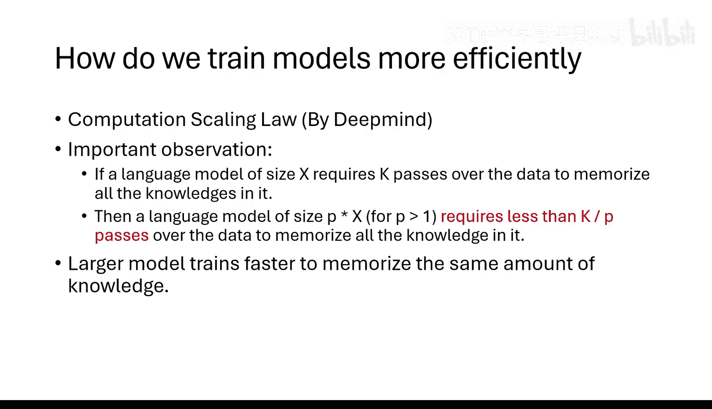

嘿。😊，So intuitively， you should think of that it as this way。

 if you want to train the model optimally， you have to squeeze your knowledge into the model's race。

 It's going to be encoded in a very non orthogonal way， right。

 is that your its condition number of the model is really bad because you have to use all possible parameters in it。

😡，But people have like a 10 times larger model or100 times larger model。

 You can almost sell every piece of knowledge orthogonally。

 So the condition number of the model is really good。 So the training is very fast。😊，Okay， that's。

 that's kind of an intuition why you see this type of skating law。Okay。

 and there are some theoretical proof for this。诶。😊。

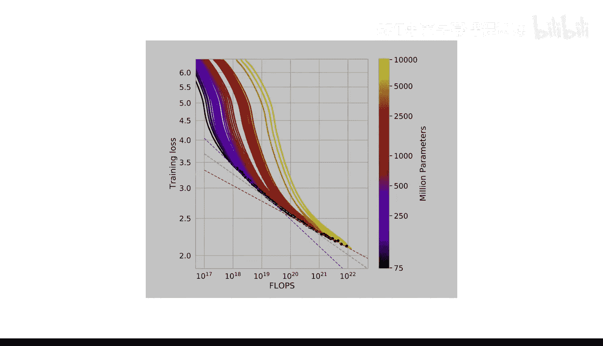

So basically， that the main observation in their papers can be translate into this。😊。

so for a model of size K2 parameters， it requires a thousand passes over the data to memorize。

They to memorize KBs of data because we know A two is kind of optimal。 So need 100 thousand passes。

 Well， for k parameter， you already only need 100 passes， which is much more efficient， right。

 This number of flow， is much more efficient。 but for 10 k parameter model。

 you only need roughly one pass， which is 10 times more efficient， compared to the K parameter model。

😊，ok。😊，So essentially， you， I mean， if you are computation contrain。

 then you cannot really train an optimal model。 You have to make the model larger than it actually trains faster。

Okay， so that's why people use larger models。 But I would assume in the future。

There will be probably like maybe not 10 billion parameter。

 but 30 billion parameter GB4 is very likely for those models may be trend with like。Like， like。

 I mean， a a thousand0 trillion tokens or even 10000 trillion tokens in order to to reach the maximum capacity。

嘿。😊，Yes。😊，Any questions？Yes。😊，Cls might advertiseorized when you are using the monetary currency loop。

How is that factor with your decide， Yeah， of course， you want the optimal size model， right。

 because the influence cost is very， very small。 But still， if your training time is like one year。

 then that's， that's not really acceptable。 But you have to do it within like two months。Yeah。

 so basically， those are the two scalingating laws。 I think they are very simple。

 but it really tells us a lot， that means。😊，Really like demyify。

 right all the choices of people use to train the transformer。

 You can see that they are actually doing the very principle choices。😊。

 although some of them are do not know about the scaling law。

 but based on a lot of the empirical knowledge you will convert to the same scaling law。

 more or less。 so all the people choices to choose to train their model in more or less the same way。

 but indeed the fundamental reason behind it is really those scaling laws。

 and these are really just a basic version， baby version of the scaling law。

 and there are much more difficult version of the scaling law， for example。

 what if your knowledge is non uniformily represent in the data， right。

 or what if some knowledge you repeated a lot of times While some knowledge is similar。

 but you only repeated very few times。😊，Okay， and also more importantly。

 what's the scaling of for logical reasoning。Right for mathematical reasoning was the scaling law。

 And actually， for mathematical reasoning， the number of parameter is not the key。 Actually， we will。

 I mean， we won't see， but the number of layers is actually the key or for those type of scaling laws。

😊，诶。😊，So there are a lot more scalingkating laws that are there where you don't know because they are hidden in company secret。

But these are things I'm allowed to tell。 And you can see already a lot hey。😊，So I think overall。

 the scalingkating law is really， really important that me。

 every companies are developing their own scalingkating law to project the model in particular like if you want to create a model。

 you have to have a scalingkating law picture presented to the CEO。😊。

So you look at the picture it see， okay， this budget makes sense。And then you get approved he。Hey。

 cool。 So that's all what I'm going to talk about today。 And hopefully， you learn something。😊。

Thank you very much for coming to today， so I'll try to see you next week。😊。

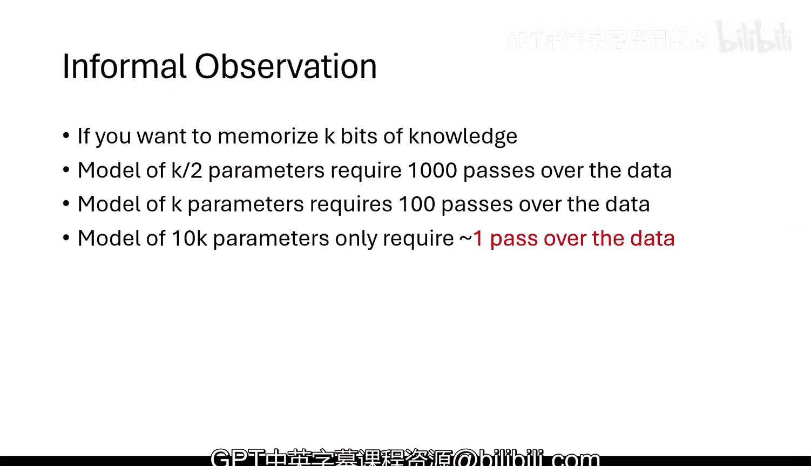