# CMU《生成式AI｜10-423 generative ai 2024》中英字幕 - P17：-P17-Lecture 16- Scaling Up II- Mixture of Experts.zh_en - GPT中英字幕课程资源 - BV1CyC9BPEhG

Let's start today's lecture and today we are going to talk about the special architecture called Nixture of Exper。

😊，And this architecture is kind of pretty important at the moment in the sense that all the large scale model。

 I actually use this like sorry， use this architecture in order to speed up the inference time。Okay。

 so today we will learn about the mixture of experts。

 learn some intuition about why they are useful and also some kind of computation tricks that you need to apply in order to train mixture of expert layers successfully。

😊，ok。😊，So recall in the last lecture， we learned the benefit of scaling up the language model。

 First of all， it improves the model's capacity。 And also， surprisingly。

 it also makes the model faster to trade in the sense of the total number of slopes。 Okay。

 La models are not only being able to memorize more things。

 But if you want to memorize the same amount of thin。 actually。

 larger models are faster to converge in terms of number of slopes。😊。

So we really， in terms of training course， we really want to have as large of a model or at least a reasonably large model as possible。

But， I mean， those large models， they have one downside compared to the H case model。 Okay。

 so recall that you order to memorize like。X piece of information， right。

 the age case of model only uses X over two parameters。

 but you can use much more parameters than that。 and that trains faster。

But the knowledge case model also has a problem of during inference time， the cost is much higher。

 yes。😊，Yes， when we make the model bigger that it definitely takes like less itations to converge。

 but why does that mean that the number of flops is also less because like oh that's I thought that yeah so actually the number of slopes are smaller I mean this is from the last lectures plot you saw that in terms of number of slopes the larger model will actually surpass the small model。

Okay， so not only the number of it， but also the number of flows。

 which means if you scale up the model side by factor of 10。

 you scale down the number of it by factor more than 10。嘿。😊，So， but， I mean。

 the H case model requires a lot more compute to it。

 but the H case model also has a benefit that the inference cost is much smaller。😊，Okay。

 so thinking about if you want to want the model to have like 10 billion B of information。

 You could try a 7 B model， which is really tight。😊，And the training takes a very。

 very long time compared to maybe a 70 B model。 But the inference cost of a 7 B model is much smaller。

 It's 10 times cheaper， okay。So basically， last lecture， we talk about the scaling law。

 mainly just in terms of training or terms of model capacity。 But now， after training the model。

 we also want to be fast in inference。 Okay， so think about4 is serving millions of our hundreds of millions of people every day。

 Okay， and that is a very large inference course as well。😊，Okay。

 so we want to minimize that as much as possible。 So how do we minimize the inference cost while not really sacrificing the modelss capacity or。

海 mean all the training benefits。8。😊，So in the next in this lecture and the next lecture。

 we will talk about some techniques to reduce the inference cause of a language model。

 So this has nothing to do or it has very little to do with training。

 It more about in inference time。 you will run much more efficient compared to the standard language model。

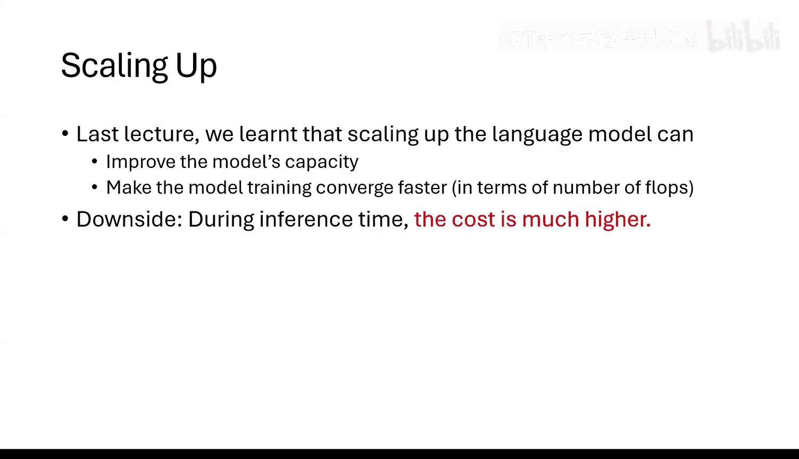

Okay， so this lecture， we will talk about mixture of expert model architecture。

 which is some architecture that you will use in the MLLP layer。😊，Okay， so recall transformer blog。诶。

 so。So basically， a transformer block has like two， I mean， two type of layers， right。

 so you have a self attention layer。And then you have an MOP layer。Okay， and typically。

 theres some residual links like this。Hey， and theres some normalization in between。 I mean。

 depending on is。

Rere activation， layer norm or post activation， layer norm。

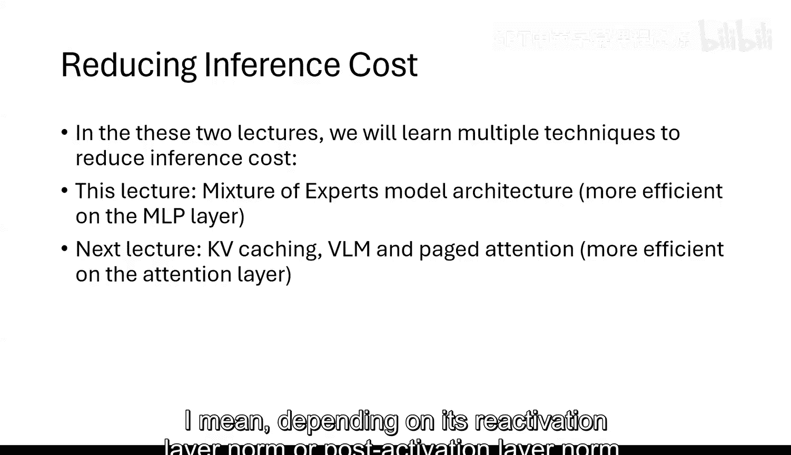

Norm， anyway， So basically， I mean， there are two essentially two layers in the transformer block。

And today we are going to learn the mixture of expert layer。

 which is going to replace or a more efficient replacement of the MLP layer for faster inference。😊。

Okay， inference course is much smaller if you use M O E compared to MOP。 And the next lecture。

 we will learn about some tricks to do the inference on attention layer faster。

 So it will not change the architecture of the attention。

 but rather you will have some kind of gooda level implementation of the attention to make it faster。

 Okay those are very important to techniques。And essentially。

 Mishop expert is used by all the large language models these days。

 And the VLM or the so called page attention is a default library in hugging face。

 and that's power all hugging face inference models at this moment。😊，诶y。😊。

So those are two very important concepts。 And today， we are going to talk about mixture of expert。

 which is the one that acts on the MOP layer。

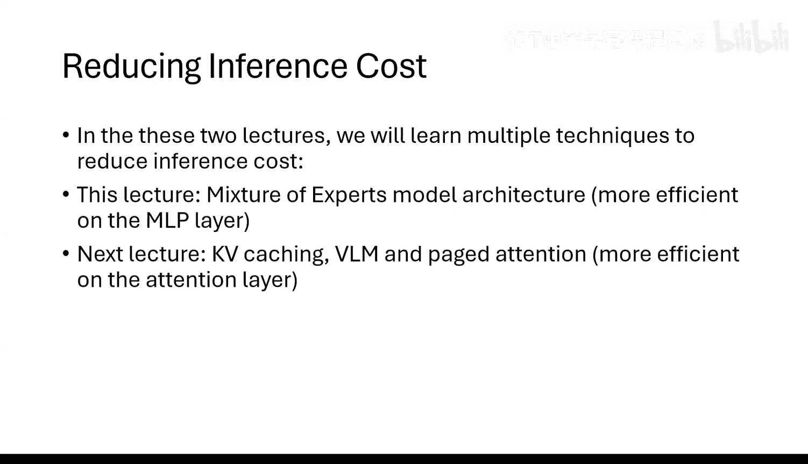

ok。😊，So first of all， I mean， GB4 is an a times 200 B mixture of expert model。 Well。

 those numbers are not exactly accurate， but you get the kind of the spirit。 as 3。

5 is a 10 times smaller model is a times 20 B mixture of expert。

 so basically those are all mixture of expert model。 And if you go to like， for example， I mean。

 there are some other famous mixture of expert model out there。 for example。

 Mitra is a pretty famous one。 and Google's prime 2 is a mixture of expert model。

 I'm not sure about Jamiei， but I assume it's also a mixture of expert model。

 Okay so basically all the large ones， are mixture of expert because they need to reduce the inference cost。

😊。

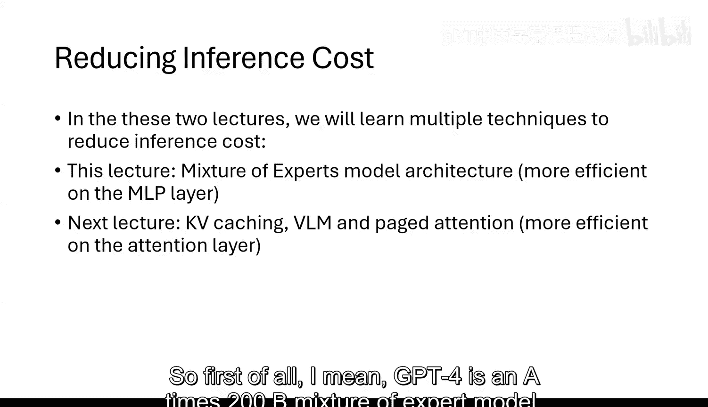

Okay， so what's the motivation of this mix of expert layer compared to the standard MOP layer。Now。

 intuitively， I mean， how do you think about that transformer。

 you should think about this MLP layer like knowledge。This layer is logic。Okay。

 although it's not 100% true， but it's very correlated with the actual truth。

 So the knowledge are more or less stored in the MOP layer。 Well。

 the logical reasoning is more or less down in the self attention layer。 Okay so recently。

 we have a lot of evidence that this is what happening in the transformer。 Okay。

 So for the MOP layer is really like a knowledge storage unit。

 which means it stores the factual knowledge， Like what's the name of the current president of United States。

 Okay， what is his birthday。 Okay， and how many child does he have， and also even factual knowledge。

 Like what's the name of this building， Okay。😊，So all the factual knowledge are stored in the MOP layer。

And the maintuition is for human， the actual factual knowledge is really， really sparse。😊。

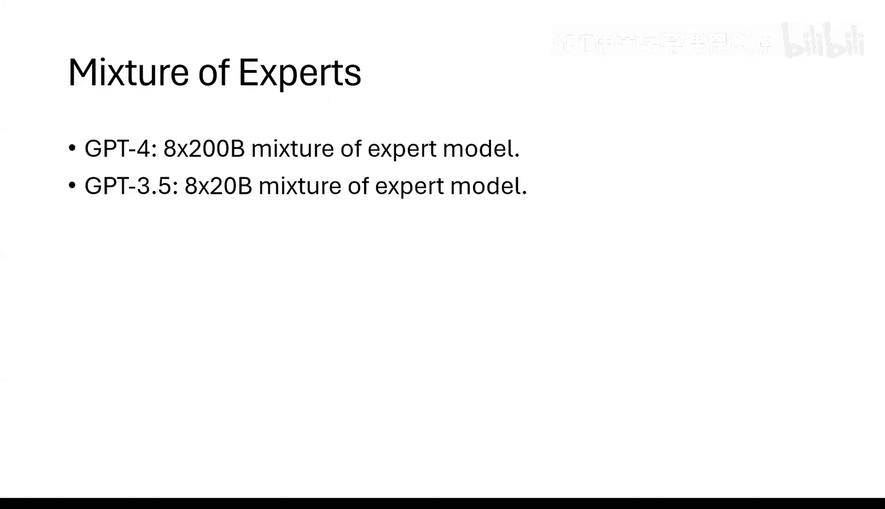

Okay， so we want the model to be an AGI， which means it knows all the factual knowledge of human。

 but usually you doing an inference time or when you ask the model a question。 for example。

 write me an essay of of the history of CM MU。😊，The model does not need to extract all the knowledge from its kind of memory。

 right。It only needs to extract the knowledge that are centered around CMU， which is very。

 very tiny compared to the all the knowledge of human。Okay。😊，So this MP layer。

 if you look at this computation， I mean， you put a vector in it。

And computation is go through the entire MOP。诶。😊，So alternatively， we want to do something。

Make the model more kind of inference efficient， just by only using a tiny fraction of the model。诶。😊。

Sorry。So， basically， we want。I mean， we want to make sure that for every question we ask the model only a very tiny fraction of the parameters or any fraction portion of the model is actually active。

😊，But for different questions， maybe different portion of the model is accurate。 So essentially。

 intuition is like we partitionition this MP into like multiple chunks。😊，Okay。

 so maybe this one is like math。This one is physics。Hey， this one is like history。诶。😊，So basically。

 every time when you ask a question， you actually only select like the relevant part。😊。

And you kind of ignore the other part of the MLP。 Okay， so you decide during inference time。

 why I see a query， which is a history of CM M U and the other part of MLP doesn't matter for me。

 Okayy， I don't even need to do the computation through the other part of MOP。 Okay。

 but if I ask another question， for example， like， what is one plus one。 Okay。

 then the math part is going to be accurate and history and or the other part are not going to be accurate。

😊，Okay， so intuitively， we want to partition the MOP into kind of blocks of knowledge。Okay。

 and each block is kind of like an iceberg that are specialized on a particular type of knowledge。

And during inference time， depending on the question。

 you will try to extract different parts of the knowledge from this MOP。Yes。😊。

This based on the assumption that every question or every prompt that I put in should have the same inference time。

I mean， eventually for the implementation of the of the MOE。

 it is true that every prompt will have the same in time。

 but it's not really assuming that every prompt has the same difficulty。 For example。

 like one plus y equal to 2 in principle is much simpler compared to like write a history of CMU。

 But the inference time is still the same because the model kind of need to prepare for the future。

 right， for example， like if you ask one plus y equal to 2。

 maybe the model also need to extract something from like gold back conjecture or something like that。

Okay， so basically， I mean， the eventual implementation mixture of expert is kind of like the computation time is uniform across all the prompts。

😊，诶。😊，But there' is definitely some strategy that people are looking at， for example， early exiting。

 like creatinging the inference faster or in shallower layers， depending on your question。

 But those are also facing the same difficulty， which is during inference。

 you are not only kind of decoding for the next token， you are also preparing for the future。Right。

 because the the token in for the past token， you are not going to be computed。

So it's pretty hard to do all those early exit and efficient inference。

 So that's why everything is like amortized for ME。😊，Yes。哦啊行。They are learned。

 We will see how they are learned in， in the text view slide。Okay， any more questions？Okay。

 so how do we make sure that for every prompt of every training example。

 only very few a very tiny percentage of the models waste are actually used。

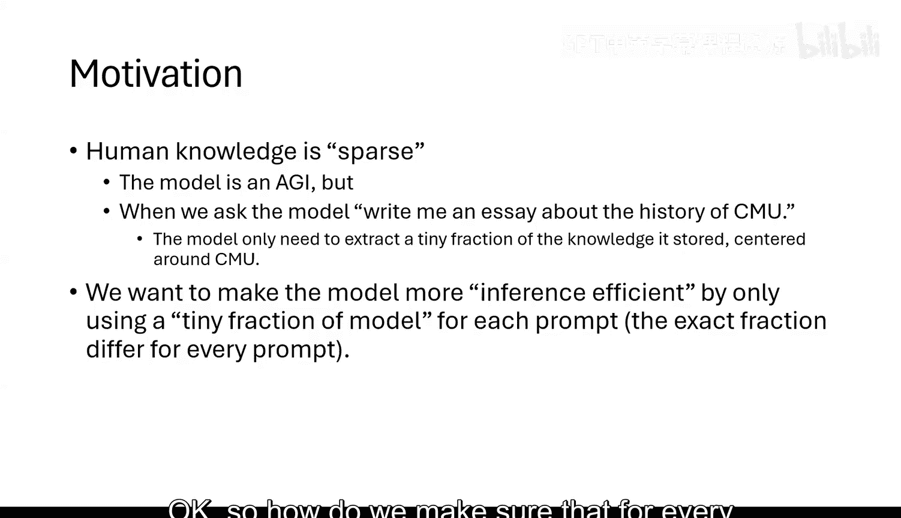

Okay， so this is basically the mixture of expert architecture。

 Its an architecture that are developed by Google， as usual， and is utilized by open eye， as usual。

 You know， open eyes mixture of expert is much better than Google at the moment。

 but Google invented those things。 So you know why Google don't publish paper anymore。

 So they learn the， they learn the license。诶。😊。

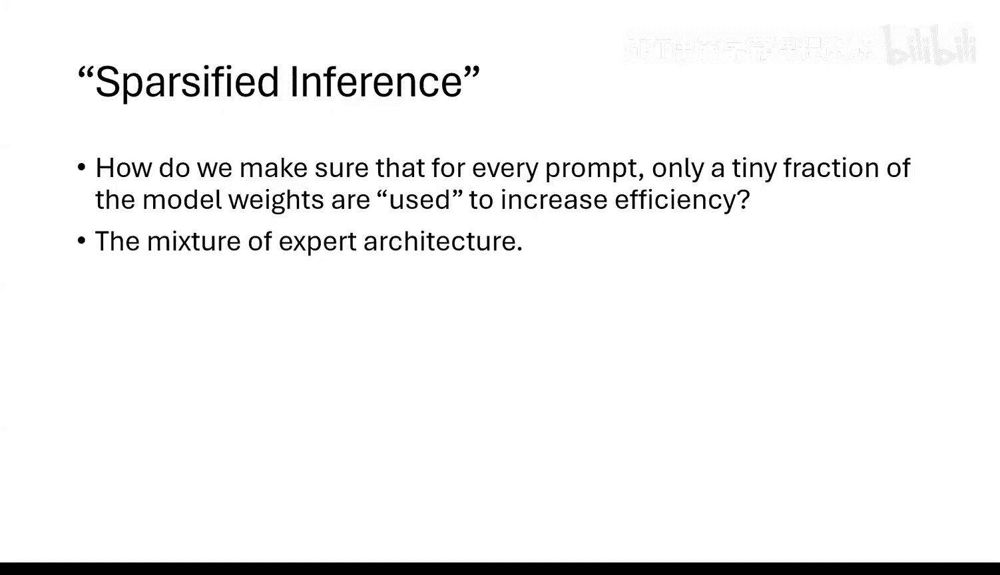

So what is a mixture of expert， I mean， this is a classical definition of mixture of an expert。

 but this definition is being used。😊，Or throughout the history。 Okay， by history， I mean two years。

 which is a very long time。Okay， so basically， what is a mixture of expert layer。

 So this is a definition， but I'm going to draw a picture for you to understand it better。诶。😊。

So basically， you have an input X。This is your input X。This is a vector in RD。

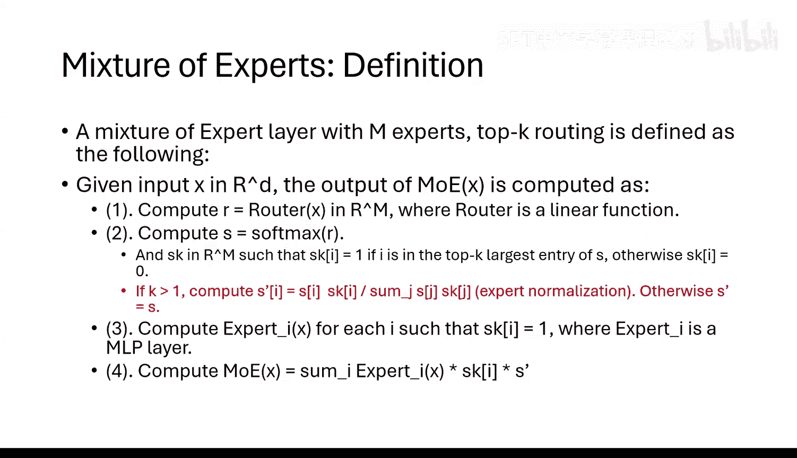

Okay。😊，So the first step is map these vector through a linear layer called the rotor。😊。

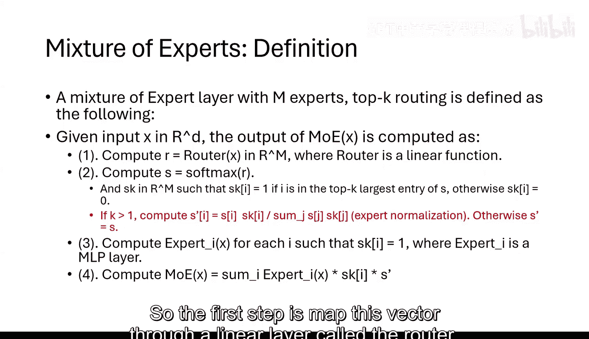

Okay， this will give you a vector in R of M。So I is a number of experts。

You should think of the number of experts as a number of partition you would have on the MOP layer。

 Okay， so usually this thing is like 8 or 16。He。😊，And the reason why Google didn't success is because Google said this parameter to be 1000。

 Okay， so the correct number is 8 or 16。 Okay， so this is how you should think about M。Okay。

 so we first map the input to a vector of dimension M。Okay， and then youll go through a soft next。

So this gives you a probability over over like dolta of M。Or yeah。

 So this is like a probability vector in dimension。 M， the sum is one。

 and everything is like between 0 and what。Okay， so then based on this vector。

 you would pick the top pay largest entry in this vector。 Okay， so this， this and this。😊，Okay， like。

 this is a top 10 largest century。So you should think of those entries as the ID of the expert you want to use Okay。

 so this routetor is like a linear classifier saying for this particular input which I expert I want to use and here you'll get the ID of the expert that you want to use。

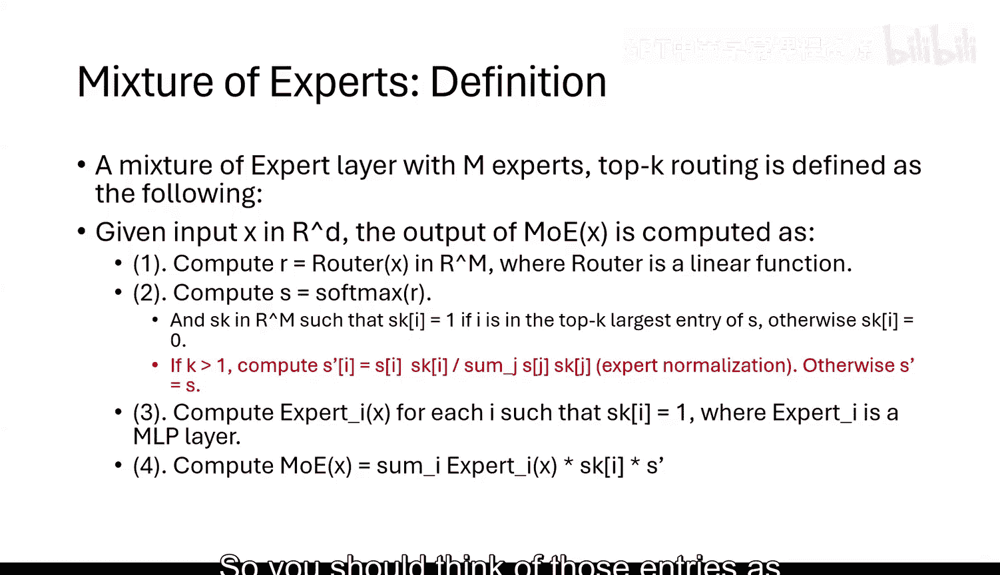

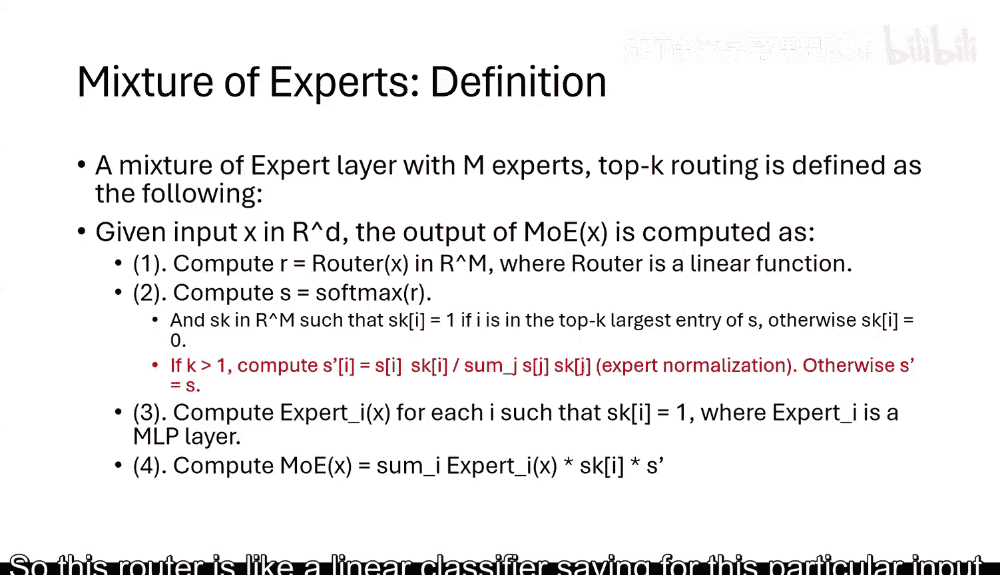

可。😊，And how do you get the actual output of x， now the actual output of the M O E of x。Okay。

 it's equal to the summation of I。 So this is， let's call this I k of x。He， this is equal to one。

Of the eighth entry。If I is in the topic。And zero otherwise。Okay。

 so then this is equal to sum of x k of x of I。Times the expertolphi。and then times another factor。

 which is quite interesting on the s prime multi x。😊，Okay， so what is this ice prime of x of I。

 So first of all， this is called s of I X。 Okay， this is like the soft max of x。

 and ice prime is like a normalization。😊，哎 is equal to the or I is equal to。SK。好仔好晒。

Ms s of I divided by sum of J of S k of x。F I I ice of cheek。Okay。

 so this is like a remalization of the soft Max。😊，So originally， you have a softback。

 but that's over anything things。 Now your peaks are top2。And you actually reize a salt like。

 So it's only over the two。Okay， so this thing is only activate or only supported on the like top K largest entries。

 and the summation of this vector is still one。 So this is still a probability vector。

 this is still in dota of M。 but it's only supported on the top K largest entries。

 So do some remalization， except when the case of K equal to1， then you。

 you are just using the original one。 but usually people don't do top one routing anyway。

 So basically， we should think of K bigger or equal to 2。 okay。So basically。

 that's how you compute the output of the。Of the mixture of expert layer。诶。So， I think there's some。

Yeah， there is some notation。I mean， I'm missing I here。 Okay， so this should be I I prime of I。Yes。

😊。

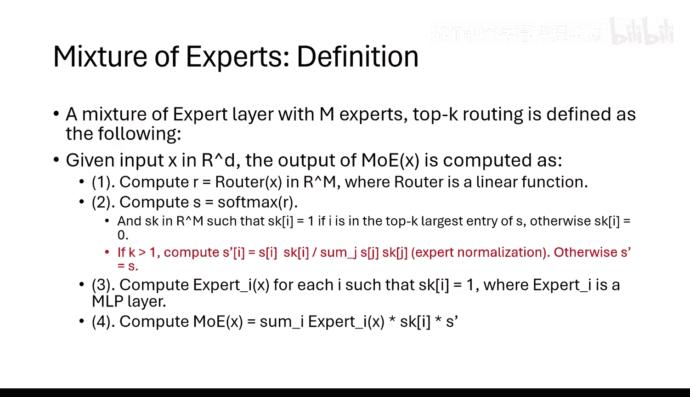

During computation graph。はい。Yes。😊，对。So each expert is like an MLLP layer。 So it' an MOP layer。

 Its a one hidden layer。 MLP， the same I see MOP layer in the transformer block。Sobody thinner。

 in some sense。Yeah。Yeah， so the entire thing is like an anto and defable architecture。

 although there is some artrc max that is not defreable。

 but you can still kind of just create the gradient I0。

 And then this is just like a defable architecture。 Okay， so this is an M O E X。

 and how do you put the M O E into a transformer。 Well， you just replace the MOP layer with the M E。

😊，So what I mean is for transformer， right， you're input this like a sequence of tokens。Okay。

 so this is like x1， x2。After I。And then for a transfer block。

 So you'll first do like a self attention， right？And then for each individual output originally有多MOP。

Now， instead of doing MOP， you just do MO E here。 so all those M Oes， just like MOP。

 they share the same weight for every token。😊，Okay，In transformity， MOP for each openken。

 they share the same， same network。Right， so here， the M E for every token。

 they also share the same MO E。 but inside the M O E， there are。K Im different experts。

 And for each of the different X for each of the X， they may use different experts。Okay。😊。

Any questions？Yes。😊，I specify that you should act that maybe a computer scientist or a developer that that also prompted to an expert now that's a whole but usually it's not like usually it's not like that kind of particularlyally decodable so Ms are not really like 100% aligned with human perception for example some some expert is really just doing one thing that is extremely interpretable and usually the experts after training they are doing multiple things so it's not really interpretable but still they are smarts。

Yes， the information going to be like low balance across the yeah。

 that's what we will talk about in later sizes。Okay， but right now。

 this is just the definition of the MOE layer。So one are there any kind of questions regarding the definition。

Or regarding like the clarity， just to be clear， those experts are part of one M O E block。

 So X one up to expert M， they are。Part of one M O E block。 Okay。

 so one M O E layer contains all those experts contains all the contains this router。😊，诶。😊。

And this M O E layer is going to be used for each token in the transformer layer。Okay。

 so each M is applied to each token。 So maybe this token is like Alice。Let smoke。

So then this Alices may use expert。 So inside Alices maybe Alices use expert。One on this way。

 I likes use expert。1，6 and bomb of use experts。2 and free。

 It's possible that your entire kind of computation looks like this。诶。😊。

And the MOUs are shared across different pockets， which means if thoughtb uses expert3 and that is also used expert3 and those are the same expert。

 okay。😊，Yes， right。Okay， so these expert and this expert， they are the same expert for each layer。

You should just think of this MOE as like an upgrade version of MOP with some specific because here in total there are I' expert。

 but if K is much smaller than M， then only a few experts are going to be used for each individual token。

😊，Hey， yes。Each is to。That's like happening from x to x prime Yeah。

 how do we gain like inference gains like isn't it the same thing。

 but like multiple times but then total network is the total number of parameter in the network is larger。

 right？This we will see in the later slide。 This means the network can store much more knowledge。

So the scaling law of MOE only depends on the total number of parameters doesn't depend on me kind of the so effective parameter。

 which is how much experts are activated。He， so any other questions， yes。fine ME as。

Different transformers or do we do this separation in each MLp layer？

So the MLP layer with the MOE layer。The MOE layer you can think of is a combination of an MOP layer。

Okay so each expert is a MLP layer， so your final output is like you have the molecule of the MLLP layers。

有你好。MOU layers in a wall in a mixture of experts model。Yeah， so basically in each transformer block。

 there will be a selfat and an MOE layer or MOE transformer。

 but you can have like 100 transformer blocks and in each block， the MOE layer is different。

 but on each layer the MOE is shared across tokens just like the MOP。Next。Yes。

 what kind of model is like the router how many parameters does it have router is a linear function is a linear function from RD to RM so D times time parameters。

Which is very， very small。 Typically， I mean， the router computation time is amable。😊，Wch。

Aciv it you have to go to the route go through the route straight you'll need to use a router to decide which expert activate for that open Okay。

 so the first step is you need to go through the router。Based on the routeors's computation。

 you actually decide which IQ for that particular token。Okay。

Go through certain parameters because those are un needed because the S value for those is going to be zero right Yeah。

 so if I say of those are going to the for those zeros then you don't go through those experts but there's a much more kind of involved the implementation in inference as we will see。

Yes。😊，So we have a stack of across is it possible that activate possible I mean for different layers。

 those experts have no correlation with each other， for example。

 man an expert could be expert one and layer one， but this expert1 layer two it's possible because during I mean initialization everything is randomly initialized so it could be that the experts are learneded completely differently at a different layer。

Any other questions？It。给起。So how do you use the MOE layer， Okay， so this is opP usage。

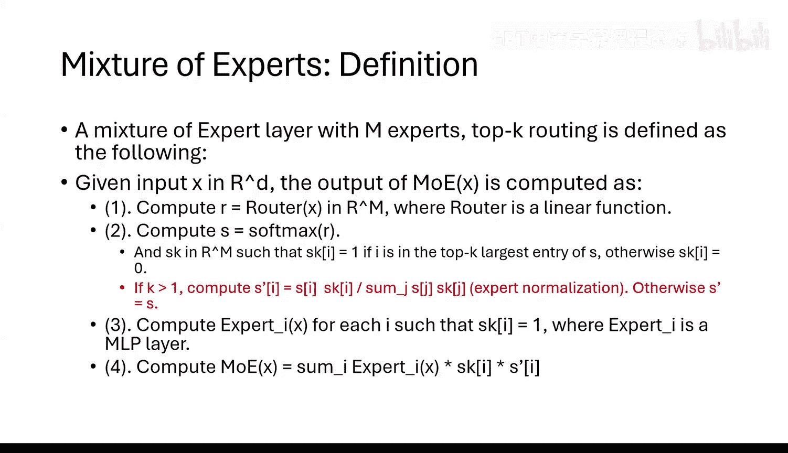

问卧是。I mean， supposed to be internal knowledge， but I guess it's fine。

 So it is a talk to relative with M equal to 16。诶。😊。

So basically each MOE layer is an MLP of the folding architecture sorry。

 so each expert in the MOE layer is an MLP of the fold architecture is a linear from D to 2D。😊。

And记录 and li疗 from土地 to地。哎。So basically you think about this architecture。 first of all。

 it has 6 in experts， But it top two roing。 So essentially you are， you only use one。

8 of the parameter。 So that's why G4 is called 200 B times 8， although it's 6 in experts。 Okay。

 but you only use  one8 of the total parameter in for each token。😊。

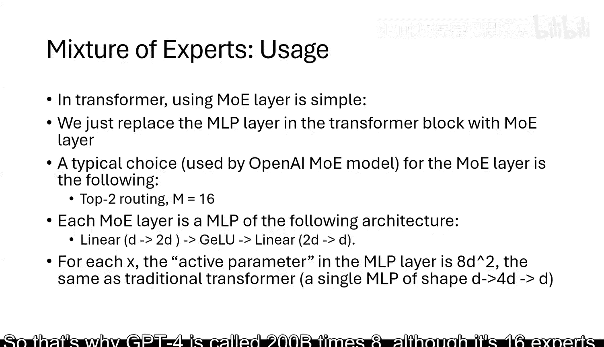

Okay， and for each token， the active parameter in the in the M MOP layer。

 this kind of or in the MOE layer is like a eight times D square because this is。😊。

So this is 2D square， this is 2D square。 so in total one expert has 4D square parameters。

 so you have two expert， so it's a square， which is the same active parameter number of active parameters as a traditional level MLP of D to 4D to B okay。

😊，So the kind of for each token is kind of your going to a traditional transformer。

 but actually you have a lot of other parameters that are not used for that particular token。诶。😊。

Any questions？ Yes，我没。

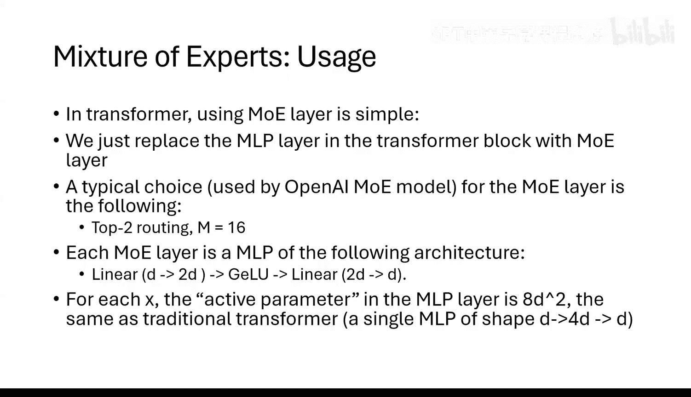

O前面这个男模要不好意思。Yeah， I lose the number of experts， so you can think of MI 16。

 You have 16 experts in this layer。😊，对。So while you always still use the same safety expert who I read okay another question。

Andra。Because any token would be di of those experience。Yeah。

 but think about MLP layer is like one expert， right。

 MLP layer is a special case of MOE with just one expert。😊，Because if you only have one expert。

 the router will always assign the to just one value。😊，And you will always use that expert。

 So you are back to an MOP layer。 So M O E is a strict， strict upgrade of an MOP layer。 Okay。

 it's not going to be worth the MOP layer。 anyway， it's just a straightforward upgrade。

 because if you only have one expert。 or if those expert actually collapse。

Then you are going back to an MOP layer。But hopefully during training。

 those experts didn't really collapse and they actually specialize on different things。😊。

So the expert usually think of them as really like special idea on each subject。😊，For example。

 there's a math expert， there's a history expert， a philosophy expert， maybe a sport expert。

 a gaming expert。😊，Okay， so you， for each token， you just call for the health of one expert to kind of understand the content of this token。

There's an important foria experts， sorry what。Yeah。

 the route is kind of deciding which I expert to use。 And that is pretty important。

 although in practice， we don't really know how to train the router kind of optimally because it's all done by gradient design。

 just a bunch of magic。好虑。For exactly doesnt know the function it's just as linear model are you。

Just I mean就 home aD dimension vector。 you apply a linear function and get to M dimension vector。也不是。

I mean， we don't know。 It's just some mathematical number。

 but M O E layers are not really interpretable in practice。

 There are a lot of efforts trying to interpret what the route actually do， but they all felt。Okay。

 so it's kind of like the transformers are learning to classify human knowledge in a way that are unaligned with human perception。

Okay， any other questions？Okay coolSo anyway， this is the open I I mean open M O E， okay， which is。

 I mean， their older version。 So that's not what they use these days， but。

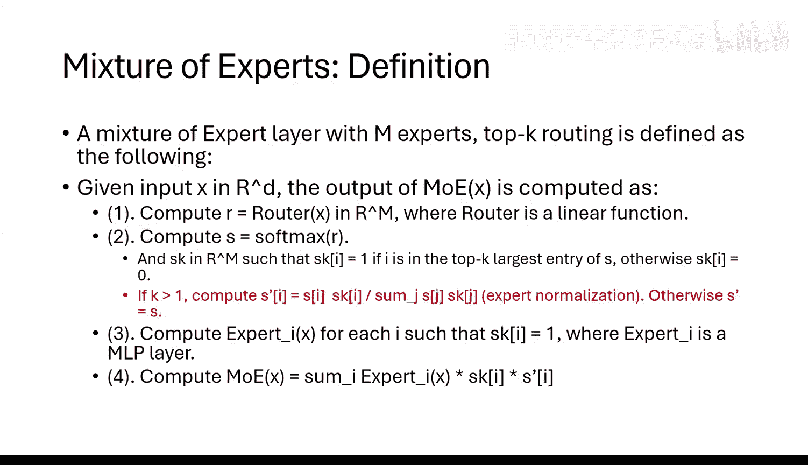

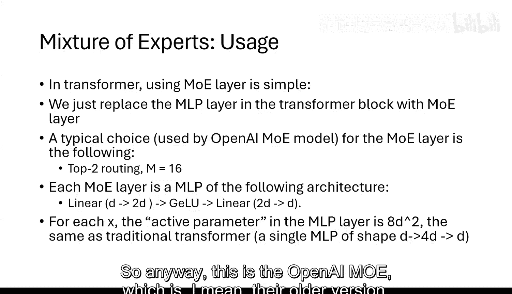

The older versions are， are talkable。 And so it's top 2 Royal M equal to 16， okay， and。

Each expert is like thinner than the traditional MOP。

 but the two expert combined is like the same size as a traditional MOP。Okay。

 for traditional like T E2， you would have an M MOP layer that look like this。 So you。You have some。

 I mean， you are projected to 4D and down projected by  to D。

 and here you are projected to 2D and down projected to B， but you have two experts。诶。😊。

So essentially， for each token， it looks like the token is just computed through a normal。

 like GB2 or GB3 model。 But for even tokens， they actually use deeper subset of parameters in the model。

诶。😊。

So for MOE model， there are two concepts that we need to distinguishsemlish。

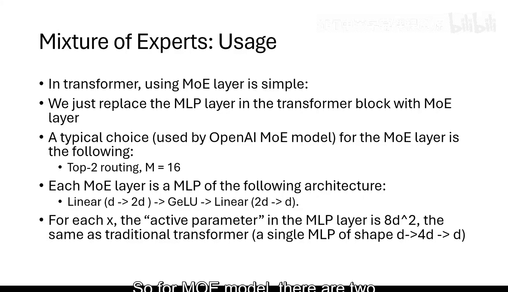

First of all， it's the total number of。A parameters哎。

 the second is the so called effective parameters of MOE transformformer。So for MO E transformer。

 the total number of parameters is really just the total number of parameters in this model。

 This consists of the parameters in the em layer or the L M head。😊。

And parameter to me attention line。And the total number of parameters in all expert， of course。

 plus the parameter in rot， But that's kind of negligible。 Okay。

 so basically here is M times the parameter per expert。

 This is like a total parameter for M O E transformer。😊，然后再一 parameter。

It's essentially the maximum number of parameter that I I for each token。

So instead of having m times parameter per expertt。

 you have k times parameter per expert here because it's top 1 rows。😊，So， you're only using。

Kind of three experts out of the total M。诶。😊，So and also。

 the parameter attention layer is still there。 You still use a full attention。

 and you still use a full embe。 So this means， for example。

 if you have 16 expert and you have hope to routing。Okay。

 you are not going to have like eight times smaller number of parameters It something smaller than8。

 because attention layer， you still use a full parameter。给。😊，Yes。😊。

That ratio or that reduction actually tend to be。For6 so 6 an。

 we talked to ro it's not like one or eight， but something close to one or six each。

 which is still a very large benefit。Okay。Any questions？Yes。😊，Two two experts， I mean。

 do you congratulate the the two experts sum them up using this function。Okay， any other questions？

内裤。So basically， here's like the end of the easy part of MOE。

Then we will go to something a bit more challenging。Now， first of all， I mean。

 before we go to something， China you will see some fun teacher， which is a skating law of M。

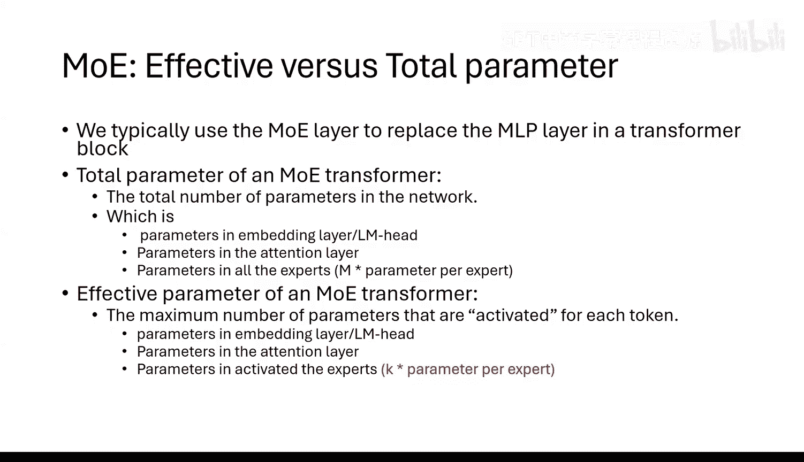

Okay， so it is M O E architecture。 I mean， the total number of parameters is benefit， right。

 It can have much more。😊，Oal number of parameter compared to the e parameter。

But what about the number of knowledge that can be stored at an MOE model。

So the state law of MOE cannot really reach2 beat per parameter is more like 1 to 1。

5 beat per parameter， although it's much slower to train compared to a dense light network。Okay。😊。

So basically for MOE network， you can kind of store 1。5 beat parameter or sorry，1。

5 beat knowledge per parameter。 and that's her total number of parameter。诶。😊，So for MOE。

 wecycl 1 billion total number parameter， you can store， for example，1。5 billion bits of information。

 But during inference time， not all the one billion total parameter are activated。😊。

Maybe only 200 million parameters are actually。So essentially。

 you are using 200 million effective parameter to store 1。5 billion。意top information。

So that's not something you can do with dancingling。Okay， so MOE is kind of necessary。

To bypass the dense scaling law。 Okay， so you see why large models use M E because this necessary way。

 I mean， for dance， we know too is a limit， but for MO E， you can get much larger than two。

In terms of effective parameters。

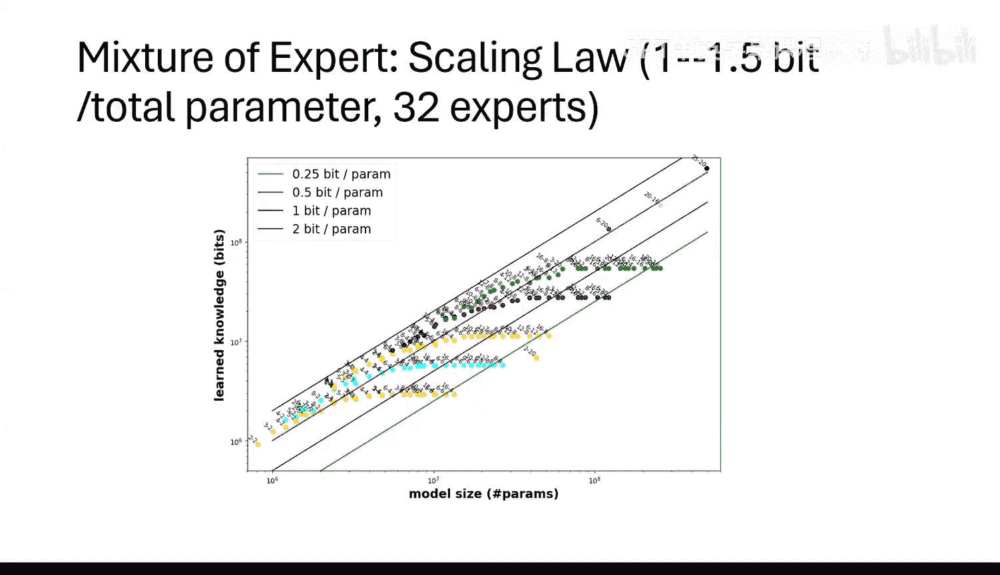

Okay， for example， in this particular case， is a 32 experts with actually Tao Gu roing。😊，Okay。

 so effective parameter when using 32 expert with top one routing or top 2 routing is roughly like 1 or 11 of the total number of parameters。

😊，嘿。Sovely parameter active per token is one 11 of the total number of parameters。

But the number of Bs you can store is like 1 to 1，25 times total number of parameter。

That means for every effective parameter， you are actually storing like more than 10 piece of knowledge。

😊，Okay， so this is five times more efficient than dense model。Okay。Yes。Yes。

 so we like five times more computation in。I mean， not exactly because you have to implement it correctly。

 but roughly that' a benefit。 Okay， it's a very， very large benefit。😊。

But that's only about the knowledge。He， actually， MOE are not that great for logical reasoning。

 so you cannot have infinite many expert and keep enjoying the benefit。诶。😊，So what performances？

I mean you have a knowledge storage， you do get this five pounds or even like more than five pounds。

 for example， you have like100 expert you will have even more than five pounds benefits。😊，But。

 I mean， as you say it in this picture， right。This is only for knowledge。 This is for logic。

If you make this layer super big， then the logical reasoning ability of language model is not going to be very good。

So in practice， you cannot really make a number of experts with infinity。

 although in scalingating law， I mean this scalingating law actually applies to like 128 expert or even 1000 expert。

😊，Okay， so they this， I mean， in terms of factual knowledge。

 you can scale number of expert as much as you want， but you still need a logical reason。好的。Now。

 you be an expert corresponding to like a super sparse model because you have a very tiny fraction of activeV parameter or effective parameter。

😊，Okay， so if you have infinite many experts or let's say you have one billion experts。

 then only one or one billion of the parameters are active during inference time per token。

 So it's very， very sparse。😊，And this gives you the factual knowledge benefit。

 But the logical reasoning is all good。Yes， and then so you said for last lecture。

 you said that like this also works for like eight bit。Funtization， so you can have like。

10 bits of knowledge with the effective like eight bit model。Is that what you're saying like I mean。

 I know you have to store the whole model， but for evaluation purposes。I love for。

 I understand your question you are asking if I can be quantized to A P。 Yeah， no。

 I'm saying like so if you have a8 bit quantization on an M O E model， yes， and then。

The number of parameters is like five times it's more efficient than the than before right so you're just like effectively storing 10 bits of information per a parameter while the parameters themselves are only eight bits like yeah。

Yeah， exactly。 So the parameters themselves are only a bit。

 but the reason that you have some more than a B per， because that's for effective parameter。

 But you have the nonactive parameter。 like， for example。

 the math are stored in some expert so that when will talk about history。 they they are nonex。

 but the knowledge is still in the model。Yes， what do we say when we scale the number of experts to a sufficient enough level。

 we argue that we lose the ability to reason because supplement potential is consistent。

 is that just a matter of fact because we cannot access different knowledge bases to reason？Well。

 the point is， if the MOP layer becomes super large， I mean。

 the effective parameter is not exactly equal to the inference time because you need to do the distributed inference。

 So you have to， if you want to keep the inference time is equal。

 you have to scale down a little bit of those inbe dimension。

 which means your attention is going to be smaller。So for example， if you have 100 experts here。😊。

Then to keep the same inference time， you probably need to scale down the embedding dimension to scale down this dimension by like factor of five issue。

Then you really heard the model's logical reasoning a lot because your attention is too small。

If we say 100 x the amount of experts， we will still gain in infant Yeah。

 but the point is you kind not all the experts， yeah single GPU。

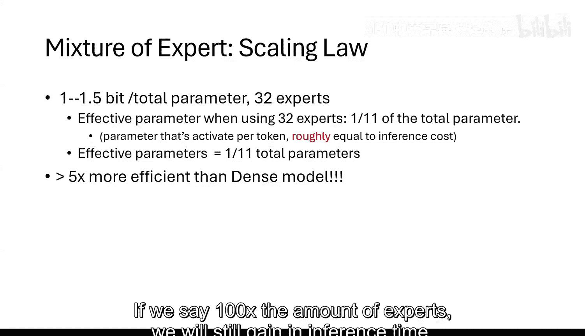

Right， which we will talk about you later slide。 So you have to store each expert in different GU。

Then the inference time is not exactly that efficient because you need to do some message passing and do some low balancing。

So you are not exactly getting like this amount of benefit。Okay， theres some like downside。好。Right。

 they are all like， I mean， everything in transformer is not only theoretical， right。

 It's also bounded by Ka level implementation。😊，Yeah。

 I mean here we are talking about the mathematical stuff。

 but in terms of actual Pa computation it's not like five times more efficient。

 the common senses MOs are like two to three times more efficient because of the hardware constraints。

😊，but just purely mathematically， it could be like five times more efficient or even more if you have more expert。

 but in reality， you still have a p concentrate。😊，诶。😊，So basically。

 this is a basic like mathematics about MOE， and now we will go to the implementation side of MOE。

 which is much more challenging。😊，Okay， so first of all to implement this M E layer， you cannot。

You cannot use it as a torch module and just call forward backward。 A， that is very， very slow。

It's the same computation crime。 It's a dense model。

 okay because the sparsity doesn't matter or pietorrch。You have to explicitly make a sparse， so。

 for example here。诶。😊，So， here。This ice cave is sparse。

But either just write that an hightorrch module。The computation is not going to look at， okay。

 I have a zero here， so I don't need to compute this。Ptorch will still compute this。

Even if S KX of I is still。Okay， you have to explicitly tell the model or rewrite your computation loop so it does not compute this thing。

诶。😊，So its sounds like you just divide it according to the math and write a pitorch module and everything is done。

 Okay， you have to rewrite the computation rule， Some of the advanced MOE implementation like make block actually reroll the kuda but the kuda is out of the scope of this lecture。

 So I'm going going to how you how to rewrite in like pi toch level， of this computation。😊。

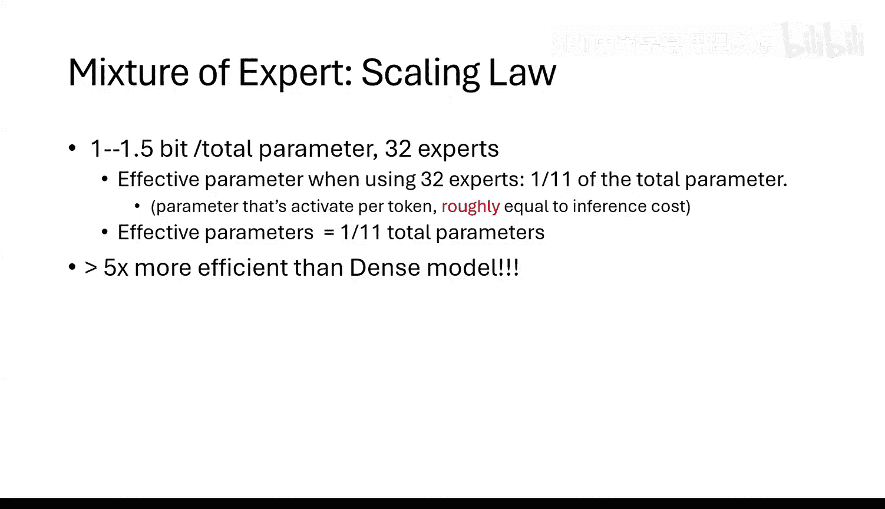

系い。So basically， we need to kind of re this computation。

 so we don't want to compute all the expert I equal every x that will lose the purpose of MO E。

 The only want to compute the expert I is S K of I is equal to0。 sorry， equal to one for that X。

 Okay， just recall， you have 16 expert and only two of them are active。😊。

So only two of the SK are1 and the other IK are0， so you want to compute only the expert I or this forward and backward word parts for this thing。

 only when SK of x of I is one， but this days one for different。

 I mean for different I for different x， right， I say the example， maybe for Alice， you use expert 1。

3 for light， you use expert 2，6， and for Bob， youll use expert 2，3。So， need to make sure。

大就 kind of reviewing those content depending on which expert they actually use。Okay。

 you cannot write it naively like this Mac formula。

So what's the actual implementation of the actual implementation one the standard implementation。

 Now， this is not the state of the art。 Mega block is a state of the art。

 but that's a pua implementation。 Okay， so the pua implementation is going to be different than this one。

 but this one is like the best you can get without pua。😊。

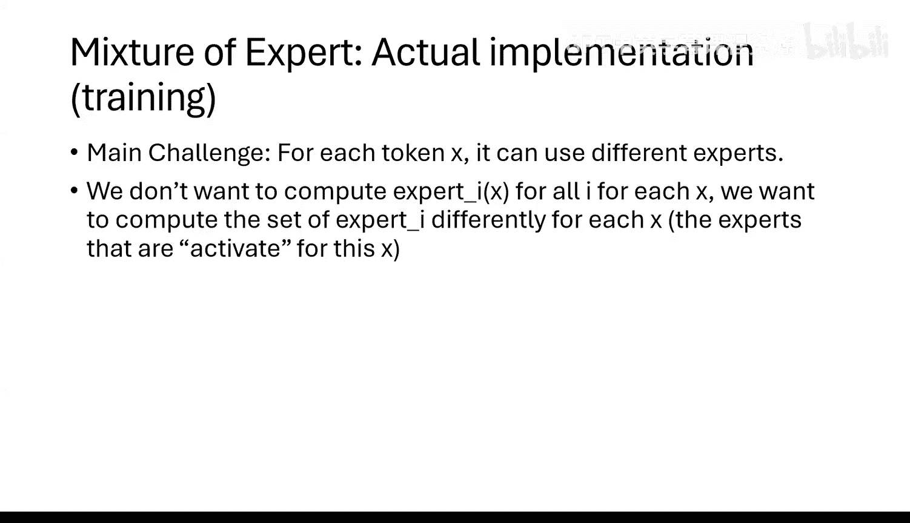

Or we don't mess up with school that。Okay。😊，So basically without messing up with ka or what what can you do to take advantage of sparsity？

Now， the key operation here is called the fast code operation。Okay。

 so let me explain what is a fast code operation of the MOE。送。Between你 race。诶。😊。

So let's say this is your input。 Your input is a sequence of tokens。诶 so is低time水。

There's a sequence of tokens and you first go through the router and you see this token use like expert 1。

2。 This token use expert 3，4。😊，This toolken use expert 1，8， This expert use con 4，5。哎。😊。

And what you are going to do is you are going to do a reshaping operation。Okay， so originally。

 the input is Dtimeson。You are going to reshape it to something like M。As B times M prime。Sorry。

So I should call this N times C。Impri Im speak。诶。😊，So what is this N prime。

 This N prime is some value that is much， much smaller than N。诶。😊。

So what is this reshaping operation is going to do is actually going to re the token according to which expert it used。

Okay， so basically I can view this as M vectors each of dimension N prime times D。😊。

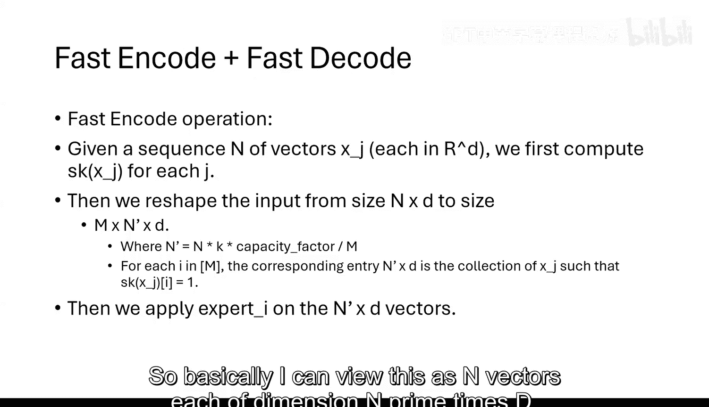

Okay， so I have。These vector， these vectors， these vector。

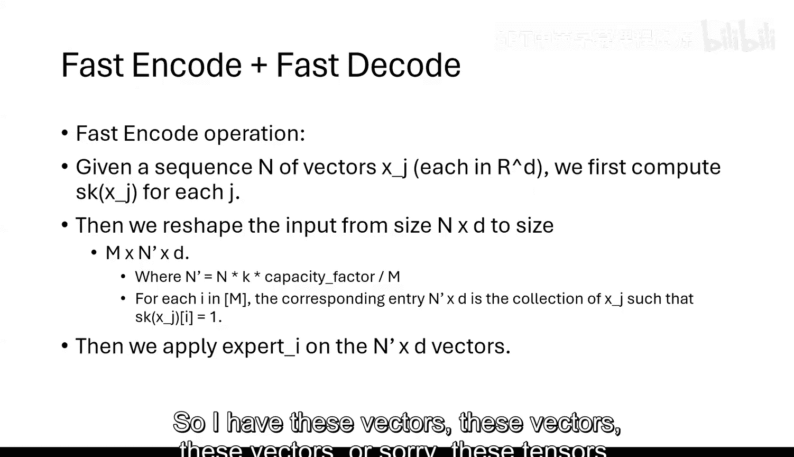

Oh sorry， this， these tensors。 Okayy， so I have， this is one，2 up to m。诶。😊。

So what would happen is this x1 uses x for1。Right， so I will put X1 here。And this X1 also use X2。

 so I will put X Y here。诶。😊，And this expert， this x2 uses experts 3。So I don't have a three。

 Maybe I should。明白因为。Or exactly。 Okay， so I put x2 here。 I put x2 here。And for x3， it uses 1，8。

 So I put x3 here。 and I put another x3 I date， This is8。Okay， and then I explore。

Maybe let's just say uses one and two。 Okay， so x4 it uses4。 So I put x4 here。And I put X more here。

 is a reshape your repackaging， which means you have this an expert？😊，For each expert。

 you are trying to fill in the focuss that actually use this expert。😊。

And there's any ideally if the tokens use expert evenly， then this N prime here。

So this is an m prime， this n prime should be equal to n times8 divide by n。Right。

When if every token uses an expert evenly， then each expert will have like n times K divided by M many tokens。

😊，Okay， but yeah ideally， they may not use it evenly。

 So n prime is n times K divided by M times the capacity factor。 So you have some like redundancy。😊。

He， you put some redundancy there just to make sure that you don't drop too many tokens。

So usually capacity factor is like 1。1 to 1。25。Okay。

 so the capacityac factor you should think of it as a 1。1 to 1。25， depending on how balance you are。

And then we apply expert eye on those factorss。喂。And then we can also， I mean， after that。

 we do a fast decoding which from this shape， you need to recover back this shape。😊，诶，就到话发现口 and发口。

This is the optimal way that you can implement intor without messing up with ka。

 If you want to mess up with ka， there's like a kind of a spae kind of broadcasting protocol that even I don't understand what is that that you need to deal with。

 okay。Yes。😊，Sorry what't that the mapping expert to the brokenken or mapping tokens to the corresponding。

 Yeah， it's like just you map token to the expert that you will use and you contact those tokens and you just apply the expert on those on this group vector because you know。

 know know could you have to do the matrix modificationn of certain size to be fast So you cannot apply expert on each token individually and contactulate。

 You have to contactulate them together and do a fast matrix modificationnification。So what？

Tazi factor is usually like 1。1 to 1。25 because if everything is excellently balanced。

 which means all the tokens use each expert like uniformly and random。

 then each expert should get n times k divided by M many tokens。😊，Right。

 but in reality it's not perfectly balanced。 So you have some redundancy so that you don't don't run out of the budget。

Okay， but if you haven't fill in the budget， you will have some zero here。

 but what you're going to want is x， for example， is x。

1000 is kind of like at here and then x100 three is like running auto of budget and you want to avoid this thing。

So you'll have some redundancy in the enterprise。He， yes。

Like does how distribute how equally distribute they are depend on the data or does it just sort of work out as there will be some loss how load balancing loss that we will talk about in the last slide that makes a distribution more evenly usually for top two routing it will set capacity factor to be 1。

25 say you rarely see any token dropping。Because I initialization。

 there is definitely no token job because everything rolled randomly。

 and you just want to maintain that。Yes。😊，In fact we actually have total dropping and there's like you know。

 we aren't able to get the corrects。There' is not very significant fallback。

 but you're kind of like some tokens are getting wasted。

Besides your essentially you training on like， for example，4 million tokens per batch。

 But if half of the tokens are was， they are essentially training on 2 million token per batch。

 which is less efficient。Also， in inference time， you really want to avoid token job because that means lower quality results。

Any other questions？Yes。😊，被个人的听。So writing。That chair。

So what said adding extra two to the no you're adding extra so M prime by should be n k divided by I。

But more now， which means you'll have some like redundancy in the buffer。

Or will you do the remapping， When you map the token to each expert， you have some redundancy。

 like there's some extra zeros here。😊，Because for p level computation。

 everything has to be the same shape be to be fast。 I mean， you cannot really。I mean。

 artificially describe the shape。For example， although there's some  zero here。

I really want to remove them。Ily want each kind of expert to get an arbitrary number of focused as basically what they would actually want。

But those will make the shape， kind of。A variable in thin。

Right a wearable sha in training is not acceptable by Uda。Well， by that， I mean。

 it's not acceptable by standarda， but the state of the art implementation of M E actually write a customized goodar kernel to actually deal with different lines。

 So they did essentially do this algorithm， but they don't set the capacity factor。

 So this will be like arbitrary lens， and they write like a customized goodar kernel to deal with it。

But that's very complicated。 Okay， at P to level， this is the best you can do。😊。

Just to have some redundancy so you can keep everything while you're not making it extremely slow。

Any other questions。配库。So this also allows you to use a very important techniques to train MOE。

 which is on expert parallel。

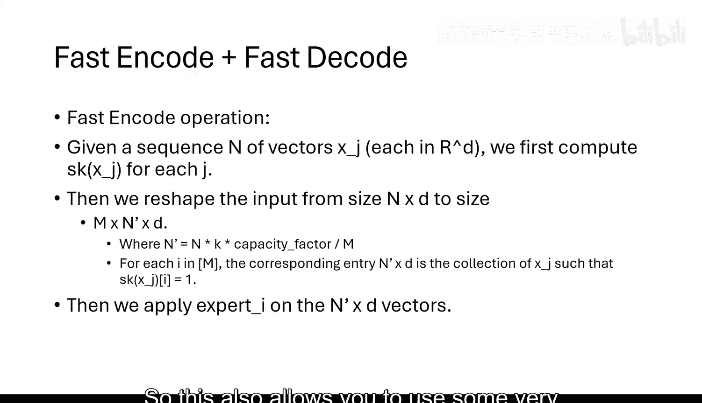

， we haven't talked about distributed computation yet， but we will talk about the later lectures。

 but this is very important。😊，Okay， so usually MOE models are trained。

 so the each expert are actually stored in different GPU nodes。诶。😊，So basically。

 what happen is you have。Okay， so you have one GPU。So one， sorryry， I shouldn't call it GPPU node。

 I should call it like different GPUs on the GPPU node。Soer one GPU note。So one， which H100 node。

 it contains8 GPU。Okay， so for typically yeah8100 node will have8 GPUs。哎。😊，So there's GPU 1， GPU 2。

 GPU 3 Apple to GPU 8， and you are actually going to store expert one and two here。

You are going to install expert。Me enforcers。Okay， so expert power level is very， very important。

 This is almost a must to trade like large MO E models。😊，So at GPPU at GP PU zero or this is a gooda。

0， this is like quo that one。喂， this is a good afternoon to。Okay， so these are H100 GPU and。

And 18100 node contains of like eight of the GPUs， so you're going to install the weight of expert one and2 and GP1 and made of expert3 and4 here made of expert 5 and6 here up to like expert so at goodha 7。

😊，You star。I exportd。对天轮。16。诶。😊，So store expert on the weight of the expert on different GPUs。

So during your computation， you first do this fast decoding or sorry， fast decoding。

 And then for each of these chunk。😊，You just send to the corresponding GPU to do the forward and backward pass。

Okay， the experts they don't need to communicate。 So this is very， very efficient。

this is much more efficient than any type of pencil parallel that you can write for dense layer。😊。

Okay， so expert parallelization is the most efficient parallelization。

 We know is faster than pipeline parallel， faster than tensor parallel， faster than anything。

 that' another advantage of M OE is。 You can utilize the expert parallelization， because really。

 the main observation is。😊，The backboard of each expert is smooth dependent。

 when once you do the reshaping dis batch。Will how go to the forward or expert floor and the backwardboard all expert form you don't need the information of all the other patches and you don't need their forward information。

You will only there backward for the information， okay？So that reduces a lot of computation time。

 as we will discuss in later lectures。

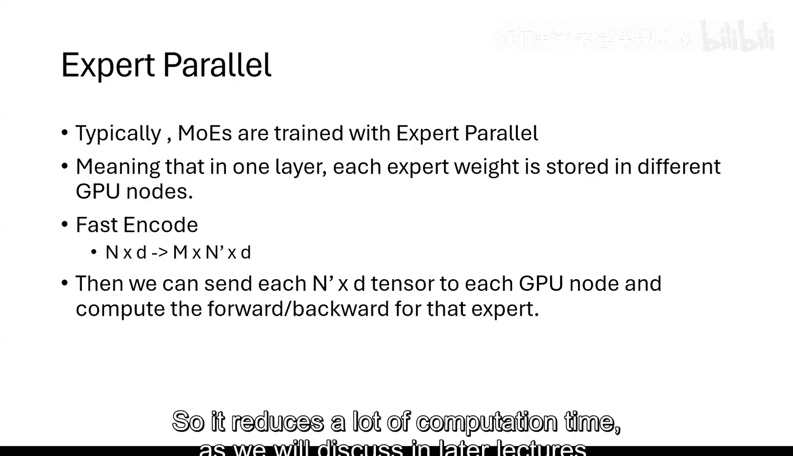

， but just so make sure。I mean， this animal E layer。OkayIt has another advantage。

 which is expert parallelizations much more efficient compared to other type of parallellyization。😊。

诶。😊，Any questions？So you may wonder why do you need expert parallellyization， Because one single GPU。

 it can at most fit a network of size like 30 billion。

30 billion is the maximum you can hold a single GPU。Okay。

 so if you want to go to like 100 billion parameter models， you have to use multiple GU。

 You have to use parallellyization。And using expert parallelization allows you to do trial 30 times8 network MOE model。

 which is the same size that GBE3。5。Okay， but if you want to train G4。

 you still need to do parallelization。 I mean， your expert parallelization is not enough。

 You have to do tensor parallelization inside expert parallelization。

 which is much more kind of difficult， but to try like a G 3。

5 level model is enough to do expert parallelization and to do expert parallelization。

 It doesn't doesn't require you to write customized code。 like high to or in particular。

 deep speed in high to can do expert parallelization for free for you。😊，Well。

 for tensor parallelization， either you will use Js， which means you're part of the Google。

 So you shouldn't say that you attend these lectures。 Okay， but if you don't use jacks。

 then you have to write your own。Tcer paralyization code。Okay， but for expert paraization is free。

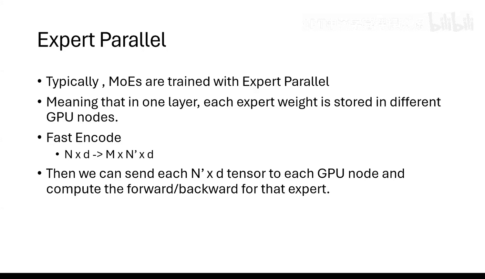

诶。😊。

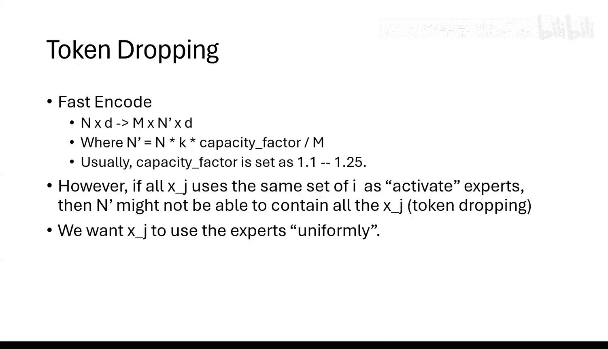

So basically the last thing I want to mention it's a socal load balancing loss。

 which is we want to make sure that all the expert or all the tokens are rolled uniformly to keep an expert right so we want to make sure the capacity factor is good enough。

Okay， so we want all the all the tokens use different experts like uniformly。

 It's not like all the tokens use expert  one。 It's more like one eighth of the expert use one eighth of the token use expert1。

1 eighth of the token use expert 2 after one eighth of the expert use expert 60。😊，Okay。

 so we wanted to be as uniform as possible。And the way to inform such uniformity is adding these load balancing loss to the training objective。

诶。😊，So what is low balancing loss， No balancing loss is a foreign loss is a sum of F I times PI。

Where F is a fraction tokens that are actually used expert。Okay。

 so it's a fraction of tokens that use expert high。

And PI is the total probability of focus that use expert I。诶。😊。

But the male observation is a minimizer of these loans is at the place where the routing is uniform and the probability is uniform。

😊，Why is that Because the sum of FI is constant and sum of PI is constant。 Okay。

 so when you sum over F， your first sum over I。And没有 some I for each SK of X。

没有 some I is always equal to pay。Right， because for each toolken you use K expert。

So the sum of FI is a concern。As sum of P I is also concern because没有 sum over P I有 first sum over the inside I。

 and for every S， which is a rotr probability， sum over I is equal to one。

Because it's a probability vector。So when you， when you have this type of submission。

When you have some of F I times P， where the sum of F is constant and sum of P is constant， You know。

 the minimizer is uniform。Right， that's essentially like like， I mean。

 that's basically some inequality， simple inequality。哎。So the minimizer。

 the minimum value you can get is essentially when Fs and P is a uniform。And when I find a uniform。

 you really have like uniform ro。哎。😊，So that's why you want to multily P there。

 because if you only have some of F， it just like。I mean， it's just always concern。Okay。

 so youll have to have some some of F times P to make sure that me mis are actually both parts are uniform。

Okay， or at least one part is uniform。 For example， P uniform or I is uniform。

 So that means either you have uniform routing or you have uniform probability。Okay。

 so this ensures that you are kind of load balances。

It's not that rigorous like it's not mathematically going to guarantee that you're perfectly low balance。

 but it's like a good approximation。He， any questions？Yes。😊，Sure like for this load balancing loss。

 I understand that it may benefits the training process very like imp practice。

 but like how does that I mean wouldn't that be going against load collapsing like because I would expect the data sets or everything to be very long tail so they should be using maybe one expert more frequently than others like yeah。

 that is a very good。I think that's a very good conject。

 I think that's a currently like the dilemma of MOE。

 which means we want to use some expert more frequently because maybe they are more important。八。

Just for efficiency purpose， we have to balance every expert because if you use Y very heavily。

 your going will have like a lot of problems。😊，Yeah， it is typically not to。I mean。

 or another saying is think about the capacity factor of M O E。

 But the reason that M O E can achieve such a good capacity such a good like knowledge capacity is scaling is because it uses all the expert equally。

 if it only uses one expert， it cannot store like 11 Bs per parameter。😊，That's not possible。

 So the only possibility is that it uses all the expert kind of evenly。Yeah。

 so you that's why you should not think of those experts as traditional expert along with human perception。

 they are kind of like a balanced experts and maybe one expert is like。Like， I mean。

 it's not like history， mass or something it's like the history of CMU is in this expert and the mass of certain theorem is also in this expert and maybe some engineering stuff is also in this expert and maybe the reason that they' are all in the same expert is because maybe they share like the same name of an author。

😊，Okay， but those are given authors is as the first names are the same。

 So then they are getting put in the same expert。 Okay， so it's unclear what's the。

Way correct way to interpret the expert， but I think what you'll say is a very good future direction。

 but you need to first solve the engineering issue alone like very imbalanced expert。Yes。😊。

If you have more experts， is it easier to get better than balancing in principle， yes。

 so if you have like a thousand expert you don't even need low balance it's almost certainly going to be balanced。

😊，Yeah， but in practice you only have like 16 experts， so you need these loans。

 this loans is actually very important。😊，OkayOtherwise。

 you will only optimization will collapse one expert， and you have a lot of poke dropping。

 and you just cannot optimize。Yes。😊，Part expert is not a lot of tokens。

Then then the loss would be high yeah， if one expert use if I mean。

 if one expert is used a lot by a lot of focus， then the loss will be high because we can think about。

 I mean， just think about the loss， like when all the I and pi is are like one over n then the loss is like one or n because it's one or n square or sorry one or m squared times n so it's one or m。

 but if one I is one and one pi is one， then you'll get one。Yeah。

 we really need like uniform mode to minimize this。Any other questions？Okay， cool。

 so if there's no more question， I guess start the end of today's lecture。

 thank you everyone for coming and yes。

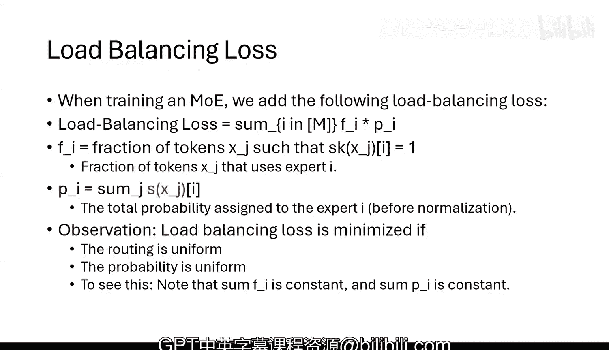