# CMU《生成式AI｜10-423 generative ai 2024》中英字幕 - P18：-P18-Lecture 17- Scaling Up Part III- Attention.zh_en - GPT中英字幕课程资源 - BV1CyC9BPEhG

Okay， hello， everyone。 Let's start today's lecture。

 and I see you guys do a little bit reformaing after the quiz。 So changing the position a little bit。

 I mean， that's exactly what page attention is doing。😊，Okay。

 but we will not talk about that in today's lecture。

So today we are going to talk about some more efficient way of computing the attention unit。

 I was planning to talk about page attention， but I think it go too much deeper into the hardware。

 which I don't understand too well， so I will only talking about other methods。

And for the last lecture， we learned how to accelerate the MOP computation using the M OE。

 really just by by pass by using like the sparsity or by imposing the sparsity into the MOP layer。

 Okay， so we know in some sense， intuitively that MOP layer is。😊。

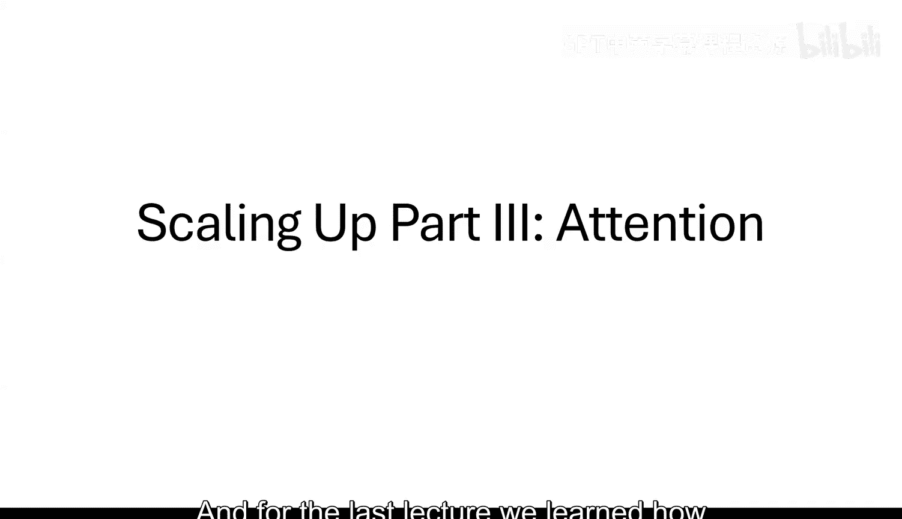

Assoiate with the knowledge in the transformer or in the language model。 Okay。

 you store the knowledge in the MLLP layer and you extract the knowledge from the MLOP layer。

And really， if you think about human knowledge， it's kind of like really， really sparse。😊，Okay。

Every time you talk about something， there's like a very sparse amount of knowledge that you need to extract from the entire human knowledge base。

 I mean， just think about Wikipedia， right， Wikipedia has 6 million articles。

 But when you search something usually is content within 10 articles。😊，He。

 there is no time that you need to look at more than 10 articles simultaneously。

 So that's how spae human knowledge should be。Okay。

 and then we use we impose the sparseing architecture。

 but we need to make sure that we actually extract the correct sparse side of knowledge。

 It's like a search engine right， you have billions of internet， I mean。

 web pages all there but when you use like bin search you know。

 I don't recommend you to use Google just use spin search。 Okay when you use bin search。 I mean。

 you will get a small set of concentrated pages。 essentially that's what you can think of the router in the MOP layer is doing it's like a search engine where you kind of do some matching of your query to the basically the knowledge inside Ms and you actually kind of focus on this particular small set of knowledge stored in the Mes so the router you can think of when doing roing。

😊。

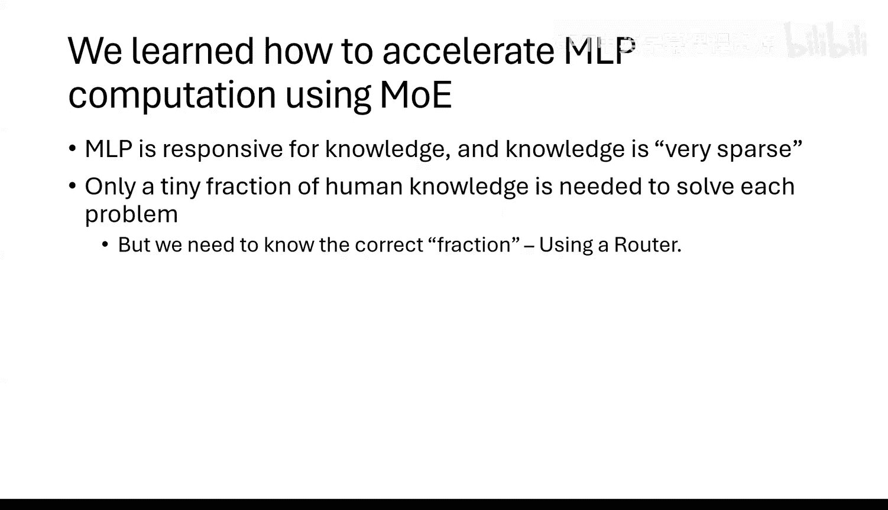

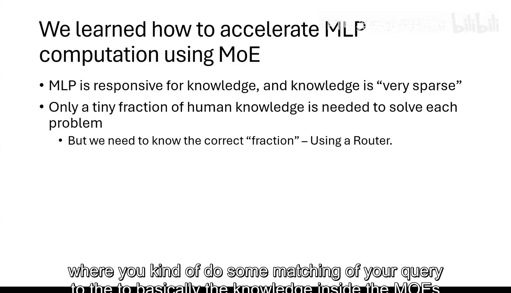

I think of you actually type in a search query and then return like a list of top results related to search query。

 and in this case， it returns a list of the top experts。😊，He， so this is M M MOP layer。

 This is probably the best thing you can do。 I mean。

 there are some other tricks that you can use in the MOP layer to speed up the computation。

 One particular trick is afuse kernel。 so fill the kernel is a particular implementation ina which actually fills some operations。

😊，I mean， to do it at the same time， for example。MLP layer consists of linear operation and记录 function and then another linear operation。

😊，Okay， so fuel the kernel can actually do the linear operation and the G activation at the same place。

 So you don't really specify them as two distinct blocks。 But those are ka level implementation， so。

😊，I'm not going to focus on today's lecture。

Hey， so basically， there are some ways also to speed up the attention。 in particular where today。

 we are going to talk about two ways to speed up the attention。 There is the flash attention。

 which is really， really useful。 Okay， it extremely good。 And then the multi query attention。

 which is whats the model architecture is using， for example。

 Mira uses multi query attention compared to Lama use standard multi high attention。

 So multi query attention is going to speed up the computation of attention also by a lot。 Okay。

 and then theres page attention that I'm not going to talk about。 But if you if you have time。😊。

There are also other type of attentions， for example， sliding window attention， blocks。

 bars attention， a lot of those things that we can briefly go through that could come speed up the computation time of attention layer。

Okay， but the most useful 1， I would say is flash attention。

 This is default integrated in hugging face transform unit at the moment。

 And it really makes the attention computation like almost 10 times faster。 It's really powerful。

 okay。😊，And also reduced the memory usage of attention layer by a lot。 So traditionally， for example。

 H 100 GPU， you cannot really try a 7 B model with context size more than 1 k。😊，哎。

 but with flash attention， you can出7 B model with context that working。😊。

It that's how much benefit you get with flash attention。 So that's our focus in today's lecture。😊。

Hey， any questions？And obviously， I mean， this flash attention library is in， I mean。

 it's your hugging face， standard transformer， which is means it's not what open I or Google is using。

 Okay， so they have even faster version than flash attention。😊，And unfortunately。

 I don't know what are those verses， but。Spiritually， they are similar， okay？

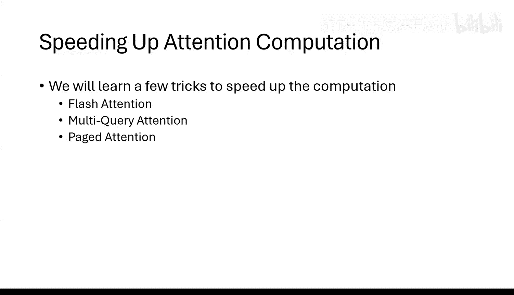

So basically， what's， what's the idea of speeding up the attention。

 So let's first recall what is an attention layer。 Okay， so there's a much higher attention layer。

 which consists of M attention has。 So given the input vectors， we1 up to V N。

 where you can think of N as a sequence line。😊，Or and each of the vectors are in dimension D。 Okay。

 so the attention of the or the output of the attention is really kind of going through all these operations。

 Okay， so you first compute like a soft Max score。😊，Of this attention soft max matrix so。😊。

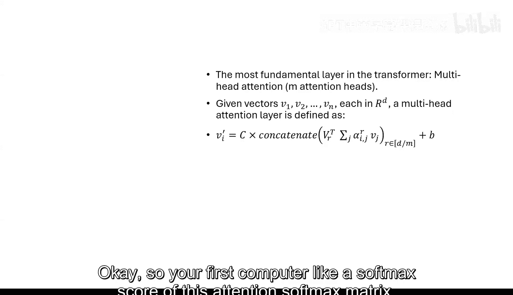

呃。Basically， your input look like this， He， there are n vectors each of dimension B。Hey。

 and then for each of the vector， He， you kind of compute a soft max matrix of size N N by N。 Okay。

 so this is like inner protocol。😊，I mean， Y IJ's entry is like the inner product of VI and VJ。诶。😊。

So basically， you'll just compute this inner product matrix and then youll take a soft map over each of the rows。

😊，Okay， just a soft here。And then basically， these are normalized。

 and you take a weighted summation of the VJs， according to this normalized South Mexico， okay。

So that's basically what the formula says， you'll first compute this softm matrix and then you'll take a weighted sum of your input vectors according to this phase。

 okay？😊，So you can view， I mean， the correct way to think about this is like this VI is called a query。

Okay， so when you have a query， you look for all the key here。

 you look at the inner product and you think about which query is the most similar to that key。Okay。

 for example， the query is about， let's say Microsoft。 Hey and V I VJ will be good。 Okay。

 and if the query is Google， then this VJ will be horrible。 Okayy。

 so this is all you should think about it。And so basically。

 you just look at the most similar vectors， according to this query。 Okay。

 and then you kind of and then the output of this query will be like a weighted average of the similar regionss。

 Okay， It's like youre looking at， youre looking at the past。 I mean。

 youre looking at all the tokens that were before you。 Okay。

 you kind of have this new token in your entire document。

 and you look at what are the similar tokens in the document compared to this one。

 And then I want to contextualize my current token by using a weighted average of previous tokens。

 Okay because previous tokens that are similar to this one actually tells us the context information of this particular token。

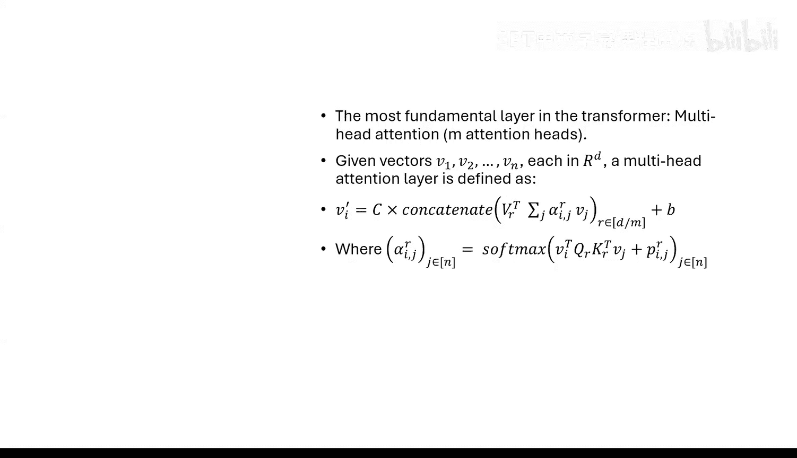

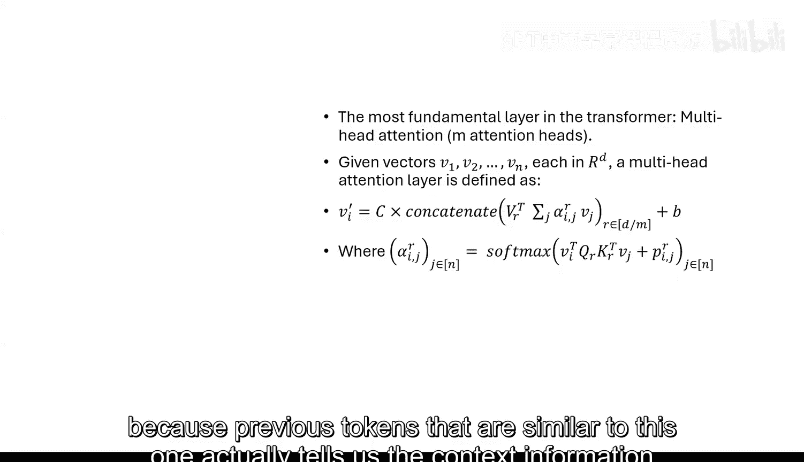

Hey， so for example， like， like if this to is something like。I mean。

 maybe some word that has a lot of meanings。 Hey， maybe it's called make。

 maybe this wholega is some representation of makeup。And you know， makeup has multiple meanings。

 right， It can mean like you actually fake something。 It can mean that you are doing the dressing。

 Okay， so what's the actual meaning of this makeup。

 You have to look at the word that are similar to this makeup。

 which maybe if the world is like somebody is trying to fool someone， right。

 then you contextualize the meaning of makeup， and you know that it actually means you're trying to trick someone。

可。😊，So the point is you have to compute this N by N attention matrix。Hey。

 this n by error attention matrix is basically the key of the of the self attention layer。Okay。

 and this area is really the input length。And main observation is for this self attention layer。

 the computation or the memory usage， these scales qua radically with n。😊，Right。

 which means if you have very long contact lens， let's say 100 k。

 then this matrix is going to be extremely big。 and memory usage。

 if you want to store all those inner products is going to be really， really high。😊，诶。Any questions。

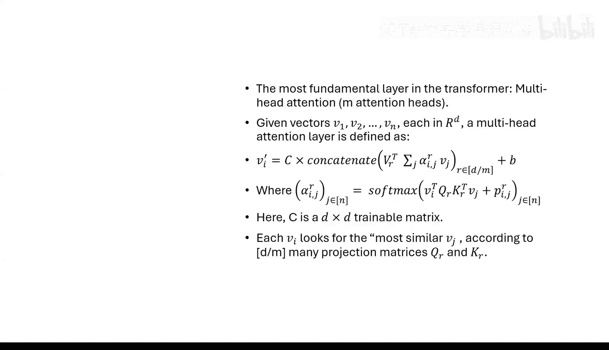

，So basically for transformer architecture I mean， that consists of all these layers。

 there's attention layer， and then there's layer normalization。 then there's residual links。

 and there's MP or MOE。 and then there's an additional layer norm。 He。

 and then there's residual link。 So the standard transformer block。

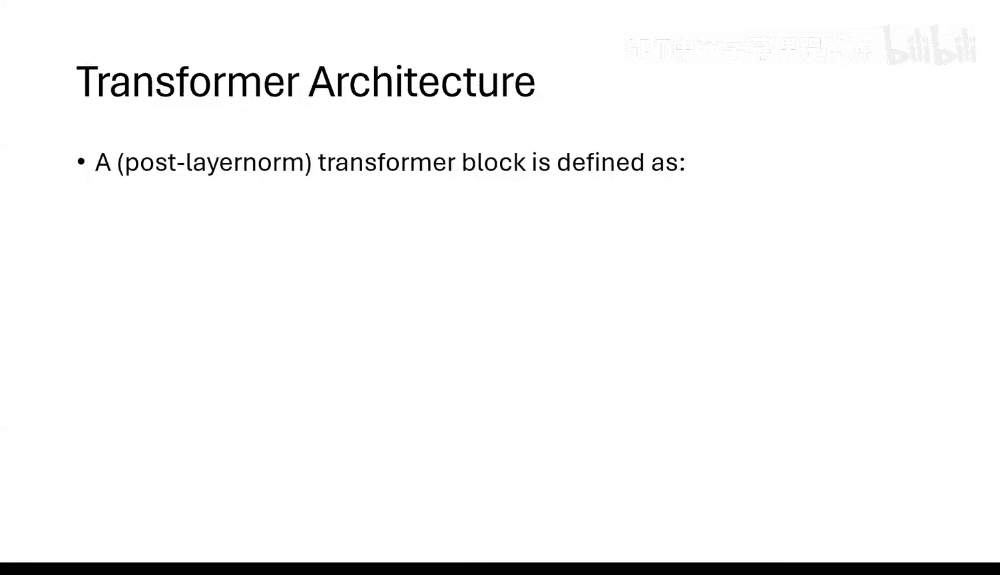

And the main duration is。

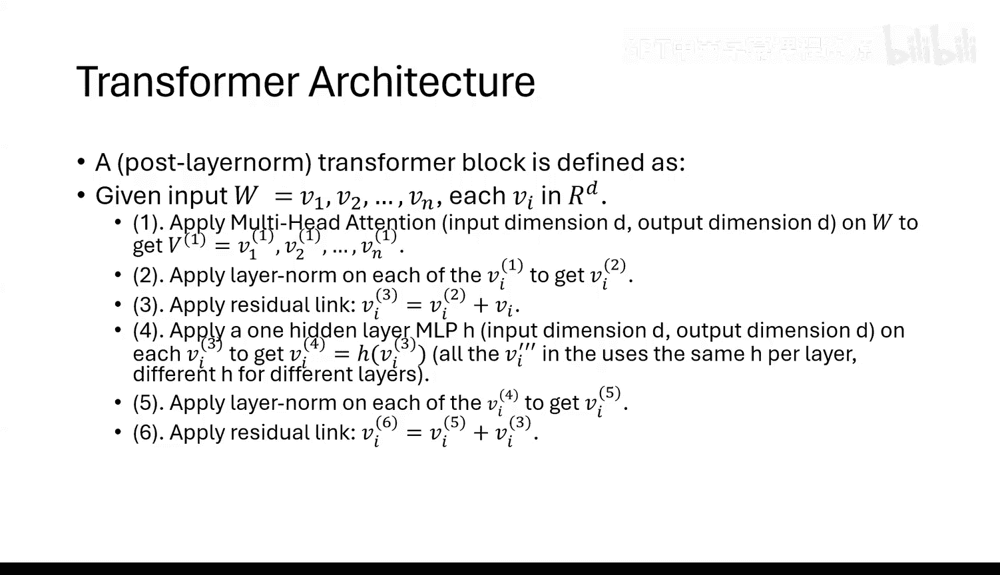

Sorry。The male of the ratio is basically the。Attention layer is pretty memory intensive。K。

So if you think about the forward and backward computation time。I mean， the MLP layer。Okay。Sorry。

 the MOP layer has the。I mean， the MLLP layer， the forward computation time is n times d squared。

Okay， because you have e square computation time for a particular token。Right。

 for M LP layers of dimension D to 4 D to D。 So the computation time is like D square per token。

 and you have N tokens。 So for M LP layer， the computation time is n times D square。😊。

And for much high的 attention， the computation time is like n squared times D plus N times D squared because。

😊，Like， whats， I mean， what is n times d squared， The n times d square is essentially those， like。

 I mean， those value matrix times each VJ。 Okay， so each of these computation takes d square time and also the K matrix times each V J。

😊，And the Q matrix times each V j。 Okay， so those computation time。

 those C takes computation time D squared， and there are any of them。Right。

 so youll have your inputs via up to the end。And for each input， you modify it with a value matrix。

 you modify it with a key matrix， you modify it with a query matrix。😊，Okay。

 so you have a computation time of n times D square， but theres an additional computation time。

 which is n square times D corresponding to this。😊，Self attention block。

 right This self attention is an n square matrix。 and each entry， the computation time is D。Okay。

So for selfation layer， there's n times d square plus n squared times d computation time。

 And you can see the n times d square computation time is the same as the MOP。

 But the n square times D would be really large if your sequence size is very long。😊，Okay。

 so for self attention， layer， it really suffers for a long sequence。

 Okay and the suffering is even more intense when you talk about the memory。😊，Yes， sorry。

 So when you talk about the memory usage for the MLP layer for forward and backward。

 you only need to store the activations and mean if you learn how to do back propagation in traditional。

 I mean， neural network， you only need to store the activations or store the output of some nonlinear stuff。

 which is the her token and N for N tokens。😊，Okay， but for much high attention。

 you actually need to store this type of thing。And you need to store this matrix。 And moreover。

 there are actually M has。 So you need to even store more things。 You need to store N by N M N。😊，Hey。

😊，So you really need to store a lot of this。😡，So far attention layer iss really like in terms of memory is even more intensive。

 right， You can see those things。 I mean， this is n times D， but this is n square times n。

 and usually M is some linear function of D。 So M is usually like D divided by996。

 something like that。 So you really have like n square times D memory。😊，Okay。

 and n times the computation time。 So in terms of memory usage， this might had attention is really。

 really extreme。😊，Because you have an M has and you have this n square matrix that you need to score because all of them consists。

 Each entry of them consists of some nonlinear operation。😊，ok。Any they questions。Yes。😊，嗯好的。Yes。

But theyre respectful inadequate。Sequence then，Yeah。

 so self attention is like scale or directly without with the input sequences。

 both in terms of memory usage and in terms of computation time。😊。

So the main problem here is actually the memory usage。

 You don't really want the memory usage to be a qua function， because。I mean。

 this term is clearly dominating the rise because M is a linear function of D。

So you should think of this M as like something proportional to D。Great， any other questions？

Okay cool。 So basically， we want to learn a technique， which is called flash attention。

 and it's going to very effectively reduce the memory usage of attention。 Okay。

 its reduce memory usage from n square to something almost linear in n。😊。

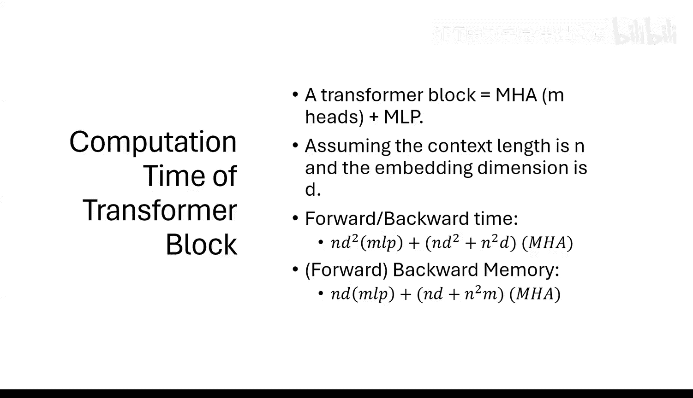

ok。😊，So basically， the important observation of how to reduce the memory usage of selfat is essentially not stor this entire and in this entire role into your memory。

 but only store some part of it Okay， so only start part of the role in the memory。

 and you kind of do some recomputation of other roles or doing some other and more clever computation of other roles without actually storing them in the memory。

😊，Okay， so the naive computation of self attention is essentially you compute the inner product first。

 and you store everything in the memory， and then you compute the soft next。😊，Okay。

 and flash attention is going to do something more clever。

 It's not going to store all the inner product in the memory at the same time。

 whether it to only store part of them， Okay， and try to do something clever in between。😊。

So to understand， I mean， how flash attention works。

 we can really just take a look at one self attention inside of this multity head of just one head of the attention inside of the multityha attention。

😊，Okay， so basically， we consider this one row。And the question is。

 can we compute this output of this one particular row without actually storing everything in the memory。

Okay， so can we compute the inner product and then the soft without storing everything in the memory。

😊，系你 questions。Yes。😊，知道了。Sa。So doing so。Instruct story can grow in party joint with all the roles。

 but its at an issue we are startingor just part of the talk product。啊。I mean。

 but myive implementation， it will just write the code in pie to。

 It will definitely store everything in the memory。😊，But you have to， I mean。

 you have to do some customization of your code。 so it doesn't store everything in the memory。Well。

 that's the sexually this algorithm that we are going to talk about。

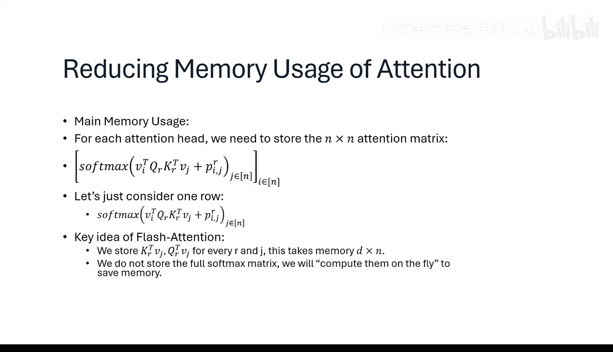

So you mentionedYeah， you actually saw some particular reflection of the role。

 which is a final algorithm， but we will go to that point， I mean。

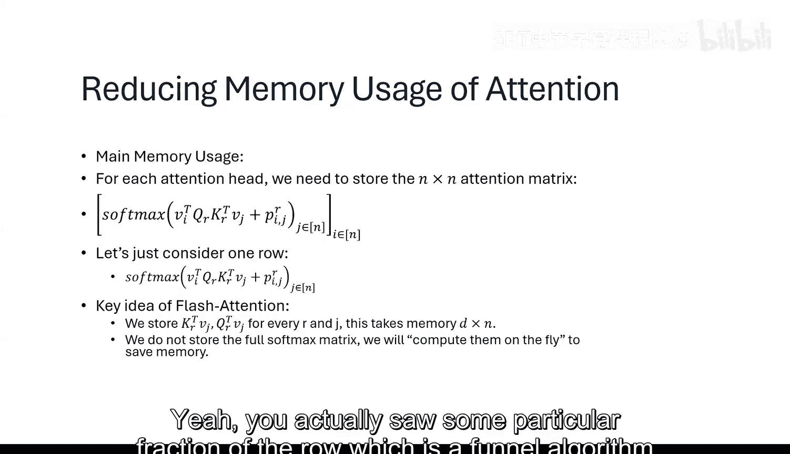

sequentialequificialally， okay， any other questions。腿裤。

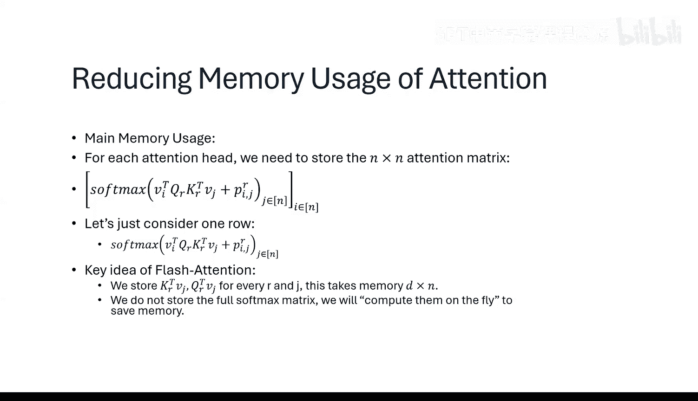

So basically， the key idea of the， I mean， the key idea of the flash attention is really just computing this softm thing in the fly as opposed to storing everything in the memory。

 Okay， so if you， I mean， just to give you some content。

 if you just write the self attention in the most stupid way。

 which is how you would write as a password unit。 Okay。

 so you would write like basically what would what would you write。

 You would write like something like few trans times right and softm。😊。

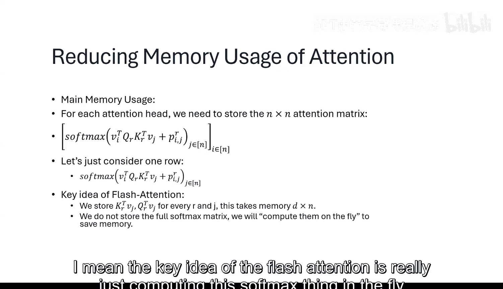

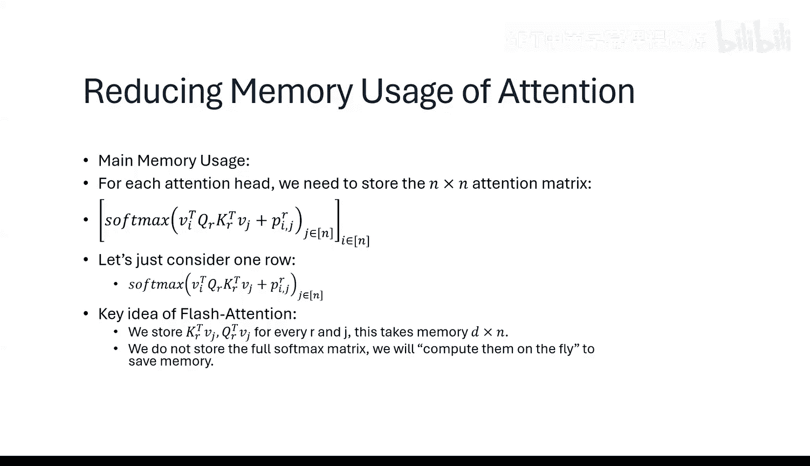

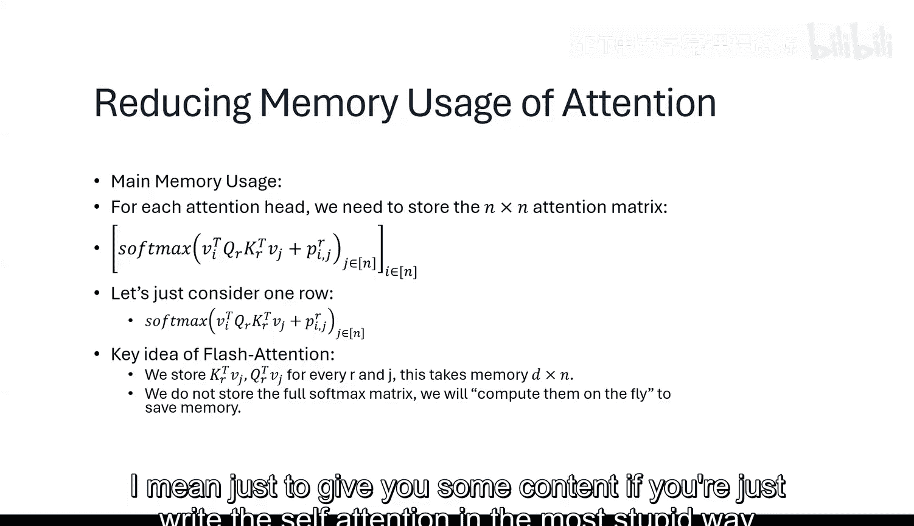

Hey， and then this matrix and then doing some operation on each entry of this matrix。

 But this is how you should your， I mean， the standard implementation in for fu do。

 But this one will definitely store the entire matrix in the memory。😊。

 which actually blows up the memory usage by a lot。

So how do you actually do do the computation of the of the attention。

 which means compute output of the attention without storing those things in the memory。😊，Now。

 the first simple algorithm， which we call it stupid attention computation。

 but still it's a little bit more clever。 is basically the following algorithm， okay。😊。

So think about you want to compute sum of Y I times the soft max of x of I。 Okay。

 so for each of the X I and Y I， we need computation time B O M to retrieve it。

 It's basically the computation time to compute this inner product。😊，He。

 the computation time to compute the inner product， because each had， I mean。

 the inner dimension of these things are in dimension D OM。 So basically。

 you need computation time D O M to retrieve each entry of X I。 and also for Y I is the same thing。

Okay。So how do you compute this without putting everything in memory。 I mean。

 the naive solution would be compute X first and store every entry of X in the memory and then compute the softm。

 right， But that would use memory N。😊。

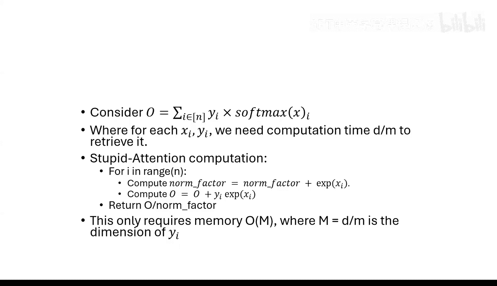

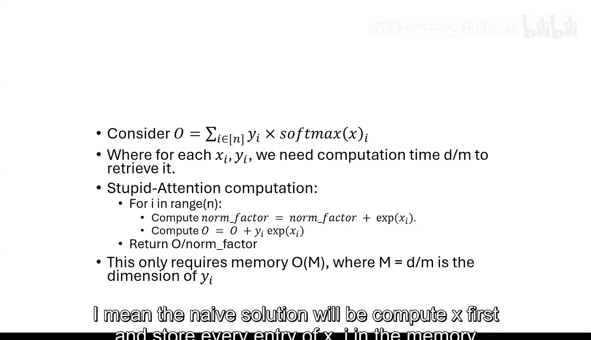

So a color rate of computing is is maintaining this running average and only store the normalization factor and the O in the memory。

 Okay， so you only store these two numbers in the memory instead of storing a vector of dimension N in the memory。

😊，Co， okay， so basically， the more memory efficient computation is you， first of all。

 you go through I from one to n okay， and normalization factor every time is going to be add by exponential of X I okay。

 and all is going to be add by Y I times exponential of X I。😊，Okay。😊，Okay。

 sorry it's always not really。 a number is a vector of dimension D or M。

 So your total memory usage is the memory for this normalization factor。

 which is constant and the memory usage for this O， which is D or M。😊，Okay。

 and this is much more efficient than than N。 Okay。

 so D O M is smaller than D and also is smaller than N。 You should think of， I mean， for simplicity。

 you can think of D as roughly the same order as N。😊，Okay。Any questions。Yes，Yeah。

 this follow is pretty slow。 That's why it's stupid attention。Yeah， but at least it saves memory。

 right， It's treat of memory and computation， I mean。😊，Originally。

 if you just track all the X together， you can use the fast matrix modification to compute those exercises very fast。

😊，Okay， because its like vector times a matrix and it's very fast。

 So you can get all the X very fast。 But then you have to store all the X in the memory in order to compute the software next。

😊，Okay。😊，Because a soft Max is not something you can compute like you using only part of the Xi。

Okay soft Max depends on all the X I。 So you have to store everything。

 the memory you to compute this output But using this full loop， at least you save the memory。

 But as a student said， the computation time is really slow because you have a full loop。😊，诶。😊。

And also， not only that， I mean， not only the computation time is slow。

 but there's also a bigger problem of this stupid attention computation。

 which is floating to an accuracy。Okay， so look at here。

 you are keeping adding something of exponential of X。系。😊，So you know floating point。

 let's say you use F 16。The exponent of the X I is actually pretty small。 Okay， exponent of X I。

 I'm not sure I remember what's the exact number， but something like 300。😊，Okay。

 so if your exercise is larger than that number， this exponent will just blow up， I mean。

 it will overflow。😊，诶。So this means this computation is really， really unstable， right。

 If your X is very large and you add exponential of X to your to your number。

 like you will just flow up the floating point accuracy， You will just get N A N very likely。😊。

 so you cannot do this operation for at all， not only for speed reason， but also it just not valid。

It's not valid to implement such an operation in Ptorch because the floating point accuracy。Okay。

 so saves a memory， but then it blows up the floating point accuracy and also running time is very slow。

 So this is like a stupid approach。😊，Hey。😊，But it turns out that flash attention is based on this stupid approach。

 Okay， it's just an upgrade version of the stupid approach that makes it more efficient and more kind of floating point friendly。

Hey， yes。Okaycom。What a very nice version of be。Its still because。the。

 you only saw the O and normalization factor。 and every time you update the normalization factor and the O in place。

😊，就还。So if you naively compute， you have to compute x first， the entire vector x first。

 and you store the x in memory， which is already an。😊，傻晒啊。This is old。Versus EM。

 which is this new one。Okay， so the old memory usage is N because you need to compute experts corresponding to you compute these matrix experts and then compute the soft Max。

 This is N memory usage per row。😊，And the new computation is still O M memory usage per room。嘿。

 because you do this for loop。 You actually don't really compute。

 I mean you don't really compute everything。Okay。Any questions。Okay， so for this particular row。

 the old one takes N memory。 The new one takes your or M memory。😊，诶。😊，系。What I mean。Why， I mean。

 if you think about that， why would the new one takes even lower memory than it's because although this entire row is used in the computation。

😡，But actually， what you want in the output is just a weighted average of the entries in the room。😊。

Okay， you don't really need everything in the row。 You just need a weighted average。

 So can compute sequentially compute weighted average sequentially without really needing to store every element in the role in memory。

😊，Hey。😊，But this computation has a lot of drawbacks。 First of all， it's a for loop。 Second of all。

 there's floating point and accuracy issue。

So how do we deal with the easiest one， which is a floating point accuracy issue。

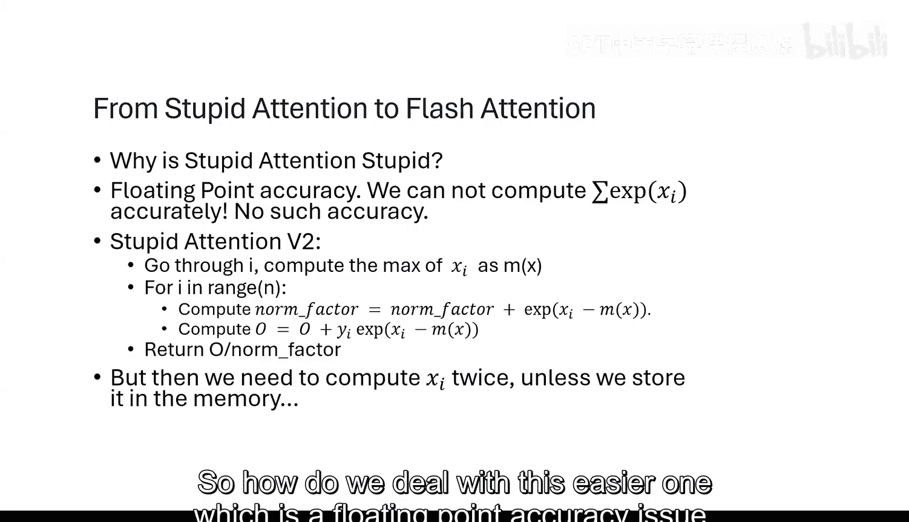

Well， it turns out that this is how you deal with floating point accuracy issue。

 which is a pretty clever solution。So you first go through I and compute the max of X I as I of X I。

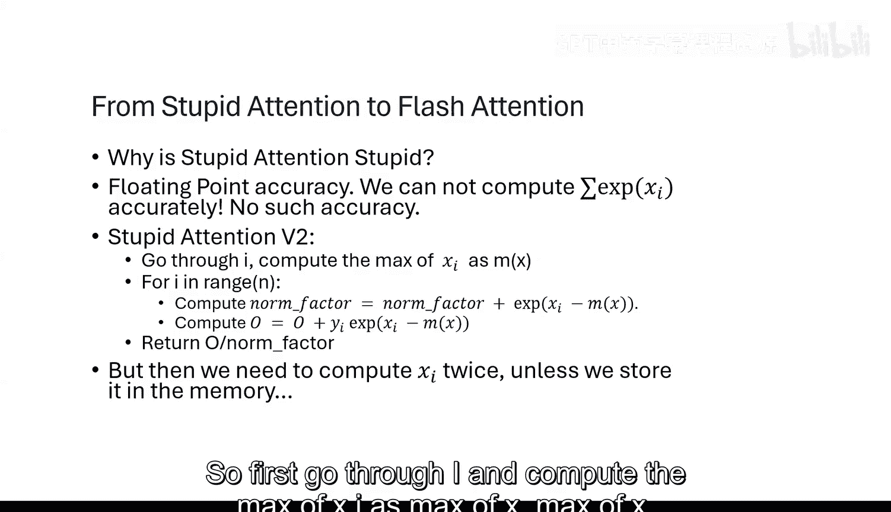

M5， okay。So you first， I mean， you first go through the X size。

 You can update the max in a sequential order， right， You don't need to store the entire X in memory。

 You can just compute the X I and update your max as the max of the previous and the new X I。 Okay。

 so you can go through the entire I and compute the max。😊。

And then when you compute the normalization factor and all。

 you actually subtract the max from your computation。😡。

睇。So why this solves the floating point issue is because this M of x is equal to some of the X I。

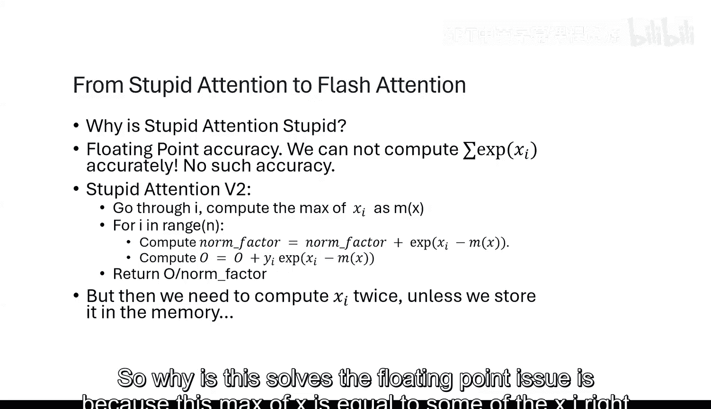

Right this m of x is equal to some of the Xi， which means some of the exponential will be one。Okay。

 so some of the exponential will be one。 But what happen， I mean。

 and all of the X I are smaller or equal to M of x。

 So what's inside exponential will always be smaller or equal to 0。😊，But what if it very negative。

Now， for very negative， you don't care， right， If it's like 10 to the negative 10 versus 10 to the negative 20。

 So will just contribute to nothing to your final sum， because there's one term in this sum。

 that is one。😊，So if there's one term in the sum that is one。

 and there are some other terms that decide 10 to the negative 10。And you really don't care， right。

 You don't care if they are  tend to the negative 10 or tend to the negative 20 or  tend0 to the negative 30。

 They are all neglectible。

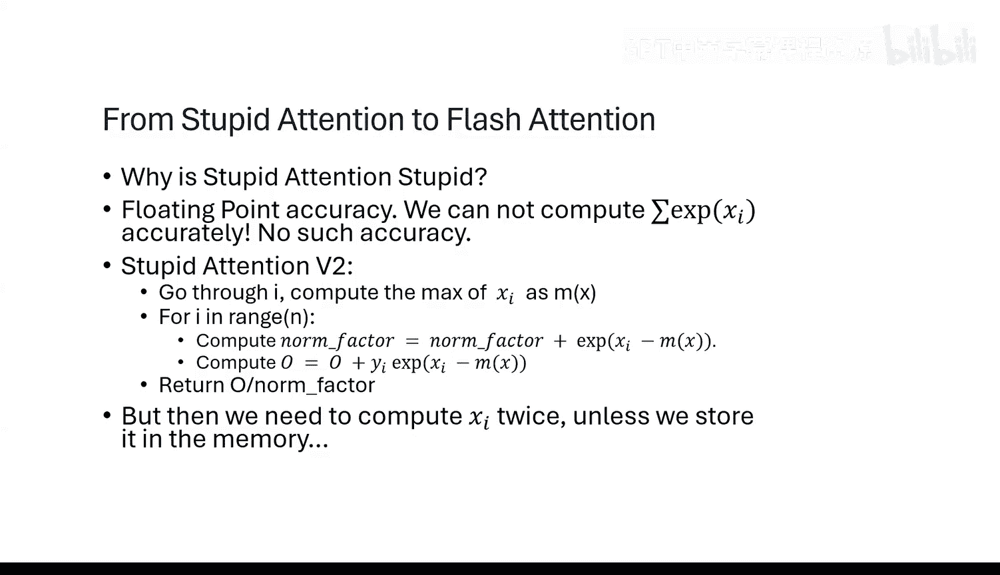

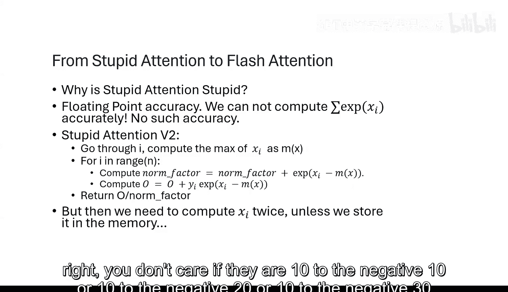

企。😊，So basically for very negative numbers， even if they are extremely， extremely small。

 very negative。 And then the exponential is very inaccurate relatively。😊。

But relative to the actual number itself。 But relative to one， they are all negligible。睇。😊。

Any places？Yes。😊，Doesn't it make me？我son来 the library on is0 one。Sorry so wouldn' it make the。

Exponential rather to lie between。0 and one， yeah， the exponential lies between0 and one。

 but this is still。The output is still valid， right。

 because you subtract Im from both the normalization factor and home。

 So if you return like O divide by normalization factor， it's like you didn't subtract anything。Yeah。

Yeah。But this will just make your computation more accurate。

 It makes the floating point computation more accurate。😊，Because。I mean， originally。

 the problem is if some X I is extremely large， Is say 1 million。

 but now if some X I is extremely large， like 1 million， then the M X will also be 1 million。

 And for that X I X I minus M X will just be 0， which is very accurate。😊，Okay。

 and for the other exercise。I mean， if they are much smaller than 1 million。

 they just contribute nothing to the soft net。 So here。

 although this thing is non accurate for very negative values， but for those。Non accuracy。

 you don't care because they are in small。Hey， any questions？北裤。

So but the problem here of this implementation is you actually need to compute X twice unless we store it in the memory because you compute the Xi once when you do the a max。

 when you do the max computation and you compute the Xi again here。😊。

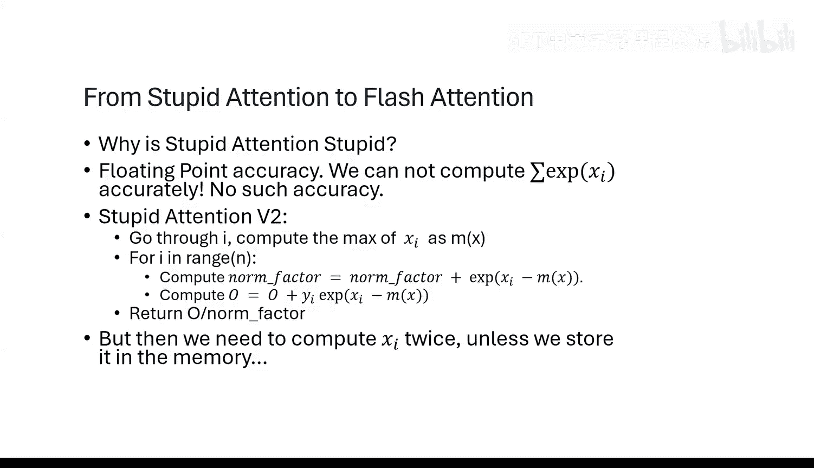

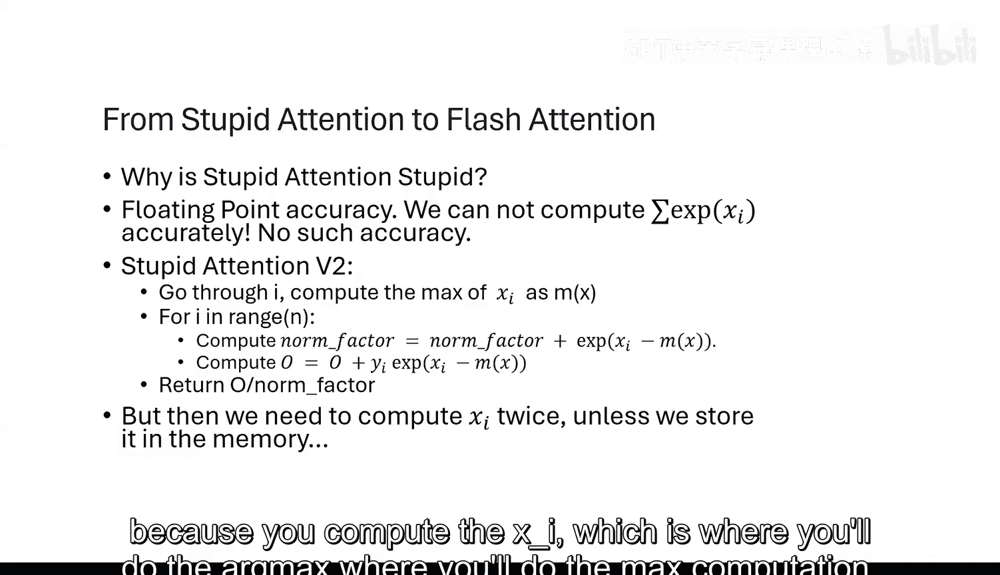

Okay。😊，So you can think of X as the inner product。 every time you need to compute X。

 you have to pay some additional computation time unless you put it in the memory。😊，ok。😊。

But you really don't want to put all the X I in the memory。 You want to use this running computation。

 But because you compute max first and then compute this full loop。

 you actually need to retrieve X I twice。😊，Okay， unless you store it in a memory。

 If you don't store in memory， you have to recompute the X I。Okay， which takes。

 Why is the amount of computation time。So still， there's a full loop issue that we haven't solved。

But we solve the floating point Y， But then we increase the computation time again because we need to compute the X twice。

诶。😊。

Yes死。😊，对。He story。点解要大线。I mean， for every token， you need to store the basically the output。

 but we are just talking about for one particular token。

 how do you actually compute that output without storing the intermediate softm values because the subm values。

 they don't really appear in the final output。 They just some intermediate step that you use to re the vectors。

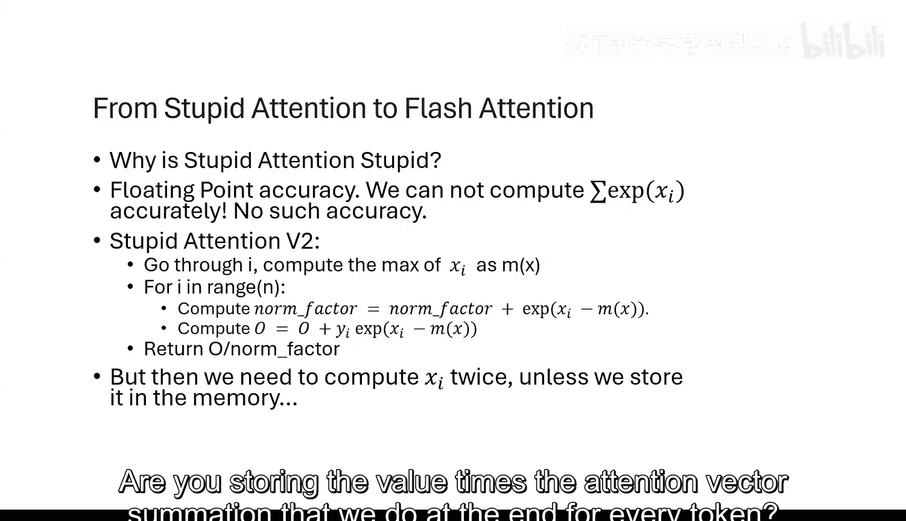

Yeah， this is for one token。So for one part were talking for this role。

You are reducing memory usage from N to deal over M。Okay， so for the total。

 you still need to pay some back of n because its impossible to be faster than n times something。

 right， You have n tokens。 So linear in a is necessary。

 but we don't want quadratic in N in terms of memory usage。

timesYeah， so basically your final output is like your final output for one token in self attention is like a weighted average of the value function of of the other tokens。

 so you can think of why I I see values。😊。

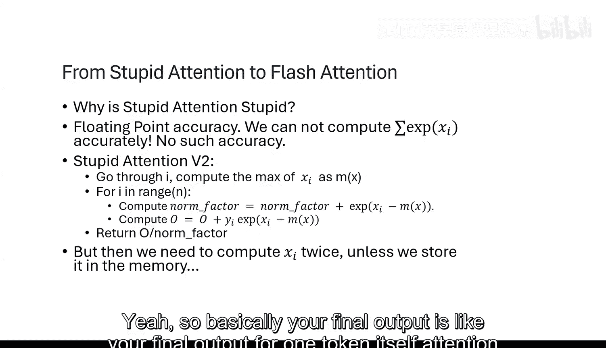

And X IRG kind of。呃，T times square year。Yes， this changes。Softback output no。

 it's the same output as before because you are subtracting。

 am I exposing O and normalization factor。

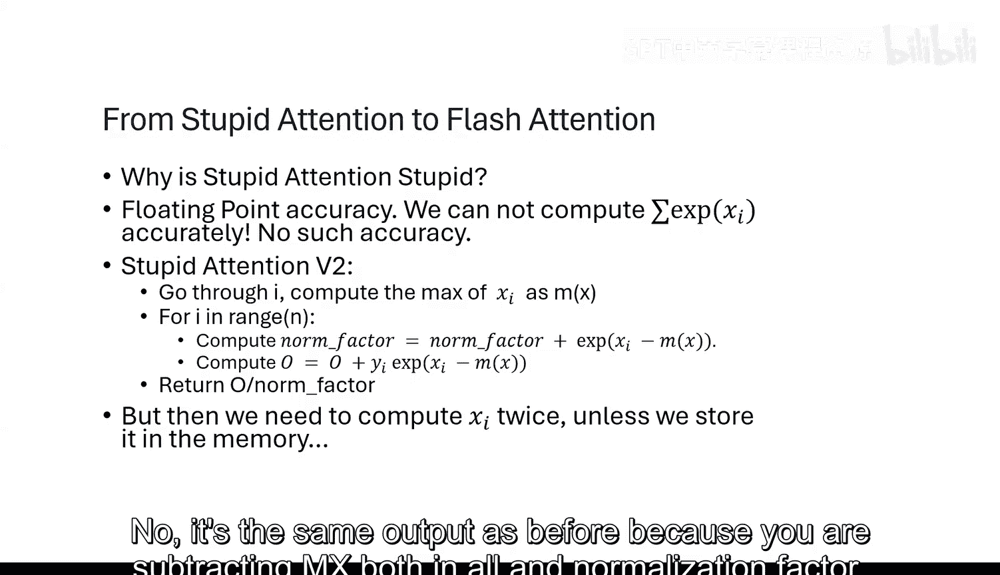

So if you return O divide by an normalization factor。

 the subtraction of M X doesn't matter because exponential of a minus x divided by exponential of B minus x is still exponential of a divided by B。

But this just may solve the floating point issue。By restricting the exponential to be between 0 and1。

O。Any other questions。Yeah， so how do you， I think still。

 maybe some of you don't really understand the computation process， so maybe let me raisese it here。

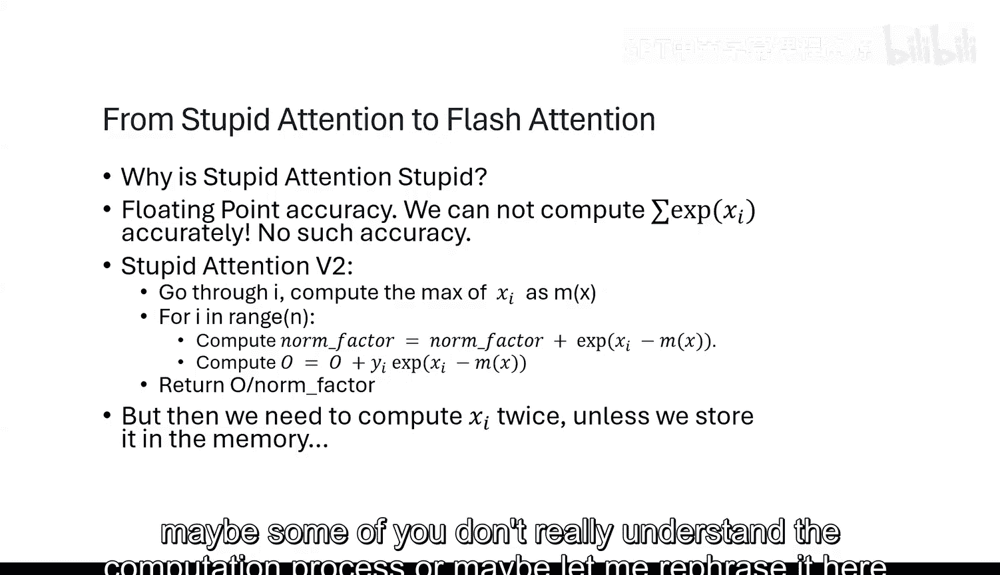

So basically you have this vectorta x， which is x1， x2。😊，Absolute accent。

 but think about this thing as hidden in some light bulb。Okay， so it's hidden in some。

 So this is in some pockets。That you cannot really assess。 Okay。

 so this is in some pocket that you cannot really assess。 And also there's。Y 1 have to Y N。

 yet all of them are in a pocket。哎。So all of them are in some pocket that you cannot really assess。

 and you want to compute some of Y I times the softm。All facts好 five okay。So basically。

 you want to minimize。 So every time when you look at， you pick one Y I or one X I from the pocket。

 you pay some computation time。 Okay， so you can do the following operation。

 You pick some Y I or X I from pocket。You place on computation time。Or you store something。

Store whatever in memory。诶， they有 pay memory。😡，Hey。😊。

So what you want to do is you want to reduce this memory usage while keeping the computation time unchanged。

😡，So what is a naive implementation， naive implementation is I just pick up everything from the pocket I saw in my local machine。

😊，They can I pay this。Computation time once， because I pick up everything from the pocket。

And then I pay the memory of everything because I need to store everything。Okay。

 so I paid the computation time once by extracting everything。

 and I pay the memory by storing them in the memory。 Okay， if I don't store them in the memory。

 and I will forget， and I need to extract them again。😊，Okay。

 so naiveively presentation is doing an instruction first。

 so doing this stuff first has shown everything in the memory that you can do whatever you want from your memory。

 so you don't need to pay this cost anymore。😊，But this new implementation， it does extraction twice。

 Well， don't really store everything in the memory， right。

 What it does is is extracting this thing one by one。😊，哎， but its only store M of X in the memory。

Okay， so the computation， so the course is， you extract everything one by one and they you pay this memory cost of storing the M of X。

 not really storing everything。 and they you go through the for loop。

 you extract everything one by one。😊，And you only store this。I mean。

 normalization factor and all in your memory。Okay。😊，So your total memory house is very small。

But to extract X。 Okay， so play more in this computation time。He。

 so basically this is our model of computation。 We want to minimize the computation time and also the memory usage。

 and now we minimize the memory usage， but the computation time is higher because we go through X twice。

 We extract them twice。 How do you avoid extract them twice。

 Well the naive solution is extract them once and store everything in the memory But then you pay this memory cost。

 right， So you really want to kind of solve this conflict。😊，Any questions， yes。て。So next。

 we don like why times。E XP of x by sum of x y of xNow this is y times EXP of x divide by the so this is all divide by normalization factor the normalization factor is a summation of exponential of x。

So what？So if you， if you ignore this， I of X， that is the。It's a sum of exponential of X， right？

But subtracting M of x doesn't do anything because you're subtracting it both from the normalization factor and from O。

😊。

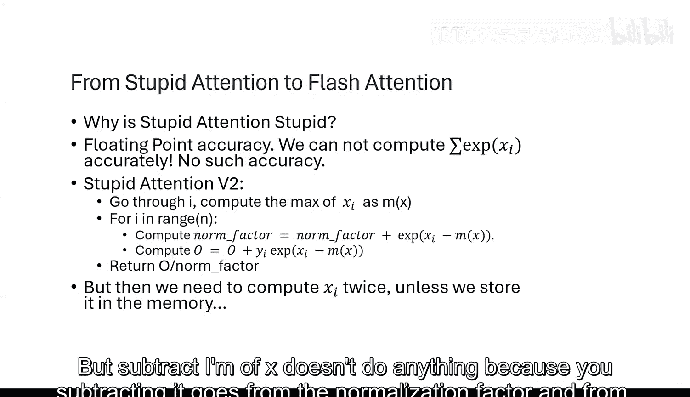

Yes。😊，别写。So when you say extract or computer site twice what does it computation model。

 so your exercise are in some pocket that you don't have access to。Okay。

 and the first time when you compute the max of X， you track X I1 by one。😊，To compute max。

But you don't really have this， I mean， because youre memory limited。

 you cannot store the entire X I。 So you only store the max of X I after extracting them one by one。

😡，But the next time going in a photo loop， you need to extract the X again。😡。

So we extract X twice from the pocket。And so pay twice the computation。没呀。

time that's why we X I is X I is like the output of the inner product。

 So every time you only start the VI and vectors。 So every time you want to compute the X I。

 you need to compute the inner product first， that's why you pay the computation time。Hey。

 any other questions？Yeah， I know this part is pretty difficult。

 but I hope you can understand kind of the spirit of the flash attention。诶。😊，So now how do we solve。

 I mean， how do we deal with this computing twice issue。

 Because we extract the X I once when we compute the max and extract X I twice when computing the sum。

 Okay， so here is the kind of stupid attention V3， which will address the instruction twice issue。

Hey。😊，So it computes something like a running max。 Okay， so this is a full loop。

 which means it only go through the data once。 and it actually uses something called running max instead of an actual max。

😊，Okay。😊，So what， what it does is actually， every time you subtract the runningmics from this。😊。

Have from the norm and from the old for floating point accuracy。

 But you need to make sure that your exponential is always between0 and one for floating point accuracy。

 You cannot make the exponential too large。 So subtract running max。

 this make sure that this value is always between 0 and1。😊。

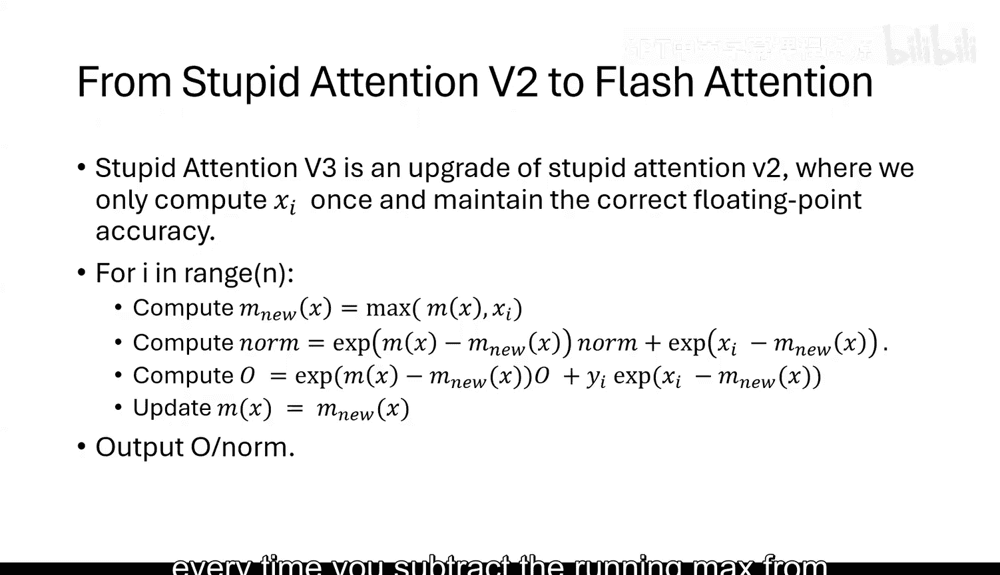

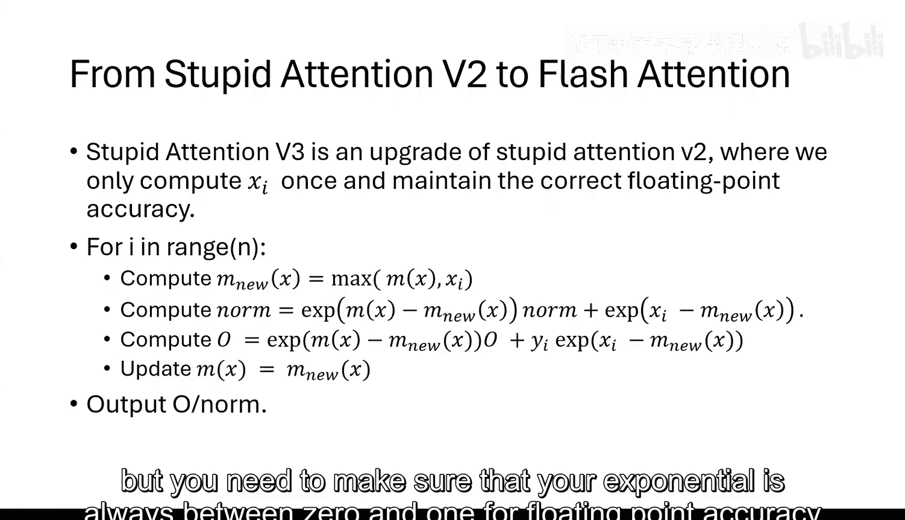

Maybe because I new inside the running mice is a currentmic。

 So whatever you subscribe is larger than。All the possible X that you have seen Okay。

 and I new is definitely bigger than M X， because every time the I new is like a max of M X and X stuff。

😊，Okay， so it's essentially like the update is， you don't really need to extract the maxs and then do the for loop。

 You can mention running Macs when doing the for loop。

So it's a pretty clever idea developed by the flash attention authors。

 and this is essentially their main idea。😊。

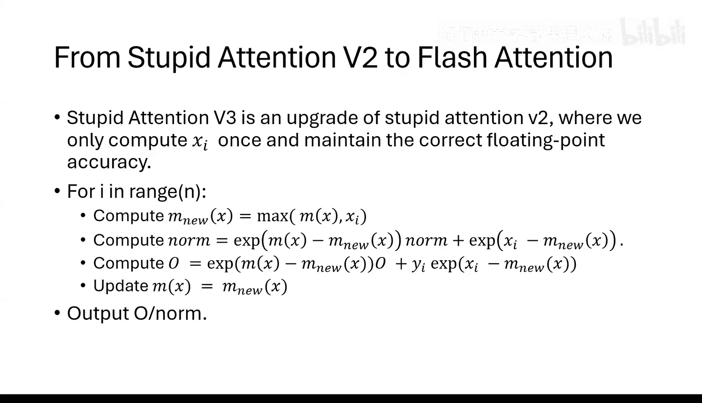

Hey， so' just maintain this running map instead of computing the Mac first。😊。

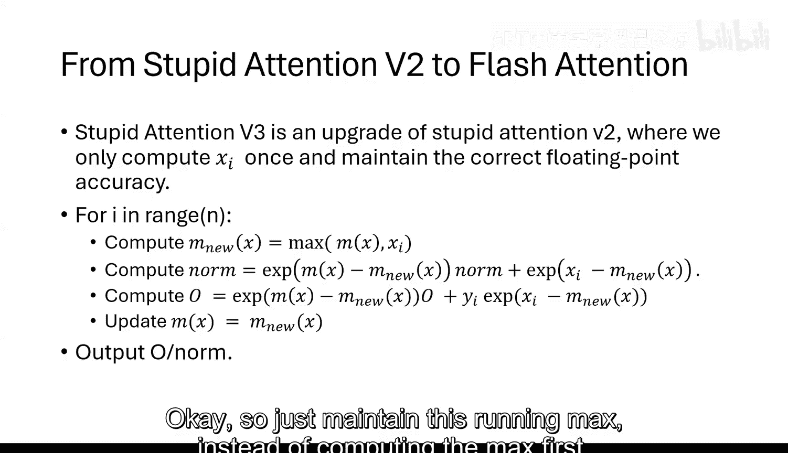

Yes。No， this doesn't change the attention value。 This still gives you the correct output。Yeah。

 but two things this formula eventually will still give you the correct output。

 even if you are changing everything， so it's pretty not obvious， but that is the fact。😊，Okay。

 I mean， you can work out the calculation and see that it actually give you the correct output。

 So pretty magically。😊，Yes。M of X， you will store in memory。

 so you will pay us memory because of this M X， M new of X， this O， this norm。😊。

But these M X are just one value。 And this always a very small vector。 So your memory usage is still。

😊，嗯DOM。And your computation course is the same as as the most naive version。

 so maintain the same computation cause， but you really reduce the memory usage by a lot。😊，He。

 and this algorithm is not what Pto would use by default。 I mean。

 if you just say computer soft max to use a naive version。Which blow up the memory。

 So you need to write this customer code。 Actually， the flash attention is a ka level code。 Okay。

 they actually write this algorithm in ka in C。😊，So it's almost， I mean。

 this pseudo code is almost like their code。 in C code， you also use four loops， okay。😊。

Any questions？He cool。 So visiting this is almost a flash attention。But as the student was noticing。

 this one still uses a follow， it doesn't really utilize。Sorry。

 it doesn't really utilize a fast matrix modificationplication right everything is like vector valued everything here is vector you never have a matrix there so basically that story is in Ka like if your matrix is in certain shape。

😊，Then the computation of matrix multiplication is very fast。 The shape is roughly like 96 by 96。😊。

Okay， so if you can partition your matrix into of shape of 96 by 96。

 then the computation of that particular shape the matrix is very fast。

 That particular shape matrix is hardholded in the in the hardware。 Okay。

 so that there's like the cool output is really just optimized for matrix of those shapes。 Okay。

 but here， everything of vector。 They are not really the computation are not very fast。 and。😊。

The point where this is slow is basically if you track the X1 by one。 Okay， so what are the X I。

 The X are。Those in their products。Right， the X are those in the product。 I mean。

 if you compute the X in groups， then you will compute the vector times the matrix。

 then the computation is very fast。 but you will just compute vector times vector and the vector times vector。

 The vector times vector。 Then the computation is really slow。😊，诶。😊，So although theoretically。

 this is the optimal algorithm to compute the self in terms of computation memory， but hardwareily。

 you need to still use some matrix ver。😊，K。😊，Any questions？

So basically， then we go to the final implementation of sell of flash attention。

 So this is flash attention V2。

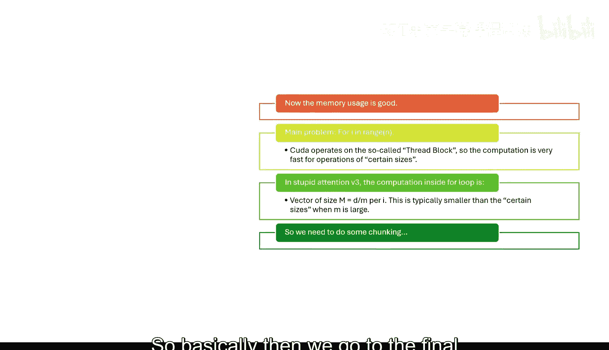

Okay， so what it does is almost like the， I mean， the stupid version V3， but now it uses the block。

 I mean， it uses fast matrix modification。😊，企。😊，So it actually， I mean， this algorithm， I mean。

 this formula is a little bit complicated， but what you can think about。😊。

Hi levelly is basically ising the exercise in。So tracking the X in logs。Okay。

 so instead of doing a follow by extract the X I 1 by one。

 extracting the X I in blocks and compute the soft max of those X I in the block。 I mean。

 compute the softm of X I naively。 So that causes some additional memory。

 but the speed of this is extremely fast。😊。

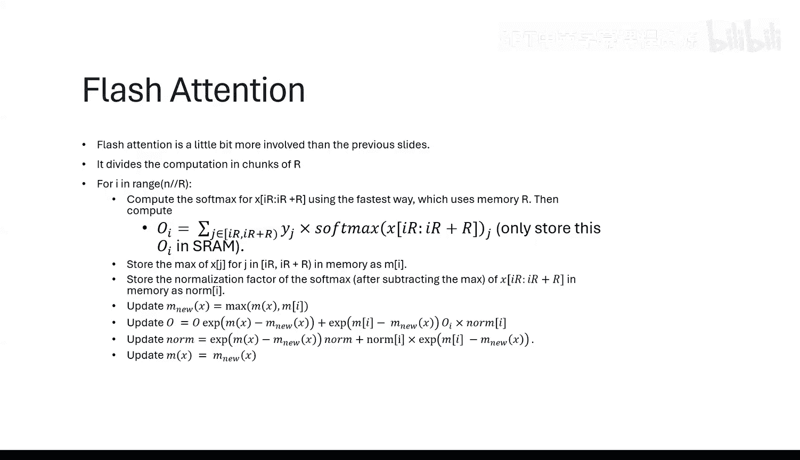

Okay， so in track those exercise on in blogs and your four rub is only go through blogs。Okay。

 so this is four loop 1， this is 2。 this is three。 So instead of doing the full loop on vector level。

 you are doing the full loop on block level。He so think look at here。He。

 so you are doing like the for loop in like a block level。Okay， so compute this all matrix， which is。

😊，I mean， essentially those O eyes， hey， those O eyes are the softmics or whatever is like the computation inside a block。

哎。😊，So basically， you computer self self attention in the na Wei inside a block and the block is really small。

 You can think of but it that like 96 by 96 is a constant size block。😊。

Okay that optimize for ka kernel。 So that doesn't really cause too much additional memory。

 The block is really small。Okay， and after you compute the self attention output put the selfat in that particular block。

 Now youll go through a full loop over the blocks using the same formula to compute the actual self attention。

😊，诶。😊，He酷，So this combines the best of everything that we have learned uses this runningmics Huai floating point。

😊，I mean， do I avoid， F Jing point andarrow。And also to avoid extracting X twice。 And also。

 it proves the X I in blocks。 Okay， so this four loop is not over all the X I， but over the 1，2，3。

4 up to whatever many blocks that you have。😊，Okay， and for each block。

 you are using the stupid attention computation， which uses more memory。

 but is very fast because you extract all the X at the same time。

 So can use the fast matrix magification in the inner products to extract them faster。😊，Okay。

 so this is a pretty advanced algorithm， but spiritually is also kind of simple。 Okay。

 you need to solve the floating point issue。 You need to solve the memory usage issue。 Hey。

 you need to solve the instruction twice issue， and you need to solve the fast matrix modification issue。

 and all of them together gives you this algorithm， which is called flash attention V to。😊。

Okay and this is not something排拖数 do。 If you just write your model哪ively and also。

 this is not something you can do using排拖。

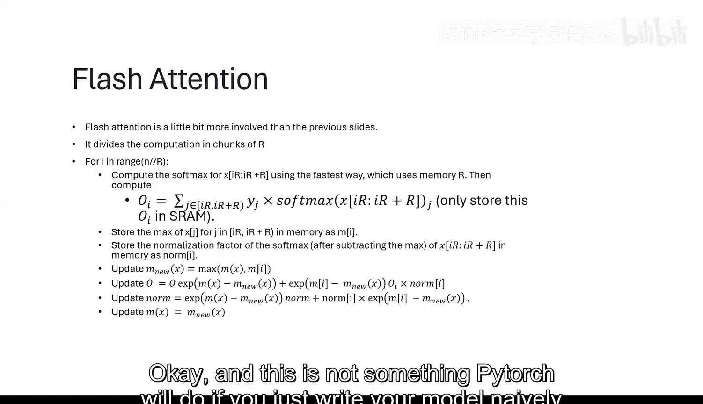

Okay， because this is only the forward loop。 The forward loop is doable in， But the backward loop。

 you need to write a customized kernel to catch everything correctly to do the backward。 I mean。

 the backward is much more。I mean， it's much more involved than the forward。

 so we can't really cover the backward computation of this in the lecture。

 but I hope you'll get the spirit for the forward computation。😊。

 which is good enough for optimizing inference time because you don't need to do backward during inference。

Yes。😊，好s。if me。Yeah you can view this as a softmax over this block and weighted average using the softmax inside this block so just ignore everything just treat it at this as your real attention and just compute the softm and also within this particular block。

The output of the this algorithm is still correct， although it requires some proof。

 but it is still correct。Yeah， you are using different softms， but somehow everything gets cancelled。

 and eventually the value is still correct。是。Soar what？No， no， it's exactly correct。Yeah。

 so that's a cool thing of this algorithm。 It still give you the exact value of the original。😊，Softm。

 although it's computing everything in block and update sequentially。Okay， cool。

 So we don't have time to go through other type of attentions。 But I think this this thing is enough。

 right， You get the g of how to improve self attention， yes。Thank。No， it's not slower。

 It's the same speed because you have the chance。 If you specify the chunk correctly。

If you specify the chunk size correctly， then it's the same speed as the stupid attention or the naive attention。

😊，I mean， in iss not like a big matrix would be faster than small matrix。

 It's all about the same correct shape of the matrix。

 So if your matrix is like 96 by 96 is the fastest。😊。

And if you're matrix 96 by like a multiple of 96， then its computation time just scale linearly is' not going to be faster than 96 by 96。

 you compute using for loop because if we look at the product code。

 many of the implementation is still using for loop。😊。

So you just have to group everything correct with a correct size。 And that size is not like。

 it's not like something going to infinity as your model size It some fixed。😊，Yeah。Ex not。Yeah。

Not really。 I mean， if this is like computing 96 by 96 blocks from the n square matrix at that time。

 And that is actually the fastest way to compute the n square matrix。😊。

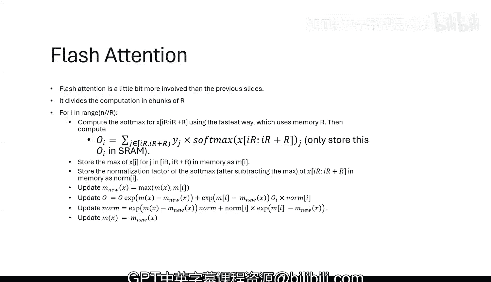