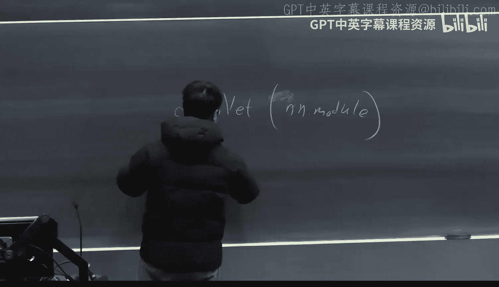
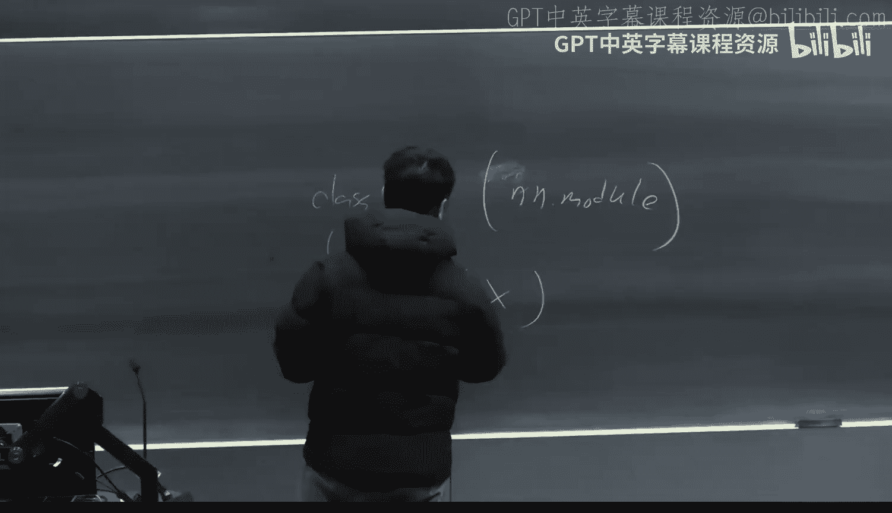
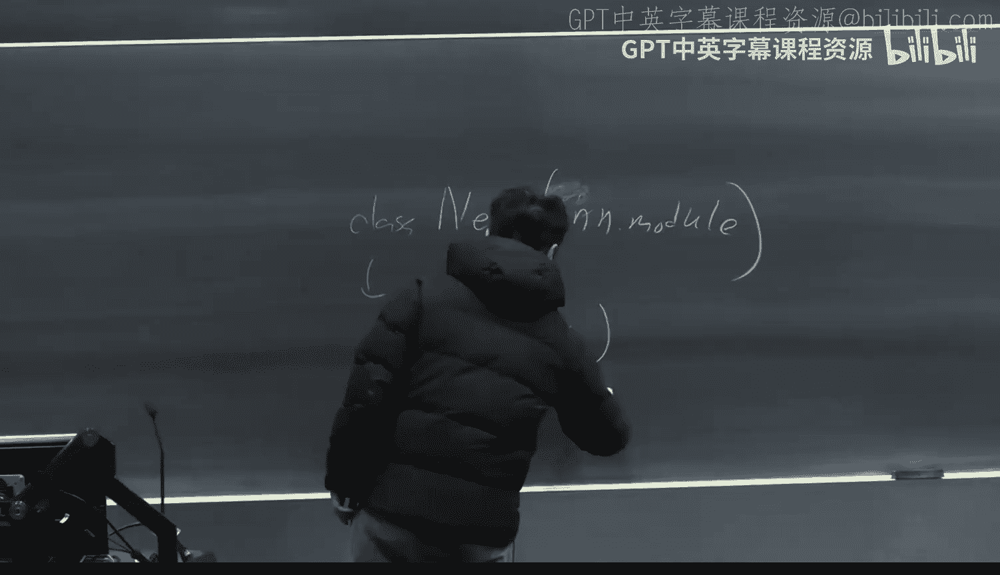
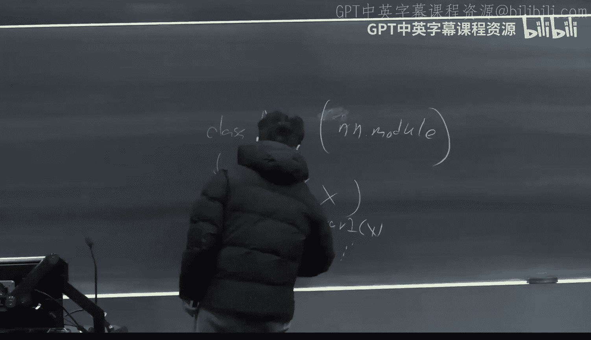
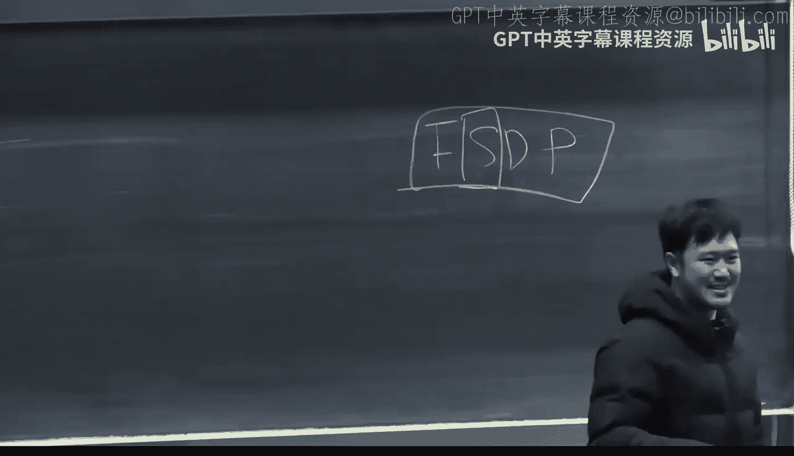
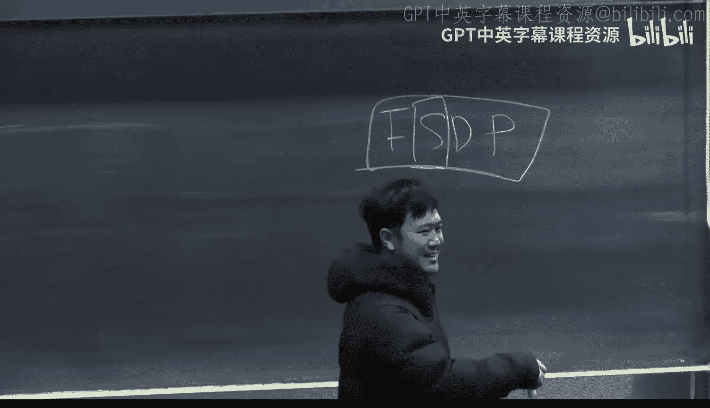
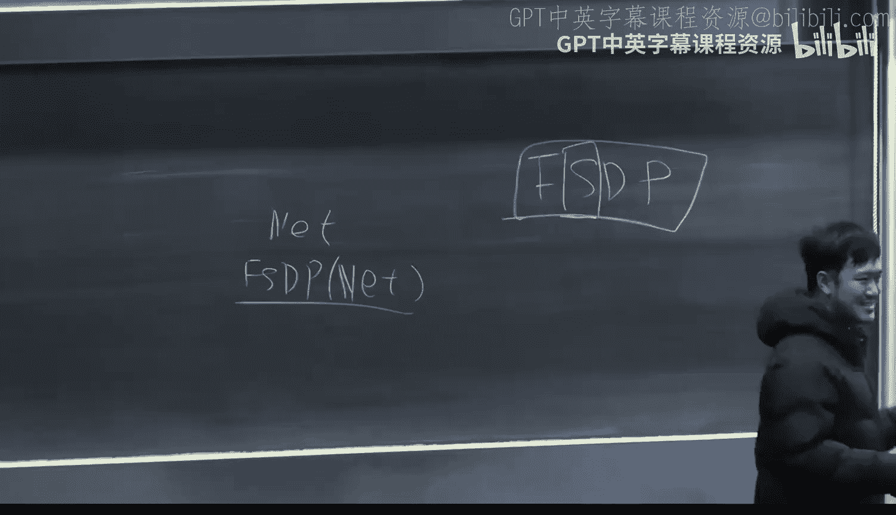
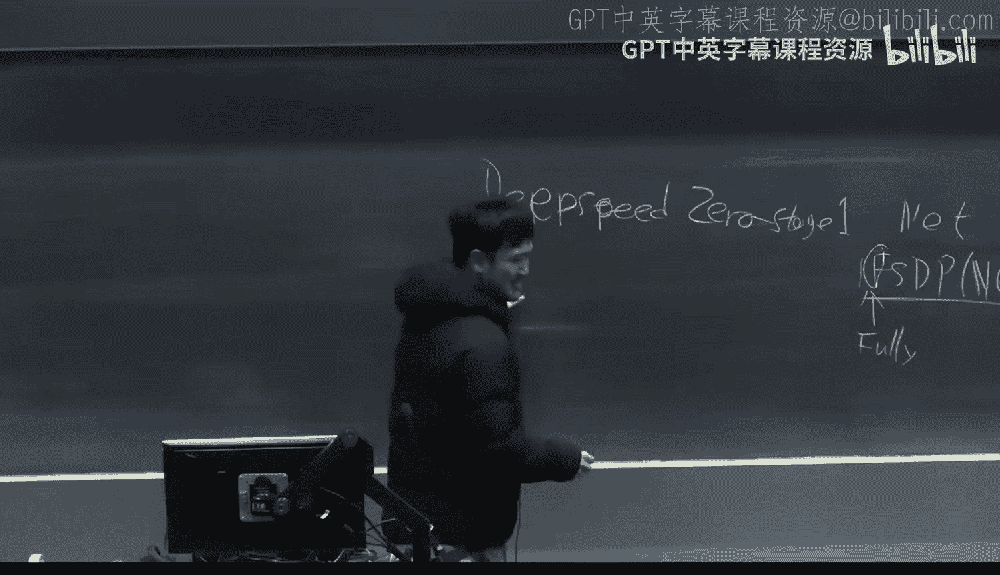

# CMU《生成式AI｜10-423 generative ai 2024》中英字幕 - P19：-P19-Lecture 18- Distributed Training.zh_en - GPT中英字幕课程资源 - BV1CyC9BPEhG

Okay， hello， everyone。😊，Yeah， let's start today's lecture。

 Thank you everyone for coming to today's lecture， and today we are going to talk about a very important topic in generative AI。

 which is distributed training。😊，Okay， so distributed training is kind of an a must for today's language model scale or generative model scale。

 And traditionally， when you train like a vision model or just a C model。

 you don't really need distributed training。 Okay， you just train the model on one single GPU and。

Everything is fine。 Okay， I mean， if you have multiple GPUs。

 what you probably do is just data parallel， which is not really， I mean。

 it is still distributed training， but it's the most basic form of distributed training。 Okay。

 and today we are going to see some kind of more advanced tools for distributed training。

 actually we will see all the tools， including fully sharded optimization。😊。

And pipeline parallelization and tensor parallelization。

 A we will use support for most of today's lecture because you will try to explain like the dynamics of the training。

 Okay， so we don't really go through the formulas， but we actually try to explain the dynamics。

 Like what are those communication look like between the GPO course for distributed training。系。😊。

So I will just give you an idea around me right now for like a couple day couple years ago。

 probably everything your train is like on a single GPU。

 okay when you train C or convolution networks。 or when I was young。 okay， when I was at your age。

 I train convol networks， and I train on my laptop GPU， which is like I don't know。

 it's like Avidia9，6，0 or something like that。😊，Okay。

 which is like thousands times slower than the current GPUs。 But anyway， so I trade on a single GPU。

 and I just write standard Pywa code， although it's more painful by them because Ptorch was full of bugs。

😊，So， but still， it's just a single GPO code。 Okay。

 you can write your i code as like something like an NN， okay， something like NN dot module。😊，Hey。

 maybe you can call it to your network。😊，Which is a subclass of an end module。Hey， I in this network。

 you have a forward operation。😡。

Okay， you just write it in a stand way， maybe so。

Lier one。

And blah， blah， blah， and then x is equal to this， and then will return x。😊。

Okay， so you you like， I mean， like a couple years ago。

 probably all the neural network you see is written in this format。

 And then the optimization on how to train the neural network。

 you just call loss is equal to some loss function。😊，Of this， whatever nios act。是。

Why pay and then you call lost stop backward。He， and then you call something like optimizer do your gra and then optimizer dot step。

 So everything is really simple back then。 they all you need to do is define the neural network by using the end of mobile。

 and then youll just write a loss function and do the lost backward and then do a optimizer dot step。

😊，Okay， so this is how this was how you try a neural network via single GPU okay。😊，本案。

What would happen if you have multiple GPUs？嘿。😊，So what you happen if you have multiple GPUs。

 well the most straightforward way to if you have multiple GPUs is essentially gather this raw of dash。

😊，Okay， so each GPU will have his own data， XI and YI， so this is on GPUI。😊，嘿。😊，So， imagine you have。

I mean imagine you have8 GPOs， so this is GPO wise。😊，Okay， so imagine you have8 GPUs。

 how would you train this type of model faster on8 GPUs？

Well the most liveive way to train faster is basically passes， I mean。

 it' basically having more data in a single step， essentially in equivalent to increasing the batch size of your stoastic gradient algorithm。

😊，哎。😊，So just increasing the batch size， which means this GPU is going to have like data x1 and y1。

 this GPU is going to have data x2 and y2， and this GPU is going to have data X8 y8 for iteration and you go through each GPU just does its own optimization。

 okay， does its own forward and when you call the lost stop backward is stores gradient。😊。

Of these reward pass in the motor ways in this GPU。Right。

 so youll ask x1 and y 1 to this GPU x to y2 to this GPU x3 y x8， Y a to this GPU， okay？😊。

And we were call lost stop backward。The gradient of the model in this GPU will be the gradient according to x1。

 y1。😡，The gradient of the model in this GPU will be the gradient corresponding to x2 y2。

 and the gradient of the model in this GPU will corresponding to x8YA。😊，Okay。😊，So in social day。

 it's just like。I mean， you have the。You have the gradient of the laws。Aorresponding to x1。

 y1 here and the gradient of the log corresponding to x2， y2 here。😊，And gradient of the loss。

Aresponding to X8Y8 here。Okay。😊，So meansto classic gradient design。

 you just need to sum those gradient up and you get the gradient with respect to the sum of the north。

Hey， any questions。Okay， so all you'll need to do is just sum the loss here。

 So there there is one distributed set here， which is sum of the loss。😊，Or some of the gradient。 He。

 so do like all for the gradient operation。 you sum them up and you put the okay。

 you do a sum and then you send the sum back to each GPU to update the model's weight。😊，哎。😊。

Any questions。So this is called data parallel， which is not what we are going to talk about today。

 Okay， is just too easy。 Okay， so this is the most easy version of distributed training that everyone can do。

 All you need to do is just write a torch。😊，到ge。Alljects here。Of this， whatever。I mean， the gradient。

 okay， so all you need to do is just add this single line here， then you can do this parallel。😊，Okay。

 so this one will make sure that you gather all the gradient from each GPU to like a single gradient and they will update using this gradient。

😊，诶。😊，Any questions？So that's， I mean， data parallel， which is a primitive for distributed training。

 just give you like a flavor of what distributed training look like。

 there's some communication step that you need to do across multiple GPUs in order to speed up your training。

😊，诶。😊，So data parallel is the most standard way to do， I mean， distributed training。

 And if you can actually do data parallel， then data parallel is typically the fastest because the communication is really minimal。

 You just need to gather the gradient。😊，But there are many cases where you cannot do data parallel in more than enough。

A largege language model training。 And that's what we are going to talk about。诶。😊。

So the main challenge we are going to focus on today is memory consumption for large language model or large model training。

 no matter language model or diffusion model or whatever。

So just give you a content of the memory consumption of those large models。So for us， I mean。

 for a language model to train every model。With there are two sources of memory consumption。

 so the first source of memory consumption is you have to store the ways in memory。Hey。

 maybe you store it in F 16。 well now you can store it in F 8。😊，Okay， but to store the model ways。

 it consumes on memory。 You have to store the model ways。 You call model about kda。 Okay。

 when you call like mobile about kta in your code， you're essentially storing the model ways in GPU。

😊，哎。😊，And then there is another source of memory consumption。Which is star the optimizer state。😡。

And that for basically for kind of accuracy release， we should be your stored in FP 32。 Okay。

 so the optimized states typically need to be stored FP 32 because youll know Adam has a square operation。

😊，Right， so this is already a common misunderstanding。 so people think about IP 60 and training。😡。

Okay， when people think about F 16 training， they think everything is F 16。 That is my true。 Okay。

 be very careful in F 16 training， even in F 16 training。

 the optimizer space are still stored in F 32 and optimizer updates are all in I 32 They be very careful about that。

 So anything happen inside the optimizer， it has to be IP 32。

 because Adam has this like square in the momentum， F 16 just doesn't have enough a。😊，Okay。😊。

So how do you start the optimizer in IP 32 and typically in your memory？😊。

So what's the memory consumption for a 70 model。Okay。

 so for some people that starting a another base in IP 16。

 roughly requires 16 oh sorry 14 gigabytes of memory。😊，Okay。

 the IP 16 and then scoring the optimized states， note that there are two optimized states in Adam。

 There's some momentum and second order momentum。😊，He。

 to start the momentum and the second order the momentum in I 32。

In memory will have towards 56 GB of memory for a 70 model。

 And this there is 70 GB of memory out of the H H，80 GB of memory。😊，诶。😊。

So just store the7 D model in memory。 This is your memory consumption for trim this is not really count like the gradient check point you have to do。

 which is st the activation item for each data point。😊，Hey， just simply we install the model。

It requires 70 gigaby some memory， not to mention you have to use a memory for other things。

 like in in flash attention， right， you learn that you have to use some memory to do the computation to store everything。

😊，诶。😊，So this is just inherently impossible to optimize a 7 B model。😡。

ha a single GPPU evenflow因 if you just have one data point。Okay， this is not like a batch size issue。

 then if you just have one data point， computing this lost or backward is just impossible。 Okay。

 you will go out of memory。😊，诶。😊，So business is training a salary model。

 which is a very small language model。 Okay， what we call GB4 iss like。Was a0 times larger than this。

 okay。So even春 on model， that is100 times smaller than GP4， it cannot be down near a single H100 GPU。

This is not for speed we say， it's not like I have one H100 GPU that just use it its too slow。

 it's just impossible okay， it will go out of memory， the code cannot be run， which means this thing。

 this code you have here， before call lots of backward before you immediately go out of memory。😊，诶。😊。

So not possible to trust that lead model。Then how do we actually train those large language models larger than 7 B or even 70 B。

700 B or even 1。6 trillion？😊，嘿。😊，So we need the this trick called distributed training。

 and it's not something you can solve with data parallel。诶。😊，So this is a mess because in the future。

 we will have larger and larger models for sure， okay。

 but somehow the GPU memories are not increasing that fast。😊，Okay。

 so we need the distributed training very， very kind of urgent Okay， so for example。

 a 100 has the same memory as H 100 and H 200 only has 96 GB of memory。But the H 200。

 in terms of slopes is much faster than H 100， roughly  three times faster。 Okay。

 so we really need those parallelization techniques。

 And this is what we are going to talk about in today's lecture。😊，A and parallellyization techniques。

 in principle， is very advanced。😊，But you'll have to know how to write those parallellyization code。

Hey， so you have to know how to write those。Dability training code in order to be hired by major company。

 Okay to get like 1 million each salary per year。Okay， or any 1 million is the lower bound。

 If you know how to write those code。 Okay， you can drive 5 million pretty easily。😊，系。😊。

So basically we need other ways to sell up if you have more GPUs。😡，That's what we will talk about。

 which is distributed training Okay on or how to train on multiple GPUs if your model size is very large。

And we will talk about multiple ideas here okay， and there are some easy ideas where you can just write a wraper of the model。

 there's some hard idea called Tensor parallel where you actually need to write your customized module。

 okay， we will talk about all of them and although they are very advanced。

 I am trying to make them simple and hopefully you can understand everything。😊，嘿。😊，He， cool。

So the first techniques that we are going to talk about is the started optimization。Okay。

 so there's sharding in terms of model rates or sharding in terms of optimizer space。Okay。

 so how many of you have seen this words。Have you ever seen this word before？系。😊，Yes。

 some of you have seen this word。 This is the thing that we are going to talk about。

 This one is called fully sharded data parallel。 It sounds like data parallel。

 but it's not exactly data parallel。 fully sharded data parallel。 The key is this shard as a。😊。

And this F ICP is the most basic distributed optimization technique。 And this happens for free。

 Do they really mean to write anything。 Hey P to has this roper。

 You just to wrap your model with this unit， which is instead of having a net。😊。

You will have like FSCP of the light。And you just call this thing。

 the backward of this thing will take take care of everything for you。 Okay。

 so this is automate tool， which is very convenient to use。 But if has is strong back。

 but which try like 7 B is 14 B models。 This FSDP is actually the fastest。 Okay。

 the technique that we will talk about the more advanced one is's going to be more useful。

 If you go to like 70 B or 300 billion parameters。😊。

Okay。😊，So what is FSDP， Okay， So FSDP， this called fully。 This thing is called fully。😊。

When you see the word fully， there must be something that is not fully， right。😡。

There must be something like partially， okay， so let you talk about this the first technique which is partially or deep speed zero。

😊，Okay， so zero stage one。 Okay， so the technique we will talk about is deep Steve。😊。

Neural stage one。Or also known as optimizer sharding。

Okay， so this is the first technique to will talk about。 and then03 will be FSDP。😊，诶。😊。

So what is optimizer sharding well optimizer sharding is pretty simple okay。

 so we just shower the optimizer， so instead of storing the optimizer stage in every single GPU。

 we just shower the optimizer stage and store it across different GPUs。😊，Okay， so this is very。

 very simple technique。 So what all it does is you your optimizer。😊，Hey， let's say it Adam。

So there's like M， which is a momentum。And we， which is a second order momentum。Okay。

 so each of them individually requires 38 Pga IO memory。喂。😊，So let's assume assume now you have。

 maybe I should use a different word。Lets say Im。He， so那， let's say you have M GP Ps。Okay。

 so all you need to do is the following simple operation。

 which is you just take it this guy and take it this guy。 And maybe together。

 they are like a vector of this auto matrix of this shape。 We just split it into an chunks。😊，Hey，1，2。

3， up to one。 And you start this in GPU。😊，So we willll start this EPP1。And you'll start this in GPU。

I'm my one。He。😊，So basically all you need to do is split shard the optimizer state or sh the optimizer state。

 I mean you just trade， you just concatenate everything and trade the entire optimizer state as a matrix。

 look at shard like any you want， just shard it okay and after sharding。

 you'll just store each shard in each GPU so instead of storing the entire thing in every GPU。

 youll just store the corresponding shard in each GPU。😊，Okay。😊，Any questions。So this is a， yes。No。

 we only shard the optimizer state， you don't shard the model base， so in each GPU。

 the models are still the same， only the optimizer states are sharding。Hey， yes。

 that in like a lot of communication overhead at the backward stuff。 Yeah。

 definitely there's some communication overhead， but this is all about a tradeoff， right。

 You cannot really do the computation if you don't have communication。😊。

So the communication is necessary。 And that's why people have different distributed training techniques。

 Just try to minimize a total amount of communication because communication， as you say， is so。He。

 well it's not that slow， I mean for this optimizer， communication is pretty fast。😡，Okay， and also。

 this optimizer communication only happens at the backward after the backward。 So in because you see。

 this is optimizer state， you don't really need this to compute the gradient。😊，Okay。

 and so basically， you can compute the gradient。 You can do the gradient to。

 Comp all the gradient for each for for the entire batch。

 and only at the very end when you are want to update the model space。

 you kind of need to take care of this sharding。 Okay， you need to do some communication。😊。

So after shouting， definitely the this is pretty memory efficient， right。

 because if you have like n views， the memory usage goes from 56 to5。6。😊。

Which is very very efficient。Okay， so thisult sharding is and reduce the memory usage lot。

 there are 70 model。 If you just sell the model basically only require 14 gigabys of memory。

 which is pretty efficient。 You can still use exercise size that for for the gradient computation and etcter。

😊，Okay， because you're sh optimizer state。And the question is after sharpening the optimizer state。

 what you do towards the optimizerable step。He， so recall， I mean， you have this thing right。

 and then you have to call optimize。I mean， you could call like optimizer do zero grade some。

 someplace like。哎，联系人啊。He， and you have to call optimize the step here。😡。

How is this optimizer step implemented for optimizer shing。They are for a Sha optimizer。😡，Well。

 the implementation is pretty straightforward。手背这利。So basically， what type is， I mean。

 you just look at GPO0。 Okay， let's， let's just take a look at the。Hey。

 so let's look at this GPfield0。Which has this short one here inside this memory。Okay。

 so basically now every GPU also has some kind of gradient here， right。

 So all the GPU has some kind of gradient here。 This is a gradient。 This is a gradient， okay。😊。

This is a gradient。Okay， and high toch has a particular function。 So this is GPO 0， GPO 1。😊，Okay。

 so this is a gradient that GPU 0 gradient I GPU 1， gradient I GPU 2。

 Those are computed inside each individual GPU。 There's no communication to compute the gradient。😊。

And all you need to do is call this function， called to。But reduce。Scatter。

I'm not sure it's one T or2 T， but anyway， so some function like this。 Okay。

 which all it does on the brilliant。Okay， so all it does is it first perform like a whole desert operation on the gradient。

 just like the standard optimization。 Okay， so all those gradient。😊。

Well be sound to like a big gradient。 Okay， so this is like a plus operation。

 You will get a big gradient here。Okay。😊，And then this gradient， this gradient。

And if this gradient will actually be sharded into like MD fresh。 Okay。

 so this is a gradient and this scatter operation， this is a reduced operation， which is here。

 and then the scatter operation will shard the gradient into MD fresh shard and then it will send this shard into this GPU。

😊，Okay， so we'll send this chart back into this GPU so that if you can update this chartard。嘿。😊。

Any questions？We send this shard into this GP so this CPU update this shard and after updating this shard。

 yes。😊，that you said so like why do we need to sum the gradients as well we don't really sum the laws。

 we just sum the gradient。So basically， with sum， with sum the gradient。 I mean。

 in the previous example， we also just gather the gradient。 There' is no summ measure of the loss。

 Pay everything because the sum of the laws you will take the gradient is equal to the gradient。

 sum of the gradient。 Take gradient and sum measure are exchangeable。

 So just compute the gradient locally， and then you just do all gather of the gradient。😊，诶。😊，Yes。😊。

Dids this perform on one of the machines？Like this you know， reduced operation。I mean。

 depending on your communication protocol。 So did this is like a really like an NCC L or like a low level implementation of this all。

 But this one is kind of memory efficient。 So it's not really。 I mean。

 this all gatherers are more like。Kind of like new place operation。

 where kind of all the GPU create like a virtual memory and then feel everything in it。😊。

It's a pretty complicated operation， but this step is kind of memory efficient。

He a reverse scatter is memory efficient。Yes。😊，Does overlap partsYeah。

 it takes long overlapping parts of the optimizer stage you want aggregate to aggregate the gradient。

 right？So the way you can think about it is and in this reduce scatter is simply my like。

 it's almost like your first scatter this， your first shard each gradient and then。😊。

Those parts will be gathered into the， into the。I mean into GPU1。

 and the other part will be gathered into GPU2。系。😊，So essentially。

 you still need to gather the gradient from all the GPs because you need a gathered gradient in order to compute the update of the model's ways。

 You cannot only lose the gradient for GPU1 to update them waiting in GPU1， right。

 You want the way in all the model to be synced。😊，Yeah。

 so that's why you need to gather those gradient first。😊，Okay， and then after Ga。

 we'll send this shard off the gradient。Into GPU1 just to update the optimizer state。诶。😊。

Any questions。Yes。😊，Yeah， why you kind of know less in one GPU？Yeah， we saw eight models in A GPPU。

 but all the models are equal。Yeah， that's how distributed training。

 I mean that's how this stage one works。 Later we will see there are distributed optimization where you scattered model ways across different GPUs as well。

😊，Yes。Each optimizer side， don't we need to like put them all back so we can update each copy of the model parameters。

Yeah， yeah exactly so basically I mean when we update that's a final step。

 when we update the model's ways， we kind of also need to update the models's parameters。

 but so how does this step move and reduce the memory okay。

 because youll need to do this all gather operations。😊。

So let me explain how those steps actually reduce a memory， okay？

And it's not really reducing the memory as much as what you were hoping for。

 but definitely reduce the memory。 So first of all those gradients are in IP P 160。😊，Okay。

 so those ingredients are in FP 160， which means they take the same amount of memory as the model waste。

😊，Which is kind of efficient。 Its only 14 GBab on memory。 Okay， so those school ids are in I 16。😊。

And this all gather operation， which is a in place operation。😊，Okay。

 this is a scatter is a in place operation。 It will just replace each gradient by the gathered gradient。

 So it will not use more memory。 This is in place。😊。

 so the reduced scatter operation will directly replace those gradient by the gathered gradient。😊。

Okay， which is still IP 16。 This step is IP 16。Okay， and after that， it will kind of， I mean。

 it will use this type of shard to update this optimizer state。Okay。

 but this is a very tiny fraction。 So the optimizer state update only use a very tiny fraction of memory because each optimizer shard is very small。

😊，K。😊，Yes。😊，HowThe charts like almost layers or no it doesn't matter it's just you treat as contrasting that thing and you just started it I mean that's why it's so kind of。

I mean so automatic， Yeah， because way surely it doesn't matter。You just trade that in。

 and you just divide them evenly。Because with table is。

 there is optimize because Adamom is a coordinate rights operation， right。

 which coordinate is just separate， you can just update them individually。😊，Andm basically updating。

So regularly I the model chart doesn't take too much memory，So basically， what's the memory usage。

Its this model weight。Well the 70 model， let's just say， is 16 gigab，14 GBte gradient。

Working your advice。哎。😊，And then the first step is basically this in place。 I mean this gradient。😊。

Plus， this in place reduce scatter。Okay， and then the third memory usage is optimizer sharding。😊。

This is very small。Ok。And then what happens is。Then there's the first step， which is， I mean。

 you only have the optimizer sh， right， in order to update the model。

 you have to sync the optimizer sh across different GPUs。😊。

Right because this is only an optimizeimr sh and for the model to update。

 you actually need to sync the optimizeimr sh。😊，So here is how this is implemented。 Okay。

 to reduce the memory。 So what's implemented is this。 You have your level weight。Okay。😊。

用 objectject问屏用考离。So。How do I say it。Okay， so what does still mean by local shard update。

 So this is your model slate。Okay， and this is your optimizer sh and you only update the shard in this part。

Can you only update your weight in this part？😡，Okay。😊，And。I mean， this thing， so basically。

 this thing will be。So this wave is IP P 16。Okay， so the optimize stage after computation is FP 32。😊。

嘿。😊，So this together， this update eventually will be converted to an F 16 late。

Only on this tiny small part。 Okay， so this part plus this part will give you like an IP 16 date weight in this tiny part。

 And then you need to think this thing。😊，嘿。😊，You need think this same， but this thing is at 16。Okay。

 so this thinking requires less memory compared to the original and optimizer stage。

 And this is how you save the memory。 He， it doesn't save the memory by extremely large amount。

 but still save the memory and allows you to do those updates in IP32 allows you to do the optimizer computation in IP 32。

 Okay， this optimizer computations updates and storage only in IP 32 just to be more accurate。😊，嘿。😊。

Any questions？Yes。😊，On weight in each of the GPs will start the entire model race in Yhan Irish GPU。

To access let's have completed the tuning or tree learning or whatever fine tuning we are doing same how do we how do I access the specific weights on this particular T I mean each GPO star are in model ways so each GPPO star are in model ways。

哎，So you actually start the entire model way。 So you just call each individual GPU。

 It has a full model。be all the models will be updated in all the reviews so theres like a there's like a sink of the updated weight in this particular step so basically your laser range optimizer chart to update some part of the ways but then we will sync this part of updated weight across。

😊，The GPUs。 So all your models based on every GPU will be the same， and they are updated。

 So there are definitely some communication， but is kind of the minimum amount of communication。嘿。😊。

Any any questions。 so basically， you can see this， you can definitely fit in memory right here。

 some memory usage here， some memory usage， and there's a small memory usage。

 and then there's this memory usage。 but this operation， which is still another reduced scatter。

 It is in place operation， So uses the same memory tool as this guy。😊，Okay。

 so your total memory is only 28 GB because this thing will use the same like reduce scattered as this thing。

 So it's like a good place operation directly replace the waste here。😊，Okay。

 not going to introduce actual memory。诶。😊，So in culture。

 we reduce a number from 70 gigabytes to basically 80 28 gigabytes， which is very， very efficient。

Right now you can train like 40 B models， even with this type of technique。 Origin。

 you can't even train 7 me or you can， you cannot even train like a 5 B。 Okay。

 so definitely this names the model size that you can train grow by like a factor of 3。

They chase a lot。Okay， and this technique you don't need to do anything。

 you just work the model and optimize asset automatically for you。

And you don't need to write customize code。 Your model is still like your shall and。

 youll just wrap up your model。And the optimizer does it automatically for you。😊，Hey， yes。

 what any other big memory consuming tasks on each GP， is it just attention and like？

How much do we need for that stuff？Inly that for like one batch to compute the gradient or to compute the entire gradient。

 You need like the same amount of memory as the model size。😊，Okay。

 so that's my first 7 B you directly out memory because。For using this type of technique。

 you are 70 gigabytes plus 14 gigabytes directly out of memory。

 but here you can even insert like four batches into it。😊，They are three batches into it。

 which is pretty efficient。Okay， because to do the brilliant computation。

 you that very need to store those activation。So that requires some memory， but you also differ。

Be part掉 your algorithm， for example， if you use flash attention， uses nice memory。

 If you use stupid attention， then you have more memory， so。😊，There's some variant on that。哎。😊。

Any other questions。So this is the first optimizer technique or distributed tri technique。

 and this is very， very widely used。 Okay， this almost everyone wants to try this technique first。😊。

So this one is the fasci if it works。嘿。😊，So it， if this technique works。

 it is always the fastest it's faster any other type of。

 you should do the optimization because the communication is minimal in my literature is only happen at the very end of training。

😊，So you mode in language model training， you use very， very large batch size。Okay。

 something like by size roughly，2000 each。So you have a lot of， I mean。

 you have a lot of gradient accumulations that inside each GPU， and you only think at the very end。😊。

Okay， so if this technique works， it's always the fastest。Because the communication is very minimal。

嘿。😊，And there's some more advanced version of this thing， which is called fully sharded optimization。

 which is this F S DP or do speed 0，3。😊，3 sharded data parallel means you are not only sharding the optimizer stage。

 you are also sharding the modelal stage。😡，Okay， because I mean。手机费入海的。Kind of， I mean。

 if you look at this kind of computation or this kind of。In our memory consumption。

 like which one can we improve。 mean this gradient computation or the gradient storage or like the installing the activation check2。

 those are pretty difficult to improve。The only thing we can improve is the model waste part。Okay。

 so3D shorter data parallel will also show the model ways and store them across different GPUs。😊。

And this in particular Google allows you to store mobile with FP 32 as well。

 which is a huge advantage。😊，Hey， you can start your model race in IP 32 because you're sharding。

 I mean， originally we start the optimizeim stage。 so we can start this thing in IPP 32。

 If you start the optimize model race， you can also start that in IP 32 and do some more accurate update。

😊，诶。😊，So how does FSDP work？Well， I mean FDP is almost the same as。As squ as shard。

 as optimize our sharding。Okay。😊，走FSDP。I mean， were still shall we optimizer state。 Okay。

 so the optimizer。😊，Its like this。And your model rates。Its like this。嘿。😊。

And to sh the optimizer stage into M different ones like 1，2，3 up to M。

 And you also sh your modelss ways into one，2，3 up to x。😊，Hey。😊。

So I now your model ways are started across different GPUs。

 so each GPU only style some part of the model ways。诶。😊，Any questions。Yes。😊，嗯。稍等， wait。Yeah。

 they are， I mean， they are exactly matching， so the optimize stage and weight are exactly the same across across different GPUs。

😊，诶。😊，Anyy questions。It's shared right always send waves over to。Yeah，Yeah， I mean。

 the only difference between optimizer sharding and fully sharded IP， fully sharded data parallel is。

Basically in doing the optimization stage， when you want to compute the forward path of the model。

 you actually need to think from other GPUs。😊，Can you need to gather the ways from other GPUus to a single GPU。

He， which is kind of not that memory efficient because you still need to do the gathering。😊。

But the promise for FSDP solve those ways in IPP 32。Can you start the optimizer in IP 32。

 So optimizer and ways update they are all in IP 32。 But when you do the all。

 when you gather the weight， you actually create F 16 copy and you only sync the ways in F P 16。😊。

Okay， I mean， it's just this step here。So me this step here， right。

 So just recalling this optimizer sharding when you do the weight update plus the optimizer stage。

 the weight is FP 16。 The optimizer stage is F 32。😊，Now in the freely sy data parallel。

 your local rate is also IP32， so this step will be more accurate。Hey。

 this site will be more accurate。 But when you sync the updated weight to other GPUs。 Okay。

 or when you compute locally， when you compute gradient。😊。

And when you complete gradient you do the computation in IP 60。😊，He。

 so which means when you buy the ways across other GPUs。

 you're actually sending an IPP 16 copy of the ways to other GPUs。

 You only follow your local chartard in IP 32。😊，But when you think across different views。

 you think the IP6 sale even IP8 copy。Okay， so this means each individual GPU has an IP 16 copy of the model。

 the entire model and an IPP32 copy of some shard of the model。😊， so that's what FSDP does。

Any questions？Yes。😊，I mean， this one is already mixed precision training， right。

 This F IDP is mixed precision training because you have the updated I32。

 but then your gradient computer I 16。 So there's many auto casting happening in between。😊，Yes。😊。

The scaling law paper is that like precision doesn't matter right like you get two bits per parameter regardless of whether you use MP 16 or MP8 so why do we care so much about being able to use MP 32 it will make your optimization speed faster because I mean。

InFor tri and large language models what we observe are those like spikes。

 they are based because of the precision。😊，He， if you can use F 32。

 you typically don't have those spikes。 So flu Sha data parallel is more for an optimization advantage。

 but it's not about you get a better final model。Okay。

 it's just because the optimizer update of the local race are FP 32。

 so youll see like less spikes in the optimization process。😊，Hey， any questions？Hey cool。

 So basically this is really shiny data parallel。 But I mean， this thing。

 we can use it to train models that are larger than what you can do without those techniques。😊。

But they are not infinite， right， You can turn like 13 B model with FSDP or with0 stage 1。

 model there is not that much more you can do。😊，Okay， that fundamental limitation is essentially you。

 no matter what you do， right， you need to store a full copy of the ways because everything。

 every forward and backward parts are computed individually inside each single GPU。😊。

 so the GPO state don't really sync with each other during the forward and backward path。Okay。

 so in the forward and back path， the each GPPO just act independently。

 and they only think at the very end when they think the optimizer update。😊，Hey。

 so further and I back pass each individual GPU just computed individually。

 So there's some limitation of what you can actually do with this technique。

 you can train a 14 B model， but that's kind of a maximum of this type of data parallel。

 If you want to be more efficient and train larger models。

 you need to use some more advanced technique。He， and this is called those advanced techniques are called tensor parallel and pipeline parallel。

😊，诶。😊，So first of all， ready tens are parallel， well tens are parallel is just。

A different way of implementing the sharded optimization。

 also sharded optimization for weight for fully sharded SSSDP。

 you still need to gather all the ways or all the IPP 32 ways into a single GPU and you compute forward than output pass。

😊，Okay but for terms parallel， we are each view the computation of forward and backward paths across different GPUs。

😊，Okay， so which me years。This step， first step， all the memory usage will be reduced so you can essentially create a model of RB 3 size。

😊，Okay really almost moon in it。Okay， you don't want install all the models facing a single GPU。

 you don't compute the gradient in a single GPU， Everything is sharder than the computation of the forward and past are also sharded。

😊，哎。😊，So we the and V V I implementation， there is a library called May platform or May platform L M。

And Mo for LM is the most source of implementing this type of powerization。And essentially。

 there's only two operations in the megatro LM code ripple。

 which is the socal whole parallel linear layer。😊，And the column parallel linear layer。😡，Okay。

 so we are going to use those two layers to replace a standard layer in in your language model。哎。😊。

Any questions。So what is a parallel linear layer， well a parallel linear layer is pretty simple。

 okay？So let's just say you have a function which look like I eight some sites。

Al a some linear layer in your network。X is the output of some lower layers。 and F A O。

 F is a non nonlinear function for the higher layers。 Okay， so think about your network。

 There are multiple layers。😊，And here you have an input X and you go through a linear operation and above you apply some function have on top of the output。

😊，Okay， now I want computer forward of this function and the backward of this function。😡，He。

 and this is my mat' eighth。And this is kind of my ex。可。

So now cancel parallel means that the weight of this matrix a is split across multiple GPUs。😊，Okay。

 it can be the same which is called column parallel， a， the columns are parallel。

 it will be stored like this， which is real parallel。😊，嘿。

So there are two different ways of store A across different GPUs。Okay。

 theres like column parallel way， and there is no parallel way。 So this is GPU 0， GPU1。😊。

Keep your too。嘿。😊，And here this is GPO0， GPO1。And GP your2。嘿。😊，Any questions？So now。

 suppose my A is spelled in this column parallel way。Okay。

 so how do I actually compute the forward path or compute any times X？Okay， so for this guy。

 a times x is equal to sums of。😊，Essentially AI I outside。Hey， your speed X。

 according to this is an AI。 This is X I。Right， so a times x is equal to sum of AI times X。😊。

Which means order to compute this rule pass， you actually need to send each X to the individual GPU that the AI is located at。

😊，Okay， so send this Xi to this GPU where AI is located at and you do this summation and eventually you'll do a summation which is all gathered across different GPUs。

😊，嘿。😊，Have questions。So what's the memory usage， Let's say original A is n by M matrix。Okay。

 so original。The memory usage is M times N just to spell the matrix and compute B A times X。

 Now for this operation。😊，Sorry， I shouldn't say this is okay。Original is Cap P。 Now。

 if you resist this operation。What is a memory usage。Okay。

 so the memory usage reduces from n times K to。N times KD版。嘿。😊。

Because you only need n times k divided by M to store this matrix and then this modificationplication。

 the memory usage is also n times k divided by M。😊，诶。😊。

So this is like a linear scalingkating unless you're M bigger than K。

 which typically would not happen。He， this reduces the memory a lot。给。😊，But of course。

 there's some additional memory consumption like after eight times actually。

 you need to study activations， but those are kind of minimal。😊，Okay， so this is a forward pass。

 right， which is a times X。😊，And what is a backward path？So the billion of pay。

Or sorry gradient with respect to a of F of a times X， right， This should be equal to。I mean。

 he's actually the。Essentialially like。Express pose。Times。Rreiant of as。

Right so gradient of a altered product of x transpose。Okay， I mean， this is simple。

 but if you want to compute the backward， if you want to compute the backward path of or going through the backward path of the lower layers。

 we essentially are going to compute a transpose。😊，Sorry， I will say gradient with respect to act。

This is going to be equal to a transpose times the gradient of the F。哎 at AX。Okay。

 so if you're going to compute the back pass， which is try to compute the gradient which back to X。

 you are going to compute the a transpose operation。😊，睇。😊。

So if your a originally is like column parallel， then the a transse is going to be real parallel。😊，哎。

😊，So to compute a transpose， you need to compute this guy， multiply this guy and concatedation。😊，诶。😊。

So a transpose sub x is equal to cut of AI transpose times x。He。

 so which means you don't really speed X as send to each GPU， you send x to all the GPUs。

 and after computation， you do like a concatenation。😊，哎。😊。

So basically just that's it for tenor parallel。 You just need。I mean。

 feel you feel forward murder is。Paln parallel or linear layer。

 say backward will we are very parallel linear layer。If your forward is a low parallel linear layer。

 your back is a column parallel linear layer。K。😊，So basically， I mean。

 that is how write write like a model parallel or model。😡，HeIt's very， very simple。

So basically这里 you have。😡，Originally， you have NN dot linear。Right？

Now we replace it by NN到 B the linear。 I mean， it's not really。 it's just like a distributed linear。

There you saw this layer， the forward。Is a column parallel or linear。And the five courts。

Its a low parallel linear。哎。😊，And the implementation is essentially you have some scatter operation that speed the axis send you to different views and you have a kind of an organgaer operation that concatenate everything。

😊，Okay， so it's all implemented using the basic Ptorch distributed linear distributed computation unit。

And that is how tensor parallel is implemented。😊，I mean。

 you just replace your linear layer with distributed linear layer in your N， N and then。😊。

Everything would saying is's kind of taking care for you。Okay， any。Yes。😊。

It will have a column row of a stored and the same No。

 it will just have a column of a if it's a column linear parallel layer。

 it will only have a column of a stored。Okay， but in the backward were completing a transpose。

 it's essentially becoming in a real parallel linear layer。

 but this is with a and this is with a transpose。😊，Okay。

 so compared a low parallel or linear layer forward， where weight is actually a transpose。😊。

Before your forward pass is a column parallel linear layer forward with rate A。

 so your back pass is real parallel linear layer with rate a transpose。😊，Okay。Yes。

 so every GPU must have their copy of the result of say AX right after each GPU does their own part。

 they need to communicate and put together the answer， right？So basically。

 they have a sum approach and then they so the apps are shared across GPU。

 so which means those intermediatemedia outputs are shared across GPU。

 so you still need to pay some memory to store the intermediate output。😊。

But right now we haven't really hit the bottleneck to store those things。Yeah。

 so the intermediate output approve those ads inside between each layer。

 they soon need to be shared across all the GPUs。And also。I mean。

 one thing youll want to remember is your data parallel or fully sharded data parallel for optimizer sharding。

 each GPU will take different input。😊，rightG Bill0又 take input x1 or x0 Y0 G Bill two y will take input X1Y1。

😊， so I not sure I still have the picture， but for beta parallel or fully sharding。

 datata or optimizer sharding， each GPU has their own input because each GP styles like an entire copy of the model weight and forward and backward pass are independent。

 They don't communicate during forward and backward。 They only communicate at the optimizer step。😊。

Well for casezo parallel。Each GPU cannot have its own input。 This input X is shared across GPUs。Okay。

 with input X is shared across GPUs， so you need to call mobile forward with the same X。😊。

Where all the GPU said you are doing model parallel啊。哎。😊，Any questions？海库。So basically， I mean。

 this is like a common bug that like a brewer of deep learning would actually do。Okay。

 so they really to take a model parallel model。And they called logo the forward at GPU 0。

And they hope that the model will output put something。But you model know actually stuck there。 Okay。

 so suppose you take a model parallel trend model。Or during like model parallel training。

 if you just call model or forward at GPU 0， it will start here because there are some distributed thing happening in the middle that there is some distributed push do altogether。

We should only go through if all the GPUs are kind of forwarding the result。嘿。😊。

So this is a very common mistake that people use。 I mean， they want to， for example， during training。

 they want to evaluate their model。Right， like your train like a 70 B model。

 You cannot wait until you very。 You want to evaluate your model。

 You want to take your model out and does some generational run it on evaluation benchmarks。😊，诶。😊。

And a very common mistake that people make is basically during tris when they do evaluation。

 theyre just call one go forward at GPO0。😡，Okay， because the data parallel。

 that's totally the correct thing to do。 right you you can just call model of flu HO0。

 If you call model of flu A GPPO， you just get duplicate results。😊， so for data parallel。

 I mean all people used to do data parallel when they evaluate the model。

 they just called model forward at GPU0。😊，But for a model parallel model， that can not work。

If you call model of forward at GPU0 without model of forward at GPU 1，2，3 up to everything。

 or the flow will just stuck because there is a much of distributed altogether step here。😡。

These that will only go through if all the GPUs are kind of forwarding。诶。😊。

So if you want to evaluate a model parallel model in your intermediate training。

 you have to call model of forward at every GPU。And also， with the same input。嘿。😊，Any questions。

But in reality， I mean， it's more complicated than that， because in reality。

 some group of the GPU are going to do model parallel。

 Some group of the GPUs are going to do data parallel。😊，So， is I like。

Dely that you have this is your s of GPUs and you just please are cross to like multiple GPU chunks。

 maybe there's 1000 GPUs here and 1000 GPU here and 1000 GPU here and between those classes you'll do data parallel and inside those classes you'll do model parallel。

😊，Okay so when you want to evaluate the model is even more complicated。

 you will call the model of forward within this batch of GPUs。😊， so in practice。

 if youre want to use 1 million GPUs， which is a scale of like triGb4 size model。😊，Okay。

 so they are split into model parallel group versus data parallel group。

And also GO is a mixture of expert model， so there's also expert parallel proof。😊，They said。

 they are all different。And for example， this one fold is model parallel。

 and maybe here there's some expert parallel。😊，And then if this are like mobile parallel。

 Those are expert parallel。 And then in between， there are some data parallel。😊， so it's very。

 very complicated to write a fully functional， distributed parallel code。哎。😊，Any questions。I。

 but I mean， I'm very complicated。 and I'm not saying implementation is complicated。

 implementationmmentation is you just replace a linear layer with this layer。😊。

No model is still super simple。If you look at the megatro LM， it's a very simple model。

 it's just every linear layer is replaced by this thing。😊，嘿。😊，But this thing takes some hyper。

So if you actually look at the Ma LM code， this intake some indexing。😡，Okay。

 so there's some index in which specify， like， how do you actually split the linear layers across different GPU。

 iss exactly like which end of GPUs are grouped in to like model parallel shas and which GPU are grouped into data parallel chart。

😊，So did this same of taking like an indexing or slicing of your GPU config。诶。😊，Any questions。

Te cool。 So we reality I meandifi training is a mix of datata parallel。

 tensor parallel and final thing， which is called I to parallel。😊，诶。😊。

So pipeline parallel is also a technique that allows you to train models of。

I mean almost arbitrary size， but not really arbitrary size。

 I mean there's some restriction that your model will be extremely deep if you want to try arbitrary size。

😊，哎。😊，把财面。We only have very little time to talk about pipeline parallel。

So and also pipeline parallel is not very easy to understand， So I guess。

I'm just going to skip the pipeline parallel for today's lecture， and we will。

Wry to resume it in the next lecture， as we will distribute this lecture into two lectures。Okay。

 so I think that's all for today， I mean， this is a pretty hard topic。

 but I hope you kind dont understand some spirit of how distributed optimization works in practice。😊。

