# CMU《生成式AI｜10-423 generative ai 2024》中英字幕 - P1：-P01-Lecture 01- Course Overview + Autodiff + RNN-LMs.zh_en - GPT中英字幕课程资源 - BV1CyC9BPEhG

So welcome everyone to the first iteration of Gen AI 10423/ 10623。

 it's a great pleasure to have you all here we're really looking forward to this semester and especially to see not just you know the kinds of things that you guys are learning this semester。

 but also the kinds of things that you guys use the stuff that we're learning to do because I think that for me as an instructor it's going to be a lot of fun to sort of witness the kinds of projects you'll come up with and the sorts of interesting directions that you're going to go in this course。

 so I'm really excited for this semester。And I wanted to kick it off with a little bit of like big a very。

 very big picture question of what is generative AI and as I was thinking about this。

 it kind of dawned on me you know usually when I teach an intro MLL course I like to start with AI right and I say。

 oh you know' there's these nice sub goalss， perception， reasoning。

 control motion manipulation planning， communication。Creativity， learning。

 but like what do these have to do with generative AI？I mean， honestly， it feels like。

 most of these things don't really have anything to do with generative AI。Okay。

 so does anybody disagree？you could pick a sub goal and disagree with me I mean。

 this this has nothing to do with what we're doing this semester yet。

Perception seems important so that it's not just sort of generating the same exact thing every time you probably。

 if you're generating something， want a condition on something else， other ideas。

Yeah for control it nice for capturing modities different behaviors for control you could be capturing different modalities of different behaviors yes。

 this one I actually had to think a lot about I think you're right though that there is a multimodality thing that I didn't think of yeah other ideas。

Creativity is a great one， I think this is sort of you know the place where like we're starting to see the adoption of these technologies just by artists and and other people who kind of enjoy the the ways in which they can inject their own creativity into a model which itself might be。

Something more than random in a way that we hope is creative， yeah。对。

This is a a great question what on earth do we mean by intelligent machines is this something like intelligent like a human or does it mean like something different than human I I don't know I don't know if we definitely don't mean like to sort of get into this idea of like a superhuman intelligence like so I think that that。

That all of these kind of come with some interesting angles that you can start to look at through the lens of generative AI right so communication is about comprehension generation and generation of language and large language models excel at both of these。

 even though they're trained to generate。Right learning。

 we've always kind of thought about traditionally as this task of parameter estimation。

 and yet generative AI has shown us sort of this new way of doing things called in context learning。

 where the word learning here is almost a bit of a misnomer from how we usually you it。

 use it because the learning is actually happening during inference at test time。😡。

There's no parameter estimation at all。😡，Large language models are also sort of good at certain reasoning tasks。

 if you know about chain of thought prompt thing， this is a good example。

 they're already being used for grounded planning with embodied agents this I actually didn't even know about I just kind of Googled like。

You know foundation models and planning apparently somebody has already done LLM planner and so creativity is sort of an obvious one where text to image models and text and music models come to mind。

In the domain of perception， multimodal foundation models are learning to answer questions about images as well as text inside the images。

 like if the text is actually represented as pixels in an image as well people are using diffusion models as zero shot classifiers。

 like as in take a model that's trained to generate images and use it to do image classification on labels it's never seen before。

😡，For control， motion and manipulation。In fact， there's this technique called Daydreamer that learns a generative model of experiences for reinforcement learning right where we're actually generating the sort of thing that you would simulate right and so this is a great example where you know you could learn to have a quadruped that just from an hour of real world experience is actually able to learn。

Okay， so what does generative AI have to do with any of these goals。

 I think it has a whole lot and increasingly as it's become more prominent in recent years。

 I think that is growing。And yet I concede that there's still lots of unanswered questions about what do we even mean。

 not just about intelligent machines， but by carrying out these goals and evaluation is something that's not up here。

 but that's a very unsolved problem。Okay so examples of generative AI I think you guys have seen lots of these this is like the GP4 example write proof of the fact that there are infinitely many primes do it in the style of a Shakespeare play through a dialogue between two parties arguing over the proof right and so like the last part of the proof you know it's simple friend just wait and see we'll multiply the primes that's key all primes from two to p combined we'll make this new cu we will find but one more thing we must include to make the proof more water type will add a one on to the end and now the proof is in our site right and it goes on and explains how you multipied them together and add one it's the classic Euclid proof so as well image editing is kind of become。

And entirely this has sort of created an entirely new way for people to do image editing you know you can take out part of an image and have a model fill it back in。

 you can take away the color and have the model generate different colorings of it so。

You all were doing some text to image generation over the weekend， creating a little data set。

Here's particularly， you know。Surprisingly good example of an image of a face generated by stable diffusion music generation。

 our audio is broken， otherwise we'd be listening to some what I would say is like very mediocre music generated by a model this is like a very unsolved problem and extremely difficult but music Gen is out there it's a transformer based decoder model over these sort of like discrete representations of audio and it can get sort of multiple layers of different instruments that seem to kind of come together in。

Things that sound sort of like music and。Code generation is probably one that you've interfaced with。

 this is like the classic example of now classic， this is like into 2023 I guess。

I don't know if the word classic or flies， but but GBT4 in the sort of。嗯。

TheThe sort of paper where they were starting to look at G4 and what it could do and basically try to advertise open AI to the world it was just like you a 45 page advertisement for chat GT really so this was where they were looking at how it was able to generate Txi code for Lotech if you've never used Tie and Lotech it's basically you know Lotech is probably like the most difficult programming language ever to debug when you hit an error because it's error messages are so opaque Tie takes that and multiplies it by 10 it's like within Lotech a little language so drawing a unicorn and Txi is incredibly difficult and they kind of asked G4 to do this over the span of a month while it was training and it was actually kind of gradually getting better。

And I guess I don't know what my obsession this is basically like all I use chat GT for is to generate lottech I can code myself I just can't write lottech you know I can convert things that look like lottech into lottech and it can also do things like write by torch code so more recently we're starting to see sort of applications of latent diffusion models to the generation of multiple correlated frames and if you put these together you get video and they're sort of interesting different techniques for how you can actually do temporal alignment between these latent variables right so。

😊，There's a paper preserve your own correlation that actually includes temporal created correlated noise so that the noise that is used in this diffusion model that kind of de noises images is actually sort of correlated over time so that as you you're getting some camera rotation or something as in this one。

 the actual noise that's used to generate the images is correlated。

 other ways that this can be done involve sort of convolution and attention layers that are temporarily that are looking across temporal interleaved with similar layers that are looking across different spatial dimensions。

So there's also sort of an increasing need for a rich understanding of how do you actually take these different techniques and scale them up？

So this is an example of an open source dataset set for training large language models。

 it's called the pile and it's something like 1。2 trillion tokens though I think if you remove repetition it's a bit less than that but you can actually look at sort of where this data is coming from and it's fairly diverse right so there's like a big block here that's pububMed Central so a lot of like medical text。

 there's a bunch from free law and from archive which is a lot of more technical papers like the variety that we read there's open web textex which is this sort of massive collection of some web crawl data as well as code such as that from GitHub and some lawte source as well DM and then there's also other things in here。

Like。Subtitles that's actually sort of looking at。Subtitles from TV right so that it can get exposed to dialogue and different things like that。

So figuring out what mix of data to include when you're actually training a generative model is one of the sort of current great challenges of our time and a lot of there's sort of a lot of these sort of snatches of rumor and wouldn I wouldn't quite say news that that suggests that one of the reasons that G4 has sort of remained at the tops of many of the different rankings of large language models is that openAI has all these these sort of。

Undisclosed data contracts with different other large organizations that enable it to to not just use us a。

 well， this is pretty large， but not just use a small open source data set like this。

 but to incorporate a lot of other data sources that perhaps other models don't have access to。

As well， there's a lot of different aspects to understanding generative AI that deal with how do we actually properly train these models right if all we're doing is training them probabilistically they don't necessarily always behave in the way that we want and so figuring out how can you inject some sort of sort of reward model into the training loop such that you're able to sort of guide it towards a particular way of learning can be very important。

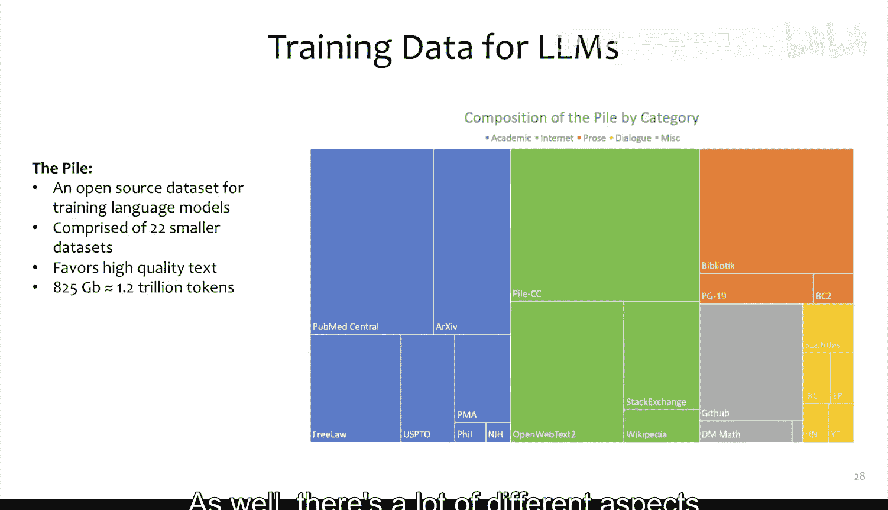

嗯。There's also a lot of different problems that come up in generative AI with memory use。

 you know there was this time I'm told where you know there were these sort of experts in the video gaming industry now mind you these are the people that were that we're writing the games for things like the Atari and like the original Nintendo and one of their greatest constraints was how do you pack all of the information for this game onto this you know this tiny little cartridge which would only had you know a few kilobytes of memory on it and they went to great lengths to figure out how can we cram everything we need to into this tiny bit of memory and it seems like we've actually returned back to that point in machine learning now where we're building the kinds of models that have so many parameters that were back to trying and。

😊，You out， how on earth do I cram it onto that TPU I have with 32 gigs of memory or that Tesla A 100 with a mere 80 gigabytes of memory and understanding both the sort of model itself and also sort of the systems aspects of how these GPUs work and the different sort of layers of memory and the speeds of different memory accesses can become incredibly important to actually getting these models running efficiently？

There's other things like how do you distribute your model across multiple different machines and the cost of train these has grown dramatically。

So when thinking about what is generative AI， I think another interesting aspect of this is sort of the convergence of language and vision。

So I have here a timeline for language modeltling。And another timeline for image generation。

And on both of these timelines， there's an important moment in 2017。

 which was the invention of the transformer。And what happened after 2017 in language modeling is that most of the language models switched over to using transformers from say。

 RNNs。And similarly in computer vision， many， many models were using CNNs。

 and then Transformer came along and it took a little bit longer until say 2021。

 when vision transformer came out for the computer vision community to start switching over to transformers as well。

😊，But there's this sense now in which I'm pretty sure that if I was pressed。

 we could teach this entire course with just one model。

 the transformer and we wouldn't never need to mention any other model， at least not this year。

So but I think what's important about that is that it's enabled sort of us to talk about techniques that straddle these these two domains or modalities that used to seem very different and the techniques for which used to seem very different。

 so there was a time you know when when everything was being done with CNNNs here and everything was being done with RNNs here and to actually sort of gain insights into what was working in one modality like language and translate those over division vision was sometimes difficult but now those sorts of translations are happening a lot faster and enabling us to do a lot more things in multiple modalities。

And so for a course like this。I think it's actually kind of fortuitous that we're able to capitalize on this sort of merging of timelines because we'll be able to sort of accelerate the pace with which we look at these different techniques because of a lot of shared commonalities between them。

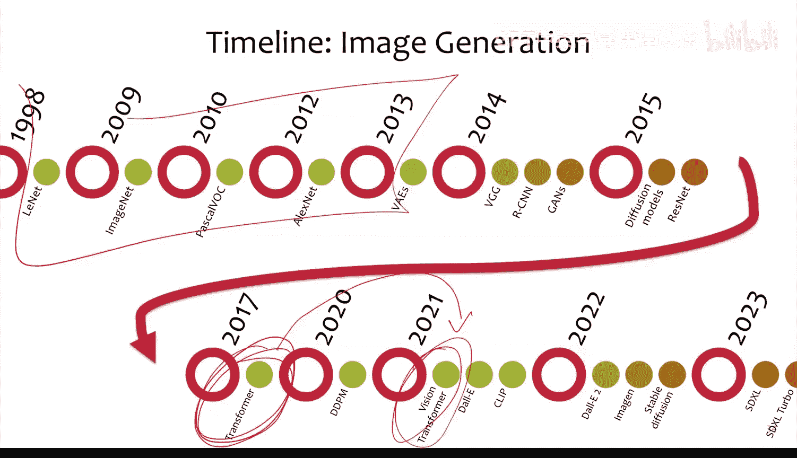

Okay， so。Let me pause here， what questions do you have before I go on？

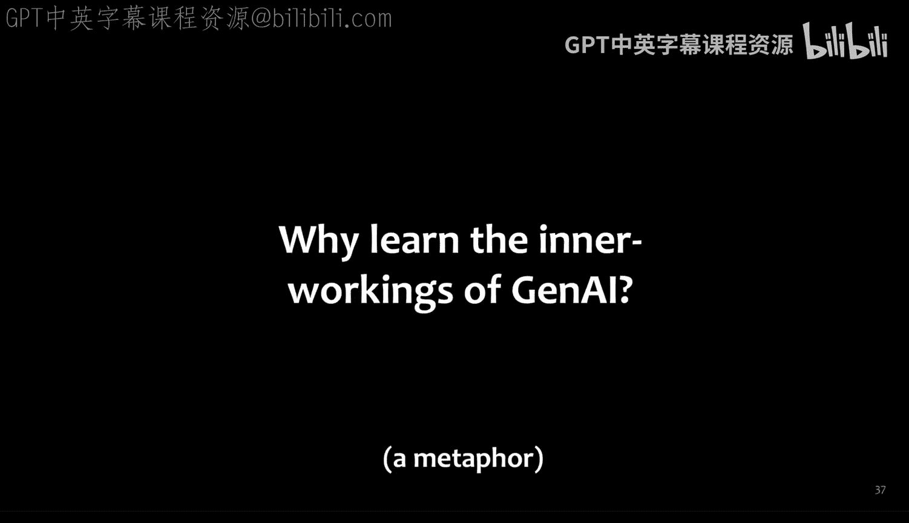

啊。s not in vision but not like great question I think we don't have time to do 3D shapes I would I would love to get there but I mean looking at our schedule we're like pretty hacked with topics and I think we won't get to 3D shapes that said I think that I'm blanking on the course number but I think you you can go over and take 16824 or something and and it shows up in that course 16824 does anyone else know is that something no no one's nodding okay maybe i'm wrong but there's a course in R that has this if you ask around。

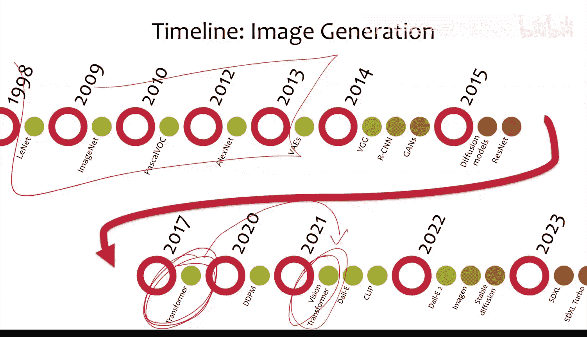

So I think that this question is probably a waste of time。

 I mean the fact that you're all sitting here means that you all already have some reason for wanting to learn the inner workings of Gen AI and I could probably skip this but。

I couldn't help myself but and and and really I'd like you all to be able to walk away with a good metaphor today so that when someone else asks you why are you in that Gen AI class like maybe your parents or something that you have a really you know quick answer for them okay so。

Think back to the days when cars were being invented， right。

 the combustion engine was kind of a new thing and there was this guy， Henry T。 Ford。

 who had this idea that every American should have a car。

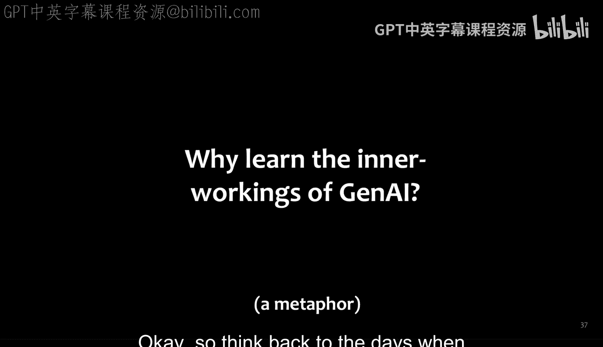

And look where he got us。AM。Like now as you start to think about cars like。

There are some good things that came out of ours。But there's also some not so good things。

Where of cars goes up。Andmpha。😊，ThisThis is like I don't know if you've been seeing this in the news。

 but it kind of got a lot of attention lately， this is the number of pedestrian fatalities between 1981 and 2022。

嗯。So that's only in the US， actually， it's going down in Europe。

So maybe you know we have all these problems with cars right， you know， they're gas guzzling。

 they're extremely dangerous hunks of metal that are just like flying along with no regard for pedestrians。

 maybe we could solve all of this if we just had this beautiful fleet of selfdriving electric cars right I mean。

 it would just be absolutely beautiful and and you know how could we get there， Well。

 we'd have to really understand the inner workings of the car right because you'd have to open up the hood and remove the engine maybe put a front in and then like flip the engine on the and then you'd also have to remove the steering wheel right because the steering wheel as part of the problem right like you let a human touch that steering wheel and this is just a bad idea right whereas if they were just all these like you know self-driving electric cars。

 everything would be solved。And so what we need is engineers who deeply understand the inner workings of these things and and you know I really think that in that case。

 you know nothing could really go wrong， I mean it would just be。Oh， that was this morning， yeah。

 okay。😊，OkayBut the point is that， you know deeply understanding this stuff is critical because I think that you know maybe generative AI is not like the next combustion engine it's not like that level。

 but I think that there's a lot of potential for things to go well and there's a lot of potential for things to go wrong and so you all need to be armed with a deep understanding of how this stuff works so that when someone asks you to go from point A to point B。

 you say actually I think that's actually like the completely wrong direction we should be going from point A to point C so that we don't end up with another round of you know big heavy hunks of metal that are polluting everything。

Okay， so。😡，Fundamentally， generative AI， what is it inside。

 it's just probabilistic modeling right it's having the probability of some next observation。😡。

A time T+ one， given all the observations that came before it。

And yet we're going to spend a lot of time thinking about how do you define that probability distribution and how do you actually learn that probability distribution in a way that is actually effective。

😡，Okay， so these days because we have deep learning， you know， generally like。

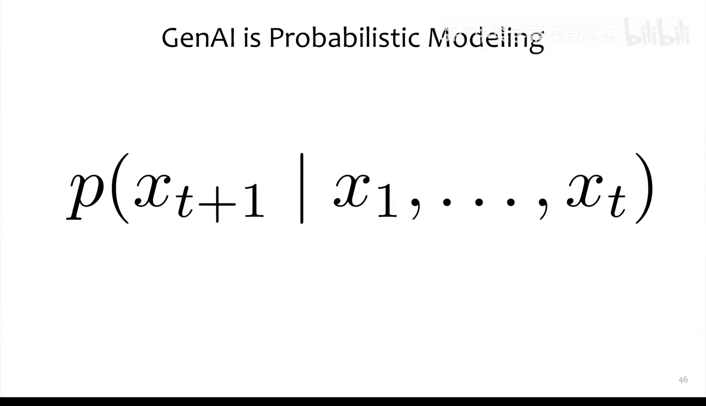

I kind of just want to model every possible variable interaction ever right I just want every variable to condition on all of the other variables that came before it。

 people used to do things a different way with things called independence assumptions you probably have never heard of those it was something that I learned about when I studied machine learning。

 but we kind of got rid of independence assumptions。

 conditional independence assumptions and we replaced it with things like an R&N language model that just condition on everything。

😡。

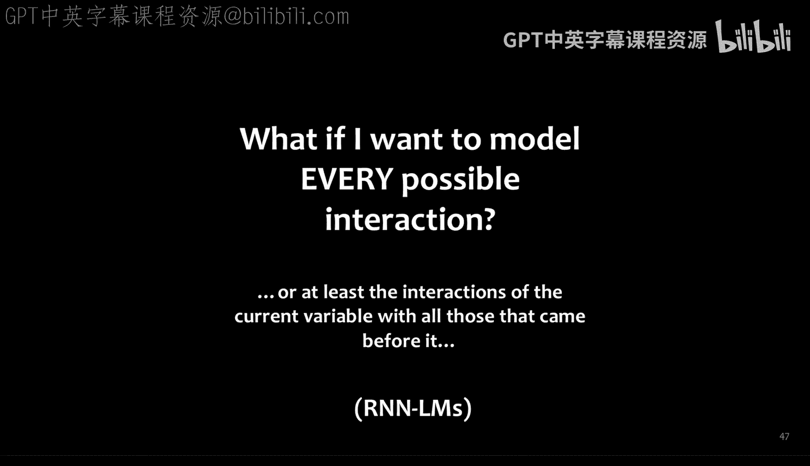

And have no conditional independence assumptions。So。So where are we going this semester？😡。

We're going to talk about first generative models of text。

 then we'll think about generative models of images。😡，From there。

 we'll think about how do you actually sort of adapt truly large models？

And how do you do so in efficient ways？嗯。We'll turn then to thinking about multimodal foundation models。

 I hesitate to say just sort of multimodal generative models because I think it gets a little bit confusing of like what are you actually learning the multimodal model for is it to generate text or images or both or neither so in that sense not necessarily everything in that space will be generative so we'll cheat a little bit there。

😡，Then other things that we'll talk about are how do you actually scale up。

 there's a lot of interesting problems that are not just systems problems。

 but that are also kind of algorithmic problems that sort of tie into the systems limitations。

 so this won't be a systems course， there's no sort of systems prere for that。

 but if that's something that you're really interested in there are some really cool systems courses for machine learning that are springing up across CSD and LTI and I can tell you about those。

We'll also think about what can go wrong with these kinds of models。And then then as time permits。

 we'll think about some advanced topics， 3D modeling is not currently on that list， but who knows。

 maybe we'll get lucky。嗯。😊，Okay， so I want to run through just a couple syllabus highlights。

The syllabus is。On the course webpage and the actual course policies are required reading。

 this is likely to be a large course and so course policies tend to become more important the larger the course gets so please be sure to familiarize yourself with those。

Here let me just point out a couple things about them the grading breakdown for this course is like 40% homework 10% of low stakes quizzes。

20% from one one midter exam and then 25% project and 5% participation so roughly the way that the course is organized is。

That the first say three fifths of the course are kind of homework and quiz oriented right and so there's roughly four modules and each one will have a homework and a quiz associated with it。

And。呃。And then those first four quizzes will kind of feed into that that's the content that will land in the exam。

Then maybe we throw one more quiz in there and then we drop your lowest quiz。

The latter two fifths of the course are going to be project focused and so you'll do those。

Together in a group。And。Let's see。 Oh， and then so you'll notice that I mentioned that。

There are five homework assignments but I said four modules that's because the fifth homework assignment is actually this like homework zero that we're we're just I'll talk about that in a second so it's sort of an exceptional one the exam date is set it's an in class exam on Wednesday March 27th。

And for homework you have six sort of flex days for homework assignment submissions where you can submit late with no penalty no submissions are accepted after three days late without an extension extensions are really like for emergency situations if you just you know have the sniffs that's a grace day kind of thing if you're in the hospital then like no worries like you'll have an extension。

And so see the syllabus for other sort of categories that fall in that bucket。嗯。Reitations。

 there will be sort of one for each of the homeworks those will be on Fridays at the same time and place as lecture。

And these are sort of optional but more interactive sessions the readings are going to be online PDFs technologies will use include kind of all of the familiar things that you've probably all used before academic integrity collaboration is strongly encouraged in this course and the key thing is just that you need to document your collaboration and that your solutions should always be written independently that said so the collaboration policies for this course if you took 1030110601 the collaboration policies for this course are different than for that course so if you took that course please do carefully read these collaboration policies don't just assume that they're exactly the same so I think that the policies for this course are kind of encouraging collaboration in some。

More so than we did in that culture。嗯。And then office hours are posted on a Google Calar。Yeah。

 so I encourage you to ask lots of questions， interrupt by raising your hand or ask it afterwards and on piazza。

The prereqs for this course are an intro to machine learning course so originally we just kind of had you know the usual list of intro to machine learning courses listed here including 715 and but then we said oh but。

SoThere's also Bisha's intro to deep learning course。

 which is itself an intro to machine learning course。

 it doesn't have any prerequisites and so if you took the 1145。

 6858785 that's also a perfectly fine pre-reck for this course but we don't want to confuse you into thinking that deep learning is a prereq。

 it's not a prereq for this one， so Pytororch and deep learning are not assumed ahead of time this creates a little bit of a schism between between all of you because depending on which prere course you took and in which semester you took it。

 you may or may not have been exposed heavily to deep learning and Pytororch so if you happen to for example。

 take my intro to machine learning course last fall you already implemented a transformer language model but if you took a different intro to machine learning course you certainly haven't。

That's okay， so homework zero that I mentioned earlier is really about kind of getting everybody up to speed on pietorrch and comfortable in particular with how to use it and then we'll also spend just some of these early lectures going through some sort of foundational topics in deep learning that'll be reviewed for a handful for some of you and new to others of you we'll just kind of get everybody on the same level in these early couple weeks。

Okay， so here's a picture of the kind of five homework assignments homework zero is kind of unique as it might be background for you or might not and then homeworks one one。

 two， three， four are where you'll kind of jump in and sort of really do interesting things like build not just。

You know， sort of a。An old fashionashed transformer language model that's kind of been done。

 but rather how do you actually build sort of a state of the art one。

 something that's say with sliding window tension for image generation we'll think about how do you actually how do you actually build a again or a diffusion model for adapters we'll think about how do you take。

fairly large language model and put an adapter on it and for multimodal foundation models subject to the we haven't actually written this or yet but we hope to get you to work with text to image models and actually to build one yourself though I don't yet have a proof of concept that anyone can do that on a laptop or on a small GPU so we'll be figuring out how to whether that's actually even moderately reasonable there's also this additional homework homework 623 that is only for students that are registered for 10623。

😊，In which you'll sort of do some analysis of recent research。

 then you'll actually read some literature and create a little video presentation。

So the goal of the well there's many different goals of the project to kind of have you explore some generative modeling technique that you're interested in。

 sort of deepen your understanding of real world applications。

 you'll work in teams of three students。Textbooks don't exist for this topic。

 but you'll be directed to current research papers so that is essentially I think a learning goal of this course is to get you to the point where you can actually sort of comfortably read research papers that are coming out very rapidly in this space。

In case you're looking for things， there's like a link just under lecture one that now says slides。

 if you click it you'll find these slides。There's an office hours link that has a Google calendar the office hours aren't up there yet but we'll have them up soon we're just kind of doing some last minute scheduling things the assignments will appear on this coursework page just right under that list of homeworks and we'll also generally announce them on Piazza。

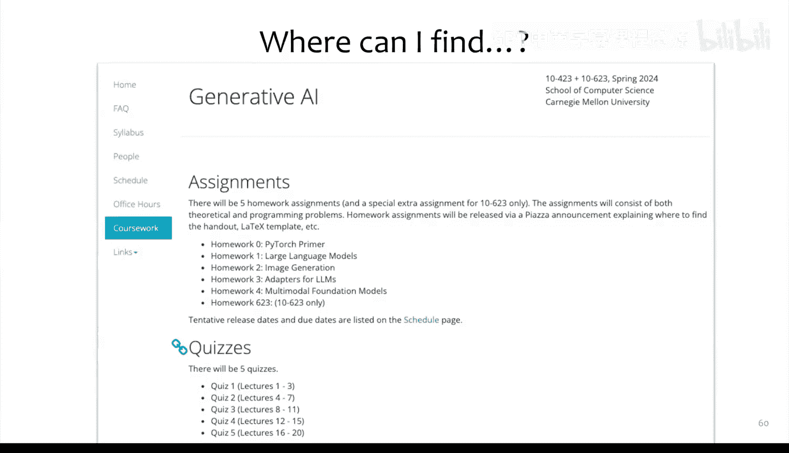

啊。Okay， and then so one unique thing about homework zero again。

 because this is sort of an unusual assignment here。

The the unique policy for this assignment is we'll grant basically。

Any and all extension requests you should just finish this homework on time if you're sitting here should you should finish this homework on time there's no reason for you to need an extension request。

 this is really so that we have a fair policy in place to account for the fact that someone like eight days from now is going to show up at my office and say。

 hey can I join here Gen AI course right after this deadline and we may be able to accommodate that person。

Okay，'ll there's a lot， I think we've talked a lot about sort of different ways of slicing and dicing the different learning objectives for the course。

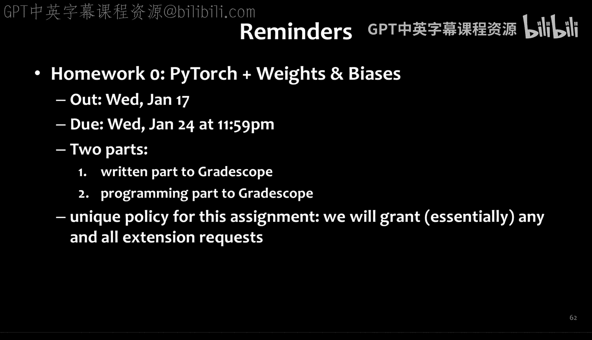

Questions。Yeah， while they're like of course overlaps， we courses like they brain。ど裁。超一个事。

Great question。I think that。So there' there's probably less overlap well so there's going to be overlap with both of those courses but like on completely different topics right so so I think that like Andre has recently rolled diffusion models into graphical models but those aren't going to probably show up in advanced deep learning。

 but then there are going to be topics in deep learning that are kind of like that kind of core models that we just need to be able to talk about like transformers and RnNCNMs that like that that course and this course sort of by necessity are going to have to talk about and then advanced deep learning also talks about some of the the generative models that well talk about。

 but probably will have it would have less focus。some of the like for example。

 it might talk about GNs， but it probably will have less of the picture of both sort of generative models from language and vision and other modalities and trying to connect them together and so so much of the reason that this course exists is that you could probably find all of the topics in this course。

In some other course that is offered by the machine learning department right now。😡。

But you probably need to take about five different courses to get all of the topics and so the reason that we put this course together was partly because we realized that while our PhD students。

 for example have time to take maybe five different courses in the machine learning department。

 not everybody does and so this was intended to bring together a lot of the projects that are just scattered across many。

 many different courses at the moment。That's a great question， thank you。

What's your favorite chat so I don't think I yet have a favorite chat GBT prompt。

 but I have definitely been developing some favorite images of parrots， narws and axel。

 which turns out are pretty amazing。Yes， how time consuming is this class in comparison to something like 301 or601 so the intention is for this class to be comparably time consuming to 301601 like it's a 12 unit course it should be 12 hours a week I think that sometimes a new course tends to err on the side of being a little more time consuming than an intense to be I have yet to teach a new course where we were like and。

All of those homeworks were way too easy we really should have like ramped up a whole level so I think that said I think we've also gotten better at like trying to actually pull you guys for how much time you're spending on things and dialing things back if we're going overboard and so so there's actually some adaptivity built into into the course already to be able to do that。

😊，Yeah， yeah， I had a question regarding the 10th23 project。

So you it's not so to be clear it's an extra homework assignment it's not a project so the project is for everyone in this course423623 everyone's doing a project homework 623 is yeah did what was was that the so basically do you expect any of us doing the project to use off the generative models or。

Maybe something from scratch so I think that using off the shelflf generative models or building something from scratch are both okay ways to go about the project but regardless of which direction you go you're going to have to build something this is not just of course where you just like use a generative model to do something like we are we are fundamentally focused on opening up the hood and actually like how do you build these things and so but there's a lot of things that that you just simply would not be able to do unless you're using a pretrained generative model because it might have cost $600。

000 to train and you don't have that kind of cash lying around I'm guess。I don't so。

Yeah so with regards to LLM we be looking like the architecture or we be at good question so are we more focused on kind of how to build LLms or how to use LLMs I say the the sU here is definitely towards how do you build them not not as much towards how do you use them though we will talk to some extent about like in context learning for example and try to understand why it is that that's actually working for all these but I don't see that in the。

Datime engineerings and how do you choose the this is a great question so data engineering is like super super important to say building a large language model and yet it doesn't show up explicitly in the syllabus so。

We are not necessarily going。I don't want to say that we're definitely not going to talk about it but we're not going to make it a major focus of this course There is a 11667 large language models course that was offered in the fall by LTI that did actually spend a lot of time thinking about data engineering part of the way that we're able to cover more machine learning topics in this course is by sort of deemphasizing some of that data engineering discussion but there is a great course this LLM's course that was offered in the fall that would be like a nice supplement I'm not sure to what extent that course is open and available but you could either look back at it or take in the following fall when I assume it' be offered again。

Yeah。Different。yeah so reusing like so building off of your own research for a project is is totally fine it just needs to be clearly documented basically so you still need to go do something else in addition to your existing research like your existing research would count as like youd treat it just like it was someone else's prior work。

Okay， so so with the rest of this time， what I actually want to do is go back and think about some fundamental topics that are hopefully going to for those of you who so I know there's like a specific cohort of intro MLL students who really have not done deep learning and so。

For you all what I in particular I want to talk about how does Pytororch work like what are how do you actually build something like Pytorrch and what is it doing for you。

 how is it doing it and then I also want to touch on just the most basic wow it's not that actually it's not that basic well I'll touch on two of the most basic classical methods for generating text so we'll do that with the rest of the time that we have today。

😡，嗯。Okay， so。Back propagations， right， so how many of you have seen back propagation before？

OkayIf your hand didn't go up， we should have a conversation after class。

 so back propagation is fundamentally about two passes through a computation graph。

 there's a forward pass through this computation graph and the idea is that you're basically writing down some algorithm to compute some function right so like y is equal to some f of x and you can represent that function as a directed acyclic graph where each node is computing some intermediate quantity。

😊，And you visit those nodes in topological order， let's say from bottom to top and then you get the output at the top and then you do this backward computation that is starting at the top and working in reverse topological order through those nodes and at each node you're computing say some partial derivative using partial derivatives that you've already computed this is the fundamental idea of back propagation and usually when we actually implement a general purpose back propagation algorithm like automatic differentiation in the reverse mode。

😡，Not just a specific back propagation instantiation for one neural network what we do is actually this this alternative version so here you'll see that。

I'm saying that we compute， so if we have some node VJ that we care about and some y。

 and then there's some intermediate nodes， U1， U2， U3 that what we do is。

We directly compute via the chain rule DY DVJ in terms of the chain rule involving those intermediate terms and I claim that that's not actually a good way to implement this stuff。

 what you should really do is that every time you visit a node you should actually increment DY DVJ so each time you visit one of those U nodes。

 you should increment DYDVJ by DDU I DY DVJ right and these two are entirely equivalent algorithms you get back the same answer in the end。

 but the second way of doing things enables you to write much cleaner code that allows you to be general purpose about your back propagation algorithm。

So fundamentally， backpro is about reusing computation。

 both from the forward pass and the partial derivatives that you're computing in the backward pass and allows you to compute gradients so that you can train a machine learning system。

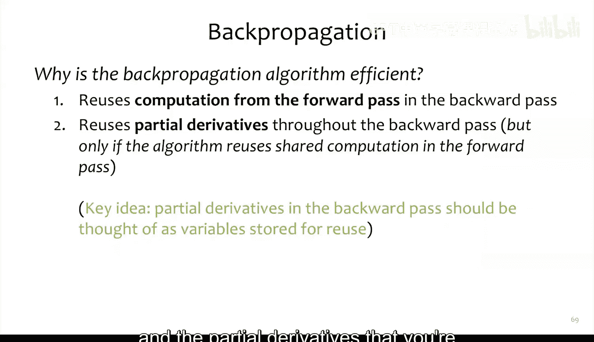

So here this is just a little picture of a neural network， this is sort of as basic as they come。

 we have some input X， we hit it with a linear layer here， multiplied by some matrix alpha to get A。

 and then we pass that through elementwise sigmoidine to get Z。

 and then we do another linear layer a softm and then say some cross entropy loss， okay。😊。

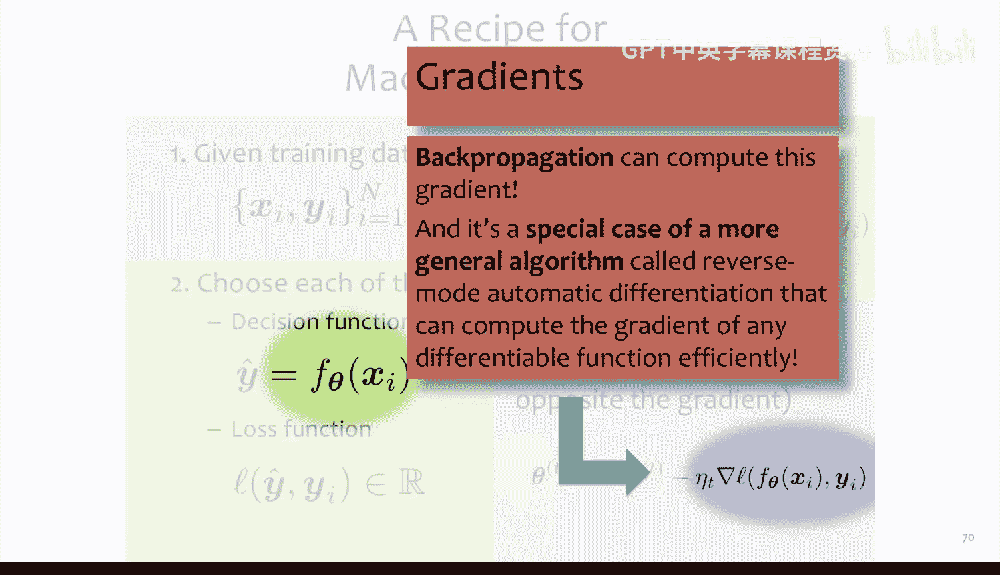

And so here we just have an actual picture of that computation graph and if you were to implement。

 say， in an intro MLl course， the back propagation algorithm。

 your code might have looked something like this but like a Ny instead of math basically like you know。

 you kind of have like you're just，😊，Stepping through the forward computation and then you're stepping through this backward computation and there's no real structure to this code。

 you know， maybe you put comments on it， but I didn't and it's kind of hard to parse and you can't really see how you would reuse anything here。

Okay， so module based automatic differentiation says you know this is like one time code that you throw away。

 we want something reusable and so there's there's been this whole collection of different neural network。

Libraries that support automatic differentiation or AutoDIF。And。

And historically there were kind of like two different kinds。

 there were static neural net packages that required you to。

 ahead of time specify the actual full computation graph。

And so TensorF started out this way and Teano was the other kind of classic example of this。

 and then there were these dynamic neural network libraries that allowed you to sort of at runtime specify the actual computation graph and these included things like torch Ptorrch Dt。

😊，And eventually， TensorFlow came around and realized that everybody should be doing things this way and kind of added it into their library。

So when I'm talking about module based AD， what I'm really talking about here is this dynamic way of supporting arbitrary computation graphs。

😡，And the key idea is to componentize the computation of the neural net into layers right。

 and each layer is just consolidating multiple real valued nodes in a computation graph into like a vector valued node or a module and the module is capable of two actions。

 a forward computation that's giving you some output B from some input A by some differentiable function F。

So that's this side of things so this is。A going through F to get B。

And then the backward computation is taking in a gradient， not just any gradient。

 but if your loss function or your objective function is J。

 then we have that the gradient of J with respect to the variables B is stored in G sub B。😡。

And the backward computation for a module should take in GB， B and A and compute GA。😡。

Or the gradient of the objective function with respect to the variables a。Okay。

And so the idea then of module based A is that you could have a bunch of little modules that that do this for you。

 So here's a sigmoid module right， So it's forward。😊。

Function would take in the A and apply sigmoid element wise。

 the backward would do this sort of element wise computation of1 minus BB and GB to get GaA。

And then a softmax module you would have a similar structure。

 but the inner computation is different right here we're computing softmax in the forward and the backward involves this diagonalization or producing a diagonal matrix from a vector and then doing some simple matrix vector multiplication。

To get the actual output。U。😊，And then you know sort of similar structure for a linear module on a cross entropy module right and so once you once you've implemented these things now you can go back to your procedural implementation and you can write your forward computation。

 which calls linear forward and then sigmoid forward and then linear forward and then softmax forward and crossenttropy forward and then you can do the same thing crossenttropy backward。

 softftmax backward， linear backward sigmoid backward。

 linear backward right and now you have reused some code。😊，The annoying thing is。

 you still had to write。This code。And it'd be really nice if you didn't have to write that code at all。

 right？Because back propagation is this general purpose algorithm。

 it works the same on any computation graph， why should we have to write this out every time？Okay。

 so the sort of object oriented way of implementing modules would be exactly what we had before。

 except that now I've just changed the actual functions to methods to class methods right so every class like a sigmoid class is extending the module class and both have a forward and it has a forward and a backward method。

And then the softm has a forward and a back method， right， same thing all the way down。😡。

And at some point， someone has to actually implement both the forward and the backward of each of these modules。

😡，And usually when you implement it， you don't actually implement it in Python。

 you actually implement it as like a kuda kernel so that it runs really fast on a GPU。😊。

But then once you've implemented it once， everybody can reuse that module。😡，Okay， and here's how。

The idea is that。You define。A new module。Like a neural network module。

And you construct your different layers， so you have a linear layer and sigmoid， a linear a softax。

 and a cross entropy。And then you define your forward computation。😡，By saying， okay。

 we're going to take in our inputs， which are x， our tensor y and our parameters， alpha and beta。

 and we're going to take our linear layer and call apply forward to x and alpha。

 and then our sigmoid layer is applied to a， the output of L1 layer。

 and then this is applied to z and beta and so on down the line。And at the end。

 we return the tensor from our objective function J。Okay。So the beauty of this is that。In backward。

 we don't actually spell out。How to。Back propagate through your neural network。Instead， we just call。

Tappe backwards。Which is a special function that runs the forward computation that we just did in reverse。

Basically calling the backward method of each module in the right order。For us。So how does this work？

So。The key thing is that。You have some global tape。

And by tape here I want you to think of like a Tring machine right like that kind of tape right it's like storing information for you。

 but this particular tape it also is implemented just as a stack so you can just push things onto it and pop them off。

And the module class that each of these things is subclassing has some important special inbuilt functionality。

Namely。So itize you initialize any module by storing an output tensor and an output gradient。

 so the output tensor is like the actual you know F of a。

 the B that comes out of the module and the output gradient is like the gradient of the objective function with respect to B。

😡，Okay， so this method apply forward， you'll notice here that。😡，These modules。

 we just defined forward methods。😡，And yet over here。

 I was actually calling this apply forward method。Okay so that was a very careful choice because the apply forward method is doing a little bit more than just the forward computation for that module。

😡，Namely， it starts by taking in。Not a list of tensors， but a list of other modules。😡。

And the first thing that it does is it actually grabs all of the tensors。

 like the mathematical nuumpy array like objects from the modules and feeds them into this class's forward method。

Okay。That gives us back。Some tensors。That we store as our app。喂。😊，And crucially in line 12 here。

We push。This module like ourself onto the tape。😡，And so that keeps a record of the fact that we just did this forward computation。

😡，So that and this is the fun part when we call tape backwards。

 we can actually run that tape in reverse and call all the backward methods in the appropriate order。

 so here's tape backwards so while the stack called tape still has elements in it。

 we pop off the most recent thing that was added to it and call that modules applyly backwards method。

Not surprisingly， apply backward is just calling the backward method to get the appropriate gradients。

And then， and this is the beautiful part。 It's doing that incrementation that we talked about in version B of backpro。

 right， it's saying for each of the the modules that was an input to this module。😊。

We take the gradients that we just computed and increment the output gradients for those modules。

Okay。So。This way of implementing module based AD is extremely close to what Pytorrch is doing。So。

So here I've taken that same neural network and I've defined for us up here in Pytororch。

 the a knit method that lays out the different layers。

And then the forward method that goes through those， those separate layers。

You'll notice that the cross entropy loss we purposefully kind of kept out of this neural network。

 that's because if you define the neural network this way。

 then it could be used at training time or at test time and the loss is really only a training time thing so we keep it outside of the module。

 so different from the previous slide but almost inconsequentially so。

And then when we want to take one step of stochastic gradient descent。

 we just define our loss function， an optimizer that is something like stochastic gradient descent。

And we compute， oh， there's a line missing here。 Sorry， I should have said model equals。Neurural。

 I could actually use this class here， neuralural network。And。

So then we say model takes our input and then our loss function takes the predictions from the model and the ground truth y to get our loss。

 and then we zero the gradients in the optimizer and we call loss dot backward。

 that's running the tape backwards and then finally optimizer。

 step is taking that gradient that we just computed and taking a step opposite the direction of the gradient。

Okay。So Pinetorrch is just an example of automatic differentiationiation。😊，You might have noticed。

 though， that here we didn't call。Linear one dot forward。Here we called self dot linear1 of x。😡。

But linear  one is actually a class， it's an actual object。

So why are we not calling a method on the class， right that's what you do with classes or objects。

 you call methods on them。Well。Turns out mytorrch has this syntactic sugar。

How many of you know about the underscore， underscore call underscore underscore method？Oh good。

 some of you， Okay， so this special method with double underscore。

 all double underscores allows you to define what happens when you treat an object as if it were a function。

😊，Okay， and so in other words， running linear of x is equivalent to running linear dot underscore。

 underscore call， underscore underscore x。😡，And in Pytorrch。

 that's nearly the same thing as running linear dot forwardative x。

 but there's some special bookkeeping that is keeping track of the tape， for example。O。So。

Another question， you'll notice that in my version of automatic differentiation。😊。

I kind of treated all of these tensors as equal， right？Inputs， outputs， parameters。

 they're just tensors in a computation graph。嗯。In Pytorch， though。You'll notice that。

 we defined that linear layer， but we never actually passed in the parameters to that linear layer。

So where are they？嗯。😊，Well。Hi Torch， in an effort to make your code cleaner。

 stores the parameters inside the actual module class。

And this is convenient because then it also can mark those variables as parameters。

Because when you have an optimizer class， it wants to know which of the things do you actually want gradients for？

Right。Like， for example。We probably don't want the gradient with respect to X here。😡。

That's say our if we're doing image classification， that's our input image。

So by marking what things are parameters and what things are not parameters。

 hightorrch is using that to sort of reduce the amount of memory that you actually need to keep around in terms of which gradients you're actually computing and storing。

Okay。So armed with Ptorrch deep learning becomes very easy so I was actually talking to a student recently who was it took me a little bit to understand what the student's concern was because he kept explaining that you know he had taken this course where all he did was you know build deep learning models with Ptorch and I was like that's great so you understand deep learning he's like oh no I have no idea how Pytorrch works。

😊，Because hightororch is so easy that someone who doesn't have machine learning background can go in and actually use Pytorrch and really not understand how back propagation works。

 because you don't really need to understand how back propagation works and you can still sort of make Pytororch do things for you。

 I would argue that it's valuable to understand how back propagation works and that you all will take Ptorch much further than you would。

 if you had not known what back prop is。Okay， that said， we can now think about sort of complicated。

 deep models and we don't have to worry so much about， say。

 doing complicated matrix calculus to figure out what their gradients are。Okay， so。

I want to actually， you know。Do some generation today。And。Let's be honest。

 the easiest possible way to generate data。Is with an Ngram language model。

These things have been around a long time， so your goal is to say generate realistic looking sentences in a human language and the idea is just to condition on the last n minus one words to sample an NF word。

😊，So if you want to， if you have something like the bat made。

 now what you want to do is you want to generate your next word。

 so you grab a multisided die and it's the one for the bat and or sorry the bat made。

And you roll that die and it comes up on some other word， like noise， and so that's your next sample。

And now you pick up another dye， that's the dye for made noise and you roll it and it comes up at。

 so that's your next sample。And then noise at， you roll in and you get night。

 so this is now a sentence sampled from an Ngram language model。

So with an engram language model we can now define a probability distribution over a sequence。

 we could have done that already though just with the chain rule of probability right like the probability of the sequence W1 through W6 is just by the chain rule probability of W1 times probability of W2 given1 and so on all the way down。

Um so。😊，呃。The Ngram language model is saying， well。

 we can actually define a probability distribution over a sequence of length t。

By making some independence assumptions oh， they came up。

 I can't believe they actually this is like the only place that these are going to show up in the entire course so the independence assumption that we made here is say that W4 only depends on W3。

 it's conditionally independent of all of the other words that came before given W3。😊，可以。

And so now this probability of the sequences involves sort of a little bit less information。

 so this is an n equals 2 n gra model， this is an n equals3 gram model where we now condition on two previous words。

Okay， so you can learn these probabilities， you could think of these probabilities as like big tables of probabilities。

 one for each of these different multisided dye。and you know， depending on what your you know。

 each one looks a little bit different right made noise has high probability for at and pollution。

Or yeah， made noise pollution， but made noise zebra has very low probability or zero probabilities。

So you could learn these probabilities just by counting from data。

 so if you have a collection of data， you could look for say if you want to learn this particular probability table。

 conditioning on the sequence cows eat。Then you could just look at all in your data set。

 all the places where you see cows eat and just count up the number of times that subsequent words follow right cows eat corn four out of 11 times grass three out of 11 times hay2 out of 11。

 and now you have a probability distribution over the next word given the previous two。😡，Okay。

 and then you can after you've learned it sample from your Ngramm language model like so。

And if you wanted to， you could train it on， say， the complete works of Shakespeare。

 and you would get some really， really lousy looking Shakespeare， as you can see on the right， okay。

So this was the state of things in the early 2000s。

These were the model these were like the best models that we had they were slightly better ones。

 but they were really slow and they didn't get you like that much more so every machine translation and automatic speech recognition system was using an Ngram language model okay so then along came thecurrent neural net language models and they did things a little bit better。

And the backbone here was sort of the classic recurrent neural net where we say we have a sequence of inputs x。

And we're going to have a sequence of outputs y。😡，Okay， so here notice that x1 is itself a vector。

 right， this is an input vector， and then this is another vector。And so on down the line。

 each of these is a vector。Okay， and here's how the actual computation works。

So we're going to take in， say we wanted to compute H2 here。😡，So to compute H2。We first take x2。Here。

And we multiply it by some big matrix， WxH。And then we add to that some H1。

Multipliied by a different matrix WHH。And then we add to that， a bias vector。Okay， so far。

 we've just got a linear combination of x2 and H1。And now we pass that through some nonlinear activation function。

 calligraphic H， and that gives us H2。Okay。So now， given H2， we can compute Y2。

So Y2 is just a linear function of H2。And now we do that for every time step。

 H3 is computed as a function of x3 and H2 and so on down the line。Okay， so。

Let's go back to the chain rule of probability。嗯。So。I like this rule， you know。

 it holds for any probability distribution， it holds for any ordering of the inputs。😊，嗯。In fact。

 we'll kind of reason about why that could be useful when we think about transformer language models。

And for a recurrent neural net language model， we're actually going to use the chain rule of probability with a little bit of a twist。

We're going to say that the thing that I don't like about this is that each one of these must be a different probability distribution。

You can't reuse this probability distribution here because this thing conditions on five words and this one only conditions on three。

😊，Okay。So to fix that， we can say， well， what if instead we first convert all previous words to a fixed length vector？

And then。We define a probability distribution。Probability of the next word conditioned on that fixed length vector。

This now allows us to use the chain rule of probability to define a probability of next word given all previous words where we just need some function f theta。

That gives us a fixed length vector from an arbitrarily long sequence of vectors。Okay。

 so the RNant language model。Not surprisingly， defines F theta with an RNN。Right？An R is just。

A complicated function to get a， say a vector like H5 that is a fixed length representation of all of the vectors up until time step5。

Just as H3。Was a fixed length representation， same length， by the way。

 of all of the vectors up to 10 step three。O。So the RNN language model says， okay。

 we're going to take in some sort of special start symbol that'll give us H0。

 and then we get a probability distribution over word1 given H1。😊，And we sample a word the from that。

Now the word that we just sampled though， we feed back in and we get a vector H1。That's the R&N part。

From H zero and。Whatever this was W1。And now we have a probability distribution over word two given H。

One， sorry。And we sampled the word bat。And now we continue along down the way and we get。

This probability distribution over next word， given all previous words where the RN is giving us that vector representation and。

And we can just keep on sampling words like we did from our Ngram language level。

 but now our probability distribution is coming from a neural network。😊，Okay。

 the only thing is we didn't say how do we actually create？A distribution， P of WT given HT。From HT。

So how do I define that？HT is a vector， how do I get a probability distribution over words？Given H。

Any ideas？ですあ。Take a and then'll apply soft soundsunds great， softm。Applied to a linear layer。

Applied to H。That gives us a probability distribution。

 we should say how long this linear layer should be so that the softm is of the appropriate vocabulary size。

 but that's all there is to it， and now we have a probability distribution over words of the right size。

 and it's defined by this neural network that's based on all of the words that came before。Okay， so。

We can multiply all of these probabilities together。

 and that gives us the probability of the whole sequence。

And we can sample from this model just as we sampled from an NgramM model。喂。

All we're doing is that now we're defining these probably the weights of these different sided dye based on a mildly complicated neural network。

Okay so it turns out if you do this， you get back samples that are a lot better。

 actually they're so much better that it might take you a second to actually figure out which of these is the right labeling。

 I'll let you think about that and what we have here is sort of our first picture of a generative model of text。

 well two generative models of text one extremely simple Ngram language model that does a really lousy job and one recurrent neural network language model that does a whole lot better and allows us to actually get something that could mildly be passed off as real Shakespeare text。

😊，And。And so the question now becomes， if we can train。

A simple recurrent neural language model on just the complete works of Shakespeare and get something that looks like this。

 what could we do if we had a slightly better model and a whole lot more data？

And so we'll take that idea and run with it next time， and in the meantime。

We'll set you off working on homework zero realistically I'll actually I didn't actually finish writing homework zero。

 but I'll have it out tomorrow morning， the thing for those of you who've already done Pytorrch months if you haven't done weights and biases like a bunch of this homework is actually just getting you familiar with weights and biases which is a nice way of actually doing plotting and logging。

 so hopefully there'll be something new in there for you as well。See you next time。是。

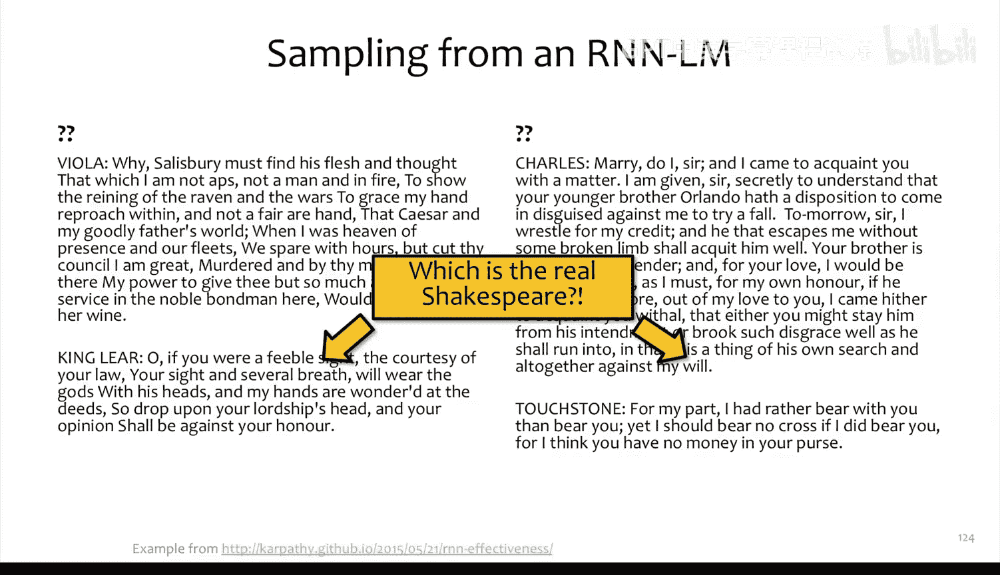