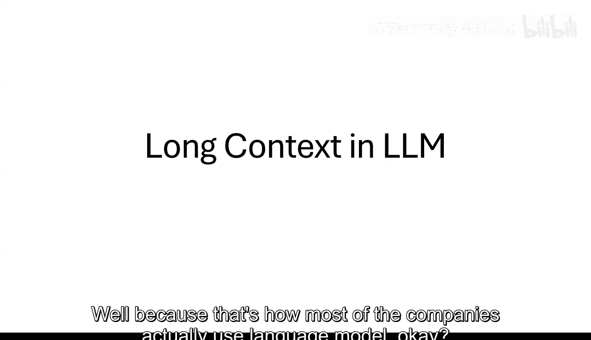
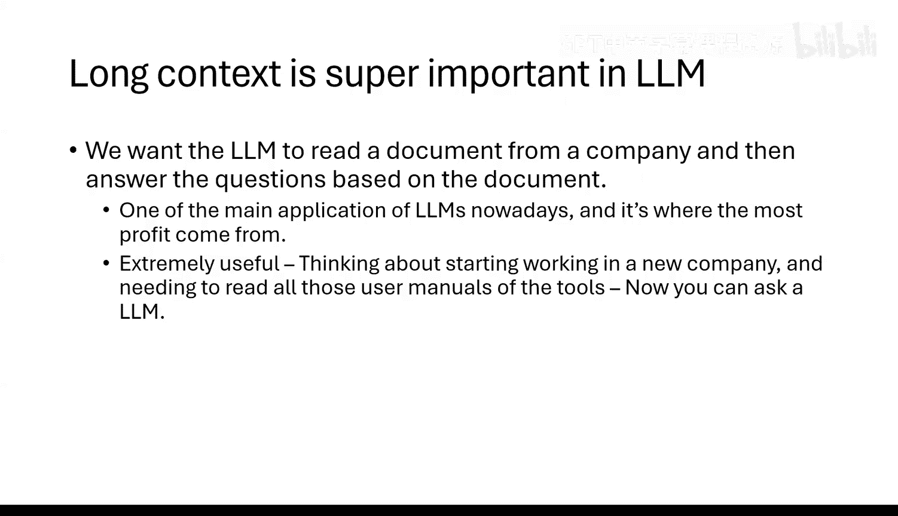
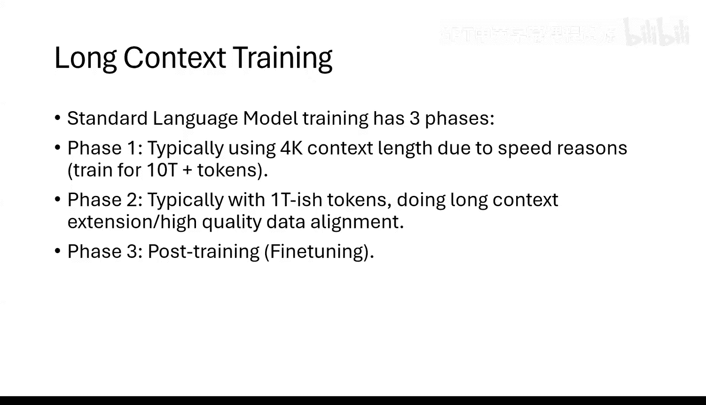
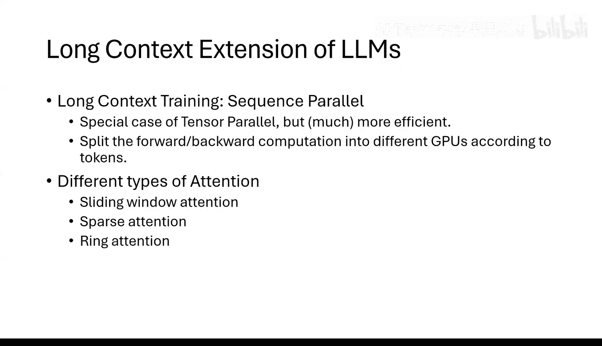
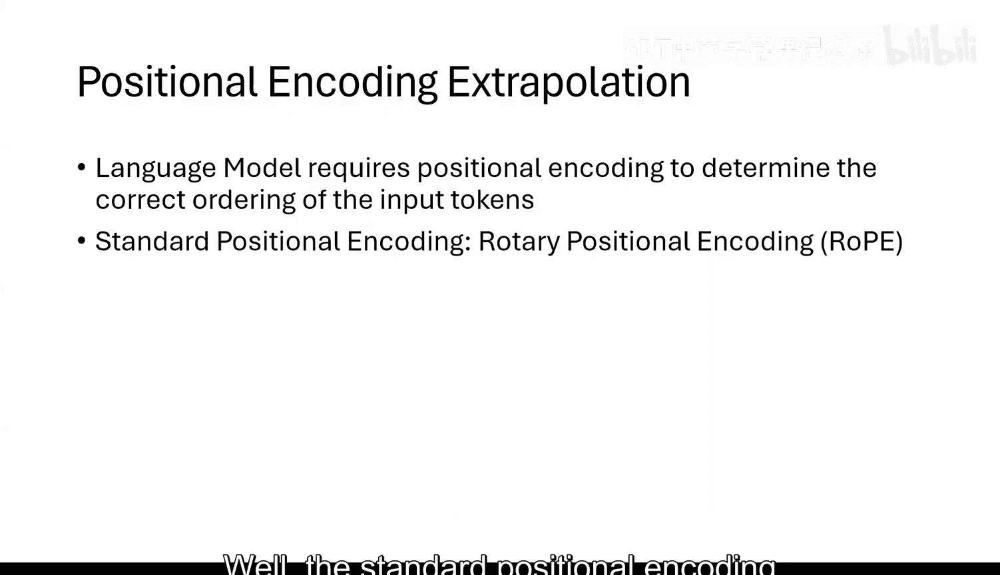
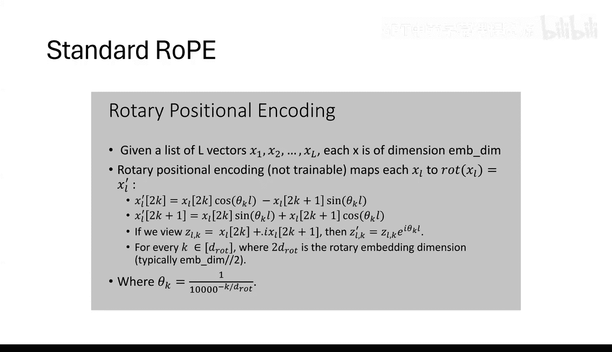
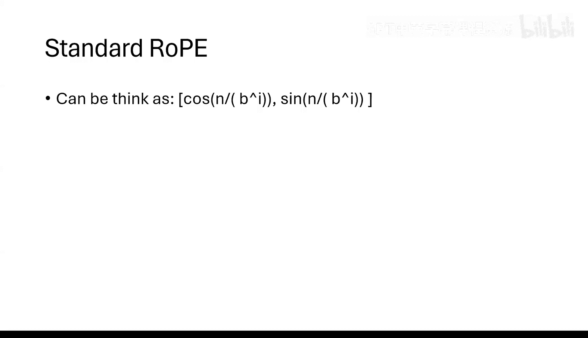
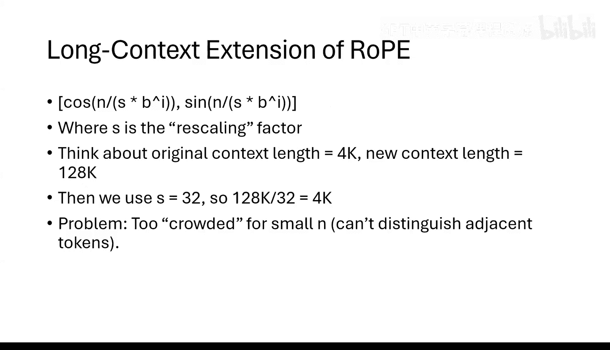
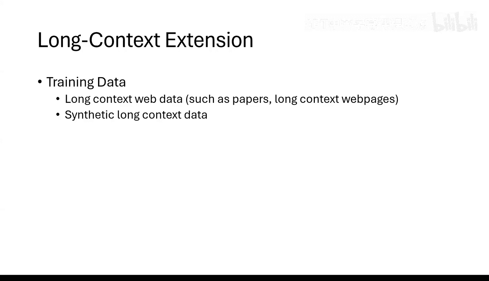

# CMU《生成式AI｜10-423 generative ai 2024》中英字幕 - P20：-P20-Lecture 20- Long Context in LLM_2.zh_en - GPT中英字幕课程资源 - BV1CyC9BPEhG

Let' start today's lecture。So。Thank you everyone for coming to today's slide。

 I think you already have the final exam and。😊，I mean you working on your project。

 so probably those lectures doesn't matter going onwards。

 that's why we are going to study something that are more lightweighted from this lecture onwards。

Okay， and hopefully you will just try to enjoy the content and have some fight。😊，Okay。

 so this lecture will also mostly be on the blackboard。

And we will talk about the kind of long contexts in language model。 Okay。

 so we kind of know that when G4 released the model was only， I mean，8 K contact sense。

 And then there's like a 32 k version， which are more expensive。

 and then they antro big release a model， which has 100 k contact sense。

 which is really making a very huge deal in the market。 And now Google hasi pro。

 which is one million contact lines， which also create a lot of wave in the market。 Okay， so。😊。

I mean， just to tell you the funny story when Gemini pro release。 that's the same day as open。

 I release So， right， And from a research perspective。

 I mean So is a much more important product or much more impressive stuff compared to Gemini pro。😊。

And the leadership by Microsoft was making fun like Google tried to heed the headline。

 But what do the 1 million contacts do。😊，But after two weeks。

 they realized that the Jmini pro is a much bigger deal compared to So。 Okay， So had no。

Orduct impact at all。 But the Germanmini pro was actually taking a significant amount of market just because of the contact lens。

😊，切。😊，So why does long context important in language model， Well。

 because that's how most of the company actually use language model。 Okay。

 so the main business of long language model， I least nowadays is basically the acting as the agent。

Okay， so one the most important application of language model is really just try to read the industry document like a description of the company policy or description of the tools that the company have。

And making sure that language model can actually answer questions by from those documents。 Okay， so。

 for example， if you feed like a document with 1 million tokens to Ji pro and then you try to ask a question about。

 for example， if I want to do this in like what particular company， too should I use。

Then the model should be able to answer it reliably by extracting the information from those 1 million tokens。

 Okay，1 million token is extremely long。 It's almost like a full size book。😊，Okay。

 and you want to be able to extract information from there re。And this is a very。

 very huge application。 I mean， thinking about youre going to like a new company。

 right after graduation， you go to a new company， you join something like something like a startup up or well established company。

😊，Or maybe you're just doing some internship， right， you feel。

 you probably feel the pain of having to adapt to the special architecture of that company， right。

 You have to read through all documents。 You have to do so many searches and asking like different peoples what should I do with this particular tool。

 right， even like。Connecting to the GPU cluster in some companies， very non travel。

 You have to read through like。Henceence of pages are document， and you have to know where they are。

So basically， that's the main application of language model。

 They want to build the language model as this type of agent。 Okay。

 where you actually insert all the document， all the description or all the like whatever instruction menus in the in a company to the language model。

😊，And then the language model needs to be able to reason or answer questions from the instruction many。

 Okay， so it needs to have really， really strong income tax abilities and also the。😊。

Kind of the document that you gave to the language model is extremely long okay。😊，Any questions。

He cool。 So that's basically why long context is extremely important for language model。

 But training language model on long contact actually has a lot of problems。 and it's not as easy as。

 I mean， you would imagine。 It's not just setting the contact sense to be that large。

At the pre training stage and just train it。 I mean， that typically doesn't work very well。 Okay。

 so you have to do some tricks。 And that's what we want to learn for today's lecture。

But just for the motivation side， I mean。YouRight now。

 when you think about that language model or you think about releasing a language model or you thinking about opening up a startup after like the last Fridays lecture。

 right， So you have to think about long context。 You cannot release a4K context language model anymore。

 Okay， right now， like long contact is really the core business。Hey。😊，So basically， as you recall。

 from the last Friday， we learned that standard language model training had three phases。😊。

There's a first phase， which is  pretty20。😊，Or face one pre training。

 And this is typically using 4K contact access due to speed reasons。 Okay。

 long contact training is actually very， very slow because， you know， the longer your contact size。

 the slower the attention would be， right， It's going to go through all those tokens and also you need to deal with all sorts of strange parallelizations。

 if your contact size is too large。😊，And also， if your contact size is too large。 for example。

 you have 128 k tokens， then the language model trainee is actually going to lose focus because you are averaging the loss over all the tokens。

 And for short contacts is really know that these4K is like the token that I should focus on。

 I should really make sure that my generation is I locally consistent that I only look at those short tokens。

 So it's pretty easy to train。😊，Okay， if you extend your， if you use。

 if you use like contact size more than 16 K in phase1， okay， we actually did experiment on that。

 and that's not even trainable。Hey，If you even if you build the infr correctly。

 even if you use the correct， like whatever floating point accuracy。

 contact says more than 16 k is really just not trainable at phase1。

 The laws would not go down because the language model rules forecast。

 It doesn't know like to predict this token。 What， what are the other tokens I should look for。Right。

So the shorter the contact sense， actually， the easier it is to train the language model at the beginning。

I mean， first， think about deeper contact size is0 K or sorry，100。

If your contact sense is really 100， you are kind of telling the language model that order to predict the next token。

 I should really just ensure local consistency。😡，Right， because there's only 10 token I can look for。

 I don't need to care about like all the global reasoning structure， etca。

 All I need to do is to make sure it's local consistent to minimize the laws。

 So it makes the language model training pretty easy if you have a short number of tokens。

 But if you really have 100 k token in phase  one。 Then the model at the beginning just so con。

 there's100 k token before me， You have to predict this token。 like which token should I look for。

 It's totally confused。So you can only add the long context extension at phase 2。

 When the language model already understand language and now you have long context。

 then the language model cannot understand which token to look at。😊，Okay。

 so this is the general philosophy of how do you do long contact training。

 And then there's a post training phase， which you keep the lung contact， okay。Any questions。Yes。😊，别。

We have different context expansions within the same training place。 Yeah， yeah。

 So phase two is actually a mix between short and long contact because if only you try long contacts。

 the short context performance will degrade pretty significantly。😊，Okay， so basically。

 phase two is usually like a mix between long contact and short context training。Hey， yes。あピかと。

He can't go about this number us can believe。There's not like a theoretical limit， but in practice。

 it's really just if your language model is not large enough。

 then even if you extend the context access to like1 million。

 the model would not really be able to search through this 1 million tokens。😊，So really。

 your patron model at phase one must be very powerful。 So usually contact science is。😊。

Kind of like whether you can extend the model to very long contexts or not。

 it is a pretty good indicator how， how good the patron phase one model is。😊，Yes。

 when like when people claim that a model has a certain number of contexts length how would like what what sort of benchmark do they use for that because like there's no ecstatic limit Yeah。

 there's the standard benchmark is long context Qa。😊。

Which is actually how people actually generate those long contact training data。

 So theyre doing in distribution testing， which we will get to that at the very end。😊，Yes， so。

So the intuition behind first requires to be able to train with like smaller context is because at that stage。

 it will be like if we along the context， it will be impossible for the model to Yeah。

 It just too much noise because the model is looking at like 100100 k tokens a 1 million tokens before it。

 that it just completely laws which token should I use to predict the loss you have to first use short context less So teach a model the inductive bias where the adjacent tokens are much more important。

And like short context is actually， you are posing an inductive bias， right。

 You are telling the model。 This 4K window is all that matters for predicting the next token。

 You don't need to look go beyond for pay。 So this makes the training much easier。😊，Yeah， I mean。

 originally， when people train bird like models， they actually do this context lens cycle。

 which means they start with context as 200 and then extend to 400 and then to 800。So they， this is。

 this is like how bird models are trained。And right now， because our PPT models are more powerful。

 So we only do this4K to like 100 K or 4K to 1 million extension。😊。

But it's interesting to see if you do， like。500 then4K then one million。 what would happen。Yeah。

 but we have some experiment showing if you train on 500， like all the short contact benchmarks。

 you are much better。😊，Yeah， but 500 is really too short。Any other questions。很 cool。

 So then how do you actually train a model on a very long contact lens。Well。

 the first thing we need to talk about is the in。

Okay， so to try a model on long contact as the most important technique here is called sequence parallelization。

 Hey， it's kind of like a special case of sensor parallellyization， but are much more efficient。😊。

Okay， so what is sequence parallellyization， Well， let's think about it this way。 I mean。

 for a 7 B model， right。😊，So if you use contact as4 call， sorry， if you use contact as 8k。Okay。

 so this is context lens。Then your maximum batch size。 If you don't。

 if you don't do any sort of parallelization and you use deep speed stage 1， Okay。

 then the maximum batch size。😊，Or you should call it micro batchch。This one， okay。

 this will occupy all the 80 gigabys of memory of an H 100 GPU。 Okay， so if you have 70 model。

 the maximum contact size， you can train without any sort of Tensor parallelization。

 model parallelization is one。😊，Okay， so then how do you do 128， Okay， so this context that。

 even if you have a 70 model， you cannot fit it in the memory。😊，He， because from 8 K to 128 K。

 you are like 16 times more。 You're probably using 16 times more memory because the M LP layer scale linearly and attention layer scale slightly higher than linear。

 So even more than that。😊，嘿。😊，So basically， how do you actually train those model with this context lens。

 Well， one way to do it is using those model parallel， tensor parallel， pipeline parallel。 Okay。

 well there is some more straightforward way to do it。

 which is called sequence parallel that actually minimize the communication。😊，Okay。

 what is sequence parallel。 sequence parallel is a pretty simple technique He。

 so suppose you have those input tokens。 okay， those are super long。😊，There is 128 k of them。

 and then you have those transformer blogs。Okay， so you have transformable blocks。

 which is like there's like a。Attention layer。Which I extremely across all the tokens。

 And then there's individual MLP layer。Okay， so what does sequence parallel mean。

 Sence parallel mean is just you slicing those training examples， according to the sequence。Hey。

 so this is your training example， you're slicing them。So we put this kind of example。

 maybe like from token 1 to 8 k K， So put token1 to 8 k to GPU 0。And then from 8 k to 16 k。

 you put it to GPPU2啊sorry， GPPU1。And then etc cetera， etc cetera。Hey。

 so you actually just parallel along the sequence level。 and you can see for the MOP layer。😊。

The sequence parallel does nothing， right， because each MOP is acting on the individual token。

So sequence parallel， you don't need any communication in the MOP layer。

 All you need to do is to take care of the attention layer in the sequence parallel。

 So you really need to do some communication between the boundaries when you do the sequence parallel。

But when you combine sequence parallel with these type of techniques。

 such as sliding window attention， sparse attention or real attention。

 iss going to be much more effective。😊，He， but first off。

 any questions about this simple concept of sequence parallelization。Okay。Yeah。

 the sequence parallelization is just quite simple。 It is pretty simple to implement。

 and also is automate。 So you can， there's a sequence parallelization warer。

 You don't really need to write your customized communication code， or using like a videos megachu。

 etc cetera。 It's just automate。 Theres some automate warer of sequence parallelization。😊，嘿。😊，很酷。

so我re kind of like training an8K context size model in each GPPU。

but you have to do some communication when you compute attention。Hey。😊。

Like this type of communication， I mean， if you implement the attention naively。

 this type of communication is still very large。😊，Okay， because for。

 and mean if you want to compute the attention of this token， right。

 you have to communicate through all those GPus and you have to grab everything。

 Okay and push it to this particular token。😊，And there are other techniques which makes the communication less and also make the communication more or make the computation more efficient。

 which is we actually change the type of attention from standard attention to， for example。

 sliding window attention， sparse attention or ring attention。😊，Yes。

 yes slididing like the slididing window at least like lose the benefit of having a big contact sense because your tokens can only attend like fixed them amount Yeah。

 but you can propagate through the layers。😊，So it's like this layer is going to look at the the adjacent once。

 but then the next layer is going to look at the adjacent of adjacent。

 So you'll probably get through layers， but definitely sliding window attention is not the optimal for long context lens。

So something like Sprse attention is more effective。 or right now。

 people found out that Maba architecture is also pretty effective for long contact lens because the LICM in it。

😊，Any questions。Yes。😊，which still require like cross communication， but it normal right， Well。

 real spa attention probably require similar amount of communication。

 but it's a very effective way to do long contact。 So the performance of lung contact is the best if you use spae attention。

Yeah， while real attention really reduce communication， Ra attention。

 make sure you only communicate between the adjacent one， same as the sliding window。

 but real attention is slightly more effective。诶。😊，So first of all， what is sliding window attention。

 Well， sliding window attention is a pretty simple attention， okay。So。So sliding window attention。

 I mean， let's say this is your token， I。Hey， so you are doing kind of an autoregressive model。

 which means this token I will only look at the token before it， right。

 The token I will only look at the token before it。

 and the sliding window attention make sure that the token I only look at the token up to the sliding window size。

😊，Okay， so after that， there's no attention from token eye to outside the sliding window size。 Okay。

 this is called sliding。😊，window size。Typically it's like 10 sorry，2047。He。

 and it's 47 instead of 48， because some couldai implementation and of whatever。Yeah。

 but this is a pretty strange number， but this is usually the correct number。😊，哎。😊。

So basically里有 only look at的 token I to basically token。I minus。Hey。😊，So after that。

 you are not really attending， which means when you compute the softms in your attention。

 your softms are only over those like， I mean， those query tokens。😊，Hey。😊，是。Sorry， those key tokens。

 okay。And after that， you are not going to compute the attention。 and for the token I-1。

 you are looking at the attention to this。 And for token I -2。

 you are looking at the attention to this。 So it's really like a sliding window。 So basically。

 every token only look at this。😊，2047 adjacent Jason neighbors。 and after that。

 it just looks like it doesn't exist for that particular token。😊。

And this one can really minimize the communication there， right。

 because for sliding window attention， you really only need to communicate between adjacent GPUus。😊。

Because the attention never go very， very long。Okay， so do compute the attention， for example， for。

For something here。Right， because the attention only depend on the fees in those places。

 So you really just need to extract it。 You really need to just look at the attention to those places and you don't really need to go to the next GPU。

Okay， so we really minimize the communication and so sliding window attention plus sequence parallellyization。

 they work pretty well together。😊，Hey， but the sliding window attention has its own drawback。

 which is it only look at the adjacent token。 I mean thinking about our application。

 which is trying to search for something in a very long document， right。

 Maybe here is like instruction for。😊，For some special machine called M D B1，0，3。 Okay。

 and your question is like。😊，MDB。1，0，3。 So need to match it here。 Okay， which is。Very。

 very hard for sing window attention to achieve because it's local。 Okay， so what I mean。

That's where kind of sparse attention of Maba is more effective because Maba directly add this identity link in the in the Maba architecture。

 But for spae attention， the sparse attention is a pretty interesting architecture is using cloud type of models。

 Okay， so what they do is basically， they have alternative。😊。

They have an alternative sliding window attention versus like， I would call it。

 I don't know what's the correct。 My term for that。 But it's like a。St sliding window attention。

 Okay， so what is that， So for cloud architecture for layer 1， okay， this is like layer 1。😊。

They have like a slid window attention。Hey， which is a typical sliding window attention。

 And for layer 2。😊，They will change the sliding window attention to an attention where you actually only attend to every other like10 tokens or every other1000 tokens。

 okay。😊，So， for example， token I will only attend to token I minus100， I-200， etctera。

 So this is like a long link that is perfect for kind of search， right。

 What this layer does is this kind of summarize what's in this particular window。

 And then a next there， you are kind of searching through each window。😊，Okay， for example。

 if you want to search this word， I mean this layer will the first layer of attention probably just summarize how many。

 what are the models that are included in each in this like in this window right this is an instruction for this model。

 for example， like all those sentences will be about this model So after first layer you really just extract this thing out and then the next layer you are just looking at for each of those chunks。

 whether this model or some other model。😊，Okay， so it's very effective for search。Any questions。

 But you can see this attention across。Okayken， so it's not that easy to trade。

 You have to write some more clever code to make it efficient。Yes。😊。

It's pretty clear to me that how that's better for search。

 but does it compromise the model ability in other domains and like reasoning or。

Wite mathematical ability or anything like that you us know because one sense where does creating this does not exist。

😊，Then you are address through its original stying window。

So basically I think one the male alter duration that people have at the moment is actually for very large all。

These title will have not anO layer compared to efficiently。So for the very very large models。

 actually there's real MLLP layers and adaptation， so they will have like four MLLP layers together without any adaptation in there。

😊，He，但 here is。Just like you have some additional attention there， but in the worst case。

 you' are not going to use it， It won't hurt the performance。Yes。

 so are these spice attention layers added after the first？Pre training step。

 no there are does there it seems the model architecture。Okay。

 but I'm not sure whether result that they said maybe they said this would be like minus 100 or 4000 so that in the baseline one。

 the spas essentially is not even effective because it attend tend to nothing。Well， that's possible。

 but I'm not entirely to what I probably did。Yes。😊。

If communication between the GPUs can become a bottle lengthck then。

 why don't we restrict the context length of the slid window or the window length to be within that GPU I particular word you are aware but you still have boundary placess right whereas there are some problem that at the boundary of one GPU that you has to look at the focus from the previous GPU so that's not way because if you have no communication its really like youre just trying your sequence as really independent sequences and that's not noncon。

Yes， I got a little of lost with。In layer two， we're doing this over the chunks that has been generated by our GPUs。

 right？No， really this is just， I mean， this is just your， this nothing to do with the GPUs。

 you are just attending to， for example， every other 100 open。This is， this is your architecture。

 I mean， many your GPUs are chunked like this。 Yeah， so it's not really like this ones。

This like entry is reading the sequence size within the GPU I see。 But in this instance。

 would it be problematic let's say that our token I semanally is completely different than like the I-100 and I-200。

 but actually I-201 is super valuable。 but because 201 seman 00 in 200 context we won't have any information Yeah。

 that's why you are hoping that this layer will act as like a message passing layer。

 So it's kind of like those tokens are a summarizeization token。

 So we kind of summarize what's going on in the adjacent like 100 tokens。

Has there ever been any implementation of Jack play？

I don't know blank like CS like tokens in a certain interval。

 say every hundred0 tokens Yeah to that instead of attempting to like a brand token Yeah。

 I think that's Google's implementation。At least， as far as I know。

 So they have the kind of the so called jump tokens where they actually only。

 there's only tension between the jump tokens。😊，这个。I'm not sure they claim they were。 that works。

 but it's only research product。 I'm not sure it's using application or not。 Yeah。

 I'm not sure how their 1 million contact that actually works。Yeah。😊，Yes。😊，Can we have different。

That's every。It's very hard because you it mathematically is possible， but to implementing in GPUs。

 you have to do all the parallelization correctly and do the load balancing。

 So if every layer has different sequence lines， I mean。

 it's kind of hard to actually understand like how many tokens you need or how many like memory allocation location I need for this particular layer。

 if your sequence lines can vary。😊，Slowly， the content from the smaller context I you。

Larger that's possible to implement just by maybe enlarging the sliding window。

 And mean if you have sliding window， that's essentially what's going on。

 right in the lower layers you when we look at the adjacent once but in the higher layer。

 you kind of aggregate the information。😊，Hey， any other questions。 So then there' is real attention。

 which I'm not very familiar with。 So I'm not going to talk about it。Okay， so this is a infrar。

 And without I see mainly just by changing the attention to introduce a sliding window of the sparsity pattern。

 Okay， and also we use sequence parallellyization， because even if you have sliding window。

 it's not going to solve the entire problem。😊，Because you still have the MLLP， right。

 You have the MLLP that takes a lot of memory。 So you have to do the sequence parallelization。

 That's no matter what attention you use。😊，Hey， so sequence parallelization is necessary。

 and then you can change your attention At just to be more effective for the long contact。😊。

And then there's additional caveat， which is positional encoding。😊。

He， so large language model used the positional encoding to determine the correct order of the input token。

 For example， like Alice is older than Bob or Bob is older than Alice。

 Those two sentences have completely different meanings， but they have the same back of words。

So you need to make sure that you understand the kind of correct ordering of the tokens。Okay。

 so the language model use positional encoding to decide that。

 and there' is a standard positional encoding， which is rotary positional encoding。😊。

But during phase， you actually need to extrapolate the positional encoing to something very。

 very long。😊，Right， for example， you have to know， I mean。

Or positional encoing like you have to still understand。😡，Those very。

 very long dependency of the positions。Okay， for example。

 there's like instruction of this model here and then instruction。😡，Of another model， MC R here。

 And maybe there's like 100 k tokens here。 And you need to know that those 100 k tokens are corresponding to this model。

 right， and these 100 k token are corresponding to that model。

 which means you have to know that these 100 k tokens come after this one。

 and these 100 k tokens come before this one。 So you need to make sure that you maintain the relative position。

 Okay， so you need to extrapolate the positional encoding to actually taking care of the long context。

😊，诶。😊，Any questions。Okay cool。So how do we extrapolate the positional encod。 Well。

 I don't think right now we have a very principle way to do it。

 So I'm only going to talk about some way to do it。And deliberately。

 there are more advanced ways out there， but I'm just not aware of。 Hey。

 I think this is a really like very important question。

 which is how do we extrapolate the positional encoding。😊，诶。😊。

So what's a standard positional encoding。 Well the standard positional ending is the rotary positional encoding。

 There's some definition of the rotary positional encoding that I I wrote last year。

 but I think it's a little bit too confusing。 So you just look at it as movies and you will explain it here。

 Okay， so what rotary positional encoding does is the following very simple stuff。 Okay。

 so think of you have a 2D play or you have a 2D circle。😊。

Okay， so this is your， this vector represent position 0。Hey。

 this vector represents position1 and etc cetera。 So you go through an entire circle。Okay。

 and maybe you have position two and up to position K。 He， and after position K。

 you go back to position zero。 So it's like a rotary rotation。😊，诶。😊，So basically。

 this is like your positional encoding vector for position one。

 and this is your positional encoding vector for position 2。

 And those are the positional encoding vector onto position。

 and you actually multiply this positional encoding vector to your key and query vector。😊，嘿。😊。

So how do you do it because it's two dimensional。 So essentially。

 this is like a two dimensional theme， but you can write it as。

So you can write this as a two dimension vector， right， This is P1，1， P1，2。

 and then youll take your key vector。Which is some vector here。 And for some of the two dimensions。

 you are going to do an element wise multiplication with this。😊，诶。😊，Any questions。 And basically any。

 we should call it what's the notation here， so。Hey。Something like， hey here。 Okay， so basically for。

I mean， for different position here， this is a pretty bad work。 So for different position here。

 you are actually you are actually multiplying with those two vectors that corresponding to different K。

 So they are kind of rotating at different speed。😊，Okay， so pictorically， what I think of。

 this is my。This is my query matrix。 Okay， and this dimension。

 I'm multilying with a vector that are rotating that are rotating at the speed of， let's say， one。

 And this one， I'm multilying a vector that are rotating at speed of 2 and up to some dimension here。

 I'm multiplying by a vector that are rotating at the speed of maybe D，😊。

So basically each of the two positions I'm multiplying by vectors that are rotating at different speed。

 So the slower speed ones are trying to capture the lung context。😊。

RightThe faster rotating widths are trying to capture the short context。嘿。😊，Any questions。

So basically， what does， I mean， what does faster， Maybe I'm not very clear。

 What does faster rotation mean， I mean slower rotation means every time you only rotate by one here and faster rotation means every time when you go from position 1。

 position 0 to position 1， you actually rotate a lot。 So basically for this， right。

 you have to go to maybe a position 1000 to go back to origin。😊。

So for this type of positional vectors， you can distinguish between position 1。

 position 2 up to position 1 thousand00。😊，For these type of position vectors。

 you can only distinguish position 1，2，3，4， and then youll go back to0。😊，Okay， so for this。

 for these vector is really trying to look at your input sequence as position 0，1，2，4，0，1，2，4，0，1，2。

4。😊，Right， so basically， these type of decisions make sure that your attention is really。

Just trying to look for local information。Hey， so your position vector to repeat very heavily。

 So basically， if something appear in this chunk is basically the same as something appear in this chunk and is the same as something appear in this chunk。

 So really， just within the local four tokens， you distinguish their position。😊。

And if the tokens are within more than factor or more than length four apart。

 you don't really distinguish their position。Okay， and for the slow rotating one。

 you really are looking at your input as 1，2，3，4， up to 1000， maybe and then0，1，2，3，4。😊，Okay。

 so basically for all the tokens here， you actually distinguish their position。😊，Okay， any questions。

Yes。😊，I the location for all it still has the same as if。Yeah。

 because sometimes the position really doesn't matter， right， because， for example。

 I have someone called Zhong。诶。我。😮，Okay， I know this person is Zhong A cook。

 but then I have some description， right， And then I have Zhong A cook again。

In this for this type of rotating vector， right， the drone A cook up here is really the same as the drone A cook up here。

Right really just try to capture the local information。 But even don have someone called John B。

Then this type of think I actually distinguish。So for language， you really have some tokenr。

As long as you matched the ordering within certain context lens， then。Ba这 meaning are environment。

Right。So basically， you need to have those different like rotating speed in order to capture the environment across multiple scales。

Iions。😊，Yes。😊，So then if k is smaller than our maximum context line。In our attention。

There is still like we're still looking in that chunk that is specified by K or not。Yeah。

 so that's why you need it a rot extension， right， Orig。

 this thing or this rotating speed decide to be something decide to be fixed。 actually。

 that's independent on the time X。 So the maximum rotating speed is okay。😊。

For no matter what the context that is， this is because ofing to issue。Okay。

 so the max rotating speed is 10 K。 So basically， you are looking at 1，2，3，4 up to 10 K， and then0，1。

2，3，4。 So even contact size is longer than 10 K。😊，Then you're really going beyond the limit of the lotter race。

 So it's going to create those things as repeating stuff。Okay。

 so that's why you want to do the extension to go beyond the original rotary embedding limit。 I mean。

 the K really come from here。 This Lita K has like a fixed value here， which is 10 K。Hey。

 any questions？Take food。し。对。So basically we have the original boundary position including the log grids are rotating at different speed on different dimension。

 but even for the slow which rotating speed， you can only cover up to 10k and after that the log star to go to a new cycle and basically that means you don't have 10k hook here and you copy the 10k open here the transformer and not distinguish these two copies。

 it doesn't know that the second copy appear before the first copy from the transformer size。

 they just look identical。Yes so if they just take1 get to do something then we will keep so yeah。

 that's a very good point so basically what's a kind of naive solution you can think about。

 I mean a naive solution you can think about is kind of increasing this template。Okay。

 but increasing the country also has some issue， which means if you really， can you think about it。

 if I。So if we'll have something more than 0k， then your're。I mean， your will taking very， very。

 very slowly。RightThis means this the blue of this the writers is very tiny。

 so kind of using the water distinguishability。Okay。

 although it can be solve and slowly rotating ones。

 but still there will be some performance degree because youre sorry。

 it can be solve partially by the fast rotating ones。

 But because they are kind of in separate dimension， right。

 You multiply those in different dimensions。 So it's kind of like you're slowly rotating dimension。

 you lose all the local information。😊，He you are just with guys like a title words of size 10 you。

Because you cannot really distinguish those two letters because of the floating point。诶。😊。

Any other questions how is the speed of the radiation？Something like this K， right。

 if your K is very， very， I mean， if your K is very large。😊，Then。不对行。Yeah， so case the position。

 I mean， case is the position。 So basically case like。😊，And。K is like the factor here。 So you have 1。

2，3，4 up to something。 And K is here。 So for each of the， I mean， for each of the。😊。

K is not really the position in your wholeken。 K C coordinate in your key and query matrix。

 So for each coordinate。😊，Or for each of the two coordinate group in European Priirie matrix。

 you are rotating them at different speed。Hey and speed depending on what's the coordinate index。Yes。

Is rope applied at every attention layer and if so。

 why don't we just like use higher speed at the early attention layer where we already have the sliding window？

Yeah， I think those are all kind of good suggestions。 I would say maybe they will work。

 but it's just people haven't really try out。Yeah， I think。I mean。Ideally。

 what you want is to just have the lower speed or higher speed ones that rotate very fast in the lower layers so that basically you are only capturing local information and having some like very long context ones I be very end。

 but yeah， I just don't think people have tried it， but that's a very reasonable thing to do。😊，Hey。

 any questions？

内裤。So basically， for standard position for standard rotary position or rotary positional encoding。

 we can think about it as this type of vector or more easily。

 we can think of it as if you think about in complex numbers。

 you can think about it in eye of this is the imaginary part。😊，And then multily by N。

 And then there's some other factor， which is also I。 That's a bad notation。

 but maybe something like K here。 K。 So basically， this n is your position。

 You are just keep rotating。 And this K is like the speed of the rotation。😊，Okay。

 so this n is the position and the K like the speed of the rotation。😊，Okay。Any questions。太酷。

So basically， what you really want for the long context extension is kind of like the following picture。

 so there is some dimension where you have very fast rotation。

 you have like this and this and this and this， a for some dimension。

 and there is some middle dimension where you have ordinary speed rotation。😊。

And then for some dimension， you have like very slow rotation。

And kind of the slowness of the rotation or kind of the slowness of the rotation is basically in the order of your context lens。

😊，Okay。😊，So basically， you， you will take， for example，1 million times in order to rotate back。

 but you still have those very short ones， and you have to。As the student were asking。

 why won't we just make this super slow？ So basically， if you have like the super slow ones。

 youll have to kind of redistribute your distribution。 For example。

 you want to have more slower ones， because the。I mean。

Or maybe you or you want to kind of rebalancing this distribution。 Okay， so originally you have。

 maybe you have what should I say， Let's just take example。

 Maybe let's just say you have four of those chunks。 Okay， Or， the speed of rotation is like  four。

 which means four times you'll go back to 0， and then 16 and then 64 and then 256。 Okay。

 This is like the original rotary in embedding or rotary rotating speed。

 And now you want to enlarge this largest one to， let's say。喷启。Hey。And naively。

 what you can do is you make this in 16 and this in 140 and this in4。

 But you can see that the distribution is very imbalanced。😊，Okay。

 so there is a very fast rotating one， which doesn't have any local information。

 And there's a lot of like slow rotating one that's only focusing on the local ones。

 So there's nothing that blend everything in the middle。😊，Okay。

 so that means you have to instead of doing things like this。

 you have to redesign it to be something like 10 k and maybe 1 k and then maybe 30 and then maybe 4。

😡，Okay， so you need to rebalance it to this type of rotating speed。

To make sure that there's not a very large gap in between。Okay。Yes。😊。

That here is need grow represent are those like different tokens in the sequence or is that the embedding sort of。

And or one ofYeah， this is an inviting writer for one poke。 So this is like。The Q， I。

 which is the query vector or key vector for one token for the token。

AndMaybe I should call it Q N for token N。 And for this token n is a vector。

 And for each dimension of this vector， we rotate at different speed。😊，诶。😊。

Or maybe I should go back to the definitions here， maybe it's more clear。

 So there's a list of vectors x1 up to Xl where this L is your sequence size。

 so each vector X is a token。

Or an embe of a token。So for each vector X， you are rotating the two coordinate of X with some speed。

He， so basically， you can think of this C as the complex representation of those two coordinate。

 and then you are rotating this C by a factor of exponential of I times D to K times L。

 So Dta K is a speed of rotation。 And L is basically your current position， Xel。Okay。

 so youll take your original query vector and depending on the position of this query vector。

 you're rotating each coordinate based on the index of this coordinate and also the position of this query vector。

😊，Okay， the index of the coordinate decide the speed and the position of the coordinatedator decide how much you actually rotate。

 So here those numbers I'm only writing the speed and your actual rotation is basically this thing comes your arent coordinate。

😊，Or why were these same times your current， sorry， your current sorry。

 What were these same times your current position。Hey。

 that's how you rotate each dimension of the key inquiry vector。Does he answer your question。Yeah。

 it's kind of confusing because you have， or maybe let's just write it this way。So， you have。

This is your talking in。So， this is token  one。我看图。After your open。L。

 and for each dimension or each two dimension in your token embedding。

 you will rotate these two dimensions to certain degree and get your actual token embedding。

 so you have an old token embedding that is before applying the rotary positional encoding and your rot positional encoding is going to rotate these two dimensions or the two dimension blocks to get a new embedding。

😊，Hey， and how much would you rotate if you treat this as a vector of Z。

 then you will rotate according to a certain degree， right， That depend。 So this is token L。

And this is coordinate group， let's say K。 So we're rotated by us with a speed that is a function of k and with a degree that is this function。

 the speed times cell。😊，Okay， and this case depend on the coordinate。

So this embedding the to embedding vector。For each coordinate for for each two coordinate group。

 you are actually rotating at different speed。嘿。😊，Does he answer your question。

 And as fast rotating one hes trying to capture the local dependency of the tokens。😊。

And slow rotating while trying to capture the global dependency。by the position side of the sequence。

 which is like an L。啊 so。Here is little also the actual rotating depending on your current position and also the coordinate index of your。

Or or in your embedding vector。 So the first rule coordinate is going to rotate very slowly。

 And the second two is going to rotate something faster。 And eventually。

 you will have the fastest rotating one。😊，Yes， basically。

The later learning dimensions are kind of very faster， right？Yeah。Sorry。

 can you repeat your question。 So dimension， yes， that's essentially what people do。

So to basically to transfer this type of， I mean， to do the kind of。Rotary position extrapolation。

 So they map this type of image to a new type of image。Where basically。

 they maintain like relatively comparable gap while making sure that the last one kind of hit the entire sequence lens。

😊，呸。😊，Yeses。😊，That isYes， that's a hyper parameter。 So what they really do。

Is kind of having this thing here， this ice here。

我。So they are not really kind of so basically what they really do is not really changing the rotating speed according to each coordinate。

 but they are actually changing the rotating speed according to the actual position。 Okay。

 so which is a little bit different from the idea here。Hey， so。Although， I mean， those are basically。

 I think the long contact extension is really like really like a very new field。

 So what I personally believe is this type of rebalancing is more makes sense。😊。

But what people do in practice is see kind of the opposite。

 which is they rebalance it according to the position。

 So they they change the rotating speed from uniforms rotating to non uniform rotating。😊，嘿。😊。

So inside of redistributing the so inside of redistributing the theta K here。

 you are kind of redistributing the L。So， basically the。

Rotating speed for each coordinate is not constant anymore across positions。

 but rather some function， according to the position。 So that's what people really do in practice。

 which I don't think it makes too much sense， but that's what they actually do。Yes。😊，supposed to。

So confused fu about like the intuition behind the difference in schema。

 so can you explain more about like what benefits do we government and why do we want thebedding like different definitions to have the？

Yeah， because。As I was explaining， So let's say you are looking at。

 let's say you are rotating at the speed of four。😊，Which means 0，1，2，3。

 And then you go back to our region beside this。嘿。😊，Then what does it mean， It means if a token。

So basically， a token 100， I mean， if a token A appear at position 100 and a token A appear at position 1 and4。

Then these two tokens in your position， in your rotary position， recording。

 they are the same token or they are at the same position。😊，Because this rotary position。

 they are not really reading the position as 100 at 1 hundred04， but rather treating at 0，1，2，3，0，1。

2，3。 So this a， although in rules input it appear at position 100。

 and this a at real input it appear at position 104。

 But after you apply this rotary position including which has a speed of 4。😊。

Then they are actually appear to have the same position， which is0。Okay。

 because I'm going to treat it as position 0，1，2，3， and then position 0，1，2，3。😊，He。

 that's because your rotating speed is four， but even rotating speed is eight。哎。

 then if a appear in a0 and this A appear in1 hundred and4， these two a will be different。

But then if your A are appear108， then this A will be the same as this A。诶。😊，So basically。

 the slower you rotate， the longer the sequence。Kind of you are capturing。

 If you're rotating very fast as a period of four， there is really just like if two tokens has a distance four apart or has a distance that are multiple of four。

 And if they are the same tokens， then they are kind of exactly identical after you apply the rot encoding。

 So they the rot encoding with a speed of four cannot really distinguish two identical tokens that are multiple or four are away from each other。

😊，Okay， but if it can still distinguish a that appear here versus a that appear here。😡，哎。😊。

So let's look at the multiple token case。 I mean， if you have， let's say。

This a person whose name is Alice Yi。Whatever B， okay， so this is one token。 this is one token。

 This is one token。 Let's say this appear in 100。 This appear in 1001。 This appear in 1 and2。Okay。😊。

So then if this the same process name appear here。😡，Hey。

 give the same person's name appear in来's say1 thousand1 thousand and1，1 thousand and2。

Okay so if your rotating speed is four， then this name here。

 the embedding will be exactly identical to the name here。😡，Right， and if your rotating speed is 8。

 it's still going to be the same。 If your rotating is 16。😊，Then I'm not sure。

 like 900 is this divisible by 16， Probably yes。呃。And probably no。I'm not sure， but anyway， so。

If you have like slower， if you have slower in rotating speed。

 you will be able to distinguish the tool。😡，I mean， the two names that appear at different position。

 but if I。Faster rotating speed than you will not be able to distinguish。

 but sometimes you don't want to distinguish， right？

 Sometimes you just want to say this person's name， no matter appear at anywhere。

 They are the same person。 So you want to have those type of rotation， those type of environment。

But sometimes you want to distinguish， right， for example， like。Alice。

 maybe this guy says maybe there's some person's name and is better。😊，单。Some other person's name。

Right， maybe this is Alice， whatever。 And this is Bob， whatever。 And then there's another sentence。

 which is Bob。Despite her。爱ice。So we want to make sure that the at here and the at here does not have the same embedding。

😡，RightIf those schools have the same inviting， if those two have the same inviting。

 they really kind of distinguished to Sundays anymore。Okay。

 so you want to make sure this Alice and this all does not have the same embedding。

 at least as some coordinate。 So at least some coordinate。

 you wanted to have the same embedding because you want to make sure the name appear at anywhere。

 it has to be the same person， but you cannot say that every coordinate， I have the same embedding。

 when I need to have some coordinates that are distinguishable that when Alice appear here versus Alice appear here。

 So that's why I need those different coordinate with different rotating speed。😊，Take。

 and for long complex retention it's the same。 So really， I mean。

 think about here is not better than think about here and there's 100 K tokens here。😊。

And I should still be able to distinguish when Alice appear here versus Alice appear here。

 so that's why I need to enlarge my rotation to make it so slow that it even make a difference when there's 100 k tokens。

😊，Okay， and mean if your rotation speed is like4，8，16 up to maybe 10 K。

 then it won't make a difference when you have 100 k in middle。

That's why you have to do the rotation extrapolation。He， it's our career。cool。So basically。

 the real thing people do is here。 They actually have this IN where the IN is a function of n that is like one if n is small enough。

 So basically for the first few tokens。😊，They are rotating at the normal speed。 Okay。

 and then you start to rotate much， much slower。Okay。

 so it's kind of like you are doing this non uniform rotation。And until the very end。 So basically。

 you are youre taking slower and slower and slower until the very end。Okay。

 so the speed of rotation is actually decreasing。😊，Until the very end。Okay， of course， this is。

 I don't think this is a very principle approach， but seems that this is the hack that works the best。

 why it works the best， because it preserves the short context。

 You can see the rotating speed is the same as the original。 If a is smaller than N height。😊，Okay。

 so which means for the short context， you are just getting the normal rotary embedding。

 So if your input is actually smaller than， for example，4K， you are just doing the original step。

 but only even your input is longer than 4K， you start to heat to this regime of slower rotation。😊。

So this preserves a short context performance the most。

 So I guess that's why people prefer this type of like decreasing ro roing speed type of rotation instead of just doing an extrapolation like this。

😊，哎。😊，Any questions。 and also those essence are hyper parameters。 actually。

 people use evolutionary algorithm to search for the optimal IN in in practice。😊，K。

The IN are a lot of hyperparameter。 There's like 1 million hyperparameter here。

So that's why people impose those constraints and just use some evolutionary algorithm to solve it。

Yes， this the 2D sub vector rotated by the same amount Yeah。

 so the speed of slowdown is the same across different eye， which means for each of the 2D。

 you slow it down at the same speed。😊，Just to reduce some search space。Okay。

 I think the interesting here is the first line which is I N is equal to one and when n is smaller than N height。

 So you don't change the rotating speed for the first， whatever many tokens。

 So for short context lines is still the same as the old model。😊。

But we only change when your contact sense is long。Yes。😊，Greatai， so if you're changing。Okay。

 so is this going to change across？Like because your your context aren't the small。 it stay the same。

 But then if you increase the context length， then all your embeddings are going to change。

 So how do you like， yeah， you need to retrain the model。 Yeah。

 you need to that's why there's a meat training。 You need to use a long context data。

 you need to train your model again， but you need to train with both long context that short context because you want to preserve the short context performance。

 although you have this IN equal to one contrain， but you will change a ways of the embedding iss still not going to preserve the short context。

 So you need the short context data in meat training。 you to preserve the short context performance。

😊，But at least when you do this change here， at the beginning， if you don't do any training。

 it's not going to attach the short context performance。 So you'll have like a very good warm stop。😊。

诶y。😊，So， what know overhead is your old context size or some。

 something smaller than the old context as basically how much short context performance you want to preserve。

 For example， you can set it to be 4K， you can set it to be 2K or even 500。

 just how much of the short context you want to preserve。😊，Yes。😊。

For somewhat similar doing positional embedding of absolute position onbedding today。Yes。

 it's kind of similar。 I mean， you can add new absolute positional encoings to do context scienceroppo。

 But I mean， first of all， absolute positional encoding is an entire vector for each of the new position。

 Well， this is just a value。 So it's kind of like easier to train。😊，So， on the other hand。

 absolute position including doesn't have this rotation environmentvari property like this 0，1，2，3，0。

1，2，3 doesn't have the rotation environmentvari property。😊，So absolute positional encoding。

 if you shift your tokens。From one position to the other position， it will never。

该 give you the same embedding。 Now， for lottery， at least some dimension is going to give you the same embedding。

 so you can kind of deal with those imvaris in language。😊，Okay， does he answer your question。Co。

 any other questions？He cool Soization is the algorithm around the algorithm。

 I'm not sure if it's an optimal solution， but seems to be working pretty well。

 at least in terms of preserving the short context performance。

 Well it does something for the long context， but it usually， I mean。

 for long context or for any of the training， the most important things is training data。😊，Well。

 how do we get the long contact training data。Well here。

 the long contact training data or the benchmarks they are actually synthetically generated or mostly synthetically generated。

😊，So the synthetic generation is not like I askG4 to write a long context document。

 You know the output contact size of G4 is only 4K。 So the synthetic here means。😊。

You originally have a short contact document。So。系い。It is here。So originally。

 you have a short context document like this。😊，Okay。

 and you are some Q S based on this short contact document。 You have some Q A that depend on this。

 which our normal language model can do。Okay， and then you actually hide this document through a lot of surrounding document。

 So change this document to maybe just hide it here， and then you add a lot of other documents here。

 and then you just ask the Q A I D very end。😊，Hey， you have the wrong truth answer。

 which is this QA because it's a short document， but you just hide it to all this document to make it super long。

 just like what the document in a company look like。

 why there is some document here that you need to find out but there's just a lot of things that are super long。

😊，Okay， and what's more interesting is you can actually cut something in the middle and you can put this part。

 for example， to here， and you can put this part to here。 And now youre。

 you are not only like searching， right， You have to aggregate information from here and here。😊，Okay。

 so you can build those synthetic long contact training datas and also many of the synthetic or lung contact QAs are also building this way just by inserting other documents into the original synthetic original short context document。

😊，And of course， there are many things you can do to improve this pipeline， for example。

 you can make sure that those document looks very similar to this one。😊，For example。

 if this is a description of some machine， you want this to be description of the of similar machines or even the same machine。

Hey， or if this is a description of some person， maybe you can extract some other document of the same person and put it in here。

 A， and those are done by like computing， the embedding distance， etctera。😊，Okay。

 you want to make sure that those documents are confusing。

 They are not too obvious to generate the best possible long context training data。Hey。

 any questions。Okay cool， because you can use the long context web data。

 but the long context dependency is usually pretty weak。😊。

But the strongest lung contact depend is really here， answer this QA。

 you really need to do all those instructions。Hey。😊，Any questions。Okay， cool。

 So I guess if theres no question。 That's the end for today's lecture。 He， so hopefully， I mean。

 most things will not be in the exam or anything。 So hopefully you enjoy the lecture and learn some of the current。

😊。

I' going， like hot。