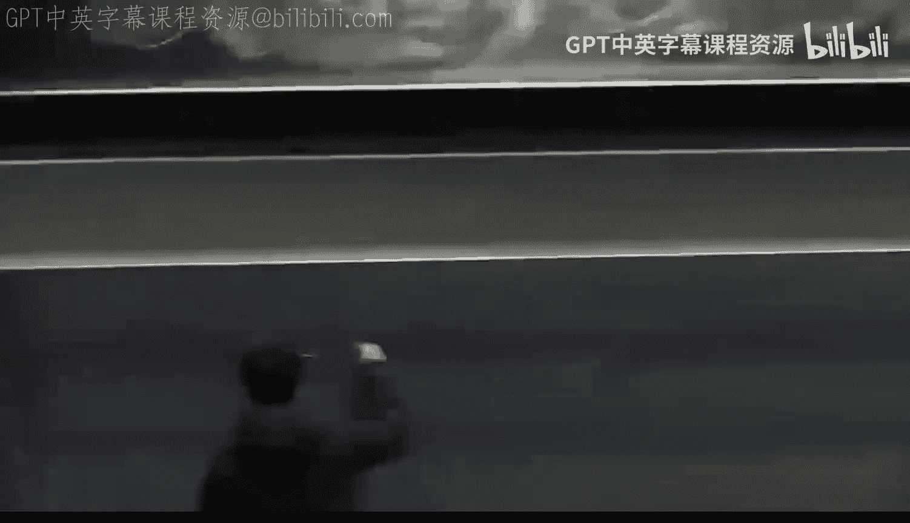
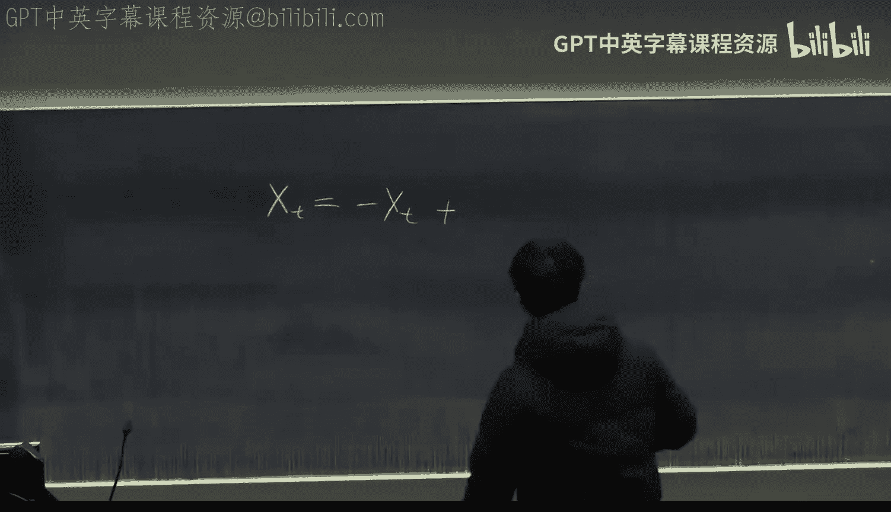
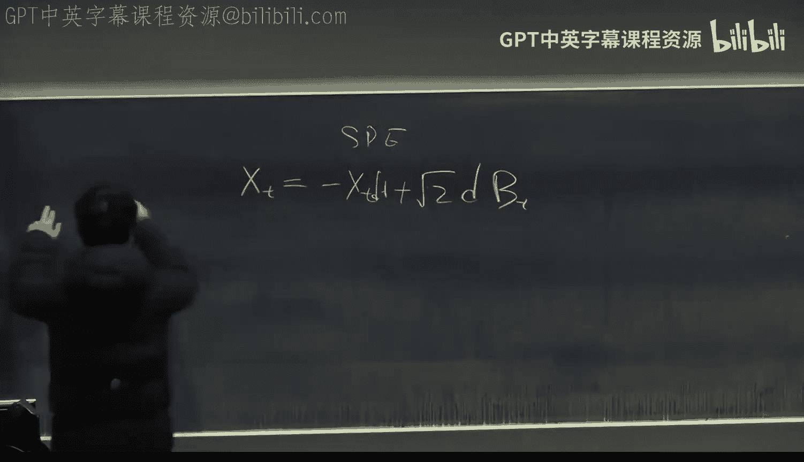
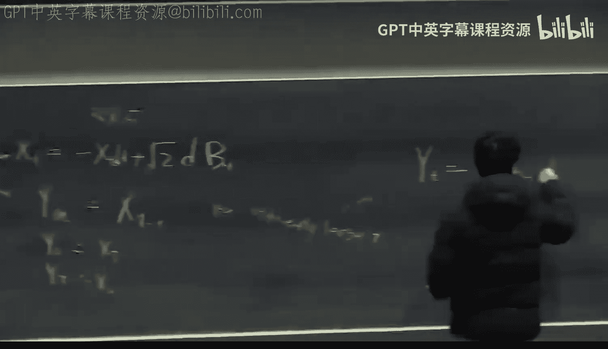
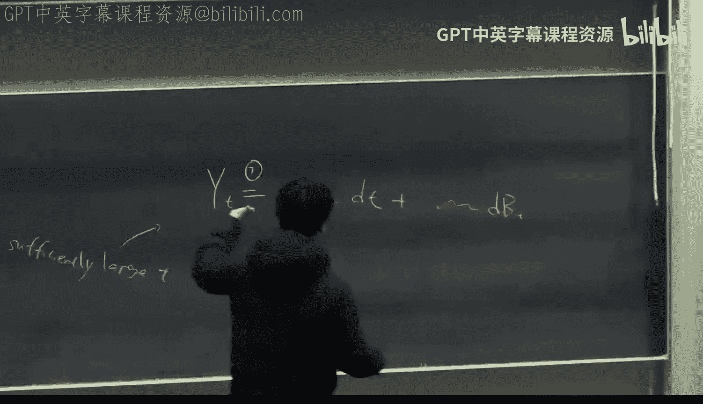
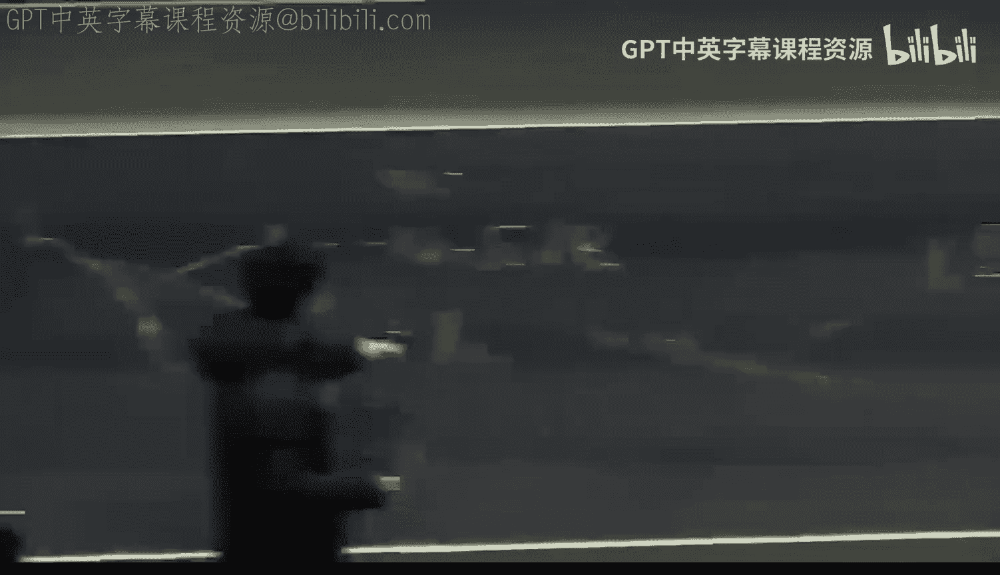

# CMU《生成式AI｜10-423 generative ai 2024》中英字幕 - P22：-P22-Lecture 21- Generative Model for Videos_board.zh_en - GPT中英字幕课程资源 - BV1CyC9BPEhG

Okay， I guess we can start today's lecture。 I'm not sure what happened。

 but we have very little people here， they。😊，哦， i事。Yeah， that's。I mean。

 that's kind of understandable。So anyway， I guess they will try to watch the recordings like watching a movie。

 that's basically the goal of the lecture。Okay， so today we are going to talk about the generative model for videos。

 which are representative by the open eyes work of So。

 And we will talk about the architecture of solar。 I mean， what is the mathematics behind it， take。搜。

I mean， previously， we have learned how to use diffusion models to generate images。 And today。

 we want to extend this technique to generate videos。 Okay。

 and this is actually going to be a direct extension。

 So maybe the lecture will be shorter than normal。 Okay。

 but we will just go through the details of or all the caveats of all those extensions and also recapb what is diffusion model。

 Okay， I know that you have learned diffusion models in the previous lecture。

 Like how much do you understand diffusion model。😊，You believe you understand very well。

 What's the mathematical background of diffus model do did the might actually tell you。Okay cool。

 then we will try to quickly re up what's the kind of what's the diffusion model and how to actually use it to video generation。

 which is what open actually does， okay。😊，So what is diffusion model。 Well， for diffusion model。

 there is a forward process and a backward process。 Okay， and for forward process。

 you kind of taken a distribution， You transfer a given distribution to Gaussian and backward process you transfer Gaussian back to the given distribution。

 Okay， and I'm pretty sure people are not going to talk about it in this way。

 but I'm going to talk about you。 What's the actual mathematical foundation of the diffusion process。

 Okay， so。😊，Sn perhaps。Hey。Bas it behind diffusion process or behind diffusion model。

The actual math or actual mathematicalmatic or actual mathematical foundation is a so called Estein Li big。

😊，Process， okay， so always sudden make process of the so called vast system and gradient flow。

 What does that mean， Okay， so let's say we theres a probability distribution， okay。

So mathematically， you can view a probability distribution as a point in a matrix space。 Okay。

 so basically， I have some matrix space like this。😊。

And every approach in the metric space is actually a probability distribution。😊。

And what is the metric here that you are using。 Well， the standard metric is the vast system metric。

 Okay， so v system metric。😊，I'm not sure if I can spell it correct， but you get the g of it。

Okay or the socal v and metric or the v and2 metric is basically given by the or the W2 of P and Q。

It it equal to basically the minimum。Of F。 That is like one lipes。Sorry， what's this on one metric。

1 lipses。Of the basically， expectation of。F。Sorry。😔，This is maximo。Of five of x。Mus。诶。F复 y。So。这搜酸明星。

Of the X and y。 So basically， it just says， I mean， what is X and Y。

 X and y satisfies This is like a couple distribution such that X follows P。 Y follows Q。

 But they have like a joint distribution， that could be anything okay。

 and this vsymmetricsymmetric basically says if I couple X and y in some way。

 So that the marginal distribution of X is P。 the marginal distribution of y is Q。

 So how much I can distinguish X and Y with F。Okay， so think about it like if x， I mean。

 think about y y says a metric makes the most of the sense， is's because。I mean， if P， first of all。

 if p is really equal to Q， then your x and y could just follow the same distribution， which is P。

 right， They are just a variable sample from the same distribution。

 So then this implies X would be equal to Y， and they all follow from P。He。

 because a marginal distribution of x is P， marginal distribution of y is P， which is equal to Q。

 And then there's no way you can distinguish because they say is0。😊，Okay。

 so if P is really equal to Q， then the and distance is equal to0 because you take a minimum over all the coupling and there is a coupling where the maximum for any function is0。

😊，Okay， but if P is kind of like this， let's say P is like this and Q is like a sample version of P。

Hey。😊，And if you are using some， some other metric like H dirgence or etctera。

 the distance is very large because the support are completely destroyed。😊。

But there is some good coupling， which means you just move the point of P。 Let's say this is P。

 You just move the point of P to here and move move the point of P to here that you just locally move the point of P。

 So they become the point of Q。😊，And you can see that because there's a local movement。

 And So F X should be very close to F Y because F is one lipses。😊，Okay。

 so because X in the covering X is very close。 Y， you are just locally moving your math。

 So you can't really distinguish the two distribution very much。哎。😊。

So there is some metric here that measures a distance of distribution。

 which is versus a metric and if this metric stays， there is some p which is an ability distribution。

 and there is another thing which is p0， this is equal to Gaussian。😊，嘿。😊，Any questions？

So basically what diffusion process actually do， Okay。

 regardless of what you learn from the other lecture。

 this is the cool reasoning behind diffusion process。 the diffusion process。

 what diffusion process really do iss a forward process。

Its actually a massive some gradient flow that transfer your original distribution to the Gaussian。

Okay， so what does I mean， what does vice and gradient flow mean， First of all。

 this metric space is a vice and metric space。 Okay。

 and then there's a gradient flow on a on like a metric space， which is kind of like。😊，I mean。

 just kind of like that。I mean， kind of like some original。

 it's essentially you can think about this as the linear。

 the analogy of the linear line in a standard matrix space。😊，Hey。

 so this is like the minimum distance right。In this verse and space。

 So you're following some like minimal distance line that transfer your original distribution into the Gaussian distribution。

 Okay think about in R that you have1 point or in R D， you have 1 point P here。

 You have 1 point P 0 here and the standard gradient flow of metric R is just a linear line。

 This is like a minimal distance。From one that you can move from one point to the other point。

 And here is the same thing。 But now you have another。Space， which is the vast ametric space。

 So there's another minimal distance line to move from one probability distribution to the other。

 and minimal distance line is given by this line。😊，Okay。

 and this is a forward process of diffusion model， and the backward process is exactly just a reverse of this line。

😊，Hey。😊，Any questions。So basically， yes。We do this we discrely jump through about100 times steps。

 Yeah， that's a discretization of this line， right So we is it possible to then find the continuous line that goes from space to space。

 Yeah， medical the discretization is just an approximation of the continuous line。

 So it's really like gradient design versus gradient flow， right， So for example， to me。

 by the function optimal， you want to use gradient flow。 But in practice。

 you use gradient design to approximate gradient flow。 And here is the same thing。

 the backward process can be viewed as a continuousual version of the backward of versus some gradient flow。

 and then you are using the discretized version to approximate that。Yes。ItsThe full space。

 the probability space。 And each point is like an image of a distribution right。 Yeah。

 if plan is a probability distribution。 It's not a sample of a of a of a from the distribution。

 It's the distribution itself。 So this point， for example， P0 iss a Gaussian distribution itself。

 At this point， you can think about it the distribution of the image itself。

 It's not like a sample of an image。 It's a distribution of image。

And you can think of the diffusion process is really operating on the probability space where the underlying metric is persistent。

😊，And then you are going the forward process， following the last gradient flow。

 and then you have a backward process。I bit understand the distribution of an image， not a concept。

This is like the distribution of image， which is kind of like， I mean， it's kind of like。

The distribution of all natural images。 And think about your training data set。

 You really that some random sample from this entire distribution。Yes。😊。

So briefly mentioned is different from KL divergence and KL divergence is say something about KL does not exist of approximation of the Q like the first distribution。

 is this the same with this was matrix？And mean once a matrix allows for example。

 Q is a discretization of P。The actually， the vast and distance between P and Q is very small。

 but the forcal divergence is very large。This is a se。Mattrix if I P and Q for one system matrix。

 if this matrix for KL is not。Hey， any other questions？太酷。So basically。

 what is the actual gradient flow or what's the mathematical kind of definition of the or what's the mathematical characterization of the vase and gradient flow。

 But it turns out that the vase and gradient flow has a very。I mean， very simple characterization。

 which is given by the I D E above。 Okay， it's a schastic differential equation。 But I mean。

 the sastic differential equation looks pretty strange。

 But whats what it says is essentially the following。 Okay， so to go from P to P 0。 Okay。

 what's the kind of change in distribution。 I mean， what is some here in the distribution， some here。

 Okay， so this is like there。I mean， maybe I shouldn't use P 0。 I should use。 This is P 0。

 which is the or your original distribution。 And maybe let's call it P infinity。

 which is your final distribution。 and then what is some PDP here in along this versus and gradient flow path。

Okay， so it told out that there's a very simple formula for computing the P。He。

 so the P T is actually given by the following， the X T is sampled from P T for available X T sampled from P T X T actually follow X T is actually equivalent or is the same in distribution。

 let's say is the same distribution as the as the following， so the first sample X0。😊，From P 0。诶。😊。

So your first sample X U from P U。 and then you just get X T is equal to。

Let me try to write it correctly。 exponential minus T X0 plus square root of 1 exponential minus-2 T。

O。呃。我仲 I call it c。Okay， so Z is a just Gaussian。Hey。

 so it turns out that there's kind of like a concrete expression for it。😊，I mean。

 it's not really a I mean， it's not really a concrete expression for P T。

 but you have a concrete expression for what does X C look like。 Okay。

 so X C has the same distribution as the following as generated by the following process。

 which is your first example X 0 from P0。And then you just add noise to it。

 Is this this a Gaussian noise。And you just add noise with it。

 And that's why you see in the diffusion process， a forward process， it just keep adding noise。😊。

This is the actual mathematical background for it。😊，And hopefully。

 youll get a much better understanding of what's going on。 I mean。

 why do we add random noise and why do we go backward， It's essentially supported by this。 Hey。

 if you want to run the last and gradient flow and run the backward process。

 then the forward process is really just adding noise。 And you can see S T goes through infinity。

 this thing goes through0， right， and this thing goes one， which means you get to the Gasian。😊，Okay。

Does it make sense。 And also， this X E satisfy as a function of T satisfy the above stochastic differential equation。

 And that's basically a kind of a minor process of brownian motion。 Okay。

 you can see every time you just。😊，There's a minus X term。

 which means you are shrinking your X a little bit。 and then you add a B BT。

 which is just a brownian emotion。 Okay， so you just had shrink your X C and then adding some noise。

 which is kind of like the same my sta。😊，诶， kind of like you're shrinking the X part and then you adding more noise。

 S T grows。Hey， have any questions？So that is a forward process， okay？

And the reason that we want to write it as a sacity pressure equation is really we want to implement this forward process like step by step。

 okay， we want to update the XT from the previous XT。😊，ok。😊，I mean。

 you can also view this as a forward process for this forward process， just。I mean。

 output'll put the X directly。Okay， so we want to view it as like a gradient flow process。

 That's why we write it as a stochastic differential equation。😊。

But it turns out that if you rev it as a schastic differential equation。

 there's a socal for plan equation， which can actually be used to reverse it。 Okay。

 thiss called fourcal plan plan equation， which is a very famous equation in stochastic differential equation that you can use to re a schastic differential equation。

 Okay， so what does forcal plan equation mean， now。😊，Let's just think about in this way。Okay。

 so let's say you have a sastic differential equation of X C is equal to， I mean， maybe。

Some， let's say this is minus Xt plus think。是啊。

S rule two of D BT。 Okay， this is an I CE。He， and this is like the forward I see that goes from P0 to P infinity。

So what is a backward I D， Okay， what's， what is， I mean， the third I D is thiswall。

 you can just run it very easily。 But then what is a backward I D。😊，Okay， so Jesus is like a forward。

 then what is a applied for？Now， it turns out that to run the backward， I see is pretty simple。 Okay。

 I mean， all you need to do is just think about this new variable of Y T or sorry， Y T。😊，Okay。

 and this y t is equal to， let's say， x of capital t minus t was sufficiently large t。😊，Hey。😊。

And then what would type is y 0 is now equal to x T， and y t is equal to x 0。 Okay， so this， I mean。

 the y T didn't really go from from here to here， but they actually go from like a very close to Pfinity point and go backward。

😊，Okay， so the YT really start from here and just try to go backward。AS T go from0 to T。

 So the forward process of YT is equal to the backward process of X T。😊，K。😊，Does it make sense。

And now your goal is to write some， I mean， is to write the I C E that Y T satisfied。

 So Y T is equal to something of D T。 What is this， Something of D T plus。

 maybe something times the brownian motion。😊。

嘿。😊，So if you write y in the srcchastic differential equation， what are those terms。

诶。😊，In as a function of writing， So some function of writing。He some function of Y T。嘿。😊。

So we know IC satisfied this very simple term。😊，And YT is just a change of variable。

And what focal plan equation says is exactly under this change variable。

 what would F of Y T and G of Y T look like？ok。😊，Any questions。I mean。

 this thing is pretty mathematical heavy。 So if you have any question， please just ask me。

 and I'm not guaranteed to answer because。😊，I'm not an expert on stochastic differential equation。

 either。But the overall spirit is very simple。 Okay， you have this X。

 which sat this simple stochastic differential equation。 And now you have a y T。

 which is just a change variable。 And you want to know what stochastic differential equation does the y t satisfy。

😊，可。😊，Hey， so by four cup plum fu equation。Hey， the actual stochastic differential equation of Y T satisfied is this same。

😊，He， so Y T is equal to Y T。I mean， Y T R， I should say is。DY题诶。So D， Y T is equal to this thing。

 which is Y T plus。へり。Two times the numberla of。呃，log。I mean， there's something here。

 which I will explain。And then， plus square root 2。M E B T。

 so you can see in the forward process that different， I mean。

 the derivative of X E is really just equal to minus X D T plus some brownian motion。

 But in the backward process， I mean， the brownian motion is still there。 which is fine。 But then。

 I mean， the Y T is still there。 But then there's this this additional term。😊，嘿。😊，Any question。

 I mean， you don't really need to know how to use for plant equation to derive this formula。

 But you just know this step is fully medically correct。It is fully mathematically justified。

 This is just exact。😊，ForulaO， the derivative of Y T， which is if you treat Y T as ICE。

 it actually equal to Y T plus two times the gradient the grand log。😊，诶。😊，And what is this grid log。

 what is this grid log of something inside， okay， this something inside is really just a probability density function here。

 which is basically this P here。😊，嘿哦PT minus T here。嘿。😊。

Or maybe I should use little P to den the probability density function。Any questions？

Sorry what just give equation， I mean， if you want to search it。

 you can Google it and in Wikipedia page， you can see that there is some log with respect to the local cur and that's why you get something like this。

Okay， but just to say that this this is fully mathematically correct。Hey， any questions。

 So let me repeat this process or what， what's the diffusion process look like， Okay。

 so diffusion process， if you view it as probability。If you view it as actions in probability。

 then it's really just moving this original probability distribution to the target Gaussian distribution。

 using versus and gradient flow。 and then the backward process of diffusion。

 Just try to move it back。 So we go from Gaussian distribution to the original distribution。睇。😊。

And then you can view， and then you there's another view of it， which is the XT perspective。

 So XTE is just some variable that follows the distribution of P。😊，Okay。

 and if X follows the distribution of P， then X actually satisfies this ICE。😊。

Or some X that follows the distribution of P actually satisfies this I DE。

 which is you are essentially just adding noise to it。 And the rule is basically。

 the P really just follows this。😊，ET has the same distribution as that X T。

RightAnd that I really satisfies this distribution or really satisfi this IE here。😊，Okay。

 so theres some X E that follows from P where X E satis this distribution。ok。

So which means if you view Yt as the reverse of Xt， then YT satisfied this new SDDE here。😊。

So this means if you run this ICE， starting from Y0。We will be able to get to Y T。

 which recovers the distribution of P 0。 or I'm just getting a sample。

 So y 0 is equal to X Y T is equal to x 0， which follows from the same distribution as P 0。😊，Right。

 so if I'm able to run this bicor postcard， if I'm able to run this IE。😊，From。Y0。

 which is exactly equal to x D。Then I will be getting back to8 0 exactly。

 which is the target following from the target distribution。Okay。😊，Which means， I mean。

 if we look at this process， what is this process as file from y0， which is I。

But my T is sufficiently large。 let's say 1000 or et cetera。

 So what does X E look like is e to the minus1000 times X O plus square root of the。

 which is is just culture。😊，Right， or almost just Gaussian。 So I found star from X T。

 which is Gaussian。 And I run this ICE of Y T。😊，Have from zero to tea and I will get be gu。X0。Okay。

 I will get to Yt， which is x0， which follows P0， which is my hardware distribution。

 This is a distribution of images。😊，Okay， so this is Gausian。This is images。哎。😊。

So this is the mathematical background of diffusion process or diffusion model。

Hey everything just lies in this， I mean if you understand it， it's actually very， very simple。 hey。

 you have a thorough process。😊，That just keep adding noise to your images。

 and then you have a backward process， which transfer， which style from noise。

 and you'll gradually get a sample of an image from it。😊，Okay。😊，Any questions？

So this applies to any distribution。 Okay， there's no restriction to distribution。 You can use it。

 I mean， that's why。Diffusion model can be used anywhere。 You can use it to sample images。

 You can use it to sample videos， You can use it to sample audio。 It doesn't matter。 There is no。

 I mean， this is really mathematically rigid。😊， as long as you can run that SDDE。

 you are guaranteed to recover the original distribution。No matter what's the original distribution。

 Hey， there is no like complexity or whatever assumption， like as as， I mean distribution。

 the density function is differentiable， which means the grid log exists。

 which it will exist because it come from a convolution of Gaussian。

 So even if your original distribution is discrete， this thing will still exist。

So you can use it to sample any distribution。 This is a universal method。睇。😊，Any questions。Yes。😊。

Maybe already mentioned， but does any SD backward process is that guarantee and then also I don't think you mentioned a neural network anywhere。

 but where in this equation is the。Never， never8 I haven't really mentioned where the neuraler network is being used yet。

 Well， to answer your first question， I mean， I'm also not an expert。

 but most of the IC as like a backward process。 if you think about it is really just。

 if you will that if you will， the distribution of the variable in the IC。Okay。

 so if you will the I D in the distribution space， then it's a deterministic trajectory in the distribution space。

Right， I have a variable that I'm applying I C youngang。

 but the distribution of this variable follows a deterministic trajectory。😊。

And then there's a backwardboard of that trajectory， which give me another IC。Right。

 so the I DE and distribution， they are exchangeable。

 So an ICE over these Xs is like a deterministic transition of the distribution of the X D。Yet。

 does it answer your question。太酷。Any other questions？北库。Sly now， I mean。

 our goal is starts to be able to run this backward process， right， or being able to run this ITE。

 If you can run this ICE， then we can get any distribution that's mathematically guaranteed。😊。

So how do we actually run this I Well we start from X C， which is roughly very similar to Gausshen。😊。

Or approximately Gaian。Okay， so we starting with right zero， we can sample from it very efficiently。

😊，诶， so X roughly follow from the distribution of the Ga深。Okay， so roughly， I mean。Really。

 what I want to say is the distribution of X is really approximately equal to Gaussian。Okay。😊。

So we can't really sample from y zero very efficiently。 We just sample from Gasian。

So we have a starting point by zero， but throughout this I see。We have to， I mean。

 this square root2 of TBBT is easy， but we have to deal with this part。

Which is the grid of the density function here。Okay， so grab of the density function。

 So all we need to do is to， I mean， all the or the diffusion process really boils down to just learning this grid of log of or grid of log of the density function。

😊，诶。😊，Iions。So then this is where the score function lies。

 So you want to train a neural network to approximate the grid of the log of the density function。😊。

You want to train some neural network， which is I， you want to train the neural network that takes in this I as an input。

And they want to approximate the grid of the log at that particular point。Hey。😊，So basically。

 you want to train neural network to approximate the gradient of the density function of some distribution at certain point。

And this is actually mathematically equivalent to the score function objective。

 which is you are giving。😊，A image or a noisy image。 And you want to predict the noise。Okay。😊。

So the entire diffusion process is fully mathematically justified。 It's not just a heuristic。😊，Okay。

 every step is mathematically correct。😊，And you guarantee to learn the underlying distribution。

 as long as you can minimize the score matching objective， it's not our approximation。😊，Okay。

 if you really some like tutorials， they will always take， say that there's some like。

Up lower bound than you just throw away sometimes youll get some approximation and you get this objective。

 That's not true。 He， this thing is mathematically correct。

So this process is mathematically justified， and all you need to do is to train a neural network that learns a gridlock。

And this is actually mathematically equivalent by integration by part。

 which Im not going to talk about。 But these two things are actually mathematically equivalent。

 So if you can train this S that takes a noisy image and predict the noise。😊。

Then this S T will be exactly equal to the grid log of the density function。哎。

 these are mathematically equal。Yes。😊，When that taught us diffusion it touch from some like approximation with elbow and stuff。

How is this two like difference or similar role。 Yeah， I mean。

 what he told you is what you write from the tos， which were just wrong。Okay。

 the diffusion model is fully mathematically supported。 There is no approximation。😊，I mean。

 if you read the distortion tutorials， which I actually read it， this say there's some approximation。

 The author even write that there's an approximation in the paper， which means， I mean。

 the author just come up with this accidentally coming up with the correct formula by using approximations。

 but actually， there's no approximation。 It is mathematically correct。😊，Hey。

 so it's not like you're minimizing some care or dirgence and you drop some terms。

 And that's what Port usually say， he。😊，You。Papers where you got this from or this is just， I mean。

 this is just known by mathematicians for a very long time。

So I'm not sure what's the root of this thing， but the original process is called always suddenly big。

 which is a pretty famous process。And there's a bi process of this。

Which is exactly the diffusion process。诶。😊，I mean， so why do we spend a lot of time on the diffusion process。

 mathematical background， First of all， this is pretty important to understand。 Also。

 this will tell us some of the design choices in later slides。😊，诶。😊，But you can see， at least。

 I mean， the diffus process has no approximation， which means you can just take this thing and apply to videos。

😊，As long as you can minimize the score functions is guaranteed to work。Hey， so there is no magic。

 It's not like I have to do something differently for videos。

 videosideos is just another distribution， and this thing works for any distribution。

 So you don't really need magic。😊，Yes。😊，'ss actually not approximation it's exactly correct and that it was just。

Mi classifies approximation Yeah， I mean， author thing author of diffusion model or those type people written in Toro they thought is approximation。

 but they accidentally derive the correct formula， which is not an approximation。😊，Yeah。

 they drove some terms in their derivation， but actually， those terms turns out to be like zero。Yes。

😊，These terms， what is the term that is determined by a neural？The I， which is a square function。

So this thing is what you want to learn by neural network， the score function。

 the score training objective of the score function is you take input class noise and you output the noise。

😊，RightBut this when you minimize this objective， is actually mathematically equivalent by integration by part to the above objective。

 which is minimizing the distance to the grid log。😊，诶。😊。

So if you can minimize the distance to the grid log， assuming you're fullyy minimize a。

The whatever the formula line in below， they they are exactly equal to grid log。

and then you are exactly running this IE， which means you wont get the exact distribution of the images。

😊，So you will convert to the distribution of images。 There is no approximation。The only way， I mean。

 the only thing that you that would be some approximation is because in practice is probably you cannot minimize this objective to 100%。

😊，So you will find approximate minimizer and you are running the approximate。I mean。

 you are approximating the Gu logs and you are running approximate version of this ICE。

 which means you may diverge a little bit from the true distribution。Okay。

 but it's just you are not if you do gradient design without the actual gradient。

 then you may convert to some approximate minimizer。 and here the gradient here。

 analogy of the gradient here is really the grid log and you are finding the best approximation to that。

😊，Through minimizing this objective。诶。😊，Any questions？So now， I mean。

 why not we just take this method and apply it on videos。Okay， and this is almost what open I did。

 Okay just taking this very naively and applied it on videos， almost not 100%。😊。

He they did some other things on top of it。But you better。 I mean。

 they thing apply to any distribution。 So I sometimes you have a large enough neural network。

 You have large number of training data。 This thing just learn， take。So it's a very。

 very powerful technique。Yes。😊，Does open AI， they just train a very large distributionion model in order to get the video generated。

 And is there an part embedded with the LM the transformers Yeah。

 it's just there's a conditional I mean， right now。

 I'm just talking about generating a distribution of the images。

 But if you want to generate a conditional distribution。

 which is a conditional distribution of image， even the X content。

 then you need to plug in some LLM in it， which means I mean， it's the same thing。

 It's just a right log here。 It' going to be the conditional distribution inside of the actual。

 This is a density function of the conditional distribution。

 And you just use a neural network to minimize this conditional denoising objective。

 which is kind of like very straightforward。Okay so youre neural network not only be taking an image。

 but also taking a text and you minimize a conditional enno objective。

 which is almost the same as the original objective。

 because you can see here there's really nothing that our distribution dependent except here。

 iss this objective。 There's nothing that is distribution dependent except for here。 This X0。

 which is your original distribution。😊，So if your original distribution is like a conditional distribution。

 which is the conditional image based on the current content。Then you just， I mean。

 you just run everything like the same。 But now your I see take in both the。Image and content。

 That's all。Any questions？And also the way to view video generation is really just view this XT as a distribution over videos。

😊，What does distribution or video mean， It's really just a distribution over sequence of images。

 It's a drone distribution over sequence of images。 But still， that's a distribution。

 as long as it's a distribution diffusion process just works。Yes。😊，八八三。An image比如说。

Or this trade of videos。TheThe sample is actually trained on or the solar is trained on videos entirely。

Okay， and， I mean， the the way you think about it is just plug in videos into those Xs。 I mean。

 you just read the videos as the X O and youre adding noise to all the frames in the video。😊。

And then you turn you minimize this objective， which is really， really simple。

And then just run the Bboard forces。Then that's almost it。是。Second videos or。I mean。

 do we have what will we have to do to get like say a feature length movie？Yeah， I mean。

 that's basically my next point。 So why can't we。Or I mean， basically。

 you have those videos which are just frames by frames， by frames， by frames。😊，Right。

 and then this is a key。So you just treat this entire thing as basically in one random variable and the distribution of videos is just a distribution of this random variable。

 which maybe let's call it。😊，D0 byD0 byT。So the entire thing is like a desire by D0 by T tenor。

And you can just treat it as that X O。And just run the entire everything。

 But the point is as he goes larger， the dimension is actually increasing。😊，Right。

 the dimension is increasing and actually， the accuracy of the convergenence speed of diffusion model or sample complexity or whatever。

 So all those things are actually proportional to D， which is the dimension of the random variable。😊。

Okay， so the congence rate， the error propagation rate and everything。

 Theyre actually linearly proportional to D。 There's a very， very complicated theorem behind it。

 But that's basically what you get。 Take the larger the dimension。

 the more samples you need and also the more accurate you need to minimize your score matching objective。

😊，So basically for this thing， you can see as you increase T。

 you kind of increase the dimension of this variable。😊。

Which means you need more accurate scoreestimating objective， which means you need more samples。

 and they just don't have enough samples to support very large。Yes。

 do other like big generation companies also use this。

 I' was wondering like what makes opening eyes so much better。

Just bigger compute and more training data。 Nothing else。Yes， I like to do some fancy trick。

 It's just more compute because those are very difficult to train。 I mean， you have videos right。

 This thing is already really， really large。 and then there's a tea， which is couple thousand。😊。

So it's very expensive to train。The sampleble complexity very large and also to have a neural network and minimize the score function。

😊，Our score LC meeting objective is just， I mean， the neural network has to be very。

 very large as well。Yes。😊，To confirm D over here is D not into D not into P， right？Yeah。

 so D is for videosius D is equal to D0 times D0 times D。

 So D is basically the space where the random variable X lies in。😊，It's like a D dimension。

 random variable。Hey， I'm here for videos is D0 by D0 times C。So really。

 the convergence rate is proportional to the dimension and。

So this means there are something we can do to make it better。没去。Yes question。

Sa thing that lane diffusion models do and they put everything in the late space。 Yeah。

 that's exactly what I'm going to talk about。 So there's a technique that can actually reduce this dimension。

 which is a latent diffusion technique。😊，He， so I think about this to me。

Its kind of hard to reduce because that's a frame rate in the video。 If you reduce T。

 your video will have less frame per second。😊，These things a little bit hard to reduce。

 but this part is actually reducable because most of the images are highly compressible。😊。

He you can put images in that in like what， whatever VRAR。

 and you can see that they actually become much， much smaller。😊。

Because most of the images are very structuretured， they are highly compresslaible。😊，诶。😊。

So basically， this dimension is actually kind of redible， which is called late。

 which is the so called latent diffusion technique， okay。😊。

So Lincoln de techniques is a little bit trickier than what you thought。Because I mean。

 mathematically is like this， you first try an encoder where you actually encode x to E of x where E X has much lower dimension compared to x。

😊，He， and then。There is a auto in This is the auto encoder， which means given E of x。

 You can actually decode back the original x。诶。😊，So for images， I mean， for videos。

 we are actually applying it for image。 So we are actually encoding this dimension to something much smaller。

 a D prime small， much smaller than D0 by D0。 Okay。

 so we are actually applying this encoder for every image。

 at least that's what the technical report says。 Maybe they did something more clever to encode everything as a whole。

 but we not sure about that。😊，Which I highly doubt that they did that because there's some other cave that we will see。

喂。😊，So for laternt diffusion， I mean， let's just think about these act。😊，Right， for latent diffusion。

 you encode it to E X。Then you try to run diffusion process on this E of x。嘿。😊，Any questions。哎酷。

So this is like the ideal thing you want to do， right。

 which is run latent diffusion on this E effects， which means you should add noise to here。😊，Right。

 this E X is the variable that you want to run the diffusion process。

 which means you should add noise to this variable。😊，But in practice and not for why people do that。

 they still add noise to hear so this is theory。Yes。This is practice。He。

 although we are running latent diffusion variable， but they still add noise to to X instead of E X。

 which means this E of x is not really a last gradient flow anymore， so。😊，Basically。

 if you think about from E X 0 to E of Gausian。Or maybe I should call it E P 0。

 This is 1 point to e of Gausian。 This thing here is not versus and gradient flow anymore。 right。

 If you want to run versus and gradient flow， you should add noise directly to here， not inside。

If you add something inside， this is not a v and gradient flow anymore， okay。

Or it just to say this is still a gradient flow， but it's not the vast asymmetric gradient flow。

 It's actually the metric according to the project or the induced metric of this operator。😊，Okay。

 so it is still a gradient flow。 This thing is still a gradient flow。

 but it' actually the induced versus and metric， something like this over this some like very。

 very strange metric space。😊，诶。😊，So you have this extremely strange metric space。

 which is induced by applying this whatever encoder to the original asset space。 And then you get a。

😊，Radium flow on the inducedr space。哎。😊，And this means， if you're。I mean。

 that's why we want to go through the math。 this will actually affect the design。

So for Va some gradient flow， we have this very nice formula and we have this very nice ICE here。😊。

So for vases on gradient flow， we have this very nice IE here。

 but now if your gradient flow is not ICE。😊，What would happen is there will be some other term P here。

 which is actually that's induced metric。So it's something like the local curvature with respect to the vs and distance。

 something like that， okay， so there will be an induced metric here。😊。

Which means when you run the backward process， there will also be some induced metric here。Okay。

 so this means for the backward process， you are not only， you should not only learn this function。

 but you will also learn this thing， which is kind of like a curervature related step。

 You need to add this part into your training objective。😊，诶。😊，And for latent diffusion model。

 the original version， they don't really add that。But the newly updated version of the latest version。

 they realize that there is a mistake and they actually add that part into the training objective。😊。

Okay， so basically， you are not only approximating the score function。 but I mean， roughly speaking。

 these tri objective just corresponding to approxiating variance of the noise instead of the noise itself。

 or I'm not， I shouldn't say the variance of the noise。

 but kind of like the variance of the local distribution instead of the grid log itself。

 So this term is kind of like approximating the grid log as the grid log transpose。😊。

Something like that， not exactly。 So translating to matching the noise is kind of like matching some covariance term。

 which I didn't quite remember。 But that， but something like that。

 you have to add in the tri objective for latent diffusion model。😊，Yes。😊。

Just use a theoretical way of doing it just adding a noise after the encoding be simpler I don't know the answer is I don't know maybe they because probably they didn't go from a theoretical background so they didn't know this like mathematical formulation。

And when they design latent diffusion model， they just thought， okay， I just do a auto auto encoder。

 What could go wrong， right？ But actually， things could go wrong。 Theres like a new geometry term。😊。

But somehow， maybe this term is close enough to identity。 So in practice。

 it doesn't really matter that much， but to generate very high quality images。

 you need to consider this term。😊，that。Okayか。Right， but I'm。

 I really don't know why people didn't do that。 Maybe they are doing that。 Now， I'm just outdated。

In the original version， they didn't do it。诶。😊，Any questions。Okay cool。

 So now we basically understand what's going on。 Okay so they just encode videos。

 Each bring my frame into some latent space。😊，And then they are doing diffusion process on the latent space。

 And because youre doing diffusion on the latent space， you have to have a geometry induced term。

 which is like this where you have to add to your training objective。 Okay。

 theres some matrix metrics that you need to learn at every iteration。😊。

That you need to add in your training objective。诶。😊，Okay cool。 So basically。

 this is like the architecture that open use were solar， which is the diffusion transformer or D I T。

诶。😊，So what diffusion transformer look like is basically this。 you take a。 I mean。

 this is a diffusion transformer for images， but you can very easily change it to diffusion transformer for videos just to enlarge this latent dimension。

😊，诶。😊，So basically what this architecture look like is something pretty simple。😊，Hey。

 you are this late， I mean， this latent thing。Okay， I mean， this whatever latent stuff。

 And then you hatchify the lateing， which means you flatten it like to be something acceptable by transformer。

😊，Okay， because this thing is like a 3D tensor for transformer。 it only accept 2D stuff。

 So pify it and send it to the transformer block。 Transformer block has this multi head attention。

 has this speed forward layer。He， but they have some additional stuff， which is a conditioning。

 This is where you insert your text description。😊，Hey。

 this is where you insert your test description of the video。 For example。

 I want to generate an email video of a turtle swimming。😊。

Then this is where you insert your text description and you can see that the text description is added。

😊，To the or added to your main branch。Hey， the text description is just added to the main branch for every this main branch。

He， and after that， you predict the noise， which is a square matching objective。

 and you also predict a sigma。😊，Okay， which is kind of like a diagonal version of， I mean。

 that's like a diagonal approximation of this geometry term。 so basically， this is their BIT。I mean。

 this essentially just look like a transformer model。 Okay。

 you have those transformer blocks like almost like an ordinary rate transformer blocks。😊。

The only thing different is for basically for the in for。 I mean， originally。

 you have those latent input。Which looks more like videos or images。

 And you have to flatten it to be like a sequence of tokens。

 So it's acceptable by a transformer block。😊，And after that， after all those layers。

 you will reshape it back to video or image like shape so you can minimize your score matching objective。

😊，Hey。😊，Any questions？内裤。So that's almost it。 I mean， there's nothing kind of fancy。

 It's just you trade the video distribution as a standard。I mean。

 just like a distribution and you run theion process and you use these transformer models to minimize the score function。

😊，And that basically is。😊，Yes。😊，Special thanks for I'm em betic with the video。Yeah。

 there is one particular trick that， I mean， over I use， which come from Google， which is this。😊，呃。

NAVIT or nativeative resolution VIT positional encoding。诶， so they use a 3D positional encoding。

 which is a sumation of the positional encoing for x plus positional encoding for y plus positional encoding for D。

😊，嘿。😊，So basically， what they do is kind of like you have those videos， right。

 which is like a sequence of images。😊，Hey， and then you do you you run latent dispute。

 and mean you run the variational auto encoder， but the output is still like video like shape。😊，系。

And then you transfer this thing into like a sequence of vectors。Sorry。

 a sequence of vectors that are input to the transformer。诶。😊。

So how do you transform this into a sequence of vectors， You first do some aification。

 So you break it into patches。You break those things into patches。Okay。

 and then for each patch is going to be like each vector in the transformer sequence。

 But you need to have some positional encoding to tell the transformer where the patch comes from。😊。

Okay， and the positional encoding for a particular vector， let's say。

 come from this patch is going to be equal to the PM。X of x plus the position including of y。PPT ofT。

He， so basically it's going to take the positional encoding for this X dimension。

 plus the positional encoding for the y dimension， plus the positional encoding for the T dimension。

 So they use this factorization positional incoding to support input of arbitrary shape and arbitrary length。

😊，诶。😊，I mean， not Irish after some upper bound， but you can have like different。

Maybe your email video is shorter， maybe your X and Y have different aspect visual。

This thing is all supported。Okay， so you don't need to chunk the video into like square by square of the same length。

😊，Hey， you can just use the native resolution and use this positional encoding。

 That's attack by Google is rumor that So use it。 I'm not 100% sure So use it。

 but I believe they use it。😊，Okay。😊，So just use this positional encoing for the particular organization。

 That's the only trick。Fmal image if you model to generate different sizes。Yeah。

 the original design for this particular， including does not have the key dimension。

 is just for images。Yeah， the N VI T or native resolution V I T is a work by Google just for images。

 but often I generalize it to videos to support native resolution video training or native lines video training。

 because without this thing for all the previous video models。

 you need to chunk the video to make it the correct size。 and to make every frame like 256 by 256。

 And there's 1000 frame for every video。😊，But with this technique。

 you can just support native resolution and native land。😊，哎。😊，Any questions。So basically that's it。

 you can see that there is not nothing too much to talk about on video side。

 beside this one particular trick and diffusion transformer model that they are using。 I mean。

 everything just boils down to diffusion process is just so powerful。 It works for any distribution。

 So as long you can scale up the compute。😊，You can't make it work。 That's why often。

 I really believe in those type of method fascinating laws， because now the math is done， right。

 Matts tell you it just works。😊，All you need to do is just get the scalingkating law。

 where you minimize the training objective。 Well， that means more data。

 larger model is guaranteed to work eventually。 So they just need to use skating law to project like。

 how large do my model need to be， How many data do I need to use in order to make it work。😊，Okay。

 so I really like this type of work， which are fully mathematically rigid。

 and then everything just rely on scaling law， which is what they are best at。😊，Yes。😊，2。

I have no idea， but I know inferencing on this requires， I think one minute on 100 A 100 GPU。

So generating like one second of video for this thing requires 100 A 100 GPU for one minute。

 which is like thousand times or。10000 times slower thanG4。

So it require a lot of compute even to generate。 You can imagine how much does it require for training。

Okay， I think that's it for today and thank you everyone for coming for those who didn't come hope you enjoy the eclipse。

😊，He。