# CMU《生成式AI｜10-423 generative ai 2024》中英字幕 - P23：-P23-Lecture 22-legacy lecture_pipeline.zh_en - GPT中英字幕课程资源 - BV1CyC9BPEhG

Okay， hello everyone。 Yeah， let's start today's lecture。 I think most people are still not here。

 but anyway， today's lecture will be short。😊，And it's going to be just a legacy lecture that we will capture some things that we didn't talk about in the previous lectures。

 We were planning to talk about， but because of the time Con， we didn't really talk about them。

 So there are two topics that today we are going to cover。

 They are just leftover topics from the previous lectures。

The first one we are going to talk about is a pipeline engine。 for distributed optimization。

 And the second one， we are going to talk about is P， which is for kind of I mean。

 a different way of initializing transformer networks that believe to be the key success of open AI to train those M O E models。

 He， and also pipeline engine is basically the engine used by open AI。 I mean。

 I know exactly the source code。 but I don't I can't really tell you， but I can tell you。

 I know the spirit of the pipeline engine， which is very， very standard。

 there's nothing truly secret about the pipeline engine where they use to train those1 trillion parameter models。

😊，嘿。😊，So basically， what is pipeline engine， Well we were about to talk about the pipeline parallelization。

 which is a more efficient version of tensor parallelization。

And pipeline engine， I mean， right now， people have realize that Tensor parallel is not really a very good solution。

 So they kind of move。From doing traditional tensor parallel， which they did for GB3。

 like models to those combination of pipeline parallel plus expert parallel。😊，Okay。

 so they are kind of removing sensorsor polarization from all those big transformer engines。ok。😊。

Any questions。So those are maybe buzzwords， but I mean， as the distributed， I mean。

 as you learn in the distributed computation lecture， where if you have a very large language model。

 right， you cannot really fit it into memory。😊。

So for H 100 GPU， I mean。This is like roughly 80 GB of memory， right。

 And the maximum you can be in the memory is like a 7 B model with contact lens 8 K。😊。

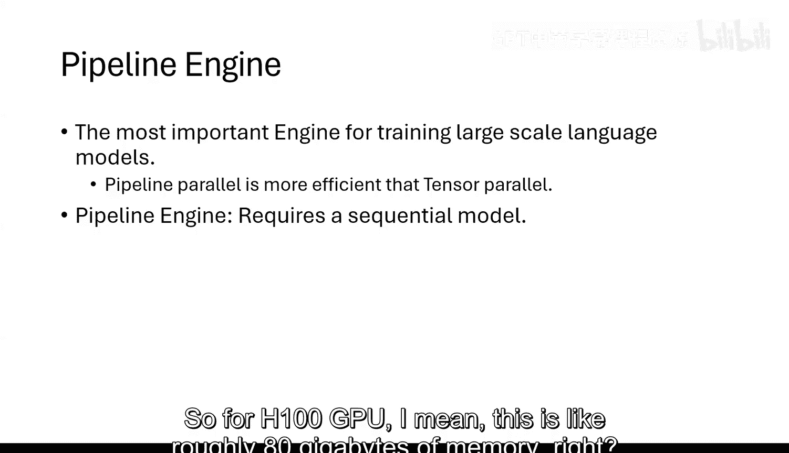

Okay， so that's a maximum model you can feed into us。

 You can feed this model as a whole into this single memory。

 and you can do kind of forward backward without any problem for a model of this size。😊，Okay。

 and above this size， you have to do some trick。 And you can see this size is very， very tiny。😊。

A 70 model is， I mean， in all days， this is an extremely large model。

 But now this is an extremely small model。😊，He it's like10 times smaller than what people really care about。

So basically you have to feed a model that are 100 times larger than than this model into a H100 GPU。

Okay， and that is a real challenge。And we have learned there are some multiple ways， for example。

 you can do optimizer sharding， but this maximumim of these things with optimizer sharding。😊。

And without optimized sharding， you can't even feed like a 4K context lens。

 So this optimized sharding be already applied and fully sharded optimization could enlar this a little bit。

 but there's still limitation。😊，And eventually， you need to go to some more advanced way of parallel the model so you can optimize it inside A gigaby or memory。

😊，诶。😊，So what are the kind of more advanced analyzing method that people use in practice， Okay。

 so what I'm going to tell you is really the state of the art because it's used by OI。

 so you can believe it's the state of the art。😊，And the worry that people do this。

 or people feed larger models relies on two techniques。 Okay， so first of all。

 they will transfer the model into M O E model。😊，He， so they will not really use dance model。

 They will use an IOE model。诶。😊，So the first step is to use an MOE model。

 and this allows you to do the so called expert parallel。Which is very efficient。

And the second step is， they will do the standard thing called pipeline parallel。Yes。

And this step is the most critical step。Whether you can optimize fast enough or not。

 it really depends on how well you actually write your pipeline engine。给。😊，So today， we will really。

 I mean， we will try to go through this method and this method in particular。 Okay。

 we will briefly re up this method because we already mention it in the M O E lecture。

 and we will mainly talk about the pipeline parallel method。Okay。😊，Any cles？Hey， cool。 So now。

 first of all， what is expert parallel， Okay， I mean。

 we have learned what is mostly what is expert parallel， right， So for MO E models for each layer。

 you really have this routing。😊。

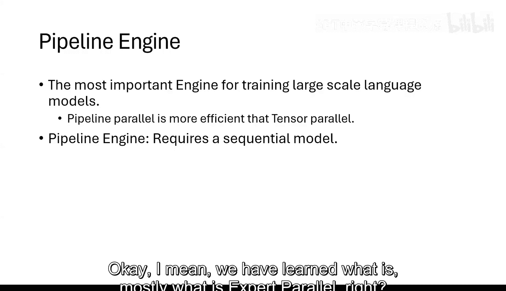

And then you have all those experts。So I explored one。Exportt tool。And typically。

 there are 6 experts， but now。I mean， they are trying to do something larger。 Okay。

 so typically 60 expert， and each expert is of size D by2 D and then by D。

 So it's something like this。白地百土地摆地呀，在有多套土饶情。An expert panel is just those very simple techniques where you store each expert in a GPU。

😊，And so youll start this expert in GPO1， you will start this expert in GPO 2 and youll start this expert in GPO 16。

😊，Okay， so sell you Chinese 30 GPU。

And then， I mean， if you want to run expert parallel。

 you kind of just use this router to decide which token is assigned to which expert。 right。

 If you recall， there's a fast encode operation that transfer your input into a vector shape like this。

 which is number of expert。😊。

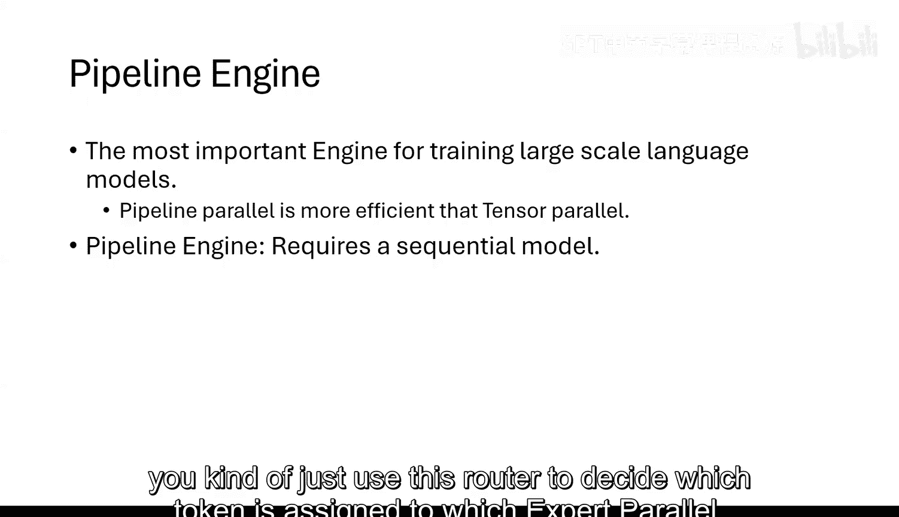

An then。Then there is a， I mean， the sequence lies。He ride by a number of experts。I mean。

 time's the top K。As's the capacity factor。Right， so basically。

 each expert gets sequenced as divided by total number of expert times the top K routing factor。

 which is typically two times the capacity factors that many tokens and each token is like dimension D。

 Okay， and after that， you can just send this slice to expert one and send the other slice to expert 2 and send the other slice to expert 3。

 and the for backward of the expert really only depending on those slides。

 They don't need to communicate at all。😊，The only communication happens as this slicing operation。

Hey， any questions？So this is expert parallel。 You can see it's maybe easy to implement and it's very efficient because there's very minimal amount of communication。

 You only communicate basically， this， I mean， the hidden representation of those hidden focus。

 you don't communicate the race of those experts or some intermediate step。😊，Okay， any questions。Yes。

 we have a specialized loss for mixture of experts that like balances the different experts when you do background or yeah。

 there's a very load balancing laws， but that applies to route。

 It doesn't apply to the expert so you don't really I mean may you do load balancing laws。Anyway。

 like these things showered across all experts。Yeah。

 the hidden representation is shared across all experts。 so you can do。Backward of that。

 pretty efficiently。K。😊，But I mean， this is expert parallel。 okay。

 it kind of solve the problem of the MLP layer， the memory usage of the MLP layer。

 but it still doesn't really solve the memory usage of the attention layer and also it doesn't solve the memory usage that you have to store those hidden representations。

 Okay they are pretty large if your language model becomes large。😊，哎。😊，Any questions？

So beyond beyond expert parallel， you have to apply some additional parallelization。

 if you really want to scale your model size to almost infinite， because you still， I mean。

 if you use expert parallel， you can have infinite many expert and those experts。

 each of them are memory efficient， but still this shared even representation takes a lot of memory and also the attention letter takes a lot of memory。

😊，Okay， so we really kind't scale to influence large， actually with expert parallel， I mean。

 the largest you can scale is something like 7 B times8， which means you。

 you have total effect in parameter 7 B。😊，And then there are 16 experts with how to routing。

 something like that。😊，诶。😊，And after that， you have to use some more advanced or not really more advanced。

 but some other aization technique on top of it。And pipelineyon parallelization is one of the technique that almost allow you to sell to infinite。

😊，Al， I mean， there's still a limitation of hyper and parallel。

 but it's kind of unlikely that we will hit in the limitation at any reasonable amount of time。Okay。

 any questions？so then what is pipeline parallel？Well。

 pipeline parallel is actually a very simple method。

 You just need to work up your neural network into a mean into an N N do sequential and pipeline parallel engine are actually automatic。

 It's not like tenor parallel where you have to write those licenses where you need to slice the tensor into row and column parallelization layer。

 The pipeline parallel is almost automatic and real trick is behind the pipeline engine。😊，Okay。

 so what is pipeline parallel Well let's think about this neural network。

 which I have a lot of transformative vs。😊，Okay， I have all those transformer blocks。

So if you look how this network， what do you find？😡。

 what's the most natural way to parallel this network？Okay， I mean， lets I mean。

 it's already written in this way， right， so the next natural parallellyization is we should do slicing like this。

😊，So we put each layer in our GPU。Okay， Ill put each layer into a GPU node。Okay。

 so this looks very natural， right， your transformers， I say。😊。

Maybe 100 layers of transformer blockss。And if I can put each layer inside a GPU and only each GPU is only responsible to the forward and for this particular layer。

Then I can almost scale to infinite it， right， I size I mean， I scale up the number of layers。Okay。

 any questions？Yeah。So this is basically the method behind pipeline parallellyization。

You see it's very， very simple， right， You'll just write your。

 and it automatic as as you write your transformer as an N or sequential。

 and each unit in the sequential is a layer。😊，Then the pipeline parallelization is automatic。

 It just put。 So if your if your neural network， let's say you call it net。

 iss equal to like N N or sequential。😊，He and there one。There儿 too。La are case。Or layer Al。

So basically a pipeline engine， once it sees input like this。

 it just automatically puts each layer into1 GPUs。诶。😊，Or I mean spiritually put into one GPU。

 But if you have expert parallel， there's some additional difficulty， okay。But spiritually， I mean。

 when the model sees this type of architecture， it just automatically puts this same into GPO1。😊。

And put this thing into a GPO tool。And put this thing into GP app。诶。And this really saves the memory。

 and you can start to infinite， right， I suppose you have enough GPU。

 You can just increase the depth of neural network。 You can start to infinite。😊，Okay。😊，Any questions？

太酷。So now the question is， how do we actually compute forward and backward if our model is start this way？

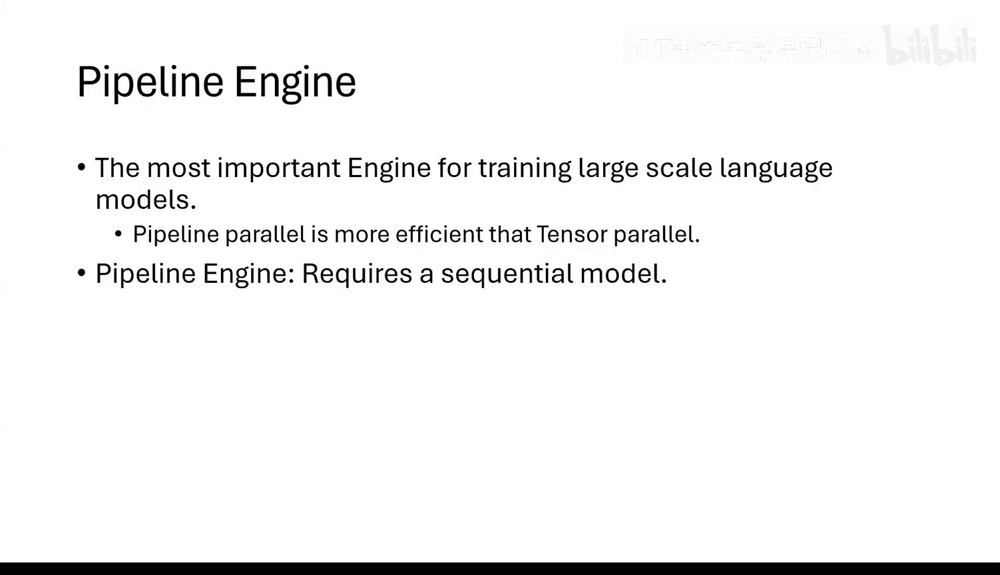

Okay。😊，I mean， what's the difference between this type of slicing versus the expert type of slicing。

Okay， or this type of slicing。You can see that when you slices， according to expert。

 if you put each expert into each GPU， the computation of all the GPU are actually parallel。😊，Right。

 so each expert just does its own computation。 and then they think at the very end。😊。

But you do slice it in this way。The computation is not parallel。 It's sequential。Right。

So if you slice in this way， you have to finish the computation of layer1。😊。

And then you go to computer layer2。 and then you go to computer layer after layer L。Okay。

 so let's just write the computation graph。So， basically， this is time。Hey， and this is layer。诶。😊。

So what does the computation graph look like， Okay。

 so let's say your are initially you receive like input X。So you receive some input like x1。

 so first off all this layer， at this time， it will compute the input of X Y。😊，And after that。

 after this layer finish， which is until this time， it actually assigns the output to layer2， right？

😊，So your X1 for layer， this is。Your computation of X1 for layer 2 is actually at a later time set。哎。

😊，And then you compute X1 here， and then you'll compute X1 here。Okay。

 and this is like a forward pass。 I need to know， I mean， if you learn the by obligation。

 youll know theres also a backward path， which eventually boils down to this。😊，Okay。

 so this is the computation graph。If you actually want to implement the pipeline parallel in the most难ive way。

Okay， you can see that there's a lot of eyeing。 You are doing pipelineython parallel。

 but it's essentially all those GPU are racing， right， You would be better just put all the layers。

 I mean， maybe load， I mean， load from CPU is not a very good idea。

 but you're wasing all those computation。😊，Okay， iss essentially at every time， right。

 at every time there is only one layer that is doing the computation。

 which means if you have 100 layers， this is going to be 10 times slower than just having one layer。

😊，Okay， even if you have10 more GPUs10 layer deeper model。

 your computation time is still1 hundred times slower compared to one layer model in on one GPU。

 So it's not scaling efficient。Right， theres so many idle in time because of the sequential parallelization。

 You have to wait for other GPU to finish computation。😊，诶。😊，Any questions。Hey， cool。

 So how do we actually solve this problem。How would how do we make the pipeline engine more efficient？

😡，Okay， so there are two ways to make it more efficient。 Open。

 I actually use a mixture of the two ways， which is a quite complicated routing mechanism。

 But anyway， we are not going to go to that level。 We will only talk about the simple level。 Okay。

 so what are the two ways of making the pipeline engine more efficient。😊。

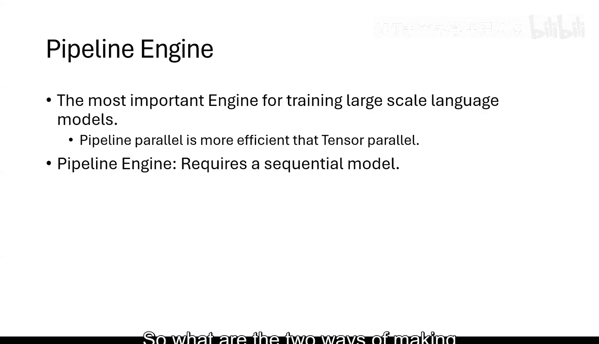

Well， the first way or I mean， actually those two ways are actually just one way， okay。

 it's just two implementation of the same method。😊。

Okay， so what is， what is the ittueration， I mean， the ittueration or the high level idea is very。

 very simple。 Okay， it's just， let's look at the idol time here。😊，So this GPA is idolling。Right。

 why not I compute X2 here。😡，诶。😊，I just put the computation of x2 here because it's idling， anyway。嘿。

And then I put the computation of x2 here。Right， I can pass it to here。ok。

And then I complete the computation of X here。And then I can put the computation of x2 here。

 I can put the computation of x2 here， I can put the computation of x2 here。😊。

I can put the computation of x2 here。Hey。😊，The only difficulty is， I mean。

 the four pass is five when when you compute by four pass， you have to recover some。E state， right。

 which is like。Basically， all the derivative of the nonlinear operations。Okay。

 so basically what the Hyend does is， for example here， right， but after it computes x1。

 it will actually off。😊，The state of X 12 CPU。Okay， so we offload to CPU。

 And because offloading is our CPUU is a non blocklocking operation。 So this two can happen similar。

 Any see。😊，So kind of just offload the tensor into CPU And then's start computing of X 2。

And after that， at certain point here， you kind of float it back to memory。😡，Okay。

 so you off all the hidden state of X 1 to CPUU。 And at this point。

 you off it back to the GPU memory。😊，Okay， and then you start computing X1， the backward of X1。

And they you send it to hear。哎。😊，A questions？很酷。I mean。

 so personally this is like the rough implementation of pipeline parallellyization。😊，Okay。

 and I mean， I say this two method， but it's actually all based on this。

 but just a little bit different in terms of scaling。😊，Or in terms of the scheduling。Okay。😊。

And essentially， you can insert anything here， right， You can insert I3 here。

 You can insert I3 here and whatever the more layers。😊，The more you can insert。诶。😊，Any questions。

So very letting you think what I live like。2。我 li。Okay。诶。😊，So the pipeline Im going with five years。

Good。Okay， so we look like this， right， this is kind of like our first implementation of the pipeline and J look I see already fuel a lot of。

Okay， but there is still some that here， which is。看到了。

And mean until year maybe you have to see your all the memory and start a new cycle。Right， I mean。

 this is like one process and after that。😊，After that， I mean， almost all I step here is autopy。

 but then you have to kind of clear your memory and then do another cycle。诶。😊，Any questions， yes。

Why the shape be a Why has the bank provocation become calculatedulated in the same G。And because。

 I mean， think about let's just think about feed forward as works， right？So for feed or nice work。

 there's some like， let's say there's some activation here。Like。

 you have to store the derivative of this activation in order to do back probe。

Right the back is essentially this matrix transforms times the derivative of this activation。

 and you keep computing that。 So you have like a forward has that keeps computing basically keep computing this matrix times your input。

😊，go go through some activation。 so this forward pass tell you what's the output of the network or to compute the。

😊，I mean， to compute the gradient of each rate， you have to go through like a backward pass， right。

 which goes from the very beginning you keep modifying this matrix transpose times the derivative of the activation。

😊，诶。😊，So this means you order to compute the gradient of this matrix。

You really need a backward from the top， from the top layers。Well。

 you need the backward from the higher layers， which means the computation goes like。

This way and then downward。Right， and if you look it in the timescale。

 it really look like the computation look like this。Okay。

 so you'll first go forward and then you'll go backward。哎。😊，Does that answer your question？

So they don't upload that part to see。Even if its populating for another X2。It allloads to CPU。

 The point is， I mean， I'm not sure what the picture you look at in mind。

And if it doesn't look like this， what， what's the picture that you have in mind。

Fs between layers and GPUs。 So I don take no which layer is a GPU。 So each layer is inside。

 So this layer is equal to GPU。It just put each layer in GPU。

They off to the CPU and another GPU pick up the information and calculated during the fact。

 Its I mean But now we are just using I it's standard race using the same GPU to pick up the layer。

 just because it's more modular。You can use other GPUs to pick up this layer。

 but it requires more work in your pipeline engine。 So it is possible。Okay by the 20 is， I mean。

 this GP star。This GPU store this layer， right， If you use the other GPU to pick up the backward。

 you have to make sure the other GPU also stores this layer。

 which is possible if you use multiple GPU to store the same layer。诶。😊，Any other questions？Yes。

 you mentioned something about like this having to like cycle like you have to clear memory at the end or something。

 I'm wondering why you can't just like continue this pattern like indefinitely yeah Yeah， I mean。

 that's basically an upgrade of the pipeline engine。So basically， I mean， this is I I implementation。

 but actually， theres an upgrade。 I mean， this implementation is actually what use in practice because of many like practical reasons。

😊，Are many like。开老虎。Strange hardware reasons， but ideally， we would really want this， right。

 we would want it to keep going。And there's nothing waste。Well。

 we would wanted to go from here and keep going， but you can see then there's some intersection。诶。😊。

So there's kind of like， I mean， originally there's also some inter。

 but now there's kind of like a many inter like it's just constantly intersecting。

 So you'll have to make sure that these two computations are kind of done separately because they are not really blocking each other。

😊，睇。😊，海酷，I mean。In practice， people like to have like a hard cut off just to clear the memory and basically having this is like one cycle of pipeline parallelization。

 And it's also kind of like more robust to crash because if you crash at here。 I mean， if you crash。

 you would always have this checkpoint in where all the computation are sync。

 But if you always do this， like no， nowhere between the pipeline engine is sync。 So in the long run。

 there may be some problem。😊，Heい。😊，5。Are there any questions， I mean。

 you can see that the pipeline engine is kind of like perfectly designed for something like transformer。

 If you have a convolution at work， Why is it bad for pipeline engine。

 It's really because each layer they have different size。😊，Right for coal network。

 if you keep doing color， your higher layers will probably be， smaller or have more channels anyway。

 so going to be the same size。 So it's very hard to balance the computation where you can put each layer in some GPU I mean the computation time are different for every layer。

😊，But for transformer， it's really just a same operation repeating over and over and over again。

So every has the same computation time， which is kind of like perfect for pipeline engine to work。😊。

诶。😊，Any questions。Hey cool。 So basically， this is like， I mean。

 this is just an overview of pipeline engine。 There's still some caveats in terms of the actual scheduling here。

 But those are kind of more detailed stuff that we will not really go into those detail。 But overall。

 pipeline engine is really just implementing this operation where you。😊，Kind of do the forward。

 And at the same time， because the GPU are idleling， will just go to the next data。

Do another forward。 and then you go to the next data。 Do another forward。Okay。

 and then you kind of offload the CPUU state， offload the state into CPUU until certain。

 time you pick it up into the memory。😊，So essentially， I mean， essentially this can。Of course。

 this method still has this limit， which is each layer now。

 And if you only use pipeline parallelization， you have to make sure that each layer can fit into memory。

 And because there's some overlapping。 So you can， you're actually doing like。😊。

The same operation twice。 I mean， this is really like the caveat of the pipeline parallel。

 For example， you can actually kind of you can actually do those two operation at the same time。

 or you can actually， I mean， really do not have this inter。

 but schedule one here and then schedule the other here。😊，So theres some like implementation details。

 But anyway， you have to make sure that each layer now can be put into the memory。哎。😊，Any questions？

Basically， eventually， I mean。我好睇啊我扶喺你嚟。Wally like a large。Ining large language model companies。

 they really use this the so called 3D parallelization mechanism。😊，Okay。

 there's the pipeline parallelization， which is really parallelization across layers。

 And then there's a data parallelization， which is parallelization across data。😊。

And then there's some model parallelization， mostly just expert parallelization。 And for attention。

 if your one attention layer cannot be fit into the memory， then they use sequence parallelization。

 Okay to parallelize the attention computation。 but overall。

 the main message is just our way terms parallelization as much as you can。😊，Okay。

 that's basically the， the practice lesson。Any questions？Okay cool。

 So for pipeliney parallelization is actually very easy to implement。

 I science your write to the N到 sequential， the pipeliney engine just does this thing automatically for you。

 And all you need to do is initialize a pipeline optimizer。😊，Which exists in hug phase。 Okay。

 so you just go the hug face pipeline optimizer and。

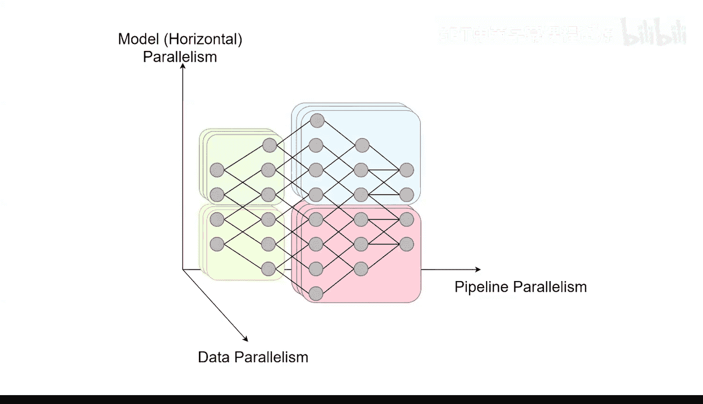

You just call that optimizer backward， and it just does everything for you。

 You don't really need to specify anything。 No， like ining of the tensor。 Okay， so no kind of。

 I mean， if you write code like in megaron or injects。

 you know how painful it is because you need to。And of specify those indexing of the tensor for tensor parallelization。

 But for pipeline parallelization or expert parallelization， we really don't need to do anything。😊。

Okay， so there is very limited work， which also makes the method very popular。

 so that's basically the pipeline parallellyization we want to talk about。

 And it's really the most important technique and。😊，I mean。

 a lot of optimization has been pushed into optimizing the pipeline engine。

 You can see there's many caveat， for example， When do you offload from CPU to here， right。

 If you off too early， you kind of have a lot of things in your GPU memory。

 which means you have less compute， But if you offload it too late。

 you may need to wait until this thing。 I mean， you need may need to wait for CPU to offload and then you start computation。

 So it's kind of like just actual scheduling is very subtle。😊，嘿。Yes。

When you use pipeline I mean each GPUs， each GPU saw one layer， right after this backward。

 this GPU can just upload update the weight on its own。😊，诶。😊，So悲要睇事。I mean， yeah。

 there's also this difficulty。 for example， There's an intersection here， right。

 then Which rate are you using。 I mean， that's also one of the reason why there's like this thing here here。

 I mean， this boundary here， you don't want to use them because here you want to think ways。

And all those computations are using the ways that are sync here。 So this operation， I mean。

 so that's why theres some scheduling。 So you want to do the backward after you do the forward。

 So you want to do this forward first and then you' do the backward。 Now you can update the ways。😊。

Okay so there is a lot of cave in those small little implementations to save some time。😊，Hey。

 any other questions？Hey， so basically this is pipeline priorization。

 and then we will also talk about another technique which we should talk about in the previous lectures。

😊。

Which is muP and muP is a very controversial technique。Okay，Because really because besides open I。

 no place has made new P to work to any extent。Okay， so it's completely a garbage method。

Outside open eye。 But because open I is using it， we kind of want to understand what is milk P and。

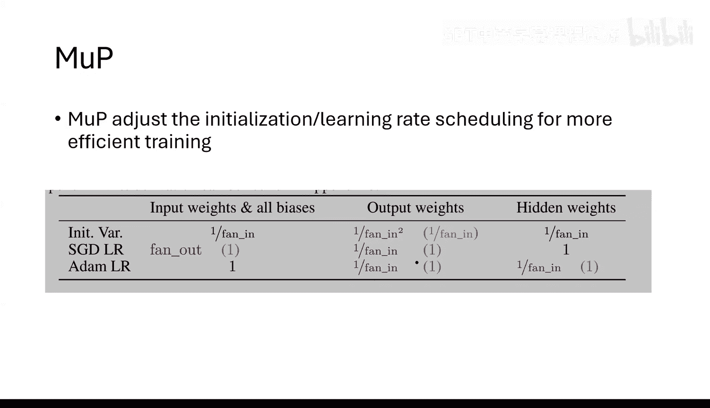

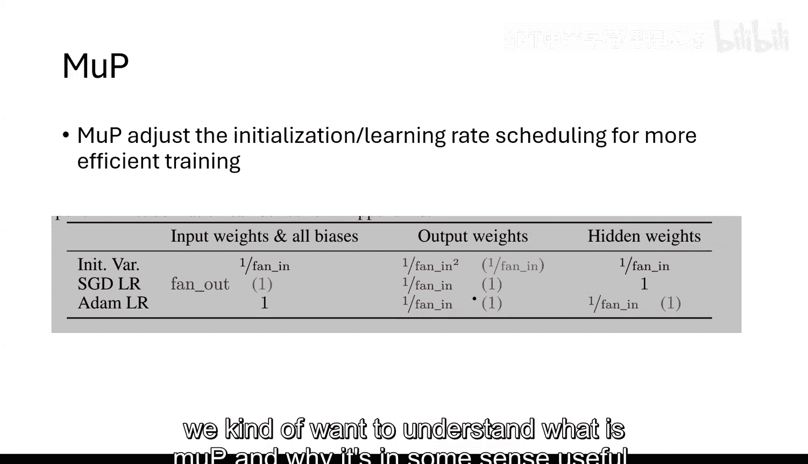

Why is in some sense useful。呸。

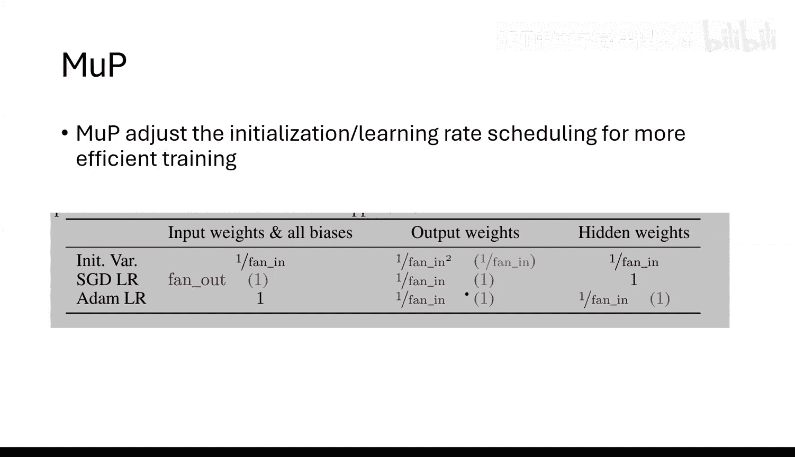

So newP is a method that adjusts the initialization and learning rescheduling of the transformer networks for more efficient training。

😊。

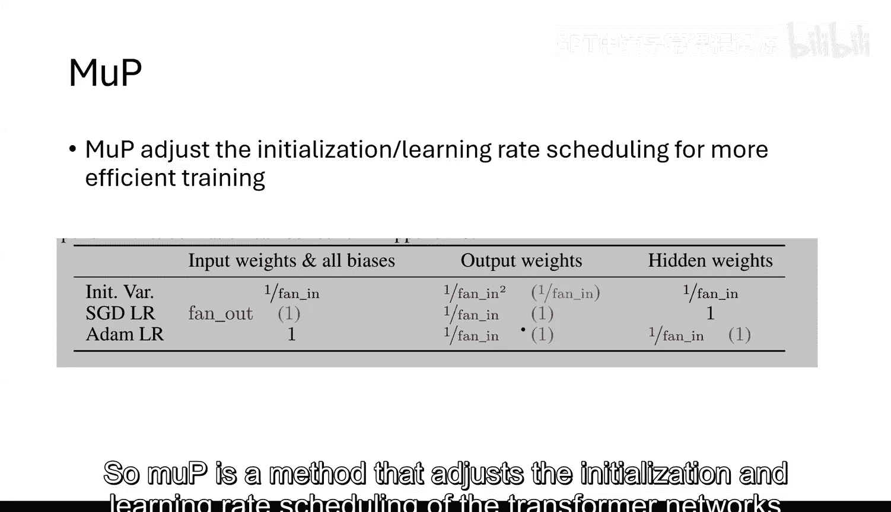

Okay， so U P uses a different initialization compared to the default initialization and use a different learning rate scheduling compared to the default learning rate scheduling for hidden optimizer and for transformer。

 Okay， so the right one is the initialization for U P。😊。

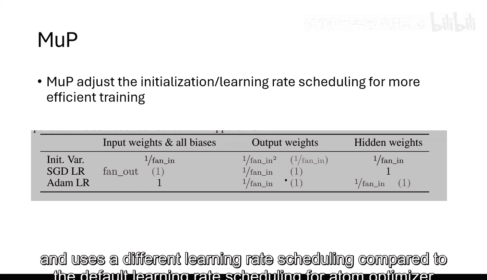

And the kind of the black one is the original initialization。Hey， if stare I did， I mean。

 those things looks quite arbitrary。😊，Okay， so we kind of want to know what。

 what's the intuition behind new P and why do we actually want。

This type of crazy initialization why do we even want to change the original initialization of the transformer network。

8。😊，And just to say， new P is the key to success for O I。 Okay。

 say the reason that they can train the MO E models better is because of new P， but。😊。

Thiss are a customized version， so I don't know what they actually do。

But we probably want to learn this thing so we can try to do something maybe better in the future。😊。

K。😊，Any questions？So now what's the intuition for MP？诶y。😊，So let's just consider， I mean。

 let's forget about the transformer。 Let's just consider how to optimize a one hiddener layer。😊。

Or I to see that letter neural light work。诶。😊，So let's say， your input is of dimension。咦。😊，诶。😊。

And then you use a one speed layer network， which looks like this。😡。

There's like a one dimension output， and there's a n by N weight matrix。

And then this is like an N D with matrix and N one layer。Can you say I say pre your neural network？

And what's the best way or what's the optimal way to train this neural network or what's the fastest way to train this neural network。

系。😊，Any questions。So let's look at the standard initialization。 Okay， the standard initialization。

 each of this is initialize as N0 and warrant D。😊，Okay， this is like the default。

 whatever X wever initialization used by pitorch。Okay。

 so each of these ways you see initialize as a Gaussian variable which mean 0 and whereas1 D。😊。

And each of these thing here is also initialized to be the same thing。😊，啊，sorrry， not warrantD1 N。

And this thing here is initialized as an。0玩。诶。😊，So this is like the default initialization of the network。

Okay， and let's just forget about this key dimension because it's a concern what we really tell is the size of the neural network。

 which is。😊，So let's just say this is equal to one。And I just have for one dimension inputs。Okay。

So this is really N0，1。Just for simplicationification， because infected CD is a constant。

 only the N you can actually change for the side of the neural network。😊，Okay。

 so what new kid thinks is I goes to infinity。😡，Which means I really have like an extremely large model。

喺恩个诉用ability。If really have a new fairly large more that work。😡。

Would the optimizer behave normal on this network or it just stops updating or maybe just grow up after one step。

😡，Okay， so would the optimizer be stable？😡，In this regime， like， if my end to infinity， I。

For example， if I use Adam， right。With learning rate equal to 0。1。If uner infinky。

 would this algorithm still work？😡，Right maybe just after one step。

 it will blow up or maybe it will never update because N goes through infinity。

 and this update is too tiny。诶。😊，So it really like really thinks about if I have an extremely large model with my original optimizer still make sense for some fixed learning rate。

😡，诶。😊，Any questions？So you can see there is a possibility that this doesn't make sense。 For example。

 this n really goes through infinity， right， and it a fixed certain rate。

 So it's possible that after one step of update， my neural network just blow up to infinity the output just blow up to infinity。

 All it' possible that the neural network will never get updated because n is so large and neural update is so tiny。

😊，哎。Any questionss。So they want to make sure that there is some initialization regime and then there's some kind of layerwise learning rate adjustment regime so that even N goes to infinity。

 the update of Adam or this atom optimizer with a fixed learning rate still makes sense。😊，嘿。😊。

Any questions？Hey， so now yes。Yeah， so let's just consider the following case， right。

 let's just let's even forget about this two layer network。

 Let's just consider like a one layer network。😊，He， and I say you have stupid initialization。

 which is you initialize everything at NG O1。 are you initialize this at NG O1。😊，He， and this is an。

So what would happen if any goes through infinity in this case？Okay， so let's think about it。

 Each output here is roughly out of size 1， right， because this is N01。 So each of the output。

 I mean each of the hidden。😊，Heden representation， each coordinate of the hidden representation is roughly of size  one。

😊，And then this multiplied by N0 is like a random variable of size  one， right。

 So eventually here is a summation of， let's call this AI and call this。😊，HI。

 so it a sum of AI times H， where this H is like theta 1， and AI is also theta 1。😊。

Although AI is a random Gasian， there is some cancellation。

 but this same by law of large number rapidly converges。😊，Ass un going to infinity。

It kind of like convert just to N0 and N。Right， because each each of the products I can standard gosian random variable and use some N of them。

 So convert to NG and N。😊，So if anything goes to infinity， you'll just blow up。

So this initialization does not the large model。😡，Okay， initial if your model is too large。

 your output would just blow up， so it's not scalable。😡。

 so this type of initialization is not good for large model， but luckily people are not that stupid。

 They use our end here。 He very fine Y， which is for end here。 And now this is our end。

 and this really goes through N01。😊，哎。😊，So for the whatever be initialization or Pytor。

 at least is support model of arbitrary large， even if your rates go to infinity。

 you don't really blow up at initialization。😊，A you still are able to？

That meaningfully bounded output at the first step。

But what about you do one type of Adam on this network？😡，ok。😊，Let's just check。

What will happen if you do one type of Adam update on this particular network？😊。

So let's say your Adam learning rate is like a thousand， which is like 0。1。哎。😊，So for this BI。

 let's just look at it。 Let's just say you have one input， which is X。Okay， for this B I。

 because of Adam， the update of B，I is roughly constant。Right， so B， I is equal to B。

 I plus delta after one7 where this deta deta I with an absolute value of deelta I is like a constant。

😊，Right， because Adam is like a normalized update。 So every coordinatedator update is like a constant times a constant learning rate。

 So it is a concern。 So I update B I by constant factor。

 which means now my output is something like submission of AI。😊，Iす。A H plus。来dota item sex。Okay。

 so originally this time is fine， So I'm just kind of about sum of AI times prototype。😊，I sorry。

 so how large is this thing？Right。Now， the deta I are constant。

 but the deta I are not really anti are not really independent of AI anymore more。

 the deta I are actually line with AI。😊，So this datata is roughly like proportional to AI， right。

 because it's gradient design。 need to My gradients of this di definitely is a function of AI。😊。

So basically I have a constant now times AI， and what is AI AI is like more root end。

And this thing at a constant that has the same sign of AI。

 so this roughly gives you something like summation of absolute value of AI。😊，Wch is root。

So after one step of update， you just grow up。😡，诶。😊，Which means this visualization is not good。

For a large language model or for a large model， As some also infin。

 you can't really use account learning rate。 You have to scale down the learning rate。😊，He。

 which is kind of like what you really don't want to do， but。Anyway。

 if you use a constant learning rate， you will just immediately blow up。诶。😊，Any questions。太酷。什么袄。嘿。😊。

Any questions。什么。In this regime， right。What if we scale down the learning rate to our Rudy。

So what if I slow down the learning rate to Ru be？我 do ithappen。Oh， sorryor，玩 root。Because right now。

 I mean， if I use a constant learning rate， I will immediately blow up， right？

I will immediately blow up。And now what if I use a learning rate of our route？But there it is。

And in this we' make sure that when you' multiply by learning rate I these you don't blow up。😊。

Right youre after the network， output by F 1。RightBut then what's the problem of this？😡。

What's the problem of using this learning rate。The problem is， if you look at here。

 your B is over one。😡，But if you use st rate wire root air。😡。

This means you need need any ittuerations to update your BI or to really have a meaningful impact of your BI。

W which means your training time go through infinity S then go to infinity。

This is not like really not a function number of data or whatever。

 It's really just to have a meaningful change of the very software your neural network。

 You have to make usually many couple。😡。

RightI mean， this virus story roof thing is the largest possible learning rate I said。

 otherwise you will blow up immediately。

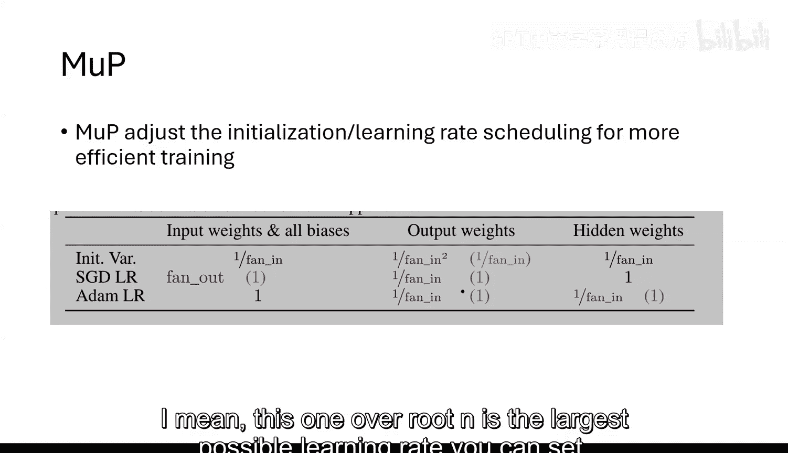

But if you use very roots and learning rate， you need to have infinitely many steps of update data to make a meaningful impact to changes even ways。

😡，Okay。Any questions。So just a quick check for the constant learning rate。

 What's the thing that actually is eventually got blown up。 It's the memory or it's something else。😊。

Maybe， that the output of the network will immediately blow up。

 So your output just overflows because your output after one step of update would be rule and large。

 And if and go through infinity， youre immediately overflow。 The output will be infinity。 I see。

 okay， Thank you。 Yeah， I mean， try that to like cause angle belows。

 you will just hit the linear or zero region of the cause angle belows。 So it's very bad。

 Thank you or maybe in the hidden layer of your soft max。

 youre really just converting to a hard max after one step。😊，And then you will have no gradient。Good。

太酷。So those are events they pull。Then they proposed this new P initialization or the mu P。

 which kind of tried to solve the problem， but it didn't really solve all the problem yet。

But this kind of like a roughly some better thing。 And that's why I think this。

 this version of mu P just doesn't work yet。 But there are some other version muP where open I magically made it to work。

😊，嘿。😊，So basically， I mean。So basically let's just go back to this picture and see what change do we need order to make this in order to avoid this very bad scenario。

Hey。😊，So the first change， I mean， so first of all。

 they somehow start is not really changing this layer。😊，He， so first of all。

 UP is not the only solution。 I mean， there are some other solutions where you can address this issue。

But what I do is， I mean， they stay with this layer being the same。Okay。

 and these layers learning rate is still a concern。So basically， it's like the input layer。

 they don't really change。Okay， so they start with these spaces and try to derive what change you need for the alterer layers。

😊，So first of all， if your， I mean， first of all， if your if your inputer is N01 and your update is over one。

 then you really need constant step to make a difference for this embedding layer。

 which is pretty good。😊，ok。😊，Any questions。So then， the Hua is。I mean。So then the question is like。

 what's the initialization of this thing and what are the learning rate of those things？😊，Okay。😊。

So let's just some cards， I mean。Let's just look at let's first， I mean。

 let's first look at this layer。Okay， let's first look at this output layer and what change do we need to make for this output layer or for these two layer together。

诶。😊，So first of all， I mean， these two layer together。

 let's just consider there's no activation in between。

 and this rule layer together gives you like a linear operation。

 right really some linear operation like here， and then you multiply to the hidden eming of here。😊。

And he the remind of here is order of one。And in particular。

 the update of this hidden embedding is also over one after one step。

RightAnd they are exactly aligned with this vector。

So to make sure that the update does not blow up this vector。

 you have to make sure that the entry of those vector are one en large。😊。

Righthy those are like more and large。Okay， so are they very enlarged to begin with anything think about it。

 this is a matrix of n0 and what n。😊，Right， and this vector itself is essentially a vector of norm 1。

RightThis vector is a vector of norm1 here， and they will multiply a matrix of N0 and more n。

 this matrix is roughly preserves a norm。😊，So basically， this vector using this initialization here。

 this will give you a vector one we're root en large。😊，哎。😊，So which means you have to scale down。😡。

These two layers are the product of these two layers by factor of water root。

He有 order to avoid being in order to avoid that the have update go up immediately， yes。

What would you if some parameters creating increased this is addedom。

 so the update perparory is older one。This has nothing to do with gradient gradient。

 It's just add update。 It， iss a normalized update。Right， no matter how large your parameter is。

 the Adam update itself is always in the order of one。Yet。

 this has nothing to do with your gradient clip or not。Yes， any other questions？H。 So basically。

 that's the reason where they scale this thing down by fact of over ro。

 So instead of having like a over N initialization。

 they put like a over n square initialization here just to make sure that one type of update here would not blow everything up。

😊，系。😊，嗯。Any questions？太酷。So then what about？I mean， then what about the learning rate for this layer。

 so we already say that in order to make the update of this layer not blow up。

 we had to scale everything down。😊，Okay， now what about， for example。

 the learning rate of this layer or the learning rate of this layer？😊，系。😊，So basically。

 we can first look at， I mean， first we can look at the learning rate of this layer， right？😊。

So everything here is pay hour， pay。I mean， the output here is older one and then multiply this by this matrix。

 So your input here， each coordinate is older one。😊。

This means the update of this particular weight must be in the order over D。😡，Sorry， what N， right？

 So the update， the dolta of this part equal rate must be in the order over N because the doltas are line with those input。

😊，So which me is the learning rights' here。The learn rate that this layer has to be n。

So the learning rate here is one。 the learning rate here has to be1 n so that the update of this particular layer is stable。

😊，Ifual running is larger than our， and then this layers update will blow up immediately。😊，ok。😊。

And you can see this learning rate， and this thing is also compatible because the learning rate is over n。

 and this guy is over n square。 variance over n square。 So the size is over n。

 which means you need constant iteration to fully update those ways。😊，哎。😊，Any questions。嗯。I mean。

 they just basically a starting place。 You if you change the input part。

 you can also be translate to change to other parts。😊。

So they just start with no changing the input part so they can derive the change of other parts。

 If you change the input parts， the other parts are going to change like in some way that depend on the change of the input part。

Yeah， for example， if you scale everything up， if you scale initialization by 10。

And you start the learning rate by 10， Right。 and nothing is going to change。

 So it's those things are not exactly skating。 I mean， they are kind of skating environment。

 So you need to have something fixed to begin with。哎。😊，Yes。😊。

He usually a practice from which we actually shall came name。So what should we just give voice clear。

No visual and change and little layer can that。No， that's what I mean。

 This is like one choice or milk P。 There's other choice that also work。But overall。

 this is I just amazed。 What's the spirit of milk P。

 So the spirit of milk P is just to make sure that。😊，You will。 so basically， I should just， I mean。

 here we see some example， but eventually we just want to see what's the spirit of UP。😊，诶。😊。

what's the kind of design space of牛皮。So， first of all， we want like。Conent steps。

Plus day the network。Right so we want common and steps so we can update the network。

We don't really want like some parameter as un so infinity only like infinite many steps to fully update it。

😡，that's really not good。 So we want to make sure that every parameter can be fully updated within constant many steps。

As some go through infinity。 and also， we want to make sure that。One update。Does not blow up outputs。

😡，So this is like an apple bun。This is like a lower bun。Right， they say you really need。

 you really want to update fast。Right or not only like update the network。

 but also update the output。 I mean， for example， you can satisfy these two condition by just scaling up the scaling on the way to zero or to like lower poly。

 But then even after constant many steps， you won't really update the output。😊。

So this it like the update the network and the output。Okay， which is I not true here， right。

 because I side the way to remove and and one side up update the output put by older one。😊。

So I need to satisfy these two conditions。 This conditions really requires your update size and initialization to be not very small。

😊，But this requires an update and initialization to be not very large。😡， so together。

 there is some neat region where you satisfy both constraints。 and that's where the new P lies。😊，诶。😊。

So you'll kind of immediately why open I loves the same because it's kind of like to say this is like a stable way of initial rights might transformer and update might transformer。

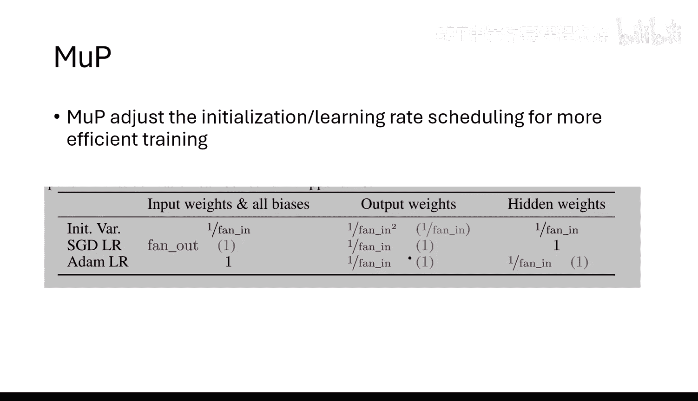

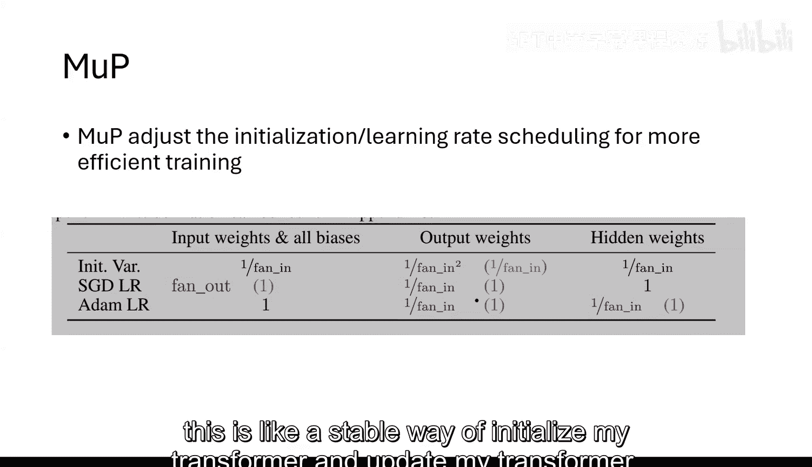

Right if I don't， if I'm not， I mean， this is kind of like necessary， right。

 if I'm not in this regime。😡。

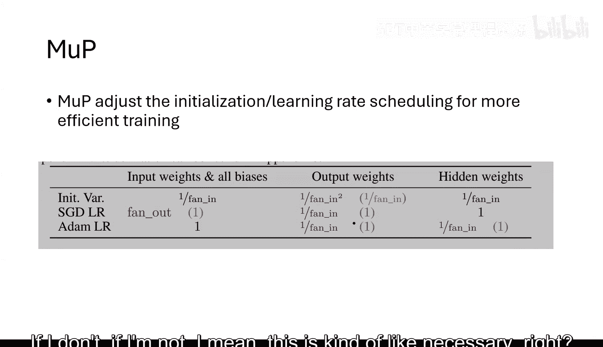

The I smart model gets larger and larger， it really just training becomes very unstable。

You can't even train your model。 So this is a necessary thing to satisfy to try that transformer。

 And unfortunately， the standard initialization does not satisfy that。

 So something like new P is necessary， okay。😊，Yes， how are the other companies training live models of like similar size。

 I mean， probably Google does something similar to Mu P， but it's not kind of like。

 according to this scale， but they just have like layerwise learning way tuning and which does similar stuff。

 but really， I mean， what often I did is a more principal way where they really just try to optimize to satisfy these two condition。

 like sli。😊，And also， even if you don't satisfy these two condition， you just train slower。 I mean。

 you can make your initialization。😊，To be small， right。

 And then you satisfy everything except for this country。 Maybe you need supercon many steps。

 but still， you can train。 But really， if you look for the optimal way to train the neural network。

 you have to satisfy these two things。😊，北库。And also， there's some caveat。

 which is I didn't really talk about layer normalization。 Those things。

 Those things also act as some automatic learning rate tu。

 So if you set your V D K to be large enough， then in some sense。

 the network will tune the learning rate for you。😊，And it can train。 So that's actually。

 as far as I know， this is a technique used by many other companies。

 which is used extremely large V D K。 And then it can also train because the normalization layer plus V decay K is like a learning tuning。

😊，Yes， does this have any impact on the chin scaling mode？I I have no idea， I mean。

And I think the changes are scaling law didn't really use this。

 So it really just search for the optimal hyper parametera for each model。

 But you can see this is not only a hyper parameter of learning rate。

 You really need a layer Y scaling。 So I think potentially if you use mu P the scaling law will be a little bit different。

😊。

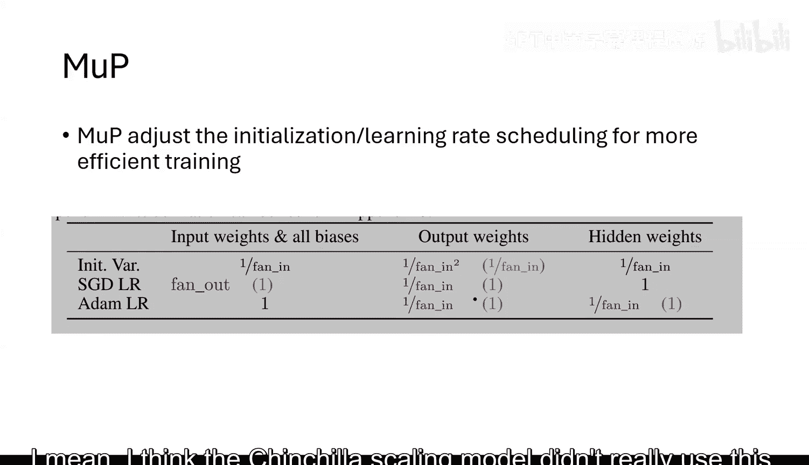

Yes， the diagram feels like a square middle layer that we said needs to be like one over end but we would have have multiple like transform layers where we want like a linear schedule between the layers that now we're going to the whole thing is one over end I think you should there as well。

 And so you can work called the math because there also there are also some layer normalization in between。

So if you work out all the math， I think this is like what you get eventually。 I mean。

 I'm right now ignoring a lot of stuffs。😊。

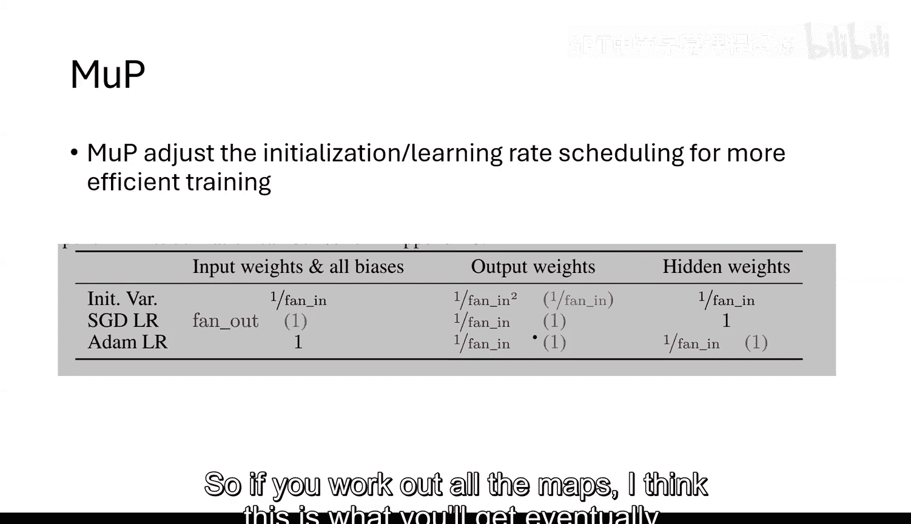

Just to give you some simple idea。But I mean， at least the method is fully justified for transformer with layer normalization。

😊，So， but still， I mean， if you go to M O E， right， then that's a completely different scaling。

And especially those little concept matter。 So I think that's basically the secret where we haven't figured out。

Hey， any other questions？Kik cool， Gu if there's no more question。

 That's basically what we want to talk for today's lecture。 I mean， today。

 we finish some lifeover stuff。😊，Okay， and then we will start some new topic in the next week。

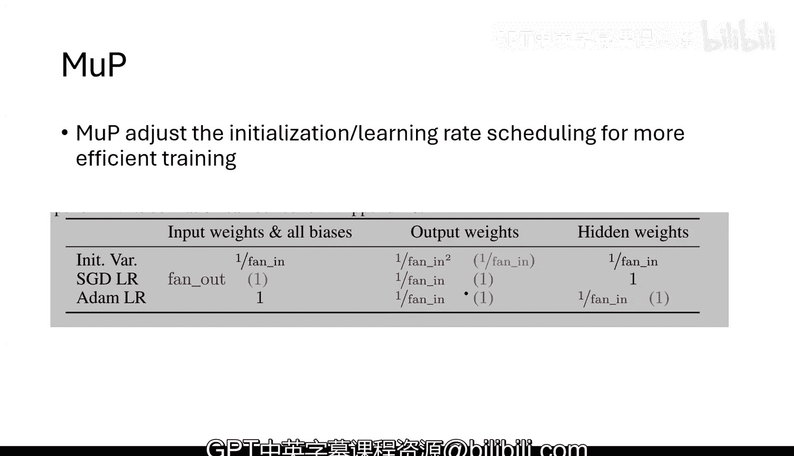