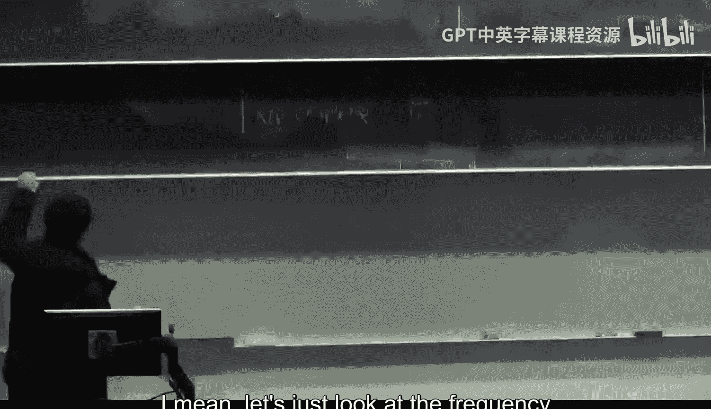
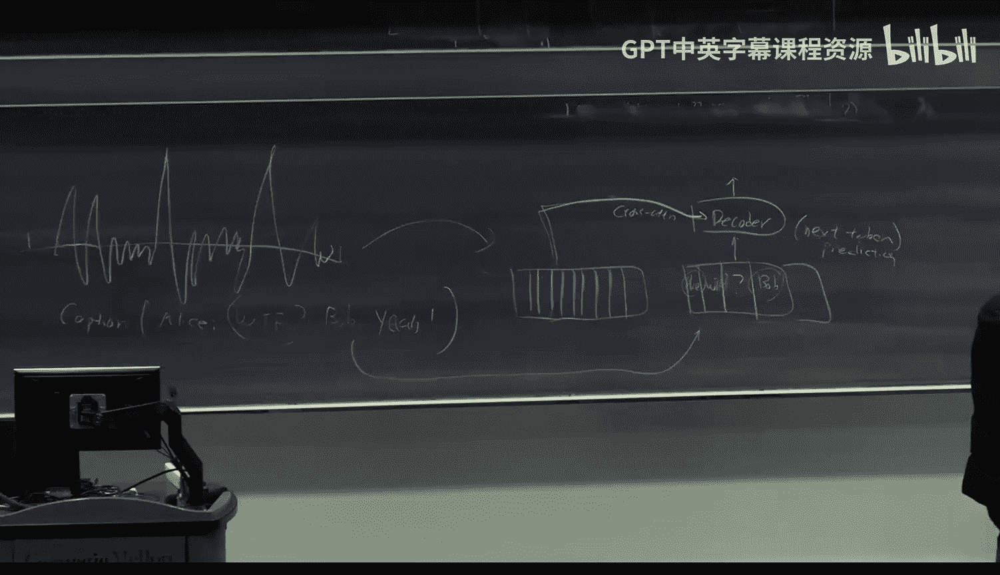

# CMU《生成式AI｜10-423 generative ai 2024》中英字幕 - P26：-P26-Lecture 23- Speech Recognition Models_board.zh_en - GPT中英字幕课程资源 - BV1CyC9BPEhG

Okay， hello， everyone。 Yeah， thank you very much for coming today's lecture。 and let's started it。

 Today， we will have a less our lecture， a short lecture about the speech recognition models， Okay。

 so。😊，I mean， speech recognition models is technically speaking not a generative model。

 but it's also kind of using the same architecture as the generative model。

 And it's very important in generative machine learning。Okay。😊，搜。Basically， actually。

 the speech recognition model or speech data is getting more and more important recently because the speech is actually a very great source of high quality data or high quality tokens to train language models。

 think about the podcast or the debates or even like a president speech， right。

 Those are extremely important， very high quality data。 I mean。

 you will not have advertisement during the president speech。 So those are very important data。

 especially even the transcript of YouTube videos。 those are extremely important。

 and they are very large amount of tokens available in those speech data。😊，Roughee is。

 there are more than 10 trillion high quality tokens， probably even more。

He just even Pen and token is only like YouTube transcript。 Okay。

 you can get a lot more than that by looking at other sources like theres， I mean。

 the audience exists in very， very long time in human history， right。

 You can collect all of those data。😊，But we need to tran them into natural language。

 We need to tran the speech into natural language。 And in this lecture。

 we will learn how people actually do that。 I mean， there are essentially two types of models。

 The newer version of the models are definitely performing better。 But classically。

 there's another type of models。😊，Okay。😊，So right now。

 I would say the speech models are still not perfect。

 They are actually not very high quality yet compared to the current language model。

 He they are useful， but it's not。 I mean， it's so exactly very great。

 So this is definitely some part where we can improve and get a lot more high quality tokens。😊，Okay。

😊，So basically， the frontier of those audio recognition or speech recognition is really just the part of speech tag or who is talking。

😊，But how do you break those， I mean， break those conversations。Right。

 and mean think about if you just transcript what everyone say into natural language。

 you're actually losing a lot of information， especially who is talking。

 And sometimes without knowing who is talking， you actually cannot understand what's going on in the conversation。

It especially when two people are debating。And if you cannot distinguish who is talking。

 that it's very， very hard to understand what's going on。 right， It's like conflicting opinions。

So really， the important part of speech recognition is really just tagging who is talking or tagging like whether there's a speech in terms of somebody's talking or speech of a topic。

 which you cannot really get from just naive transcription like YouTube transcription。 Okay。

 so you need some speech， good speech recognition model in order to do that。And today。

 we are not going to learn how to solve this task exactly。

 but rather just to learn how to do speech recognition in general。睇。😊，He questions。Te酷o。

 So this is definitely a very active direction in industry where。

Once you can get a perfect speech recognition model like the perfect O C R pipeline we discussed。

 right this is a very important step towards getting a lot of high quality tokens for training the model。

 I， in particular， nowadays， like all the big companies are using podcast to train their language model。

 Okay， so this is really very important。😊，And so how do we push。

 how do we kind of try a speech recognition model or how do we recognize sound。

They just recall in your original physics class， okay。

 the sounds are actually characterizeded by two things。😊，The first is the frequency。 sorry。

 not the frequency， the amplitude， and which is how loud the sound is。😊，睇。😊。

So the amplitude is quite important。 decide how loud the sound is。

 how loud one particular sound wave is。😊，And there are another phase of frequency。Right。

 which is essentially， I mean， I cannot describe what frequency means， but the more。

 the higher frequency， you would hear the sound like more high pitch。

 while lower frequency is more like。😊，Very deep voices， okay。So basically。

 it's decomposing to this two unit。 And just by composing those sound， those basic sound waves。

 you can get any type of sound you want。😊，K。😊，Any questions。

Sub basicallyly a particular soundtrack or a particular whatever piece of song。

 you would say can be decomposed as a composition of。Those type of canonical sound。Okay。

 with certain frequency and certain anti。Okay， and decompositionisation is really called fo a transformation。

 right， This you should learn in your high school physics class， okay。😊，Any questions？He cool。

 So this means we can actually transfer the sound using Fourier transformation into the so called frequency domainme。

😊，Okay， so any type of sound wave maybe just look like this。Okay， and let's say it's from0 to two pi。

 so every function， right， as long as it's continuous。

 any continuous function in this thing can be written as exactly equal to some summation of R by I。

 Okay， so basically some exponential of I theta I times X。😊，Okay， and this half I is basically the。

I'm teacher， and this theta I is a frequency， So theta I is probably equal to two pi times。😊，Sorry。

 maybe I should use J here。 who pi times J。Okay， so basic through transformation。

 and you can just decompose any function into this infinite sum。😊，Okay。

 and then you can just transfer the sound from the original， like， what do you call it。

Or whatever analog domain into this frequency domain， which is kind of like digital domain。诶。😊。

So this one， you can represent it You a vector， right， Alpha1 or Al 0， Al 1。

阿尔pha 2 up to alpha infinity。Aon阿尔法 n and up to infinity。Okay。

 so look I really just represent this whatever arbitrary function into a vector of infinite theory dimension。

 And you know， just by standard for the， as as the function is continuous。

 this coefficient will decay to 0。😊，Right， all the tail of the coefficient doesn't matter there exists some finite cutoff where you are really。

 really good。 I mean， you can tell a really good approximation of the original function。

 So really don't need to keep all the coefficients。

 There exist some finite cut off where you get a good approximation。

 He just from standard fully approximation theorem。😊，哎。😊，So， that means for every。H Bob， this thing。

 we can actually approximate it with alphapha1。 sorry， Al0， alphapha1。😊，Up to some alpha N。Okay。

 so this is like a good approximation， as as your function is not too weird。😊。

It just from your any mean high school mathematical knowledge。

 your no Four coefficient would converge， right， So there exist some large enough anywhere。

 just using those Four coefficients you get a good enough approximation of the original function。😊。

Any questions？So this means we can really trade this function into this， I mean。

 as a vector like this。😊，哎。😊，I it's liked as vectorYeah， I just encode as a。 I mean。

 each sound from 0 to two pi is encoded as this， but you can， I mean， maybe the sound is very long。

 Then you may have multiple windows。 So it's like a sequence of vectors。😊。

So each sound in a particular window is encoded as a vector。😊。

But then the entire sound track is encoded as a sequence of vectors。

 just like your NLP spinning data。😊，Any questions？Yes。That's a good question。

 I think it's a design choice。 I mean， I don't really know the detail whether it's overlapping or not。

 but it's possible that you can overlap， but noping， I guess is also fine because I。

 as I will talk about， there's an additional layer on top of this that could merge the two adjacent windows。

😊，Hey， other questions。T cool So those already this it's kind of like the。

I mean that's first all approximation that we would think about， right， Think about， I mean。

 this is a sound of， obviously， this function cannot be feed into a neural network。

 You have to transfer it into a vector。 And the way you transfer it into a vector is just keeping the query。

 help whatever queryier coefficient。And that is like the first other approach， he？So basically。

 you kind of transfer your。😡，Basically， youre input into like vector。

Of the empty to over and frequency。Okay。😊，So these schools are first saw the approach。

 but what's the problem of this approach？😡，Well， if you look at this spectrum。

 you can see that it's all kind of concentrated on the very top。

RightI the very high frequency stuff iss kind of， I mean， the empty is rather long。😊，ok。

And also like the very high frequency stuff， like human really perceive it kind of differently。 Okay。

 if you have a very high frequency sound， for example。

 it's 600 frequency versus 800 frequency that humans can't really tell the difference between these two。

 But humans are very sensitive around those type of range。😊，Hey。

 so it just means those things better small， those things matters less。😊。

So when we see some graph like this？There's kind of like automatic thing you want to do。

 which is reize the beans， right， You want to put， you want to have like a more fun resolution here and have a more cross grade resolution here。

Okay， so it looks more balanced。诶。😊，And why do we want to do that。

 because the dimension of this vector is basically your input dimension。😊，Okay。

 or the dimension of your input。And for kind of an ordinary sound， you know。

 the frequency can go to 10 k or even 100 k After there， you would get a good approximation。

 but you really don't want your input to be like a dimension，100 K vector。😊，That would be too large。

So what we want to do is we kind of want to move those coefficients into bins。系。😊。

So let's just say you have an input vector， Al 0， alphapha 1， Alpha 2， Al 3， Al 4。诶。😊，So basically。

 this is， let's say this is like 100 k dimension vector。

 including all the Fourier coefficient up to some kind of high threshold where you get a good approximation。

 but this is a very high dimensional vector。😊，So how do you get a low dimension vector。

 Well one way is you just chunk it， maybe just cut it as alpha0。 Then you get a dimension 10 vector。

 but you are losing all those coefficients。😊，Right， so if you want your input to be dimension 100。

 there is， I mean， the naive phase you just chunk it here and just keep alpha 0 up to alpha 100。

 But then you are losing all those coefficients late in the in kind of the high frequency domain。😊，诶。

😊，按。Sort of like that。 So there's a smarter way to do it， which is， as a students say， I mean。

 I can do an aing， right？ Maybe I just do this。A阿尔法100 plus阿尔法 hundred one divided by two。诶。😊。

So maybe I should do something like averaging because if the two frequencies are close with each other。

 maybe doesn't matter。诶。😊，Anyy questions。So this reduces the dimension a little bit。

 but if you want to reduce from 100 k to 10 or sorry to 100。

 you need to average over the average over100 of the alphas。😊，Right。

 so if you want to reduce it to be very large， you have to do something like alpha G O plus plus alpha 1000。

😊，Divide by tools。诶， and then这是啥 fun， maybe。睇唔启。Plus alpha。Only mean eleven1 do I by出。Hey。😊。

But what is the problem of this type of ir？😡，Okay， so what's the problem of this type of energy。

 I mean， let's just look at the。灰个事。Are those wave functions？

Right so what is those wave function for0 is really like a， really like a line。😊，Right， for one。

 it's really just going through it once。Okay， the two rule is going through it twice。Okay。

 and maybe for like 1000， it's really just。哎。😊，And now， if you look at the function here。

The one with0 and y are really， really different。Right they are。Almost completely different function。

 but 1000 and 1001。They're actually not that different。So this means you shouldn't do this uniform a。

 right， I mean， I cannot really average the coefficient of this function and this function。😊。

But I can average a coefficient about 1000 and 1001， because they are not that different。 Hey。

 they are kind of very， very close to each other。 It just there's one more wave。 But mostly， I mean。

 if you add the two functions， you kind of get almost just double of this function。😊，诶。😊。

So that's kind of the method that people invent， which is like the best way to approximate the function or approximate the sound function using a vector。

😊，Okay， so they kind of group the the beanss or group the coefficients。

 according to some very weird function， and which is called male spectrum。

 This is almost like an exponential function， but not quite。 okay， so it I cannot really draw。

 but something like this。Okay， so this is like exponential of x。 This is like the male of x。😊。

A so almost like an exponential function， but not quite yet。 So people have developed this function。

 which is kind of like a。😊，Optimal approximation。Or optimal way of booking this。

 So what does this function mean， So this function just means。For example， like。I mean。

第 said啲羊用虎 black。From this to this。Is one bin。 And from this。So this is the second bin up to。

 for example， this 100。And。It's another bin。 Okay， so maybe you have10 beans。So basically， I mean。

 this just， I mean， if this function is really exponential function。

 then this is exponential to the zero or maybe zero tools。😊，Now，0 is like another bin。 So maybe。

 I mean， if this is really an exponential function。 This means from 0 to y is a bin。😊。

They are bigger than 0 smaller than one。 So the only number here is 0。

 And then from exponential of 0 to exponential of one， the numbers are  one and 2。😊，Right。

 and then from exponential of one and exponential of 2， the numbers are like 3，4，5，6。7。

 or maybe there's8。Okay， so we're really just grouping those code。 Of course。

 it's not exactly exponential function。 Okay， it's kind of proportional to exponential function。

 but not exactly。😊，Okay， but you buy the G。 So group the things according to this particular very weird function。

Okay， so all those coefficients are going to be grouped together。

 Those coefficients are going to group together， and those coefficients are going to be grouped together and you take some averaging。

😊，8。Any questions。So because this function looks like an exponential function。

 You're actually cooking more when the frequency is very。

 very high and cooking less when the frequency is very low。😊，可以看到了 line with some intuition。Yes。😊。

Be good decisions valid for distance。This is more and a lot more optimal。 I'm not sure this is like。

From the sound or audio research literature。Yes。😊，对对。对。嗯。Orig。El。Yeah， yeah， basically， you are。

 you are grouping the coefficients of the original function。 So， for example。

 if malfunction is really exponential， the alpha0 will be a single beam and the second beam will be alpha 1 plus alpha 2 divided by 2。

 and third beam will be alpha 3 plus alpha 4 plus alpha 5 plus alpha 6 plus alpha 7 plus alpha 8 divided by this is 6 numbers。

 So divided by 6。😊，Okay， so this is just a vital representation of your original function。

And the question is， that how representative is this vector representation compared to the original function。

 So there's basically， I mean， the student were asking why it's not exponential because。

Like natural human sound or the sound of the audio has like a natural distribution。

 where this type of function minimize error in that particular distribution。 So it's not exponential。

 It's some weird function。Okay， any questions。H cool。

So basically now we understand how to do this vector representation。And we map the input to。

 we map the sound or the one particular window of the sound into a light。诶。😊，Sly。

 we have encode the sound into a sequence of vectors where each each coordinate of vector corresponding to some amplitude of some frequency bin。

 according to that function。😊，Okay。😊，So now what what is our input look like， I mean。

 assuming we have some sound cloud like this。Okay， this is on a soundtrack。

 and we will actually met it just by chunking it into Windows。Hey， we chunk it into windows。

 and then we map it into a sequence of vector。Hey， this writer is the first window。

 and then the second window， third window， etc cetera。 Here we map。

 I input sound into a sequence of writers， which。😊，I mean， now you should be。

 you should love this type of structure。 right， If it's a sequence of architectures。

 then it means we can apply the most powerful learner in the world。

 which is a transformer model to it。Yes。😊，if we're mappinging each coordinate of the vector to the amplitude of the bin。

 isn't this a one dimensional vector？I mean， each coordinate of the vector is the M2 of one particular beam。

 for example， the first coordinate is alpha 0。 Second coordinate is alpha 1 plus alpha 2 divided by2。

 So this is a multi dimension vector， depending on how many bins you have。

So is the first dimension then time steps and the second dimension is the number of bins that we have so basically4。

I mean， for each soundrack， you first chunk it into Windows。Okay， and this is your time step。

 So we can view it as this is a time step。😊，And this is like， the frequency。Hey， our frequency点。Okay。

 so each of these coordinates corresponding to the average amplitude of that frequency bit。

At this particular window， okay， because you cannot really take one particular time。

That sound only make sense if you look at it as a window。Hey， so basically， this writer represent。

This vector just represents what the sun look like in the first window。

And the second vector represent what the sound look like in the second window。K， etc cetera。Hey。

 any questions？Yes。😊，outputs of the mails created。So first of all。

 we need to do a Fourier coefficient to Fourier decomposition to compute Fourier coefficient。😊。

And then you group the Four coefficient， according to the mail function。

And then you produce this vector， which lies in a low dimension。

 If you use the original player coefficient， it may lies in a very， very high dimension。😊。

LikeYou can view this function as a dimension reduction technique。诶。😊，Because， I mean。

 frequency hers， right， The natural sound is like。You would say like 1 K herz， like 60 K herz， right。

 So if you use original free coefficient， you need to go to like 60 K or 100 K。

 which is a very high dimensional vector。 So this malfunction just reduce it to lower dimension。北库。

So basicallyly， that's， that's our input， right， which is very good。

 It just a sequence of vectors like the standard input of the transformer model。😊，Okay。

 so now how do we train a speech recognition model。He。😊，So how do we trade on this particular thing？

So we have this very， very timing。 We have those inputs。Right。And then we just chunk it into windows。

Yes。And then we get the sequence of vectors。诶。😊，Whateverever。Okay， so this is a very good input。

 Then How do we train on it， Well， there are two kind of important architectures in history to do the。

 to do like the speech recognition or audio type of training。😊。

The first architecture is called wave to W。诶。😊，So wave to back is an architecture that mostly does unsupervised learning。

 So the most of the training data of this thing is unsupervised。

 just pure soundtrack without any caption。They just pure soundtrack like humans are talking without any caption。

 without any natural language caption of what is the sound actually about。Okay。

 so purely most of the training is purely unsupervis， and then they apply some supervis fine tuning。

 which has both sound and caption。😊，诶。😊，But unsupervised training look like this。Okay。

 so we highly ignore the quantized representation is mostly just those vectors。😊，诶。😊。

So once you have those vectors as a input， those vectors， you can view it as a tool in this picture。

😊，Okay， so once you have those vectors。What's their training objective。Okay。

 so it's just a soundtrack。 Once you have these vector， how do you trial on it。 Well。

 they actually apply the standard mask language model training objective。😊。

So what they do is they actually must out some of these things。so they must call these things。

 so they look like it doesn't exist。So just like the birth model。Hey。

 so are you guys familiar with the mask language model training object。 cool。

 So basically you use a they use a mask language model training objective。

 They must some of the tokens。From this soundtrack encoding， okay。

 which means you just mask some of these windows。 Okay， so between this window。

 it just doesn't exist。Okay and then for standard mask language modeling objective。

 your objective would be to predict this thing。😊，Right to predict the mask token。Okay。😊，So。

 for standard。I mean， for standard， if this were standard mass language modeling objective。

 the objective would be to predict the math focus， but they actually do something a little bit different。

 which means they actually use some contrastive laws on top of it。😊，诶。😊，So what is the loss function？

诶。😊，So let me explain what is their loss function。So you have the input。

 which is a sequence of letters， those are the encoding of your sound。😊，Okay。

 and you must something else。Hey， you mask something out。 usually is with probability 15%。

 You mask something out。And then it goes you pass this thing into a transformer。Okay。

 so there's a transformer model here。😊，Okay， there's a transformer model here。

 and the transformer will produce some total embe。 right。

 This mask vector will be replaced by a particular。😊，I mean， particular， vector called mask vector。

Which is just like the wholegan im of the mask token in bird。 Hey， so this is like a mask vector。

 a mask vector。 And you just pass this sequence of vectors into your transformer。

 You produce sub sequence of vectors as an output。😊，Okay。😊，し。

So if you go through all those transformer blocks， your input is a sequence of vector。

 going through all those transformer blocks， your output is a sequence of vector with the same length with a second dimension。

😊，Right， that's basically the property of transformer block。 If your inputted a sequence of vector。

 your output this sequence of vector in the same length and same dimension。Okay。

 so basically your input is a sequence of vector， let's say1 by T。😊。

Your output is going to be a sequence of vector in the same length and same dimension。系。

And then they construct the so called compressive laws， which is。For every mask token here。He。

 so for every this month， Okay， let's call it Qu T。So look at the output token here， which is CTt。😊。

Okay， so the train objective would be。You want to make sure that city is close。不Q题。Okay。

 and also city is far。王。U T prime。E prime is not equal to T。Okay。

 so exactly the contrastive training objective that people use to train this model。😊。

So welcome to anyqities。Sorry。呃我 should I say so。I should use another notation。

 So this is the original。是。S。Sorry， let me repeat。 So this is the original sounds without mask。

 And then you apply mask。 Then you put it in。 So this is Qki。Hey， this is like Q prime。

QT Q very有必进度的transer。 so the transformer does not seek Q T Q thatsorry。

 the transformer does not seek Q T。So it need is to produce the vector embedding。

Which kind of recover the Q T。And also， very different from the rest。 so it kind of like this C。

 reproduce produce a unique characterization of Q T that is very different from the rest。😊，He。

 any questions？Yes。😊，So let me say in the contrastive training objective。

 CT is far from QT prime is the T prime every other time step or every other mask time step Yeah。

 every other time step。But what happens if the same token is repeated twice or the same well the song that probably that won't happen？

I mean， this token is basically like one chunk of the sound， right。

 unless you actually repeat this chunk， wise。It probably won't happen。

But the contrastive laws really doesn't have。 I mean。

 it's essentially think about the original contrastive laws for images。 You also have the case。

 maybe two image are very close to each other。Although they have。

 they are not the same image and you are also doing contrastive there。

 But as far it doesn't happen very frequently， then you are fine。Yes。

 I that the Qs were coming from like the male plus four year transform。好。内面。

Thanks actually sold the first， I mean。They have the later representation。 This is not the exactly C。

 This is just their picture。 So what they do is they first apply this thing。

 and then they apply a C on top of those vectors to get the final vector。

 So they do like some averaging over the adjacent Fourier coefficients。😊，To get this function。

 but I didn't really go through that part。 So you shouldn't look at the C part。

Is the Q then embedding sort of representation of sound or is it just a frequency to domain vector that we have achieved？

I mean， it is a frequency， it's a frequency domain vector that we have computed。

 but it's like a very good representation of the original sound。 It's almost like a one to one map。

 You can reconstruct the original sound using this thing really well。😊，Yes。

 why do we have the contrasting laws there， is there a parallel in bird。That's a very good question。

 So why do people use contrastive laws， not use the original bird laws。 So first of all。

 B is the input that tokens。😊，To get Q O T， you need to go through the token embedding layer。

So your training objective for Bt is recover the original token， not the token vector。Here。

 the input vector is not a token。So which means you have to make sure that you recover this vector inside of the。

I mean， so you cannot really apply the。Like our mass ho prediction objective in。

If you want to apply that， you have to modify it to be like mask vector prediction objective。

Does it make sense to discourage the model from making all different sounds into a very similar vector。

 not really。 I mean， if you do the mask vector prediction objective。 So what's the problem。

 Think about natural language。Like if you mask a token， that token or natural language input。

Or a particular sentence in natural language， Each took are very different from each other。Right。

 before the song domain man。😡，The adjacent sound window is actually very close to each other。

So which means if you just try to mean the dec Q T。

 doesn't make sense because you can just take the previous one。And it's already very close with Q T。

So that's why you need conive laws。 You want the unique characterization of Q T。

 That is different from your previous window。😊，So the consive loss actually makes the most sense because conive loss is very useful If your sequence has a lot of similar tokens。

😊，Okay， so comp help you to find the unique characterization of that particular window。😊，一见。Hey。

 any other questions？Yes， so they like higher orders contrasted loss and they further back or do more than just like literally interolating loss from last course that's a very good question。

 Ily， we want to relate the contrastive laws。 So it contrasts more on the previous token。

 or maybe contrasts less on the previous token。 depending on which way your intuition go。

 But I think in fact， it they just do uniform。 I think if youll just search in the literature There will be probably some work that does non uniform and claim is better。

 but those are probably just minor improvements。Yes。

 here's the thing that I'm trying to I think here's the part that i'm stuck at the QT is come from a function that we cannot modify because it's the me spectrogram sort of like representation right yeah QT is our input is fixed this is fixed so if we had an embedding layer between QT and like inputs to the model the contrastive blast would have been able to help us。

Move the representation of the sound to a mathematical space where all of the sound bites are like uniquely represented。

 but it feels like because we're using a fixed function to get our QTs。

 the contrastive laws cannot sort of like permeate that layer and like sort of separate the representations around No that's why that's exactly what contrastive loss is about right the contrastive laws want to make sure that you recontract some unique authorization of QT that are very different from the others。

But the function that we get treat from is not something that we do back properly right because yeah。

 so let's just say， I mean， let's just say QT is this type of vector where the all those dimensions are exactly identical and only the first few dimensions are different then your CT will actually just look at just be some function that are focus on the first two dimension and then others are zero。

😊，So it's like this transformer block tries to learn。

 so you can you should think of this transformer block as the analogy of the word embedding layer in the standard NLP transformers。

 so entire N transformer blocks are trying to do the word embedding of the Q T。Okay。

 so I see so the transparent blockss output itself is what like sort of pushes that representation in an optimal manner yeah。

 they are trying to push the representation to be kind of orthogonal to each other。

For different Qies。 So this is called wave to V， right， they I did they want to kind of take a input。

 which is some wave and encoding into a sequence of vectors。

 which is better than this original sequence of vectors because it's more contrasting。😊，Yes。😊。

 this would work better than a standard in decoder architecture or related representation architecture but how you create a standard encodeder decoder vector this is un superervis right so your input is only the soundtract There's no caption。

So this is an unsupervised training objective。 You want to do encoder decoder architecture， then is。

I I， I mean， this is almost like training a bird model or next token prediction。

 But the problem is this Q T is very， very similar from Q T minus-1。Right， the sound flag。

 the sound wave doesn't really change too much between adjacent Windows。

So the next token prediction objective doesn't make too much sense because it just force the model to copy。

You really need the contrastive laws to make sure that the model learns a representation that can separate the subtle change in the sun。

😊，Okay， so it's like focusing on the subtle change of the sound across time， which is very important。

Okay， and also is separate background noise。 that Singapore if though soundtrack has a very large background noise that is repetitive。

RightW whichch happens in most of the sound。 There's some background noise。 even human cannot hear。

 but if you actually represent this sound。 It has a very， very dominating background noise。

 And we actually ignore it because of our brain。😊，And this thing。

 if you just use a next hogan prediction of vector。

 probably just predicting the background noise because it dominated。😊，So basically。

 the contrastive laws is also what human brain does， right。

 if there's a background noise that are resistant， then you will just ignore it after a while。

 which is exactly the contrastive objective。 if there's some very large signal in the Q T by this consent。

 they will need to ignore it。😊，The representation will ignore it。 So it's a very good representation。

哎。😊，Any questions。Okay， cool。 So then you encode this thing into vectors and then how do you actually use this thing to do speech recognition。

😊，Well they actually just train like a something like a linear function on top of the contextual representation to predict what are the speech tokens in each window。

Okay， so its pretty straightforward。 They just find you on this thing with very。

 very little supervised data。 just like how you use B words kind of sequence to sequence model。😊。

Okay， but the most important thing is they get this very good representation。

 Then they just can apply a linear function to transfer basically the contextual representation to the actual NLP or to actual speech。

😊，诶。😊，Any questions？So basically， this is one technique。

 but this is more for learning the sound representation or more for kind of some sound classification or part of speech tag task。

 If you really want to transcribe a video， This architecture is not really very ideal。 I mean。

 it's very good at hiking part of the speech， you can really just say in this part of the sound wave。

 does it belong to the same person or not， the classification problem。

 which are what birth like model is very good at。😊，Okay， but if I really。

 really want to do a transcription or want to do it just yeah and to an manner。

There's a more recent architecture， which is Piburg architecture。ok。

So Visper architecture is like an un to run model。 and to run architecture。 I mean。

 it uses this thing， which is the same stuff。 Okay， as the as what we describe。

 And theres some convolution apply on top of it。 So this thing is what you see in the previous picture。

 But they also， the previous picture also uses this thing。😊，ok。😊，But anyway。

 what a Vi model look like。诶。😊，So there's a picture， but maybe it's better to just draw。Okay。

 so we model is an unrun model it's a supervised training model it's not an unsupervised training model。

 you have to have your song。😊，Hey， so this is your song。是。And。Action。Which is maybe Alice for8。来。

Alice first say what a fuck。还能报死。Yes。😊，Okay。So maybe you have some caption like this。Okay。

 and just notice this caption is not aligned with the with the audio。😊，The audio is just an audio。

 and then they have theres a catch， which is not online。 You saw like。😊。

It's not like these things belong to a certain unit， it's on。Okay， so online caption。

 which is very easy to get。 online caption is very hard to get， but online is very easy to get。😊。

It's are not really online。 So how do you use this type of supervised data。诶。😊。

So it turns out that least for architecture is a very。

 very clever architecture that does this type of thing。So what they do is they first transcript the。

Also the sound being a sequence of writers。And then price square width。I mean。

 they can tokenize this into a sequence of vector。Right？They may not be the same number of tokens。

 Maybe there's only four tokens here， but maybe 40 tokens in the sun。Okay， theres not。

 it's not the same number of。 I mean， they are just completed online。 Okay。

 it's we just know the caption is the entire of the soundrack。

 but we don't know which part of the sound corresponding to those things。Okay。😊。

So how do we use those state Well the way that the Vi model use the data is by utilizing the cross attention mechanism and the next token prediction objective。

😊，So what they want to do is they want to apply next token prediction of this sequence。

 but conditional on that you know the sound this here。😡，Okay。

So you want to do next token prediction to generate this whatever transcript。

Conitional on that you know， the soundtrack。诶。😊，So basically here。

 we still have like a decoder model。That does the next token prediction。Hey。

 so maybe this token is like Alice。And then something like what Alice said。Okay。

 so basically this is your transcript look at the transcript has the part of speech tag。Hey。

 this artist per say something and then pop say the other thing。

 and then you want to do the nice token prediction。😊，But instead of just using this part。

 you kind of merge the sound into the decoder。😊，And merge is using a so called false attention。诶。😊。

So basically， you use search information of the sound into the decoder so that the decoder can do the next token prediction very easily。

 In the ideal world， if you see the sound or if you hear the sound as a human。

 we can do the next token prediction perfectly。😊，Because we understand some。

So they just want to trim this decoder model so that when you hear the sound。

 you can just do the next toan prediction very well。

 and then you can just use this decoder model to generate。😊，Right will generate entire transport。

This has nothing to do with alignment。 This is not a translation problem。

 It's just condition on the sun。 You want to generate the。Generary的， I mean， January the。The caption。

P。😊，This is very， very similar to。I mean， those like dling model or those diffusion model where you conditional。

 But in there its like condition on the text。 you want to generate the image。

 But here is condition on the sound。 You want to generate text， but the same technique。

 which is close attention is simple， is applied。K。😊。

Any questions。So basically idea mean if you look at it here。

 the close attention is pretty simple because you have standard transformer block。 and after that。

 you get the whatever embedding and you feel this embedding into the attention into this close attention layer。

 which means instead of doing the next token prediction here， okay I mean。

 instead of having like a pure self attention here。

 those tokens are also going to attend to the token embedding of of the song。😊，Okay。

 so basically you are standard attention layer。 Let's just say those are your writers of。

Your input focuss。Wing a standard attention layer， this token will look at those tokens in the past。

But now， instead of just looking at。I mean， just looking at the tokens in the past。

 there's also like this sound vector。Okay， so this token will also look at everything in the songer。

😊，Okay so basically this token no only knows what's before it， wass a text before it。

 it also knows the entire sound vector， so it knows the entire sound。

 which means impsonable it should be able to predict。I mean。

 it should be able to do like so prediction perfectly。He。

 because it's just a translation has I mean as a full information。Okay。

 so this is cross attention layer， and this is basically the Vi model。

 which is a very successful model。😊， and I think that's basically the time。

And that's all I want to tell talk about today。 so， I mean， right now， people are really。

 really just building on top of this model。 But this model has a drawback， which is in needs caption。

 Well， the previous。😊，Wave to write model is a fully unsupervised model。

So maybe there's some clever way to combine those two models who get ultimately。

Is possible speech recognition model。 I mean， that's a very good research direction。 you can try。

Okay。😊，Hey， I guess that's all for today's lecture， Any other questions。

