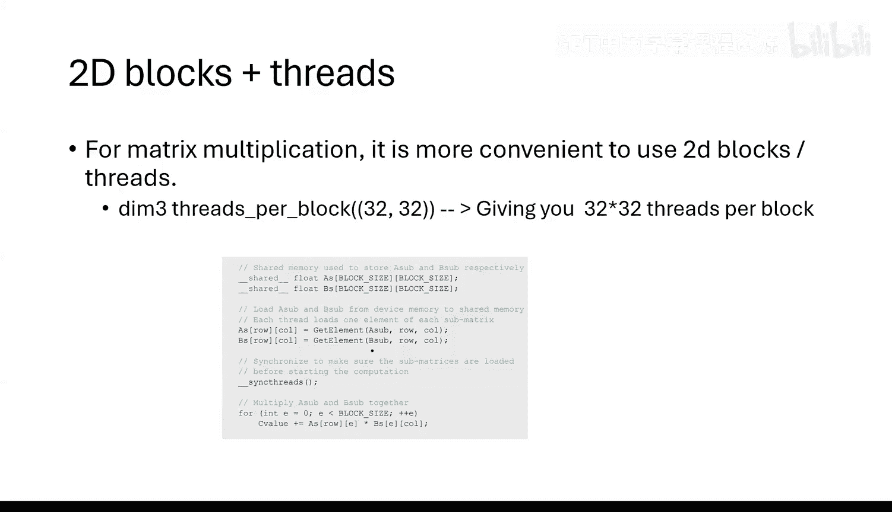

# CMU《生成式AI｜10-423 generative ai 2024》中英字幕 - P27：-P27-Lecture 24-cuda_programing.zh_en - GPT中英字幕课程资源 - BV1CyC9BPEhG

Okay， hello， everyone。 Let's start today's lecture。

 Thank you very much for coming to today's lecture。 And today， we will have a complete movie lecture。

 Okay， and this topic is quite difficult， but I think it's。😊。

It doesn't make sense if you attend a generative AI lecture and you still don't know how to do ka programming。

 Okay， so this is really， really important in the sense that。I mean。

 you have to know could that language programming。 if you want to train those large language models by yourself。

 not calling existing libraries， which you shouldn't。

 because all the good libraries are hidden or hidden secret in each company， right。

 open source ones are not that great。 So you need to write your own kind of could level code in order to speed up the computation。

 and kind of the good could level code versus the default， right you can' like 30% speed up。Okay。

 if you optimize everything， which is really， really significant。Hey， so， I mean。等说你来一个。I mean。

 each company has their own tourist of the Pu and of kernel for their own language models。

 And this lecture， we will try to have a。Basic understanding。 very。

 very basic understanding of what good programming look like。

 and why do we need to do some good programming for our model。 in particular。

 in the flash attention lecture， right， I said you have to do those operations in blocks。

 And in this lecture， you will try to learn why， I mean， we choose to do those operations in blocks。

 Okay， so if you still record there's a stupid flash attention implementation V3。

 which just goes use a full loop。 right， But the real flash attention， use a block wide structure。

 So it compute the softm within a block and then use a full loop to go through all the blocks。😊，Okay。

 so why do they not really just use a for loop。 And this is related to the ka level programming。

 Okay， and kind of you need to understand that and。More importantly， for example。

 if you want to join company you like Po A or Anthic。They are writing everything from scratch。

 They are not calling Py to code。So Pytorch is a convenient tool。

 because Pytorch actually has a lot of kudar kernels that are hidden。 Okay。

 The Pytorch has its own matrix modification， Kudar kernel that is hidden to you。

 you just call matrix modification and believe that it will work。

 But in behind that is actually the pitorch kuda kernel for matrix modificationplication。

 But if you want to write piytorch from scratch， which actually all the big company do。😊。

So they need to do。 you need to write the kudar Er from scratch as well。Okay。

 and you may wonder why do okay， I write P watch code from scratch。

 Are they stupid or are they crazy， Are they having too much time or too much money。 Well。

 the reason it's necessary， okay。😊，Because itwach is by design。

 not suitable for large language model training。 And I'm going to tell you the secret。 Why is that。😊。

Okay， so far。他你 very色长。So this is our GPU， right？They same。With very high probability。

 it looks like a normal GPU。But there is a very low probability event for every GPU that it will go crazy。

😊，Okay， so with probability， I think it's something like， I mean， over 100 k or something like that。

 or maybe even longer with this probability。😊，The GPU computation will actually go crazy。

 That's the hardware issue。 Okay， you cannot fix it。This is just what GPO looks like。Okay。

 and this probability， the GPU will go crazy and when it go crazy。

 it will actually not throw an arrow。😊， you may see that in the old GPO， there's ECC arrow。

 but this is not this type of  error。 It's not undetectable arrow。 It just goes crazy。Okay。

 so with this probability， it goes crazy。And for a standard， like a data parallel job was or anyway。

 like those small language model training。😊，This is a ne probability。 I mean， if your 1 G goes crazy。

 your some， the gradient for that particular data goes crazy。

 but it's just a very small probability event。 and you have Adam， you have normalized gradient。

 you have gradient click。 So if it goes crazy， you just introduce some a little bit of error， right。

😊，That's neible。把儿子。What would happen if you have a very， very large model。😡，Okay。

 so let's say your model is so large。 just to say， let' say your model is 10 trillion parameters。

 which is likely the size of P 5。 Okay， so if your model has like 10 trillion parameters。

 you have to use even like thousands of GPs to store your model。😊。

Right so now you have all those keys。Maybe you have 1 k of the GPUs just to start the model or maybe you have 2 K GPUs to do all those parallelization computation。

Okay， so they have communication。Between them and all this like 10k GPO group。

 they compute a single forward of this 10 trillion parameter model。

And now what would happen if each GPU has this probability to give you an error？😡。

Then you have probably very response to have a hero， right？😡，Because each probability each GPU。

 each computation has a low probability to have anarrow， but as long as your single GPU has anarrow。

 you just propagate through the entire network and just this forward pass is that。😊，So standard GPU。

 actually， you cannot sell to 10 trillion permeter model， no matter how are you try。

 no matter what parallel you try， If you use Py if we just use so standard communication。😊，You can't。

 This is just impossible。 Okay， It's not like you write smart codes。 Then you write a very。

 very good communication protocol。 You write all those that pipeline parallelization。

 expert parallellyization perfectly。😊，They scale to 10 tri just not possible because the GPU has this intrinsic error rate。

This is unaoidable。 Okay， hardware you unless you， unless you buy。

And as you buy the entire media and then build your own hardware from scratch。

 this thing is just unavoidable。😊，诶。😊，So what op does。Is the following okay。

 for every matrix multiplication operation。I他X。This thing is actually computed twice。 Okay。

 in the open eye pipeline。So they actually create some repeat car of the model。

And this the same operation is actually computed twice on different GPUs for every this operation。😊。

诶。And then they will check if the two operation actually agrees with his father。😊，Okay。

 this reduces the error rate from10 100 k to this squared。Right？Because。

If one of that thing has an arrow， then these two things doesn't agree with each other and the probability that these two things has agree with each other and they have an arrow。

 I mean， it's even smaller than this， right， because if it's an arrow probably a randomarrow。

 so it's very unlikely that if both of them have  error and they agree with each other。

 it's almost negible。😊，So they implement this pipeline， which is inherently not pipe， right， for Pi。

 you compute the forward one and you compute the backward once。😊，In their pipeline。

 they actually compute forward twice and compute the backward twice。诶。😊。

And they need to do this altogether operation in this forward past。

 They need to track what's the correct replica。 So it's a very， very complicated code。😊，Okay。

 but that's necessary。Sorry me， yes。😡，Now just keep re compute， Okay。

 just how the progress there and keep re compute。Okay so yeah。

 you need to deal with a lot of synchronization and that's why they need to write their own Qa code to make sure that the recomputation doesn't block other things。

 so it's very very complicated pipeline， but if you go to 10 trillion parameter model that's the only thing you can do okay this compute twice is a must。

😊，And so that's why they don't use Py tools If you don't use Pytor。

 you have to write your kar kernel and open I write their own ka kernel。 okay for every operations。😊。

Okay， so， I mean， that's why I think it's very。 I mean。

 if you want to join open if you want to understand their code。

 you have to understand what could our programming look like， otherwise。

 you can't even read the code。😊，诶。😊，So that's why in this lecture we will give you a brief overview of what QDa programming would look like okay。

 and hopefully you will understand something。 of course its only scratch the surface。

 the real Ka programming is much， much more complicated than that。😊，Okay。😊。

So now what is a Quda or what is QUa programming Well。

 Qa programming is just a short thing of programming in Quda using CC plus plus。Okay。😊。

We need to program on the following architecture， which is a pua code。Okay。

 so Q core is something that looks like this。😊，So at this level， at the lowest level。

 you have spread。each thread is a very tiny thing。Almost like a register in in the CPU。Okay。😊。

And for each thread， for all those threads， they are actually grouped into a plot。😊。

Okay and block further group into grade and grade the entire grade is one kind of Huda。😊，诶。😊。

And one could I call typically， as like maybe 10 threads separated into different blocks。Okay。

 so why do we care about this structure It's really because of the memory structure。

 It's not about computation structure。 It's more about the memory structure。 Okay。

 so for all the thread in a particular blog， they actually have a shared memory。

 which is called L2 cache。😊，Okay， so the L2 cache is a very small amount of memory and its shared across all the threads in the blog。

 and it's much， much faster than the than the so called V run， which is a GPU memory。😊，ok。

So does any thissis or GPU？And then there is like a pencil。I mean。

 GPU has a lot of different tensor calls。 I mean each tensor course， theres some。The lot of loglogs。

Okay。😊，So this is like a thread block。7。And for each block。

 there is some shared memory attached to this block， which is called Iri。😊，诶。😊。

And the GPU has its own memory here， which is V run。😊，And this rerun is like APTga。

This ice round is very small， typically likes。关电美打牌。Okay， but there are a lot of ice run。

 There's one ice run for each block。Okay， and if you just assess a memory in this particular S Ram。

 then very fast， it's much faster compared to access memory from the V Ram。😊，Okay。

 so basically I survive。It's roughly like pen。Pasor。Then there's zero。 and for Ka lot programming。

 you mostly care about the memory movement。 That's the soest part in Ka programming。 I mean。

 the floating point computation， they are very fast。😊，Hey， the memory movement is the slowless part。

 especially if you want to read something from we。 So basically， that's what you need to look for。

 if you want to do ka level programming。😊，哎。😊，Any questions。Yes。😊，嗯。4 or1 grade4 I mean。

 depending on the architecture， but。I mean usually like there are multiple grade pers or terms cores are also studied in multiple grade。

 but there are also architecture where there is only one grade。

 but the grade level we really don't tell about I mean even if it's one grade per between different cross anyway there's no shared memory so the architecture isn't that important。

 the more important thing is the block structure which has a shared memory。😊，So it is just like。

Pth thread memory and then SRAM and then straight to V Ram right so Per thread it has very little memory is like there's some register associated with each thread。

 but the register is not really like memory more like the actual register in CPU so you can't really use it in memory so the slide memory is really this SRAM。

😊，O。So we have this architecture and how do we actually program in this architecture。

 now the main kind of。The main thing for programming like a cool and local is just to use the ice Ram as much as possible。

 That's the only criteria you need to follow。But that's a very， very hard criteria to optimize。诶y。😊。

Any questions。Okay， but before going through that， we kind of first look at the so called basic impacts of cooling。

诶 quota is C。Okay， so basically for C code， you may not be very familiar with C code， but anyway。

 it looks like Python is just 100 times more ugly。 Okay， so basically。

 you have kernel function declaration at the beginning， which is there's a domain。来个 domain could be。

I mean， the domain would be like it in device， or it's just ice for。I mean。

 it could be like it's V Ram domain or its as Ram domain。

 That's basically where the computation is or many located at。😊，And then the return time。

 it doesn't matter usually is empty。 And then there's a kernel function of some input and some operation。

 Okay， so this is basically the goodda kernel。😊，Okay。

 and then there is a function that actually calls the kernel。

 And this is a function that you will be attached to your pitorch code。 Okay， for example。

 P to matrix modificationn， it actually calls this alter function， which。😊，IntercC孤达 kernel。Okay。

 so basically the overall structure look like this， so you'll have， for example。

 if you want to implement on matrix this modification， you have this mud kernel。😊，He。

 which does something。 And then you have this mate。😊，Much function。

 which also takes some input that is going to call the main mag kernel。Using these synax。Okay。

 so we will to talk about what are those？哎。So how do you think about a kernel。

 a kernel is actually an operation that operates the on each thread block or on each thread separately。

Okay， so a kernel is the operation that are on the threat level。 So basically。

I should still write those thread。So a kernel is actually an operation on here。Hey。

So what two a column mean is basically just an operation on each thread。Okay。

 so that's how you should think about Kak kernel。And then you have an alter function which tries to use the operation on each thread to compute the actual output。

 which is matrix byplication。😊，Hey。😊，And then you have this syntax， which is a number of block。

 number of thread。 This means how many blockss and how many thread you will use。To compute。

 I mean to apply this kernel function you to get the final output。诶。😊，So these are all very abstract。

 but then let's just walk through some examples for you to understand what's going on here。😊，嗯。Okay的。

不能。嗯。😊，Okay， so let's just look at the sst function， which is vector addition。

 so vector addition kernel， your input is A and B， and you want to insert it into C。 A。

 and this is C code。 So they are actually pointers so you can actually directly modify them。

 They are not like Python， where everything is protected。😊，Okay。

 so we can directly notify C inside the function， even if C is that an input to the function。😊，诶。

 so vital addition just means for every element in A and B And you just add them and store the output to C。

😊，Okay。😊，So you can just write。 I mean， you can write this sea code， as in the Ka kernel。😊，Hey。

 let's just say we write this C code， which is this volume。😊，I mean。

 we have this whatever addition kernel。Which takess a input， which is the flaws。This is a float rate。

 right， for CC types， this， you can think of it as a array。

 This is a pointer for the beginning of the float rate。😊，Okay， and then you have another floatterary。

And father blown away。嗯。Hey， and then you just go through。

 maybe you need to take another N as an input。 Okay， because for see。

 you cannot really determine the length of the flow that rain。 There is no such thing。😊，哎。😊，啊。

And then you'll just put AI。BBI。You are sign to see us。

 you don't need to return anything because these are pointers。 So you directly modify the memory。

 So this is your kernel。 This is like some sea hold。

 And how do you actually use it in the so called addition function。😊，Hey。😊。

So you have this add function， which also has this ABC， right？

And one way to call the add function is just a bull。So you'll kind all。So first of all。

 you need to create the thread and the blog。So you need to create。 this is a three dimension stuff。

Okay， and youll need to create your grade。So maybe you only use one brief。嗯。And also。

 you'll need to create your blog。I mean， these are not the I typess， but。😊。

These are just trying to tell the ka or trying to tell the ka like how many grade and how many blockss they will use to compute the addition。

Yes， is that like blocks per grid or is that total blocks these are block per grade。

 these are total grade。Okay， so every every grade has the same block。 And this is a block per grid。😊。

哎。And I mean， this is not the actual syntax just to give you some idea。

 And then you can call this a kernel。😊，诶。😊，With one and one， and then ABC。诶y。😊。

So what does this code mean？This code means you will only use one grid。 I mean， this is。

 so you will only use one grid。Or， I mean， you're only using one grade， which is this 1，1，1。

 and you only use  one block， which is specified by 1，1，1。 So basically。

 and here you are only using one thread。 This is a number block， which is one block。

 and you're only using one thread to compute this function。 So basically， in your entire food that。

 He， there is all those things。 But then you are only picking one block and one thread。

 So you're only using this very tiny unit to compute the addition。😊，Okay， so this just near the。

I mean， the algorithm once it sees this work or see this code。

 you to actually only pick a very tiny unit， which is one thread to compute the addition function。

 So it needs to go through the four loops。😊，睇。😊，Which is very slow， right， So Qudai is so large。

And your code only uses one thread。Okay， because of your synax。

 this is the number of block you will use。 This is a thread， a block you will use。

 So you only use one block， and you only use one thread。Okay， so this code after X using rule here。

 it will put the computation into one thread。😊，诶。😊，Yes。the era。Yes said。I mean。

 we haven't really got into that part yet。系。😊，So basically。

 in if you just write the code in this way， it will be in the V run。

 It will directly below from VM and updating V run。Okay。

 so we haven't really got to the HM part here。Okay， but any question about this very。

 very basic example。 I mean， you did nothing but just create one thread。

 and just put the computation here。 So it's very， very slow。

 If your writer has a dimension 1 million， then it has to。😊。

Do the operation on this particular slide for 1 million ms， which is super slow。Hey。😊。

So now how do you do， how do you do actually。诶。😊，So we can actually update the code so that we actually use more thread。

Okay， so maybe we shouldn't really put one here。 Maybe we should put 1000 here。诶。😊。

But if we put 1000 here。I mean， if put 1000 here， then。How do you爱你。Like。

 how do you even call this function， right。How do we know that I mean this particular tunnel or this particular line will create one0 thread to compute the addition？

😊，But how does this function know like how to distribute the computation across different thread？

Right， so seeing of us you have well input， which is AC。😊，So the naive implementation。

 which uses one and one， okay， so it just has like one thread that go through this thing and then。😊。

Go through the other thing and then go through the other thing。Now， if I want to use a folder right。

😡，Okay， so if I want to use a thousand thread to do the parallel computation。

 I want to use the entire that Co， right， I don't want to just use one thread and do four roof。

 But then what's the correct syn that I tell you。😊，I mean， I。So now I have those10， right。

If I just use this naive code， then what would happen？

What would happen is each thread will still the100 compute the entire edition。

 and you just repeat 1000 types。😊，系。😊，It's not going to work。😡，I mean， the that， I mean。

 this is C code， right， It's not like Tython， where there's some magic high hidden behind the code。

 What you wrote is what the program will execute。 I mean， that's a good thing about C。😊，Okay。

 if you didn't really want somewhere to distribute the computation。

 then there's nothing hidden that will distribute the computation for you。😡，Okay。

 so that's a good thing for C and also a bad thing for C for beginners。😊。

And what you want is what you what will actually be executed。 So if you put the 1000 here。

 then this particular code will just be executed 1000 times or right。😊，He， sorry， sorry。

 just will be exed 1000 times each for one thread， which means there are all those threads that are all doing this particular operations and is repetitive。

 Okay， so each coordinate of the vector is actually being added like 1000 times and stored into seat。

😊，Okay， so it's completely repetitive， the code is still correct， but it's not going to be faster。😊。

哎。😊，So the important step to do much thread through that programming is actually minimize this line。

 So it aware which thread it is in。Okay， so in particular， we want the first thread to only compute。

 for example， the coordinate that I more， I mean， maybe I have 1000 thread。😊，Right。

 so I love fried light。We do like。A zero。And a maybe 1000。And maybe a two招人。Hey， an excited one。

Right， I want slide one to only add a 0 and E0 and a 1000 and B 1000 and A 2000 and B 2000。

 And then I want slide2。To deal with a one and a 1000 and one etca。 right。

 I want to distribute my computation。 So the first right does see whatever the four that are more 0 that are equal to0 more to 1000 than the second right does the computation that are more equal to one more 1000 and etca。

😊，Okay。So then how do I actually write the code？Now it turns out that the code is kind of simple。He。

So it tells， I mean， it turns out that for a cool programming， even if you don't pass there's like。

I mean， there's like a kind of like a internal variable。

 which is called thread ID and block dimension。😊，And there's also a variable called block I D and block grade dimension。

 but we are not really use those things yet。 Okay， but you can actually use this variable。

 You don't really need to pass them as input。 It's just by default building in into this particular kernel function。

 okay。So basically what type is。You can actually retrieve the thread I D from that thread I D dot X。

 and you can actually retrieve the block dimension。

 which is a total number of threads from the block dimension dot X。😊，Okay。

 and then you can actually write the kernel。Which depend on the thread I D and depend on the block dimension。

哎，嗯。So you can see the full loop right in the full loop。

 the starting one is the index and the square is the block dimension x， which is a number of thread。

😊，So basically thread the starting。😡，I is the threat I D。

 So the first thread will start from or the zero thread will start from 0。

 and the first thread will start from one， and the second thread will start from 2。

 And the straight is actually equal to the block dimension， which is a total number of thread。

 So we have no overlap。😊，哎。😊，So basically thrive one will deal with， I mean， basically。

 you upgrade your an object addition to。😊，Okay， so slide one will only take care of both things。Okay。

 and thread two will take care of those things。He， and that's right threes。Okay。

 so this is thread one， this is X thread3。Okay， so slide one will only take care of the addition of those coordinatelate and slide two will take care of the addition of those coordinatelate and slide three will take care of the addition of those coordinateor。

诶。😊，So， yes。But it's or be like no you can specify the number of thread it depends on the architecture。

 which is how many thread are there in each particular block。诶。😊，And for example， for H 100 GPU。

 I think it's something like 1536， something like that。

 So that's the maximum number of spread you can specify per block。

 but you don't really need to use everything。 You can use some fraction of it。

 but then the computer will be wasted。😊，Because the other program cannot really collect a fractional thread from each block。

So it's better。 that's why it's better to write your， I mean。

 so that's why if the transformer dimension is in certain dimension is fastest because it's compatible with gooda。

 you're actually maximizing the thread。😊，Yes， but so in like normal C code if you were to like add some stride constant to eye you'd be accessing memory that's like not sequential and that oftentimes is like really terrible for stuff like cash locality like voting memory these same principles apply to kudo or all of these on like the same S Rach No so without you code cash if you're want in there's no flash。

So basically say， those variables are directly read from memory from the me run。😊。

He and then direct store in the Van。 there's no like locality in Van。

even if you do like non consecutive read and write， it doesn't really matter。So for C。

 it's really because of cashing， it's really pre fetch。 And that's why it's， it's， I mean， slower。

 if it's non consecutive。 It's trying to guess。 But here， there's no pre fetch。

 What you role is what the program will execute for level programming， that's a good thing。

 You have full control over the cash。😊，Yes。😊，Or different mus or machine clusterers with different bras in the total。

I mean， the the thread， the index and the thread will be different for different。

 sorry the index will be different for different thread。

And the thread are shared for different threads because they， they have a block dimension and dot X。

 which are the same for every thread。 So the only difference is the index。😊。

That's why each thread will actually execute on different coordinate of the input vectors。😊。

Right all these way that you want you can still use this but just a total landmarks right。

 for example if your machine doesn't really have that many thread a block。

 then you can't really use this number， it will just throw away throw some error or some execution will not success。

So that's why if you read the actual could I code， I need always always a lot of config files。

 which says this architecture will use this particular number of thread number of block and this architecture you will use something else。

😊，So basically， that's， I mean， that's a difficult。

 or that's a difficulty of writing like General Kak hold that you need to support all those different architectures。

 But that's also the benefit of why startups are so powerful because they only support their own model。

 right， theyre not writing like a Pitorch library that support everything。 So obviously。

 the library are going to be much faster than Pi to， because they don't need to support everything。

 All those magic numbers are actually hardcodeed。😊，So if you look at overhead eye code。

 well you can't， But I can tell you， there's a lot of assertion in the code where the model has to have that particular hidden dimension。

 Otherwise， the you can't even define the model。 So they have lot of assertion check to make sure that your definition actually compatible with the cool that code that only support this particular size。

 because they only have one model， right， that's why start codes are much faster。😊，Yes。😊。

This block mention or can you for example， if you have a really large computation can you also organize communication between the blocks yeah that's what we will talk about later you can use I mean here you only use one block but then there are ways to use multiple blocks。

Because the number of slide in each block is really limited。But you want to be fully parallel。 right。

 For example， you have a very， very large computation。 if the addition is extremely large。😊。

RightI mean here you'll still do four loops， you still have the four loop that the slide is basically the number of thread。

That's because you only use one block， but the upgrade or an ultimate version of this code would be will use all those blocks。

And you just use that， I mean， then there's no flow， right。

 you just distribute the entire addition across all those blockss。诶。😊，Yes。

 question like as different operations are being put in and out of different blocks。

 I'm assuming there's like some threads that are maybe completed or called multiple different blocks like are these threads collected anyway or I guess how you like official also not like having too much communication blocks Yeah。

 I mean that's why you need to write this alter water function right this usually after this line you will call something called thread or sink something like that this will actually sync the thread that are all the thread that are used in this operation。

嘿。So basically make sure that the this function will return only when all the thread in this operation are finished。

Yes， please explain the dimensions of the block image。Oh the three dimension。

 usually you don't really need to use all three， but this is like just a convenient。So basically。

 this is just for convenience。 You can view it as one dimension。But some。

 but because quoar kernels are basically specified for matrix modification or mostly doing like matrix or tensor level mag。

 So having a three dimension block or three dimension thread or whatever is kind of like more convenient。

😊，Well you can just。You can just write it in one dimension and you reconstruct the 3D structure in your code。

ok。😊，I mean， maybe it's too abstract but lets think about inside of vector edition。

 I want to do Netflix edition。Right。Then for vector addition。

 I have some thread that depend on block X， but then for matrix addition。

 maybe it's better to spot like 32 thread along this dimension and 32 thread along this dimension。😊。

Right， then I will have that instead of I have thread I D dot X， I will have spread I D dot X and y。

And then， there's the。B dimension of X inside of that， I will have block dimension of X and y。

 and instead of having block dimension to56， I will have like 32，32 one here。😊，Okay。

 so but but you can do the same thing just by spaing like a 1024 one， one block。

 but then you have to reconstruct those Is。😊，So this is just for like visualization purpose。

 The three dimension really doesn't do anything just for understanding and visualization purpose。😊。

Hey， yes。What's the S doing this there's no ice yet is this thing doesn't really assess the ice。

 it does everything on the me rampm。Yes。But。Are they' really like doing like a lot of things from scratch or are these figuring out like what like stride and what block dimension makes the most sense for like these like for this model architecture are these kind of just changing these numbers mostly yeah no see changing those numbers it like。

The so called cut plus template from pen media， which is basically a template of writing all those ha functions。

 And what they do is really just changing the numbers in the template。 Well。

 they still create some new template， for example， if you want to change。I mean。

 there's like the so called fields kernels， which I will talk about later。 But if you want to。

 for example，fuse some operation together， you need to write your own code。Yeah。

 so get to but maybe it's a good good time to talk about fuel kernels or why this。😊，Yeah。

 maybe we should talk about fuel kernelel later。 This is when， I mean。

We should just finish the thread and blockss。Okay。😊，Serverly， I mean。

You can use thread plus blockss because there are a maximum number of threads that you can specify。

 Okay， and you can use this code that specified the thread as this thing and starting position as this thing。

 And then you can actually sp like 500456 thread。😊，And you spawn 123 blocks。Okay。

 so basically this particle go the code uses like。Whatever in total 1，23 lotss。Hey。

And inside each block， they actually use four or five， six minute risk。Oh。Okay。😊，And then you just。

Wooing disable computation， which means。So this is your writer， right， This is like。Basically呃。So。

 this one belongs to。I would say block zero。Right at the earth。And they in Po block  zero。Sread one。

And then this thing belong to block 0，3，2， and etca。 And then your star is block one。😊。

Rightride zero。Ex cetera。Okay， so kind of fully parallel the computation across threads and across blocks。

😊，诶。😊，Yes。😊，Pick companies they have everything card codeed。

 but how does quite or with the well the size of the alignment vary and what if it's more than 123 times 45 yes。

 and for example if for matrix I mean。I mean， these things are， so these things are like conflictfis。

 They are actually depending on your particular GPU。 So for P。

 the clue icon home has like those config files， which says if it's like a100 then use this particular config file。

 and then they read those numbers from the config。😊，As you can see this finding color code。

 you can add arbitrarybit3 large vectors。😊，Right， please just use 123 blocks and 456 threads in order to do the addition。

 So those numbers are hardware dependent， but this function can be applied to writer addition of any size。

😊，He，Of course， I'm exploring some details in the functions So they also have， I mean。

 the IVIP your writers are shorter than like 123 times456。

 Then they have some maskings to make sure that you don't really access the invalid memory。

 So something like that， but。😊，This thing really just can do any vector addition。

 but you can see its a fastest。 if you have this type of structure。

 then it fastest if your vector is a multiple of126，3 times 4 56。😊，Right， otherwise。

 you'll have some like fresh fragments that are wasted。Yeah， that's why you， I mean。

 that's the reason why you would heard about like， for example。

 you need the matrix would be certain size right on you need a batch size would be certain size then it's faster really rooted in here because the thread blocks are spaing that way。

 And if you' are not that size， you have some baing。😊，嗯。Hey， any questions？太裤。

So this is basically in addition， this doesn't really use ice for。😊。

So when do we actually want to use I Ram， now we will go to the next very famous example。

 which is matrix multiplication。Okay， so this is the this is actually the mephone code for matrix modificationplication or the NVDR default matrix magplication kernel。

😊，So， I mean， or some fraction of it。So basically let me explain what's happened if you want to do matrix modification。

😊，哎。😊，那能。嗯。So let's say you want to multiply this two matrix。And you want to do it in parallel。

 right， you want to do it in thread blocks， in threads and in blockss。Okay。😊，So one。

 so how do I parallel out the computation。Now， what night is， I will just， I mean。Maybe。

 so maybe I will just放 like。诶。What is the most naive way let me。Okay， so maybe I spell like 32。

32 thread along this dimension and then 32 thread along this dimension。😊，嘿。😊。

So then each red will just do some， I mean， or the first red will just do matrix by of this particular row and this particular column。

😊，Okay， so basically any are。I have S I D， which is I and J， right， So the thread I D。

 I will do matrix verification for。😊，So basically， youre thread。I amJ he。

So I want to do matrix modification for role。That is， maybe。I would say。嗯。And armss。sorry，我老嗯。

And column M。Suchsh that。是。开嗯。More32以及构图 I andM more 32。It's equal to J。哎。😊。

So this is kind of like the90 implementation。 Let's just assume we have one block because the block structure is not very important。

 It's only the thread structure that has the I is important。😊，So if we have one block。

 then for this particular block， I can spell like 32 thread。 I'm 32 thread。

 So basically a total 1026 thread and the thread I D are I and J where I from 0 to 30。😊。

1 and J from0 to 31。 And for each of the threads with I V I and J。

 I can actually do row and column myplication。😊，Of the n throw and M's column where n is equal to 32 orN is equal to I more 32。

 and M is equal to j more 32。Okay， so basically， really， you're just speaking this particular column。

😊，And this particular wrong。Oh。A for the I N threat。 So basically。

You're doing all those modifications。Yes。Oh。ok。Any questions？太酷。什么。Let's look at this。

 So if you want to write it as a full loop， then it's just like this right for I for like row。😊。

ID is equal to high and role I D smaller than something and role I D。Plus is equal to 32。Okay， and4。

超人。ID is equal to J and whatever plus equal to 32。 And then youll do this row and column modification。

 which is for。😊，Like R is equal to0 and R。Smaller than something and our fast class， right？

 And then you have the。Value， which is equal to plus is equal to。Row of the row I D， sorry。

A of the role I D。And our。And times the B of whatever。呃。R and column my。诶，这上进来的。Right。

 this is like your for。And if you write it in this way， right， there's small I run code。

 so I'm directlying radio everything from memory。😊，So what's the problem of this code。

 is's really because let's think about this for loop， it goes through a older row right。

 and then for each column， this means for this particular column。

 you're actually multiing it with a lot of deeper roles。

So it would be better if you actually load this column in memory first。

 right then you don't need to read from V1。😊，So you first load this column into asran。

And then you don't really need to load the column from SM anymore。

 each time you only need to load the row from SM and multi with the column。诶い。😊，Any questions。

So that's basically one naive use of H Ram is really just saving some load from V run because if you don't write anything like every time when you have this this like whatever A row and B column。

 it actually loads this particular entry from the V run really from V run directly。

 which is very slow。😊，So if you load the column into I run。Then at least for the column rate。

 you don't really need to read from the bur anymore。 So it's kind of like faster。

 but it's not by too much because the role， you still need to load from the。利润。

Right you can not read load all the roles from the V run to the I。 that's just too much。

 You can only load one row。Or maybe you can't even read load one row。

 You can only load like fresh of the rows。 So basically here you need to implement some memory allocation regime。

 maybe you first load the first half of the column and then do all those computationmplication。

 and then you load the second half of the column。😊，But I mean。

 you can see this naive implementation saved something， but it's not really very great。😡，Okay。😊。

So what is a smarter implementation written there？😡，That space kind of like similar to。R attention哎。

So basically。Psally， the actual matrix modification and implementation that a following thing。

 So instead of。😊，I mean， instead of having the， So instead of having the kind of。

each row and each column， it actually group the row and column into chunks。Okay。

So we do matrix modificationification of this particular I mean。

 this particular sub matrix with this particular sub matrix。😊，Okay。Any questions？

So what is this particle sub matrix might applied by this particle sub matrix， well it's equal to。

Basically， if you chunk the matrix simple squares， right。

 it's equal to the first square multi by the first square and the second square modified by second square at first square multi by third square and four square multi by four square。

😊，I never see immediately， right， why this is good， is because。

This is a full loop and you can actually load this square into I run and you load this square from in I run and you can compute the matrix magnification of this thing and this thing only by reading from IRA。

😊，Okay， so that is what these re are doing it actually creates this very。

 I mean this it actually creates this shared memory， which is this line of code。😊，Okay。

 so it tried to create a shared memory of this thing and this thing。😊。

And then you can see this idea directly is assessing the shared memory。

 it's not that sizing the original matrix anymore。😊，睇。So basically this。

A and B are the original matrix。 And you can think of A and B as the original or A sub B sub original matrix。

And AIS and Bs are a shared memory version。 So basically。

 you first load the role and corresponding role group and column group into the shared memory。

 and then you can just do the computation inside the shared memory， which is very， very fast。😊，嘿。😊。

I mean think about it right so this matrix is actually let's say this matrix is B by B so no so if I do directly do the computation without loading from share memory。

 then I have BQs grid。😊，This is without。Load in into a shower memory。They have from V S。Right。

 if I want to compute the B by B matrix， modified by B by B matrix， if you write it in full loop。

 there's B cube rate from the VM。Because the matrix computation time is beQ。

 and every time they you want to compute a new element you have to create from the V。😊。

So without learning to share memory there be too great from the brand。

I learned him from Sharon memory。There's squirreing。嗯。Right。Or2 B square root， something like that。

 So you'll need to read this matrix will share memory， which is B square rate。

 and then you'll need to read this matrix to B square will share memory， which is B square rate。

 But after that， the computation is inside， share memory。 So it's very fast。😊。

 so this is how you use shared memories， essentially when you do matrix magnification or you have rep computation。

 it's better to load things to shared memory and just do computation around that and then you clear the shared memory and load everything into the shared memory and do computation on that。

😊，诶。Any questions？So， I mean。This is just a theory。 You can actually write the code with those。So is。

 I mean， it's not that hard to write。 It's just sea code。

 So you need to compute the correct block I D。 but overall， it's not that hard to write。 Okay。

 and that's how the default implementation of matrix modification in P toch。Okay。

 you use as a shared memory。And also， you can see those things has to be like a block。

 or those things is better to be a block that feeds。😊，Just inside the sharp manway。Right for H100。

 the， I mean， for H100 the。Ot number of thread is like one。I think it's 1001532。

 which corresponding to something like 48 by 48 each or not really like 36 by 36 or something like that size matrix。

😊，Take。😊，So it's better this directly fit into the shared memory or。Sorry， yes。 So basically。

 it's better that this particular size of matrix just feed the entire share memory。

 That's basically the fastest computation you can do。 or that's the。😊，I mean， that's an ideal thing。

 But the shared memory size depend on the architecture。

 So you have to rely on configure file to specify those things based on what is your architecture。

Okay， and it's better to make sure that your mates are multiple of that。

So we can see all those complicated dependencies。So that's why it's better。

To work on one particular architecture on one particular GPU。Okay。

 that's when you can actually optimize everything。But if still want your algorithm to be general。

 then it's very hard to be optimal everywhere。嗯。睇。😊，Any questions。Yes。😊。

Talk about distributed training One of the big reasons for doing that was that like the VRAM on a single GPU is a bottleneck right Yeah。

 but if we are pulling stuff from VRAM to SRAM anyways when we're performing computations。

 why can't we just use like system RA and have a really live model on a single GPU Yeah so pulling from VRA to ice takes some speed。

 but pulling from C1 to ice cream is like what I times slower than that。

So you cannot really afford anything on the system， run its just do。But I mean。

 there's all those shard optimization that we learned， right。

 Those are essentially offloading the model ways into CPU。

 So sometimes you do do exchange from we run to CPU， the system run。

 which is much larger to in order to compute in order to optimize larger models。 In particular。

 I believe man and the Lama model was optimize mainly using FSDP。😊，谁记得读mod2，然后为持。

This why their models are probably not scaling up yet。 Okay， so they there are some things like that。

Hey， any questions。不。Hey， so basically overall you can see but to programming。

 although sometimes is serious So it's kind of like basically complicated。 I'm hiding many things。

 for example， when you allocate the memory， you have to call the so called memory law cooperation。

 And after that， you have to call memory free， which are nuly。😊，The most happy operation in sea。

 right， Everyone want to avoid。 But if you want to write cool I cold， you't have to do that。😊。

But you get this high level spirit。Which is you want to， basically。

 if there's some repetitive computation， you want to put it in the I run and also you want to spa different blocks or spa as many blocks as possible。

 Sp as many thread as possible to do the parallel computation。😊。

But you also don't want it to be too parallel。 for example。

 if you just put each entry inside one particular b thread， then。

Each entry has no shared computation。 Then it's very hard to allocate the V Ram or next Ram to be kind of optimal。

😊，Yeses。😊，You can see this line， right， it's called S breath It's kind of like to tell every thread that are executing this function as to wait here or every thread that are founded in the same block has to wait here。

😊，So there are some synchronization， But people don't tell you to synchronize and it won't synchronize。

 So maybe some threat failed and you didn't write synchronization then the entire algorithm will still。

Go sound and you get some arrow that are undetectable。

So that's also a reason why ka programming is kind of complicated。Yes。

They sharing about like how do your tight。It's not optimizing the computation time。

 It's more optimizing the time used to assess the memory。 It is about a egg for ka programming。

 So the computation time of the floating point computation is very fast。 It's actually negable time。

 The most time in ka computation is assessing memories。😊，So here we want to minimize the one assess。

😡，To make the code much faster。 So that's basically the the primary goal of Qan program。

Even if you are doing that， the follow those challenges are dieback though。

But the flu read from Ice right you read AI and BI from Icr instead of reading it from VR。

 you just first read the entire matrix from VR and then the photo directly reads from the copy of this matrix in iceceRA。

😊，Hey， any other questions？北裤。什么。I mean。II didn't have this particular thing in the slice。

 but I think in the remaining 10 minutes， I'm going to talk about a very important good operation。

 which is calledfuse kernel。😊，I feel the kernelel is basically。I mean。

 it beside like the most important kernel in good operation。And what does F kernelnal mean。

Let's just consider this simple function， which is Ra。Of time time。嗯。Okay。

 this is particularly normal， very， very normal， right， and you can write it in high torch。

 what would happen。😡，Before this lecture， it doesn't seem to。Imaginable what would happen， but。

Let's just think about in the language of goodda kernel。What would happen。

 right did you write it in P torch， your first compute enzyme time sites。😡，And then you store this y。

 you store this y to V run。Right？You first compute M times X， and you store the Y to V1。

And then you access this from Iran to compute the value of one。Right。

 you store n times X to V Ram and then you compute you extract from V Ram and then compute rail。

 right， That's the overall flow。 And there is some like ice frame computation in this。

 But between this operation and rail operation， you first store this y into V Ram。

 and then you compute value。😊，Okay， had a clcious。So if you sterilize this operation。

 like why do I actually need a V here？It's， I mean， theres no real reason to have a V Ram， right。

 Think about M times X when you compute the M times X， each coordinate of X。

 if you write it really well， each coordinate of the output will first be stored in S Ram。

 and then you actually load it back to V Ram。😊，To get the why， and then you actually load it back to。

loadaded back again and computer re路。哎。😊，So basically， let me just write the computation graph。

Is that you have any handight？Right， let's just say you write it in spread blockss。

 So maybe theres some spread here。 Okay， and you compute this same times this same， maybe using some。

I run。 And then what happened is。This thing the output， which is this thing will be first in ice run。

And then you load it back to we软 to compute actual outputs。Yes。And then from this V1。

 you compute the value of this thing。😊，Okay， so basically。

 what happened is you have all those operationss， you first load to Vrun and then compute in IRAM and your output is in IR。

😊，But if you just write it in Pytorch， it will actually write everything back to VRA， right。

 write this one back to VRA and then compute the re。😊，So if I only carry about the final output。

 I should shortcut here， right， I should shortcut here to do the value here。啊。

I should do the writer on the ice Ram to avoid these two size of V run。😊，Okay。😊。

So this is calledfuse kernel。😡，It actually does a shortcut。

 so it does have some activation of whatever seen in the I run directly as shortcut to of VRA。😊，Okay。

 so these is actually much faster。 The fuels kernel is very important。 I mean not much faster。

 but give you like 10%，20% boost， which is very significant。😊，Okay。

So basically if you actually write the I mean K a kernel， most of them are actually fused kernels。

 just try to merge the computation together if they can。😊，To actually reduce the access of Iran。 And。

 I mean， that's why you can't really rely on Pytorch， right。

 The pieytorch is really outdated for large language models because but that's that's， I mean。

 but that is， that is not pietor sport。 Ptorch is designed for theoreticals。😊。

Right for for mathmatic。To write simple programming， but to be simple and general。

You can really shortcut to ice Ram But this code is super complicated。 This feels kernel。

 If you want to be simple at general， you have to use V Ram in all the middle layers。

 And that means you're slow。 It's just like Python code is simple and。😊，And easy to use。

 but it's usually much， much slower than CQL。And here is the same thing。

 If you use default pipe says， if you cannot really control the memory access。

 You cannot control the kernels and this guarantee to be slower than if you optimize everything in a level。

😊，Okay。Any questions？Yes。😊，这一个版。这当。How you白。No， the first kernel is the entire function， so there。

 for example， this signal will be called the Ra matrix modificationplication kernel。

 that's an entire function。😊，So the first kind of is that actually an entire function that computes。

😊，This operation entire operation results relying on the intermediate steps。So if you write pyth。

 there's no way to tell the p to compute this function right without st the intermediatemedia y into V right。

 That's just not possible。 The only way to do it is just write a kernel function called red room matrix mag that you do it in your in that one function。

 So the first kernel is one function solve the conagation of two kernels because here you have to access the ice If you are two kernel function you can share the ice or beyond like the single kernel function。

So that's basically thefuse kernel is a single kernel。

It's just a fuel means your fuel multiple operations in this kernel。

Okay， yes。So we have these like raper functions that make calls to specific kernels to do parallel operations。

 where are those raper calls calculated？Yeah， so pie torch has this library where you can actually override some computation by kernel。

 So basically， when you call torch the matrix multiply。

 it actually calls the kernel function associated with the matrix magn， which is this。😊，Whatever I'm。

 I'm not sure I still have it， but all sides function。Maybe I'm not having it now。

 but just in the earlier size。 there's like outside function。

 which is called the multiply function that calls all those sp those right blocks and calls the kernels。

 That is an entry point of the pi to matrix magn function。😊，I that Thank you。啊 know， I mean。

They it's basically just saying when you call to or matrix multiple。

 it actually just directly calls the ka function with the same argument。

 or there's some simple transformation code。 So there's like a pi toch library。

 which you can associate with each pi to functions with the corresponding kernel function。😊，Yeah。

 and after you do the association， it's just automatic。😊，Yeah， for example。

 you can associate this particular function called Rlu。I value of matrix times M。

 you can define like。Maybe I can call this torch a new。Not。Right。

 and I take I'm an X and output put this in。 and I associated a new matrix magification function with a fields kernel。

 Then the computation would be much faster compared to if you write it in like as a P to function。

 which compose the right one M times size。😊，Yes， so you need to write some。 You need to。俾色利。

Declre this same with a social kernel in the Pi watch， kernel extension。So that's pretty easy to do。

Yes。😊，What pair abstraction does like an open AI suite from Kuda is something higher level。

 is it at like the。Transformer law level， or is it at like the forward level level。

So their own replacement for Pitorch。So they still use Pitorch computation graph。

 but they replace all the forward and backward。For as impact because they need to do the competition twice。

😊，And then for each of the computation， for example， there's Ma magification or whatever。

 they replace everything by the associate kernel。😊，For example。

 flash attention for standard attention。 If you write it in P code。

 you have to do do product and then do the whatever。Sot max and do whatever。

 But flash attention is actually a flash attention kernel in the flash attention， implementation。

 The entire function is a flash attention kernel。😊。

So it replaces all those s matrix output products of mass and summation into one single kernel。

 and overhead it does a lot of that like every read their individual function is a kernel。😊。

And it's actually very difficult to do it because you have to。Kind of。

 having this is kernel function。 But then you have to do the like。Do those like parallellyization。

 right， all。 And you have to make sure that the kernel， because the kernel function here。

 you cannot do NCCL communication in your kernel。😊。

You have to group everything together in a single GPU。

 and then the kernel function only run on a single GPU。 So it's a kind of a complicated loop。

 Youll have to decide where to think and then where to apply your customized kernel。😊，诶。😊，Yeah。

 I think we are over time。 I guess that's all for today's lecture。 Hopefully。

 you get some idea of what could or when you look at。

 And you know the fresh attention implementation makes sense， right， You have to operate on blogs。😊。

又看到嘴里度 follow入。Directly。

