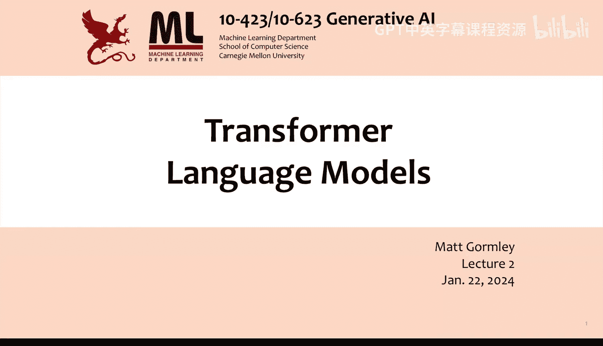
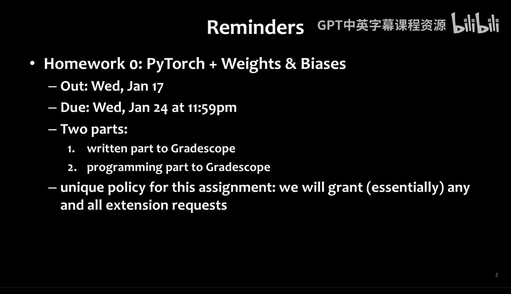
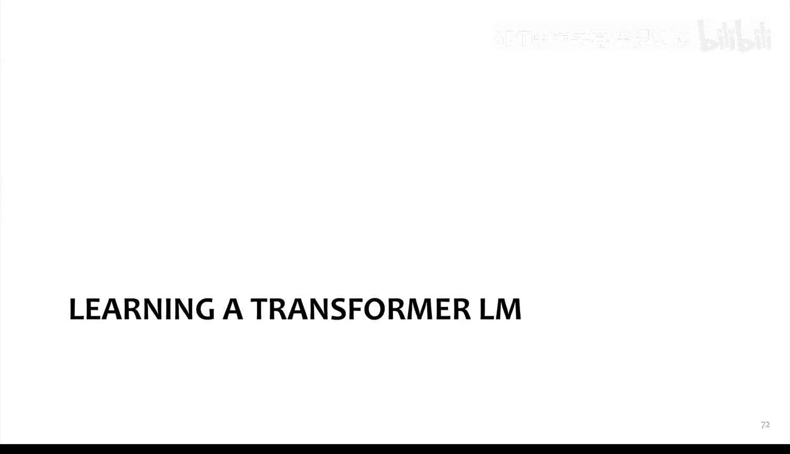

# CMU《生成式AI｜10-423 generative ai 2024》中英字幕 - P2：-P02-Lecture 02- Transformer Language Models.zh_en - GPT中英字幕课程资源 - BV1CyC9BPEhG

All right， good afternoon， everyone。Let's get started。So welcome back to 10423， 623 generative AI。

Today we're going to be talking about transformer language models。Again。

 for some of you this may be somewhat review if so。

 I hope it's clear the second time around and this time we're going to kind of focus on the core model。

And then next time we're going to start thinking about how that model has been sort of redefined over some of the last just couple years in order to sort of give rise to what is actually representative of sort of the current state of the art in large language models。

😡，And so we'll be looking at things like， you， sliding window attention。嗯。Multi query attention。

 different kinds of position embeddings like rope， and we'll be thinking about how you can take the sort of foundation model that we're talking about today and enhance it in different ways。

So for today，'ll be thinking about we'll start by thinking about the recurrent neural net language models that we were talking about last time and think about some of the things that are wrong with them and how we could use transformers to get past those issues。

Okay， so just the usual， we'll kind of start with a reminder slide。

 homework zero is due on Wednesday。

And it has sort of these unique this unique policy。

 be sure to submit both your written part and your code， there's two separate slots on gradecope。

Okay， so let me start with some history， large language models， you know。

 maybe the rest of the world has only just started talking about them in like the last couple of years。

 but if you worked in natural language processing prior to 2017 when the transformer was invented。

 there were really two tasks that heavily relied on language models。

 one was speech recognition and the other was machine translation。

And the whole idea was you would define a noisy channel model that combines what's called a transduction model with a language model。

 so theuction model or the language model is some probability distribution over y。

 and the transduction model is given a Y what's the probability of some X， that's the transduction。

And the idea then was that your goal was to recover some y through this noisy channel model from some X。

 where say if you were doing speech recognition， x could be your acoustic signal coming in。

 and then y could be the actual transcription of what was said。If you were doing machine translation。

 x might be， say your source language and Y could be your target language。😊。

And so you were trying to choose the Y that maximized the product of these probabilities。

 which is proportional to the posterior P of ygonx。可以。So。What were people doing Well。

 they were using Ngram models and in fact， some of those Ngram models were well。

 I would say rather large and。😡，And so the earliest sort of truly large language models。We're。

From Google Engrams， and in 2006 was the first release where it was just English and to train this model。

 they had a trillion tokens of web text so that's like 95 billion sentences。

And it consisted of one grams， two grams up to five grams。And then in 09 and 10。

 there was a bunch of other languages released， Japanese， Chinese， Swedish， et ce。

And so if you think about just the English model for a second。

 we could count up the number of unigrams， bigrams， trigrams， four gras and five grams。

And that would tell us the number of parameters in the model。

And so here are those numbers and if you add those up， it's about a 3 billion parameter model。

So is this large like yes， to both the model and the training data set right。

 like this is still a really large training data set by by like 2024 standards， a trillion tokens。

 and this is still a really large model by 2024 standards。

 so maybe it's these days it's looking a little smaller。😊。

Okay so what are sort of the large language models today。

 so GPT2 came out in 2019 and it was a model with 1。

5 billion parameters so that's like half the size of the Google engrams。

 but it was only trained on 10 billion tokens。So this is you know substantially smaller than the trillion tokens of the Google ingrams。

 so then GPT3 came out it was 175 billion so that's a far cry larger than the 3 billion。

 but it was still only trained on 300 billion tokens。

So then you know Palm came out with 540 billion parameters， almost trained on a trillion tokens。

 Chinchilla was one of the first that pushed up to over a trillion tokens of training data。

 though it actually decreased its number of model parameters and found that that actually kind of worked out more data。

 less parameters was actually kind of a good recipe。

 and this was something that was kind of replicated in the llma models that came after。And。GPT4。

 there's kind of like speculation that it's probably based on a core model that's something like a couple hundred billion parameters。

 so it's you know kind of somewhere in the scale of what we're looking at。Okay， so。

Before we think about transformers， it's useful to think about RNs and how they can be forgetful。So。

To do that， we'll kind of be thinking about you know the actual computation graph of the RNN language model。

 which we kind of cartoonishly were picturing something like this and so。😊。

The model that I want us to have in mind here would be one that's very simple。

 so we could think of it as one that takes in。啊 say。诶。A vector of size 2。So that would be x1。

And it has hidden states also of size 2， so this will be H0。Which feeds into compute H1。

 and then we'll say that its output is just a vector of length1。And so now at time step two。

 we have H2。And that's built from H1 and x2。And we use it to get Y2。And this continues on down。

To construct H3 and H4。And。So the question now becomes， you know， what is？呃。

What is it that we can actually sort of think through with such a simple RN like this。

 And it turns out that。There's something rather useful that this RNN can show us。

 which is it's sort of forgetful nature and。Let's suppose that the actual way in which we're doing computation here follows that Elman network that we had last time。

So what that would look like is。We'd say that。H at times at times T is late。

 let's say some sigmoid function of。WHH。Times H at time step t minus1 plus WH X times X at time T plus sum bias term。

And then Yt is just。Sigmoid to WHY。Times H T。Again， plus a bias term。And so。

So this is a fairly simple model。And what we could do is we could think about sort of a specific setting of the parameters。

 so let's suppose here that WHH。Is just the identity matrix right so it's just。

As simple as they come。And then let's suppose that WHX。Is something like。One half， one half。

 so it's one half times the identity matrix。So what this allows us to do then is actually to sort of think through。

What might happen with our RN？If we feed in different data， so let's start by feeding in， say。

 the vector0， zero here。Okay， so let's assume further that this is zero zero。

And so that means that H1 is the vector of zeros。And now at x2， if we had10。可以。

Then H2 is going to be 1 half0。Great。And then。If x3 was 01， then H3 is going to be 0。25。One half。喂。

Soum。So let's suppose that further we had。W。HY chosen。To be some matrix。Such that。嗯。

Such that Y at time T。Was。About one。If。呃。H T1。And H T0。We're both say greater than or equal to 0。1。

And why at time T is close to zero otherwise？Okay， so what is this this little R&N doing right。

 what it's doing for us is it's trying to keep track of have I see seen a one bit。InIn this position。

 and have I also seen a one bit somewhere in this position？Okay。

 and so then what we're getting as outputs here are that y1 is going to be zero and then y2 is also zero。

 but y3 is now one。And why four should also be one for a while。And there's going to be some。

 number of steps after which。Say if we got to certainly if we got to H100。Now。

 y 100 is certainly going to be back to 0， assuming that， say， all of the other。Inputs to。

This little graph we also zeros。Right。Okay， so。So essentially， what's happening is， the RN。

It's seeing these two bits， but then gradually over time。

 it's kind of losing its memory of those two bits。Okay。

 and you could think of this as a form of forgetting。

And this is sort of a purposefully contrived example so that it's obvious。

 but this Xs behavior is actually kind of the standard problem with RNNs and they have trouble learning long distance dependencies so there was this idea called LSTMs that was trying to combat this issue and the whole thing was that in standard RNs they had this forgetting problem which can manifest us what's called the vanishing gradient problem and。

😊，The vanished ingredient problem is just that the。

The model is basically multi multiplying together many small numbers and such that the gradient is actually getting tiny to the point that you know the。

呃。Whatever the input is， at say， time1 can actually have very little effect on the sort of later parts of the computation graph in time。

And so LSTMs were meant to solve this issue。😊，By building these little gates。

And the idea was that the gates could allow information to either sort of flow readily or be stopped。

And so here the gates are actually represented pictorially so that here for this hidden state。

At time step two， we see three different gates。So this input gate is actually closed。

And this output gate is closed。啊 but。This other input gate from the hidden state is open。

And so essentially what viially is going on here is we're saying， well。

 information is allowed to flow through these time steps and these are kind of being blocked from changing our internal state。

 such that at these much later time steps， we're actually getting this information to propagate through。

 and when we back propagate， that information is also able to readily move all the way from。

 say a late time step to an early time step。Okay， so how was this actually borne out well the structure was that you had these little LSTM cells one for each time step instead of just sort of the standard Elman network RN that we had that I just scribbled out for you we had this more complicated structure within each time step okay so what did that look like the idea was was as follows you have these three different gates an input gate a forget gateit and an output gate。

And then you have this new thing called a cell that's essentially like the long term memory of the LSTM okay。

 so if we look at this， so remember HT is still the hidden state。

 this is like the output of the LSTM cell。😊，Okay， and it is some gate called the output gate times this handh applied to this cell。

Okay。So what is the cell， well， the cell， if you look at the actual computation it's doing。

It's taking this input gate and this forget gate。😊，As input， okay？And the input gate。

 if you if you kind of squint at this， it looks almost like what we had for the elementman， right。

 it's some big matrix times Xt plus some other big matrix times Ht minus1 plus some other matrix times the cell at the previous time step plus a bias okay。

 the forget gate is exactly the same it's just different matrices at each time step。

I eat or multipied in。And then so we have these two vectors and they're essentially sort of modulating the flow information。

😊，And here you can see that this quantity is exactly what we would compute as the hidden state of an Elman network。

😊，And so we're sort of using this input gate to modulate how much of this gets through versus how much of the previous cell value comes through。

😊，And so if you want to remember something from the previous cell。

 then you can just push the values in your input gate down really low。If they're close to zero。

 it'll forget whatever was happening here， and it will remember instead if these are driven up high。

 what was in the previous cell。Okay， so this idea is a powerful one and we'll hopefully revisit it when we think about state space models。

 which are kind of the RNN that's trying to take over the transformer。😊，Or edge it out rather， but。

But this was sort of the classic idea that gave rise to this LSTM model that you could kind of build up into many deep layers and could have many。

 many parameters the same way that our transformer language models are going to。And so， you know。

 there's this the architecture that I was just showing you it's kind of like complicated looking with the gates and such it turns out that particular architecture wasn't like the most special one ever。

 you know someone did neural architecture search and searched over many different sort of cell architectures and found well actually there's a bunch of different ones that would also work pretty well。

 this one was just kind of a classic one from the 90s that had a lot of stock in it and and really stuck for a while。

😊，Okay， so why not just use LSTMs for everything Well it turns out everyone did for a time。

 but they still have difficulty with long range dependencies。

Even though you know that's what they're ostensibly trying to solve。

 their computation is also still inherently serial。

 meaning one step one time step comes after the other and there's no way of getting around that。

 so it can't really be parallelzed very easily say on a GPU。

And even though they kind of mostly solve the vanishinging gradient problem。

 they still have problems with with exploding gradients Okay so this was not。😊。

Some panacea and transformers kind of addressed。These issues。

 in such a way that they very rapidly supplanted LSTMs， particularly inLLP。

 and now more recently envision vision， they've begun to supplant CNNs。Okay。

 so the basic building block of a transformer and I guess should I should be careful here so we're talking specifically about transformer language models。

 this is different than just sort of the standard transformer which I'll mention like you know。

 I don't know maybe 30 minutes from now， so this is the other name of this model would be a GPT model。

 a generative pretrained transformer。😊，Okay， so the building block here is attention and the idea of attention is this what we want to do just like an RNN is build up some representation of the entire sequence of say words that has come up until now。

😊，And so if we have a sequence of say， four words up until now。

 then one way that we could represent those is by taking a linear combination of them。

and that's exactly what attention is doing， it's just saying if we have four vectors up until now。

 then our representation of those four vectors will put in X prime4。

And it'll just be this linear combination of those vectors where the weights of the linear combination are given by a41。

 A42， A43 and A44。Okay。So here we would get the vector at time step one。

And here's the one at time step2，3 and4 right and you'll notice here that the indices are changing right at time step two。

 the weights of the linear combination are a21 and A22。

 whereas at time step3 they're a31 A32 oh see I didn't actually get that right so this should say a32 and A33 right？

And then at time step four， I think I got it right。

 the index is different right so the attention values that we're using to get these linear combinations are different depending on which time step you're at。

😊，Okay， so。Where did those attention weights come from？Well。One way to get them。

 the way that scale do product attention does， and that's what we're talking about here。

Is from a set of scores。Okay， so here these attention weights we're saying are actually computed by。

By taking a set of scores。And those could be any numbers between negative infinity and positive infinity。

And we pass them through a softm to get。A probability distribution。RightHere。Over the four vectors。

And that's how we come up with our linear combination。Okay。

So now we just need to come up with a way of actually defining where these scores come from。Okay。

So let's do that。The first idea here is we're going to。

Not actually have these values that we're taking the linear combination of BR inputs， okay？Instead。

 we're going to say that our real input vectors are actually x1， x2， x3， and x4。

And the values that we're taking a linear combination of。To get x4 prime。

Those are obtained by taking each input vector and multiplying it by some matrix WV。

 that's our value matrix。😡，Or rather， I should call this our value weights。

 I'll use the word value matrix for something else。Okay， so in that sense， V1。Is just。

WV transpose x1 and V2 is Wv transpose x2 and so on down the line。

And so now we have these value vectors that are distinct from the actual inputs。Okay， now。

Playing on that idea a little bit， what if we came up with another set of？I don't know。

 We could call them keys， and we get them the exact same way。

 except that we'd use a different matrix， call it WK。😊，To produce them。Okay。

 so each of these little key vectors is now just that WK matrix times one of our input vectors。😊。

And let's do it a third time， and now we can get a third matrix。

 let's call it WQ and that will give us vectors Q1 through Q4。😊，Okay。

 so how is this getting us closer to some scores， well， to compute the scores。

 what we're going to do is we're going to take this so called query vector。At time four。

 and we're going to take it to be some representation of the current token。A current word。And。

Now we're going to say to decide how much to weight all of the other vectors。

We're going to look at the dot product between Q4 and each of the key vectors。

Which will be some sort of fixed representation of the actual token。And the higher that dot product。

The more similar this Q4 vector is with the corresponding k vector。

And so the higher the score will be。Okay， so remember what dot products do for us。

 they kind of tell us something like you know， here's a vector in this direction and here's a vector in that direction。

 and they kind of tell us， you know something about the angle between the two vectors so that the dot product is larger if they're kind of pointing in the same direction and it's smaller if they're pointing in opposite directions。

 right？😊，Okay， and then we're also going to do this little detail here。

 which is we're going to divide by the actual dimensionality of each of these vectors。

 which we'll call decay。So that'd be or rather divide by its square root。

 so we'd be dividing by the square root of three in this example。Okay。

 so now this is a powerful idea because it means that our scores or you could think of these as scores or similarity scores。

Are essentially telling us， you know， when we're at time step four。What is the similarity of？

The current token with each of the other tokens that came before。If it's high similarity， then。

The score will be higher， and that will mean that we pay more attention to that particular previous token。

And then of course， to actually get the vector a4， we take S4 and we pass it through a softm。

 and then we do exactly as we said before to get x4 prime。Okay， so this whole idea。

 this whole thing that we just laid out here is what's called attention。Okay， so。Before I go on。

 what questions do you have？Yeah， how do we get those later after you make your sense？Great question。

 so where do these W matrices come from？We're going to treat them as parameters。

And we're just going to actually learn them， so in the RNN or the LSTM we had these big matrices that we were multiplying things by。

 and we also would have learned those matrices and learn and these will be the parameters of the model and you can see that given our vectors X and our parameters here。

 everything else is just a function of those two inputs。

So these really are kind of the leaves of the computation graph。

 I guess I left out the arrows of kind of these all。Feeding into the appropriate spots。

Other questions yeah。Yeah， so basically。When。When we end up。

Having sort of larger dimensional vectors， the scale of those dot products。Will itself be larger？

And so that that root T is trying to tamp down the effect of the actual size of the vectors so that we can sort of treat the size of the vectors as a hyperparameter that we're kind of constantly changing and trying out different values of to vary the number of parameters。

 it's essentially deciding you know how many columns should be in those W matrices without heavily affecting the actual sort of。

Heakiness of the attention distribution。And so the fact that it's like a square root rather than linear。

 I actually don't have a good answer for， I'm I'm not entirely I。

I don't really remember like has someone tried out a bunch of different things I'm sure someone has at this point。

 but I don't know what the if there's a good intuition y square it would be helpful。Yeah。

So given that school dark started， is it understood too that they not be as sports board？

Of what is be。Great question so the question was will S or will a44 always be a really large like among the attention weight。

 will it always be sort of the highest attention weight because we just have this dot product so naturally Q4 must have a high dot product with K4？

😊，And it turns out that depending on sort of what the transformer learns。

 it might actually learn to maybe not pay as much attention to its own key， and so it could kind of。

Take that into account through the fact that we have these separate sort of query and key matrices that allow us to push these vectors in different directions。

Great question， yeah。these and values need to be separateYeah so one of the questions so question here was why not just have the same vectors forqueriess keys and values why should we let them diverge so I think the earlier question here about you know query and key being identical is a good first step in that direction so I think that the other thing that we haven't really addressed is like why do we want the values to be different so here you could kind of think of this as like the queries and keys where like these matrices are allow allowing us to learn how to come up with a representation of the inputs that enables us to decide what to look at？

😊，But the values are actually sort of what we are actually putting into the representation and so by having these different matrices and essentially these different vectors。

 we're allowing those to diverge you know so that essentially maybe the way in which you decide what to look at is different from the way in which you actually represent things。

😊，Yeah。So learning。Take that endeavor。It's like a。Early video step copy end about it kids you like six different so would ever just have like more complex that leading to the year better。

Yeah， so you certainly could try that， I dont know that I don't know of people that have。

 but so injecting a more complicated network here would certainly be one way of accomplishing it。

 there are going to be we're this is just going to be one building block that we use along other pieces and so maybe the fact that it's kind of simple is okay。

あや。系。So a reason why to like transform the actual input solve the values and that why not decide operate directly on the inputs to like mixing together like so why does W being interact？

Yeah， this is a good question， why do we need WV at all？Maybe for symmetry just because you know。

 if we got rid of the WV， then we'd only have the two and no I actually don't have a good I don't have a good answer for this。

I think that maybe it has something to do with sort of the the history of RNNs， right。

 like if you go back to what we were doing。呃。You know， even with LSTMs right。

 like there's kind of this long history of like whenever we have some vector coming in。

 we multiply it by we hit it with a linear layer， we multiply it by a matrix and so it may be that that just as you know。

 as someone found by neural architecture search that there wasn't anything particularly special about LSTMs。

 it may be that you know， there's actually sort of things that are kind of that have become standard here that aren't really necessary。

 but it's really hard to tell the difference between something becoming super popular because it's necessary and something becoming super popular just because。

A bunch of famous people used it and then a bunch of other famous people used it and now two famous people using it makes it seem like it works really well and a third ver famous you know so I think it's kind of difficult to tease these things out。

 especially when the way that you would bear this out is by applying a model across many。

 many different tasks and you would get experts in those tasks to actually do the application。

Yeah another question term dependencies。Yeah， so what is how is this solving。

 the question is sort of like how is this solving the long term dependencies problem here？😊。

And I guess the answer is kind of remarkably simple， which is that in this。

This final computation here。呃。There is no forgetting right looking back one time step looking back 100 time steps。

 both of those are getting the exact same computation。

There's no like sort of passing through many time steps that's being done here。

So there's it looks to me like you're learning random things like you have you don't really have a reason that you have all of those three layers。

 so there's nothing particularly unique as to why you specifically have three things like you could add more or could add less and it would be the same。

You to had more like you could have QB， I don't know， C， D， whatever and。

We then compare them and then done more comparisons against thought audit and I don't know。Yeah。

 yeah definitely I mean so another another reason sort of historical right so there was this wasn't the first model to introduce attention。

 there were a bunch of other people who came up with attention before this model did and they were building off of existing ideas for how to do what we're calling attention here。

 which is basically taking a weighted combination of vectors that came before y。は。

So you're taking the thought product of the values and all the values that came for it。

Why don't not to learn and documentation presentation like do you have a sentence that has six words sentence that have five words does the sentence that have five wordst do you learn something different six because might you define the size of the neural network and if you have let's say K1 through K10 but you only have six words then what happens to the best and then we go more them let me hold that question so the question was kind of around different sentences of different lengths what do we do with them how do we learn in that setting I have slides on that much later so let me hold hold off on that question All right last question yeah。

People。I don't expect that。Yeah， so here what we're seeing is that this thing can look back at time step one。

Without any penalty， right， the value a41 here could be as large as the model wants it to be。

And it could get a crisp。Unadulted picture of what was happening at time step one。

And that's also true if instead of four here， we were talking about time step 400。Okay。

 but what we're seeing with the RNNs is that， and again。

 I'm kind of ignoring the LSTM for a second because I think it muddies the water a little bit。

 what I'm saying here that anything that you want at time step 100。

 if you want information about what was going on back at time step two and three。

 the only way that you have access to that information is if it was passed through many。

 many time stepss。And your weight matrices must have done something to preserve that information somehow for you if it's going to be preserved100 times steps later。

Or 98 time steps later。Okay， so。This is sort of the fundamental benefit of attention。

And we're going to in homework1， exposed to you all of the horrid problems that come up with attention as well where you'll see that this is growing this computation is growing quadraically with the input length and we'll make that viscerally real for you in homework one so for now let's ignore that issue and just proceed as if this is the greatest things in sliced bread and so we'll think of this block that we just set up as a module and for automatic differentiation it's all differentiable and so we can kind of encapsulate it in a little gray box here and whenever I write attention。

 what I really mean is you take in X and you do all of that interesting computation with these matrices to get x prime。

😊，And and so now what I want to think about is how we could actually have multiple rounds of attention simultaneously。

 yeah， question。那么时间的。我在不道微信。看し。G way， right。Yeah， actually。Yeah。

 I was going to draw that analogy so so if you have seen CNNs before we'll talk about CNNs in a later actually again just to kind of get everybody up to speed。

 but if you've seen them before， the whole idea of a CNN is that you have these kernels or filters or convolution matrices and you're sort of sliding them over an image and the idea is that you know if you slide one of them over then you get say one output and。

So this would be one filter and if you do it once， you get one output， but if you do it twice。

 then you get two outputs。OkayAnd the idea here is that if you have an image that has three channels like a red channel。

 a green channel and a blue channel， which is typically how we represent pixels。

 then you could have one filter that looks at all three input channels and produces one output channel and then another filter that looks at all three input channels and produces another output channel so now you've taken your input image of three channels and you've produced another output image of two channels。

Okay， so what we're doing with attention， we can think of as as sort of a way of。

taaking our input and passing it through some interesting filter to get an output。

 and we could in the same way， do multiple rounds of attention in parallel。😊，Okay。

 and we call this multi headed attention and。Each head gets its own parameters so we would say。

So if you did just the attention computation that we just described with these vectors。

 let's call that as sorry， the matrices for the first head。

 then they would produce these four vectors。And then if you do the same exact computation。

 but with different parameter matrices。You could call that the second attention head and it would produce a different set of four vectors。

And then do that one more time to have a third head。Okay。And then at the end。

 you could concatenate all of the outputs to get a single vector for each time step。

So we could call- so x1 here， right？It now consists of these three vectors of length  three。

If we concatenated them together into a long vector of length nine， we could call that x1 prime。

 and then this would be a different vector of length9， x2 prime， and so on。😊，Okay。

 so multihead attention is just running attention in parallel with different parameter matrices。

 say h times where h is the number of heads that you have。Okay， so here's the thing。

I carefully chose the dimensions of everything that we've been doing on previous slides so that there were like as many different integer dimensions as like seemed reasonable and could fit on a slide like inputs of dimension four。

 but keys， values and queries of dimension three and then three attention， you know， but in practice。

😊，It turns out that if you want to ensure that the dimension of your input inbedding。

 say Xt is the same as the dimension of your output embedding， Xt prime。

Then what you would do is you would choose the actual sort of embedding sizes so that the following happened。

 so here's what we'd say。If D model is the dimension of your inputs， right？

And then D is the dimension of each output， and H is the number of heads。

Then you choose DK to be demoed divided by H。Okay， so let's look at look at our example here。

 So here D model is the dimension of our inputs， and it's four， right， This is for。F， four， and four。

 right， this is demo down here。And then what we're saying is that decay。

 which is the dimension of your key your key vector， your query vector， your value vector。

 right it's you can also look at it as the number of columns here right this is two this is two。

And we're saying DK is that too。So if you choose DK to be demoed divided by the number of heads that you have。

 in this case， the number of heads we have is two， right， here's one head， here's another head。

Then you can see here that D in my。Now smaller example is。4 divided by the number of heads two。

And what that means is that now x1 prime is a length for vector and x2 prime and so on is a length4 vector。

 and so we get the same input and output dimension。And that could be convenient if you wanted to。

 for example， have multiple layers of attention stacked on top of each other。Okay， so。

So to make that。Picture work。I'm going to take those weight matrices and kind of cram them down into this box right we said last time that pytorrch is kind of doing this for you anyway when you write a module in pytorrch you keep the parameters inside the actual clock class that defines the module so we're going to do that with our picture here and。

😊，And that。Would actually allow us to kind of then stack multiple layers of attention on top of each other more easily。

Okay， before I go on， any questions here？Yeah。好。Ex。Just for stacking， that's the only reason。

It'll make it easier to define a multilayer version of this。A deep version。Y。Great question。

 so how do we actually make sure that you know the parameters of this first head don't end up being just exactly the same as the parameters of the second head。

So in general， when you're initializing the parameters of your model。嗯。

You often are kind of randomly initializing them to some tiny values and so what happens is that if you actually look at the gradients of your objective function。

 we'll talk about the objective for this later， what tends to happen is that the direction of steepest descent is going to pull the parameters of the first head off in one direction and it's going to send the parameters of the second head off in another direction because that's the most efficient way of actually using those parameters and so our objective function which is going to be to basically maximize some likelihood is actually usually going to push them in a direction that makes sense for us。

😊，Okay， so okay， so remember last time we were talking about this RNN language model。

 the idea was that you get a hidden representation。

 say H6 that allows you to define some probability distribution over the next word。😊，Okay， so。

Transformer language model。Is essentially the same thing。Except that now。OrWell。

 at least the language model part is right， we're getting some vector like H4 that represents the input up to time four。

 time step four。And we're going to use that vector to produce a probability distribution over words at the next time step。

And then we could actually sample a word from that distribution， say the word noise。

 and then you could feed that in as the next input。And so here。

The thing that's different from the RNN is that each hidden vector is now looking back。

At the hidden vectors of the current and previous time stepss in the previous layer。你K。So。

So this H4 is looking back at so here we actually have。Say。H4 is a function of。

Say these four vectors。At the previous time step。Right。And but if you were interested in， say。

 you know， how did we get this vector， well， it was a function of。

Three vectors at the previous time step。没的。And these connections are direct， right。

 it's not passing through other time steps to get there。

 you actually get direct access to what came before you。Okay， so。

What's important to notice in terms of differences here is that the size of this computation graph。

Dictates how much memory you need to actually store。

The computation that you're doing and this is going to grow linearly with the input length。

 whereas this one is actually going to grow quadraically with the input length。😊。

And quadratic can be a big problem， quadratic growth came。Especially if you want really long inputs。

Okay， so it turns out that each of these layers is not just the multiheaded attention that we've seen so far。

 each layer of the transformer language model actually consists of several sublay so when I show you these layers really each of these consists of attention a feed forward neural network layer normalization and residual connections and so we need to unpack those to understand how to actually build this language model okay so let's first talk about layer normalization the problem here is that。

😊，Something called internal Covariate shift can happen when you're training a deep network and the idea is that if a small change in the low layers amplifies into a large change in the high layers。

 then that can be really bad for training because your training algorithm is making small changes in the low layers。

And if that results in a dramatic shift in what's happening in the top of the network。

 that could be bad。 So layer normalization says， well。

 let's normalize each layer and learn element wise sort of parameters for that normalization。

And this。this is the way that we do it， so if we have some input vector a of length K。

 layer norm computes an output vector B also of length K as basically a minus its mean mu divided by its standard deviation sigma。

And then we have some parameters， but let's focus here on the mean and standard deviation for a second。

So the mean is literally like take the vector a and just average the numbers in it。

The standard deviation is exactly the sort of thing。

 you compute the sample variance and then take the square root。Okay。

 so then there's also these parameters， so beta is a vector of the same length as a and same with gamma and what we're doing with them is you're adding be or sorry you're first multiplying element wise by gamma。

And then you're adding element Y is the vector beta。

So it just allows the layer norm to kind of like shift things around a little bit and the beauty of layer normalization。

Is that you can use much higher learning rates。Without the issue of sort of gradients that explode or that diverge。

And so here what we're looking at is kind of this early application of layer norm where if you just use。

 say， a regular。😊，LTM， that's this blue curve。And that's about as fast as you can get it to learn without things exploding。

And here， this light blue curve。Is layer norm， and you can see it's learning。

 it's converging to about the same point， but it's doing so dramatically faster。Okay。

 so this is why we like layer normalization and why it's a useful。😊，Tool to have in your toolbox。

Residual connections are actually solving a rather different problem。

 So here if you make your network really deep， then you can get this performance degradation that。😊。

Is just not explained by overfitting。Okay， so so what we mean by that is that。That basically。

 if you were to actually increase the。诶。Like like basically the train and test error both get worse。

 so residual connections were introduced for this convolutional neural net model called the ResNe and what they found was they had this 18 layer model。

And when they increased it to a 34 layer model。Both the train error and the test error went。Up。😡。

Okay so usually you think of like， you know， you make your model more complicated。

 the training error goes down at the expense of the test error。

 but that's not what was happening here。Okay， so the solution that they came up with was called residual connections and the idea is very simple。

 you just pass a copy of your input alongside some complicated function。😊。

And so here this is a plane connection， so you take input A。

 you pass it through some complicated function F。Think of that as like attention or something to get an output B。

And residual connections are saying， well， instead， let's compute B prime from F。

 and then let's add to B prime a copy of a itself。And so the idea then is that so you could rewrite this as just a residual connection is F of a plus a。

😊，And the reason that they're called residual connections is that instead of having to learn like a full transformation of a in F of A。

 F of A only needs to learn sort of some additive modification of a。

 meaning like the actual residual， the change from whatever A is to whatever a you want a to B。😊，です。

This is not the same as the gates that we saw in LSTMs。

 and that's because here we're not actually multiplying， but it's sort of similar in spirit。

If we were doing gating， we would have multiplied， say element wise。

 this vector a by some other learned vector。That's what gating is doing here we're saying just pass the whole thing through and then just add in some modification to it。

No。Okay， so now we can talk about。What an actual transformer layer looks like？So each layer。

As I said， consists of a bunch of sublay， so here is an actual transformer layer。😊，Okay。

So it takes in at the bottom。Your vector X。And the first thing that it does is it pushes x through。

 or rather， it's not just a single vector x， it's the sequence of vectors x。

 it pushes it through multiheaded attention to get some。

 say representation x prime that is of the same dimensions。Okay。

 so then we push that through a residual connection layer。😊，And then through a layer norm layer。

And then we do。Another just regular old feed forward neural network。

Followed by more residual connections， more layer norm， and then we're done。Okay， yeah。

Thiss a dual connection there。Secret inspects to respond to the additional one。Yes。

 so that's really just， that's really just adding。Yeah， so。Just adding in a copy。

The riskier Connect Centre Pe， which have the network is connecting only each word through the correspondinging same position。

呃。It's only connecting yeah， sorry， this is maybe not the best depiction of residual connections。

 So it's taking so let's take this feed forward neural network。

 The feed forward neural network is taking this vector。 Let's call it。X double prime1。

And it's computing。F of。X double prime1， that's this。And then here。This thing is some new thing。

 let's call it x triple prime1。And that is F of x double primem 1。Plus x double prime1。How。不司。一。呃。

It's the same weights at each time step that's right， yeah。

 so they are shared across time steps yeah。St just normalization of that。

I don't really want to talk about batch norm right now， but I'm happy to answer that。

 say in hours or after class， but in short you're normalizing over a batch versus normalizing over a layer。

 so yeah。But I just， I'm trying to avoid talking about batch norm just because another can of worms。

That is the right contrast to draw， I just don't want to draw it here。Okay。

 so this is a transformer layer。And now if we think about all of this。

 encapsulateulated in a transformer layer。We could say that this。

Is one layer of a transformer language model。Okay。All of that crammed down into a little box right and so if you want a transformer language model。

 then you repeat multiple transformer layers one on top of the up。Okay。

 and so this is actually how we would build the full transformer language model。Okay。

 so now suppose we have like some input embeddings oh there's no polls in class polls in this class if you took 601 we're just I'm not doing this too much work for me so suppose we have you guys are here and it's like cold I mean so I just assume that you'll still be here once so weather is nicer so suppose we have the following input embeddings and attention weight so x1 is you know one followed by 30s and then 0100 and so on down the line and then we have attention weights 。

1。2。6。1 so。😊，呃。Now further， let's assume that WV is the identity matrix。Then we can compute x4 prime。

And。Because you don't even need to know what WK and WQ are because I just gave you the attention weights。

 right？So you know what the values are， they're just copies of the inputs。

 and you know what the attention weights are。Okay， so the question is now suppose we swap the embeddings x2 and x3。

Okay， so x2 was 011，0100 and x3 was 0020， I just swapped them。

 so now this is 011100 and this is 0020。Okay， so the question is， what is the new value of x4 prime？

Take a second， discuss with your neighbor and then。See if someone comes up with next。Yes。

那这也不是他当于说啥的意思。Okay。Okay。どでしょ？YeahSo there was just a question like， is a swapping as well？😊。

So you'll remember that the A's are a function of x， so there is an implied swap of A42 and A43。😡，认识。

Okay， so does anyone have an answer？What exactly is the new value of x4 primes？

I think it's it's exactly the same as it was before， nothing has changed。Okay， so exactly。The same。

As before。Okay。然。Now， this should seem extremely weird to you。Because。

We're supposedly modeling language。And if I just took a sentence and just reshuffled the of the order of the words。

 it wouldn't be the same sentence， right？呃。The value is new of what x4。

Is not the same sentence as what is the new value of x4， right？So if we just。

 if we're saying that what we're saying here is that a transformer language model。😡，啊。

At any given time step is completely agnostic to the order of the words that came before。

That's the claim。Okay。So how on earth can we fix this？So one answer is called position embeddings。😊。

U。So because attention is position andvariant。We can actually learn a collection of position specific embeddings。

 we could call you know PT a representation of what it means to be in position T。

As a vector and add this to the word embedding， whatever it is at time step T。So。

Each word is going to be represented as a vector， right， So you know the bat the bat made noise。

 right， Each of these is a vector representation of an of a word。

And what we're going to do is rather than to actually get our little x vectors to get x1， x2， x3。

 and x4。We're going to take the representation of the word。

The and add to it some representation of the position one。And so if later on。Let's say， I don't know。

 say the words here， it's ignore these。That suppose our words were cat saw。Att dancing。

So there's two cats here， right， one cat saw the other cat dancing。What we're saying is that W1。

In this case。Is actually equal to W3。But P1 might be would presumably we're going to learn it。

 but probably P1 does not equal p3。And so x1 as a result。

 could actually be a different representation than x3。😊，Okay。

So there's a whole bunch of sort of variations on position embeddings， some of them are fixed。

 like what I'm talking about here is one like you could define some interesting。

 complicated function based on sine and cosine， others are learned like wordt embeddings like you actually learn a representation of you know what it feels like to be a fourth word in a sentence which maybe feels different than being a fifth word。

And then as well， some of them are absolute， meaning what we're describing here are called absolute position embeddings because there's a representation of the fifth word。

 right？But there are other things that you can do called relative position embeddings that actually adjust how you do attention so that you're looking at how far a pair of words are from each other to decide how to take position into account。

And we'll talk about that more next time。Okay， so GPT stands for generative pretrain transformformer and actually I want to skip that so suppose you want to actually implement this。

😊，呃。You wouldn't actually implement it with a bunch of four loops。

 You would actually implement it with some very careful matrix multiplication。

 And here's what that would look like。 So the first thing I want to do is I want to take those attention weights and kind of cram them over to the side。

😊，And having done that。We're going to now think about how we could。

Really cram a bunch of things together into matrices。

So the first thing that we're going to do is we're going to say these inputs X。

 we're going to put we're going to stack them into a matrix X so look carefully at what I've written this is a column the vectors are conventionally column vectors right so this would be this vector as a column。

😊，And then this vector is a column and this vector is a column， and then I transposed it。

So that's the same as if I had taken x1 and stacked it on x2 and then stacked those on x3 and then stacked those on x4。

That's the matrix X， and then the same thing goes for the values， the keys and the queries。

 right I'm stacking these horizontally on top of each other。😊，Okay， so or in other words。

 V is computed as x times Wv。And that means that if this is of dimension n by。Demodel。

Then this must be a dimension。呃。And by decay。And that also goes for this is also N by DK。

And this is also N by DK。没有。So next， the actual scores that we compute。Well。

 they are a little more interesting because here， when you take this n by D matrix and multiply it by a decay by n matrix。

 you get back something that is。N by M。And then this passing it through a softmax is also going to give you back an n by n matrix。

And then finally， at the end， you multiply it that end by n matrix by something that is n by decay。

 which means that this must be。And by D。Which。Is probably chosen to be demoed divided by age。Okay。

 so。Pctorially， we have this。Right。At each time step， you're building up these similarity scores。

 one for each time step。And then you pass those through softmax to get your attention vectors that are stacked into an attention matrix。

So。😊，啊。So this is a lot of new arrows， do we actually want or need them all？

So suppose we're training our transformer to predict the next token of the input。Then。

We would say that attending to tokens that can't come after the current token would be cheating。

 right？And yet in this current picture， this vector is formed by looking at all four of these vectors。

Where it should really only look at V1。Okay， so what is this model。

 well it turns out this is actually the sort of standard transformer block。

Or Earth transformer attention， we'll talk about this later。

 but we want a transformer language model and that requires what's called masking。😊，Okay。

 so here's the idea。😊，Oh， sorry， first a question， how is the softm applied。

 so it could either be column wise or row wise。And the question is which one？

So I have a better question that comes after this， the answer is row wise。

And you could figure this out just by looking at the dimensions of the matrices and sort of thinking about how to make sure that what we're doing with our elementwise computations matches up。

 okay？Okay so here's what I actually want you to take away from this。If。When you're doing a softm。

 one of the inputs to your softm is negative infinity。Then。

When you take the softmax of negative infinity， the actual value in a should be zero。A hard zero。

Okay， so。We are multiplying a times the value matrix。And that's why we have。In this picture。

 full arrows connecting everything， but that's not what we want， right。

 we only want these arrows that are kind of looking forward。Okay， so in practice。

 what we do is the attention weights are computed for all time steps T。

 and then we mask out by setting to negative infinity。

 all of the inputs to the softmax that are for time steps to the right of that query。😡，Okay。

So the question for you is for a causal language model， which is the correct mat matrix？

MSo you can see what we're doing is we're taking that matrix M and we're adding it to our similarity scores。

So some of those similarity scores， when you add in one of these Ms。

 are going to be driven down to negative infinity， and some of them will be left unchanged。

So take a second， talk to your neighbor， and then we'll vote。ToSee what you come up with。这稍其实。Yes。

Okay， let's do the vote。We had your a few seconds。All right。So we'll just do this by show of hands。

How many for option A？How many for option B？How many for option C？

Well no one after everybody raised their hand for option B Yeah， that's correct Okay。

 so the correct answer is B here and the way you could think about that is is like what we're doing is we're masking out these right we're saying these three don't these are going to get negative infinities and then these two are negative infinities and then this one is negative infinity and no negative infinities in that last one。

😊，And since a causal is just stacking those on top of each other。

 that's exactly what we're accomplishing when we add in this M matrix。Okay。

 so you can also do the multi headed version of causal attention。

and this is just the matrix version of that， so there's really nothing new on this slide。

 but's it's very carefully laid out。So we have the first attention head has。

 we've now superscripted the weights by one， second attention head。

 we've superscripted by two and third attention head by three。And now when we compute VI。

 it is x times WviI and KI is x times WKI and so on， so we now have separate。

Qury key and value matrices， one for each head。And then we compute， say， the matrix x prime I。

By doing the usual single headed attention。With the causal attention mask。But with QI， KI， and VI。

Okay so we're just clearly differentiating which head is which and then finally at the end we take the output of each of these。

Heads， and we cancatenate them together。And that gives us the output of multihead attention。Okay。😊。

And。Of course， this is just kind of the picture where。

 you know we're going to again be careful so that usually the dimensions of the outputs match the inputs。

Okay， so we'll stop there for today that's the transformformer language model when we pick up next time we'll think about how do you actually learn one of these and we'll think about some other variants of some more advanced payments。

😊。

