# CMU《生成式AI｜10-423 generative ai 2024》中英字幕 - P30：-P30-Recitation- HW0.zh_en - GPT中英字幕课程资源 - BV1CyC9BPEhG

it going sorry and didnt realize know how this was oh welcome to our current question。

As you may or may not know， somewhere Ze is already out。

 it's not meant to be overbearing or anything like that。

 supposed to get you used to pietor and all the things that we're going to need for this class。

Right now we'll have Ao Yang in Tansang and they're going to walk with through Pi So and Yan V。

 so thanks so much。Hello。😊，Can you hear me。A little bit closer， maybe。Hi， everyone。 I'm Tianchn。

 Today will will cover a basics about Pch， the famous deep learning library。

 as well as the the weights and biass to try to record your training and testing log so that you can submit for your homework。

First， I will go over the basics about patron。So。The basics about py is tensors。 So basically。

 tensors are just a high dimensional。vectorors。So。TheP is very similar to Nngpai。For example。

 we can directly create tenses from a list of like。 first， we have the data。

And then we just call Todo ten。 Then we will。Have the pencil。 And for this part。

 you can specify the data type， like floating number or integer。And for the floating number。

 you have two choices。 The default is 32。And you can also create a double floating number。

And I can run this library。Also， you can make tensor from a nu ray。 Basically。

 you first create a lump ray， and then you can call torch do from lump。

And the data type will inherit the data type from。我 you can。啊。

You can use a similar functions like non P dot one non P dot zeros non P dot random and P to have similar stuff。

 Just change。No touch， then you can have touch that worms。啊 touch do。There touched or random。And。

Basically， that's how you create a bunch of tenss。Then we can take a look at the operations in P。

 So after you create tensors， you can copy the tensor by called。Tscer dot clone。

 and basically dot clone will inherit the original cancer， like the gradient stuff。

And it also supports basic operations。And if the tensor requires gradient。

 it will automatically create the computational graph as well。

Here we can see the basic operation include a plus minus multily divide and also matrix multiplication。

This is exactly the same as Nampa。Also， we can call Port cat to concate to tensors along existing dimension。

 And similarly， if you are using stack， it will create tensor along a new axis。Aside from this。

 we also have the view operation， which which is similar as a shape。 However。

 it will create continuous array。Basically， theres。They are saved in， in a continuous memory space。

Also， we will have the reshape， transpose， squeeze and unsqueeze。

 as well as some and mean basic operations。Also， you can build computational graphs with sensors。

 The only thing you need to do is to set the request request gradient attribute to be true when you create the tensor。

And then， you can。Do some operations like some。我啊 multiultiply。Slice。And some。Also。

 the indexing in is the same as number排。You can see that here we have the gradient function。

 Basically， this is just the slice。Then if you go to some。

Then the gradient function will become some and backward。Yes this is outplay。As well as the sum。And。

Before you go backward， the gradient is none， but however you， if you go backward。

 it will automatically compute and save the gradient for you。However。

 non leaf variables don't have their。A gradient attribute populated after a backward pass。

And if you are interested， you can use a returntangraph。

Refer to this website to see how all the stuffs work。Typically， you will just。

When you change the model， you just need to call lost or backward。And then， using an optimizer。

Call optimize door step to do the update。But for。But for some something like diffusion models or something involve score function。

 you will need to specifically call grad and using the autograd library。标天人拍出去。

Then we will take a look at the data system and data loaders。

 basically how you load data for the training。So a pilot has to build in functions。

 The first one is the utility store data do data loader。 and basically。

 it will just pass in the data sets。 And as well as the stuffs like batch size so that you can during the training。

 you can。Enumerate the data loader to get different batches for training。

 And they also have the building function called data set to prepare the data set。

Then let's take a look at how we can load in a data， how we can load data。

So this is example of how to load data sets that's already included in Toch vision。 To vision is a。

Py to package， specifically beautiful。Computer vision tasks。And the。

Example here is a fashion minister。Basically， they have 10 categories of cloth。And。It contains a。

60000 training examples and 1000010000 testing examples。And each image is a grayscale image。

2228 by 28。And they have a label， as well。So for a data sets thats already included in。

 you can directly import。import data sets。 and then call dot fashion minister。 Basically。

 the root here tells you where you want to download the data。 or if you already download your data。

 then you can just specify the pass， and it will read the data stored。In specific location。

And if you set train equals  true， it will load the training sets and。

You can also choose to download the data， if you are。If it's the first time you use fashion minister。

And you can also define different transformations to the image。And。

This is just the most basic operation to ten。Of course。

 you can use in like random crop random rotation。And。Many other data augment data augment to。

在在银行是是不是没？Here we can see if you set  train equals4， then you will get your test set。

After we download data， we can iterate and visualize the data set。basically。

 we can say we are1 we have10 classes， T shirts， tro， purple dress coat。

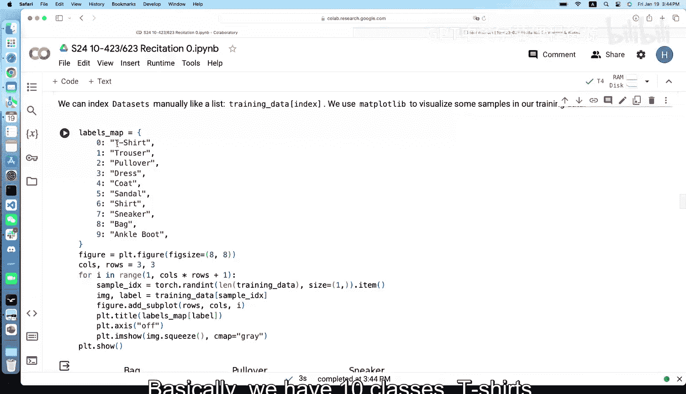

And if we run this， we can say。

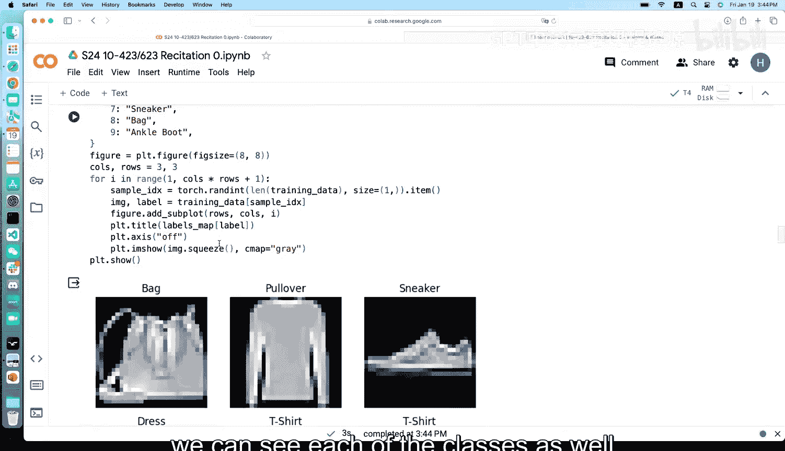

Each of the classes， as well as there are as well as one example for these classes。

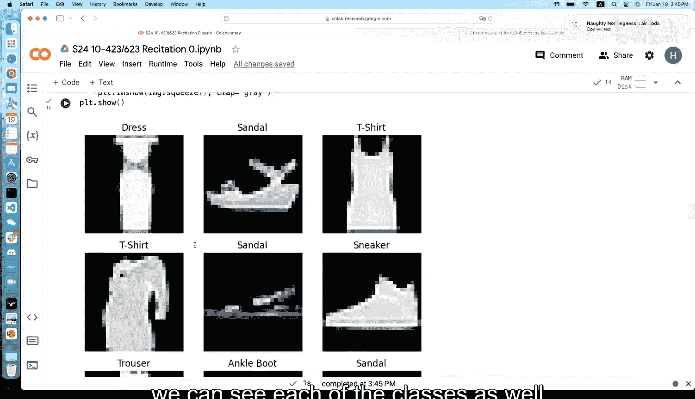

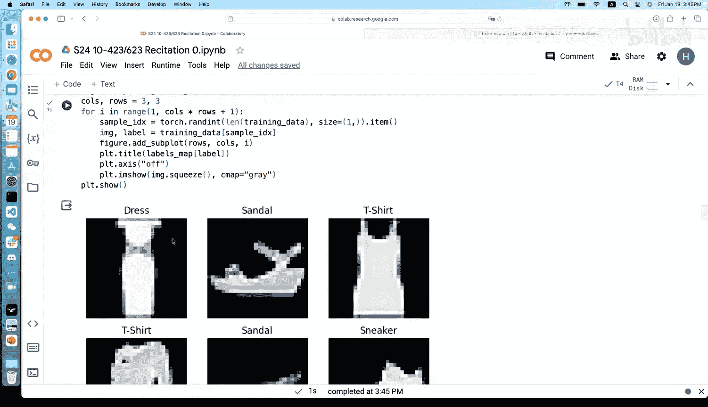

Of course， in most of the time we， we may also need to customize the data set for our files。

 So basically， the customization is very simple， you。

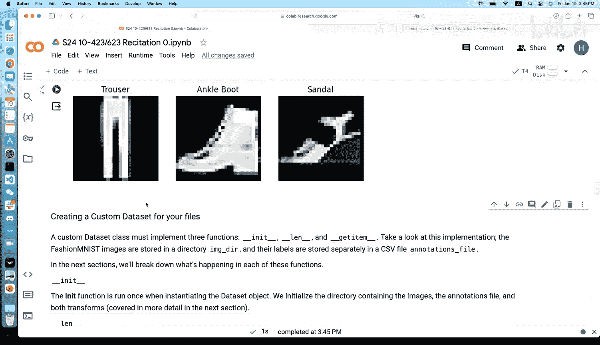

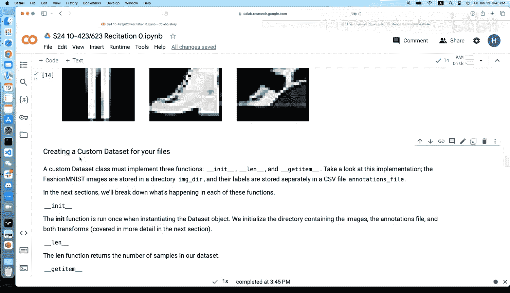

Inherit the data set class。 Then you define three major。Methodds， the first is initialization。

 typicallyy for initialization， you will pass the。Feature file， as well as annotation files。

 In this example， the feature file is the。Are the images。And the annotation is just。Typically。

 the CV file。And for image files， you can choose to load all the images if the size of the data set is not large。

 You can。 you can just load all the images in your initial method。However。

 you can also choose to do it in the get item。 Basically， it will just。

Get the each of the individual sample based on the in index。Also。

 it will have something called length， basically just。Return the size of the data set。Also。

 we can see there are some functions like transformations。

Sometimes you may also need to transfer your targets。For example。

 if you are doing augmentation for a segmentation task。If the data set is very large， it's very。

Recommended to load it on the fly。Basically， you load。

 you just save your image parts in the initial function and then loading the image as well as do transformations in the get item method。

Also， one drawback。You load images。 or do transformation in the initial function is that。

It's difficult to do the transformation because some random transformation may have different parameters parameters。

 each time you call it。Then if you are。Each time you are calling it in the get function。You can。

 if you are Chinese for multiple apples， hopefully you'll get some different variants。

 and it will likely。I to give you。A bettertter results because your data is more diverse。

Then you can prepare your data for training with the data loaders。 It's quite simple。 Basically。

 you pass the data sets。And then you define the batch size， which is a hyperparameter。要看我地话。

有晓得我是小小法在 data头上去。And each apple， it will shuffled like the order。

Of the samples are retrieved from the data set。 Also， there are。

 there are some function like a pin memory。啊。Also， you can set some function like prefe the number of workers。

To a。Prepare your data and uploadloading your data when the GPU is training。

Typically for test data sets the software。Whether you shuffle or not， it doesn't matter。

 but in training， you will probably need to shuffle the data。And here is an example。

How we can iterate us through the data loader。Because the data loader is some sort of generator。

 So you have to call it and next。If we want to do it manually， and for most of the time。

 we just need to enerate data load。Because we already shale the data sets。Then each成为 in data load。

 the data。It's different。From the previous apple。Oh， I didn't run this。W I should around the。

Hello there。

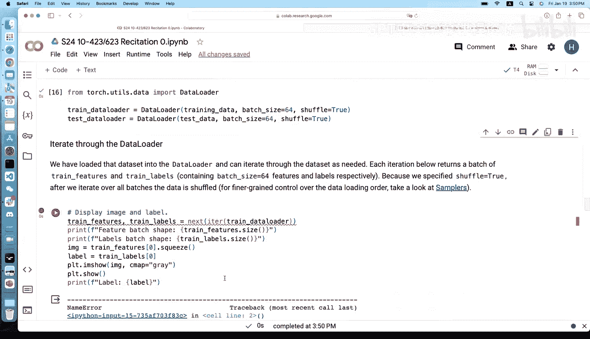

Heres an example of the shoes。

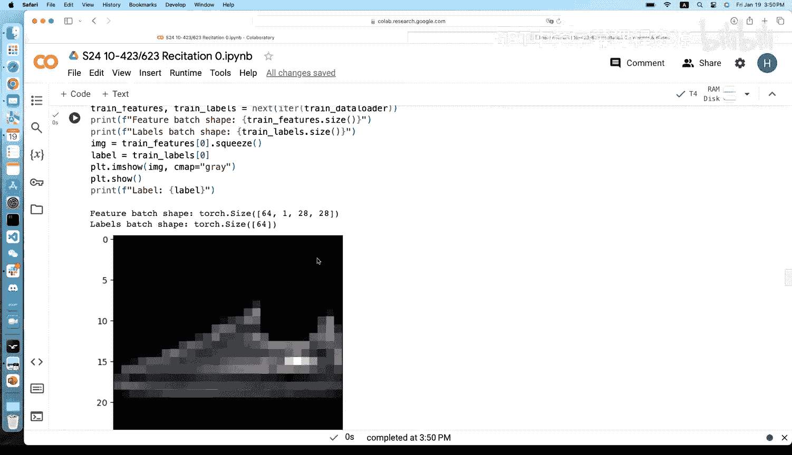

And here the feature batch shape is the batch size because it's a gray scale image。

 The channel is  one and 28 by 28。

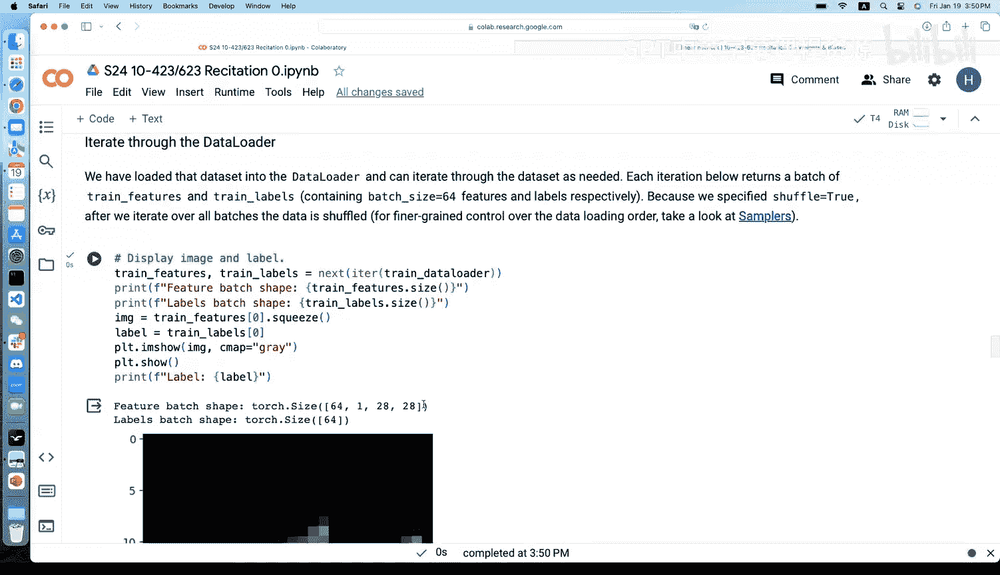

The label the size of the labels are 64。The same as the batch types。

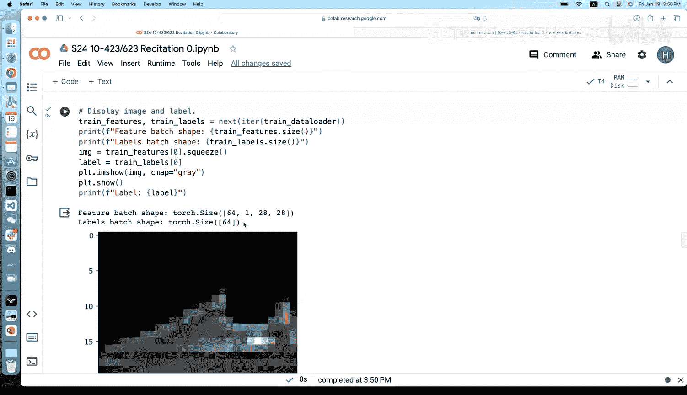

And the label is 7， so basically。

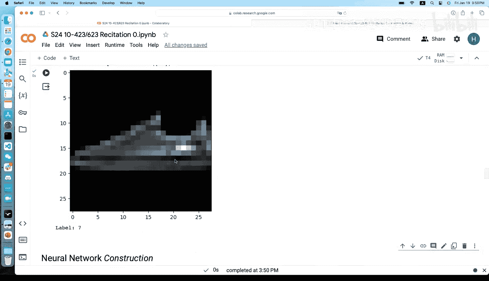

Yeah， it's sneaker。Then let's take a look at how we can define neural network。Any questions so far。

啊不思是。

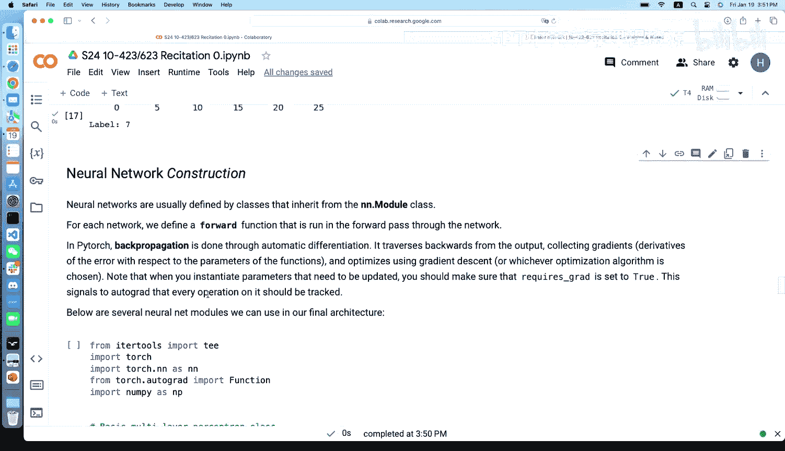

Basics， how you define how you create tensors， how you do tensor operations。

 as well as how you load the data。

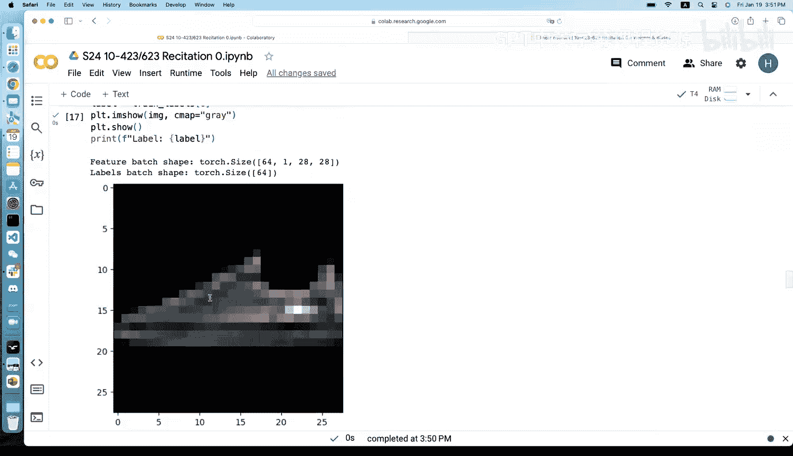

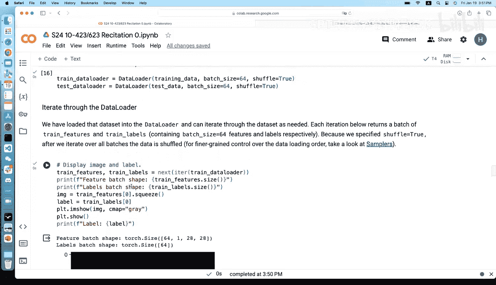

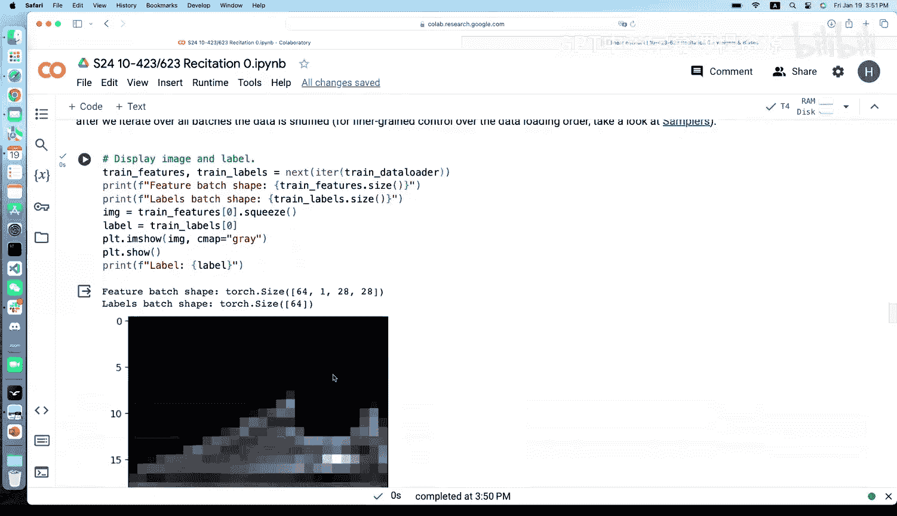

Alright， let's take a look at how we can create our neural network。

No networks are usually defined by classes that inhers from the N dot module class。

And for each network， we have to define the forward function。

 and we don't need to worry about the backward。You just need to call lost backwards。

To do the back propag and then call optimize doorstep。To update the gradient。So it's。

 this is a basic two layer， multi layer spectra。 It's M， LP class。

We have the linear layer called on do linear。One thing you have to notice that you can also。Because呃。

This are。This one is so popular。 And if， if you don't want to if you don't want to call toch dot N dots some sort of layer。

 you can directly import to dot N as an N。To save some time for typing。And also。

 if you want to do it this way， you must first import torch。 Otherwise， you will get an error。

And this is the autograd library。AreUse for。Customize your functions later。

And here you just need to define forward。And。That's the most， most basic。Multtily perception class。

 And we will use this M LP for。Eximents later in this rec。Also， you can modify each individual layer。

So here is an example for how you can modify the linear layer。 So typically。

 the implementation for the linear layer is that you do a a matrix multiplication for。

Its import as well as the weights， then you plus the best turn if the best turn exists。However。

 another way that you can do linearly is that you。Append you。

 you append the vector once before the input X or features so that。

The whole of the linear layer becomes the matrix multiplication。

 You don't need to explicitly worry about the bias term because you' already adding an additional dimension。

To act of all ones。And that， you can。Inherit from the function。Basically， it's another。Class。

And then you define， you， you have to define the static method like forward。

 basically C T S C T X is the same as self。And you define the matrix multiplication。

 And if the bias is not numb。You can add a bus， however， for the backward。

You just set this one to be now。Then when you want to create the linear module。You have to。

Apply this啊。0年方心class。You just implement。Otherwise， it will use the default。Basically。

 this is how you。 This is how you can customize specific layer。Here's an dot parameter。

 just how you can create the parameter。现。啊，一起毛就。And you can also initialize your parameters。

 like using the data to uniform or。What different initialization。Any questions。For most of the times。

Customization of the specific layer， is not needed。

Unless you want to define some operations that are unique。Then we composing a linear layers together。

Then we can get an MLP。This is similar。 however， you are using the customer customized linear module right now。

Also， we need to define some evaluation metrics。 So here we are using the binary test。

 We are using the accuracy， whether it's correct or not。So basically。

 you have some predictions flow your neural network。And then， you。Get some log。

 and you can choose to directly use Agmax， or you can first call soft Mac and then call Amax。

Along the specific dimension， Basically， this is the second dimension。

The first dimension is the batch dimension。And you can just。Set them to an equal。 if it's true， then。

It's correct。 Otherwise， it's incorrect。Then you convert it to the float。

Because this is just the Boolean value。 you have to create a convert it to float so that it can do operation like some and divided by the number。

啊，Dived by the啊。Bch size， yeah， divided by the batch size you will get the accuracy。Also。

 you can customize your loss function as well。 This part is similar。 You just need to。啊。太平音乐1块线。

Of your loss。让油。Define the forward and back forth。But for most of the time， we actually， we can just。

Do basic operations。To calculate some specialized loss。

 and it will take care of the gradient calculation auto differentiation。

 So you don't need to specifically customize such log function。On your own。Also， similarly。

 when you create the module， you have to use your customize function and call apply。

To replace the default function。Otherwise， you are just using the default default module。

Any questions so far。Alright， then how Yang will introduce how we can initial the model。

As well as the weight and biases for logging。Okay， so hi everyone。

 basically we're now going to talk about like how we actually trained the stuff。

 We've already spent a lot of effort actually to define like using Torchion or whatever to define the model to define all the stuff that we actually need for the building bus of a actual machinery network。

 but now we'll take a look at how this different networks actually run and importantly in this class we will be using with biases for log in all the different materials that we get from our experiments。

 which so just a quick poll how many of you have ever used with sym biases。😊，Okay， alright。

 a lot of you， if you guys want to leave， you guys can leave right now。😊。

Take basic stuff is really meant to be aequ tool for anyone who's ever not familiar with these two to like actually get use them and like maybe a little hands on experience so that we can do the homework and the rest of the semesters other assignments more smoothly。

😊，So basically what with biases is is just one of the many ways you can log your training sorry。

You can just clip it to your phone。So basically， it's just one of the many ways you can use to train your log your training let's say accuracy and loss and a lot of other things。

 So other than that other than just mere logging like visualize whatever you have for training accuracy log into some pretty nice parts。

 which people are most likely use for the homework rates for the rest of semester。

 especially I think one problem of homework0 has already been mentioning biases。 So yeah。

 this is just a briefing of that。😊，All right， so other than with biases。

 anyones use other forms of like logging tools like pencilboard， Neptune， whatever。Al right。

 cool then maybe this is pretty familiar to you as well。

 but I also briefly talk about how Wi Myis has some special features that some of those tools may not have and it could be interesting for you guys to look deeper into it。

 but we won't get into the details for today because it's more of an intro for everyone。😊，Okay。

 so basically we can see here we initiate the model the model is just basically a multilevel percept defined previously using which is going to be trained on the data sets that we have already seen previously above so let's just run that。

😊，And MLP is not defined， let's just rerun that。Where is an LP。好。Interesting。You know what。

 while I'm talking， I'm just going to re on everything。Wait， why can't I。You know。

 just this pretty convenience thing in collab， you can just like run a lot of blocks that once couldn't find it somehow。

 but anyways， let's just rerun these。😊，啊。Mter sort three意。Yeah， that's not re needed。

Shouldn't be needed吧女生 maybe not， okay。Let's try that out。Still errors， linear is not defined， okay。

S give some of those。嗯。二手。Here are the missing parts。I I'll just press all of them。Okay。

So now we've already initiated the model。 We know that this model is just the MLP we have seen earlier up there。

 And then basically for Wi bias， it's not a default library available on。Collapse。

 so you have to actually PIP install it。 So let's do that here with bias is actually also like a standalone stuff where you can view it on the other side over here。

😊，So let's just go to WNB点 dot AI。

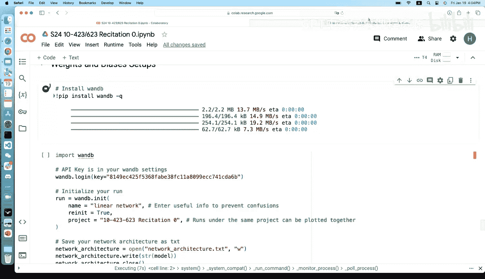

So that's the name of the tool and I already created account so you can log it in and basically this is just the overview of what it is it's basically a way of for you to view the stuff that's already trained。

 for example， this is something Ive run earlier but over here you can see that to set it up you just basically import the API here and logging using your unique API key which you can find over I believe here profile。

😊。

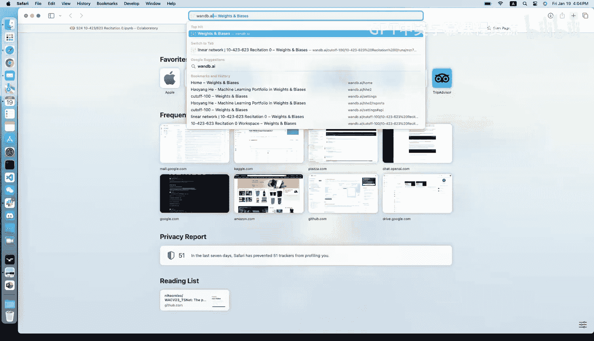

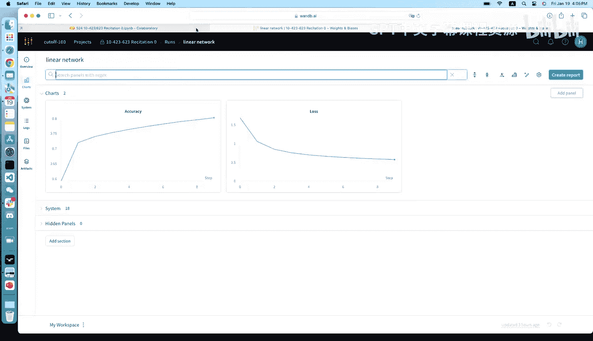

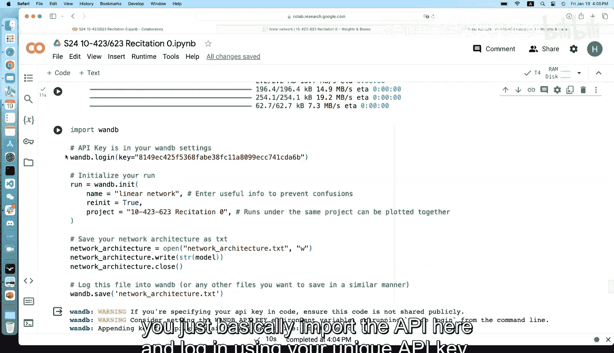

Wait， now profile。User settings， right？Down here you have this API key it's called the danger zone because it's supposed to review all your account information。

 which I somehow re put in the shared Col number， so please don't share that。Well， in either case。

 I can you can also probably just do this。 So yeah， delete it。

 So whatever the API key I put there is not working anymore。

 let's just assume that no one's ever done this before。

 So we just do a new key here and just a nice little copy here。

 copy to clipboard and you just put it here。😊，Now you guys can see it。

 I'm gonna lead it after the recit。 So yeah， good happy if you keep around them。 you know。

 you want something bad to happen。 So basically after you're logging all the sessions afterwards will be within your account of your API and which is first what we do is we initialize WMB run it's basically sets this environment record like's saying that oh。

 this is independent what they call a run of and deep learning model experiment。

 So you initial you name it linear network or whatever you want， just please be sure to be screen。

 especially when you're running a lot of experiments because the names are really confuse you as I am about to do right now because I'm using the same name equal true is basically like after youre running some bugging。

 you can reize that and project this is the way of organization within WMB， which is basically how。😊。

WM B organizes different groups of experiments into what we call projects so that you can actually plot graphs of different of the same of the similar experiment together to like compare their results。

 like where the accuracy， the validation and in which app， what happens by that。

 So it's good to have a unified project name for a single。😊，actual project you're doing， basically。

 and one example of what WMB can do basically is that we need to realize that it is on cloud。

 So it's on the we can buy this service of the company instead of like on your local environment。

 especially when you're using Google it can be really useful because you're just borrow a machine for Google and they can take out whenever they want。

 So it is a really good habit for you to record whatever basically back your model checkpoints or whatever other stuff that you may have that may have been useful in this onto the WM。

 So one example of that could be the neural architecture that you use for this network。

 So we can just say we put it in the string and save that as a TX locally。

 So now what we can do is just for almost any files there， of course。

 is a size limit and stuff by that。 But for almost any files。

 you can just say WMB save and that file and this file while。😊，Will appear on your W be wrong。

 as we will see a bit later。And it is important to note that in order to say this。

 you had to already have initialized a run so that it actually is corresponding to this run。😊。

So let's just from that， it might take a while， sometimes it even has some bugs。

 I think WB has improved upon that， let's hope it works。Alright， I think it did。 Okay， great。

 So now we move on to the actual training loop。 So W is for recording accuracy loss and something like that a lot of all those information are from when we actually train the different learning network So we might getting the training loop。

 So basically for training is that we this is something that we need to notice that a lot of people miss。

 So before we actually train or evaluate the model using Py。

 we need to set the model the neural networks， basically what you're doing here is to operate on every neural network block of this model to set it to training mode。

 So So what training mode has in differenceffer in in comparison to others is that is actually learning based on what what they see。

 So basically it's doing the forward and backward propagation。😊。

We have to allow that and then the loss function is just something we defined earlier and just an optimizer。

 any of you who hasn't heard of an optimizer before。😊，Okay， great。

 so I'll just briefly skip through optimize just like something that helps you to achieve the learning goal of your different network。

😊，So then basically for appking range Es like for every training loop。

 you just go through each day other and those are pretty standard machine learning stuff optimize0 grad is something really important when you're doing training because you need have to create gradient for every batchlor training otherwise it's going to mess up the training and it's really common mistakes。

😊，And then you move the desired inputs and ground tools to actually lead to GPU so that it's doing that So this dot2 is just like moving the CPU stuff to GPU。

😊，And then you just， this is just running the model， getting the prediction。

 doing calculating the loss and accuracy based on the functions we have already defined and then perform backward propagation。

😊，And this is where the optimize step because after you perform better propagation。

 you want the optimize to actually like help you optimize the model and that's just calculating loss and accuracy throughout the training loop。

😊，After whats that， this is because we are doing this for every batch。

 we have to like divide the loss and accuracy by the number of batches so that everything is her training sample。

😊，And and over here it's just a little bit of printing logs that will show up after runners。

 Any question up until this point？😊，So until now， before we run the W And B log。

 nothing is logged to with bias， right， right， actually， over here。

 you log the model architecture as a T X C to with biases。

 But for this training loop up until this one， you didn't log anything。

 including the print hasn't been logged yet。I'm going to say yet because it's going to short。

Any other questions？if you run this again， does it like overwrite the logs that you previously did Great question we're going to demonstrate a bit later。

Anything else？Okay， so now up until this point as we just discussed nothing is explicitly locked to wait and biases except for the file。

 I just say。 So now this step is where you actually log the loss and accuracy as a variable that you define in wait and bias。

 So as a variable we define is basically we are telling the wait biases log that this is loss track the loss。

 this is accuracy， track the accuracy。😊，That's my team， what were explicitly telling you them。😡。

And then the other stuff is just a unique like the usual like updating the checkpoint。

 updating the best model it's habit to do because a lot of the times when you're running a lot of apps for running and go collapse history out is really useful as a backup to consumer training and stuff so basically you can save whatever your model waste by doing this or like other relevant information with toch locally So To already has to save functions that can store whatever stuff that you think is relevant and relevant information in a PTH file on the local machine in this case。

 the local is just the co or environment。😊，So we have saw like the Apple model state dictionary。

 Auto state， loss accuracy， whatever into a checkpoint。

 model is an automatic especially important for you to resume your training。

 And then the next step is to back up the checkpoint on with bias as well。

 And this is real important in the collabing environment because once you get kicked off of the coab machine。

 your checkpoint will be and you can't resume your training from that point。

 So what this will do is that you can actually reload the file from written biases at your moment and put it back onto collab to continue your maybe like 100 efforts of training or something。

😊，So， yeah。And the other is just evaluation function definitely also a lot of stuff here。

 but like we're just skiping that for the sake simplicity and we can just run that because those are just function definitions we and nothing will pop up yet。

😊，And this is just some other brief setup。 Oh wait， please should be here。😊，Yeah。

 these have already been moved up there and we just run the training loop and also the test accuracy and there will be like 10 efforts of training which we are just run right now it's a pretty straightforward process。

So while this is running， I'm gonna show you a run that I have did with this exact setup on over and with deviceses。

 So this is。😊，Previous one。Out， here。So basically， I remember that we explicitly defined the logging of a。

Okay， it's taking a while interesting。 So remember we explicitly define the variable of accuracy and loss。

 Well， this is where they pop up。 They will attract them automatically for you and they will tell you what happened at every step of the entry point and usually this step is just every airport that you log in because you update every step。

😊，You can also do pre things like update every webbe， which is definitely not recommended。😊。

So these are the graphs that it will just automatically produce for you。

 So how many of you have ever used methla lid and hated。

Great me too And this is how we are saving you time for the homework because we had to grade it somehow to evaluate your performances。

 but we don't want to do that too less like an absolute value。

 So what we are doing in most homeworks is just ask you to submit an appropriate plot that basically shows how your training model trains and just basically look at it to see if there's any good things or bad things about it。

😊，And this is how you can do it without using any super match lablet functions。

 It just generates that for you， you don't even need to explicitly tell them to product it to just call it for you。

 which is great。😊，And also， remember that we saved a couple of files。It's all the way over。

After we click it in here， or by the way， this is like the project page。

 so it shows up every run that you have ever done using this project page using this set project。😡。

And I don't know why the new one is not showing up。Maybe this is the old one。

 And I deleted something。 Well， doesn't matter。 We can just。So basically this is a project page。

 And if you define another WMB run within this project page。

 the the new network the new log will just show up right here right above this linear network as a different color So you can even plot multiple runs of your same project onto the same graph and they will just show up like here automatically So for the others for the other files we say we just clicking into the run itself and they will have first of all。

 you have files。 So those files are some of them are automatic generated。

 some of them are explicitly saved as you can see the new architecture T that we saved and also like some other system generated automatic file。

 the checkpoint P which saved and also。😊，The Applelo when some artifacts that doesn't really matter。

 you don't really to worry about it。 And here is another another section called lumps， not files。

 You notice that this way of printing things and this way of doing things is not necessarily the way that we are doing previously。

 but exactly what this is。So to answer the question of what is log up until this point。

 you know W andB run whenever you step something and like doing a log。

 it will actually like show you the final output log as well as the whatever you choose log。

 So the whatever got printed over there will also be saved。 So that's also， I guess， a comm feature。

 Of course， this is this log is saving basically the dot log format。

 So it only saves text information。 So no images。😊，Any questions up until this one。Okay， cool。

 And this is what we are covering in detail about government B basically。

 and it actually has a lot of other more advanced features that you can。

 you are really welcome to check out their tutorial for。

 like a hyperparameter sweeping and tuning stuff like that。

 but we won't cover that because most people will never use them in a nonin setting。

 because you just don't have that much GP to do that。😊，But yeah。

 I guess that would just be everything you would need for this and basically it' the rest of the course。

 like in terms of hydrogen double basis that doesn't be any questions for anything。😊。

Go ahead so if you。Upload a file with the same name it overrs the file it doesn't it shows you another project office of the same name but with a different color without any indication of British。

 which is why I said is not a good habit of doing this。😊。

And also to re answerswer your other question， if you fail midway。

 the failed project also gets saved。 So that is also bad， but what you can do away。Over here。

 like in the project page， what you can do is just like ignore it so that it won't be shown and whatever your box runs can be just skip。

Any other questions？Well， I guess this would be this recitation and good luck on your homework zeros。

😊，Okay。

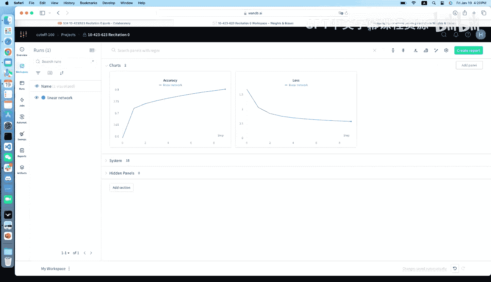

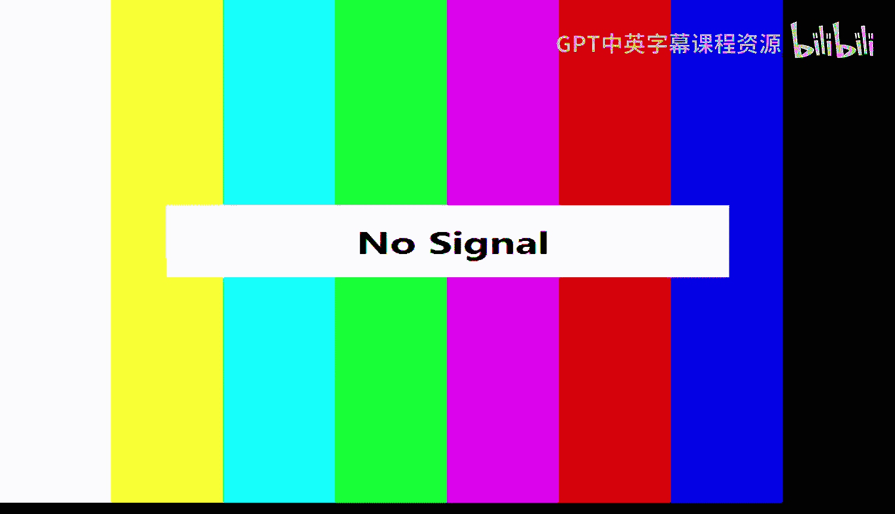