# CMU《生成式AI｜10-423 generative ai 2024》中英字幕 - P31：-P31-Recitation- HW1.zh_en - GPT中英字幕课程资源 - BV1CyC9BPEhG

We can give you the work through anyway， take come on， please。😊，老43。

Oh okay first how increase walk you through how to build your own transformer Okay。

 so the start code that we will give you has。😊，One folder called min GT this folder has three files in it and it also has3 files called CADGPT dot pi as well as input dot TXc input dot EX here is the complete works of Shakespeare so it's actually not that big you can take a look at it if you want so you can see it has all of Macbeth and probably we are Juliet and whatnot。

😊，And we' are going to feed this in verbaom to the transformer to transform mimicmic。

 what Shakespeare said。😊，TgP。5 this is the main file that you guys will be running。

 you don't have to make any changes to this file but I'm just going to walk you through what the file does so that you have some idea of what's happening。

😊，A it's doing we are on this file？Is that there is some config stuff first you can feel free to totally ignore wherever you see the word config。

 all that's doing is making it easier for you to run the code later。

 but you don't have to understand what the config bits are doing。😊。

So here's where your data site is being loaded this data site is actually cur cute because all it's doing for so all it does is it takes in the input text all it does for tokenization is it maps the input text from。

😊，A number from 0 to 65 appendice Shakespeare used only 65 characters in like all of his work ever including capital case letters。

 lowercase letters punctuation space everything just 65 characters and so your language model has like a vocabulary size of 65 where each of them is one character and it's using that to train the model so your data all the data set function does is it converts all the characters to an integer version of them and after that it gives you chunks of those numbers out so that your module can train。

😊，Apart from what the rest of what CalGT。 pi is doing is that it'sing the trainer。

 the trainer is what the trainer is another file I'll show you what that file does。

 it's what's using the phone loop and upgrading the weights and doing the actual training。😊。

And all cloudator files going apart from that is saving your model and also showing you some helpful scores when you're using it。

 yeah， tell。😊，Exactly so keep things simple if you're just using using doing it on a character basis if you want to later one you can swap out that very solid character to number mapping you can swap that out with subwords or whatever your favorite tokenizer is。

😊，The benefit of having a smaller vocabulary size and not doing like 50。

000 subwords is that you even have a much smaller model because you don't have to handle trying to map all those embeing all those different vocabularies。

😊，Cool so that's what KGP dot Pi does let me also show you so the three all this is doing is just like calling the other classes and then running your code when you are when you guys are running it all you have to do is python KGP or pi and this will done for you we'll show you it working as well。

😊，The three other files that you have are this model do51。

t5 and us out of these three you only need to modify model do5 so only this top one over here。😊。

Nowless I'll show you what these22 things are doing so that you aren't like totally confused in case you end up opening it by mistake。

😊，Right so this is the trainer again this is fairly standard stuff similar to what you've seen in homework0 what the trainer does is that it loads one batch of the dataset set。

 does a forward pass through the model updates the weights and then keeps doing that in the loop until it stop。

😊，So it's first like getting the train loader。It's setting a modator train mode。

It keeps running for endlessly unless you specify a max citations， I'll show you how to specify that。

😊，What it does is it picks up to one batch of your data。Passes it through the model。

Here passes it through the model。And after that it does once it gets a loss。

 it does lost that backwards and then optimize it outstep， basically updating the mod。

 it's nothing many you guys haven't seen before。😊，That's all this general file file is doing again it's crazy how little code there is to get your own functional transformer and yet this is just proof of that the other thing is these users again you don't have to open this file at all all it's doing is it's helping you with logging and then it also helps you with configurations a little bit。

😊，Before I move into the model， any doubts about any of this？😊，No。Yeah， good。

We go over like actual like forward steps and model yeah， model that and we go over that。

Anything else？こる。Right so model thatpi this is where your actual model is implemented there is two things over here one is which I'll walk you through the vanilla GPT implementation this works out of the box for you and when you just run this file you'll see that it works you have to make changes to implement group query attention rope embeddings and so on and I'll show you what partsel the file that you you need to fill in。

😊，Right， so starting from the bottom。 So here this is your this is the model class class GP。嗯。

All that this model class is doing is that it has the following modules。

 it has an embe which is mapping mapping your vocabularies to that that's your input and bringing。😊。

It has a dropout and this is not something idea you have to worry about。

 but just regularization that's applied。😊，It has blocks。

 each of these blocks is the transformer block。😡，What's happening in each block。

 we go that in detail， but what's happening in each block is there's a tension that's happening and then there's a forward pass that's happening。

So all your transformers is it's in per em bearingings， it's a list of blocks。

 and finally it's an output linear earlier。😊，Thats all it does in case you using the default configuration which uses learn position embeddings you also then add position embeddings what you guys will be doing is youll be implementing rope and so once rope is implemented then you will no longer have embeddings over here how he will cover what happens when you switch to the openbeddings。

😊，so that's all the transformer is you can also see。😊，Yeah。

 you can also see the forward function all the forward function is doing is。😊。

For it goes in through your token so forces it goes through the input embeddings after that it goes through each block and this dollar forward pass through each block we are also measuring the amount of memory that's consumed why do attention computation as well as the amount of time that's consumed by it all of this is just logging that helps you later when you're plotting this stuff have we ask you to plot how much memory is consumed when you do slid window attention versus say normal attention or when you do group query attention versus this normal attention and so whenever you see a memory consumed during attention times all of that is measuring how long and how much memory is consumed in doing attention。

😊，You should see some interesting results here when you do these experiments after you've implemented your code and so yeah。

😊，So that's the class GPPT。 Now， what we'll do is you look at what's in each block。

 This is also super simple。😊，Whats in each block is there's first attention that happens in each block。

😊，And after attention， you pass the result through a linear layer。😊。

So actually you pass it through tool linear layers， but yeah。

 so the contents of each block is attention and then a feed forward network。😊。

Now going one step block， what happens in attention？

So we have that we have that implemented for you as well， which is the causal self attention。😊。

This is this is a class that you should go through in a little bit of detail because when you are implementing group query attention yourselfselves。

 you need to ensure you understand this code really really well。😊，Before I go into this。

 any other questions that you guys had？Okay， cool。Right， so as Matt covered on Wednesday。

 what happens in attention is that you take in an input X， you map that input to keys。

 queries and values。😊，After that your attention is you between the queries and the keys you do a dot product between them。

 so we look at how much each key matters for a particular query。😊。

You take these attention values and add them you take these attention numbers and add them to your values so that it becomes a representation of how much each of these values matter。

😊，And after that you return。Did that make sense？Any questions on that？okay， cool。

 so that's what this code is doing as well。First is you from your input X。

 you get key in the initialization， what he do is you get key query and values。

You can see that that's happening in one shot over here。

And that's because what they're doing is they just theyre using one。

 they're using just one linear layer and splitting the output into key query and value。😊。

The advantage of doing this is that you can do it in a batch instead of doing it sequentially as a linear layer for  Q and linear layer for value a linear layer for query。

😊，There's also some you also just pass the final output through another feed forward network so that's what projections are。

 you don't have to worry too much about that。😊，And one thing that you should notice is that there's also a dropout that gets applied within attention so all of this you will have to do in your group query attention as well but there's no change that you need to make to the dropout step you can just keep it as it is。

😊，Finally in case you are using the rotary position embeddings rotary position embeddings are applied on the attention like the key on the queries and keys before attention is calculatedc and so when you do do rope which how he will walk you through you should ensure that you make these changes as well whatever you need to change will be marked with a giant big to do like that and so you need to look for these blocks and then make changes to them。

😊，What happens in the attention computation first you get the queries keys and the values。

You switch them， you usually rotate them so that you have the dimension that you are doing the operation over to the right as much to the right as possible。

The reason you do this is because computations are faster when the thing that you are calculating over is on the right most and that's because in memory let's say you have a 2D matrix right the way its stored in memory is that first you store the first row then you store the second row then you store the third row and so on。

😊，So if we're accessing the elements by row， then we're all going to be next to each other and that makes it much faster than say accessing by column those of you who have done two and three might know this yeah。

😊，That benefit exceeds the cost of doing the Fran oh yeah yeah good question so when you're using the operation view it's not actually going to shuffle anything in memory but when you do transpose it does actually shuffle in memory but the benefits' is definitely worth shifting it on。

😊， so you have the query keys and the values， you've shifted them so that it's you can do the computation as fast as possible。

😊，And then what is attention is just multiplying the queries and the keys the rock lag between them。

😊，After that， you are applying this mask。😊，So。While we are training。

 let's say you are training for the line， this is recitation one。

When the model is when you're given the model just the word this it shouldn't have access to the words is recitation one while predicting right because if it already knows that the next few words are going to be is recitation one。

 it just going to spit that out and it's called cheating。😊。

So the reason you add this mask over here is that you must out all the future tokens。😊。

So that the margin doesn't have access to see when it's learning when during the training phase。😊。

Why do you even have access to the future tokens over here that's because in training。

 what you do is you give it an entire sentence and you try to get it to predict to one word at a time in that sentence。

 So the entire sentence all exist stupid， but you want to ensure that。😊，Those way it's a master。

After that you apply after you've done the dot product。

 when you mask out the things that you don't want the model to do。

 then you apply the softm and finally you have a doboard for regularization。😊。

What you're returning from this function is just the attention。Oops。

It says can all do all right Okay so what the what hast done。

 So what you're finally returning is the attention multiplied by the values。😊。

And that getss it turned over here。You might notice that you still have this end memory and start memory business that's all let's do again is measuring the amount of memory consumed in doing these attention operations and it then returned so that you can view it。

 log it， print it， put on a chart， submit it for homo one。😊，Does that make sense， any questions？Yeah。

3 you。即就分なさ。Right right so what happens in each block is that first you do attention and then after that you have a two layer feed forward network。

😊，So that's what one attention that's what one transform of block is and you have six of these blocks repeated。

😊，Yeah。Good question， Any more questions。不。And go for it。So。比 should after。是的。Yeah。

 there seems to be more of a。Some people put before。

 some people put't after there's debate on the community on like what works better us？😊。

Not relevant for us， though。Okay， yeah， great。😊，こた？对的。は。W greeners right。

 right So line one So the are your I are 220 cash after that there is start memory and then there's an end memory。

 right So what they're doing is we're trying to。😊，说。

So my question is why are you storing how much it's using a plotting or yeah it's just purely for plotting yeah that's nothing the as to this in fact like because you're entering cash in the might we actually might be slowing down the model a little bit but the tradeoff is well worth it because we want to see the impact of the features that we're adding to the model。

😊，你说。Yeah， yeah。Also know you shouldn't really have any issues with implementing this so when when we did our tests after implementing the features we saw that we were able to get good results in five minutes using a Google collab free GPU and that's what you guys should do as well like if you do this on collab it will take you like five minutes to once you actually implement everything it'll take you five minutes run and do all your experiments if you do it locally in laptop which's at least 10 times slower so there's a big performance difference and the mono you spend is pretty different between the two。

😊，However， that said， make sure that you when you're implementing all of this make sure you do it on your laptop and run it on CPU because it's really difficult to debug QA errors like even if it's a simple error。

 Qa will throw some weird exception at you and you won't know what's happening。😊。

So my suggestion is that you finish writing this out， you run this on your CPU for one iteration。

 just make sure it works after that'll upload to collab and then do your experiments。😊。

That's thought。If you have a GP on your desktop， then you can do it locally。Yeah。

Will we get credits or something for accessing like GPUs like you don't have one？That that my view。

Yeah。So we're going to send out a form tonight， likely tomorrow actually， for AWS credits。

Details So what you're going to have to do is you're going to have to set up an AWS account。

Fill out the form that I'm going to send you with your account number。呃。So fill out that form。

 give me your account number， and then when I submit that form in about a week you're going to get so AWS credit。

We don't really want you to use them for the homework。

 we try to make it easy enough so you don't have to use them for your homework。

We really want to do this for the project， we want to get it out early。Caatat about the AWS credits。

 when you set up an account， they're going to ask for your credit card number and if you want to set up an account you're going to have to put that in。

That being said， once we give you credits， if you use over those credits， we are not responsible。就は嗯。

嗯。So make sure that you turn off your ans when you're done using them。Because from what I hear。

 someone left theirs on over Thanksgiving break。Yes。

It worked out they're still a lot but I don't want that to happen to you all right so look for that in the coming days alternatively you could just set up like a coab pro account just like 10 bucks of money。

Although AWS is faster or it is much more worth it， but we'll figure all that out。

 I'm going to send that out to you。Likely at 1 am。It's so a rough week， but yeah。

 so any other questions about GPU credits。For anything yeah， not direct question。

 but you can usually if you just sign up for a GCP account。

 maybe be like 200 bucks worth three credits three 300 bucks 300 bucks worth you're exactly right and from what I understand is that with the same credit card or the same you could like have like five or six。

Oh， I must also say that， never mind。You what you me to do。That。That said。

 you don't really need collab for this hormone like on collab three on five minutes。

 you should be able to like run all your models， so not needed for homo one。😊，Okay。

 I'll do leave open meetingsddings。Yeah。不是。

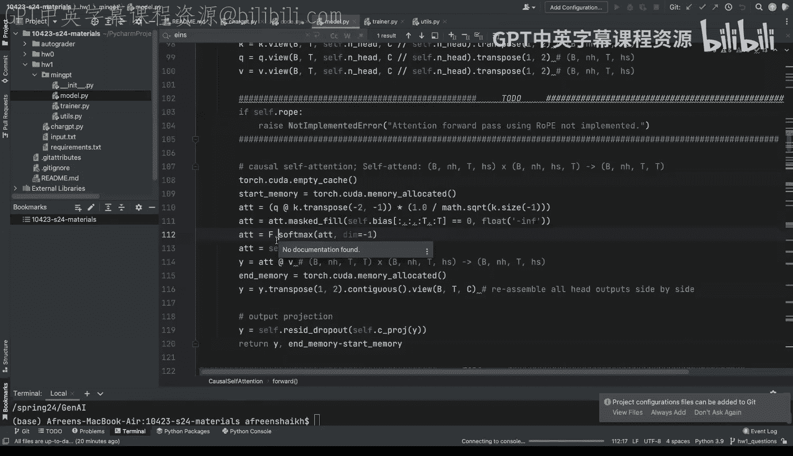

Alright just like one last thing so in case when you don't be experiments you may need to say change your model sequence length or generate a fixed number of itations or change the number of heads that you use for your keys in order to do all of these you don't need to go and change any code there are flags that you can use to do each of these things so that here's a list of the common flags that you can use all you have to do is after PythongT do co you don't just specify what these flags are the ones that you want to change and then which should help you change all these things in your code so any changes that you need to make for any of the experiments can be done with flags like these they don't need you to go around changing code。

😊，Alright， so now let's get started talking about road also known as rotary positional embeddings。

 So， first of all， let's talk about what positional embeddings are。

 So I'm sure many of you have seen this image here。

 This is from the original attention is all you paper。

 And here you can see this box here with positional encoding。

 So usually positional embeddings and positional encodings。 They are used interchangeably。

 So I'm just gonna talk to you about like what exactly this positional encoding is。😊。

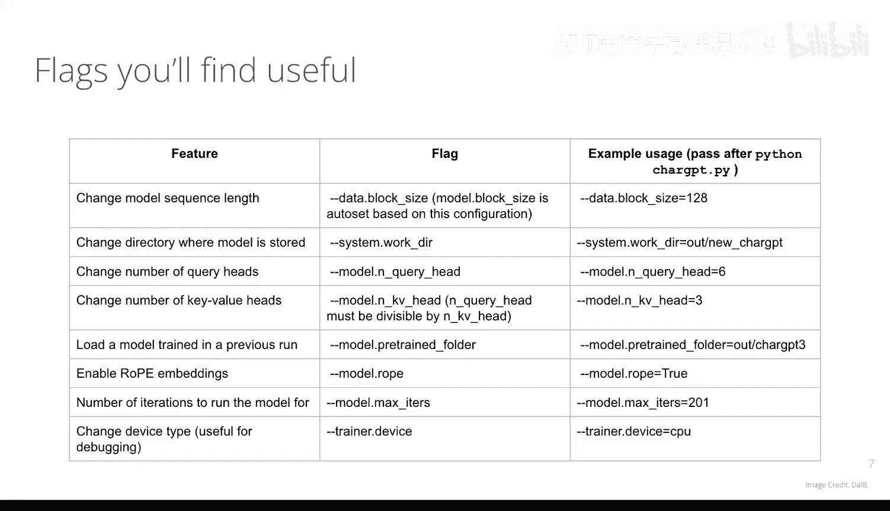

So here we have this example sentence， for example。

 like your cat is a lovely cat So the thing with attention is that it is invariant to the position that the word appears in the sentence So when we first apply the first layer of embedding it will see that the same words will get the same embeddings So for example。

 here cat here， the first cat as well as the second cat。

 they have the exact same values for the embeddings So then you have some difficulty trying to distinguish tell the model how to distinguish between these two different words because they appear in different positions and the position actually matters a lot because for example the word that appears first could be like the subject of the sentence and the word that appears later could be the object or something else so you want the model to interpret them differently So that's why we have position embeddings so this position embeddings will be different for each position of the sequence so。

😊，Exle position， the token， the first token would have a specific position and bedding。

 The second third4 fifth and so on will all have unique position em bedddings。

 So you can see that the first cat has a different position and bedding from the second cat。😊。

And lastly， we just add up these two embeddings， embedding and position embedding to come up with the input that we want to pass into the model。

 and this is how we get different representations for all of the tokens。😊。

Right so there are two types of positional encodings or embeddings first is absolute positional embeddings so some examples of models that use this would be bet as well as GPT1 and2 so this is what I covered previously so basically these are six vector that I added to the embedding of a token in order to represent its absolute position in the sentence so it deals with one token at a time。

😊，And there are two variants of absolute positional embeddings。

 learn embeddings which are directly learned on your training data， as well as cusoidal embeddings。

 which I'll cover later on。😊，So but the issue with absolute positional embeddings。

 the learned ones are that it limits the number of tokens the model can process as there's no way to represent a sequence longer than a maximum sequence length since you are training the model on a certain max sequence length。

 so it generates， it learns the positional embeddings for that fixed sequence So when you try to perform inference or further training on a sequence length larger than your max sequence length。

 your model will not be able to generalize and will perform poorly。😊。

So next we have this another variant of absolute positional embeddings which is a sinusoidal embeddings。

 so this attemptss to overcome the problem of fixed sequence lengths so the idea is that we will have an input sequence of length L and in order for us to calculate the positional encoding we will pass in will perform sine and cosine operations so what we have here is that pay would be the position of our token in our input sequence and D is the dimension of the output embedding space that we want to project our input into。

😊，Right， so this the P is just the position function。

 And what we're doing is that for the even dimensions in the output space。

 we will be applying the sine function。 And for those dimensions that are odd will be applying the cosine function。

 So this might seem a bit strange， Like why exactly are we doing this。

 The idea is that here you can see some examples for I equals to 0，1，2 and3。

 you will see that all of these functions result in a unique encoding。 right， So from I equals to 0。

 all the way to your last hidden dimension of D， all of this functions will be different。

 So this promises a unique encoding for each position in your sequence， right？

 And also you can see that。😊，For the layers that are the dimensions that are even we apply the sine function。

 so we start from zero and since I equals a 0 itself as I equal equal a two and for the ones on the right。

 we would apply the cosine function。 So we do this for all B layers D dimensions。😊。

Right and so just again， since the sameus for each position is different。

 there will be a unique way of encoding each position。 So for example。

 you can see the four different colors represent different eye values of the dimension and each of them would have a different encoding。

😊。

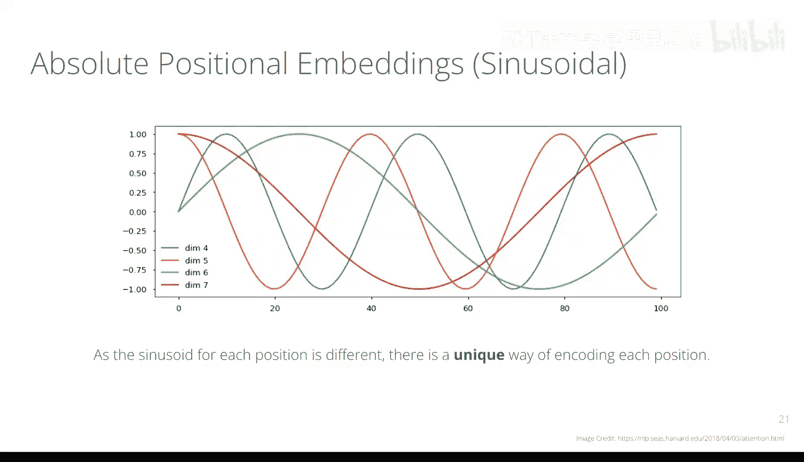

But there's no a problem with this because let's just go through an example。

 We have that our dimension is just d equals to2。 And let's say that we have a sequence length of9。

 So if we apply the functions， this equations here we'll see that but the first token will have that bright yellow arrow there。

 and the second token， it will be slightly down。 And the third will be this one。

 And then the fourth is。 So right now it still appears pretty regular right。

 there's kind of like even gap between the words they are right next to each other But when we continue down the sequence。

 you start noticing that for the fifth sequence and because fifth token right。

 the arrow starts to point in between the first and the second tokens right and this order continues to get mixed around。

 So for the sixth token is like almost vertical and the seventh is this， the eighth is this and the。

😊。

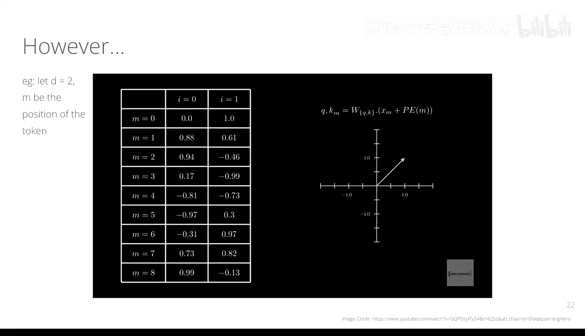

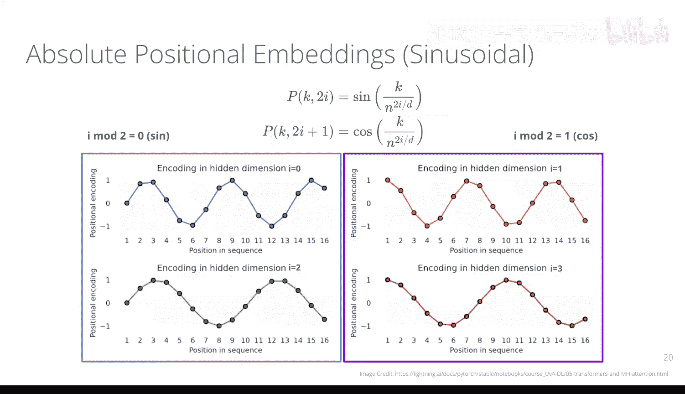

Its this so the point of there is that if you're the model trying to learn whether which words are the closest together in order to learn their relationships right you see that for example for the ninth token it is pretty far away from the eighth token and instead another token is closer to the ninth token right so it's still not very regular in terms of trying to figure out like how as close the tokens are to each other in a sentence right so any questions at this point。

😊，Yes， why would you want it to be closer to each other Because you can imagine that if you have like a really long sentence。

 you would imagine that the words that are closer together are more likely related to each other and further down the sentence you could be even a separate sentence。

 You would think it's more likely that those two sentences would talk about different things So the words that are closer together would be more related to each other and we want the model to be able to capture that relationship。

😊，Isn't this embedding just creating a lookup table sort of a structure where you use the embeddings to look up that word。

 so how does the relation come into the distance？Sorry can you yeah because you have embeddings for different words right that is fine。

 But the problem is that words close together could have different meanings right if for example。

 you have that it's a cold drink you could you would think that it's a positive thing right but if it's a cold day。

 maybe you don't like the code So then that's a bad thing So if you have the same embedding representation of the words code right you're not able to capture the differences in that sense yeah。

😊，Yes。I've seen it before where like why do you go through the effort of ploting it with like against sinus story。

 why not just like you can guarantee you you need embedding if you just add a linear penalty to every single term based on where is the sentence。

But why those their own signs Yeah， so yeah， the problem with that is it will go。

 we go back to the previous problem on the learn embeddings where we have a fixed next sequence length。

I'm not really sure about how the penalty is applied。

 but I'm assuming that you're calculating it based on the original sequence length， right？

I mean are these also calculated based the number of Z where end don't need somehow reverses original sequence length right yeah。

 but you can change it in the sense that。

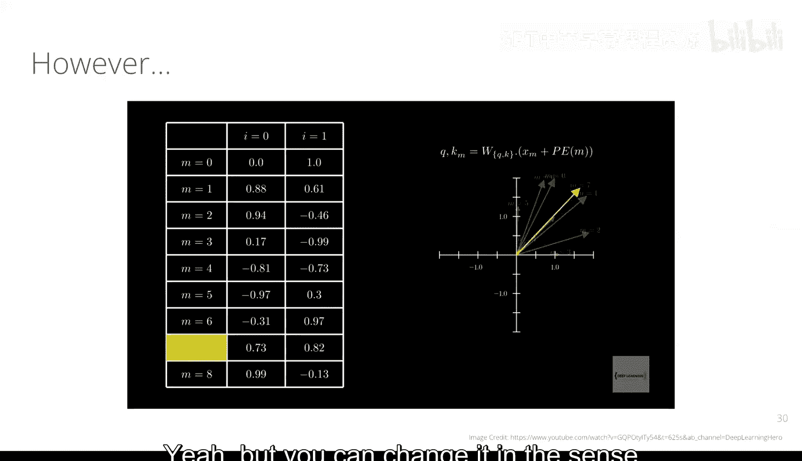

The D or the sequence length， even the L， right， you can change it and it will just still remain in that fixed range。

 but the values are just closer to each other for example， if your sequence is longer。

 but they are still in that fixed range from0 to one negative one to one， right。

 so it's very easy for the model to continue learning from there。

 as opposed to having an unbounded like length。Inally any not necessarily just with signus with his book like。

If you just take it to divide or a linear thing you could divide it into it because negative11 is an infinite number of amount numbers if you could believe those weren that right if you just divide it by however many numbers you have on the input that's your space Yeah but once you get a new input then you divide it by the new input set。

RightOkay， well， I guess， but well， I guess you have really it seems to be like a very complicated solution Yeah yeah。

 I， you can probably just read the paper on attention is all you need to figure out like what is your exact motivation for form English this。

😊，Okay。你 you want啊ium big then。Yeah， so because you're learning this learn embeddings is learn directly on your input spread so if you have a current certain max sequence length。

 your model who hasn't seen anything before that and wouldn't see anything other than this max sequence length will just take this as the absolute maximum sequence length that can occur right so if you throw something completely new it will not be able to generalize。

Does that makes sense like you've seen something but you haven't been exposed to something else all your life。

 so you grow up thinking that that's all that exists。Right。

 and then you throw something that's completely unseen to you。 you wouldn't know how to react to it。

So that's basically rocking the problem with this。But there is want to mention a limitation of the model itself。

 like it's not just specific to the embedding。Yeah。

 sure and only process strains up to for children up to 1024 right So so why is the problem we describe。

Doing to explain the rationale behind the problem of embeddings。

Because it could be so you could have two sources， two reasons for the problem， right， first of all。

 the embeddings， second of all the inherent limitation of the model。 So in some cases。

 the model could handle much longer sequences， but it could be restricted because of this sequence length restriction of the embeddings。

 So we want to get rid of this restriction right， so it can if for models that can work with that longer sequence length。

 then we can apply this better embeddings that we'll go through later on。😊，O。I'll just continue on。

 so。

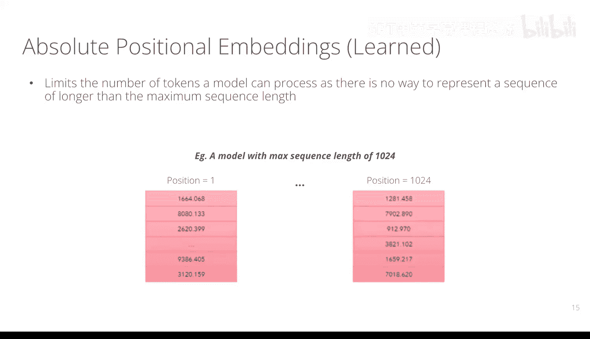

We've looked at absolute position embeddings， so the next one would be relative positional embeddings in the sense that it captures these pairwise distances between words because going back to the previous intuition about how words that are close together are more likely more related to each other as opposed to words that are further away from each other。

 So this takes two tokens and it creates a vector that will represent their distance right for example。

 if we're looking at the word yield we will see that well encode minus-1 for John since it's to the left。

 one word to the left of it and we encode one for at and two for Kevin So basically this is how the matrix will look like So the diagonal here would just be zero and then to the left of it will be-1-2 and so on and then to the right of it would be positive numbers indicating the distance it is away from this current token。

😊。

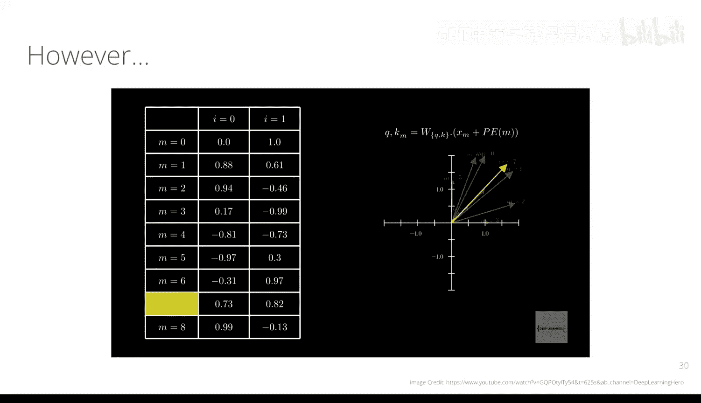

But the problem with this is that it is slower than other embeddings that we've talked about the absolute positional embeddings because it's not fixed it changes in every step because for every single word is different right and then we also have to perform an extra step in the self attentionten layer in order to compute this matrix So if we look at the train speeds T5 which is a model by Google that uses relative positional embeddings it has the slowerest training and inference speeds out of all the different types of positional embeddings with the absolute one being the fastest out of all。

😊，So just to sum up the two types of positional embeddings here we have the absolute one with this very formula equation for attention。

 as well as for relative attention， we have that we still have the matrix multiplication between the query and the key and then we add this matrix S rail。

 which is basically it encodes the distances between the tokens in the sequence。

So just something funny for you to remember， basically for absolute position encodings。

 you are adding the position to the token itself before performing attention。😊。

Whereas for relative positional encodings， you get the tokens themselves。

 and then you calculate the distance between them， which is that plus part。

 And then you apply a attention mechanism。 So this is also where the extra step comes in。

 which makes relative positional encoding slightly slower than absolute positional encodings。😊。

So now we'll just go on to rotary positional embes。

 having heard about the limitations of both absolute and relative embes。😊。

So here we have an example sentence your cat is a lovely cat， so with rotary position embeddings。

 we can create this sort of representation where we have D equals to two。

 we can get it on this plane such that it' very nicely rotating counterclockwise anticlockwise So your cat is lovely cat So with rotary positional embeddings。

 we can represent the distances between the words properly right because you see that when we look at the angle counterclockwise。

 the words that are closest to each other will have the smallest angle and the words that are the furthest apart will have the largest angle when you look at it anticowise。

😊，So basically rotary positional embeddings will encode this absolute positional information into the tokens in a way that it only depends on the relative positional information so what this means is that we still have the absolute positional information because the first angle that pumps up would be the first the first angle with the smallest angle counterplwise would be the first word and so on and so forth right and we also have the relative positional information because we know that this is the six angle going between each token right it's just the same data going between the tokens。

😊，And so this relative positional information will also be preserved by the attention function。

 so we don't have to do any additional additions， for example。

 like with relative positional encodings。😊，So how they do this is through this rotation matrix in two dimensional space。

 So this is why it's called rotary positional embeddings or it's a rotation matrix in D dimensional space and this is just an example in two dimensional space this is what the rotation matrix will look like。

 So what we're doing is we multiplying this rotation matrix with the root matrix and the input itself right and this data is the same data that I talked about previously with the absolute positional embeddings。

 the sinusoidgo1 So this paper that introduced rotary positional embeddings also uses the same the calculation。

😊，So why this is the rotation matrix， if we recall from previous math that you might have learned。

 basically if you have an input vector v n and you multiply it by this rotation matrix R theta。

 which is basically the cosine sine negative sine sine cosine。

 you will be able to rotate it to empty clouddwise counterclockdwise by angle theta。

 so that's why we are multiplying the inputs with this rotation matrix。😊。

So we've covered the 2D case so。we blow up the dimensions here is the 2D case and then we move up to the 4D case and we'll see that we still have the same fundamental structure of the rotation matrix。

 the 2D rotational matrix and we just added up diagonally So this is how it looks like for four dimensional and then we just continue scaling it until D dimensional。

 which goes from theta1 theta 2 all the way to theta d over 2 again。

 d over 2 because we have both the even as well as the odd components right of。😊，Of of the data。

Of the。Right， so， but the problem with this is that it's a very fast matrix。

 So this is not computationally efficient to compute。😊，Therefore。

 what we do is that we can reduce it into this computationally efficient form。

 you can read the paper for more details of how exactly they derived it。

 but basically you can see that for the red box here。

 it's all covered in the first two rows and the purple box is in the next two roles and the last the green box is covered in the last row last two rows。

 So in your homework， youll be primarily trying to implement this rotary matrix when you're doing the forward pass and so on with your rope embeddings。

😊，Question。Yes。But would you mean that you have it even in the odd of the status so you only need the over yeah so you see that here because you're applying a rotation right so you have two。

2 components， because you need cost data and。You need a 2D matrix to apply the rotation。

So if you have a D dimensional D hidden dimensions。

You will split it up into just D over2 to get the result in a D dimensionional output。Yeah， it's。

 it's basically kind of similar to what we covered previously on the absolute positional and meics that sinusoid dont1。

 because if you recall this one also has。啊。Because the I will range from one to d over two。

 so there is an even component and component， so it's a similar idea。Okay。

 so we're almost done with rope。哦。So what group promises right。

 why we are trying to ask you to implement this for the homework is used in many models like Lama2 as well as Google's P。

 because first of all， there is faster convergence of training and also lower overall validation loss so the one using work is in blue。

 we can see that as a lower loss for both mass language modeling as well as language modeling and also has better generalizability to different sequence length as opposed to as positional embes So this is what you'll be able to implement and in the homework you actually be able to see both of these improvements from the normal implementation of mean GPT。

😊。

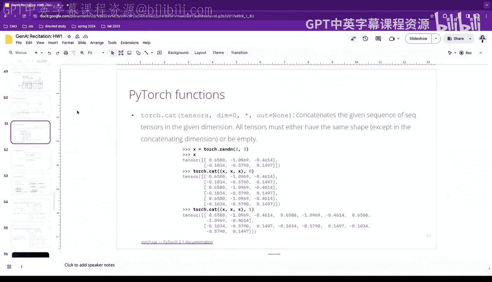

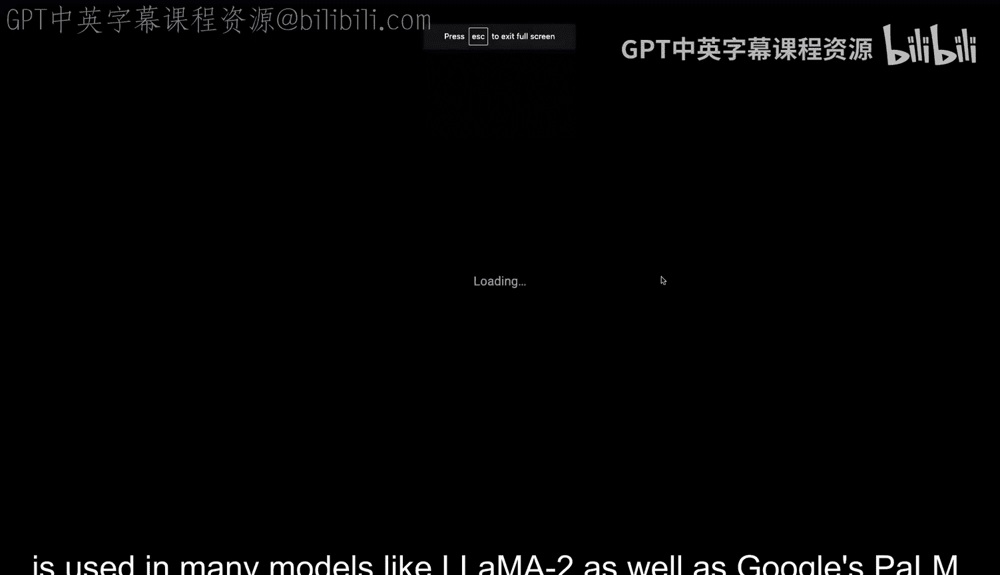

So lastly， just a little bit about the Pythtch functions to wrap out this road segment， we have Toch。

t act because of the interest of time， I we won't go through the function into detail。

 but you can read the documentation at the link here and also we have poch dot sign and toch dot course which helps you to calculate the sinusoidal components。

😊，And also cause the eyesight as well as torch do earringch。😊，And just one last part about rope。

 this part， because you'll be dealing with trying to convert the math equation that I showed earlier into Pytoch code。

 this is just an example of converting the math equation of the sinusoidgo embeddings into pytoch code。

 So the first thing is just to get that position ind is k ranging from zero all the way to sequence life minus1。

 and then using the po a range method and we unsqueezed it so that it will be the same dimension as our positional embeddings。

 which has the dimensions of sequence length comma D。😊，Right。

 so here we let just creating the positional indices， So it will just be0。

1 all the way to sequence length minus-1 and embeddings。

 we firstly initialize it as just a zero's matrix of size of shade C length comma D and then we want to calculate the denominators in the formula So it's this part over here right where so this is just again po from a range going from0 all the way to D divided by two So we first get the indices from I equals to0 all the way to D over2。

😊，And we then just use the torch about power function to raise and to the power of this exponent here。

 And here we will have the denominators。 and then we just apply the signine to every even position。

 with this is just a Python syntax that start from zero and then we go by every two steps。

 we apply the signine function and for the odd position， we just apply the cosine function。

 So we just divide position， which is K here， and we divide it by denominators， which is this here。

 So actually it's very easy to convert this math equation into Pytoch code。😊。

And just one last thing notice that this embe will be fixed for a given sequence length D and N and it will remain constant throughout training so in order to speed up your training process。

 you just store it to prevent recomputing it every single time so just remember to do this to store it when you're doing calculation so you don't repeatedly calculate it every time doing training Yes。

😊，Yeah， so I is it goes through because you have D hidden dimensions， output dimensions。

 So that would be I goes to one corresponds to your first hidden dimension I goes to two is your second hidden dimension and so on。

 And K is the token position in your sentence。 Yeah。

 so just two these two variables that you should get to your bottom。

 So basically K range from0 to sequence length minus-1 and I will range from10 to d over two minus1。

😊，Because we are。Because we are multiplying it by two it's a2 I and 2 I plus one。

 so the maximum that we can reach with I equals up to D by2 is d。Okay， yeah。

 I think our past of finance is talk about group query attention。

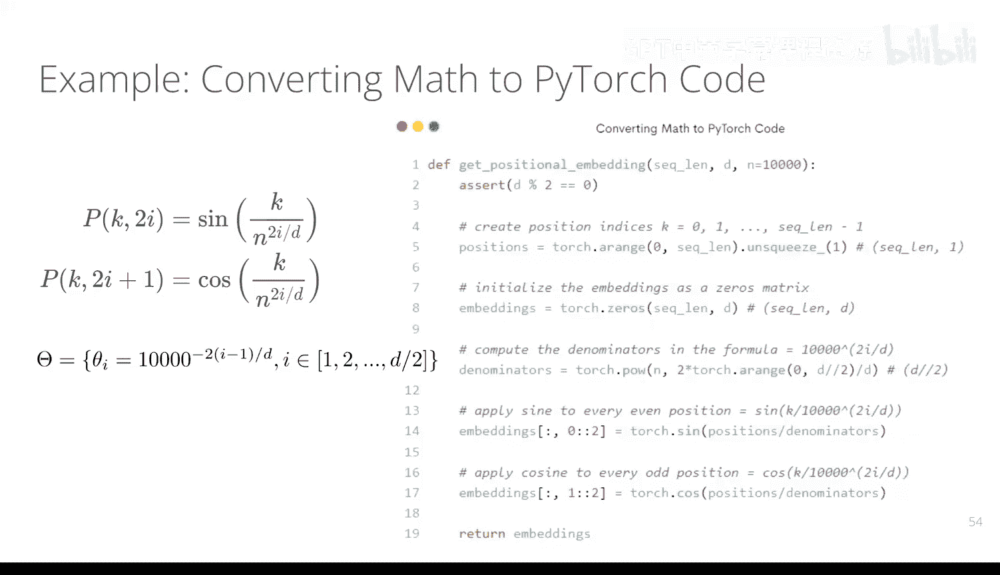

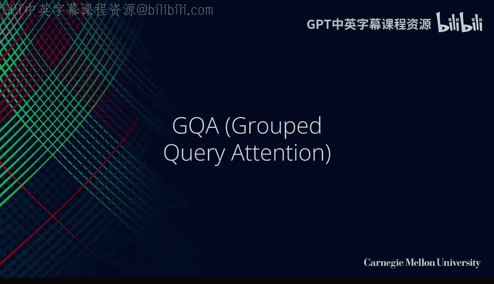

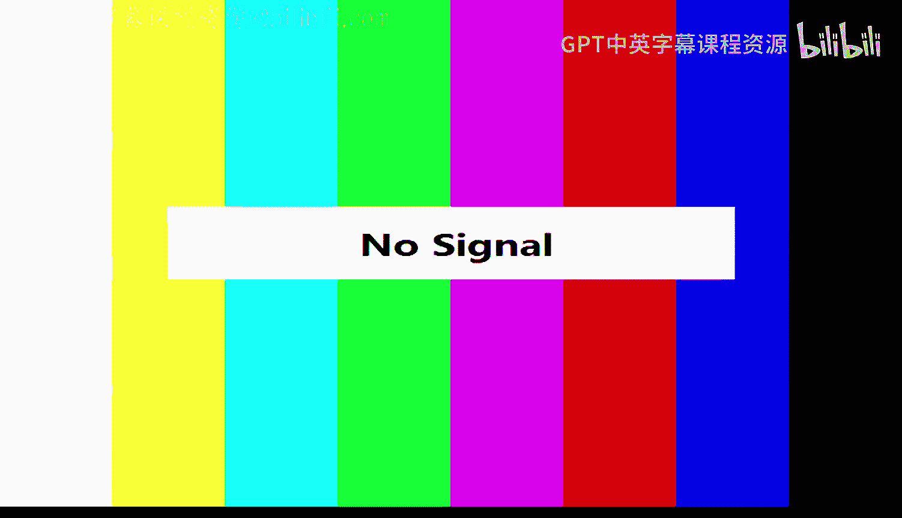

我不讲。

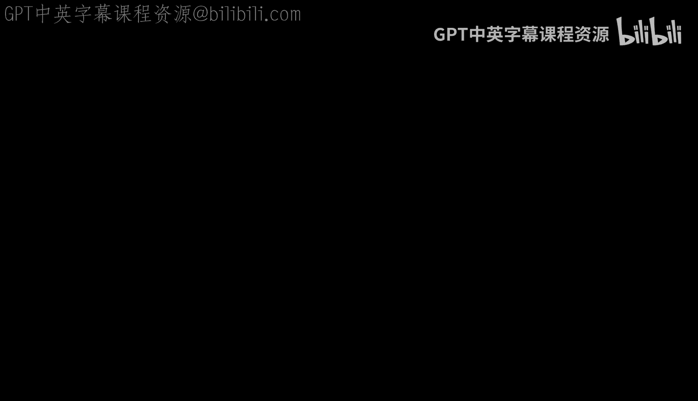

对。

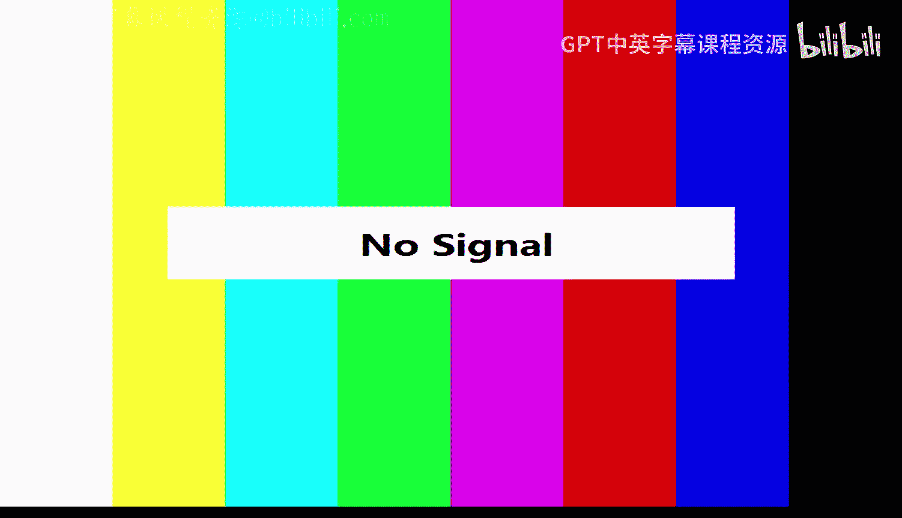

对的。Okay so let's get started with group query attention。

 so this is one of the path that you'll be implementing in your coding part of the homework one。

So before we get started with grouped query attention。

 let's quickly recap what we had learned with multiheaded attention I think most of us are already quite familiar with this concept but we'll quickly go through what what it entails so say for example a word like Apple would have D model dimension of like the length of the embedding of a word apple would be d model so let's assume like let's say it as 512 now the entire embeending space is split up into H attention heads and say for example if I consider the number of attention heads to be8 then we split this entire d model into eight equal subpaths and each of these is then passed on to fall calculation in the different attention heads of the entire attention model so like for example attention head h1 would compute the first part attention head H2 would compute the second part and so on so forth。

😊。

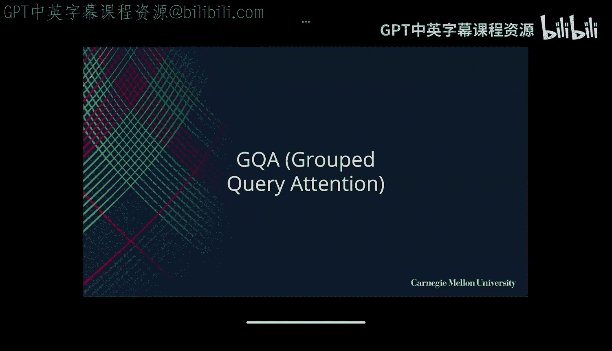

At the end， all of these attention values are then concatenated and then passed to the linear thereer。

😊，So this is like a basic concept of multi headeded attention right。

 And we can look through like a detailed representation of how these heads like individually operate。

 So all of these head multiheaded attention in multiheaded attention。

 each head computation can work in parallel。 There's no dependency between each one of them because like。

Individual parts of the dimension are calculated separately and then at the end you just concatenate them together so in this case。

 for example in what would be the dimension of the query matrix it will be the head the number of head times the number of sequence length so let's assume that d times the dimension per query head so what would this dimension B it would ideally be the D model divided by the number of heads so that like you basically spliting the entire d model into the number of heads so each query head gets like say 64 dimension width of the information of that particular word。

Then you multiply and each of the value and keys also would have the same dimension。

 you multiply Q k transpose and your attention matrix would be of the size h cross t cross T。

Where this is basically matrix of a square matrix of size t cross D where you would take this attention matrix represents that what is the attention of a particular word given all the other words in that particular sequence right and then you multiply it with you do a soft max layer you scale it down by root over decay。

You multiply it with the value and then this is the output now this would give you 64 size embedding and then all of these 64 are concatenated so 64 into eight you would get back your the model dimension。

It said this is mighty headed attention。But what is one of the disadvantages of this multieded attention So for this we need to understand the concept of incremental generation incremental generation is a case where Lns produce the output one word at a time so when you're producing the word at a time youre actually taking the sequence input of just one word but you're computing the attention for all the words that appeared before that word so in this case if you look at the equation of attention the size of the query matrix where it is number of head times the sequence length。

 this is generally1 in incremental attention whereas your key and value mates would be number of head times the sequence length L times the dimension this is 64 example。

So this L would generally be the number of words that have appeared before this particular word。

 so say if I'm generating the 101 word， then the value of L would be 00。

So the issue that what could be an issue that would come up with incremental attention and multi headeded connection together？

Any ideas？Go ahead to and more exactly so as like we start generating long sequences。

 your L will keep increasing and then like once you I mean it will become very difficult to load those large key and value mattresses to them the memory and then do our computation so how do we go ahead and reduce this computation or the memory usage so simple way to reduce the memory usage here is edge so the dimension of these K and matrices is edge cross L cross decay so one way that the authors of multi query attention thought was to just drop this entire headed。

Right， so that lies that led to the rise of multi query attention。

 what multi query attention does is instead of having different。

K and value matrices for different heads they just had a single key and single value matrix and the same one the same key or the value matrix was shared across all the queries and the computation still remained the same so for example in this case the number of query heads is still the same as our previous multiheaded attention but we just have a single key key matrix that are shared across all the heads。

😊，So the final number of computation the attention computations are still the same。

 you still have eight attention matrices that are computed。

 each one of them is again then multiplied with the shared value matrix to produce eight different output。

So each one would again give us 64 dimension like the embedding dimension and all of these are concatenated to give us a the model embedding size。

But what could be a downside to the thing like。Exactly so it might not be efficient right like the performance would not match multiheaded attention because we're just squeezing all the information into just one key and one value and that might be like information loss so then what could and I think take the next life and of clearly depicts what's the tradeoff between like the time it takes versus the performance so if you notice this graph is basically a performance versus time plot。

😊，The time， generally the time it takes per sample should be lesser。

 so we will want like the values to be towards the。

 I mean towards the left side of this graph and performances in perplexity and the performance should generally be higher。

So if you notice here， multiheaded attention has higher performance。

 however it takes longer to generate versus the multi query attention which just use one head and one value matrix has lower performance but it's quite faster。

 so we would generally want something that comes up here where it is like well is golden performance as well and also takes less than。

So what could be a way to just like combine these two and get to a common point Any ideas we can have more than exactly so very like a very intuitive and a easy hybrid solution is just group query attention and this is what you will be implementing in your homework one in the coding part as well so it's I mean this figure I think does perfect justice to the concept it's quite simple to understand it's somewhere between multihybrid attention and multi query attention in multi query attention this was always strictly one whereas in group query attention it's lesser than the number of query heads so the key and values are lesser than the query heads and you kind of form these groups so say for example in this case these two query heads form a group with this key matrix and the value matrix and this key matrix is shared between these two query heads。

That and so on and so forth， so in this case we have four groups that are formed let's look a little in detail about like what happens here exactly。

So again， your query heads， so the only like one major difference that you will notice is the number of heads。

Now you would just not have edge， but you would have to distinguish between HQ and H say KV。

Because the number of heads in key and value are different from the number of heads in the query。

 like generally we're all used to performing multiheaded attention in our code。

 just like this is one thing that you need to keep in mind。

So number of query heads times the sequence length， that was S。

Times the dimension that is Db right so this will be something like for this case eight cross if I'm doing incremental generation then one cross DV would be 64 that 64 comes from52 cross 52 by 8。

Number of key heads would B4 in this case， cross S cross。

D this is also the same now now if you notice the number of attention computation is still the same like I'm using the say key key matrix and'm multiplying it with grouped queries。

And the number of attention computations that I'm doing eventually are still8。

 so this is similar to our multi headeded attention or multi query attention just that I have reduced the memory in comparison to multiheaded attention and I'm trying to improve the performance and comparison to multi query attention。

😊，Right so and then rest of these parts still remain the same like each of these。

 like once you multiply these two attention matrices with value。

 each of these would produce two two outputs each。And each one would have 64 dimension。

 64 into eight times would give you five2 the。So in terms of the computation。

 we just mentioned that it's similar to multiqu attention or multiheaded attention。

 in terms of memory efficiency， it's somewhere between these two where multi it's better than multiqu attention。

 but it's lesser than multiheaded attention。So I think the next lot。

Next plot kind of shows pair GQA stance， this is exactly where we wanted it to be higher performance and lower time per sample right and this is like this is what we were trying to achieve and GQA stance at that place。

Any questions before we move on？

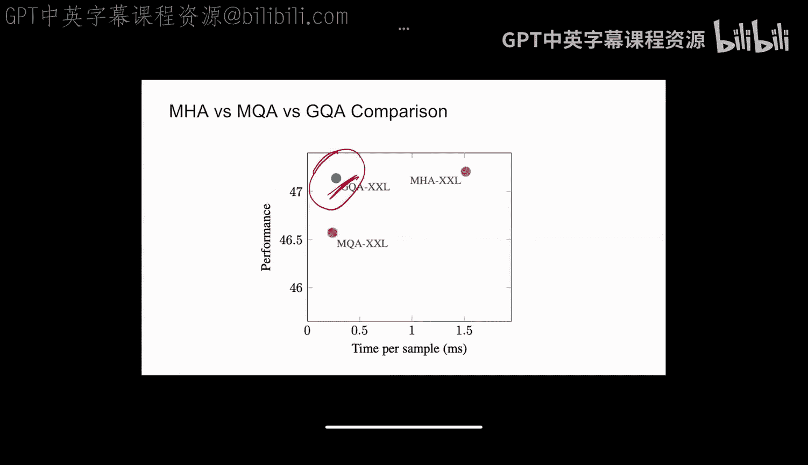

Yeah， I enjoy some general rules for like tu the like hyperparameter from groups there are the number of groups。

 yes， so if you look at the paper for grouped query attention。

 they kind of draw a plot I can roughly show you the plot where they show that this is your like in terms of the performance。

 this is multi query attention and say this is multiheaded attention。

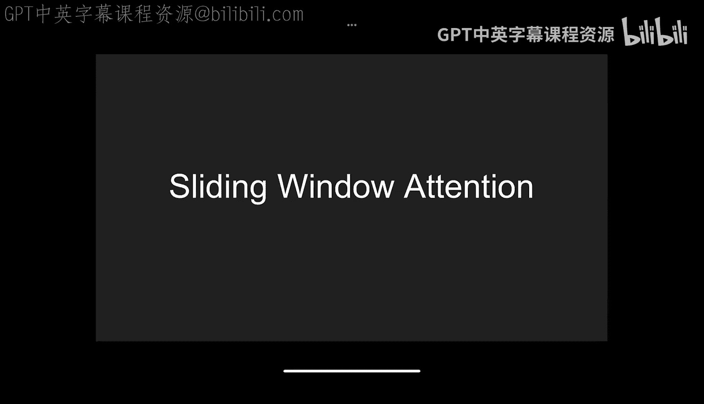

So if you keep and this is like as the groups increase right so in multiberry attention your groups is always one and this is just like a baseline and in multiheaded attention it's say like the maximum value that you' have set say for example eight or it actually in general cases you generally have more groups so so the group like the heads would be eight so groups would be。

😊，Yeah groups would also be so if you keep increasing the number of groups you see that like like the time it takes or the performance kind of pivots after a particular point so they did that experiment as well so you could read that read about that in the paper it does explain a little more clearly but yeah they did that experiment。

Any other questions before we move？Yeah， so since if we generate my do sequences。

 students after store if Q maybe ten that increases so you're not doing as we're just trying chain damage of。

To overcome the so yes， but the number of heads that you have is reducing so like edge so eight cross that long value versus say full cross that long value you're essentially reducing it to half。

Yeah， that it's reflected like it's just sort of。With saying in our system constraints。

 you can get it twice as long sequence or as as long sequence as roughlyway yes。

 it but if say you have the same lens sequences or up to a point， you can still reduce them。

Okay so let's move to sliding window attention this is part of the I mean sliding window attention is not something you would be coding for homework one。

 but it would appear in your written by of the homework so sliding window attention before we move to like what happens in sliding window attention let's quickly recap and I think everyone like knows what happens in full attention I wouldn't pay a lot of I wouldn't spend a lot of time here but very quickly this is an attention heat map of like a t cross T sequence so for example the sequence length was 10 so this is an attention map of that particular sequence where each word can attend to all the other words in that particular sentence or the sequence right the time and memory complexity in this case is order of n square we all know that。

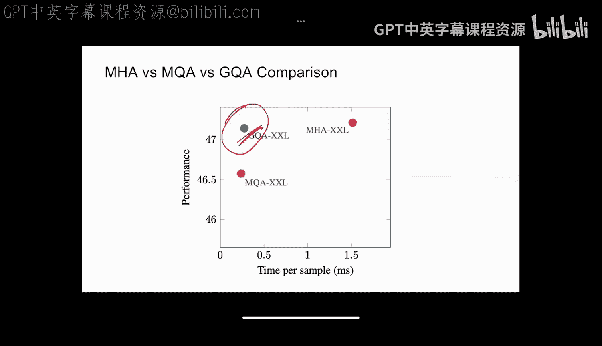

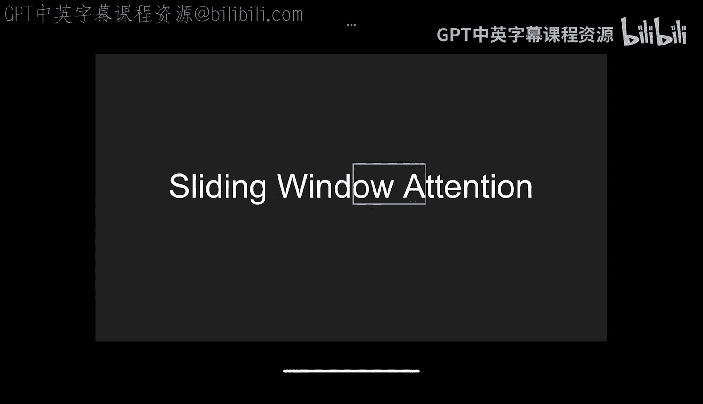

Now this so one other thing that I think A was also talking about is when we are trying to train the model。

 we should always look， I mean， generally be focused on the words that are。

Previous to the that particular current word and we shouldn't look at the words that come after it because that could be cheating so one way to do that is we generally mask out the upper triangular matrix of the attention attention matrix and this and only this part is retained this would ensure that you're not looking at the future words but just looking at the words that come prior to it。

Either ways， again the memory and the time complexity would still be author of n and as say for example。

 if your task is to summarize a long document of say 2030 pages then you cannot build such attention matrices where your attention matrix dimensions would just explode and it becomes really infeasible to load it in memory do your computer so one of the ways to solve this was proposed in the longform paper and this is called sliding window attention setting window attention is as simple as like the word I mean the name itself it just means that for each particular word you're going to focus on w by two words to the left and right and you're just going to attend to those many words for a given word and not focus on the rest of the sentence so what is w is basically your window size so for example in this particular case your W was set to4 so for each。

You're looking at four words， two to the left and two to the right。

But and so in this case the time complexity would reduce down to n cross w and if your w is not like as comparable to the sequence length。

 if it's just some numbers say for example，410 even 20 in that case you are kind of reducing the time complexity to linear rather than quadratic right but one question I think。

I hope all of you have is what happens if this word has like important information at this position or this word has important information at this position were just ignoring that entire case and just focusing on the just neighboring words right so think of this particular attention matrix as the first layer of your computation so in the first layer your attention matrix would look like this but as you move across layer you would be incorporating other information as well for example let's say this was your like this is your sequence in the first layer and this is your sequence in the second layer。

😊，And this is your sequence in the third layer。So this particular world will be attending to。

These words。 So this is layer 1， layer 2， layer 3。 So layer in layer 2， it will be attending to this。

 and this particular word will be attending to these ones。 So indirectly at layer 3。

 you're also having the information from。Like so words to the left and not just two words to the left So eventually as you increase the layers you're actually looking at all the words in that particular sequence or all more if you have enough layers all possible word interactions you end up being quatic anyway like so we would not keep increase like so we wouldn't increase the number of layers so that it like matches all these I mean so that we could incorporate all the sequence we would still have the layers to be as many as like we would have general generally but it like eventually you do you're not focused only on like the window size towards the left and the right but you do have a little more information towards like other places as well yes question。

So if you don't have all of the biggest other words。

 those who have to snakeball in they originally had a bar or forgotten。

So yes this is a very good question and I think like when you read through or look through the longform people I should have put that image here but it's not related to sliding window attentions I did not but one other thing that they did in this case was they also randomly picked some other like so they just randomly picked some other words in this particular sequence so they would look at the window size and also randomly look at some other words so that like youre increasing the attention span。

😊，So for causality purposes， when you only be looking at the worst my， knock the ones up into other。

 yes， you would do that。so this is like a comparison of self attention versus sliding。

 but if you're looking at causal self attention versus cause the side when no attention then you should look at。

Yes， does that？对。Yes， we will look into like how what happens and how do we compute this particular se into attention。

 but it is。😊，这个白色啊白色有。Exactly， so that that is exactly what I answered that this is this particular diagram is in comparison to full self attention。

 but if you are doing casual attention cord sliding window attention。

 then you should look at only the left window。😊，generating generating that people not。

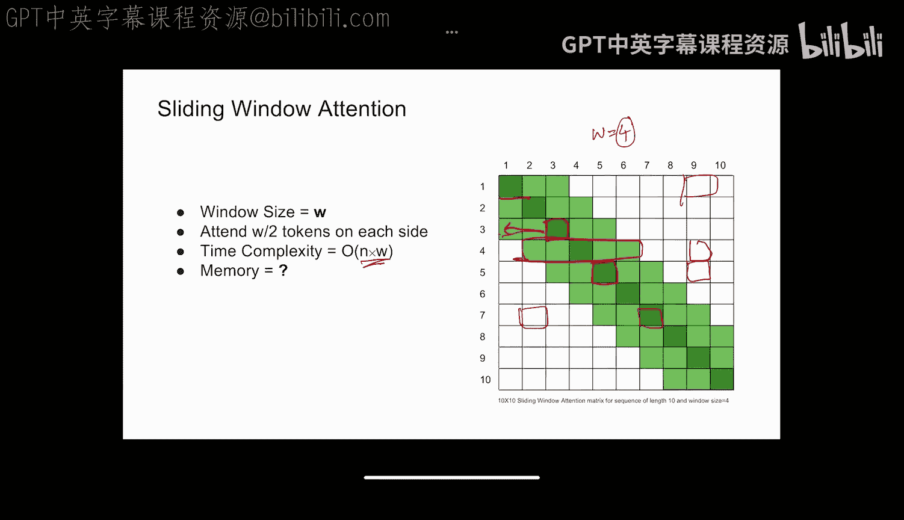

Okay so very quickly we'll just look at what happens so we asked chargeGPT to generate the code for sliding into attention and it it straight up gave us this so what it did is for causes as attention it gave us a mask that looks like this where these parts are masked out and this is what is considered and for sliding into attention this is the code that it gave sorry this part where it said like basically it it rated through each of these words and looked at a window size of w by2 and w by towards each side and masked out these parts and only included this but what's the downside of those。

Still has the full size of it， exactly。Exactly， so you're reducing the I mean the time complexity。

 but your memory is still the same you're still having an end cross and attention matrix so。😊。

I mean this is not an even though ChaPT thinks this the right way it's not because it's still computing and cross and metrics so I think for your for your homework you would have to think about how you can optimize this。

😊。

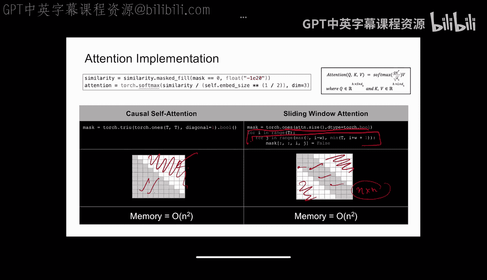

Right and so we'll quickly look at two more slides and then I'll take other questions so like when I was coding this I personally thought that these two functions or the ininops library would be very useful for you when you coding this so there are two major functions and I thought would like make your life really easy in this assignment one is the rearrange function and the other one is the Einom function will look at rearrange first so like a lot of the times when you're coding through you would have to keep like moving your dimensions from like one case basically swapping dimensions or changing the way like 4D matrix looks and IOs does a very good job of providing a rearrange function where you can just specify your dimensions and then how you want to rearrange them so in this particular case like what is happening here is。

You are switching between。Like w you're basically rearranging BCCHW to B WCH first and then looping these together to get a 3D 3D vector 3D tensor right so like I mean a torch Py to equivalent for this particular code will do this it would first for mutute your dimensions of the tensor and then do a contiguous view of the tensor and then multiply things together to get a 3D representation I personally feel this is not very intuitive and like so that's why I find rearranged intuitive you can just specify your dimensions and how you want to group them and how you want to rearrange them。

Another。

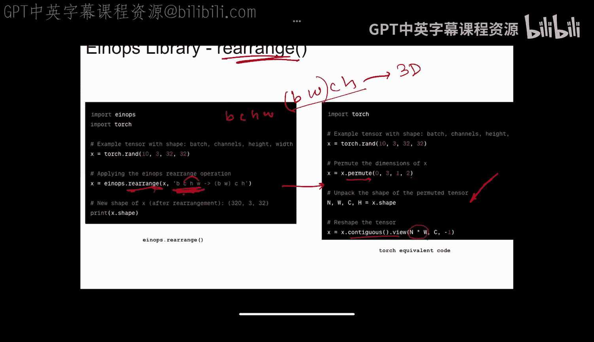

Another important function is the einsome function Einem is Einstein summation so in this also it is it is quite quite straightforward I would say you would specify so it basically is used for like generally in our the purposes of our code in homework one is would be used for matrix multiplication so say for example like you have to matrix versuses A and B which are whole dimensional and you would want to multiply them so you just write the dimensions of these matrices and like in what dimension do you want the output like what is your expected output and you will multiply accordingly and give you the final output so say for example in this case a was two cross three cross four cross5 and B was two cross three cross5 cross6 so the five and five get canceled and you you would expect it to have two。

3，4，6 dimension and dust actually。え？One other thing that you should keep in mind is that the Einsom function is provided by two libraries。

 torch has its own Einom function and IinOs is a installsable library which also provides Einsom。

The only difference between these two for us when we are quoting is2 dot Einsm just allows you to add characters as your dimensions whereas in this you could also do something like say Q H as one dimension or sometimes like batch is your one dimension whereas in this case you just would have to give individual characters and like after 20 sets you run out or otherwise sometimes it's not intu like you cannot call batch right so for that reason I prefer Ein dot I mean Ein ops dot einsom。

Generally， Dosh dot Einim is a little faster when you're working with Pytorch。

 but for our use case I don't think there'll be a huge difference so you can use either one of them。

I think that brings us to the end of the recitation， any questions？

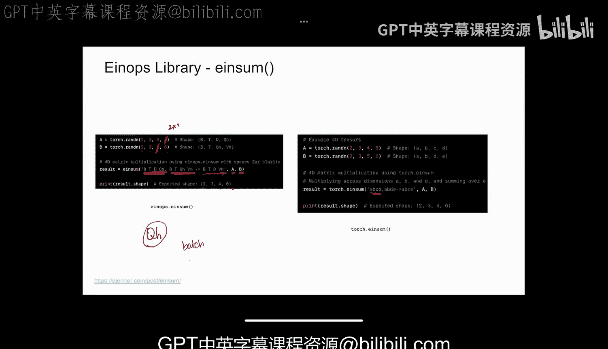