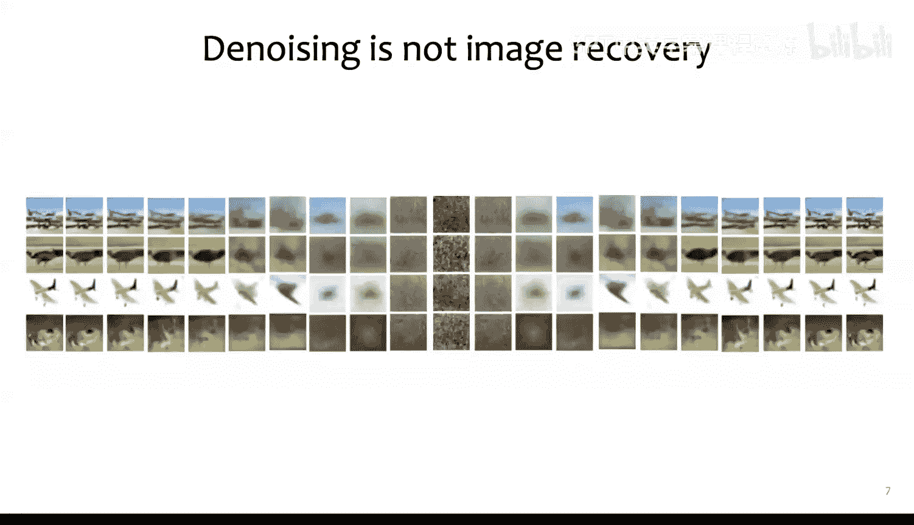
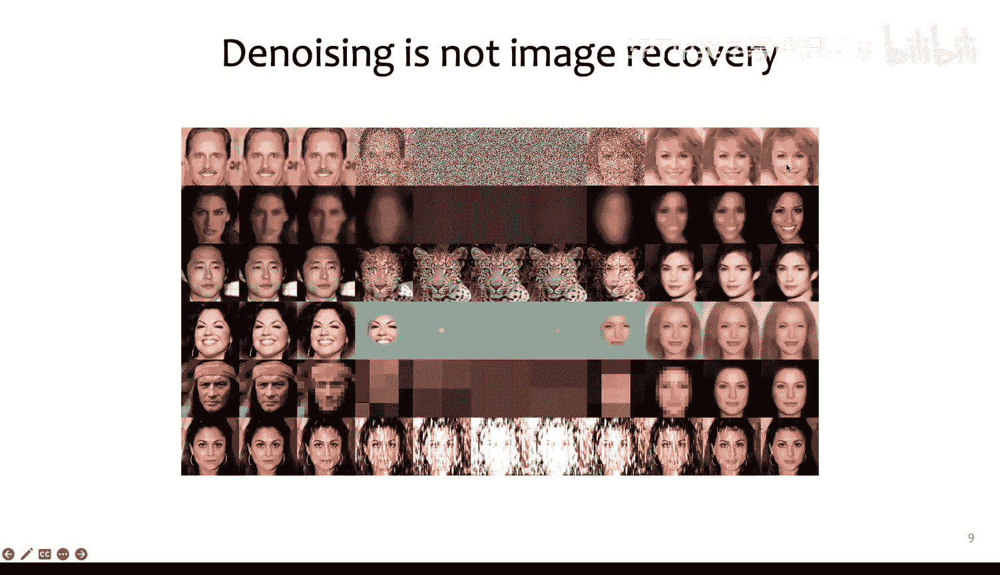
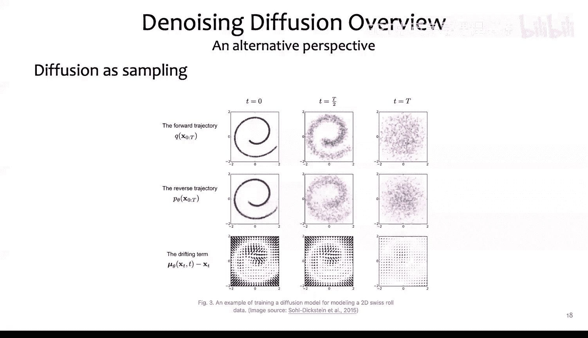
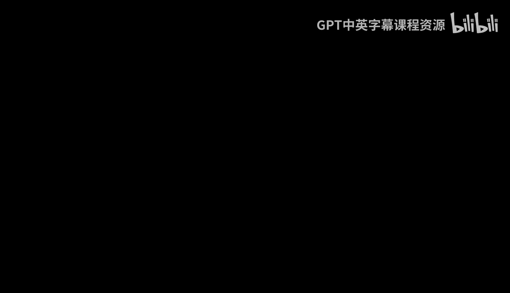
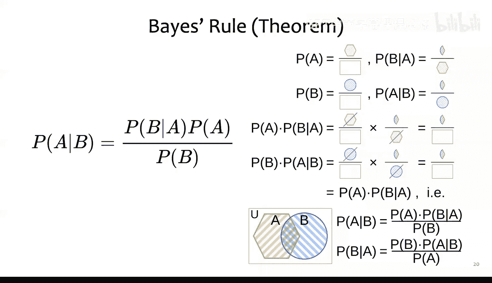
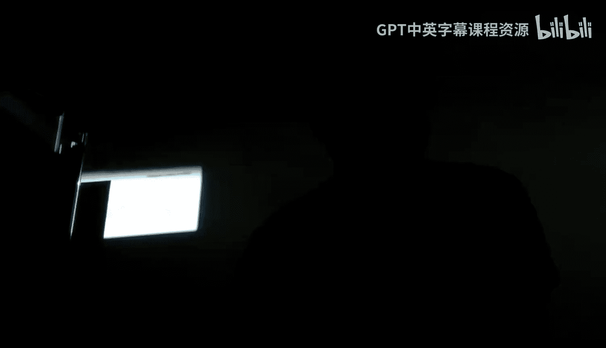
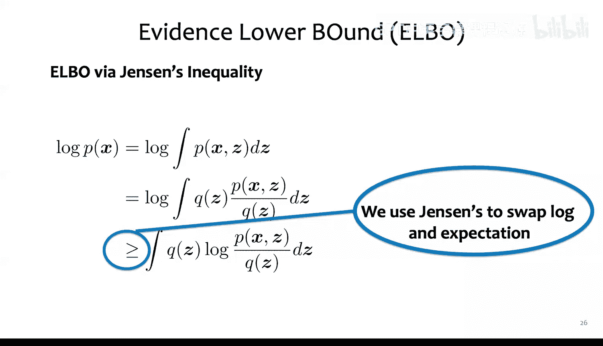
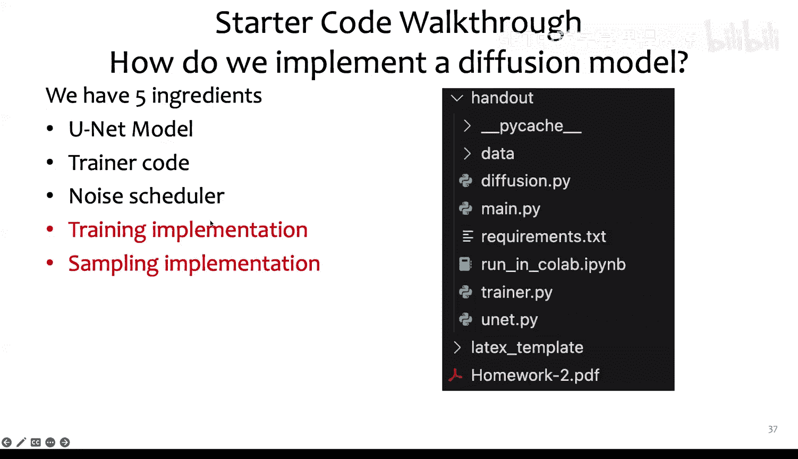
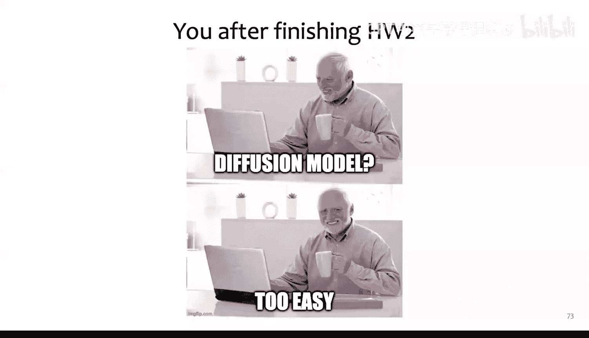

# CMU《生成式AI｜10-423 generative ai 2024》中英字幕 - P32：-P32-Recitation- HW2.zh_en - GPT中英字幕课程资源 - BV1CyC9BPEhG

So happy Monday， everybody， and welcome to the Home two rest stationation。

I hope you guys all had a great time on homework one and you're just fresh and ready to go for homework two。

So let's get right into it。So here is our agenda， we're going to be first starting with a brief overview of the diffusion model from lecture。

And then we're going to be diving a little bit into some of the math behind the diffusion model so that can help you on your written section in the homework。

😊，Then we're going to look at a little bit of the starter code for Home two。

 we're hoping that the programming section is going to be a little bit easier this time around and we're going to give you a little bit more support。

 so we hope it should be really smooth for all of you。

Then we're going to talk briefly about the metric that we're going to be using for this homework section called the FID or Fchet Inception distance or fchet。

 ft， I'm not sure， and finally we're going to be looking a little bit at some practice reading documentation and looking at some of the Pytor functions that you're going to be using for this homework。

Okay so let's start with the overview of the diffusion model since this is recation I really hope this is going to be interactive。

 so I guess I want to start with a question for all of you。

In the diffusion model we have this forward diffusion and we have the backwards diffusion or the reverse diffusion and when we talk about a neural network we also talk about a forward pass and we talk about a backward pass。

 so can anyone tell me are these the same concepts is the forward diffusion the same thing as a forward pass through a neural network？

Anyone。Yes。啊。好的好好的啊。case。Or you're applying the forward pass。Like that question。And sort。

Getting rid of the image over time and typically an improvement that for us it would be。Instruct out。

 but doing some kind。More useful update。Yeah， exactly so don't be confused that forward diffusion method is adding noise。

 just like this student said as a great response， Thank you very much and in a neural network we're going to have a forward method totally different conceptss' get confused。

😊，Now can anyone tell me is this diffusion model you know is this going to be a Markov chain。

 can anyone tell me what is a Markov chain and is the diffusion model is the forward pass through the diffusion model a Markov chain？

Each step doesn't depend on gift。So can you say that again or so the a noise part does not the condition on this？

Yes so it doesn't matter future how about the reverse process is that also a Markov okay？好。

It depends on how it do it。I don't know， so what if we use the version that we're showing in this slide？

That kind of looks like it， so only conditioning on the previous step， so yes， we are going to。😊。

Okay， so hopefully this is all feeling familiar from lectures。

 but just to give a brief overview of the diffusion in the forward process we add noise at each step until we get a totally corrupted image and in the reverse process we're going to be using a neural network or a Unet in order to remove that noise。

😊，But to be honest with you。Yes， and our goal in training the diffusion network is going to be training that unit that's going to be removing the noise from the image so that we can do the reverse diffusion process。

I guess I have another question is x zero， is this the noise free or the totally noisy image？😊，Okay。

 what about XT， is this noise free or noisy？Very good。

 very good Okay so when I first saw this presentation it did make sense。

 we add noise and then we removed the noise but I still had some confusions and I was thinking。

 you know how does this work like noise is the absence of all information like in order to just generate Gaussian noise we only need two pieces of information and we go to this beautiful image that has tons of information in it and so it's like it was removing noise the same thing as adding information I was thinking to myself and I was thinking no。

 that doesn't make sense like maybe all we're doing in yeah， this is me。

 I was totally confused like how is it possible we can go from total noise to just an image that's impossible you can't do it you start from noise you go to an image impossible but if you go step by step over 500 time steps it's actually print out to be totally feasible and it works perfectly。

😊，So I had some confusions and I was thinking， you know。

 maybe denoising is just like we're kind of adding a bunch of junk to the image and then we train the network to kind of memorize what the junk is that we added it and we remove all of that noise and so we get back the image that we started with。

Is that correct， can anyone tell me？Yes。How it's the。There's so many hostile areas。ち。嗯。Yes。Okay。

Exactly that's correct so our network is not learning all of that and there's another way that we can easily tell that we're not just like doing the exact process in reverse can anyone tell me how we know。

Another hint that we have。So when we remove all the noise and we get an image。

 is that image going to be the same as something that was in our training set？No。

 it's totally different， so we're not just removing all of the junk that we added to an image and getting back to the original image so that's important it's not just image recovery。

So it actually looks like this， we start with some image。

 we add a bunch of noise and we do is is our forward diffion。

 and then we do our reverse diffusion and we get out something totally different。😊。

And so I was really confused how did this work like is removing noise the same thing as adding information like for example。

 if my neighbors are out there and they're making too much noise and I go knocking on the door instead of saying。

 excusecus me， can you please make less noise， should I actually be saying to them excusecus me。

 can you make more information like is that correct？

And so no actually it's it turns out that this there's another way of thinking about diffusion models that could help you to understand this a little bit more when we're doing our keynoising step we're actually going to be adding information and we're doing going to be doing it in a specific way that makes sense so let's get it briefly。

😊，So just as some background I'm going to start let's start by thinking about images of vectors。

 so let's say we have this RGP image of a cat can anyone tell me how we can decompose this into a vector。

Okay， I'm hitting some flatten。Anyone want to add more detail？I that。Exactly。

 so we're going to have three channels that red， the blue and the green。

 and we're going to separate them out and they're each going to be the pixel and then we can flatten the thecatenate until we get each in a massive vector in this case we have 32 by 32 image。

 32 by 32 by 3 makes 3072 and each of the values in this vector is going to be the pixel intensity of one of the channels of a single pixel。

😊，And so that means that there is some sort of high dimensional space。

 3072 dimensional space in which each image is just a vector。

 so it's just a point in this really high dimensional space。😊，Is everyone good on that？Great。

 and then there's this hypothesis， it's called the manifold hypothesis。

 and then it says that if we construct our dimensions wisely。😊。

That we can actually find a subspace of this massive 300 dimensional space that is composed only of valid pictures。

 So let's say we're only looking at cat pictures。 It says somewhere in this massive space。

 there's a subspace that is all the valid pictures of cats you could ever generate。😊。

And if we could only write down and close form what this distribution actually looked like。

 this subspace that is a distribution of only cat pictures， we could sample from。

 and then we could by sampling from this we could generate every picture of a cat that ever existed because every picture of a cat that could ever exist is in this subspace。

The problem is it's really hard to write down what this subspace looks like in closed form。

But we do have some hints that this manifold hypothesis is correct if you think back to our lecture when we' were talking aboutganNs。

 we knew that there's these latent variables that if you move them through them。

 they have semantic meaning and so there is some sort of a dimensionality space in which there is this latent manifold that if you move through you get valid pictures。

😊，Does that make sense to everyone？So we just want to find some way to sample from this distribution。

But how can we sample these distribution if we can't even and write it down？

And so that's where we if we think about diffusion models as a sampling algorithm that's really going to help us yeah justine that a manifold do we know do we know anything about this shape like do we know whether it's likex or whether it's even in one particular space yeah that's a great question we have hypothesis that it is in one space if we construct our dimensions well and we have some support for that because we know there is a space space that if you move through that space you get valid pictures。

😊，We don't know anything about it it's like highly nonlinear， probably yeah。

 but we have some evidence for this hypothesis。So now I want to think of previously we're thinking of an image as a 3000 dimensional vector。

 now I want to think of just a two dimensional vector。

 and then I want to see diffusion in this two dimensional space。

 and maybe thatll makes more sense of how we can see diffusion as sampling from a latent manifold。😊。

And that'll make the concept of diffusion moving from like this magic we' just removing noise into。

 okay， it actually。There is some sort of a theory behind this。So let's say we have。

 instead of having the manifold of images， we have this kind of complex nonlinear shape。

 which is like this Swiss rule。😊，O没。Okay， so instead of having a latent nonlinear manifold of the images we have this the Swisswill shape and you know just like the image the image distribution。

 the distribution of points that are drawn from this is really hard to write down it's hard to write to harden clause from closed form what distribution this is and that's in contrast to our Gaussian distribution over here you know that's really easy to write down what this is and is's really easy to sample from。

😊，And so what we want to do is in our diffusion network。

 what we're learning is how to manipulate this totally noise distribution。

And get it so each point in this noise distribution is at each time point， they're kind of nudged。

By our youNe。orwards this distribution of this Swiss roll distribution。

 as you can see this in this second row， we're starting with this total noise total noise distribution and each time step our drifting term here。

 the term that the unit is learning is just giving us the gradient。😊。

Of the distribution of this Swiss rule， and so we're just doing by a gradient descent where we move along the gradient of the distribution that we're of the target distribution until we get towards some really high likelihood spaces。

Does that make sense to everyone？Okay， so this is actually a general class of generative models they're called score matching models and what score matching models do is they say well this distribution of images is really hard to write down it really hard to talk about it has a lot of problems so instead of learning the distribution itself we're going to learn the gradient of the distribution。

😊，And then once we learn the gradient of the distribution。

 we can just move along that gradient with a sampling technique in order to we get to the high likelihood points of the distribution。

😊，And so you can see this is pretty much this is exactly what the distributionffusion model is doing we're starting with an easy to sample from distribution a Gaussian and then we just move down the gradient of our target distribution until we end up in the high likelihood spaces and these are the spaces that are valid images。

😊，any questions about that？Have people experimented with using other things besides a Gaussian for noise？

Like just like I you have different linear activation layer maybe you' have a different。

Diffusion layer。That's a good question， Gaussians have really nice properties like we explored in lecture。

 so if you move from one Gaussian to another Gaussian。

 I think you can prove that if you move over long enough time steps you can move from a Gaussian to the target distribution。

 I don't know that might be really hard to prove if you use a different distribution。😊。

But it does sound like a lot of fun to experimentally play around with so one thing I would recommend is maybe you can come to my office hours and once you finish your homework two we can try swapping out our Gaussian with maybe a uniform distribution and see what happens。

😊，So short answer。I'm not sure I know Gausian works well。

 but I don't know if other distributions would work。Yes。😊，Thats perfect。Yes。

 so I'll tell you as much as I can so we know that we have this distribution a manifold of distribution of images that's really hard to write down and so we can't learn that in close form it's difficult to do so so instead we learn the gradient of this distribution and that way instead of trying to sample explicitly from that distribution we can sample anything and then move along the gradient to a high likelihood area of our target distribution。

😊，Does that make sense？What is the gradient false state？Sorry， just just is it， does't make sense。

 is it okay？Yes。Do you have a follow up question or？I have question， So how is that。

what the gradient Oh okay， so this is your question as well right。

 you asked how is the gradient obtained？Right， so when we're learning our network。

 we're learning this mu term and we're taking the L2。

Loss of the noise and the target noise and so when we're doing so you can show that there's like an explicit connection between the objective function that we're optimizing and the diffusion model and the gradient of the target distribution。

I guess for more than mathematical details， you're going to have to look at the white paper。

Which is the original DDN paper is section 3。2， it goes through all the math if you're curious。Yes。

 so here steps opposite the so we direction Okay， that's a good question so we want to get yeah we're doing a hill climbing so。

It might be more accurate to say we're doing something similar to gradient asset。Actually。

 we're not doing either， we're doing something called Longevin。

Lageev dynamics in order to get our score so we're adding noise in here as you can see in this gIF we're not just doing a deterministic algorithm。

 so you can think of it as similar to gradient accent。

 but it's actually not the gradient ascent algorithm， does that help。😊，Yeah。

 but thank you for the question or the potential confusion， thank you very much。😊。

Any other questions？Okay， if not， we're going to move on to Hao Yang。

 who's going to introduce some of the math for inclusionion models。Okay。Yes。Okay。

So I'm gonna actually， before I talk about the mass of some of the DPM proofs。

 I just want to mention your questionnaire earlier about like how people are trying different kind of people trying to kind of distribution or ways of doing diffusion。

 I've actually been working on a project that is basically because DPM and all subsequent diffusion models basically thermo thermodynamic equation for this diffusion process and the project that I've been working on is using an equation electromagnetism。

 which is also another kind of physics neural network。

 But like the partial differential equation works a little bit different。

 So that's also kind of direction that people in general are working towards。

 So maybe just a little bit of extension to your question。

 So now I'll continue to talk about a little bit of。😊。

A little about math related to the written parts of this homework2 in particular the mathematicalmatic proofs that you guys will be writing for homework to written part。

 so yeah for homework too， our programming parts won't be as difficult。

 I will say as more one but we will have some proofs。😊。

And this is just a quick reminder of some very basic probabilistic serum base rule。

 which is really fundamental， like P A given B is equal to PB B given A times P that PB this is basically it's a bread butter for some almost all kinds of like probabilistic proofs So that's something to just quickly recap if you're not familiar with this there are tons of resources available everywhere for you to understand and it's actually truly easy easy to understand just look at picture to the right which you can intuitively understand and that's how one is stolen them from Wikipedia。

😊，So I won't spend a lot of time on this one What I will spend a little bit more time on is the proof of evidence lower bound in shortcut elbow and also in relation to thats inequality which is a very serum that we also using a lot of the math proofs for machine learning optimization and basically what this seems states is that if a function F of whatever is concaid。

 then the expectation of that function is definitely less so equal to the function of its expectation it's actually kind of trivial easy to understand if you think about it as as you draw a line of the concave and and diagonal line over it。

 but in this case we will not go into the proof inequality， but how we will be using that for elbow。

 which you guys will use in your homework。😊。

So elbow evidence lower bound what we want to do is just to find a certain optimization objective for our model to actually learn so that it can improve upon a certain set of training data and in order for us to do that what we will do here is to find to optimize not function not the objective function itself。

 but like a evidence lower bound that we can prove is that the actual that we want to maximize is lower bounded by this is really really to the whole variational inference saying that Matt briefly talked about towards the end of last lecture。

 but since you will be covering more of the math of that we won't be talking about that parting detail but just keep in mind that in practice when we are optimize say for the objective or DDPM we're not optimizing the objective directly but instead optimizing its variational lower bound or in this case。

 evidence lower bound and and we're gonna show。😊，You how this affect works。

Basically what we want to do because were trying to optimize a late variable here。

 we first used modization to make the late variable appear if we have a log of Px。

 we can say it is an log of integration of P SD joint distribution over D。

 This is basically summing over the distribution of the with respect to the probability distribution X。

😊，So after we forcefully made made out the Z， we can use this term for the expectation of gender quality that we will construct。

 so what what that means is basically that we will construct another will we all define other free Q。

 which can be anything。 And after we constructed it as that。😊。

What we can do is that we can ever we multiply a Q Z for for the creation of expectation。

 we divided by another Q Z to cancel that term out。😊，And that well， seems this whole function is。

pretexed by a log logism function。 it is by definition a concait function。

 And we can use trans in quality to directly divide derive that this is more bounded by the equation over here。

😊。

And can anyone tell me why is this this the case？😡。

Yes， chance in。In this case， F is actually log of Pxc divided by Qz， where the Qz is the F neoality。

😊，So when you think of it。Gensioncingality that an expectation of F X is definitely smaller or equal to as of the assertation of that。

 And in this case， if we want to create an expectation out of it。😊。

We record that for a continuous interval when we calculate the assertation of it。

 we first get a certain x in this case， a random variable large large x is a distribution  Qz over here and the function F is actually log of log of P smaller Xz divided by this larger x we just defined。

😊，Everything to our D。And with this work， we can see that we have just proven a very useful s called elbow that basically says for any logarith function。

 it is lower bounded by this integral over here， which is basically just。😊。

The assertation of Q assertation of Q over log P X， C divided by Q Z。

And recall that the the actual stuff we want to maximize in the DDPM DDTM objective is for us to find a distribution that is closest to the actual reverse process by using our para reverse process and using this term to。

😊，Mimize the lower。 you all eventually find that this is the same as optimizing our objective and the process of which I will not cover here because it is while your homework questions。

 But yeah， good luck trying that out and。😊，I hope this gives you a brief overview of how elbow works。

And another thing that you will use in both your actual code and also your proof is the reparameterizationization trick。

 which is also really commonly used。😊，第四 on。Hack in a lot of distribution based math and also machine learning series。

 So basically what we're doing here is that when we are generating a random number result sampling it directly from a based distribution P epsilon。

 we're actually sampling it from another one of our control desired distribution。😊。

Anyone have any idea why we might want to do this？😡。

To directly sample from the desired distribution we easilyYes calculation complexity could be one of this case。

 but since were already sampling something from the distribution we're assuming that we already know what this distribution is so it will more be of a time complexity issue but not on the actual thing that was getting at any other choice。

行。You going to find a boss friend。Yes， you are correct of the first part of it， actually。

 regardless of whatever thing we sample from a distribution， whatever the distribution might be。

 we can still think a loss。 The hard part is how we actually get the loss I gradient from it。😊。

So if it's a random distribution that we don't even know any poverty about。

 how can we after sampling from this distribution of things that backward backward gradient from this sampling process which is really hard to define and really hard to grasp and what we usually do over here is that because we mentioned earlier that Gaussian distribution is a very powerful variationing that almost is able to approximatemate any distribution given some special if if you look at it let's say far enough and that is basically a huge assumption that we' are making in this whole tricking is that no matter what this distribution Ppson we are actually trying to get。

 we're actually going to sample it from a Gaussian distribution and this Gaussian distribution will be defined by a mean and variance mean of new and variance of sigma squared。

😊，And this me。And even though were with this Gaussian distribution of approximation where we are approating the desired distribution with its mean and variances using a Gaussian distribution。

 we're still not actually sample it's still actually pretty hard for us to calculate the actual back propagation for each of those individual cases。

 just because we had to deal with the parameters in each one。

 So another essence of thisization trigger is for us to simple because another nice part of Gaussian distribution is actually you can really easily transform one Gaus into the uniform Gaussian。

 which is mean of0 and variance of one。😊，And we actually actually when we sample the noise factor in DDPM or sampling a random sample in a lot of other stuff that we will be encounter later in the course。

 we actually sample it from a uniform uniform standard Gaus distribution not uniform you know the standard Gaian distribution my bad and after that we calculate this sampled sample noise of standard Gaus distribution by parameterizing this epsilon that we just sampled times it by the standard deviation and plus the sigma I want to I want to keep very I want to stress this to the point that all of this is linear transformation that can be perfectly back propagated throughout the gradient decent process and another key thing that I want all of you to really take notice of is that we are here using sigma Sigma is standard deviation。

😊，Remember how previously when we are actually denoting this distribution and also how you actually write it in code。

 you are using Sigma squared So when you actually use let's say torch distribution and sample the stuff you are inputting the distribution with Sigma squared and that is a really huge study that resulting in a lot of code bugs when you are actually working on it and also a lot of massive available proof box is that there this a tiny little different I think Matt also made this mistake from his last lecture slide that I think he already posted about if not he's going to talk about it in the next section。

😊，So after after this linear transformation， we actually by sampling from a standard Gausian distribution。

 we managed to approximately sample a sample that we want from the distribution of this non standard Gaussian。

 which we use to approximate the actual distribution here。😊，So yeah， that's the reization tree。

And the last thing I will cover today is just data scaling Keep in mind that all the maths that we have done so far are assuming that all the stuff we're doing is in continuous environment。

 but in reality， when we're dealing with image pixels。

 it's actually discrete data set is a discrete distribution of RDB0 to255 and for a lot of maths that VDPMs prove actually used they are actually assuming it to be negative one to one So just keeping in mind how you switch this from switch switch this different scale when you are implementing your code and also when you're thinking about this problem and a really important thing when you are actually if youre actually doing really rigorous mathematical proof about this is that for actual VDPM you have to prove everything in this free time itself in continuous time and that is a huge difference in a lot of probability proofs。

😊，So yeah， that's it， for my part， any questions so far？

I'm just curious so in the diffusion process the numbers in the middle are or define numbers in the middle mean I mean the beingus well you can visualize them so they're actually discrete there are some information log right rounding happens。

😊，Well， technically speaking， all of those can be proven in discrete time。

 so technically there is no information lost because of continuous to discrete ship。😊。

If you can get what I mean， I'm still very confused so say voting point grace go。image。

Before I go to the next step are we going to make it discrete or are we keeping the Oh if that's what you mean by calculating this process we wouldn't make it discrete yeah。

 but when you're in your homework question just also question for you to utilize the all the images to those steps that's where the scalinging comes in and you have to like actually round it up to be able to successfully visualize that yes question。

😊，Comum。嗯。You mean almost evidence lower bound？That's actually a really great question。

 do you guys know？From my understanding， it's just that you can prove by evidence so it's called evidence lower bound。

I'm not you're really welcome to search it up and if you have an answer。

 you're welcome to post on Piaz I will tell it to us right now， so yeah。😊。

I don't actually know how this terminology come to be。😊，Any other questions？Okay， then。

Now we're going to pass on to the coding part。Okay。

I'm going to give an overview of our programming part。So when you open the handout。

 you can see we have this five files and。The main file is the is the entry point of our assignment and we have the trainer and unit。

File and also diffusion file， the diffusion file is the only file you needed to modify。

And in our assignment， we have five ingredients， one is the unit and the trainer。

 and in our diffusion we have the noise scheduler and also we wanted you to implement the training and also the sampling。

The red one are required to be implemented。And for the unit unit is here is a model to like to model the denoing function at each step of the reverse diffusion process and you can see from the structure。

 it has a done sampling and also up sampling process and it can obtain the multi skill features of an image so we will use unit for on denoising。

And for the noise scheduler， it will control the amount of noise we add in each step of the diffusion forward process。

And instead of the original linear scheduler here in our assignment。

 we adopt improved cosine based variance on scheduler and as you can see in this picture。

And the improved one gets more near linear。Noise level than the original one。And。

So for the coding how we train a denoizing unit model。

 we wanted to implement this training algorithm， so first we take a training image and we pick a random pine step。

And we run and we sample also sample noise from a Gaussian distribution。

 and we run this forward diffusion process to generate a noisy X T。And also。

 we took the gradient descent of our of the L1 loss between the noise。

 actual noise and the noise predicted from the unit net model。And also。

 we want you to implement sampling。 So in sampling。

 we want use our model that can revert images with amount of noise。

From T from T to the previous step T equals to n -1。 So how do we achieve this。

 record the lecture Last lecture。 and we introduce like three on different options for sampling。

 And here in our assignment， we adopt the option C。

So basically we have a noise the XT image sampled from a Gaussian standard Gaussian distribution and we go through a loop。

In each step， we will calculate the an estimated x0。And we calculates the。The mean of the。

Of the X T -1。 And also， we know the。The variance。 So we can use this parameter parameterization trick to get the sample from。

 from this distribution and to get the X T-1。 So we need to go through this loop and to get our final result X 0。

Yeah this is a extended version of our sampling so the some difference is we have a clamp here after we obtain our estimated x0 we wanted to clamp the x0 to minus1 to1 that can rectify the。

This。This image。 and also， we clarified equations that we need to calculated。

And here we can see the the mean the post zero mean is relevant to the X T and estimated x 0。

 So we wanted to calculate this in the loop。 But the post variance。

 it is independent from the X T and X 0。 so we can calculate this post zero variance on。

In our like in the initialization of the diffusion， that can make some reuse for better computation。

Okay， so I want to show the structure the code。嗯。Yeah。Why it's not converted to CoLab？Yes。嗯。O。Yeah。

 as you can see， we have our homework tool here and there's the handout file。

And we provide a round incoab notebook。 You can directly use this in this incoab to run the to run experiments。

 So first， we will mount our driver on to to the collab and we will go into the pass。Yeah， here。

 and we will download the data set by running this sale。

And also here we can set up environment by Pa install。Yeah， and also we can。 sorry。

 we can round this training and visualization here， so。I want to show some code here。😔。

In the main file， we define some flags that you can play with。

And we use weight and bias to log the experiments。And here we define the unit as our den model here and diffusion model that takes in the unit model。

And to do the sampling。And and there is another trainer that will go that will use diffusion to train。

And also， if you set the visualize flag， we will。It will automatically visualize the images that you need to put into the。

Put into the assignment right up。And this is the unit structure。

 We already implemented all the unit for you guys， so we can just look through it。In the unit model。

This part is the downsling structure。And this part is the upsseling structures。Okay。

 and in the trainer。And there's a data loader。And this is initialization of the trainer。

And also it's the main train function。So we we will go through this training loop。

And get loss and do some backward here to train the unit model。Yeah and also。

 if you turn on the FID flag， we will calculate the FID here automatically for you。And also。

 this is the visualization code that we provided。AndYou can， you can add it。Yeah。Okay， let's。

Go to the final diffusion。So here we provide some helper functions。For example。

 extract and also cosine schedule。 This is the scheduler we defined。 So you can just。Use this in the。

 in the diffusion。 and also the。No normalization function。 This is used because in our calculation。

 the。Whole training， the image will convert to minus1 to1。

 and this function will unnormalize the calculated image to0 to one that can be projected to the RGB。

Okay， so in our diffusion class and initialization。

 we wanted to define the scheduler and also pre compute some coefficients that can be efficiently reused in the diffusion process。

And for the training， you wanted to implement forward on P loss and Q sample these three functions。

 and in the sampling you need to do the sample P sample loop and P sample。

 So we just divided the sampling into two parts。 We wanted to explicitly write a。

Write a sample for one step and you integrate it into a loop here。

Yeah okay so last thing I wanted to mention is how to use this extract function。

 So this function is just extracts the tensors at the given time step and it will take three arguments like first one is the a tensor that contains the values of the all the time step and T is the time step that we wanted to extract from for and the x shape that it will defines the reference shape。

So maybe we can see in this collab。嗯。We wanted to define the alpha to be a uniform scheduler。

And we wanted to extract some some alpha number in in this tensor， so here。We get our office。Yeah。

 so it's a uniform scheduler。And for T。They sell， we， we have the tea。

That is the size is4 and the the each number is 8。 So T is here。

 And if we use the extract function from to extract the the。Extract alpha that corresponding to the8。

Rightr 1，2，3，4，5，6，7，8，9， this one。So we wanted to extract the four form。E from the alpha。

 we can use this extract function。And this is the reference shape that we input。

So we can see we extracted this tensor here。And also， we can extract the random number。

Like for example， here。The T is on 85，13， so we can extract the indices with 85113 for this alpha tensor and we get the results here。

So you may find this function very un usefulful when you preefefine some coefficients in this。

In this initialization function， and you can directly extract this。

Directly extract these sensorss on coefficients in in like some P sample functions for efficient reuse。

Okay。And last there's some flags that you can play with， for example， for example。

 you can change the image size or the batch size to better fit into your GPU and in our data we use this AFHQ animal face high quality data set。

And that you can download it through the coab。Yeah， and this some pass flags。

And if you want to enable the FID calculation， you can specify FID and you want to enable the visualization。

 just enable the visualization。O。O。😊，So we're almost done two sessions left。

 so now I'm to be talking about the FID or the fchet or ft， I'm not sure which I'm going to say ft。

 the fchet inception distance。Now， the fchet assumption distance helps us to measure the quality of a generated image。

So let's say we have these two batches of images that we generated of cats and in the top one。

 we have a bunch of cats that look， you know。😊，They're cat is they have eyes right they're not they're just blobs with eyes basically and in the bottom one we have some of these that are actually they're starting to look kind of okay like they have some ears you know this this guy right here looks pretty good I might adopt this cat if I saw it on the street like it's kind of cute right So how do we measure like which one of these would you guys say just you know bite empirically by eyes is it better。

😊，Distribution of cat images。The bottom one right but unfortunately can when we're training our model we can't like at every time step query a human and ask them to say what's the quality of this and that that tells us which model is working better that would be really expensive so what we want to have is some sort of numerical quality quantity that we can calculate over these distributions is going to tell us how good of generated images they are。

And so what's commonly used in the field right now is called the FID of the fchetette inception distance and it's defined on the right。

 so here's the notion of a fchet distance， it's the inferum over alpha and beta max of T and 01 D of alpha t B of beta t。

😊，Okay， that doesn't mean a lot to me， but maybe there's some help here， you know。

 if we go online and we say well we're not just interested in the fchet distance we want the fchet distance for probability distributions and it turns out that has a special form here。

😊，And unfortunately， it looks like our life just got harder somehow。

 like now we've got an integral in here and we're taking the square root and okay。

 this is the LT distance here， but it's not really a lot of help。And then now okay， but there is。

 if we look for multidimensional Gaussians， you know we actually do get a。

 there is a pretty nice form of this， you know， it's just the difference in the mean plus the trace of some quantities of these sigma matrices。

 but this map doesn't make a lot of sense to me it's not telling me exactly what this metric is calculating。

😊，So let's look at the other part of this， which is the inception distance。

 you know maybe that'll make our life easier， we can understand this metric。

 we don't really know what the fchet distance is， but maybe we can understand this inception piece。😊。

Okay so it turns out the inception model was invented in 2015， it was a state yard model at the time。

 it was based on resnets with the idea that if you have some residual connections are good。

 maybe more residual connections are better。It's a 48 layer network。

 and it's composed of convolutions， average pools， mean pools and cas， dropouts。

 fully connected layers and softmes。嗯。Oh and fun fact。

 it was actually named after an internet meme just this one if you're curious， but and at this point。

 maybe you guys are like really frustrated。 you're like man。

 I just sat through three lectures of math and machine learning and all I want to know is like is this picture of a calf fluffy or not。

 can you give me a number。😊，Okay， so it turns out if we break it down。

 it's actually really not that bad this fchet distance is。😊。

Based on this the idea of optimal transport， which hopefully you guys't encountered before。

 it also goes by the name its actually turns out to be such a good idea。

 optimal transport that's been independently discovered and independently named very related concepts many times over all of them are related to Earthmor distance is the most conceptually easy way to think about it it's also called the washerstein distance or the rubenine metric aisle on my I saw it's called the mouse distance but the ft distance facility is the washerstein two distance it uses the L2 distance and all it means is if we have these two probability distributions here。

 one in blue and one in yellow， how much probability mass would we have to move to transform one probability distribution into another probability distribution。

😊，And the more probability in that mass we would have to move， the larger the distance。

Seems pretty simple right so this is an alternative so you guys have seen in lecture the kL divergence kL divergence is also sometimes used to measure it's not a distance but it's used to measure similarity of two different probability distributions so this is an alternative you might use to the KL divergence。

Is everyone good on that？Yes。the question I heard was， whenever we can measure the chaos divergence。

 is it always possible to also measure the FID， is that your question？I think。that's a good question。

 so the question is like you know if the kale divergence is high。

 does that always mean that the ft distance is also going to be high and alternative if the kale distance is small or the kale divergence excuse me the kale divergence is small。

 does that also mean that the fchet distance is going to be small？😊，They're measuring similar things。

 but I think they're unrelated enough that I wouldn't be surprised if you could construct an instance where you could change one without changing the other。

嗯。So there I would say they're similar measures， but not exactly the same。

 I know that doesn't directly answer your question。

 I just don't want to make a stronger statement because I don't I don't know。Does that。

 does that help？Okay， any other questions？Yes。This是。

Like the pass or or farther that also would also increase it like think there's a really high difference in the students does that increase the。

D sense for the jury and how much with these Yeah that's great question we go back to the the way we can answer this is the fchet distance and closed form for multi multi multidimensional Gaussians we can see that has this difference in means terms so the further way they are what higher the distances。

Good question。Anything else？Okay， so that's the ft distance part。

 but we still have to grapple with this you know 42 layer， excuse me， 48 layer neural network。

 how are we using this exactly？And turns out it's not so bad either we're using this really common trick which is what we're going to be doing is using all the layers of the network up to the very last linear layer and you can remember that the linear layer is the output of the network and if we're computing a linear the last linear layer anything that goes into this last linear layer is going to go into a linear layer and come out as classes so this is working on imagenet so it's dividing image into classes is' classifying images so we're going to get something into the linear layer and it's going to be linearly separable into image classes。

😊，And so what that means is that everything that becomes before this linear layer is just this massive feature extraction system。

 it's just going to be taking an image as an input and moving into a representation that can be linearly separated into image classes。

😊，Does that make sense？This is a pretty common trick， you see it。

 you just use all of the layers of a network up to the last linear layer as a feature extraction system。

😊，So we don't really need to know all the details of how all these residual connections are working in all these different layers。

 we don't care， we just say it's a feature extraction system is everyone good on that。😊，Okay。

 and then after we put these two things together， it turns out we're pretty much done。

Here all we do is we take our real images and our generated images。

 and we feed them into our Inception V3 model to get the features。

Then we get these distribution of features for the real images and a distribution of features for the fake images。

😊，We had to make this step with that we approximate them as multivariate Gaussians because thats going to make our firstchet distance calculation really easy and that we have justification for that is the max entropy if you don't know exactly what the distribution is。

 you can like upper bound it with a Gausian。😊，It's fine。

 and then all we do is we calculate the distance between these two distributions and that's the FID。

😊，But any questions on that？Yes。FID is not used as a loss function no great question FID is not directly used the loss function just once we I do have a follow up。

Why。So。Okay， so the question is we don't directly use the FID， we're using the meancr Air。

 why aren't we just directly training on the FID？So I think we saw in lecture there we had like。

 so one answer is really expensive to calculate。Another answer is remember we had these three options。

 A D and C for how we can kind of parameterize that unit。

 and it turns out directly learning the noise was like the most effective simply because it's like the closest to what we actually care about。

I think if we directly tried to optimize for this， it wouldn't work very well because it's just like too far removed from what we actually want to optimize。

But that's just some intuition the actual I think the most straightforward answer is is just too computationally expensive。

Yes， how dependent did this almost the quality of the inception boundary？Firstly。

 keep block based of the model through the featured。嗯。I haven't played around with it。

I would say if you use a really poor model it's not doing good feature extraction it would not work well and I would say probably if you're talking like the FID of something that's not an imagenet like if you're working with biomedical data it's probably not going to be extracting features that are really relevant because it's going to looking for features of natural images rather than like features of whatever is in your biomedical data so I think it has some relation Yeah does that is that helpful yes and back。

😊，You just bought the lot time。A要法理。The volume to expression。

Yeah that' a great question so Sunshsha is really like computationally expensive why don't we just get rid of it so one straightforward answer is that the kL dirgence famously is not a distancesymmetric so it's not symmetrical so that means if we were use the KL dirgence instead it matters if we're taking the distance from the fake images to the real images with the real images to the fake images which is not really something we want this is a symmetric metric so it helps us there。

😊，Yeah。I'm not sure that that works。 So you can show that K is not symmetric。

 I don't know if you can play tricks to try to force it to be symmetric。嗯。

It also has some really undesirable qualities， I think we as we talked about in lecture on Friday。

Haives cares a lot if you place a lot of probability mass on places where where you're measuring from has high probability mass and it doesn't care if you put probability mass where it doesn't have probability mass。

 it has some undeable properties so whereas the Earth mover distance kind of it has some tradeoffs is more computationally expensive but in some sense its a distance for one and in some sense is's a little bit better of a metric for comparing probability distributions。

The first distance also shows up in GNs， so if you ever have the washer scene G。

 that's also another place where it shows up， so it is used widely in machine learning。

Why don't you just use the any seeds like the particular eons or？Okay。

 so that would be the loss so we're saying so why don't you just use exam ac or whatever we're trying to optimize you can do that。

 but then what if you want to compare two like totally different models like what if you want to compare a again to a VAE to a diffusion model then the losses don't really compare so if you want to compare across different models and you might have you need to have a metric's saying how good is your generated image。

嗯。Okay， any other questions on this segment？So it turns out I hope you're not going to need to implement this on your homework。

 it's just your own curiosity， but if you do want to do it in the future reference。

 there is a great package called Clean FID invented right here at CMU， super straightforward。

 it's like three lines of code。😊，Yeah。Bber my。をしていったら。

Oh so once we pass so we have a batch of images and want to once we pass it through our inception module we're going gonna to have the feature extracted from these and we're going to get a distribution of features and that's probably going to be some really strange distribution we don't have any reason a priority to know what kind of a distribution is but it turns out we can upbound it with a Gausian and if we do that then we can calculate the fchet distance in close form really easily the fchet distance is not easy it's extremely expensive to calculate for like strange distributions but if you approximate Gaussians it can be calculated in closed form。

So this isn't exactly the distance between the two probability distributions。

 it's just an upper bound on the distance between the two probability distributions。😊，Okay。

 if there are no other questions， I think I'll move on to our last section。O。

Oh sorry I last thing so it's a lot of nice math it sounds nice it sounds wonderful but does it actually work and if you look at the paper you can see that if you add disturbances to images and then you measure the FID it behaves intuitively so the more disturbed your images are the higher the FID and this famously did not hold for other metrics which were used before FID was introduced so this is kind of showing why FID has nice math but more importantly it actually works in practice。

😊，Okay， so now we're going to move on to our last section。

 which is kind of going to be an interactive documentation reading section。😊。

So we've gotten some feedback in the course that a lot of students are relatively new to reading over the documentation。

 so what we're going to be doing here is introducing some functions that might be really helpful in your homework and we're going to be looking at that documentation together and trying to figure out what a code snippet is going to be doing。

😊，So first of all， we're going to be looking at the torch Scott clamp function。

 hopefully you're all thinking about clamp， I heard that somewhere else since' recitation so hopefully you're thinking where that might come in handy in your homework。

But here is the documentation， this is from the Pth documentation。

 we clamp all the elements so it takes in a couple of arguments， the input， the min， the max。😊。

And the output and it clamps all the elements in the input in the range min max。

 like the min value and max value be min max respectively and it returns this y。😊，So。

Hopefully that's okay for you， so now we have this code snippet over here， we import torch。

 we import nuy， we define access to be a nuy array and then we pass this nuy array into our torch that clamp function and we print it out。

Can anyone tell me what they would expect for this to return？5 six six six Okay。

 we've got a volunteer for 444456666， is that what I heard y any other any other ideas？No， okay。

 guys， make sure what is the input type to this function？It has to be tensor。

So this is going to return there。We passed into a nuy array to something that needs attens and input。

 so unfortunately we're going to get in there okay。

 so how do we fix this how can we fix this problem？😊。

sor all right let's just make it a tensor right we pass in torch dot tensor123456789 and we pass it again to our tor dot clamp function What do you think we're going to get out this time？

Yeah I'm having a lot of fours I think so probably the previous answer what you said and yes that is absolutely correct sorry to play a trick on you but yes now we are going to clamp all the lower values to four and the upper values to six。

Okay， great， so hopefully you guys understand the clamp function now。😊，Let's do another one。

 about Torch。t QPro， so this is going to turn the cumulative product elements in input in the dimension data。

For example， if input is a vector of size n， the results will also be vector of size n with elements where Yi is defined to be the product of X1 up to Xi。

 it's going to take parameters as input input tensor and it's going to take DIM or dimension。

 which is going to be integer dimension to the operation over， and it has some keyword arguments。

So we have this snippet of code， we take X is going to be it is going to be ten this time。

 so I like going to play the same trick twice。We one， two， three，45， and we're going to do To。

cueProd x is0 and I'm going to print Y。So what do you guys think this code snippon is going to return？

Okay， I've got some， I've heard hearing some 1234 five， can anyone explain that answer？

You should go for direction zero。Which doesn't really contain anything so it's going to be unchanged all right very good so I couldn't trick you guys this time I thought I could sneak in an extra square bracket here and hopefully you guys wouldn't see it。

 but you're too smart for me so you figured it out and。Yes。

 that's exactly right it's going to try one， two， three。

4 five all right so it doesn't really seem like what we wanted to do like we didn't want to get out the input can anyone tell me how can we fix this。

😊，Yes， changes zero okay， and then what should the output be？大概是。By factorial， okay，So one times two。

 so it just a single integer， one times two times  three times four times five。Okay。

There be okay so to be a tensor， not an in that's true that's a good point。

So what were the dimensions of the tensor be？Okay， I'll give you a hint the dimensions of the potential but actually not be 11。

 it would still be  one15。Do you want to keep trying or should pass？

But you're absolutely right that five factor is going to be in next。You first。Yeah， you got it。

So it'll be one factorial t factorial， three factorial， four factorial factorial， great。All right。

 so now we have another function here to dot full， so the Torch dot full。

 it gives us the explanation string create the tensor of size size filled with fill value。

 the tensor D type is inferred from fill value。😊，So we can take the argument size， which an integer。

 a list， a tuple or torch that size defining the shape of the output tensor。

 and the fill value is a scal， which is going to be the output to fill the output tensor with。

So now we're going have this code snippet x1 is Torch dot full233 x2 is Torch dot1s2 comma 3 times3 and we're printing is x1 going to be equivalent to x2 so what will this code snippet output？

Yes。Sa it's a scary。い会。Okay， so that's。So。What would the RV？Okay， okay， so we have one vote for air。

 does anyone else have another opinion？Yes， have an argument error， okay， what is the argument error？

Bes to have a basic approval and's not just very math audience。

That's exactly correct so the ones it can take like a list of arguments to define the dimension。

 but it's full if we look it needs to be a list or a twople and we just passed in we want it to be two three but we just passed in two three as arguments that's not going to work so can you tell me how can we fix this。

😊，好。Okay。So how about this to post snippet， was it maybe going to be the error that the gentleman in the back suggested that maybe we can't compute this quality now is going to be a different error。

 does anyone want to have any takers？So。All right， there's nobody's feeling brave。

 So it's very related to what you said。 Sometimes you do see an error of this。

 I think in NI it would give you an error in this case。

 it's just going to output a tensor where it's going to say the equality at each position in a tensor。

 So it's not going to complain you actually can directly compute the equality of two tensors。

 but it's going to output a tensor where it tells you each other。😊。

So it doesn't seem like what we wanted， so do you know how to fix this？か。一个。There may。

 I don't know that function， it's possible there might be a torch that equal。

 but I don't know that function， I was thinking of a different way。Anyway， yes， in the back。

There's not all。Yes， that's the direct I was looking for that's what I was thinking so you would call the do method and then what will this finally output？

去。Okay， so hopefully you guys find that helpful， it's a little bit of practice of reading the documentation。

 just be careful with you have to watch out for those pitfalls make sure you're passing as inputs。

 what is asking you to pass these inputs， make sure you don't pass in an input accidentally to the wrong position like we did when we tried to pass in two arguments instead of a tu。

😊，and we hope this era was really helpful for you and hopefully after finishing homework two。

 this is going to be you。😊，嗯。Oh。

