# CMU《生成式AI｜10-423 generative ai 2024》中英字幕 - P33：-P33-Recitation3.zh_en - GPT中英字幕课程资源 - BV1CyC9BPEhG

Okay hi everyone， welcome to recitation for homework three。Is this audio good y？冰色么不是好。啊。Okay。

 so our agenda today， we're going to start by。 I'm going to talk a little bit about。嗯。

Learning in context where you have a small amount of data。

 so we've talked a lot about and I guess this whole class in certain ways about learning generative models from large data sets。

 we're going to talk a little bit rehashing some stuff from class about learning from small amounts of data。

And then we're going to go into Laura and Str applying tuning and some stuff that you'll cover on the programming assignment and the homework。

Okay， so let's start by asking this question。How can we learn from small amounts of data？

And I'm going to sort of partition this into two types of learning， one is few shot learning。

 which means that I'm going to give you examples from a new task and just a few examples and ask you then to do a new instance of this task and these tasks may be like RL problems or they may be classification problems or regression problems or what have you。

And then a more extreme version of this is zero shot learning。

 where I give you a new task and you don't receive any examples of this at all。

So to be a little bit more hands on。You could imagine that。

You've trained a classifier on some large data set。

But not particularly to discriminate between cats and dogs。

 maybe you've trained this class fire to tell between cars and trucks and lions and tigers。

 but not in particular between cats and dogs。An example of a few shot learning problem here would be if I gave you this sort of small collection of instances where I show you these three pictures are of cats and this one is of dogs。

And I ask you to predict what this new instance of an image is。

And we can imagine the same thing for fruit here where I give you pictures of apples。

 grapes and bananas and ask you what the new fruit is。And similarly for zero shot learning。

 you could imagine the same task， but now I'm not going to give you any examples at all。

 so purely from generalization you would have to infer what the animal or the fruit was。

So how can we approach fu shot learning？嗯。One answer。

 and we're going to deviate a little bit from what we talked about in class here。

 one answer to this question is that you can do meta learning。And。嗯。

Metal learning is often described in this kind of。Glib ray as you're learning to learn。

And that's true， but maybe not the most informative for getting some grounded understanding of what's going on。

Another way you could think about it is as trying to optimize your fu shot performance for some distribution of tasks。

So you could imagine we have some distribution of instances of training examples which look like this。

So I'm going to give you a small number of。啊。Of inputs and their classifications and a new input。

And the thing we're trying to predict is the output。Is that there the class of the final input？

So you can actually just treat this as its own optimization problem and try and optimize this。

And there。Are kind of fancier and less fancy ways to go about this。

 one of the more fancy ways maybe would be to do second order gradient descent。

But a much sort of more straightforward way is simply to treat this as a classic supervised learning problem。

嗯。And we can just put this input example into one of our typical sequence models。

 like a transformer or an RNN and learn a function which generalizes over small numbers of examples and it gets good at predicting cat in this one or banana in the other one and hopefully would generalize to a new a new task with a small amount of data。

Okay， so。How does this relate to in context learning？

It's quite closely related in the sense that in context learning is kind of this idea that we can take an LLM。

And this LLM hasn't been trained via meta learning， at least intentionally。And in the same way。

 we can give it a small amount of data about a task or a small amount of context about something we would like it to do。

 and surprisingly a lot of the time it's able to correctly learn how to do this task。

From a small amount of data。So in context learning is describing this phenomenon that the LLM。

 just from the things that you put in its context window， is able to learn how to do something new。

And people will sometimes also use the term to refer to kind of the act of providing input output examples to the LOM as a prompt engineering technique。

Are there any questions about that？Okay。So yeah， this is it's a maybe surprising observation that the LLM knows how to learn。

 even though we didn't in the sort of meta learning lingo。

 we didn't teach it how to do this explicitly， it didn't undergo some intentional learning to learn process。

 it just knows how to do this。嗯。And this raises an obvious question of whether we can use additional prompt engineering techniques to improve the performance of this in context learning。

And the answer is yes， and perhaps the most。啊。Most。

A fundamental example of this is something called chain of thought bumping。

And the basic idea behind chain of thought prompting is。

That in each of the examples of the task that you provide to the LLM。

 in addition to providing the input and the answer。

 you're also providing the reasoning for the answer， so normally you would do this with text。

 I just continued with my image example here， but for example。

 you might say this image looks more like a cat because you can see it has whiskers or something like that。

😡，And perhaps surprisingly。Language models are able to sort of use this reasoning。

 learn to use this reasoning and apply it to new examples。

 and end up being better at classifying new examples or doing new tasks just based on the fact that you're providing a reasoning pattern for similar examples in its context window。

So just to give you a more typical example， you wouldn't normally do chain of thought prompting with images like I showed before。

 but maybe this example for what you saw in class is a lot more typical。

 which is that you provide some word problem to the LLM and if you also provide the sort of。

Chain of reasoning that one might use to solve the problem。

 the LLM is sometimes able to generalize this type of reasoning to a new instance or a similar problem。

And again， this is。It's not super obvious that this was going to work。

 So this is a pretty neat phenomenon。Does anyone have any questions about this？嘅。

So as a general matter， few shot learning has this problem in that providing these few examples is inconvenient because if you want to do this over a large scale。

 you would have to collect examples of each separate task。

Input answer examples and you have many separate tasks。

 this quickly becomes expensive and in some cases prohibitive。So one natural question is。啊。

Is whether we can also use prompt engineering to improve our performance in zero shot settings。

 so settings where we actually don't want to provide any examples to the language model。

And the answer to this is also yes and in some ways takes inspiration from the previous chain of thought example。

 so if you remember the sort of the key idea behind the chain of thought example is that we explain the reasoning step by step that we're taking to get from the question so gets the answer。

So the sort of insight that people made for doing this in a zero shot setting is actually that if you just tell the LLM to think through it step by step。

 you perhaps surprisingly get a lot of the benefit that you get from showing it the actual reasoning pattern for a particular problem。

啊。So I'm just going to say that again because it' it's pretty neat result it's that。

If you just tell the LLM to think through the problem。😡。

That gets you a lot of the benefit of actually showing it how to think through the problem。😡，嗯。

So this， this technique is very convenient because now we can， if we have， say。

 some data set of questions。Rather than having to find question。

 answer examples that pattern match each of the questions in our data set if we want an elementM to perform well。

 we can improve our performance just by adding a non-input dependent suffix to our prompt。

 which is just let's think step by step。Okay， now we're going to move to adapting LLMs for specific tasks。

Okay so so far we learned some very interesting techniques such as in context learning few short prompting zero short prompting etc so now let's say we have like like a pretrained LLM and we want to use it for a very specific domain such as the healthcare domain the legal domain can you expect the LLM to work if you straight away ask it very specific questions from these domains can you expect the LLMs to answer well。

Well you will get some result， but do you think those responses are reliable most most likely no so what can you do One option like we saw now is you can do in context learning where you can give a lot of text regarding that domain to the language model but we just learned that in context learning is very expensive so how much data can you give the LLM in context after all so what can you do to adapt LLMs for your specific tasks。

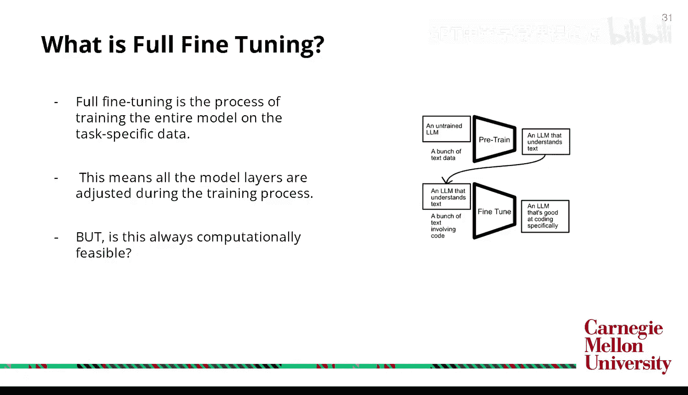

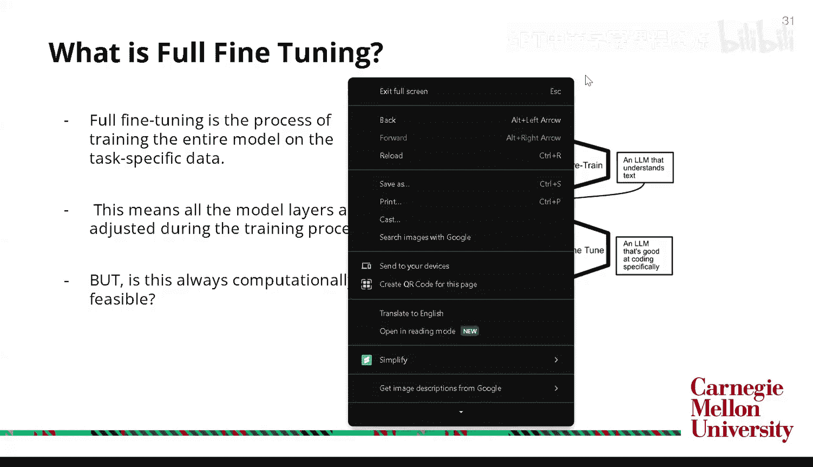

So this is where fine tuning comes in so when you find tu a model what you're basically doing is you're making small adjustments to the pretrained weights to adapt it to the new task or whatever task you want you do this by training over the task specific data and yeah so that way you can retain the language understanding capabilities of the model and also make it adapt for the specific domain。

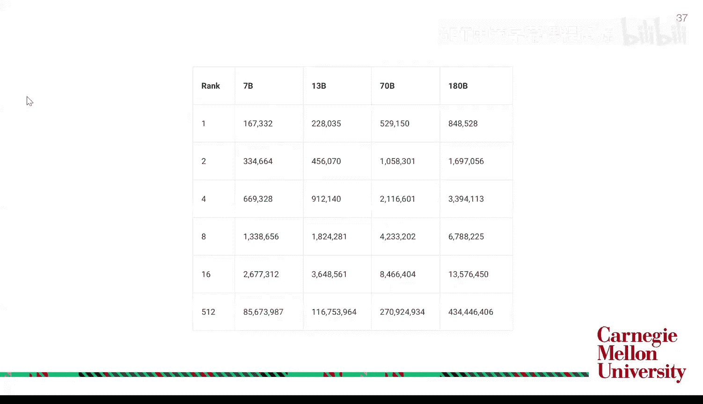

嗯。

Yeah， so there are different kinds of fine tuning let's look at full fine tuning say yeah what is full fine tuning。

😊。

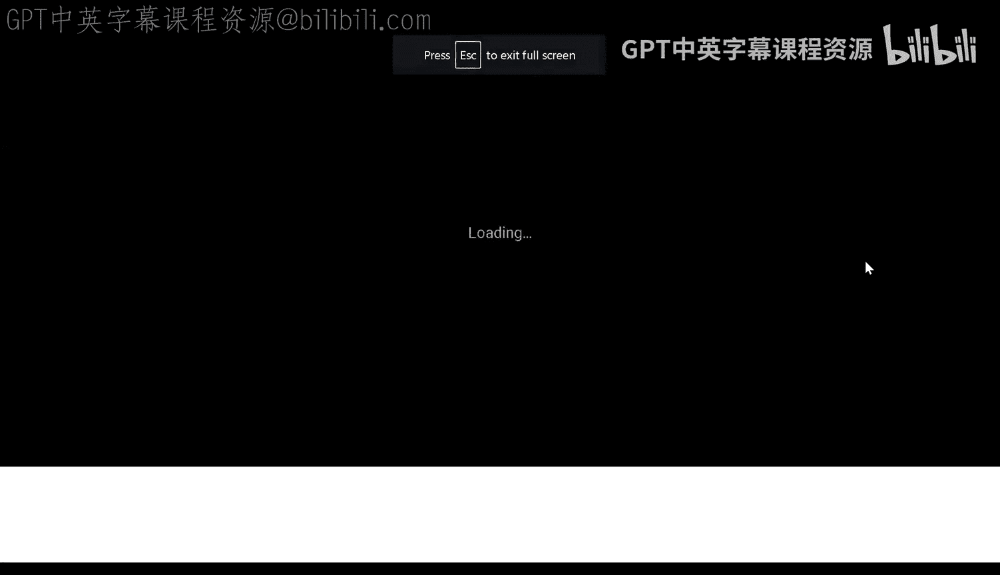

Like I already said， when you do fine tuning you're making adjustments to the pretrain model parameters。

 So when you do full fine tuning you're basically changing or making adjustments to every weight in the model all layers all parameters so that's what you're doing when you're doing full fine tuning but think about it I this computationally feasible every time。

😊，No， and let's look at why。Okay so when you're let's look at the memory requirements when you're training a model what what are the components that go into the memory requirements so we have the model so you obviously need to load the model when you're training the model and then yes the optimizer and activation the memory for that and also you need to save your gradients because you need to back propagate through all these parameter so you need to save you you need you need memory for all of this so let's for now ignore the memory requirements for the optimizer and activations so when you're fine tuning if you're doing full precision fine tuning where every parameter is represented using 32 bits so in that case every parameter needs four bys of memory and since you also need to store the gradients for it for the back propagation you also need one four bytes of memory for the gradient for each parameter now let's say they're looking at a model as big a 13 billion parameter model so so that's。

😊。

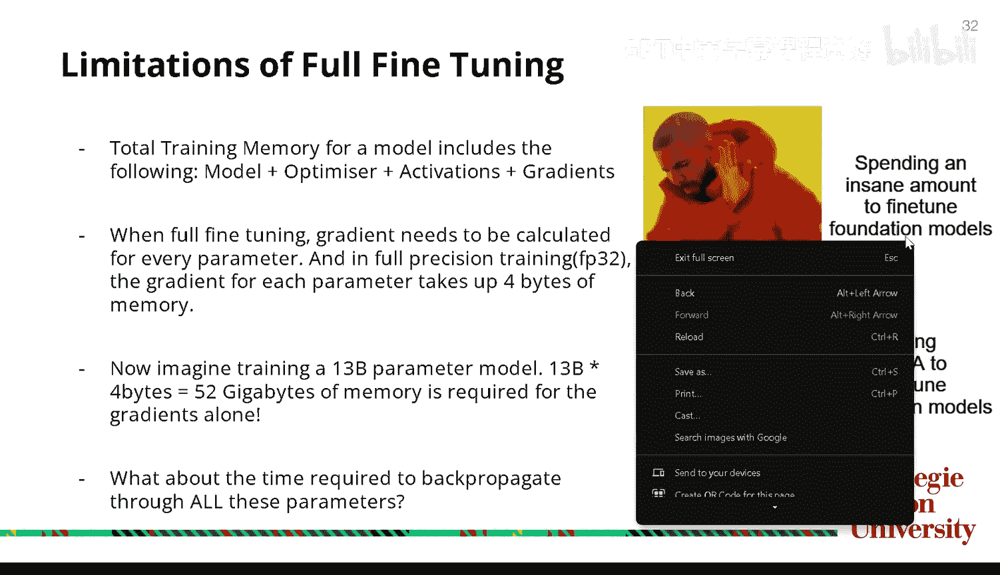

13 billion into 4 B that's equal to 52 gigab of memory just for the gradients。

 You also need to back propagate through all these parameters that also requires a lot of time in most cases。

 So what can we do。😊。

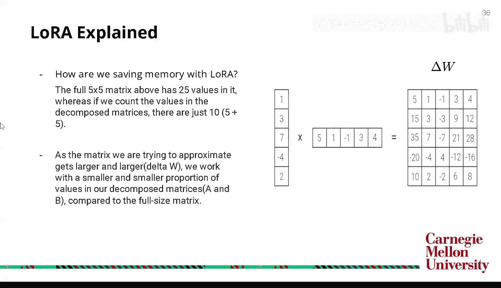

So this is where Laurara comes in。Yeah so Lora low rank adaptation it addresses a lot of these concerns that full fine tuning have and just to give an overview so what you do when you're doing Lora is you freeze the pretrain model weights and you inject low rank decomposition matrices into each layer of the transformer architecture I know that's a lot let's let's break this down。

😊。

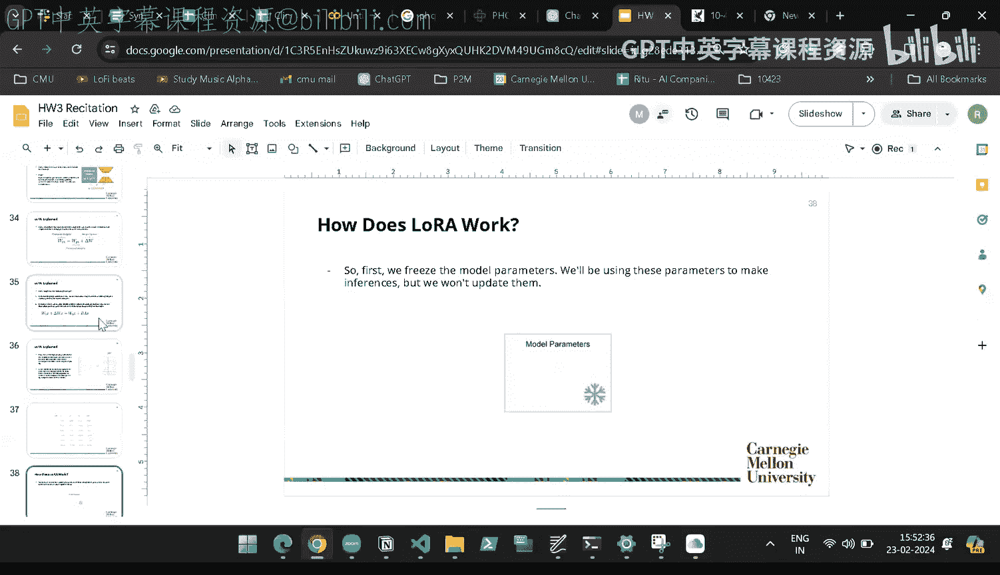

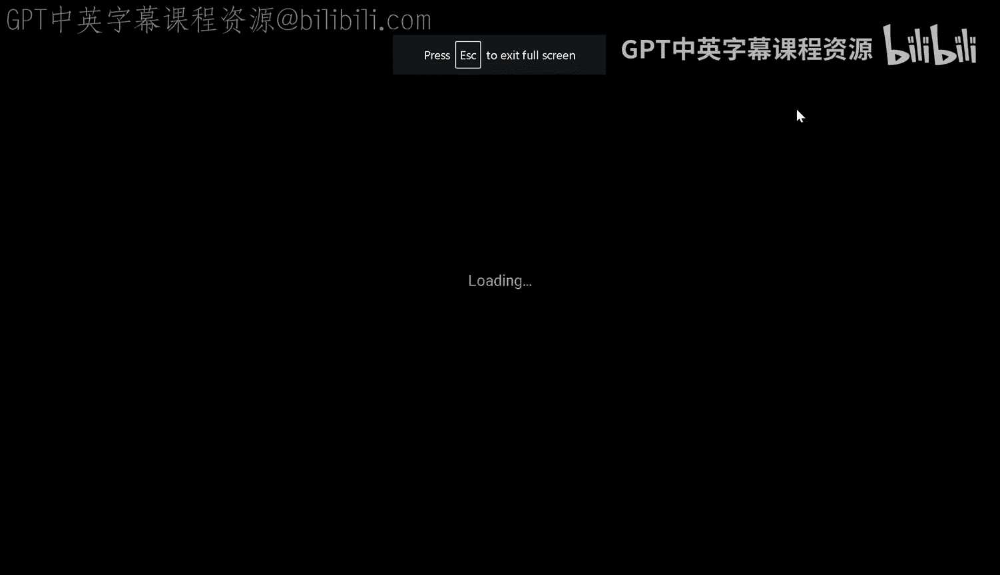

好的过分。我你问。Sorry again so like I already said when youre doing full fine tuning or when you're fine tuning you're basically learning small adjustments to the weight the weight or parameters of the model so the way Laurara reimagines this is instead of making small adjustments to every weight in the model why not just learn a delta W which the delta W that has the adjustments that you need to make to all the parameters of the model so that's what Laurara is basically doing so you have the pretrained weights of the model which you're keeping aus and you're learning are delta W which has all the adjustments that you need to make to every parameter of the weight metrics to make the model adapt to the given task。

😊，Yeah so so if you're wondering okay how was adding w or like say n into n or w size parameters more to the model helping us save any space so yeah Lora hinges on two main concepts one is that most of these pretrain models have very low intrinsic dimension What I mean by that is you can project these huge weight matrices of these language models into a much smaller subspace and still retain most of the information so that's one of the most important concept Loura hinges on and the other thing is that you can break down this delta w or you can break down these low intrinsic dimension weight weight matrices into smaller matrices so yeah you can decompose these matrices so。

😊，For an example。Yeah， let's say we have a delta W which is a size 5 into5 and that needs 25 parameters。

 but if you are breaking down breaking delta w into smaller one rank metrices say B and a which when multiplied basically approximates to delta W you need only 10 parameters so we have gone down from 25 parameters to just 10 parameters when you are breaking down or doing a matrix decomposition of delta W。

😊，Okay，25 parameters in 10 parameters。 that doesn't seem like a lot of difference right the actual difference you see is when delta W is extremely huge in those cases。

 when you have lower rank matrices you are basically saving a lot of space on the number of parameters you need to trim so the fewer the number of parameters you need to train the fewer the gradients you need to trim so the memory requirements is also less。

😊，Moving on。Yeah so this is just an example， so let's say we have a 13 billion parameter model if you were to do full fine tuning youd have to make adjustments to all 13 billion of those parameters。

 but if you decompose your weight mattressrices into lower rank matrices of rank4 you would be fine tuning only 912 k parameters。

😊，If using low rank， the low rank vectors are like better than using all the parameters and why don't we do that for regular training as well some are just more efficient and a fewer parameters in general。

So呃 we， can you接。Like yeah like the better lower as we have these like low dimension like we use like the low low intrinsic functionality to like only train like a lot of parameters but why don't we do that for training in general you focus on these composition vector so Laura as we use a lot of these days instead of fun using when you find models so it gives decent results when you look it larger models success parameters in putting the models what to these days I usually train with Laura does a good job when you find tune them using I think the point is that you are reducing the end which means that it comes at some cost it's not that you can always fully down W two matrices but the hope that you can do a decent enough job even with a lower you don't need to use the full dance。

Yeah， in the end， it's in the end the you' yeah， so it comes at a cost like to say。

So yeah let's now look at how Lora works so like I said when you take trying to fine tu model the model has has some pretrained parameters right so what we do when what we do when we do Lora fine tuning is we keep those weight mattresses or the pretrained weight mattressrices as it is we don't touch them we don't update them。

And then then we create two lowang matrices A and B。😊。

The dimensions are of A and B are such that when you multiply A and B you get the dimension of the original weight metrics。

 so that's how you would initialize A and B。😊，And these are the butresses you would do your back over。

😊，Okay， so like I said， when you multiply A B， you get that delta W or the change metrics。😊。

Moving on， so when you do your forward pass what you're basically doing is you pass your input。

To the model original model parameters and also the also delta w and then you get the output so when you do forward pass you are basically going through the original weight metrics and the and delta W and get and then you are getting the output。

😊，Yes， and during back propagation the original model parameters have frozen。

 you are not back propagating through them， you're only making updates to matrices A and B。😊。

And during inference， you basically add the delta w back to W。

 the original wave metrics to get the lower updated parameters and you would run your input through this lower updated parameter metrics to get the output during inference。

😊，Yeah， and something that I did not talk about all this while was the scaling factor Al divided by R So r is the rank of the R is the rank of the matches A and B and alpha by R is basically the scaling factor this decides how much effect you want delta W to have So you can experiment with different values for scaling alpha Al divided by R which is scaling factor and different values for R。

 however， for the assignment we have some default parameters which we thought worked well you free to experiment with most scaling factors in R are these values parameters Al and R are hyperparmeter double alpha if I double alpha E at a So there's no Can you say that again are to right a higher value on alpha。

😊，alpha you're not learning alphaE are getting。s the point of having they all change the global minimum values。

 but you're doing non nonex optimization over a high mental health surface so you're a lot of the time not actually moving that far away from your initialization so changing a hyperprinter like that will change the kinds of values that you end up at even though you're correcta just doesn't change the global's how much right？

ThatWhat do you mean by， I mean， say a bigger of a smaller algorithm values we influence how much we。

It may to be much different on the initial matter or not。

So learn to be different from the initial time， but like you're you're not going to recover the same like you're not going to recover the same value of you can be。

Right。はい。不对。When you implement this like you have to go at each attention layer and add these mattressrices or put it in the solver。

the solver as can you say well last far do you put it in you the mattresses for each attention layer are the delta mattressrices the M or you put it in the solver the gradient decent solver or the solvers what do you mean the solver？

In the put like or whatever some implement there right Yeah， you would inject that into the。

This went like you saw right during forward passes we are going through both the mattressrices。

 so you need to inject that into the transformer layer you can't you can't add it sorry into the attention layer。

So that's a lot of work like you have to go to all of them and change the card and put these The easier you don't have to do that。

 but you have to figure that out figure how to do that as you do the homework your model form will have like one transformer block which gets called you would only change in the transformer block then that even if you have six sorry it automatically change So the initialization of your attention weight metrics will take care of that。

Yeah。BNA always have to be the same rack。Yeah， so only that might multi like so if the let's say b is x into r and a is y into R。

 you would multiply B and a transpose transpose so r needs to be the same。Any more questions？

So the updates to DNA would correspond to that element which is getting active that not right。

How do the update is it getting updated at the same way A andV？Sping。

parameters they have the have a and then you would add you would so you have a gradient for young and then menu almost two parameters the coordinate wise addition so。

Yeah， every court。You need to get。Yeah， the when game A， you get Delta W。

 which is the same size as that。 Theres two different learning Yeah。

 you're learning both B and separates。 you're not learning the Delta W。

 You're basically making updates to A and B。Which is then multiplied。

ization is used to mini so in the original paper， A is initialized using king uniform and B is initialized to zero。

And one other thing is in the original paper query and they applying Mora only to the query in value matrices。

 but in the court in the for the homework you will apply to all three query key and well。😊。

And also the output projection， Ruthta will talk about those in more detail。

Okay sorry so there is one small bit left so if you try like a classification text classification task on let's say the G2 that you trained in your homework one so let's say we give it a movie review and ask it to predict label positive or negative most likely it will not do that because these are not trained to follow human instructions or to follow instructions so that's why you need to do something called instruction find tuning to make the model behave a certain way so if you want a model that can give you summaries for the text it gives you that you give it you have to for those tasks also you'll need to do instruction find tuning and the way it works is youll have input output past so for example yeah so let's say we're looking at a movie review data which is what will be working on for homework2 homework  three as well so the dataset will consist of texts and labels for each so when you do。

😊，When you do your fine tuning the way you would create your data set is you would append text。

 that is the movie is great as in this in this case is the text and you would append the label also to that so you would append say positive to it so your final text would have the input output there。

😊，But that's not it you also need to tell the model what to do so in this case you want to ask it to predict positive or negative so you also have like an instruction text that says okay I'm giving you a movie review classify record or predict labels positive or negative for this review so that so yeah so you would the text that goes into the model is basically this instruction template plus the movie review plus the output label so this whole thing append it together is what is what is your new text that goes into the model during training。

😊，And if it's a summarization pick， then the instruction would be。

 I'll give you a paragraph right the summary or so yeah you can experiment with different instruction templatelets。

😊，And yeah， you would add the text and then the output would be the summary of that text。

 Does it make sense。Figure what the instruction example it's seeing that instruction。

 it's seeing the text it's seeing the output。The first Amendment is。

It seen across the it' seen it across all。Examples， right。

 so the assumption is that the model will learn to perform the perform the instruction given there。

So in this homework， you will actually do the same thing for because you' are going to be using the GP2 that you train with Shakespeare data on the classification data and you will see this happening so you can get the model to predict positive or negative instead of just random generation。

😊，come we had backs for the instruction exactly， yeah， you can add。Answer， we have a answer。

 Yeah you can add。 This is a text。 You can do that。 You can experiment。

 There are several ways to do it。 You can， you can add spaces。 You can try different ways to do it。

 Yeah， so that that comes in like tuning like how you want your prop。 You can basically experiment。😊。

Does it make sense？Okay， thank you。Okay， so we've heard about Mcna gave us a great overview of what Laura is the math。

 the general intuition， but of course we expect you guys to write the code for it。

 so let's talk about that。😊，And so we will be using the MGP implementation。

 which we started off with in Homebook one where you guys implemented rope and GQA for the MGP implementation now you guys will add Laura。

😊，And so the dataset set we' use is the rotten Tomato dataset if that was not clear from the picture。

 which is a movie review dataset set and if this seems to straightforward or maybe not as advanced as other dataset sets that exist It's because we're using like a GPT2 model we're using law on top of that and we want to keep training times limited Also this is what G2 untrained currently predicts for the for the text you are terrible it predicts yes。

 murders of this we definitely want better labels for something for a text like this。😊，嗯。

So you guys will be provided with eight files in your code structure。😊，O。O。Can you hear。Okay。

So yeah so you have eight files in your code structure you will be expected to change a few of them。

 but really your chunk of your implementation will be in your LoRA dotpi which is about 30 to 35 lines and then once youve implemented LoRA you will change your model dotpi as someone alluded to you would to add it in your retention layers you would do a bit of instruction fine tuning in the data loader and finally you would make your training model Lora friendly。

And so this is in the training part of it in the evaluation we will actually ask you guys to write our own accuracy function hopefully so that is what you do in generate D by so this is meant to be a more straightforward assignment than Homebook one homeworkbook2 hopefully it should go faster than those two。

😊，Okay so the point of Laura is that you could technically add it to anything because you are really just learning two matrices which you could add into any weights and so you should be able to do this for like any layers but we will limit our implementation to just the linear layer。

And the reason for that is that of course it is easier but also the original implementation they in the original Laurara paper as well they only added it to the linear layers so we will do we will continue with that approach。

😊，And ideally what we are doing is that since we are applying it to the linear layer we will tweak our existing linear layer to support Laura and if we could go into Pythch and change their linear implementation we do that but no we will create our own custom class which you guys will inherit from。

😊，And I say tweak because you also want to make sure that your linear layer the new lower linear layer that you are right can still function as a normal linear layer if rank is less than equal to 0 any thoughts on y less than equal to 0？

Anything related to maybe scaling factor， what would your scaling factor be if it's。

It's less if it's equal to zero。It would be since scaling factors alpha over R it would be infinite and so if you we obviously can't have like infinite rate updates and so if rank is equal to0 or less than it we will use it as a normal linear and this will also become a little clearer why we want to do this in the next few slides。

😊，So since I've spoken about linear layers so much。

 it would be helpful to actually go through it because you would be inheriting linear layers so you would want to know what the functions are already existing in the linear class are and because you would then go ahead and override those functions a bit。

Good let's talk about the functions within Lora dot by that you will implement so the init function is where you would actually just create your parameters where you would add your lori Lora B matrices only if rank is greater than zero you will add scaling factors so on。

And helpful Pytch functions in this is the parameter and yeah is the parameter functional torch。

 which is maybe what your Lora A and Lora B should look like。

Then in reset parameters you will actually set the initial values for your Lora Lora be so someone asked what those values would be so your uniform and gaminging uniform n and in it zero is where this would come in and again helpful functions for this would be to out and n in it。

Finally， we also have the forward pass and。The forward pass well the meat of your lower equation actually comes in and you would have the train and eval functions which you are also expected to modify。

Now， someone might wonder why do we need to reimple anything in train or even？

And the answer to this is。So you have Lora Lora B， which at inference you want to merge in。

 but how do you actually know whether your weights have been merged in or not？And really。

 the easy solution to this is to just have a parameter Boolean flag with you that。😊，嗯。

And once you know that you need to have a Boolean flag。

 how do you know when do you want your weights to be merged in versus when do you not want your weights to be demerged？

In train or in Eval， these are the two places to think about that。

And once youre sure where you want your rates to be merge， where you want them to be demerged。

 also explicitly add like a sanity check in your code to make sure that。

They are in the required format， if not just de mergege them or merge them as required。

So we also ask you to do full fine tuning with the data just so you guys can see what results are like if you all didn't use lower and youll use full fine tuning。

And this is where setting r equal to 0 is helpful because then you've never really initialized Lorabi and then you are basically just doing full fine tuning right？

😊，And yeah， account for this in your train forward and weval functions。

And so basically you want to make sure that if if your rank is equal to 0。

 you want it to behave like a linear layer itself， so it should do the same things that a linear layer does。

So we spoke about adding Laurara A Lora B but how do you ensure that nothing else gets changed in the whole fine fine tuning process and it's just the Laurara matrices you will implement that in this function which is in Lora。

t Pi and the way you do it is that you just iterate through the named parameters and check if a parameter is a Laurara parameter or not and then set it as trainable or not if you're not sure how to do that hopefully a quick Google search will tell you。

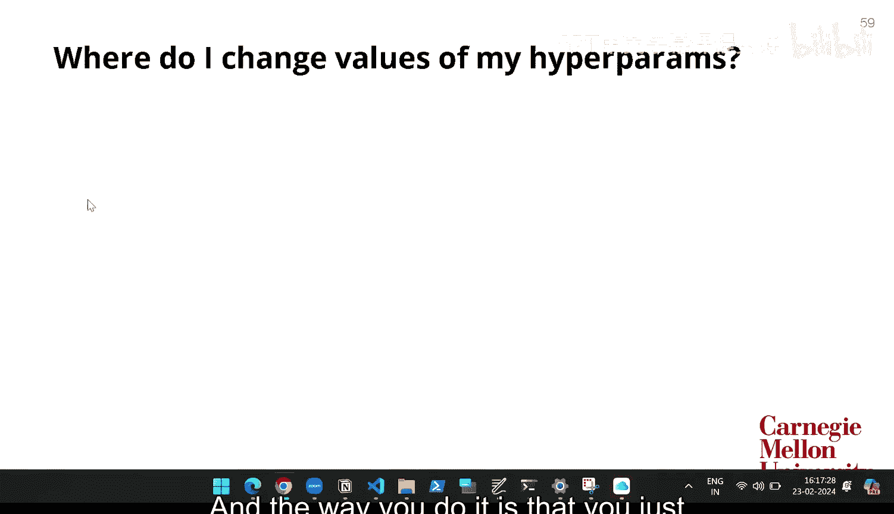

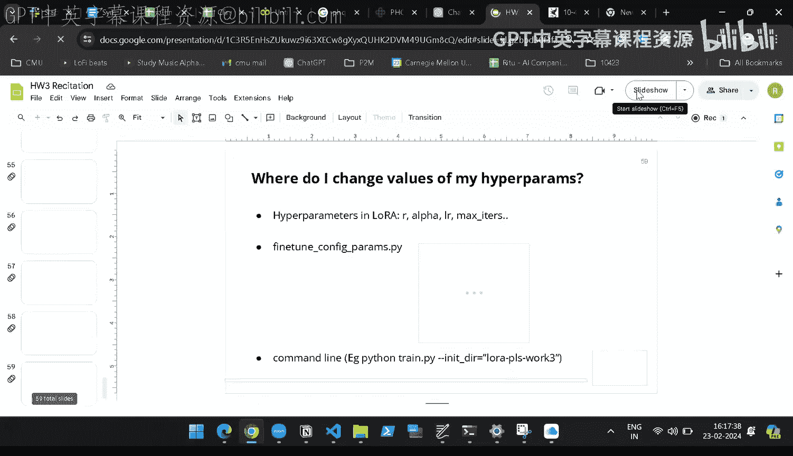

And then there are a few more files which you modify in Mo dot5 sorry。😊，The cheeseese。

So yeah once youve added your LoRA implementation you want to actually modify your model your model dot pi which has your transformer layers。

 you want to make those use Lora linear in those and once you have changed your model do pi parallel you also want to do the instruction fine tuning in your data loader。

Where you get to write whatever instruction you want to use you can experiment with instructions you can also make your labels more descriptive so the current data set only has the labels as 001 you can make them more descriptive using positive negative can even use stuff like cat dog your model doesn't really understand water reviewers right？

😊，And finally you want to update your train dot pi to actually use the function which you guys wrote the makechra trainable function you want to use that in your train dot pi to only do it again if ranknk is greater than0。

And then once youve implemented these files， you can run train dot file。

We also expect you to do the bare minimum hyperparameter tuning you are welcome to do more hyperparameter in Lauraura are alpha Lrs the usual。

😊，And you can change these in two ways， either you can change the fine tune config parameter。

Or you can run it from command line。Lastly， I mentioned you write your own accuracy function。

 you are encouraged to just also just look at generations how they come off with is GP GPT2 untrained versus using fine tune and GPT2。

😊，And there is the get generation prompt function which you can refer to。

 but of course it would be too hard to gauge how good or bad a model is if you just had generations。

 which is why we are using the classification data set to begin with。😊，嗯。And。

One thing you would look at is that check if the check if Laura actually produce the labels you told it to so small models like GPT2 is just 350 the medium one is just 350 million parameters but even like 7 b1s sometimes have trouble generating EOS and so a good hack is to ask it to generate like a limited number of tokens and then look for labels in the first few characters。

😊，Also， it is quite possible that the labels you generate will be will be garbage like for the longest time the labels we got were half fun and so make sure to consider those as negative predictions in your accuracy function。

😊，U。

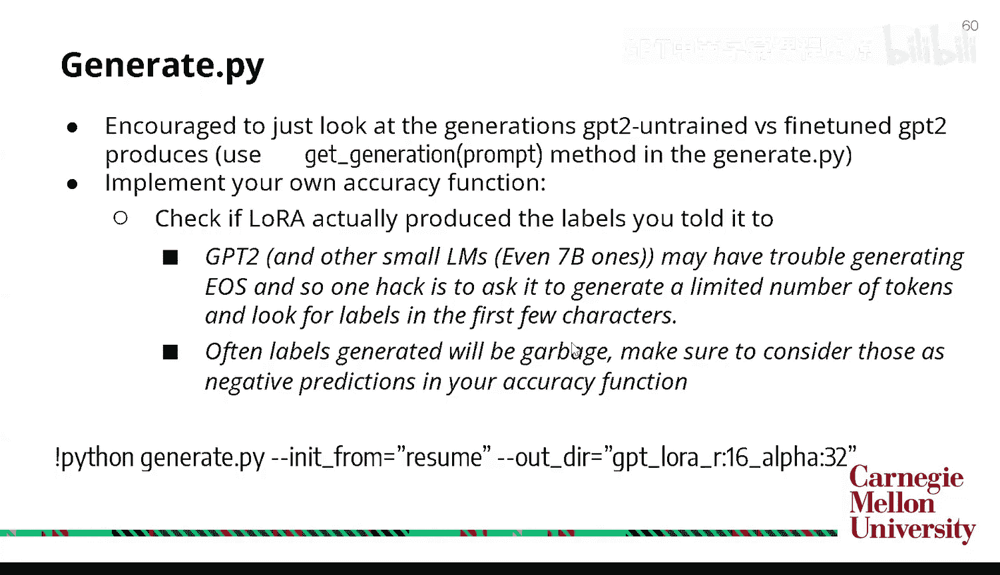

Yeah， I think that's about it。Any questions， yes。Is it for a or is it last there？Oh。

You my side which the pre version， and then we add the。

DeI it the layers the just for the attention layeru。

 you don't do it for like the attention and the output projection layer。

 you don't do it for the MLP or anything else。They are all marked with todos in your model do。😊。

What where we expect you to add Laura linear？好的。Like you said if the rank is zero。

 you start legal they off， why that is。Do you see the last not zero what exactly is it you said in the rank is zero you the end zero what we fall back to just it being a linear layer。

 like not a lu linear。Okay。Any other questions？Yeah。

 do we have fine traininging has in the extent or do we have make instructions given some saying？

Consistent or do we have different instructions given to the models like because it's consistent or just predicting the classification you'd want consistent instructions for like you'd use the same instruction for training and then in inference like across all examples is that what you were asking？

Okay。Yeah yeah you would use the same instruction for training and for influence and in fact for like smaller models even like a space here and there makes a little bit of a difference。

 but I don't think like I don't think it will affect your accuracy too much。

 but yeah you'd want to be as consistent as possible。

Since theations would be quite different in a data loaded pi you would add the instruction right you would add what instruction to be used for each example。

对的。Oh， okay。Do we have a first consistently update for particular instruction and then go to the next instruction or do we alternately submit instructions and update so the model doesn't work at the update at the areas of。

you want to see instruction structure for that in general。

 if you if you want your model to do multiple instructions。

 if you want your model to follow multiple instructions。

 is it a better strategy to fully learn one instruction and then learn the second instruction or do you keep alternating between the two？

😊，嗯。I think yeah， you can maybe ask Matt， but I feel intuitively you'd want to do one and then the next I don't think there'd be so much like catastrophic forgetting that it would completely forget one instruction。

But I think like a lot of this is more experiment driven like it's better to run experiments and check than just assume。

 but yeah， I think yeah， I I would like to think that completely doing one and then the next would be helpful。

But I ask Matt also or post on Piazza。Any other questions？Okay。Thank you， everyone。

