# CMU《生成式AI｜10-423 generative ai 2024》中英字幕 - P34：-P34-Recitation- HW4_2.zh_en - GPT中英字幕课程资源 - BV1CyC9BPEhG

Alright， let's get started。 So welcome to the rest for homework 4。 And in homework 4， you are。

 you will be asked to do some text based image editing。😊。

And this is quite different from a homework tool， which you are only required to。

Do some unconditional image generation。 And in order to save your computation。

 we actually contrain the generation into one specific class， which is cat and。However。

 for text to image generation， if you want to achieve general purpose generation。

 you actually require substantial amounts of data， as well as computation resources to train。

 which is invisible for homework like this。 So we decide to use a pre trend。

 powerful text to image generation model。To do some text based image editing。

And the model we are going to use is covered by the lecture， which is the latent diffusion models。

Basically， the difference is。Is that first we convert the high dimensional image pixel space into a latent space to save computation。

And。Also， since it's a tax conditioned generation。which is difference from the un generation we will。

Adopt cross tension between the image and text to achieve a generation。

And today's outline is we first， will first introduce prompt to prompt。

 and then I will briefly talk about or introduce the diffuser API。😊，啊。

And then howo Yang will do some code run through to help you understand the code base of the bump to prompt so that you can do your homework。

 Otherwise， it will take substantial amount of time to understand the code base。Yeah， so first。

 let's dive into the prompt to prompt。So the key ideas of prompt prompt is that the special layout and geometry of the images depend on the cross extension maps。

 Then we can do some like editing of the cross extension maps to achieve the。

Hediting purposes of the images。Another key findings they find is Another key findings is that the composition is determined in the early steps of the diffusion process。

So， which means。The structure of the image will be determined in the early steps。

 and then the specific content of the image will be。Gerate or generated by the later steps。

 like filling the details of the images。Any questions so far？Yeah， first。

 let's take a look at a few examples。 The first editing example is that the boulevard are crowded today。

 so basically we can adjust the the weights of the world crowded to achieve the actual crowdness of the images。

 like showing the top left。And the second is。We can replace an object in the image。 For example。

 we are replacing the bicycle to a car。The cats， cats riding on a bicycle or car。 So basically。

 we can swap the attention maps of these two world。So that we can achieve the。Added in purpose。

The third one is。The third one and the last one are refinements of the images。 Basically。

 you can see。The third one is children drawing of the castle， next to a river。

So we are actually adding some attention maps for those three words children drawing off。

 And the last one is the a cake with jelly beans decorations。 Basically， we are adding a few words。

 Yeah，s generate image when youre like changing bicycle。 So I want cover this later。

 So this is just the examples。Yeah， so here is the method。 So first。

 let me introduce cross attention。 So you have a pixel features。

 Then the pixel features becomes queries in the attention。

 And you also have a set of tokens from your prompts。Yeah， you must pay attention to this。

 the tokens here， not words， because depends on what token neither you are using。

 probably some complex words will be decomposed into multiple tokens。

 which will make the alignment of the attention maps are extremely important。And。

This is very important for your homework。 And after we do close attention。

 we get a set of attention maps， right， and then we will use the cross attention to get the output。

Basically。It's when after the cross attention， the feature。

 the image features will include some information about the text prompts。And。Yeah。

 there are three major type of tasks。 The first is the replacement。 You can do the word swap。

 So basically， you maintain two diffusion process simultaneously。 And at each step。

 you can swap the attention maps for these two words like the the source words and target words。

 And after you in swap the attention maps， then you can achieve such editing purpose。And also。

 we will。 we can add a few new phrase， and the new phrase will have a corresponding。😊，Attention maps。

 After the alignment， you basically just insert those attention maps into the original diffusion process。

 And then you can achieve some refinement purpose。The last one is is reweighting。 So basically。

 if you want to like amplify some influence of the words into the generation purposes。

 you basically just increase the weight of that attention map。For example。

 if the original attention weight is one， you can do like a multiply time to increase the。

Wight of the。A dancing map。Any questions， yeah。Is it is it actually， that doesn't matter。

 So the original prompt to prompt paper is。It's doing it's doing editing in the pixel space。

 but it also works for the latent diffusion models。

 That doesn't matter right after you compress the image into the latent space。

 You are still having some sort of the pixels。 same as。I mean， you can first。

Convert the images to the lant space。 And after the diffusion process。

 you can use decoder to map it back。What do you mean by the dimensions of the cho。They are the same。

 right？You're using the unit。辩会。Like ways， I mean， the gray weight went down。

Would have different dimension if the fixeds if the image is covered good changes because later there have a different dimension as compared pixel。

Yeah， but， but you can choose either to do it in the pixel space or do it in the latent space。

 so long as。They are different， by the import。But why would it make a difference？

The ways are changing definitely。So if you are doing some editing so long as you are consistent。

 you are not doing like latent to a pixel space generation。 That's， that should be fine， right。

 So long as you are doing pixel to pixel or late to latent。That's it。

The piece and you are relyliance on trend text encoder。To get some meaningful， like embedding。

In this example， we are using the clip tax encoder。Any questions。Yeah， so as I mentioned before。

 the tokens of a single word can be different。And。Because the clip include include text include are actually using B。

 P encoding in which the complex words will be decomposed into multiple tokens。

 That's why you will have to implement the map function。

 which will align the attention maps After the alignment， the swapping injection and the reing。

Will be very simple。Yeah， also， they mentioned that the injection steps of cost attention actually matters。

If you want to maintain the structure， you only need to inject the attention maps in the early diffusion process。

And， of course， you can inject cross attention maps through the whole diion process， but it might。

 it might lead to subultmal behavior。 So if the object you want to replace have similar structure like a bicycle or motorcycle。

 then the， then it won't be an issue。However， if you have different structure like a bicycle。

 replace bicycle with airplane or replace bicycles with train。You can see that if you inject， like。

 if you inject cross attention maps to the whole diffusion process。The image will look very， like。

 unrealistic。Because you can see we have a like bicycle shape airplane and bicycle shipped train。

So we， we also need to like control the number of steps we want to inject the cross attention maps so that we can generally maintain the original structure of the image。

 but also we want to allow some freedom so that the image looks more reasonable or realistic。Yeah。

 another thing I want to mention is that we are using like listen diffusion models。

 which is like an early work in the text to image generation and。

It's very likely that you will get on。Like嗯 on。Results are not very plausible however yeah the depending on order diusion steps like that kind of maintains like the sort of continuity in the image so like depending on like the change you want to make is that like sort of dynamically chosen or is that like kind of a hypopar sort of set for like all changes you have throughtu。

But is that like， for example， if I'm making like bigger change to the image。

 but where' I want more steps， more to food steps？You want to inject lessff， less steps。

Inject cross cross attention maps into less steps。 Yeah， okay。

 so if you inject more and more cross attention maps， you， your generation is more concernedtrain。

Right， but is that is the number of steps like chosen dynamically based on the chain。

 like based on the prompt change or like。And I think you。

 I think you need to like manually play with the steps for each editing you want to make。

But there should be a range。 if I remember correctly， it's between 。3 and 。6。 Basically。

 if you have like the total number of division step is 50， then basically 50 times 0。3 or 。6。

 That's a range。And if it's too much， then you are only doing like a local editing。

 If it's too little。Your啊。Generation will be will divide from the original image a lot。

 just like these two colorss， right。Yeah， here is the pseudo code。

 So the imports is the source prompt， as well as the target prompt。 We also need a random seed。

Because randomancy actually obviously determines the diffusion process。

And the output will be the source image and edit image。And we want to maintain two diffusion process。

In parallel， first， we sample内。Well， first， we sample a recent vector from the Gausian random variable。

 and then we duplicate it。And for each divisionff step， we first。

Diffusion do diffusion for the original one。And then we。To diffusion for the target prompt。

 Then we we will be we can acquire the attention map for the target prompt。

Then we added the attention map， basically swapping， reting and adding attention maps。

 according to the time steps。 So the time steps is specific for whether you want to inject across attention maps or not。

 right， you want to control the amount of change you want to have。

And then you do another diffusion process with the。

Target prompt and the edited attention maps to get the edited images。At the previous step。

 And then you repeat this whole process until you get until you finish， and you will get the。

Soce image， as well as the edited image。And the prompt to prompt is proposed for synthetic image editingity。

It actually can be edited。 It actually can also be used to real image editing。

 Those effects are not like ideal。 So you you may have some flaws。

If you want to do the prompt for real images， you need to first invert the。

Real images to get the license vector rather than sample it。 And after you do the inversion。

 the other process are the same。Any question yeah。How would the output on the diffusion model like different in each step。

 like the sixth tab。The identity space and the adoption map。

 but so only as the attention map and even the nine does and it does only the agencies space like how do we。

So the first thing you want to make sure is that the original image or the source prompt will not change。

 right？The target image will change。 So basically， and in order to generate the target image。

 you will have to do a diffusion process two times for the first time is to get the attention maps。

And then you do some editing of the tension maps。And then you do the diffusion process based on the target prompt and the edited map。

The attention maps to get the actual previous time step images of the target prompts。

that makes sense， yes except six。The six step。The sixth step is just trying to also generate the source images。

 right， Because this is synthetic image。So you only have the prompt P， right。

You want to compare the difference between the original image and the target image or the source image and target image。

Any questions。So yes， I have image I want to the problem get a image So I have image right and to do that I have to get the and then to the。

 so if you are doing real image editing the third step should be replaced as you do inversion。

Do you know the inversion of an image and text prompt。 So basically trying based on the image。

 as well as the text prompt， you are back doing some optimization techniques to get the closest latent vector corresponding to the images and the text。

And then， you start from the。Step 4 all the way to the end so。Image inversion is another topic。

And you， if you are interested， you can just Google it。 Like。

 there are many ways to do image in version。Okay， thank you。Yeah， and learn a pay drugs。Yeah。

 great question we you want to convert bicycle to motorcycle， let say we get one of the email。

And if we again change it prompt in this like convert a motorcyclecycl is again like because it will be can with image or would be again a different image。

不。I'm not sure because I haven't tried that。Yeah。Let me think about this。I think you can。

There are ways for you to obtain zero image， but if you just use the quantum type of the。

 you index the different distribution that on different parts of parts of the distribution so you only modify only agency attention on the type distribution that is the final in which you are have your and in this case it will do the exact attention original but pipelines the provides the video。

So then the attention maps could be the same but the tiny step of vision Well。

 technically because you're your attention map are that will mean that the effects will be different when you going solve person or。

I think you can get similar image， but you couldn't get identical ones because you are。

 if you are only rejectjecting partial steps， right。And for example。

 for this motorcycle motorcycle example， there's actually several steps are using the original diffusion process。

 and that will make you get different1。 But I think if you are doing the full attention injection。

 it should be similar。 it should be the same。But I haven't tried that before。 Good question。

Any questions so far。Yeah， let's take a look at a few examples， though。

 the first one is we fix attention maps， as well the randomancy。 We can see that only。Like。

 the structure remains the same。 Only the specific， like chocolate pumpkin。

 lemon cheese are replaced。However， if you just fix the random seed。

 the structure is completely different。Yeah also， we can see a few refinement example。

 So basically you can by， you can change the car into sports car， old car， black car， American car。

Like， crashed the car。Also， you can change the。AComp into flooded streets， B F Street， Manhattan。

Autumn sunsets evening first。 So the results are pretty ideal， but this is only for synthetic image。

 Also， you must have a very powerful taxi to image generation。model。

Now just looking at the crash card example， it looks kind of like a crashed card example。

 so let's see for specific words what the accuracy that you're going to get。

Because question crashers is just one little difference， but it looks like it're different。Outcome。

No should I haven't tried us before， yeah。Yeah， we also have some sort of rewritingiting。

 So basically we are done with the world birthday。And we can see that the birthday candies disappears and the A birthday cake becomes a cake。

😊，And also， we have the blossom， and we can see that there are many flowers。😊，Holy flowers。

 And then also the snowy mountain。We can see if we operate the snow。

Then you can see more snows on the images。我时是胡辣费。Yeah， basically， that's a few examples。Yeah。

 here are some rare majority。 So basically， you。Do some image inversion。Right。

 you have the rare image and the recon image， as well as the latent vector corresponding to the images and text。

Then you start from the step 4 to generate image like next to red flowers。When the snow comes down。

我盘听。But you can see that there are some subattimal behavior。for real image I的听。Also。

 we can see the landscape of trees in a valley。 As for at different seasons。

 you will get different images。And different time， like sunrise night。Any questions， yeah。你て。啊，你的是的。

What if the contact is。Extra。There're no to change family。Ex problem there everyone。系啊。no relation啊。

So let's say we are often done and let's say we are but problem says。嗯。Oh， you mean if you。

If the image is about mountain， but the problem is。

 the problem is not related to anything about mountain。哎。

I think you first need to generate the relevant or reasonable prompt。Right， you have some like。very。

 you， you have some good open source models like believe believe to to caption the image right。

 You first， yeah， for right image， the best product should be like you caption the image first。

Otherwise。I don't think it will work。 just like you mentioned， mountains and farms doesn't have。Yeah。

 with the mountains， then you will probably fail。So for rail images， it will be much more complex。

And to do image in version， actually， it can be very efficient。Depend on which method you are use。

Yeah， that's all for promise to prompt so。Next， I will introduce the diffuse API。

 So the diffuse API actually is a very convenient library。Yeah。

 so the diffus API is a well established a convenient library for you to like import a few lines of code and general and will download the model and prepare you for everything you need to do to directly utilize the open source models for generation editing stuff。

 It's super convenient。And typically， you will have a pipeline。

 and the pipeline will load your models according to a model I D。 Tyically。

 the model I D is a text string。 And after you do that single line。

 it will download the model and will load the model for you。 It's just it's just one line of code。

 and you will get everything ready。Then for the model class。

 you are in you will have many different attributes like the tokener。 Tyically。

 tokenazer will output the dictionary， and you couldn't directly use the output of the tokenizer and feed it into the text encoder。

You must like， you can print， print it out to see what are the key and values for the dictionary。

 And then you also have the text encoder。The output is an object。Yeah。

 you also need to take a look at what is the object。

Before you move forward to feed the tax prompt or text em to the unit， Of course。

 it will have the unit， as well as the V A E， which will convert your image to the latent space。Also。

 you will have the schedule。 So basically one pipeline will get everything ready for you。

It's super convenient。And this is just an example for stable diffusion pipeline。 So in the homework。

 we are using latent diffusion models， pipeline。 and you will specify the I D。

And the pipeline is a class of consists of several，7 components。 The first is the feature extractor。

The safety checker schedule tax input took neither unit than B A E。Any questions。Yeah also。

 you can access each of the components by print it out。You will see。

 what are the input arguments here。Like if you do pipeline do tokenr。

 you can see the input should include name of pass， vocabulary size， model max， lens， stuff。Yeah。

 typically you can keep most of those stuffs as default。

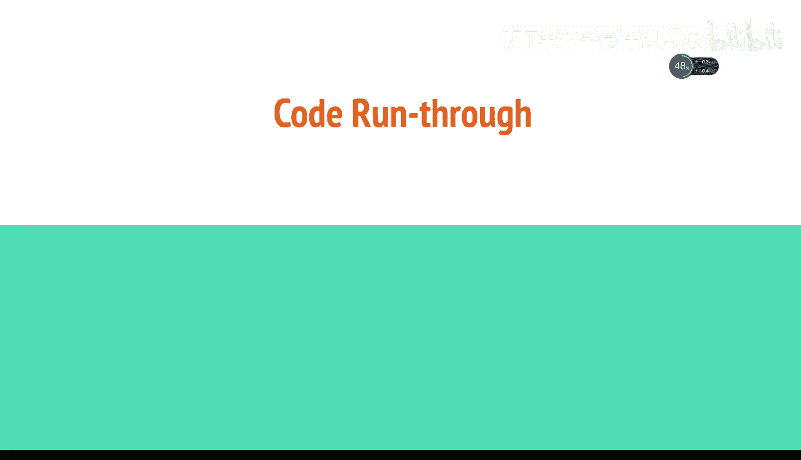

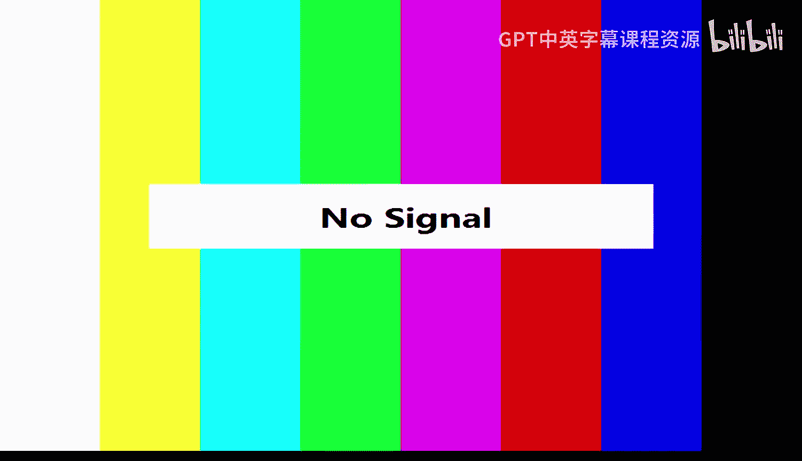

。Any questions？

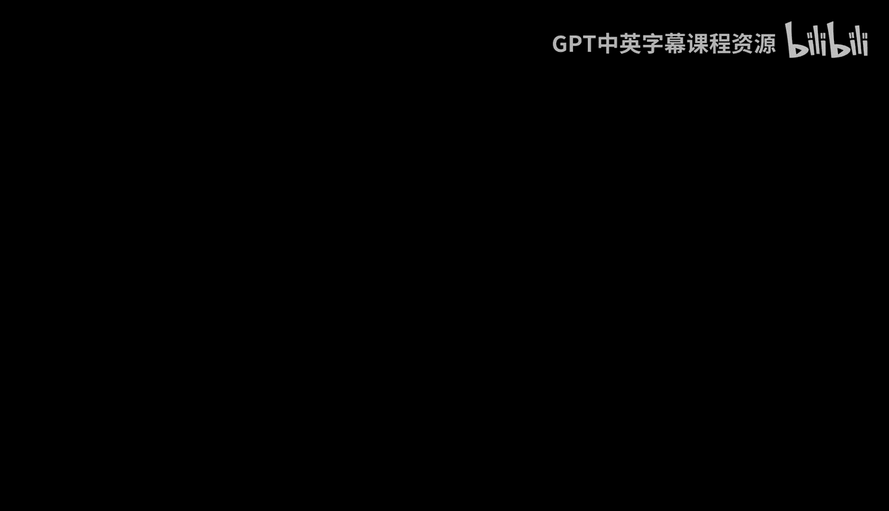

And for more details， you can refer to the website of the diffus API。There are many examples。

 It's super convenient。

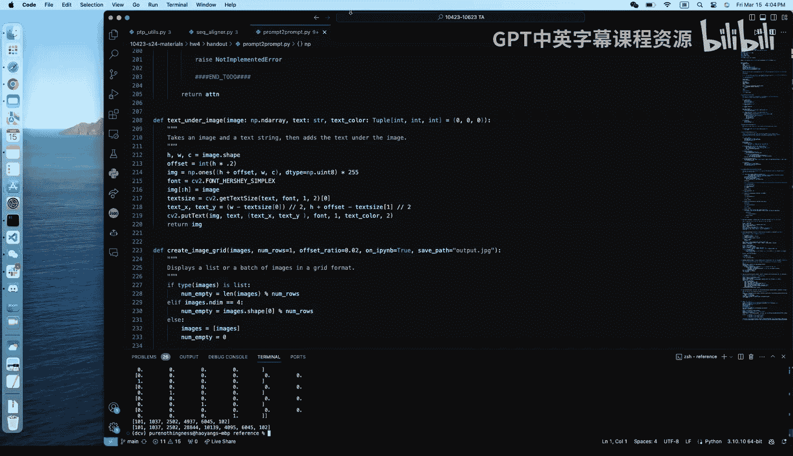

So if we use the diffus API， you don't have to worry about the complex。

 complex code base of either latent diffusion models or stable diffusion。

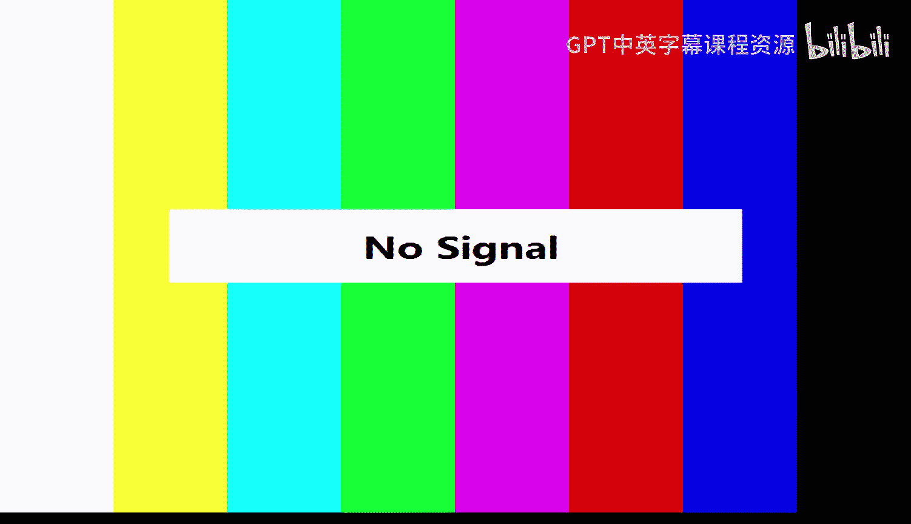

Our models。They will save you a substantial amount of time。Yeah。Any questions so far。

So if no one has any questions， how young I will run through the code？找到课堂。Good。Okay。

 so now I will take you guys through the。Coode itself and why is this not showing up？这个。

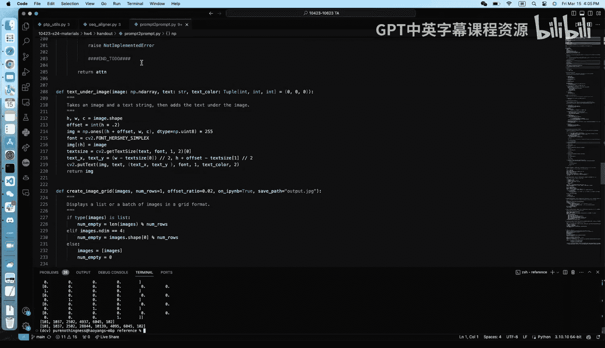

嗯Oh，O。Cool， so in the code base for this homework， you basically only need to pay attention to three files。

 which is like so three PI files and I will go through each other them what they do and especially a little bit。

😊。

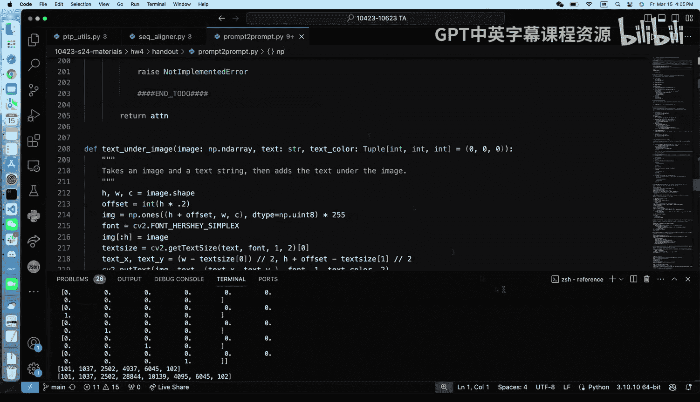

Oh yeah。A little bit explanation of what each of them does。So we， first look through basically。

Overall， what prompt prompt does， basically， this whole thing really respond to a few things that you need to implement for the conceptual things of that prompt you can do that we just introduce you only need to implement the attention replay。

 which is basically replacing the single word or multiple words from the prompt with another thing completely。

 And for for the sake of simplicity。😊，So the first really important thing for you to clarify is to use how you face this L LDM text image pipeline API to actually implement this what you'll actually be using here just for clarification is you're gonna use diffusion pipeline as a general class for import of the API we gave you in the right right now is a little bit off。

 So please check on Pazza on updated link for the actual API for for the LDM text image diffusion pipeline。

😊，Oh okay and but what you actually will be using is just calling the def pipeline class。

 which is a mother class I forgot the exact phrase for that。

 but like basically LDM test image pipeline subclass is this class and you will basically load using that and the first and foremost really important thing to make sure that you got right is test to image LDM function。

 which basically asks you to simply use the API to actually put everything together。😊，Basically。

 loading the model knowing what to take from their text organizer to diffusion denoing steps and so like then build everything together。

 So basically， this function is mostly just the API and a couple of the P T P u functions that you will need to look through in the other file。

😊，And the second， the second phase is basically where you actually implement the attention replacing in the prompt form。

 So we have first a attention control base class where it just in does initialize everything about what it does。

 And most of them are empty because you're gonnaride them。😊。

And this call function basically working here is just a bulkee method for some of the steps and attention shape just for some other steps。

😊，MmpP control is really intuitive。 You just bring you forward it。

 You just return the original attention and it does nothing because it's empty control。

 On the other hand， we have like another control method called attention store。

 which also does nothing。 But more importantly， it will create all of these code over here or for bookkeeping records of what actually does in the units in the unit structure where it actually acquire the attention for each of those steps。

 So you don't technically need to understand the attention store class。

 because it's pretty much only for visualization purpose for one questions。

 But this is a good example of what attentions could look like in terms of its components。

 So we put here as a reference。 which you actually need to implement is these attention re class。

 which。😊，SlfPass is also the attention control based pass and what you need to do is to emit relevant cross crossre alpha numb selfre and Maper。

 we're going to introduce a little bit more about what this replace alpha and Maper are and then in your replace self- attention and replace cross attention engine implement those two in terms of what attention to swap it and then there's the forward pass which basically does swapping attention itself and we'll call upon the replace self attention and replace cross attention methods that you previously defined。

😊，So one thing to know here is that we have to separate replace self attention and replace false attention over here can anyone tell me why do we have two separate functions for that and what's the difference for those？

😊，Well， I go ahead because we are。Technically， yes。The thing is。

 the important thing to recognize is that remember in the when we introduced problem like previously。

 there is a really important thing for you to understand is that we when we actually replace those things。

 we need to run the diffusion pipeline for two of those。 and one is for the base image。

 one is for the replacing image。 and there are attention mapping for both of them。😊。

So that that's why we need to like separate the self attention across the attention。

 which are both existing in the unit structure。😊，So yeah， that's basically why and。

The the more important replace part happens in cross attention。

 But you will also need to address like the self attention replacing function。 And the reason。

 like this is pretty trivial in the attention replace class。

 And you can probably argue that you don't need a separate method for that。

 But the reason we have this as a separate method is that of all the other functionality that we just introducing like reweighting like local blending and stuff by that。

 which is are which are like more stuff that you can do。

 But for replace self attention and replace cross attention。

 Those two functions are almost just one liners that you can do really intuitive early because it's a simple replace question。

😊，This what the difference in my。Oh yeah， sure。Remember in the unit structure。

 we don't actually have just one kind of attention。 We have two kinds of attention。

 One is something thats one is it attending to itself。

 and one is it attending to the cross cross attention of the words。

And we need those two separate things because although it is correct that in the naive replace case。

 that cross attention is what where most of the magic happens if we just replace one word。

 we still need to deal with the attention the self- attention part for those pipelines because。😊。

In first of all， you can actually make it much more complicated by editing some attention to be more contrast。

 Second all， like you actually are dealing with two diffion pipelines。 So you。

 you need to when when you're iterating through the each of the steps of like swapping attention because what you actually are doing is like youre after you influence like one base one base of the diffusion pipeline and one replacing prompt of the diffion pipeline。

 what you're doing is that you're。😊，Basically， taking apart of those attention matrices。

 taking apart like all the weights and results you obtain from those each of these attentions。

 and you will reassemble them in such a way that it will finally output some some a new prompt with the most of that look like in the original base prompt。

 But only the edited words that we will look like something else。

 So this is these two functions are there basically mostly for so that you can easily like disassemble everything and put everything back together in an appropriate way in the forward pass you are going to implement。

😊，Question it was against problem。your attention， where the attention is。

OfSelf intention and across attention are both components of the， the so called attending part of it。

 where you have the unit to have the query query query keys and values where you correspond a text to the image so。

So以。Pro the text to text text the text remember in。Okay。

 so remember in the more previous lectures when we talked about like it's an overstructure of civil diion and stuff。

😊，There is the cross attention happening add those inter basically intersectional text and image in the unit structure。

 But there's also self attention in it as well。 Remember like。

Just simplicity imagine a transformer in the transformer。

 you have a self attention module and then across the attention module for that， right。

 So it's a similar but modified structure in the actual SD D pipeline。😊，啊。Yeah， basically。

 it's in the， it's all in units。 Basically， it's still in the within the unit structure。

 you have each of those blocks。 inside like a control unit convolution。

 You have like the attention box， yeah。😊，Okay， so that is basically and that it for attention replay。

 really， it's not that much lines of code what is more important is for you to actually understand what each of them do。

 And that can get pretty tricky。 And the rest of those functions are pretty much as helper functions for visualization。

 even those like stuff like aggregate attention show cause attention are basically for some visualization purposes and also good examples of how to actually call upon your different stuff that you already defined。

😊，And yeah。And what we are spend more time on is actually the two helper file sequence liner and P2P U。

 Well first first look at seek a liner and the ultimate goal of this is the get replacement map。

 which you implement as the main routine office get replacement map dash。

 which basically this in naively calls upon。😊，So what what is really important to understand here is that when you actually swap two prompts。

 it the swapped prompt doesn't necessarily have to be the same length in terms of token as the previous prompt。

 So we know that it is actually token， not word， because that's that's how the model understands the text。

 And maybe a more complicated word， let's say if you are trying to swap a cat with marshmallow。

 Maybe marshmallow takes three cat tokens and cat takes one token。 And that can that can get really。

😊，Problematic where when you are just slightlyly swapping attention because the length of the token are different。

 and this is basically what the map does is's trying to align the align the size of the attention for the base base prompt and the replace prompt。

😊，And this is the way you all be implementing here to align Y by sex， given the tokenizer。😊。

And one thing that I really want to show you to clarify things up。

 And I'm sure that it's gonna get a lot of people really confused is how what the get replacement map over here actually outputs。

 And we already have some debugging code prewritten for you。

 But we now just show you what those outputs should look like。 And why is why that is a case。

 So basically over here， we have loaded LDM and tokenizer。

 and we will run get replace for three groups of three pairs ofs versus a big dog hat versus a big cat hat。

 you see cat and dog are usually just or both one tokens。 So it is the same lens replacement。

 And then a dog versus a big cat and dog the word dog turns out to be three token lens。

 So previous So so the previous lasing token is actually longer than so basically the X is longer than why。

 And the other case is why is longer。😊，And that's。

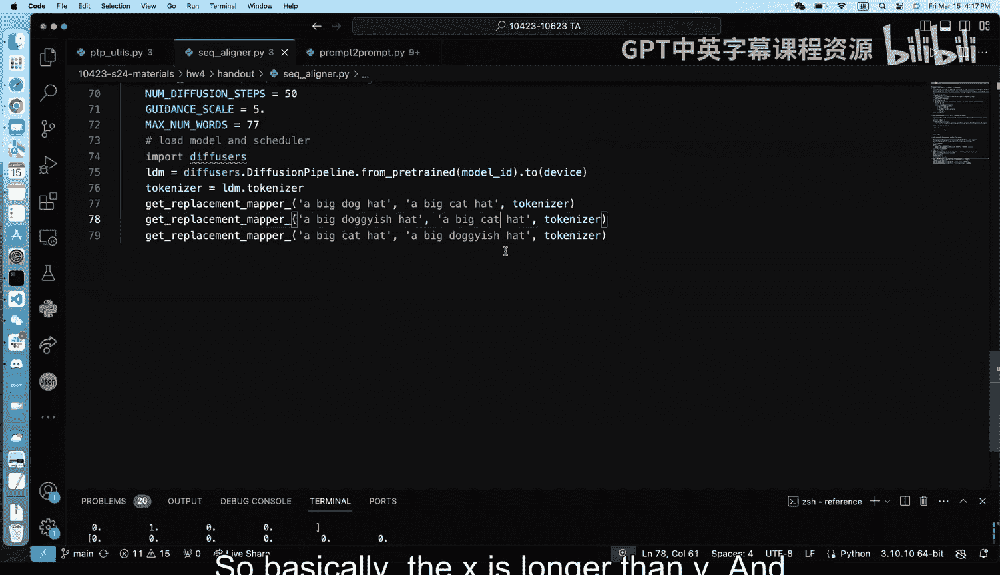

And when you actually run this。You can just do Python seek alignr。Well， well。

 I'll put a bunch of things。 first of all， I'll just start loading the models of it that。

 but let's know with that。 This is just the output that I just previously got。 for the first case。

 it's this matrix。😊，hich is basically an identity matrix。 Can someone tell me， why is that the case。

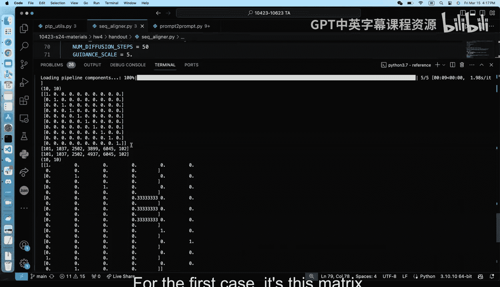

でも。Yes， it's the same amount of tokens。 You can just switch straight out， replace the attention。

 like just like that。😊。

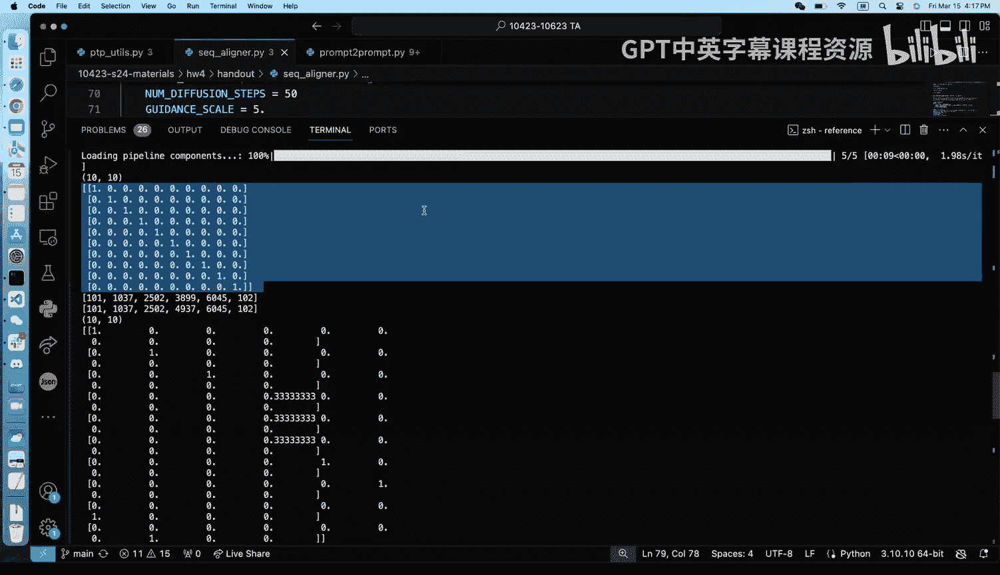

And for the second output where we have input a big dogggish hat and the output， a big cat hat。😊。

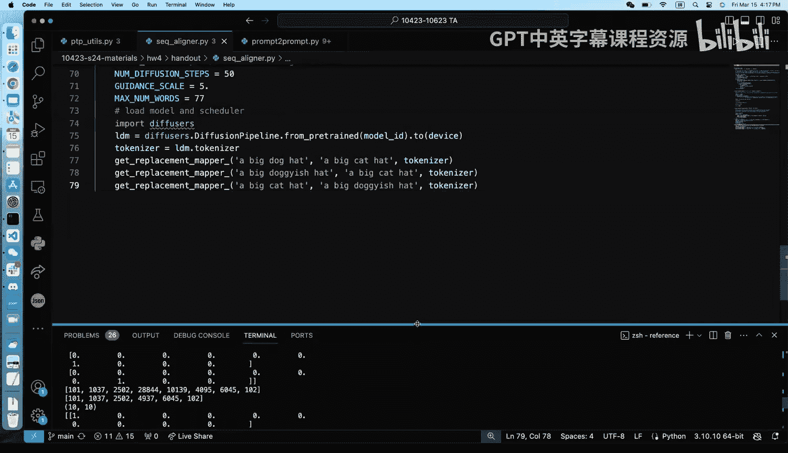

The the alpha matrix looks like this。

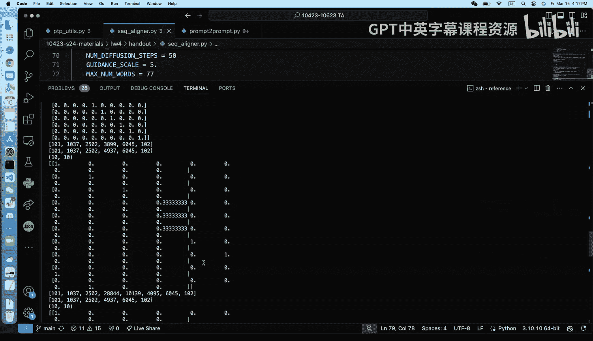

Please take note that this is not actually like this by this like because it's like printing into two lines for her line of the matrix。

 But this is so the dimensionality might be a bit of One thing to notice that what this well look。

 is really similar to to a diagonal identity matrix。

 But here we have one1 on diagonal 1 on diagonal 1 on diagonal。

 notice that this is like just a same line in the matrix。 So those are all on diagons like 0，0，1，1，2。

2。 And then on 3，3， we have1 third。 And then on。😊。

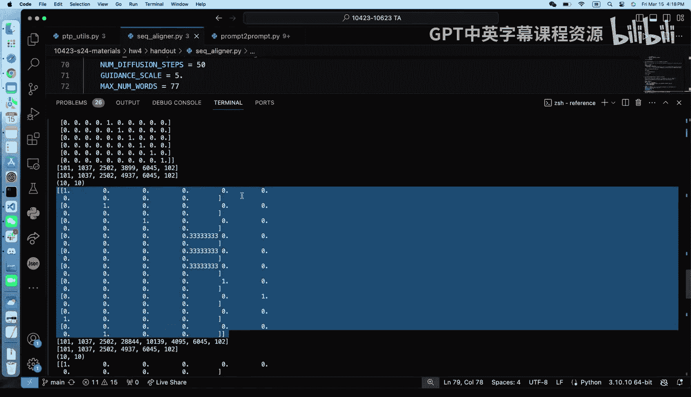

Actually， on four three， we have one third on five three， we have one third。After 5，3。

 after the index of 5，3， we actually have the next value of one right right to the lower right of the previous3 by one in attention matrix。

 And this， So this is will be this will be like 6，4 in index。 And this is 7，5。 and so on and so on。

 So in the last line of this attention matrix。 the one is not actually as a lower right bottom。

 But actually somewhere following the diagonal shape as3 divine。😊。

Can someone tell me why this is the case？kenYes， it is three tokens。

 And why is that not a diyagonal matrix。Yes， there are a different number of opens， Yes。

 I can yes so。So it's not。 it's not square。 Yes， it's not square。

 It's not square exactly because we are trying to align y to x。

 So the reason we have one third on each of those is because think about it。

 like when you are trying to align the word dogish with a corresponding word cat。

 Youre what you are actually trying to do is to actually get the swap the attention of those two。

 And what can we do if we actually have three attention graphs versus one。

 very naive way that the office did what basically to average them。

 Like you combine the three attention maps and you average them， which is one third。

 Can anyone tell me why we are not doing one，1，1 for those three and just add them up and instead do average or three attention maps。

😊，P do 111za Y3。That is not actually the case。 It doesn't imp。 It has three dos。

 But what it actually does is think about this matrix what this matrix multiplication actually does。

 What it actually does is that it multiplies the three attention maps each by one third and then add them up and to replace the one single attention map of cat。

😊，And the reason we are dividing it by3 averaging itself summing it up is because even though in the previous attention maps。

 the word doish Occ three attention maps， you are not supposed to pay three times as of the attention。

😊，As the as what the cat is in the new new one。 So think of it， think of it like。

 just because something is longer and you took a little bit more time to read through it doesn't mean that you need to take three times This much time to re through it。

In a replaced prompt， if you're thinking about attention in a more intuitive human reading way。

 basically。😊，即明。是。That's essentially having three doggy， doggy issh Cos。

 but you don't naiveively something up。 You average them。

 So in the actual output like that you are align the single cat with the three dogish。And。

 and an interesting phenomenon now we need to like recognize。 and most not most people like。

 But like a lot of people will probably get confused about iss the reverse case where we have a big head versus a big doggish。

 a big headhead versus a big dogish hat。😊。

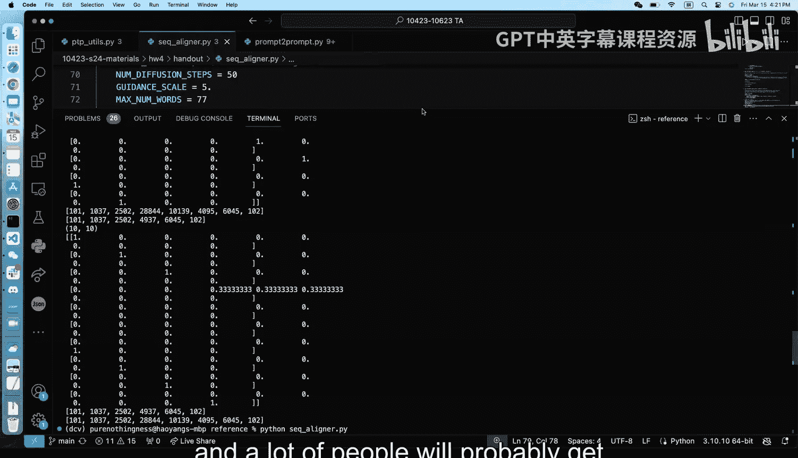

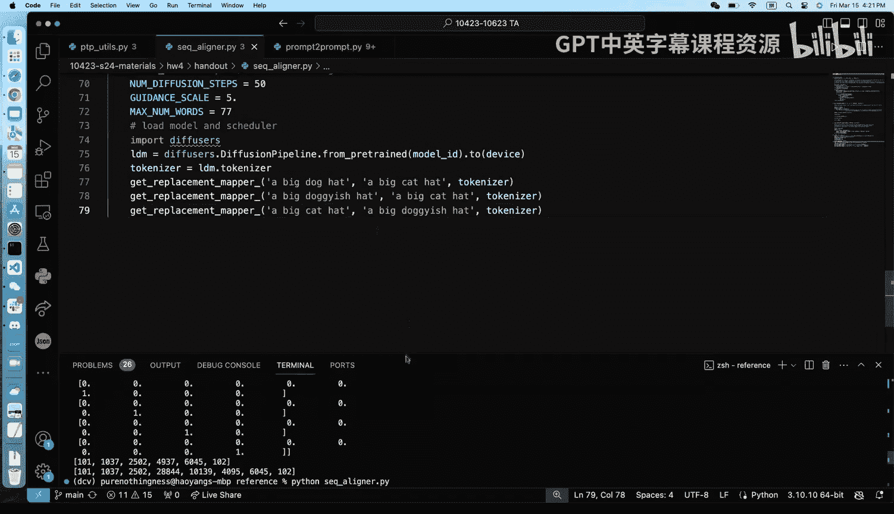

What we have is still a diagonal matrix here。 and we actually have three1 third on the horizontal axis now。

 But the thing thing you really need to recognize is that afterwards。

 the diagonal matrix keep going on。 So the ones are still on the diagonal itself right after let's say over here。

😊，Can someone tell me why this is the case？You个 see。Yeah。Poer in one row。And diagnosis kind。Yes。

 basically， that's it。 The main tricky thing here is that the output of the attention matrix for this case。

 still， it's basically like you're summing those three up and you're just consolidating over here。

 And the final lens is still so the same for the three one。

 What this actually does is that it's dividing the it's basically using the single cat attention and and make separated into three separate attentions and make it average in place of the dog dish。

 which is why the output of this still needs three co occupy this space。

 which is why like the diagonal matrix continues。 So this is basically what get replacement map does。

 And you will need to implement this。😊，And this will be used in your prompt pro definition of get replacement get replacement matter get replacement attention。

 basically replace cross attention here， because you all need to use the function get replacement member you defined to actually swap it up。

 actually you are you are be now calling like the get replacement matter dash。

 but like get replacement matter just because it's like more it's more well rounded to for you。

 but it's basically the same thing。😊。

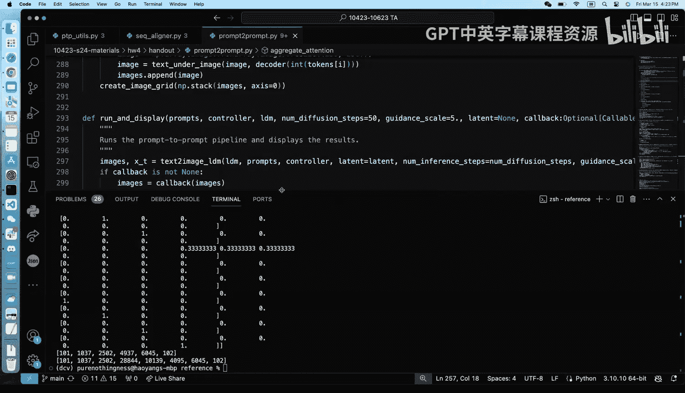

And then the next thing I want to clarify here is in P P us。

 we have a lot of different stuff that you will use for example like division that latent to image in latent registered attention attention control these four are like functions that you will need when youre defining yourM pipeline using the APIs really important function for you to really look through and have a general idea of is this attention control function。

 which basically is the only way in any in the entire codeb that the attention replace class is ever called and actually use So thing is in a very high levelve abstract and not a completely correct way saying this is that register attention control first hook up all the attention self attention and cross attention of the pipeline that you define from the API with the attention replace class so that when you are infferencing it and replacing it。

 you can just directly replace the appropriate attention map at the appropriate。😊，です。And for the。

 for the final thing that really matters in terms of your implementation is get time worth attention Al。

 this alpha well， well is basically what you will have in the image of。😊，Here， cross replace alpha。

 And what this alpha actually is is basically。

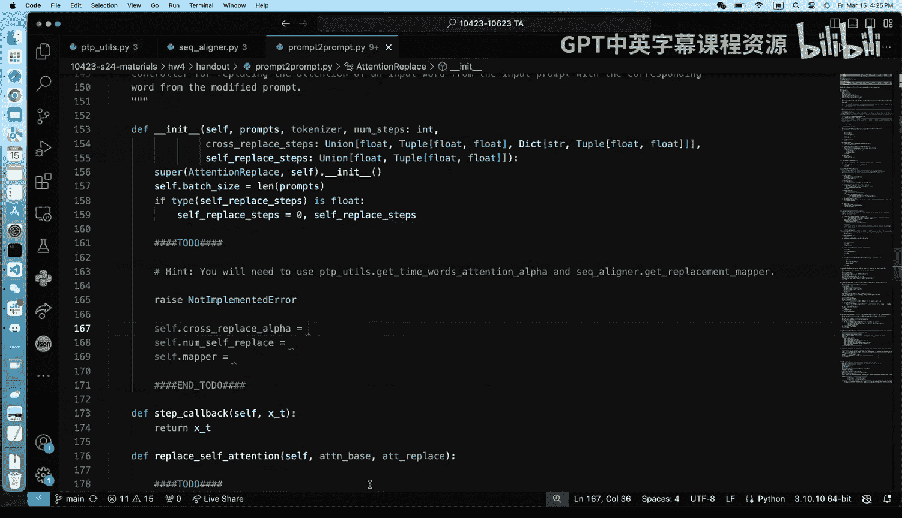

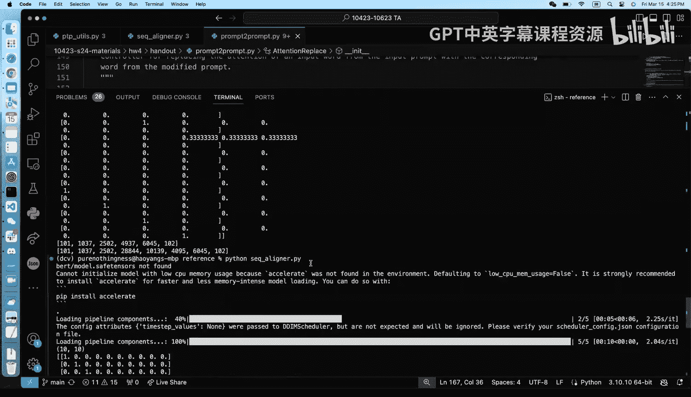

basically a bunch of ones and zeros。This alpha remember。

 recall that in the conceptual understanding of prompt。

 we mentioned that basically the cross attention and selfat for that matter will be swapped at a certain time place in the diffusion step process。

 where exactly that is is a hyper that can be addressed by you and you will kind of analyze the effect of that in your basically analysis part of the programming assignment in homework4。

 But what this function actually does。 You don't need to implement。 by the way。

 you we already give it to you。 But what do you need to understand is that first everything is one because all the attention are kept with the base base pipeline。

 So basically the original attention will be used originally。

 And then after a certain point in time where you find the solved out cross cross attention replace step。

😊，it it will swap out to 0， where， which basically means that。The。

 the attention that you use for the diffusion step for passes step will be the replace attentions inside the original attention。

 And one tricky thing in this alpha thing is that notice in the test examples we have in P T P U。

 Oh by the way， this is the output you can get by just running P A U P。

 one tricky thing here is question。😊，Yeah so basically what this does is that it will just tell you the weights basically not in the weights。

 basically a mask of whether the diffusion sets are using the original attention or the swater attention。

😊，Yeah， zero is for swap attention and one is for original attention。😊。

So you basically the intuition is pretty simple。 You want the diffusion process。

 the first few steps of diffusion will determine the general idea of the image。

 and the the latter step will determine the details of the image。

 So what we add is that if you want to edit an image。

 you had the original image attention there be be used for inferencing for diffusion in the first time steps and then the swapping the replace attention for the latter time steps to get the final details。

😊，And in this example， we have five diff fusion step and the parameter for the attention overall attention swap is just 0。

8， which means that the attention will swap in starting as the fourth step。

 which is why the first three steps are the first four steps， actually， Oh yeah。

 the first the first Yeah， the first four steps are all one。 and the last the last twos are zero。😊。

This this is basically this line。 And an interesting thing that you experiment with is that this allows you。

 this actually allows you to define different swapping time time step for different words in your prompt。

 So other than this overall replace of 0。8。 what you can do is that you define a dictionary of what you do for each word。

 So the default is 0。8。 So that all the words all the for every single words in the prompt you all swap it at 0。

8。 But maybe you can specify that the word in question that you want to swap like cat。

 you want to swapping cat at 0。6 times step。 And what this will change the alpha in a very。

 very subtle manner is that notice that these are still ones and  zeros。 But notice over here。😊。

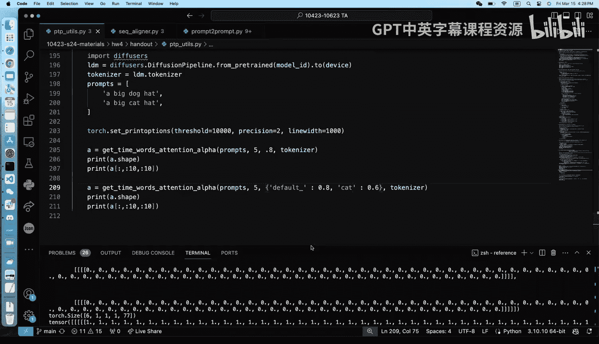

In among a bunch of the ones。 there's a tiny little zero here。 that actually stands for cat。

 So cat actually got swapped a little bit earlier than the rest of the rest of the image。

 which basically means that the element of cat will be emphasized a bit more。

 And once your total examples how it actually affects in right now， actually。😊。

But it is important for you to understand what alpha actually is so that you can actually use it for your implementation of replacing attention anding sub inting the attention replaced class。

😊，Okay， these two are the， I will say the most， the two personally most confusing things in this whole code。

 So if you can understand those intuitively， that will be really much a huge help for that。😊。

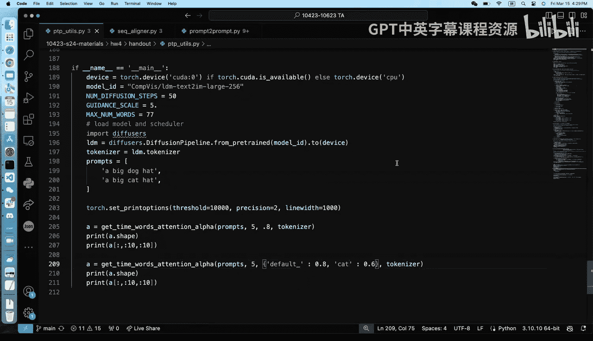

And now when I look through a few actual running examples。

 This is exactly the same as the coab code you had， except that I swap the seed。 So basically。

 you all get very similar results， but like different images。So basically。

 it's the first one is that you will visualize across attention and the seeing or handout will be 42。

 but the C here is 1024。 And the first one will just output the original based image。

 So you'll be working on this squirrel eating burgers。 the squirl is extremely creepy。

 The reason for that is that in order for us to not confuse you guys with a lot of like complicated setups for the test image pipeline。

 we actually use latent diffus model， which is like so calledled original stable diffusion。

 because is are by the same mouse but like a little different。

 And so the actual outputs looks much worse than actual Ss。😊。

But you can definitely do that with S 12。 But with S， this is a squirrel eating burger。

 just like believe it。 But like it's a squirrel eating burger。

 And this is actually what the attention store store actually gave you。

 This is like a visualization of what each word actually have in terms of like the entire image。

 So we can see the for a painting of is like pretty blurred。

 but like a squirrel you like attend to the squirrel and burger you attend to the burgers of that。😊。

You should you should have already seen this in a couple lectures back where Matt actually showed you guys some examples of those attentions。

 but this is like basically a way for you to visualize that in your own code basis。

 which is kind of cool， but like more importantly you want to help you understand what's will happen next。

😊，And then the second one is no attention controller。

 So this is basically what we we all just basically swapped the subjects as eating the burger with a lion cat and deer。

 And what this does is that it tells you without the attention control of replace whatever output。😊。

And this is actually promptly from the most naive way of word word swap。

 You just define a couple things。 and you just swap it。

 And this is the result roughly the result you shall get。 basically， the lion cat and deer。

 basically the word in questions that got swapped should be smashed into the frame of the squirrel in some ways such that it will look like very similar like it。

 but kind of different and resemble the features of a lion cat and deer。😊。

The second thing you all do is to modify the process attention injection step and actually compare the results for them。

 For example， here instead of squ we have the dog。 But the main difference is that remember in the alphas we defined like we just discussed we are swap all of the other words will be kept as the original image basically one so that it's always one。

 but the main difference is the attention masking for dog will be different。 So 0。

9 is that you only swapping in the last 10% of the different step。0。5 is half and 0。

1 is like very early。 And you can easy see the effects of them。

 Like the first one is that this is barely a dog like it just looks like squrel。

 And it has a little bit features of the dog here。 And then the mediocre one is that mediocre is more like dog。

 And if you swap too early， it will destroy some of the features of the original image。

 So it's less like an image more like a different complete image。😊。

And this is basically your experiment and you'll do like a basically your write some analysis of that in the analysis part of the programming homework and then the finalized logo added where you should be getting like similar results to this。

 but again in a completely different image。😊，So yeah， these。

 these examples are just there for you to have a intuitive check of what your results should look like。

 because yeah， all and all of these are just the original code base。

 You don't need to change anything。😊，Yeah， and that's pretty much it for introducing the code basis。

 any questions？😊，一。Insscribe and should not say。ThereThere no sorry。No attention。

No connection controller is basically like generating a completely new image。

For each of those image editing tasks what you actually have is actually two diffusion steps。

 one is the original diffusions you got from the first one and the other one is just each of those different ones。

😊，To replace the future pipelines。Because open advice you starts out being in front of first manuscript exam。

Well， no attention basically returns the attention or whatever。 So it doesn't do replaces at all。

 It's just， it's almost as you just ask the pipeline to generate a completely new image with with this prompt of painting of a line in bird。

And no technical controller in this case， as you can see here。

 you basically call the controller here is within the empty control。

 and we just look at the code that empty control does nothing。😊，到。Thanks。Question。

 could you go backside the schedule the alpha schedule real quick what when you were showing like I changed it for cat it was like zero earlier than the rest。

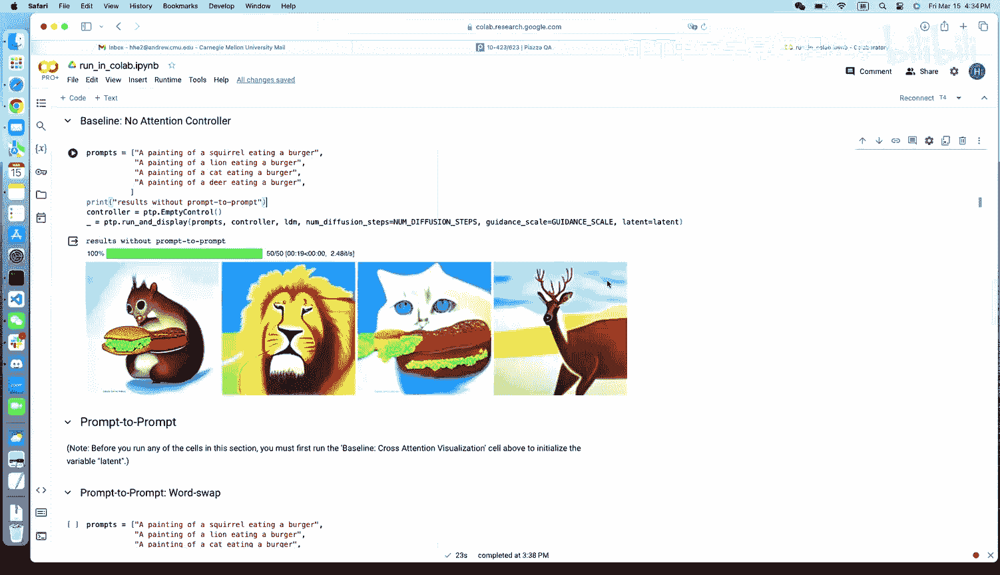

嗯哼。Is the reason why it's so long just like all the extra padding like is that like the wind that's the max length of 6 that 77 here max onwards would they actually like each one all those one and zero are just sending for one token。

 yeah。

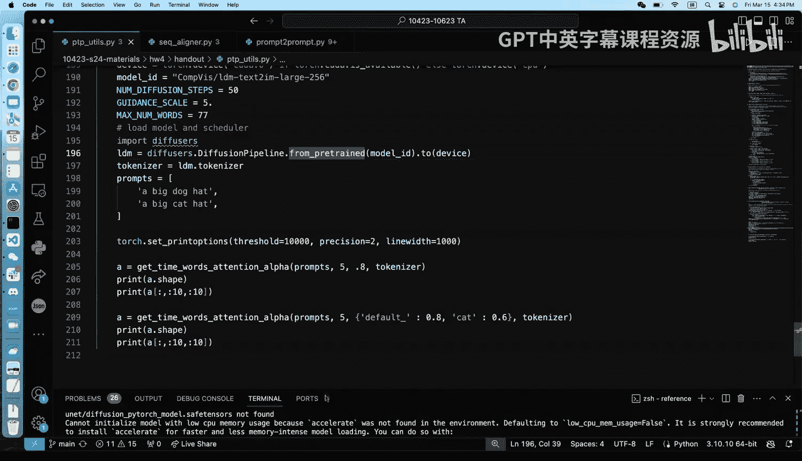

So that's like 77 ones， yeah， cool， thanks。Any other question regarding ColB？

So we're not training any model because training this will take you like take us a huge course budget that we can all afford。

😊，Any other questions？How long does the 20 seconds in on C4？

You can also do all of those on a pure CPU setup， it's probably just three minutes or something。She。

Yep。Any other questions？There's a defaultpot one and I knocked。

the so the mean starts shifting to the first oh， it may say a dozen swap。

It doesn't swap for the rest of the prompt， except for the wording question。

So zero means that it swaps at the very early stage because it just goes to zero at the zeros time set So this0 to one is basically like the proportion of the time step and00 means the 0% time steps and 0。

5 means like 50% time step and one means 100% time set。😊，And just to clarify it。

 there's two parameters。 One is cross replay steps。

 which is the stuff that we will be most experiment on。

 Another one is called selfre steps that we will not ask to experiment with。

 but you' are welcome to experiment with anyways。 And that is a question of what's the difference within cross attention mapping replace cross attention and replace self attention。

 Basically this parameters tell you like when the self will be replaced。

 but we are not not delve into this， because it's mostly useful other other functionality of from two problems。

😊，If there are no any other questions， then I guess that's it for today's recitation。

 thanks for coming。

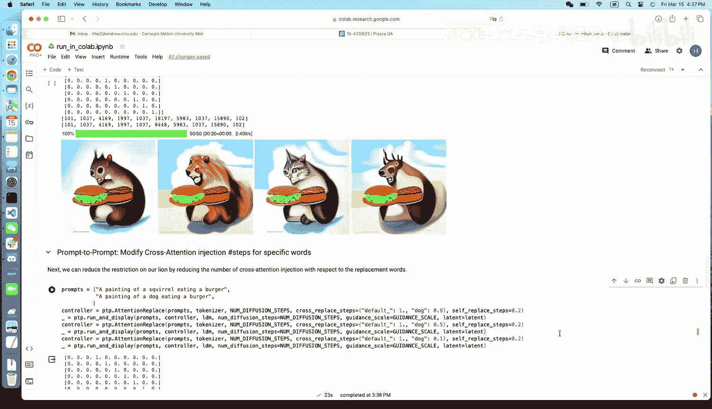