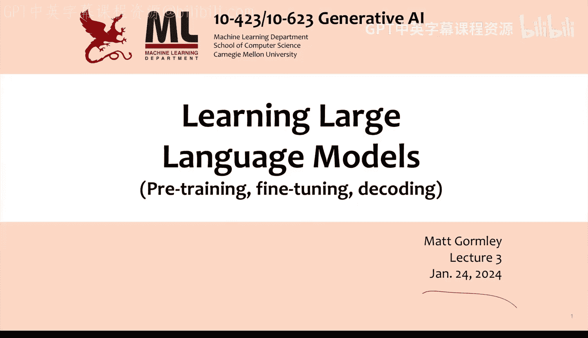
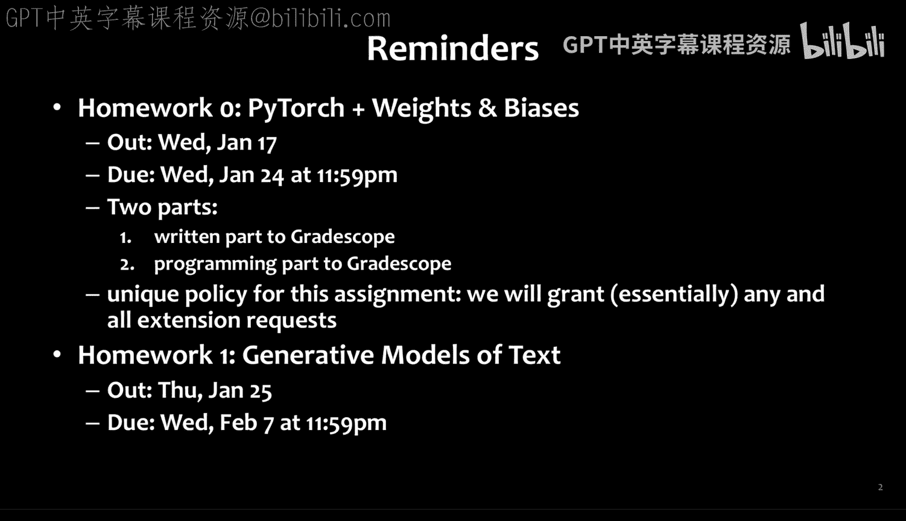
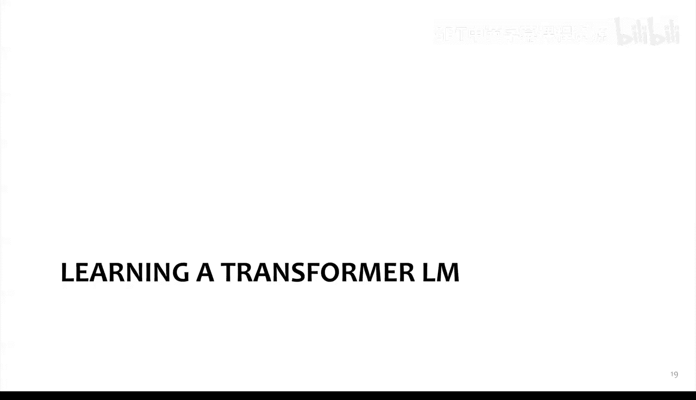
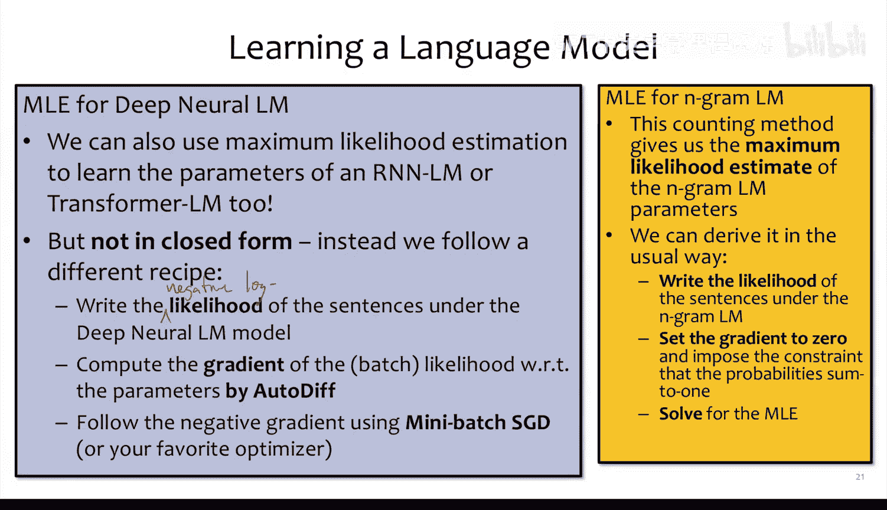
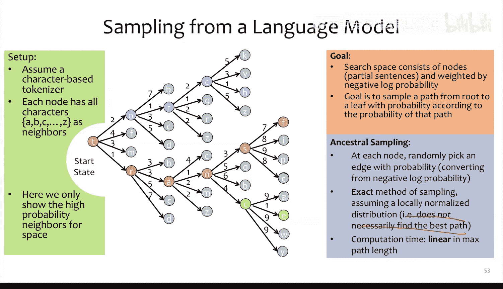

# CMU《生成式AI｜10-423 generative ai 2024》中英字幕 - P3：-P03-Lecture 03- Learning Large Language Models.zh_en - GPT中英字幕课程资源 - BV1CyC9BPEhG

All right， let's get started。Welcome back to JenAI。

Today we're going to be talking about how to actually learn a large language model。

really up until now， we haven't said essentially almost anything about learning。

 which is a little bit funny for a machine learning class right so now we actually want to think about the learning side of the models that we've been talking about up until now。

So just by way of reminder， homework zero is due today and if you need additional time。

 we are not so you can't use grace days， we don't want you to waste them on homework zero instead we want you to actually request an extension and there's instructions for how to request an extension in the syllabus。

 normally extensions are for like emergency situations。

 this is a different use of that extension mechanism。

And then homework one will be coming out soon， I think probably Thursday。And and then do you know。

 kind of just under two weeks later。Okay， so this question is coming up like how do I earn those 5% participation points just gradually like there will be various things that we're asking you to do that are not homework assignments but that we need you to fill out and so these will be like polls and surveys and different aspects of kind of the project process that will attach participation points too。

😊。

I talked to a couple people who asked this question。

 you know I'm already feeling a bit lost the deep learning content is going by really fast what should I do so we're not expecting you to know deep learning already but I think that you know different depending on what your intro now of course was different courses had like different sort of depths of treatment of neural networks so if this applies to you feel free to come chat with me after class or also you could consider reviewing the neural networks module from the fall 23 offering of 301601 there's links to slides and videos here you might be asking but I took 301601 with you and I'm still feeling lost okay well that's happening something I must be doing something wrong so come talk to me and we'll figure it out。

Okay。So before we jump in， I want to start by giving a recap of what we've done so far to get here okay。

 so we introduced this idea of module based automatic differentiation and we said the key ideas。

 you know that you have these objects called modules that define forward and backward methods and they can be chained together into a computation graph。

😡，And that automatic differentiation is all about computing gradients of the output of that computation graph。

 the loss with respect to generally the leaves of the computation graph。

 which are typically parameters。😡，And。Then we defined a very interesting computation graph called an RNN language model。

😡，And。We defined another more complicated computation graph called a transformer language model。

And then we said various things about language modeling and that in some sense is sort of a totally different topic so essentially what you could view this as is that so far we kind of started out by thinking about automatic differentiation as this tool for computing gradients and you know specifically of differentiable functions and if F is some differentiable function。

 then eventually we might get to a point where all you need to do to different it is write some code in a forward method by chaining existing modules together and you don't even need then to implement a backward because each of those modules has a backward already implemented and you can just rely on those in sort of a careful use of that computation graph。

😊，Okay， so。嗯。Computution graphs are sort of another way to define。A function F。

 it's a little more conducive to putting it on slides。 So that's maybe why we've been doing it。

 so far we've seen two of them and arguably like the transformer language model was a kind of complicated computation graph。

 right Like it didn't fit on one slide。😊，Um， so， but because when we modularized it。

 we can kind of break it down in that way。😊，For language modeling。

 the key idea here was that we were conditioning on previous words to sample the next word。😡。

Another way you could say this is that a language model is defining a probability distribution over sequences。

 or it's doing that by defining a probability distribution over a next word given the previous words。

And the two ways that we've seen to do that so far are with an Ngram language model。

 which you could think of as like this， massive collection of 50，000 sided dis。😡，Each die has 50。

000 sides because your vocabulary is 50，000 words， and so each time you're picking the appropriate die and rolling it to get your next word。

And by contrast， the RNNLM or the transformer language model are using a neural network。

To define the probability of the next word。But you could think of that as like， you know。

 this neural network is defining the weights on that 50，000 sided dye。And。When we roll it。

 it's kind of just like taking a sample from the probability distribution given by that neural network。

Okay， so then on the subject of learning， we really said that。There is。

There's Ngram language models and here learning is easy， you just count coocrences。

But so far we've actually said absolutely nothing about how you could learn an RNNLM or a transformer LM。

 okay， you may have kind of already inferred what we're going to do。

 but today we're going to like kind of unpack that in some detail。😊，And。

And so that's really the topic of what we want to think about next。So in essence。

 there's sort of two things that we've talked about so far， one is how to。

Conceptualize this idea of modeling language， that's language modeling。

And the other is how to define some models for deep learning。And now finally。

 we're going to think about how do you learn those models？😡，And finally。

 the other topic that we'll get to today is how do you actually decode or sort of get outputs from those language models？

Okay。So I want to start with just a quick recap just so we kind of have some visual terminology in mind here for learning a neural network。

 okay， so the recipe that we're used to following in machine learning is we're given some training data。

 and then we choose each of these a decision function and a loss function。

 and then we define some goal as minimizing the empirical risk is just a loss applied to our prediction and the true label and then we train with stochastic gradient descent。

 taking steps opposite the direction of the gradient。😊，Okay。

So back propagation for a one hidden layer neural network is kind of going to consist of you that we've been talking about it in this modularized way。

 but you could also think of it in this procedural way。

 where the forward computation starts at the bottom here and goes to the top。

 computing a linear layer， then a sigmoid layer， then another linear layer。

 then another sigmoid layer then a cross entropy loss。

And then the backward computation starts at the top and goes down and at each step is computing some partial derivative right so if J is our loss。

 then these things， these little G subB， they're like the derivative of J。

 with respect to B and we're storing that in GB。😊，ok。😊，So。

The point of AutoDF is that we can do this entire column now automatically。😡。

We don't have to actually write this out step by step。Though I guess we could say， well。

 someone actually did have to write out what the steps were for back propagating through sigmoid layers。

 linear layers， and cross entropy layers。Okay， so if you want to actually train that one hidden layer neural network。

 then you're going to do something like this with stochastic gradient descent。

 you're going to initialize， say the parameters of your network。

 let's call them alpha and beta where alpha is like a matrix of parameters for the first layer and beta is a matrix of parameters for the second layer。

😊，And we're going to say that for each EpoC E， you're going to loop through each training example。

 which is an XY pair in your data D。And then you're going to do sort of two steps， right。

 you're going to do your forward computation and your backward computation。

The forward computation gives you all of those intermediate layers and the backward computation gives you the gradients of your parameters。

 alpha and beta。😊，Whi is what we're going to use to actually do the stochastic gradient descent update。

 which is just saying that alpha goes to alpha minus gamma times g alpha and beta goes to beta minus gamma times g beta。

Okay， and then along the way， it's generally good practice to keep track of， say your。

Average cross entropy on training and validation data。And then at the end。

 you return some parameters， alpha and beta， though maybe if you're smart about it。

 you would actually keep track of which parameters corresponded to your best validation cross entropy and return notes。

Okay so then just for the sake of making a quick contrast here。

 I've been talking about stochastic gradient descent。

 which is just working with one training example， but in general。

 for a lot of reasons it's good to work with multiple training examples at once in a mini batch。😊。

The reasons are maybe twofold one is reduction of variance and the other is。嗯嗯。AVs。

And the other is efficiency。So in stochastic gradient descent。

 we're just selecting an individual training point right， this is like a single XIY I pair。

But in mini batchch STD。We start by taking all of our training examples。

 let's say there's capital N of them。And we randomly divide them into batches， each batch here。

 I have capital B batches， each one I1， I2 up to IB。

 if we could assume to be the same size size M and if we take the union of all the mini batches。

 then we get back to the full training set， if we take their intersection。

 we get the empty set because generally they're not overlapping。Okay， and then finally。

 when we want to actually train or do the optimization of our objective。

 we're going to iterate through time steps T。And then we'll iterate through mini batches B。

And so what we'll do is we'll select the next batch。😡，IB。

Where we're going to let M be the size of that mini batch。

 might be 16 or 64 something like that examples， typically you're going to choose your mini batchch size based on how many training examples you can fit into your GPU memory that's usually the deciding factor。

And then you make it as a power of two as large as possible， and then you compute the gradient now。

 not of just one example， but as the average of the gradients。

In the mini batch right so for each training example I in the mini batch IB。

 we add up the gradient of our objective function or our loss。

 the gradient of our loss on the IF training example。😊。

And then the one over M in the front is just making it so that it's averaged over that mini batch。

And and then we update our parameters， right， the new parameters at time step S or the parameters at time step S minus1 minus8 times the gradient of the mini batch。

And then here we're just evaluating the average training loss at the end of each EO。Okay。So。

We're going to use that sort of foundational idea of how do you train a neural network to train another neural network？

The neural network that we're going to train is called a transformer language。

But before we get there， I think it's actually useful to pause and think about how we learned the NGM language model。

Okay， so if you remember what we said was。We learn the probabilities for the Ngram model just by counting Ngram frequencies。

 right， You look at like the。😊，All the cases of cow eat and then you count up how many times each of the possible subsequent words occurs。

Well， it turns out that doing that。This counting method is actually maximum likelihood estimation。

For the engram model。Okay， how would you come up with this counting method well you would do it in the usual way you would write down the likelihood of the sentences under the Ngram language model what probability distribution are we actually using in an Ngram language model。

There's really just one probability distribution。 we're using it over and over with different parameters。

 what is it？Yeah。So Bernoulli is almost right because but the Bernoulli would be like the coin flipping distribution that only gives us two words and we need more than two words that that would be if our vocabulary was just cat and dog。

 then it would be just the Bernoulli， but then we could only get sentences like cat cat， dog dog dog。

Multenommial yeah， and I prefer to actually talk about it as the categorical distribution just because the multinomial distribution typically when defined allows you to kind of take more than one sample from it。

 we're only ever taking one sample from the multinomial distribution of that next word and so it's sort of that special case of the multinomial distribution。

😊，So when you write down the likelihood of the sentences under the Ngram language model。

 you have this product of a bunch of multinomial probabilities multiplied together。

 one for each word in the sentence。And that would give you a likelihood。

And you could set that likelihood。As your objective function。

And then you could actually compute the gradient of that likelihood。And now here's the tricky part。

 how many of you have solved the maximum likelihood estimator of a multinomial distribution？Oh。

 really。No， more than that， right？Oh man， oh， we should put this on the homeworker so this is not even like this material that it collapse。

 So the multinomial distribution is a front。 you should all go home after this and work out the maximum likelihood estimate of a multinomial distribution。

 It's great fun because it has this constraint。😊，So it's not the same as like working out the MLE of say a beta distribution。

 it has a constraint that says the probabilities must sum to one。😡。

And that constraint means that you can't just set the gradient to zero and then solve for the parameters if you do that。

 the answer you would get back is that all the parameters should be positive infinities。

 you need a constraint that says the parameters， the probabilities can't exceed one when you add them up together。

😡，And so when you solve that constrained optimization problem in closed form。

 you get back these counts。That as the answer for what the maximum likelihood estimate is。Okay， so。

With that in mind。If we're training a deep neural language model。

 we can also use maximum likelihood estimation， and that's what we're going to do for both RNNLMs and transformer language models。

 but not in closed form。We're going to follow the recipe that we just saw for the vanilla neural network。

 we're going to write down the likelihood of the sentences under the deep neural language model and then I guess I probably should have written the negative。

😡，Log likelihood of the sentences under the deep neural language model。

 then we'll compute the gradient really of like a mini batch of examples。By Auto diF。

 by automatic differentiation， and then we'll follow that negative gradient using mini batch stochastic gradient descent。

Or realistically， we'll use Adamom because almost everybody does。Okay。

So。So how do we actually get the likelihood out of a recurrent neural net language model？Okay。

 so here is a figure of that basic。Elman network that we started with。

 and this is a useful building block for us because it allows us to talk about kind of the full computation graph without going to the level of complexity of the transformer。

Okay， so here what we're looking at is a little bit of pseudocode that is kind of what you would put into the forward method of an R right so we're going to have these hidden states we'll call that are actually maybe are not pictured that are H0。

😡，And H0 is just going to be all zeros。And then for each time step T。😡。

And now we should be careful here， these time steps are not to be confused with the time steps that we were just talking about in training right this is not the stochastic gradient descent time steps。

 these time steps are really say positions in your input sequence right so your input sequence might be a sentence。

😡，The cat。Soaw。嗯。啊，哎。Food all the things I want to complete with involve a determiner and so the cataw food and and so the sequence T is ranging over those words。

 so we're going to receive our input data at time step T that's that's one of these X Ts。😊。

And then we're going compute the hidden state right This is exactly how we had done it before we have our weight matrix times our hidden state our previous hidden state plus our weight matrix times the current input plus a bias vector so the ws are vectors and the H X and B here。

 those are sorry the W's are matrices and the Hx and the B are vectors and then we apply some activation function Sigma element wise to A。

 just as we would in a sort of a standard neural network that gives us H T。😊。

And then we compute the outputbe of time step T by taking our matrix W times Ht plus some other bio vector。

Okay， so question where did so you'll see that we're passing some things in here。This x1 to t。

 that's the sentence that we passed in， where did all of these come from？

Where do we get these W matrices and these B matrix matrices？Where are those coming from yeah？Yeah。

 so at the very start of say， mini batchch SGD。Therere all those W matrices。And the B。

 those would be our theta， right， so this would be like WAH。W。A X。WY H。BH and BY。

So theta here is actually consisting of this long list of a bunch of W parameters and of W matrices and a bunch of bias vectors。

😊，And maybe it makes you feel a little uncomfortable to write out like a list of matrices and vectors in this way。

 if it does make you feel uncomfortable， you could just take those matrices。

Take each one and stretch it out into a vector right you could unravel it so that you just take each row and concatennate it one after the other。

 So now each matrix is now a long vector， So now take that first W matrix and then put alongside it the second W matrix and the third W matrix and then the B and then the other B and this huge long thing that you've just constructed is your theta your vector of parameters。

Okay， so at the initial time step， yes， we usually randomly initialize those Ws。

 so the first time that we come into mini batch SGD， right？

Let's go back here the first time that you would train a neural network。

You would have some initially random parameters that you pass into your forward。Okay， so lifewise。

Here， the first time that we call this， those things are probably just some random numbers。😡，Okay。

 what about the second time that we call this？Where did they come from the second time？Yeah。

Get a bit for second。Yeah， so they are going to be the current value of theta according to mini batch SGD。

 right， which we just updated via a gradient step。Okay， you know。

 the1 hundred0th time that we call this， they might actually be an okay representation of parameters that could do something useful for us because we'll have taken 100 steps of mini batchch SGD and at that point they will be the current theta。

That represents where we are。Okay。So。The next change that we can make to this RNN is that we can swap out this line nine with a new one。

Instead of Yt equals this， we could have Yt equals softm of this。

 and now our Y' went from just some arbitrary vector to being probability distributions。Over say。

 well， whatever you want them to be over， right？Maybe what you're trying to do is predict part of speech tags for your sentence right so here the cat。

Saw donuts。 maybe what we're trying to actually predict over are different part of speeches like adjective。

 determiner， noun， and verb。And we have a probability distribution over adjective determiner noun verb at each time step。

Okay。Okay， so now suppose you wanted to compute a loss function for this RNN。Well， here。

 if we had something like the cat saw donuts。And。Then we would need。

A gold sequence of parter speech tags right so the is a determiner hat is a noun。

 saw is a verb and donuts is another noun。 So our gold sequence of part of speech tags Y1 star Y2 star up to y4 star is D N VN。

😊，So when we want to actually compute the cross entropy loss。What we're going to do at time step T。😡。

Is compute？Essentially， the probability or sorry a cross entropy loss for the Teth tag。

Because each of these is a probability distribution over AD and V。And so now。呃。

Each of these little losses。Is telling us what is the probability？

That we assign to y1 being the true labeled D。That's what this L1 is。

And then L2 is what is the probability that we assigned to Y2 being Okay。

 so if you think about this as A D and V， then。What this is doing is it's essentially picking out one of those bars。

In the first case， it picked out this little blue barb。And it stuck it in this box。

In the second case， it picked out this red bar and it stuck it in this box。

And then it grabbed the verb bar here。And the noun bar here。Right。And I guess， it also applied a log。

 so it's not just sticking the number as is because the Somax gave back a probability。

 it's actually grabbing the log and sticking it in there。Okay。啊。

So there's actually something in this， this is the right way to write this down on a slide。

 that Home zero we actually exposed something important when you implement this stuff。

 there's something that we're doing here that we would never actually do in an implementation。😡。

Of this。Does anyone see what that could be， what are we doing here that we would not do in an actual implementation？

Yeah， the softmax， we wouldn't actually compute the softftmax at all。

 we would just work directly with the log probabilities because that way or we would call them the logits。

 the things that were passing into the softmax， they're not loggged probabilities yet。

And that can actually be much more efficient because then the cross entropy loss computation doesn't need to work with probabilities at all。

Okay， so the next question is。How can we use this to compute the loss for an R&N language model？

I mean， all we're doing right now is computing。This loss function for what's actually a structured prediction problem。

 like a part of speech tagging problem。Okay but this looks very different than the language modeling problem that we had before right what we're doing in this case is we're defining a probability distribution P of vector Y given vector X。

 right？😊，This is kind of the typical discriminative。Machine learning that we're used to doing。

 This is not so much a generative problem。It's just maybe more interesting than say classification because we actually are doing multiple classifications at once。

So how can we use this for language modeling？I claim that we don't need to change algorithm1 at all。

Yeah， any thoughts？啊。Yeah， that's exactly right， you could just predict the next word instead of predicting DNVN。

Just predict。Let's be careful about our inputs。So W0 is going to be x1 okay。

 and W0 is always going to be the special start token that tells us we're starting the R&N。Okay。

And then that means that。So this is our input X1， it' this start token。

 so then we get this probability distribution over word one。

And that's what we're calling this vector y1。Okay。So now the correct label for word one is whatever that word is right So again。

 if our if our if we if we're working with the same sentence as before the。Cat。Saw food or donuts。嗯。

Those donuts were really good weren't they man those very good donuts sorry I didn't bring any donuts。

 I've got donuts on the brain。😊，The cat saw。What we're doing here is。

We were taking the word the as the true label for this probability distribution stored in y1。

And then we're taking the word cat as the true label of the thing that should follow the word the and thereby be the thing that should be picked out of this probability distribution and so on down the line。

😡，Okay， and you'll notice that we actually don't ever feed in so we feed in words one， two。

 and three， we don't actually feed in word four here。And so that feels a little bit。

Almost asymmetrical， right， but what we're doing here is defining a proper probability distribution of word one。

 two， three， and4。Okay， so what if you really just， I don't know。

 feel uncomfortable about this and you really want to feed in word fork？

How could you change this so that you actually do get to feed in to the language model word four？

Yeah。Thank you。I don。Exactly， you could just add a special end token。

And then we could add a box here that is W4 that gets fed in and for W4。呃。

The L5 that we compute based on。We'll look back at。Some W5， which is a special。End token。Okay。

And so now once you've done it this way， you've actually changed ever so slightly。

The probability distribution， because now what you're saying is that you're computing the probability of。

 I'll draw it down here。 So with this。嗯。We actually have a distribution that is。Let's see。

What exactly， the probability of W1。Up through。WT。And then how does。

Let's call capital T4 in this example。So how does T+1 fit into this？WT plus1。

And there's also a question of what to do with W0。Yeah。But the be that。是请。Of。

 so we are in a condition。But only on W0。WT+1。Is now actually part of the probability distribution。

Because the final thing that we generated。Here was the end token。可以。Okay， so。So this is lovely。

We can do one oh yeah question。By。好ピ。Oh， good question Why what does the hiptogram have to do with the probability distribution over our words Okay。

 so now my picture breaks down because in practice。

Your vocabulary probably has something like 50000 words in it， not four words。 And so really。

 this histogram should actually be histogram with。50000。Over， say， 50 k words。And so in that case。

 you could imagine that essentially the YT vector is a 50，000 dimensional vector。

But because it's the output of a softm， we know that it has all positive values and that those positive values add up to one。

And so it is a probability distribution， over 50，000 different words， which again。

 would require more space than I have on the slide if we were to draw it as a histogram。

 but that is what each of these probability distributions actually is。😊，And crucially。

 each of those probability distributions at each time step is going to look a little bit different。😊。

Great。After we fed in the cat。The probability distribution over verbs。

It's going to have really high probability for all the verbs in your vocabulary， for example。Okay。

Other questions。いや、然咱肌肉还这。C。Yeah。So here。Let's go back to our。Our non language modeling story。

So here's our story when we were not doing language modeling。

 this is when we were just labeling a sentence with part of speech tags。So here。

 what we were saying is we feed in the cataw donuts。And at each time step。

 we're kind of getting this H that's a representation of all the words。

Up to and including the current word。And so that means if you're trying to label the word the。

 then H1 is some vector， some fixed size representation of the word the and we're using it to get a probability distribution over possible part of speech tags for that word。

Likewise， by the time we get to H3， this is a representation of the cat saw and it'll give us a probability distribution over possible part of speech tags for the word saw。

😡，So when we're doing language modeling， though， we need to be a little bit more careful about how we feed things in。

So let's think for a second about what would happen。If we。Did not have this column。

Okay so if we let's go actually to so let me actually before I ask that question。

 let me just I can just we need a clean slide and I actually have one here。

 so notice that these two slides are exactly identical。😊。

In that word one and word one are here word two， word two， word three， word three。

 word four word four， so I actually just collapsed those boxes right so that you just have one copy。

Of each word right， so this slide and this slide is just sort of a nice way of actually cleaning up。

The mess on this slide， right？Okay， so my question to you is。

What if we just got rid of this entire column？What probability distribution would we be defining？哎，呀。

Great that。Any， I mean， it depend on what you've give in for the hidden state。

 but assuming you' give in the same thing what you' given normally going the probability that。

Like W1 is what is the probability of like every given word following W1 for the sentence Yeah so how so it would be the probability of every other word following W1 given W1 so we could write that down as so。

Absent this box。Gives。The probability of word two。Up through word T， given W1。Okay。

 because now what we've done。Is we've said。We're actually multiplying together。

The probability of here。Word two。Given H2。Times the probability of word 3 given H3 times the probability of word 4。

 given H4。But we don't have a probability of word one anymore。

And so all we're left with is multiplying together probability of word two， word three， word four。

 so we have a distribution over two， three， and four， but one has been left out。And so we need to。

Have this additional sort of special start token so that we actually get a probability distribution over the first word。

It's a great question。Okay。Another question。What is the？都快。As。Oh thank you what is the YT asterisk。

 let's go back to this one so。This Y T asterisk。Is。The gold labels。Like the true labels。

So whatever sequence you're trying to predict。Why star one to capital T is the true sequence that you're trying to predict and so。

So in this case， that was the sequence DN VN。And what we're seeing is that。In this case。

Or let's look at this one。That y star1 through T。Is。The sequence， word one， word two， word  three。

 word four。Because that is the sequence that we're trying to predict。

And' trying and we've carefully offset it from start W1W2w3 so that we're always predicting the next token from the previous one。

It's a good question。O。Other questions？You mentioned that in practice we don't use soft it like partial those cross entropy loss allows us to not deal with proities。

 but under the hood it's still computing yeah it's still computing the same exact cross entropy loss so you could you could sort of think about this for yourself suppose I gave you。

Not this YT， but I gave you YT prime， which did not include the softm so then you could you could actually puzzle through for yourself。

 how would you compute。LT here。Using only that YT prime without the Soix it's a nice little puzzle for you to think through。

And it's fairly straightforward where you just need to think about how the logs and the excs interact。

Okay。Okay， so。So learning an R&N language model。呃。Is essentially as follows。So each training example。

Is a sequence and if you're doing real you know actual human language modeling。😡。

Then that sequence is a sentence。Although in practice。

 maybe it's not actually a sentence as we'll get to in a moment。

 maybe it's actually a sequence of words that you break into 1024 tokens， for example。

And our training data。Consists of， say capital and sentences or sequences。

Where each sequence consists of a collection of words right， so W superscript 1 is W1， superscript 1。

 W2， superscript 1。And so on up to say， if it has length T， WT superscript 1。Right。

So then the objective function for a deep neural language model。

whichhi it could be an RNMLM or a transformer LM is typically then the log likelihood of the actual training examples。

 right？So the full likelihood of our whole data set is just some over all of the capital N training examples。

 and for each one， we add in the log of the probability of the IF sentence according to the model。

And then we train by mini batch， stochastic gradient descent。

 or whatever your favorite optimize series。Okay， so what we're looking at here is you know。

Sort of one slightly longer training example。 and you can see we did actually include the end token there because in practice that's generally a nice idea。

Okay。So all of this。That we've been talking about was to train a recurrent neural net language model。

But that's not what we want to do， we want to train a transformer language model。

Right so now we need to completely shift gears and think about how to train a transformer language model。

 okay， here's how。Okay， let me let me you might have missed it， okay here's。Did you get it？

Make sure you catch all the changes to the slides。The title and this gray box。That's it。

 that's all there is。Because the transformer language model。😡。

Is just defining for us a different computation graph。At the end of the day， that big。

 complicated transformer language model that we spent all of last time talking about is just defining for us。

A bunch of probabilities over the next words， right。

 it's doing so with attention and layer norm and residual connections and feed forward neural networks all kind of crammed together into many。

 many stacked layers， but ultimately all it's doing is defining for us these probability distributions over next words。

😊，And so the training algorithm looks exactly the same whether we're using an Rn NlM or a transformer LM。

 the only difference is which。😊，Differententiable function we're using to actually construct these probability distributions。

听。Let me pause here， any questions？Okay。Okay， so now you can see why we just spend all this time looking at RNMLms because you know we can actually kind of cram all of this onto one slide。

 I can't really cram all of this onto one slide， but I think by now you have this picture of how to go from words to probabilities that's the transformer language model and it is some big complicated differentiable function。

And you now also have this picture of。You know， if you have those probabilities。

 how you can get an appropriate loss function for your data set。Okay， so。呃。So it turns out that。

 you know although sort of current state of the art language models currently do rely on transformer models。

 A ands actually did comprise most of the early neural language models that sort of led to the current state of the art architectures。

 so if you look at if we zoom in here，So this is sorry。

 this is a famous data set called the Penn Tree Bank。And it consists of about a million words。

 and it's being used here as a test set。And so one of the ways that you can evaluate the quality of your language model。

Is asking the language model？What probability？Do you give to an unseen sequence of words？

Because if a language model has never seen that sequence of words before。Right。

 and and suppose so the Penn Te Bank consists primarily of Wall Street journal newspapers from say the。

The 1990s or something like that。And so if your probability distribution was really naive， right。

 suppose it just， you know， put all of its probability mass on the word right。

 so it really liked to generate sequences like cat cat cat cat cat cat cat。Right。So in that case。

 it means that the probabilities assigned to all other words that might show up in the Wall Street Journal are quite small。

And so when you're trying to evaluate your language model。

 you can ask what probability do you assign to this piece of text that you have never seen before？

And if it's a pretty substantial piece of text， like a million words。

 then if your language model is no good， like it always assigns high probability to the word cat。

 then it's going to have really low probability for a million words of Wall Street Journal text。Yes。

So if you look here on the far left。We're actually evaluating test perplexity perplexity is like。

2 to the。Negative log。Probability of the sequence of words， there's something like that。

Someone could Google that and then correct me when I give the wrong definition。

 so the point here is that whereas for likelihood you would want things to be going up for perplexity you want things to be going down down is better and so here in like 2014 you can see kind of the best things where LSTMs and recurrent something or others and more LSTMs and as we kind of go along here pretty much everything here was LSTMs even past 2017 right like 2017 is when the transformer was introduced here's 2018 it wasn't really until GPT2 came out in 2019 that we actually had a model that was transformer based that was beating the R&NLMs。

And since then， I think people kind of stopped evaluating on this data after GPT3， one。

 can anyone think of a problem with evaluating GPT3 on this data？Yeah。actually in the data yeah。

 this is a very famous test set it's probably sitting on GitHub somewhere and GPT3 was probably trained on Gitthub and so that means that this so-called test set for GPT3 is really in the training data which is probably cheating。

Okay， so。啊。So next I want to think about efficiency。So why does efficiency matter？😊。

So if we think about GBT3， the number of training tokens for it was like five you know。

 not even a trillion， it was only half a trillion， like 500 billion， but it was big。

 it had 175 billion parameters。And GP3 is。Is kind of a nice example of a transformer language model because we can actually think about how large it is。

Okay so here what we're looking at is some different versions of the GBT3 model okay。

 so let's look at the top row GBT3 small， it has 125 million parameters。

And it consists of 12 transformer layers， so each transformer layer consists of what layer norm and residual connections and self attention。

D model you know， is the size of the embedding dimension N heads is the number of heads in attention and it had 12。

D head is actually just de model divided by number of heads， think is 768 divided by 1264。

 it should be。And it's batch size it was。in5。Was half a million and I guess what we're not seeing here is actually the sequence length of an individual input to the model。

 Okay， so that's G small that's considered a small G model，12 layers。 What was G3。

 Well it was 175 billion parameters，96 layers。 D model was 12000。

 It had 96 attention heads has 96 attention heads 128 as D head and a batch size of 3。2 million。Okay。

 so this is a truly enormous model。And。And so we can also think about。

The amount of compute that it needs。😡，And basically。

 one way to actually do that is here by comparing it with other language models。

And so what's important to notice about this is they're measuring head oflops， which is。

Sort of a measure of how many multiplications and additions you're doing。

 you could think of it that way and。And so the Y axis though， is not on a linear scale。

 it's on a logarithmic scale。And so GPT3 looks like it's not that much taller of a bar than all the models that came before it。

 except that this is on log scale， so that actually does mean that it was like dramatically more compute than almost anything that had come before。

😊，Okay， so。And just to answer the question of you， would the Penn Te Bank be in the training data。

This is 410 billion tokens of web text， so I would say， yeah there's a decent chance it was in there。

 they might have taken some care to actually filter it out though。嗯。😊，Okay。

 so now that we're kind of on same page for why we should care about efficiency。

 I want to think about how you can go about getting some efficiency out of a transformer and arguably this is sort of one of the key reasons that transformers have been so successful。

😊，Okay so for one， batching can be done very efficiently。

Rather than processing one sentence at a time， we typically batch B sentences at a time。

 and then the computation is identical for each batch。But it's also trivially parallelizable， right。

 because the computation graph for one sentence doesn't interact with the computation for another sentence。

Okay， so how do we actually do batching？So suppose we have eight training sentences。

We would set our so called block size， which is like our maximum sequence length to something like。

 well， it would always always be a power of two because we're computer scientists。

 but here on this slide it's going to be 10。And then we go through the following four steps。

 so before collecting them into a batch， we truncate sentences that are too long。

So here we would just drop。Those excess。Words off of the long sentences。

And then the second thing we would do is we would add padding tokens to sentences that are too short。

喂。Okay， then we would convert each of our words or rather what we could call them Turk tokens into an integer via some lookup table。

Okay， so how do you create a lookup table like this。

 well you just loop through all of the words in your training data and you assign and you gather them into a set。

😡，And then now you have all the unique a set of words that appear in your data。

 and now you just create a mapping from words to integers and convert each word to an integer。

So here you can see those yellow highlighted ones where I had added the special padding token and all of those mapped to zero。

Whereas the first word here in。Maps to the integer2。Good。So。

The fourth step is maybe the most interesting one， we convert each token or integer to an embedding vector fixed length。

😊，Okay， to do that， we just build another lookup table okay， so this table says well。

 we know that our vocabulary size is 56 words。It's probably more like you know tens of thousands。

 but and so what we have then is for each possible different word in our say，  50，000 vocabulary。嗯。

We're going to have a unique vector representing that particular string， that particular token。Okay。

 and now。You know for word two here。We're going to look up。The embedding for integer two。

 and we'd put it in there。And then we'd say， okay， here， this is word three in the second sentence。

 so we would take this embedding。And we would stick it here。

Now you'll notice that in this third sentence， the first word is also the word it。

And so we would pit this also here。So we'd be reusing the same embedding vector for multiple different works。

😡，Okay， so now we have。A nice vector representation of our sentence。

And we can feed each of these vector representations into， say。

 a recurrent neural net language model or a transformer language model。Okay， oh。

 and then don't do this。 I think we already posted about Giats on this。 You should。

If you haven't read it， you can read about what bug I introduced into your homework era。

So other things that you should be concerned with for efficiency。

 so one is the scale dot product attention that we introduced last time。

 it can also be easily paralyzed because the attention scores of one time step do not depend on the other time steps。

😊，So at least within a particular layer， so the second layer is going to depend on all the attention scores from the first layer and the third layer depends on all those from the second layer and so on。

 but within the second layer， each of the time steps are independent。

Multi headed attention also computes each head independently， which permits yet more parallelism。

 I think you're starting to see the trend and then。😊，While on the subject of parallelism。

 for huge models， you could actually divide the model itself over multiple GPUs or machines and get parallelism over different parts of kind of these different things that break up layers and so on and time stepss。

😊，And then another nice efficiency is that basically at the core of attention。

 if you remember how we did it， we computed that something like X prime is a。😊，Soft Max。Of。

QK transpose over root decay。Times V and you can see here that the main computation that we're doing is a big matrix multiplication here。

😊，And then another big matrix multiplication here。And comparably dividing by a scalar and doing a softmax is kind of efficient。

 so most of our computation is tied up in this matrix multiplication and specialized hardware can make this very fast。

😊，The last thing is kind of interesting and maybe unique to transformers。

 which is key because essentially almost everything that I'm saying here is true of like a lot of different aspects of different kinds of models。

 key value caching is another very transformer unique things so the keys and values are reused over many times steps but we don't actually need to catch the queries。

 similarity scores and attention weights and what we've learned in recent years is that GPU memory is really one of the big bottlenecks to getting efficient computation done and and just like a CPU has different memories of different speeds basically the closer you get to the physical CPU。

 the faster the memory is but each of those different sort of layers of memory gets the closer it gets to the CPU the smaller it gets and the same thing goes for the GP there's sort of a big block of memory that is typically what's advertised when you see like the NviIDdia。

Adtisement but there's also a much smaller amount of memory that is the fastest part of your memory and that is typically not advertised。

 but that's the thing that's usually the bottleneck it's getting in and out of that really fast memory and so to the extent possible thinking about memory is very important so that the idea of the key value cash is that at each time step。

You reuse all previous keys and values， like you do need to cache them。

But you can get rid of query's similarity scores and attention weights。

 you can let them essentially fall out of the cache。😊，So here， you could see in this time step。

 I'm just going to show you one V1 through V3 and K1 through K3， those were all computed。

For a previous time step， but reused for time step four。By contrast， all of this stuff。Query4， Q4。

 and then all of those similarity scores， those attention values。

Those are all just completely useless to future time stepss when the next word comes along the word X5。

All of those， the queries and the similarity scores and attention values。

 we don't actually need those anymore。And so if you're very careful。

 you can actually discard those as you go。Now， can anyone think why it might be tricky to discard those as you go？

Oh sorry let me throw in a caveat here so let's assume for a second that all you're doing is you have a trained model and you just want to you have chat GT and you just want to serve people responses to their queries as efficiently as possible so the weights are fixed and all you're trying to do is actually take in word at a time and output from your model。

So why might it be tricky to discard？Past queries and such cash eviction policies are not usually up to the interesting cash eviction policies are not usually up to the program rate that is that is maybe one part of it。

 I guess I think that I have something a little more fundamental in mind。That has to do with how。

 how we typically implement a transformer。I'll give you a hint。It has to do with that red scribble。

This has a key value。然后。Yeah， so the softmax is definitely like kind of in the mix here。

Does anyone remember what this Q and K matrix actually are？Yeah， I guess like。think sufficiently。

 they're often in combining multiple things。One big matrix。

 but if you want only some guys to live in the cache then you kind of discard the ability to do all of those computation it once exactly right so this Q times k is typically we've taken all of the queries over all of the time steps and all of the keys over all the time steps and stacked them on top of each other to get those two matrices and then we're multiplying them together which is fast because matrix multiplication is really fast。

😊，But now what we're saying is wouldn't it be nice if we could discard queries as we go， Okay， well。

 that's a nice idea， but now you've just broken your nice matrix multiplication and you're going to have to think very carefully about how to decompose it so that you're still doing some big matrix multiplications while also discarding things as you go。

And this is the subject of the key value cash。Okay， I want to say I'm worried about tokenization。😊。

I don't think we've， yeah， I didn't talk about this yet。

So this is stolen from a coinor of mine Henry Chai。

 and so our input here is Henry is giving a lecture on transformers。And so here。

 the wordbased tokenizer would essentially take in that sentence and output a sequence of tokens by splitting on the white space。

 everywhere that there's a space or a tab or a new line， it would break into the next word。Okay。

 so the thing is this can actually kind of have difficulty trading off between vocabulary size and sort of computational tractability。

 because what happens is。呃。You typically want to accommodate as many possible words as you could imagine seeing right the typical sort of native speaker of English knows about two or 300。

000 words。But I've been talking about 50，000 word vocabularies， right？So what about that other 150。

000 words， well， usually we don't want to accommodate all of this。

Another problem is sort of similar words like transformers and transformer are going to get completely separate representations in that embedding table of vectors。

 right， they're just going to be completely distinct integers now and the representations of those two words will have nothing to do with each other。

As well，tepos will typically be out of vocabulary， so here if Henry had typed instead Henry is given elect on transformers。

 then the word given is going to be out of vocabulary and lecture is also going to be out of vocabulary。

😊，Because it's unlikely to have appeared in your training data。😡，Okay， so you might think well。

 what we could do instead and actually what you'll do on homeworkmark one is you as a character based tokenizer。

And so in this case， you get a much smaller vocabulary。😊，Right。😊。

Now your vocabulary is over characters。Right H， E， N， I mean。

 the actual vocabulary itself is lowercase letters。

 ABC D up through Z and then uppercase letters A through Z plus some numbers and some punctuation。

And even if you're in， say， a logographic language。The vocabulary still might not be huge。

 it might be on the order of thousands of characters。Um。The problem is in a language like English。

The small vocabulary really does lose a lot of semantic meaning， right？Now。

We're also going to have to have sequences that are dramatically longer。Right because I mean。

 you can see it happening here right in this case in the word tokenization。

 this only consisted of what seven tokens， whereas in the character setup。

 we have more running off than fit on the slide。So the trade off。

 the solution is something called a subward based tokenizer， and for this。

 we split longer railways into smaller but maybe semantically meaningful units。

And so this is beautiful because we now have no out of vocabulary words because any non-subword token can be constructed from other subwords and one way to guarantee this is to always include all of your characters as subwords。

And there's a bunch of different algorithms for actually learning these different sub wordss like by pairencoding word piece and sentence piece。

 so here now we have something like given and it might be broken up into GIV as one token and then hashtag hashtag IN。

 the double hashtag is there to indicate that this is the continuation of a previous word。

And like true might be broken until like plus hashtag hashtag true。看看。Okay， so what about decoding？

So。So greedy search is a useful algorithm and you can actually use it to get output from a language model。

😊，So in green search your search space consists of nodes and weighted edges。

 the goal was to find sort of the total lowest weight path from a root to a leaf at each node you select the edge with the lowest immediate weight。

And this is basically a heuristic method of search doesn't necessarily find the best path。😡。

But it's nice because it's linear computation time so here's how it would work so you start at some node like this and then you look at all your neighbors and you say which of these has the lowest weight on any of its neighboring edges we'd say okay one is the lowest so we'd pick that node and we'd expand its neighbors and we'd say okay which of these has lowest well there was a tie here that's just arbitrarily pick this node to break it。

And now again， we pick the lowest weight neighbor and again and again。

So to get the total weight of math， we would add up one plus three plus1 plus3 plus seven。

 which is 15。你看。So that's a pretty good find the trouble is that this is greedy and it's not necessarily optimal so here we picked the lowest weight edge which is three。

 but if we had picked a non greedy edge here that was a weight four。

We would have gotten to weight one here instead of seven。And so this path。Would have had。

A weight that was seven。嗯对。Oh， a total of 10， thank you， not a total of seven。

So it's much better than our 15。And then finally， if we had gone all the way back to the beginning。

 we might have found another path that was even better。Okay。

 so what does this have to do with language modeling， so assume that now。

We change things up in the following way， so we're going to assume a character based tokenizer。

And each node has all its characters as neighbors， A through Z， though I didn't show them all。

And then the search space is over partial sentences。

Where each of the weights on the edges is essentially the negative log probability of the next word or sorry。

 next token， which is a character given all of the previous tokens。😡，Okay。

 and the goal was to find the highest。Probability path from wheat to leaf。

 which corresponds to the lowest negative long probability path。Okay， so at each node。

 we select the edge with the lowest negative log probability。

 which is corresponding the highest probability character。And so if we did it here。

 then we would trace out first the character T， then among these options R。

 and then A and then N and then S and then F， and then maybe we would continue on to get us transformer。

Okay。😊，If instead we had not been doing Read research。

 we might have found that the most probable output was actually the word torch instead。😡，可以。So again。

 this is not an optimal method of search， but it's really nice because its computation time is linear in the max Pa lengths。

😡，So。So sampling from a large language model we can also think about in this picture。

So this is the algorithm of ancestral sampling and the idea here is that we want to sample a path from root to leaf。

With probability proportional to the probability of that path。😡。

And when you have defined what's called a locally normalized language model as we've been doing。😡。

At each node， you can randomly pick an edge with probability proportional to the weight on that edge where you've converted from negative log probabilities。

😡，And if you do it in this way， you're getting back an exact method of sampling from your language model。

And so this is a convenient property to have。Okay，呃。

So this has been kind of the picture of how do you learn a language model？

And how do you kind of do some important efficiency things with a language model as well as how do you decode from a language model。

 where we'll go next is start to think about sort of some of the foundational ideas for for other ways of training these kinds of models and other more advanced techniques。

 for incorporating things into say， position embeddings and attention。

So the last detail here is just that I in preparing this lecture I kind of realized like I needed to make sure that this stuff was very clear so that you were prepared well for homework one there's still a little bit of content that I want you all to have for homework one so homework one is going to end up incorporating either like either I'll release a little like video recording or it'll just in some of lecture for on Monday so either way we'll be releasing that and you'll actually get a chance to implement a character based language。

😊。

