# CMU《生成式AI｜10-423 generative ai 2024》中英字幕 - P4：-P04-Lecture 04- Modern Transformers & CNNs + Transformers for Vision.zh_en - GPT中英字幕课程资源 - BV1CyC9BPEhG

Yeah。Yeah。Yeah。Yeah。Yeah。Yeah。Yeah。Yeah。Yeah。That's one， two， three， four， one， two， three，4， one。

 two， three， four。Iless what are you doing？上楼啦。Not much just， you know。

 enjoying a relatively slow Monday so yeah， had a class remote nice。Yeah， yeah， that's good yeah。

 we don't have a recitation for this class this Friday， do we？I think I saw on the calendar。

 there's nothing。Again， don't think so cool。 Let me just confirm it。 Yeah， yeah， for sure。 No， cool。

 cool。 Yeah， yeah， you trying to go theage trying to have a night on the town。😊，If there's not。

 goingYeah， yeah， so I'll have my 9 a， but。找回动。Thank you， let me check this because in。Yeah。

 I'd be like my yeah， exactly I'm looking forward to it because that's a day well where I'll just like come in and then once I'm get get done with my morning class I'll just go on。

是。嗯。The freeze came back a little bit today。 it's kind of like melting and freezing on and off a little bit。

 Yeah has a。I had to walk， so of my wife dropping off like a little bit farther in their way because we were yeah。

 I had to walk here。Yeah， that's。Yeah， you got to watch your step too you might like oh it was still early。

 so it wasn't I see oh haven't been outside actually。Well， I guess I I haven't been asked that。嗯。

You said， yeah， it's Friday， there's no institution cool right。

But we're going to do them withquiz on well， it's only 10 minutes， but aqui wants to where go。

that means yeah，ll see Wednesday and then that cool cool。し。S one， two， three， four。Yeah二。Sh。不车。Yeah。

Yeah I can't wait I'm glad though we had that little warm spell that was really nice Oh yeah absolutely like I I was wearing a t shirt outdoors in Jamie me for a minute there that was weird it was in like6 Yeah yeah。

and my I'm really happy for my one friend earlier last year he got a concussion on his bike and yesterday was the first day that he got back on the bike oh motorbike no just like a pedal bike yeah yeah yeah and he he got kind of like a nasty concussion and it was like this thing where like he doesn't even remember what he did you know like I had a family friend who did the same thing Yeah yeah。

 and it was his senior year of high school he was one about theium wow yeah。Yeah。

 the wrong kind of injury like that I'll just。You know。

 so I'm we're all really glad that he's he's like back on the bike now because it's been like it's been like more than six months since that he's he's like my age she's like actually he's like a year younger than me So he'd be like 2。

29 right now Okay， yeah。但是。SoYeah， yeah， you got to watch out because I don't know it's like。

I've been like riding my bike for years， but I've never had'。Like， never had an injury like that。

 You know， like， yeah， yeah， never had an injury and bag crashes right。 Yeah， yeah。

 I've had like a crash and stuff， too。 But yeah， like I was like facing for。I mean。

 I'm in Staten Island with my cousins and we have。We have several bites。

 but there's one that doesn't have bricks and we。We were playing or we were passing it around so like date your day without so it's like Russian and Ruette night bit yeah yeah。

 you got the one with the bullet in it so。We're cutting through traffic。

 I don't have breaks at this time。And all of a sudden this band pops out in a the band is empty。

 I don't know that but started the man and the guys jump out like are you okay are you okay like catch up Yeah but like I just imagine how they heard it versus like right。

 Yeah yeah， for sure。 Yeah， like that right Yeah， yeah， yeah I mean。

 when I'm like in my car even like some like pieces of salt like hitting the bottom of the car I'm like I don't like that Yeah like I don't like good noise of that I don' have to get this detail right yeah。

Like the sound of pause。Just。I'm what you have。Haven't been in like any fund vendors yet this year or last year。

 but the two previous winters I gotten like a small fund vendor like twice in two consecutive winters。

You know， the insurance company is just like， all right， we're gonna make you pay。 Yeah， Yeah。

 this is't report it。 right， Well， it was like a thing where I had to kind of because it was like I didn't make a collision with another vehicle。

 I actually made a collision with a snowbank and。😊，I didn't think it would total my car， but it did。

Yeah， yeah， it's it's it was like the front of my car was I guess like we had the insurance agent income and like。

He I drove it home I drove it home like from the highway after this accident made it home and he was like。

Yeah it's total so I guess like I mean I guess it was like long out of shape enough that like it would have cost the price of like a new car to fix it damage right yeah yeah so I think it was that kind of that kind of thing but yeah i'm just like it's like when ice is on the road people。

Don't people forget how to drive。And I had that same experience I was driving an interviewing。

About years ago， and。I didn't realize that I typed in the wrong address， I'm in the wrong。一。I。

I my experience with。Its correct。这这里是是不需要。Yeah。We can approve and disapprovve with everyone else's。

Yeah。Oh， I've already seen dream was even like。Ex question。

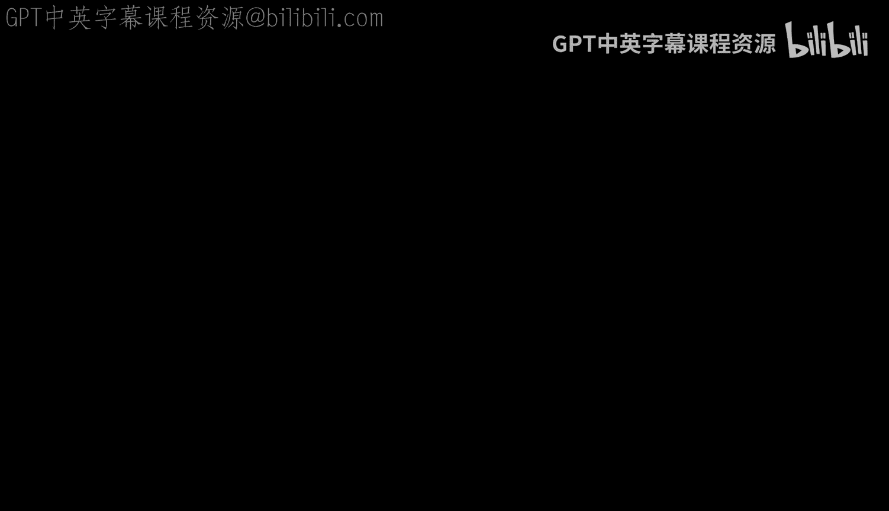

I think she's like getting。But like， I think to got it survey。肯定对。Yeah。ち。点得。反の question。我视分钟。来。

I to take another chance cut over。Okay， I think we're good to go， yes。Okay。

 welcome back today in GenAI。The title slide started getting too long。

 I think I even left off like some of the things in here。 This is like g training in here。Oh。

 fine tuning， we'll talk about that。Modern transformers。

 well really there's like all sorts of different aspects of that talk about。

 but we'll maybe like mention three， there's CNNs， there's transformers for vision。Anyway。

 so in essence， this is like a laundry list lecture of like lots of different things that we we'll try to talk about I'm not actually sure how long how far through the laundry list will'll get。

 but I think this is also kind of a transition moment where we're trying to transition now from our discussion of。

😊，Generative models of text to our discussion of generative models for vision。

 and so the actual models that we're going to be talking about on the vision side first。

 CNNs and vision transformers， those are technically like not by themselves generative models。

 but we'll use them as building blocks as we move towards the generative models。O。

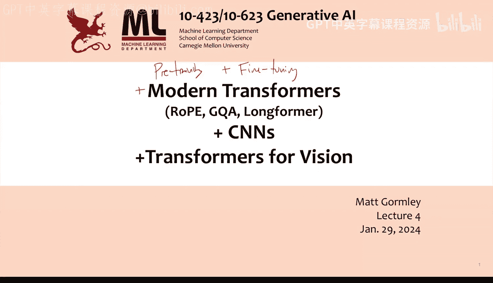

So。Just a reminder about homeworkmark one， which came out last week and it due on Wednesday。

 February 7th and then quiz1 is on this Wednesday in class at the start of class and I'll direct your attention to Piazza for more details about that。

 but I guess the main one to note is just that we'll be sending out assigned seats for for quizzes and so you know you'll come in and you'll just you know walk directly to your assigned seat and then we will start the quiz together probably you know two minutes after the start of class or something like that。

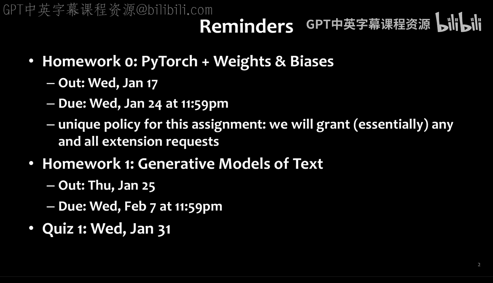

Okay， so last time we had cap and。We kind of saw where we had been and where we were going。

 and last time we kind of filled in this bottom block about how to actually learn either a recurrent neural net language model or a transformer language model by optimizing some objective function with stochastic gradient descent and then to compute its gradients with automatic differentiation。

Okay。So so now that we've kind of got that figured out， I want to think a little bit about。

Greed training versus fine tuning， and we'll define these two technical terms as we go。

If you look back the sort of architectures of modern deep learning actually have this very long history。

 so in the 1960s there was this like Rosen Gts sort of three layer， multi layer perceptron。😊。

And the value activation function， which became popular in computer vision decades later。

In the 70s and 80s， there were RNNs and CNNNs in the 1990s there was an architecture that was effectively like a linearized form of self attention。

😊，Though it wasn't until say the 2010s that attention really started to take off。

 but the spark for deep learning really emphatically came in the year 2006 thanks to the idea of pre training。

And from there， there's been this sort of meteoric rise of just the number of publications in the space of deep learning and as well。

 I think it's success。Okay， so I want to hit on three ideas， idea number one。

 which is just supervised training， but we're here going to call it supervised fine tuning。😡，嗯。

Idea number two。Is we're going to do something called supervis layer wise pretrain followed by supervised fine tuning。

 idea number three， which we'll actually kind of unpack a little bit。

 is unsupervised pretraining and supervised fine tuning。Okay， so so in 2006。

 there were these results from this paper by Yahua Benjiio and some others on this very now classic task of MNist handwritten digit classification and this is a percent error。

 so lower is better and basically the state of things was that with a shallow neural network。

 you could get error just under 2% on this task sounds pretty good。😊，And。And yet。

 if you use a deep neural network。Trained in exactly the same way， meaning supervised training。

 supervised fine tuning， the error was worse， it was higher。So， you know， at the time。

 this was really， you know， kind of。Both puzzling and also disappointing to people because Litendo was saying like。

 you know， it feels like a deeper neural network should be better and yet it's not。

And so someone came up with this idea。Of。Training these networks were sort of the simple sort of multilayer perceptrons right。

 they're fully connected at each layer and the second idea came up which was what if we trained each layer of the neural network one at a time so that it predicted the handwritten digit for us？

And we could do that sort of layer by layer building up。

 and then the final layer is the one that we would actually use。😡。

And this idea worked in the sense that it got the error of the deep net to decrease。

 it failed in the sense that the deep net was still worse than the shallow neural network。Okay。

 so by shallow here， I mean something like， you know， a two layers deep neural network and then deep。

 I mean something that's like three or more。Okay。So what about idea three。

 idea three was this will'll kind of take。The original idea of supervised fine tuning。

 but we're going to try to pick a better start starting point and the way that we do that。

 so starting point for our optimization algorithm， right？

And so the idea was we could train each level of the model in a greedy way。

And we would use unlabeled data to do that， so the idea would be that you could work from the bottom up。

 train the hidden layer， the first hidden layer， then fix its parameters。

 then train the parameters of the second hidden layer。

 then fix its parameters all the way down until the N layer and then fix its parameters。

And then that's with just unlabeled data with the supervised data。

You could use just sort of standard you know back propagation and classification loss cross entropy。

Okay。😊，So if you're doing unsupervised training for M digit recognition。

 what this means is that each training example now is just an image without a label。😊。

So how do you train if you don't have a labeling？So well the only thing that you observe is the input so what do you try to predict well you try to predict the input itself。

 so this is the idea of an auto encodecor。😊，So we take our input image and we stretch it out into one long vector Okay so it's just taking you know let's these are grayscale images so you just stretch them out into a vector of pixels if there's not like multiple channels for a color image。

 so very simple。So that is our image stretched out on the first layer。

 and then the first hidden layer tries to encode some representation of the input。

 but at lower dimension。And then this output layer。

Is actually going to be trained so that it triess to produce a copy of the input。Okay。

 so if the hidden layer was the same size as the input。

 this would be almost trivial right it could just learn the identity matrix for each of the other sort of weight matrices。

 but because we have to reduce dimensionality now we have this bottleneck and hopefully it learns something generalizable。

😊，Okay， so the key idea here is we have the reason that it's called an auto encoder is we have。嗯。

This sort of encoder part。which is doing a linear function of x followed by a nonlinear activation function to get Z。

 or hidden layer， and then we have another linear layer and another nonlinearity to get x prime。

 which is our reconstruction of the input X。And our loss is going to be the just sort of distance between the original X and the reconstructed X。

And so we'll train to reduce that difference as much as possible。Okay。

 and then we're going to do this whole thing layer wise。

 so we'll do this to train the first hidden layer。And then we'll freeze those bottom weights。

Graade them out。 Okay， and now we'll do it on the second hidden layer this time。

At the second hidden layer， we're going to treat this as a fixed function。

 right it takes in an image， it produces a fixed hidden vector， and now in the second hidden layer。

 we're going to try to learn parameters that reduce the dimensionality of this hidden layer。😊。

And then reconstruct it。Okay， and so on down the line。

 until we've trained all the parameters of the hidden layers。😊，And now finally。

 we do supervised fine tuning of all of the parameters。

Including that last output layer to try to predict the actual label of the image。Okay。

So this is the distinction between unsupervised pre traininging and supervised fine tuning。

 and this is idea number three。😊，And the sort of magical result of 2006。😊。

Was there that it actually worked？It actually got the error down on the deep net such that the deep net was beating the shallow net and this was the spark and so from here this idea of pretraining and fooning has shown up all over the place so when we have a large language model the jerative pretraining for a deep language model each is basically each training example is an unlabeled sentence。

😡，And the objective function is the likelihood of the observed sentence。

 and you're essentially trying to build up from unlabeled data， some good parameters for your model。

 such that you could then use them for some other task。Okay。

 and what we've seen is that the actual scale of the pre training data can be quite large。

 we talked about this before， but you know it's on the order of like billions or trillions of tokens these days。

😊，Okay， so so this takes us to sort of modern times where we're using this idea of generative pretraining to train language models and so from here what I want to think about is a collection of sort of modern transformer models。

😊，That have。That are sort of representative of what's out there。Okay。

 so in October 2022 Palm came out， this came from Google。

 it was a 540 billion parameter transformer model， but it was closed source so you couldn't really see its insides the model made some interesting changes though to the traditional older GPT model。

😊，So for example， it used a。A GLU activation function。It was technically Swig glue。😊。

It used something called multi query attention， which I'll mention momentarily。

 it replaced absolute position embeddings with rotary position embeddings。

And it did this whole shared input output embeddings that I'm not going to talk about。

 and then it trained with an optimization algorithm called add a factor on 780 billion tokens。Okay。

So then in February of 2023， Lama1 was released and this is actually a collection of different models of different parameter sizes ranging from 7 billion to 65 billion。

 it claimed to be open source， but if you read the license it's like，You know， the source is there。

 but like， is it really open source。 I don't know。 Okay。

 so Lama 13 billion outperforms G3 on average。 So this was kind of a big accomplishment and。😊。

It did some other interesting changes， used RMS norm on inputs instead of layer normm。

 it reused Swig gluelue as in palm and reused rotary position andbeddings as in palm。

 but it increased the amount of training data something like 1。4 trillion tokens。😡。

And it was its optimizer was Adam W。Okay， so。In June 23。

 Falcon came out and again it was like models of different sizes from 7 billion to 180 and this was a fully open source model。

 this is like an Apache2 license friendly both to industry and academia compared to Lama1。

 it was using gripped query attention。And。呃。Oh， wait， that's see。 See this。

 if is like a like a copy paste error or something like that。 Yeah， so it used。

It was it was using grouped query attention instead of multiheaded or multi query attention。 Again。

 rotary and position embeddings were used， but at least it tried out some other things and it found that they were better than say alibi and it switched actually to using Gelu instead of Swig glue for activation functions and it trained on 3。

5 trillion tokens of text This is one of the biggest ones with this additional loss term Z loss for Melssa defensive I understand parameter but feature versus tokens token is token is like the is like the data。

😊，Oh。没。Just mute。I don't think that was yeah。Anyway。😊，So Lama2。

Came out in August 23 and it introduced like a chat version which we'll talk about how you can fine tune as a dialogue agent down the road we haven't gotten there yet it used group Cla attention it also increased its context length from 2048 to 4096 and had two trillion tokens。

 Mistrral came along more recently in October 2023 and。

This is a company in France and it's a small model， it's only 7 billion。

 but it outperforms Lama 2 13 billion on average and。

The the model here was interesting because they were actually using sliding window attention along with group query attention and they they had a really long context length of。

Over 8000 tokens and。They did some other interesting things that we've talked about that key value cache。

 they did some other interesting things with that。嗯。And okay so。This is a bunch of different models。

And， but you start to notice some trends， right？ And so I want to。

 I want to kind of just mention rotary position embeddings。

 group query attention and sliding window attention。 Now， here I can pause because I feel like。

 I don't really need to mention this at all。 your Ts did a great job on Friday of describing these things。

 So in some sense， I'll go through them。 But this is really， you should really。

 if you want to actually understand them， you should go back and， and listen to your T's recitation。

 which came before this on Friday about these， these topics。😊，Okay。

 so the first one is rotary position embeddings， so these are a way of replacing absolute position embeddings。

😊，And the idea is that for。A pair of vectors。When we compute the dot product between the query and the key。

Usually we assume that the absolute position embedding was just added in the lowest layer of the model and that there's some position information there and it's just sort of like flowing through with these vectors。

By contrast， relative position embeddings are trying to actually incorporate position information as you go whenever you're doing those dot products。

And so the idea of rotary position embeddings。😊，Is basically that you。

Rather than doing addition of say， a position embedding to another word embedding to incorporate position information。

 you take the actual word embedding and you rotate it。

And more the farther away the aquararian key are from each other， the more you rotate it。

So what we're saying here is。That。But to do this。We're going to actually change how you compute attention。

Okay， so specifically standard attention。😊，Is。Is computing these query and key vectors。

 so this is QJ and KJ。And then when you want to actually get their similarity。

 you just compute their dot product and scale it。So。

Rpe attention is doing something a little different。So it's saying。

Every time we want to compute a similarity score between a key and a query。😡。

We need to take into account the actual distance m between the key and the query。O可以。

So this is now an important change。Because instead of just taking KJ dot product with QT。

Now what we're doing is we're actually constructing a vector。That represents KJ。

And when it is M tokens away。From QT。And likewise， we're constructing a representation of QT when it is M tokens away from KJ。

看。😔，And so。Then when we take their dot product， we're actually going to be taking that distance m between the two vectors into account。

Okay， so how do we actually construct those representations？To get KJ。

You're going to do exactly what you did before， which is multiply WK times Xj that's here。

So that's the same as before， but now you're also going to multiply by this linear transformation。

 our theta app。And r theta M is the actual rotation matrix。

 this is where we're going to rotate the vector。And then we're going to do the same thing here to the Q vector。

Okay。So。嗯。So the trick then is how do you actually construct？A rotation matrix that does this。

And the way that they actually came up with how to construct this rotation matrix is kind of cute。😊。

So rather than simply。😊，嗯。Rotating the entire vector， let's say the vector is of dimension D。Or DK。

 I guess is what we've been calling it。So rather than rotating it in decay dimensional space。

They're actually going to take each vector and break it into a bunch of little two dimensional vectors and rotate those。

Okay， so here's let me actually just draw a picture of this。So suppose we have。Our original。

Say QJ or QT rather。Which is WQ transpose Xt。And。And then we have。K J。Which is WK transpose。X J。

And here， let's assume that these vectors。😊，Have a particular。In a convenient pattern to them。

Which is。That they look like。This。So let's suppose that。嗯。So if I were to draw。These vectors。

We're going to have one that is。Like this， one， three and one that is like this three， one。2。

And so let's suppose then that the query vector。Is。Of the form1，3。One， three okay。

 this is a bit contrived on purpose， one，3， one，3。Okay。And the KJ just by chance， was three1，31，31，3。

1。Okay。So if we were to now go in and actually break these。Into little chunks of size 2。

 we could say here's the first chunk of size2。 Then there's another one of chunk of size 2 and another and another。

 And then this also breaks into。Four pieces right， so each of these has you know four distinct vectors of dimension2 inside of it。

And so here we've drawn the first pair， so this is the first two。Okay。

 now we could draw the next pair and it would look identical， right one vector。Two vectors， right？

And then。The third pair。One， two， and it would be identical there。And then one， two。

So now we have for each original vector of length eight， we have four little two dimensional vectors。

Okay， so when we rotate it， what we're doing is we're getting back。Something like。This FQ of。嗯。

So let's see  one3， so this was the let's just label these。QT， this is like from position one to two。

And this is KJ from position one to two。And this is QT。Position 3，4。And KJ position 34。And so FQ of。

X T。With relative position M。Where am here。Is just t minus J， so this is the distance between them。

Is going to take。Q T and multiply it by a rotation matrix。 So this will be R theta M。At times。Cutie。

And the trick of this。Is if we were to draw just the rotations for。Say QT here。

Then just as like a reference point， I'm going to keep KJ in exactly the same place。Okay。

 so that's KJ。For us。And。进。Let's go to the first one， so this is KJ。1，2。

And what we would find is that， know the first rotation， so the original QT。Maybe it was like this。

And that it's going to rotate by some amount。Like that。嗯。So if this was our original QT12。

Then this is our rotated。FQXTM。1，2。H。But we do this on each of the little segments right。

 and so on the second segment where we had QT。😊，Say three， four。

It's actually going to rotate a different amount。So here it might actually only rotate a little bit。

And so this would be FQ。Of X TM。Three， four。So each of these little segments。

 these two dimensional segments of the of the full vector is getting rotated a different amount and in the end。

😊，We can actually use that to sort of dictate that， you know， essentially the larger the value of M。

 the more rotation you get。So if M grows， then you know， in fact， this would rotate farther away。

 if M was small， it might only rotate a little bit。sorryrry， for a particular dimension like one two。

 it would either rotate a lot or a little。Depending on them。Good。So。

And then I think as how we explained， there's these additional details of how you can actually go ahead and compute this efficiently。

 but I'm not going to sort of repeat that in great detail other than the fact that you're capitalizing on sort of the block sparse nature of the matrix such that it works out to just be some vector dot products。

Or rather， yeah， vector element wise multiplications， excuse me。Okay。So yeah， question。I was curious。

 so here， the reason why I guess rope works better is it because as the distance grows。

 we rotate the query vector more such that order it to have the same sort of attention or the same influence。

It has to have more correlation the further it。Yes。Yeah， so the key thing here is that。

We've transitioned from a model， so maybe the contrast to think about here is what absolute position embeddings would actually do。

So an absolute position embedding is going to look quite different。

So absolute position embeddings are saying you're just going to have some vector in high dimensional space。

Like this is the vector W sub dog。And then we have some other vector that is， remember。

 this is in like 10 or you know， thousand dimensional space， this is W subcat。Okay。

 and then what we have is a position embedding that says to get。Like X1， if the word was dog。

 you would take W dog， and you would add。A position embedding for this is the modification。

 the additive modification that you do if dog is in position three。And so what？

The problem with this is is essentially that like。嗯。

You know if position three is always moving to the left。嗯。Then if can't， and let's say position。呃。

Position4。Is always moving up。So in this case， if we move dog to the left here and cat up。

 the relative positions of these is actually somewhat similar。Okay。

 but now imagine if cat had been on the other side like what if？

What if we used or what if we had a different word？Like zebra that was over here。Now when we move up。

By the same amount， if this was in position  four。Now， for some reason。

 Do and zebra have moved closer together。Then if it had been dog and cat。

So this is the sort of oddity of the additive absolute position embeddings。

 the neural network figures out how to make it work anyhow。

 but there's something kind of appealing about this idea of rotation where like the closer you are。

 the more you move together and the farther the farther you move away。

I see so rotational ems allow us to sort of like go beyond from additive which could create problems to basically as long as they're further away we're going to rotate it more so' guaranteed that they're going to be further apart that's right Okay awesome thank you。

AndBut why does this like play thing not show about the patient that？

Because then like the other way do things are then they could just like overlap the same way Yes so if yeah。

 so if they' and so I think this works out in part because you're decomposing like into these little like 2D segments so if you know so like on average if they're kind of close together。

 then they're going to be on average these 2D things are going to be pointing close。To each other。

It's fixed， it's a fixed thing， so it's a fixed amount of rotation for each。

I don't want to call it dimension。 It's like pair of dimensions。Y。

I think I still don't understand why we're constraining the relationship between thebeddings to be like a rotation but they be like putting in a matrix instead like any other you I feel like that would be a more general solution I'm just not sure why we don't go to that again instead of take our that our relationship to your rotation Yeah so I mean I think that's a totally valid idea like the idea of just saying what if instead。

嗯。Instead of having this particular block sparse matrix that had a sort of a rotation behavior to it。

 we just had some parameters R and we just learned them so for one if R was not block sparse then we lose this convenient efficiency trick but you could just make it so that now these are just parameters or something like that so this is something that I don't know if people have tried but I don't think anybody's gotten that to work quite as well as rotary position beddings is sort of the way of looking at。

But it seems like a very reasonable idea。いや、ごいまし。S please。

exactly so rotary position embeddings assume that you have a fixed size context window and so if you try to as you will。

 extend them to a different size context window things might break but sometimes you can continue training a little bit and get it to work again。

😊，Maybe， and maybe I'll。Still want to get through like， all right， let's keep going question。

How around the state at pretty time？不。So oh， it's literally just like how much to rotate each of these segments and some of them are rotating faster or slower than others。

U。Yes。I don't know that I have a great。I guess the。

So I guess the point is that they're not all rotating。At the same rate and。

I think that there is some intuition about like you can get this like three dimensional helix structure out of it。

 I actually don't have a great like way of explaining why that could be useful though。Yeah， yeah还有题。

对。We're rotating both。The point would that。我这个先在他。嗯。这应该。Yeah。

 so theta the same for the query and key。So。Let's see。So I wonder if I have something like backwards。

嗯。Let me think about that， I wonder if I have something wrong here。

Let me think about that and answer kind of offline because I'm not 100% sure。

And maybe I should move on just because there's still more good things to talk about that you might have other questions about Okay。

 so next up is。is actually。I want to think about grouped query attention。Okay， so to do that。

 I want you to refresh your memory of multi headed。Attention， right， So in multi headed detection。

 we sp。We're basically going to have separate parameter matrices for each head。

We're going to compute attention with each of these separate matrices。

 and then at the end we will concatenate them all back together again。Okay。

 so can sort of succinctly summarize this。By saying we're going to compute a separate QIKI VI with those parameter matrices。

And then we'll compute similarity scores for each head with a causal mask and scale it。

Take the softm and then multiply by the corresponding heads values。Okay。

So grouped query attention is basically saying。That。

We're going to so normally we would have many heads。 so this would be the the first。

 this is like the。あ。V1， and then this is like V 2。 And then this is o， sorry， this is K2。

 and this is。Sorry， K1 and this is query 1 and then over here，1，2，3，4，5，6，7，8， so this is query 8。

K8 and V8， right？Okay， so these are our matrices and basically。On the far extreme end。

 one thing that you could do is say we're actually just going to use the same exact parameters。

And we'll just have a single K1 and a single V1 that is shared across all heads。

And so whenever you need to compute， say。A query matrix times a key matrix。

 you're just going to use that same。key matrix for all of all of the different heads。

 right if it says Q I KI。Here in multi query attention， you really only have one KI。Okay。

So this idea is appealing。In the sense that， well， now we can actually do less computation。嗯。

So grip query attention。Does things a little bit differently by saying， well。

 let's actually not go all the way down to just one set of parameters for keys and values。

 but rather let's have like groups and some of the queries will reuse say。

 so you know this is Q1 and Q2 and Q1 and Q2 will both use V1 and K1。Okay， so。

We can instantiate this。Let's follow。Let's let HQ be the number of query heads。Okay。

 so that here would be one， two， three， four， five， six， seven， eight。

And then HKV is the number of key value heads， so here we have four。😊。

And we're always going to assume HQ is divisible by HKV。

 so here G is the size of each group in this case that is two。

 there's two query heads per value head。And now the computation that we do is actually like remarkably straightforward in in that we're going to compute our。

😊，呃。Our value matrix based just on。呃。One of the D Aveni different。呃。

Prameter matrices and same thing for the key。 But for the query， we actually have。WQ IJ。

 meaning the I ranges over1 to DKV and J ranges over1 to G。

So now we've actually constructed these separate query matrices， one for each。诶。One sorry， one for。

For each of HQ different heads， but then we're going to reuse the same key value heads along with them。

可以。And so then。What this does for us in the end。Is that when we actually compute。Our。Our main output。

 which is x prime。It's just going to be a soft mix。Over。嗯。A sum。From。Jy。Equals 12 G。Of。Cute。

 oh sorry， this would be。Q， Q prime I。And this will be QIJ。Times。Okay I transpose。Divided by。

Root decay。And that whole thing times VI。So essentially。

 what we get in the end here is that you're just summing over。Multiple。

Sort of query key combinations。And I guess what's kind of surprising about this is that。

The performance of this approach。Basically， like rivals that of full multi headeded attention。

 but is dramatically more efficient。So something about sort of maintaining a bunch of different queries。

 but dramatically reducing the number of keys and values still allows the model to perform about as well。

As look at the ones that are library onN Valley would there a case for recording on the mod of the song that another baby。

啊好我。So you're saying would it get into a situation where？诶 the。

So these are split into four right diagram yeah， there are eight firms， so horsequeries reuse birds。

Yep， but what if like it also wants to tend to like other keys as well as keys values？

How would that constitute？Like second， what if that they also want consent to a second key KD and a third Kv and a fourth K as well how author。

If they want to attend to the。Oh so sorry here what I'm talking about are like big in this diagram。

 these are big matrices， these are not time steps of the input sequence So the input sequence is actually horizontal here right so like here these are time steps So this is like time step one2。

 three。Down to N。And likewise here， one， two， three， four， down to n， and likewise here。

So that's the key thing in this diagram is that the actual times。

 sore not we're just talking when we talk vertically here。

 this is sort of disorienting right because up until now in all of our pictures。

 the sort of horizontal axis with like input time step dimension， but we've flipped that now。

 because we're talking about these actual matrices and so now the time step is on the vertical axis。

😊，This is a great question。For making sense of this diagram。Say it again。

It's efficient in a time and memory sense。And the quality of the output tends to be about as good。不。

Like， and yeah， so you get。So it a lot it's a lot more computationally efficient， even though。Like。

 you know， your perplexity on held out data is about the same。Yeah。

Yeah always the computer and thought it was like the same amount of people the memory is the Wild。

So we're also saving compute because。Of how we actually do this matrix multiplication。

So this comes about because。嗯。So if you were doing this。independentlydependent。

And then like adding everything up， I guess you could make it。Just as compute inefficient as before。

 But because the sum is inside the softm， we get that。嗯。啲。呃。Let's see。 oh， I wonder if。Yeah。

 let me think about this carefully。 So it could be that the compute efficiency is coming from。

A decrease in memory usage。So sometimes。诶。You get speed up not because you're actually doing less。

Like multiplies and ads， but because you're cramming things。

 the things that you care about can fit into smaller memory， the faster memory。

 and then it gets fasterer not because your number of flops has gone down， but because。

The hardware is more efficient with the computation that you're doing。

 and that might actually be the case here， yeah。Yeah。

 I have a question about the number of time but it seems that the final outcome is HK me， right？

The numberumb of tabs。啊也HKV吧。Yes， oh， yes， thank you。 That's correct。在QQQ里个都。Yeah， yeah yeah yeah。

 that's exactly right So let me let me just clarify what you just said So the the key point is so normally we would have been saying that we were going to have HQ heads at the end of this。

But now we only have H KV heads at the end of this。

 so we are actually doing less computation in the end。Yeah， thanks for the clarifyification。

 question So are end So will it match the performance compared to the original multi head case。

So oh there is this little detail。 so often when they compare performance。

 they actually increase the they sometimes。Do like increase the number of parameters in some linear layer somewhere else。

So sometimes but but that that ends up being like more efficient so basically like you you drive down your number of parameters here。

 but then you increase your number of parameters in like the the multi layerer perceptron。

A block somewhere else， but that increases like a small increase relative to the savings that you get here。

Yeah。There so here we are HQ。Okay。How do we get more time efficiency out of？Oh。

 I see you're saying like how do you actually if all of this is happening perfectly in parallel。

 then when you do when you have fewer heads， shouldn't you like I don't know。

 essentially like have the same computation time and I think the reality is that like we don't get perfect parallelization on these things and yeah so and as well you might be able to increase so as you decrease here you might be able to increase something like your batchsh size because now you have more memory and so you can get higher throughput。

Yeah， so there's kind of like these constant trade offs that are happening as as you decrease one thing。

 you can push something else up。Yeah， so there's the great nuance here and so on your homework you'll actually kind of bear out in a little plot these sort of time and memory trade offs and remarkably like if you implement it right。

 you'll actually get something I think rather beautiful in the end。😊，It took us a while to get their。

Okay， so slid window attention is the third big idea。😊，And to my knowledge。

 Mistral is really like the only model out there that's sort of actively making use of this。

 though maybe others will pick it up now that they kind of got some good effect out of it。😊。

So the problem that it's trying to solve oh so it's also called local attention。

 it was introduced in this paper called Lformer and there they frequently referred to it as local attention。

 but that can be kind of vague， so sliding window attention is a little more specific。

So the problem is regular regular attention is computationally expensive and requires a lot of memory。

 okay， so same thing that we're trying to address with grouped query attention。

 but now we're going to address it in a wildly different way。😊。

So the solution is going to be to apply a causal mask that masks out even more stuff。

So here on the top， I'm showing you like a regular causal attention mask and in this diagram what I want you to think of this as is anything that's white is minus infinity。

 so these are all minus infinities。And。Anything that is。

Blue is rating blue on blue is the bad idea so anything that's blue is a zero okay。

 so that's how our causal attention mask usually works。So sliding window attention。

Is going to only look at a window of1 half w plus1 tokens。

So basically it's so W is the window size around your current token。

And so we're saying you look at one half W on one side， and if you were not doing causal attention。

 then you'd look at one half w on the other side， but we're not there yet。

 we're at we're doing causal， so we're only looking at one half w on one side。

And then the plus one is for the current token。And so here I'm showing you examples of like W equals four that gives you two tokens on the left。

Of the diagonal W equals6 gives you two three tokens on the left of the diagonal。So in that case。

 what we're saying is basically that you if we had， say tokens， one， two， three， four， five， six。At。

 and then。This is like your current token。On the vertical axis。So。

And these are kind of what you're actually attending to。

 so we're saying if your current token is six， then you can attend to yourself and you can also attend to tokens five and four。

哎。So。So essentially， this is just using the causal mask to reduce the number of things that we attend to okay but。

There's a very important question of how do you implement this right。

 because if if you just do a naive implementation where you just construct a causal mask M。

Where everything that's white here is negative infinities and everything else is zeros。

 then you haven't saved any computation at all。 You've just worked with more negative infinities。

 right。So the naive implementation of just doing this giant sort of working with these giant matrices is still going to be sort of exactly the same computation and memory that requirements that you've hadn't before。

Okay， so what we'll ask you to do on your homework is like sort of a fur loop implementation and your solution should be both should be asymptoically the computation time should be better and asymptotically the memory should be better。

 right？In terms of the actual sequence length。But in practice。

 you could never actually use that for loop implementation in Pytorrch because it would be like stupidly slow。

 I mean it would be it would be completely unusable。

Because you need some matrix multiplication to get things to be at least a little bit fast。Okay。

 so the actual implementation of this stuff says， okay。

 we're going to do this sliding chunks thing where we break the query and key matrices into chunks of size w by W with overlap of one/ half w。

And then what you do is for each of these three smaller matrices。You do the full。

Sort of like Q times k multiplication to get that smaller red matrix。

And then you mask out the red matrix。And if you do it this way。

 then you end up getting something that is asymptotically in the sequence length。

 the same as the for loop implementation。Though in practice。

 it's actually using a fair bit more memory。But it realtime is like dramatically faster and its memory usage is dramatically better than if you weren't doing sliding window attention。

Okay。Yeah， I think I might have missed something。 So if we're only attending to some of the tokens previously each concepts like how do we still get the ability to capture long range dependencies that like our and struggled with this is a great question So how on earth so so for one you should go check out the recitation slides they have a beautiful visualization of this but the idea is that're we're only doing this at at one。

😊，Layer right and so at one layer you're only seeing like a couple token of the left and but then if you go back up to。

To， you know， say having a model that's like 92 layers deep。

 well each layer is like looking is effectively looking at like a wider and wider window because it's building up on the lower layers。

Yeah。As well， if you look at my notes about mystrel。

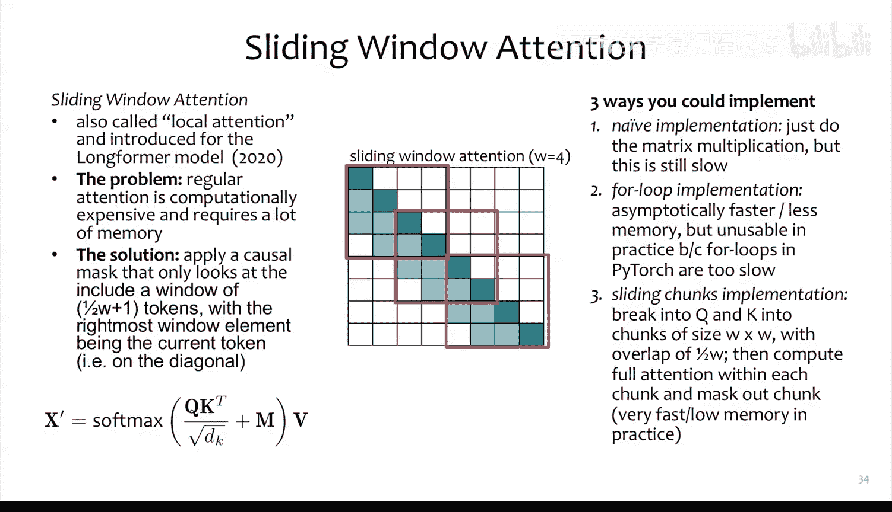

The the way in which they use。

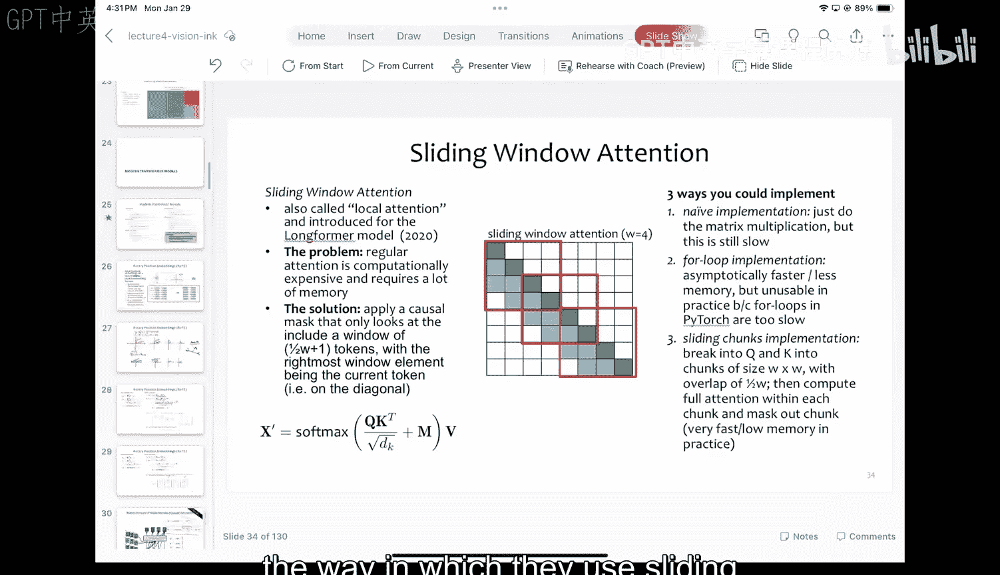

嗯。Sliding window attention is almost conical。I think their context length is 8192。

And their sliding window attention。Has W equals 4096 so they're looking at one half of that tokens to the left。

 so they're breaking it into like four pieces or something。

But that's already like a significant savings。还有。So。So what's left I want to talk about。😊。

Some models for computer vision and we'll see how far we actually get today。

We might not get to the actual punchline of transformers for， that's fine。嗯。So。

I want to think a little bit about image classification， so there's this task called ImNe。

It's now kind of a famous task because it was one of the places where a convolutional neural net sort of first beat out the competition and so that happened in the 2011 competition where the data set was 1。

2 million labeled images over and they had a thousand different classes and the classes were things like birds and irisees and courtyards and so on and so up until 2011 people had basically relied on manually engineered features and then shallow models like SVMs or logistic regression。

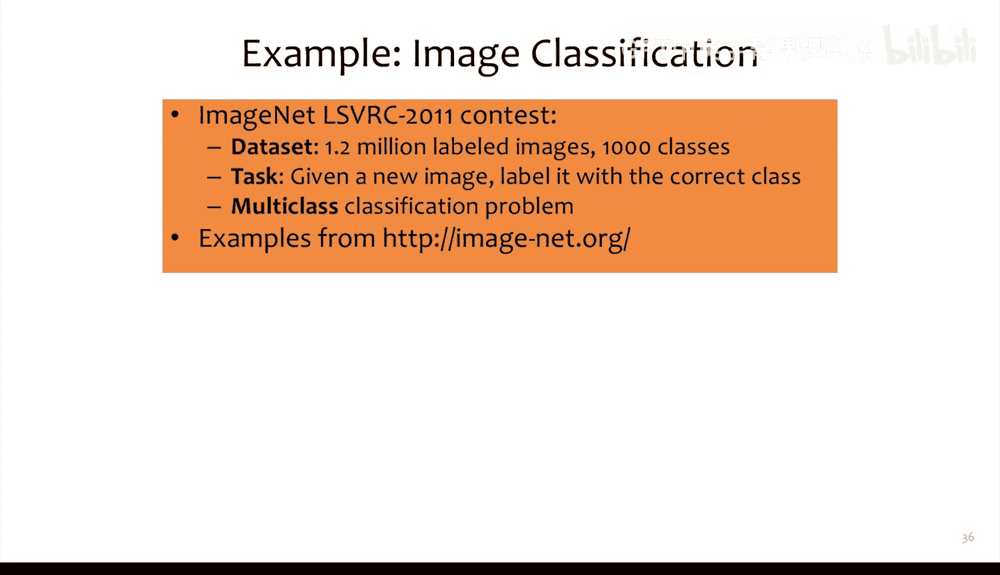

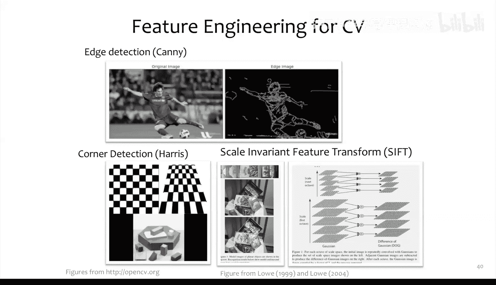

And so the。The 2012 sorry， 2012 winner was。This convolutional neural net now called Alexmet。

 and it consisted of taking in the input image in the lowest layer and then doing a bunch of convolutions and then finally kind of outputting a distribution over the thousand classes。

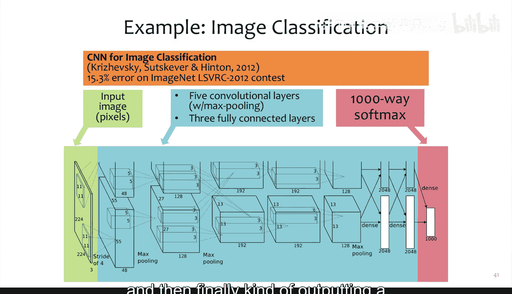

And so that happened in 2012 and then what came afterwards was many more convolutional neural networks winning the same competition and as the time went on。

 the number of layers kind of kept on climbing up and up and up until we had something like resant that had 152 layers。

Okay， so。So this is just another kind of computation graph。

 but it's particularly appropriate for images because it is translationally invariant very quick on that go I was going to the left。

😊，Yeah， that's super weird， but it's I don't know why they did that This is like from my renet talk。

I've never noticed that before but。That is so weird。Yes， time is going west。😊。

Maybe they're like like so I don't know， like if you're an Arabic speaker。

 like do you think of time as feeling to left， I don't know anyway。So。

Convolution is kind of a fascinating idea， but it existed before convolutional neural networks。

So the key idea is that you basically do like a dot product of a matrix with the pixels underneath it and so here we're showing how you could actually bear out that computation。

 you have some input image that consists of pixels say3 by3 and a convolution matrix that's two by two and so your output is going to be also two by two where you get the first output y11 by taking essentially like a dot product of this matrix with the four pixels underneath it in this corner and then you slide it over one and you take its dot product with this corner and that gives you y12 and then in the bottom corner gives you y21 and then y22。

And so you can see the computation here is like in the top left corner， it's just alpha 11。

 x 11 plus alpha 1，2 x1，2， alpha 21， x1，21， alphapha 22 x22， and a bias。😊，And then as we go down。

 we're just shifting and looking at different pixels underneath as we get different outputs。嗯。😔。

So this is very different than simply taking an image and multiplying it by a big matrix。😡。

Because now we're reusing the same parameters at many different positions in the image okay and so if we think about aonvolution matrix here and I color it such that all the zeros are sort of opaque blue and the ones are transparent。

Then I can take that matrix and I can slide it over an input image and you could actually see through it right。

So what this means for us is that。As we're constructing。Our convolved image from a convolution。

 for this case， we you just look through the transparent parts and add those up。

So here we'd add up one plus one plus one and get three and then0 plus one plus one is2 and then01，1。

2，11，1，3， and then 0101。 And so we just keep going until we get a convolved image okay and the idea is that。

You could choose different convolution matrices by hand to get different image effects so if you use an identity convolution。

 it just copies the image though you'll notice that you've lost the outer edge of the image。

If you do a blurring convolution like this one， 0。2 in the center and then 01s around it。

 you get back a kind of a blurred version of this little triangle。

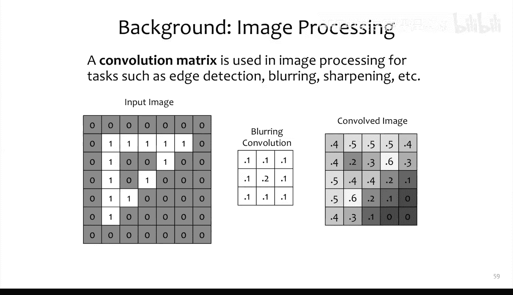

Here's some actual examples， so this is the original image now if I apply。

The smoothing convolution you can see the image kind of blurring I don't know if you need to be in the front row for this maybe in the back you can't really see this but it is actually blurring am I right okay。

here this it's Gaussian blur it looks about the same。

 this is a sharpening kernel I think this one should show up in the back row even you can see that switch to how it sharpens right up。

 this is an edge detector or it's kind of highlighting the actual edges of the image。😊。

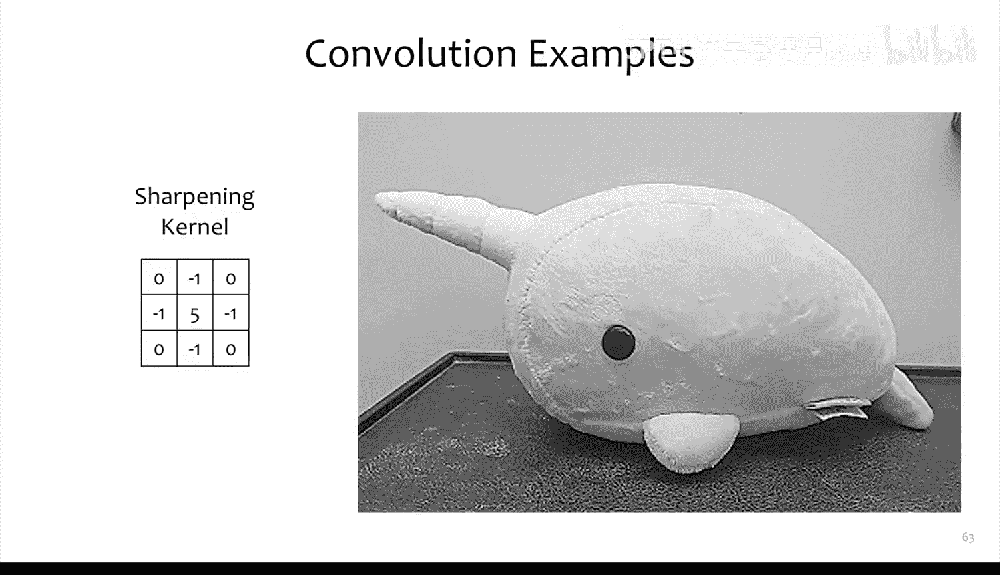

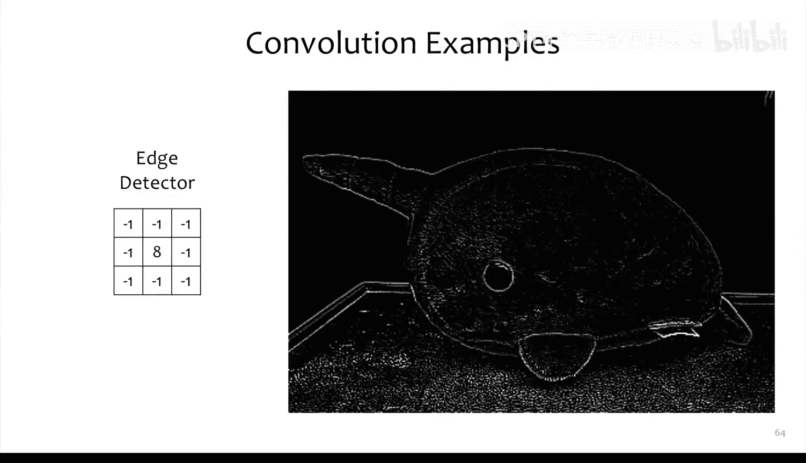

And so you can also do things like down sampling where you move your convolution multiple pixels at a time。

 so if we move it two at a time， then when we get back the convolved image。

 now our original one was six by6， but our convolved image is only three by three。

So this is kind of a nice way of going from a large to a smaller image。

You could downs sampleample by averaging or you know by that other matrix there's also this thing called max pooling which is not convolution。

 but it's sort of closely related at least in sort of the idea of it so you could you could move。

This max function over and instead of doing a dot product。

 you'd actually just look underneath at each different position and take the max of whatever is underneath。

嗯。Okay， so convolutional neural networks， the whole idea is that you train them just as you would for any other neural network。

 it's just that they're defining like a very specific kind of decision function。

And the key layer is going to be this convolutional layer where we take this idea of a convolution and we just have the values in that convolution matrix not be chosen by hand。

 but rather be learned parameters in the model that's the whole idea。

And this is fundamentally different from what you would get if you were instead just using a standard feed forward neural network。

Because the feed forward neural network is going to be。

It's the opposite of invariant position anyway， it's going to be positioned specific in that it's going to learn specific things about the upper left corner of the image and other specific things about the bottom right corner of the image。

 whereas the convolution matrix， if it learns something from the upper left hand corner of some of its training images。

 it could apply that whatever it's learned to when it sees it down in the bottom right。😊。

That's the key idea of the convolution layer。嗯。So this idea has been around for a really long time。

And there's lots of different layers that are typically put together。

 this is an example of Onenet which put together a bunch of convolutions and then max pooling and then more convolutions and then more max pooling and then finally did some fully connected layers and then finally got some output here。

So what's maybe interesting here is to actually think about how you can use multiple convolutions in parallel the same way that we've been using multiple headed attention you could have one convolution matrix that does a pass over the image to give you one output channel and then you could have another convolution matrix that gives you another output channel and then in this case they did six different convolution matrices to get six different output channels and then from there they had other convolutions they didnt you know they went up to 16 convolutions here and so on。

Okay there's there's maybe this other detail that you know here it says that they have some fully connected layers at the end。

 what they would do is that this 16 five by five convolved images。

Could just be sort of concatenated together or stretched out and then concatenated together into a big long vector。

And then you could pass that through a standard linear layer to get back。

 say a fixed length vector of say size 120。Okay， so so how do you so how could you actually learn one of these things well by back propagation and stochastic gradient descent of course。

 so here what we're seeing is actually a sort of a description of how you could do the computation for a very simple convolutional net。

 so here our parameters are going to consist of alpha beta and W。So in the first。

 so we're going bottom to top here， so we take in our X。That's the image。

 and we do a convolution with parameters alpha to get Z1。

And then we do some max pooling on Z1 to get Z2， and then we take Z2 and do convolution with different parameters beta to get Z3。

 then we do a value element wise on every position to get Z4。And then we take C4。

And we stretch it into a long vector。And we do a linear layer。

 so take this multiply it by a matrix W and get C5 and then apply a softmax that gives us a probability distribution over say。

 some classes， and then finally a loss function。Okay so you could think of our parameters here。

 theta as consisting of alpha beta and W。😊，And while we've not converged。

We're going to sample a training sample。And then we'll do that forward computation to get the actual layers of the CNN and the objective function。

 we'll do AutoDF to get the gradients and then we'll update using those gradients。

So this is sort of our standard recipe。And this is just sort of some slides that are showing you kind of what some of these layers would look like and as modules right so here here's a re layer and has a forward computation and a backward computation so here maybe what's interesting is that we can get away with the fact that even though this is not smoothly differentiable it's subdiiable and so we can work as if we just take one of the subderivatives and。

😊，And use that when compute ingredients。This is our softm layer forward computation and backward computation。

 here's a fully connected layer，' here's an example of how you could have a single input。😊。

But multiple convolution outputs。So here all you need to do is just sort of do the exact same convolution computation that we've been talking about。

 you just need to have separate convolution matrices， this one is superscripted by one。

 this one is superscripted by two， and now we get two separate output channels。嗯。Here the。

This is sort of describing how we could actually do a convolution where you have a color image， say。

 as your input。So if you have a multidimensional input。

You could say CI might be something like three。Input channels okay， so this is a tensor。

Where this dimension is three。So you have a red channel， a blue channel and a green channel。

And your image is WI by H pixels。Okay， so the idea here is that when you do convolution with a multidimensional input。

If you only have one convolution typer， then you're going to get only one output。

If you have two convolution pencils， then you'll get an output of depth two or two outputs。

So in general， if you have CO convolution。Tensors， then you're going to get。A depth CO output。

So how does this work， well， it's kind of like what we were doing before。Except now。

 instead of working with just two dimensional patches of the image。

 we're working with three dimensional patches。Okay， so a patch still only looks at like a fixed size。

widthth and height。But the patch always looks all the way through all the channels。😡，Okay。

 so if your convolution is currently looking at the center of the image。

 it gets to see all of the red， green and blue pixels at once。

But it only gets to see that little bit of the height and width of the image。Okay。And so。

If you were to write that down as math， it's kind of like the actual forward computation。

 it just needs an extra summation over all the channels。And some very careful indexing。

 but it's basically the same thing as what we had before。Okay。

 this is a max pooling layer as a module and then we're back here so so this is sort of a standard small this is like from 1997 architecture this was the 2012 architecture and was was a good bit bigger but what about like sort of modern architectures well so Alex Ne it looked like this so here now the input is at the top in the output is at the bottom and you can see it had like a seven by seven convolutions some max pooling layers and then a bunch of three by three convolution layers followed by some fully connected layers。

😊，VGG16 was big enough that you the input is here， it comes down it goes across and then back up。

 but the structure was quite similar， but here they were using re activations and those were quite helpful。

There's pastor R CNNN， then these are some other architectures and now you'll start to notice that things are starting to look similar。

 three by three convolutions are very very， very popular。😊，And here in FCN。

 there were some interesting connections like between different depths。And you know。

 all of this is fun， but it's not that deep， really until you get to re。

And now suddenly all of these other models that we've been talking about don't seem so deep anymore。

So。So basically。You know there's this question of like how do you pick a kernel size so if it's a small kernel it only gets to look at a or a convolution size。

 also called kernel size if it's two by two you only get to see a few pixels where if it's four by four now you get to see many more so there's almost something surprising about the fact that three by three could work out as well as it has and I think that the motivation for that is that essentially just as we were talking about sliding window attention with one layer having a small window and then the higher layer getting to see effectively a larger window the same thing is happening here because as you go up higher and higher you're essentially widening the amount of the image that the later convolutions are effectively seeing as you go。

O。So。449 okay， so I wanted to get through this stuff。

 but we'll save it for next time and where we'll pick up is talking about the thing that I had been leaving off all along。

Which is what happens if you don't have a causal mask at all？

And what transformer can you get there and we'll see how that can be used to actually be a really effective model for vision。

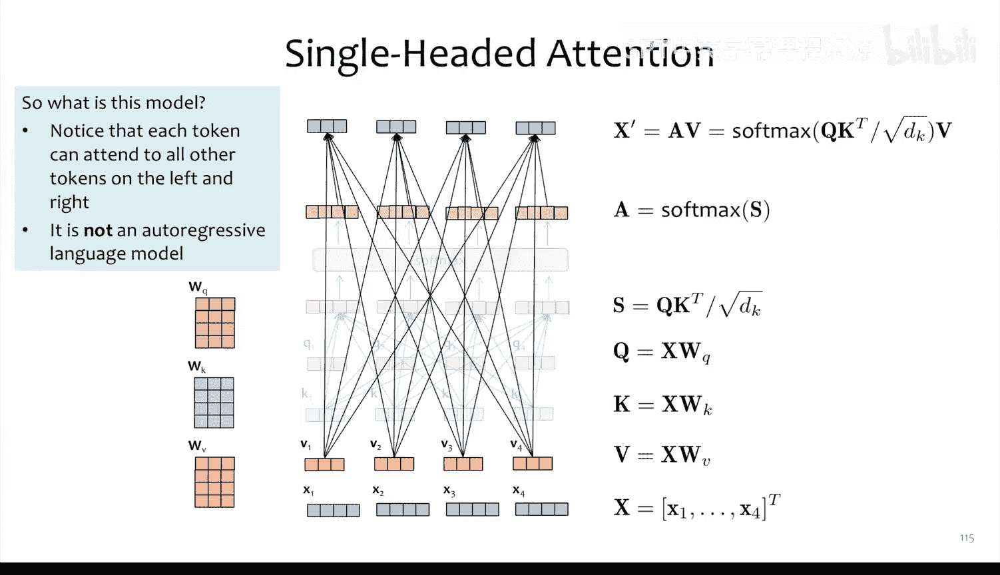

absolutelybsolutely。