# CMU《生成式AI｜10-423 generative ai 2024》中英字幕 - P5：-P05-Lecture 05- GANs, Conditional GANs.zh_en - GPT中英字幕课程资源 - BV1CyC9BPEhG

Okay， let's go ahead and get started with the rest of today's lecture。Are we good on audio？

I think so okay， so today we're going to be talking about our first sort of modern look at how to build models for computer vision and through the lens of written transformers CNNs are certainly still like。

You know， an incredibly important model， but this is sort of the what's I think we're starting to see the computer vision community move towards like in the last two years。

And then we'll also start to talk about generative adversarial networks。

 which is our first look at how to actually learn a model that generates images。😡，So just a reminder。

 my office hours， they weren't on the GC they're there now basically reflecting that I've been doing office hours after class so today's the last day that that after class office hour will happen so look at the Google calendar for when my future office hours are they will they'll be semi regular but they'll move around a little bit。

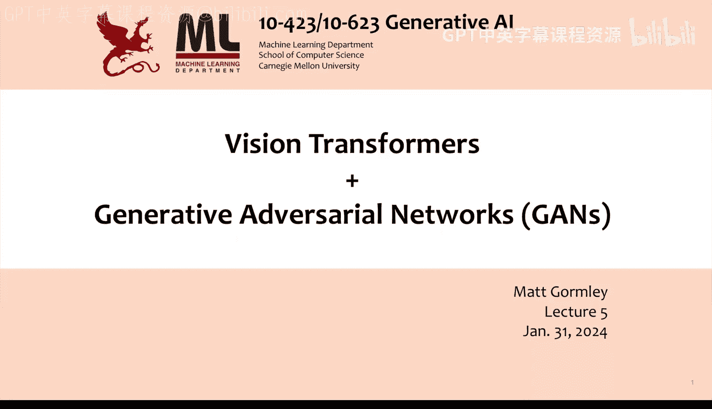

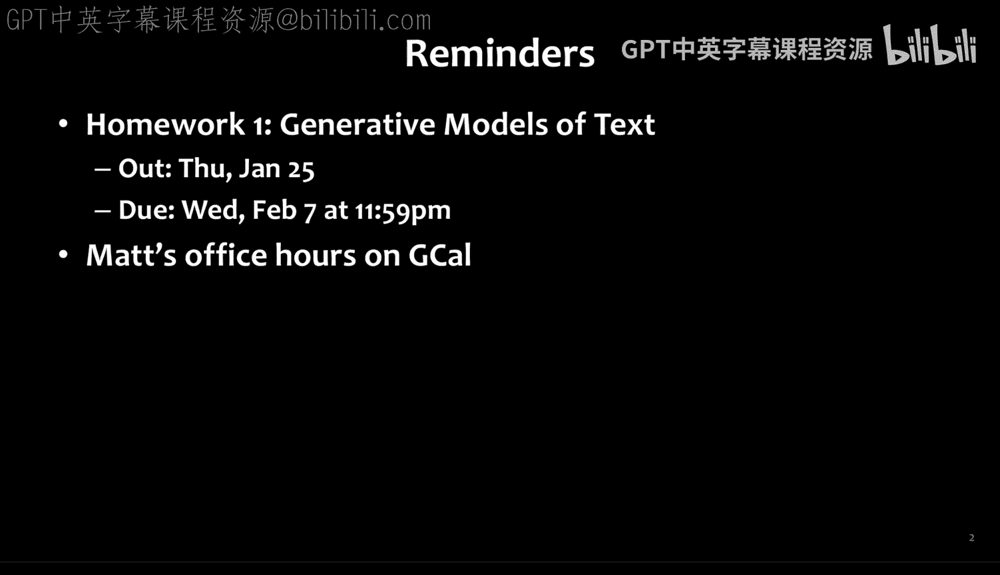

Okay so this was a really good question that came up I just wanted to kind of quickly address does pretraining always involve layer by layer unsupervised training No that's just where it started in 2006 for you know MLPs but to pretrain a CNN or a vision transformer you typically train the entire pretrain the entire model on a supervised classification problem so when we talk about pretraining for a CNN or pretraining for a vision transformer this is actually usually what we mean to pretrain a large language model we train the thing by maximizing likelihood of unlabeled sentences so that's a little closer to what we saw last time none of these are using layer by layer pretraining anymore though it's typically you just backpro through the whole thing and a big part of why that's why that's the case is we've just gotten better at building models that don't need this layer by layer thing sigmoid activation function for a big part of the。

Problem that led to the need for layer by layer pretrain and since we've kind of moved away from sigmoids we've been able to get rid of that Okay so this is your absolutely amazing course to have this semester there's just like 12 incredible Ts that sorry13 incredible Ts that that'll be working with you guys and that are you know carefully crafting good homework problems and programming problems and trying to not just get you to like。

😊，Build one of the things that we're talking about。

 but actually build something that that works on a small scale。

 And so that that's a that's a bigger challenge than you might think。 So throughout the semester。

 you'll kind of。Notice that about half of them are kind of tied to each sort of homework and so there's sort of a language team and a vision team and you'll get to see different people throughout the semester Joshine who who you all got to interact with today around the quiz is our education associate if you haven't met him he's amazing and running like all sorts of logistics for this course as if you' if you ever need like a quick response never email me。

 I won't give it to you， I'm like right now I'm probably about a week and a half behind on email but Joshine is fast and responsive so really you should so if there's something that is like a private concern and you need to email someone it's not like it's not something that you would message on Piazza about definitely reach out to Joshine andy。

And then Uanszi is my coinor for this course， you might see his name showing up on some of our readings throughout the semester because he was involved in GPT4。

 he was involved in Laura， which is the kind of adapter。

 so he'll be coming in like to lecture in like the second half of the semester。😊，Okay。

 so so rot to embeddings so I don't know if you remember there was this moment last time where where we got this question we were like。

 you know， someone asked rightfully， it seems like we're rotating both of these vectors the same amount。

😊，Doesn't that break everything Yeah， yes， it does So you know， the thing is， you know。

 you could ask， why does this slide have so many times goes I'm genuinely not really sure I mean。

 like I I work really hard at this to carefully， carefully craft every slide。😊。

By hand and I just don't know what could have gone wrong for this particular sequence of slides that there were so many typos。

It'st there really like pretty good job。Anyway， let me fix some of the errors I introduced so this was all fine this was kind of the high level picture of rope so here is kind of a corrected description of rope。

😊。

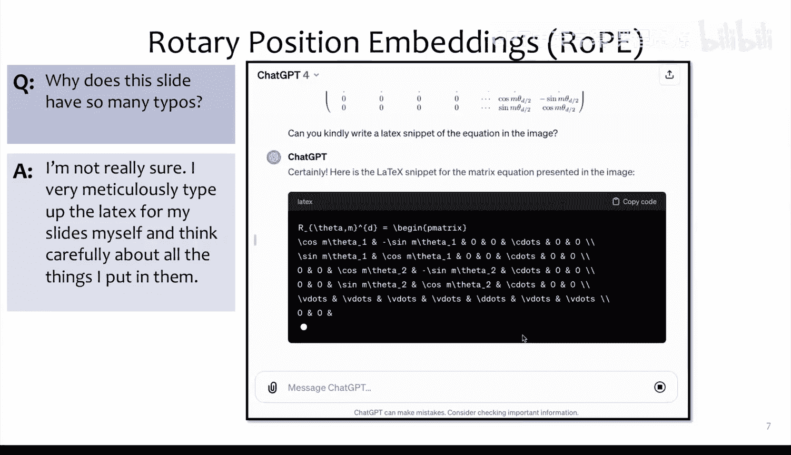

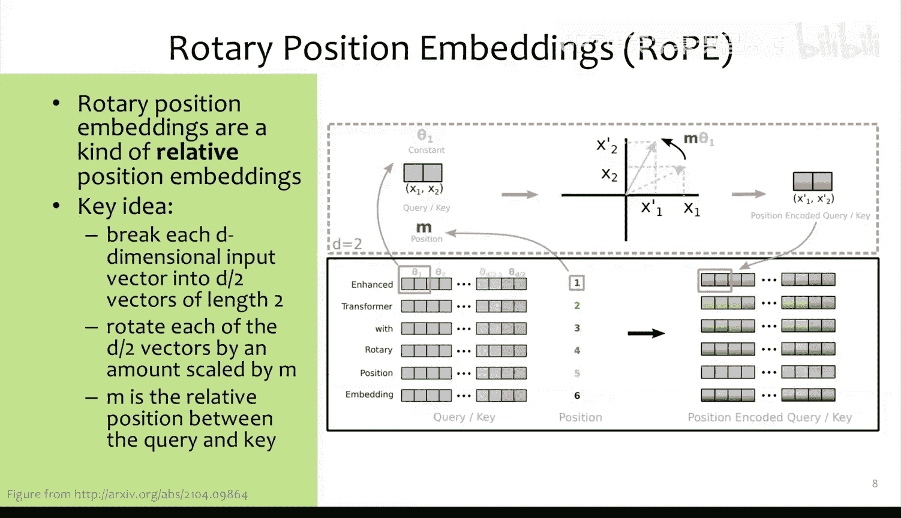

And I also as I was kind of going through this I kind of wanted to explain it in a slightly different way too。

 so my notation has changed so what we have here is actually now QJ and KJ as identical to what they are in standard de and what I did is I introducedqtildej and K tillil the J as the rotated versions and the crucial thing that that was broken last time was that I was saying we rotate。

Each of these by some relative amount， but that's not it at all。

 we're rotating each of these vectors by an amount。😡。

That's essentially a function of their absolute position。

And what this means is that you when we rotate Q sub1。

 right it's going to rotate a little bit and then when we rotate K sub seven。

 it might rotate a lot more。And so what we're interested in is the difference in the amount of rotation between。

 say， something that was in position one versus something that was in position7。

And so when we go in now we compute these similarity scores between the tilde versions of these and you'll notice that we're computing like K sub J and Q sub T right。

 so Q sub T was rotated in amount according to T， its position T。

 but K sub J was rotated according to an amount， a different amount according to this index J。😡，Okay。

 okay， and then everything else I think is fine here there was actually like another error that we just caught that is that was in this was like in superscript。

 it's just negative2 I minus1 divided by D。

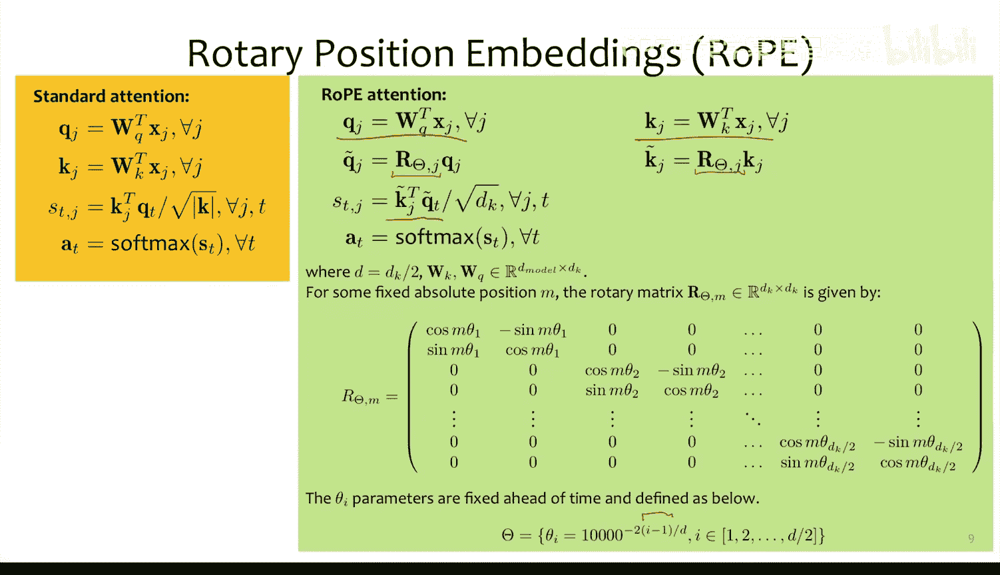

Okay， so so now this picture actually all of these pictures that we drew were correct。

 but now we can kind of go in and maybe add to this so that it's clear what I mean by like different amounts of rotation so say here you know FQ of XTT is going to be the rotation of QT by some amount according to T so F。

😊，K of X T。呃。Or let's say F sorry， J here。X J is going to rotate by some amount， according to J。

 So that's going to be the， the rotary matrix for theta J。Times。呃。Kj。

And so this is what we're calling Q Tilda T， and this is what we're now calling。Kay Tilda J。

And so essentially what's going on here is if。If J was some different number than t。

 we might find that KJ only rotates， say a little bit。Such that。

K Tilde J is right here and because on some different component we're rotating a different amount this K tilde J for。

The 34 segment might rotate less。OkayAnd so now what we're getting out of this is that when you compute their dot product。

 the relative amount of rotation is what we're actually incorporating here。可。So。

So you can compute this matrix vector computation efficiently because of the block sparse nature of the computation but that doesn't actually quite help you get to the point of implementing like a matrix version of rope embeddings so what I figured I could after all my errors I could at least very your bone and kind of like spell this out in a little more detail so the matrix version of rope has to look a little bit different you need to be careful about how it's different so we still compute the Q in the K matrix identically。

 but then we're going to need some function G that is going to give us Q tilde and k tilde as matrices okay so what is that function G what should it do it should give us some new so for some matrix y which could either be  Q or K what it should do is it should give us back some y tilde that is。

Rotating the Emth row of Y。Which is like YM by r theta M。😡，O。But that means that the。

 the first row of the matrix is going to be it's going to be multiplied by r theta1。

And then the second row of the matrix should be multiplied by r theta 2 right。

 and so on down the line。So。We can capitalize on the fact that this matrix multiplication boils down to some element wise vector math。

And what we can do then is。Construct， say， some constant matrix C that has essentially all of the sort of constants that we need for the first row in the first row and for the second row in the second row all the way down to the N row。

And then this is kind of a careful reconstruction。Of this quantity。

So that it is computed for the entire matrix at once。😡。

Where we're taking element wise cosine of this constant matrix。

 we're taking element wise sine of this constant matrix and then doing element wise multiplication of this is actually just the original matrix y carefully notated where we're saying why where you take all all rows。

 but only one up to D2 and then。Likewise。Of the columns and then here we're taking D over two plus one to the Dth column and then here we've actually flipped it so this was like the first half of the columns and then the second half of the columns now we've flipped it so this is the second half of the columns in the first half of the columns and we're negating here。

Okay， so what you should see about this is that when you actually kind of try to tie back and forth between this equation and what I've written here。

😡，Okay， the key thing that you need to notice is that here we have this sort of funny alternation between even and odd columns。

So even columns are all getting negated。😡，And they're interspersed with the odd columns。

And so what you can observe about this is there's nothing special about even versus odd you just need if you're if you're rotating two dimensional vectors then you just need to pick two elements of the vector and rotate those particular two elements as a vector right so what I did is I said well。

😡，Rather than working with even an nod， I'm just going to work with first half， second half。

And so now there's a pair between these two columns and these two columns and these two columns and these two columns。

 such that they're treated as a way of constructing 2 D vectors。Okay。

 and this is sort of without loss of generality because we're learning these parameters anyway。Okay。

Is this slide correct I don't know but I did write it myself so hopefully hopefully it's a little more correct than the last last round shouldbedding yeah so B here is like decay so so why the matrix y that we're passing in here is。

😊，I guess it's an n by D matrix。So。So for Q， it's n by DK and for K it's n by what it matters actually if you rotate like concatenated and then you're rotating each other like they're saying if you rotate the concatenated。

Embedding。I can what what do you mean concatenated here the so instead of maybes allcateated if you rotate that would it make a difference yes。

 absolutely so I mean rope is specifically defined so that we're not。

Rotating the entire vector right we're rotating these little two dimensional segments and so like this careful definition of how we were rotating led us to be able to implement this more efficiently than if we were trying to rotate。

The entire vector。Yeah， good question。Okay。Okay， so let me talk a bit about computer vision。

 so computer vision abounds with all sorts of interesting tasks。😊，You know。

 there's image classification where you're given an image and you're going to predict a label there's classification plus localization where you begin。

An image and you want to predict not just a label but also a bounding box for the thing that you're labeling right like here a little bounding box around the car up in the top left or a bounding box around that chair and generally you can kind of represent this by by outputting an XY position and then a height and a width of your box along with the label。

😡，Okay so you could think of this as a multiple regression problem where you're not just outputting as an normal regression。

 one number， but you're outputting four。😊，Human pose estimation is also kind of a multiple regression problem where but now you're trying to predict a bunch of key points like the position of a left hand or a right hand。

 a left elbow， a right foot and so on， and each of these could be some corresponding XIYi position。

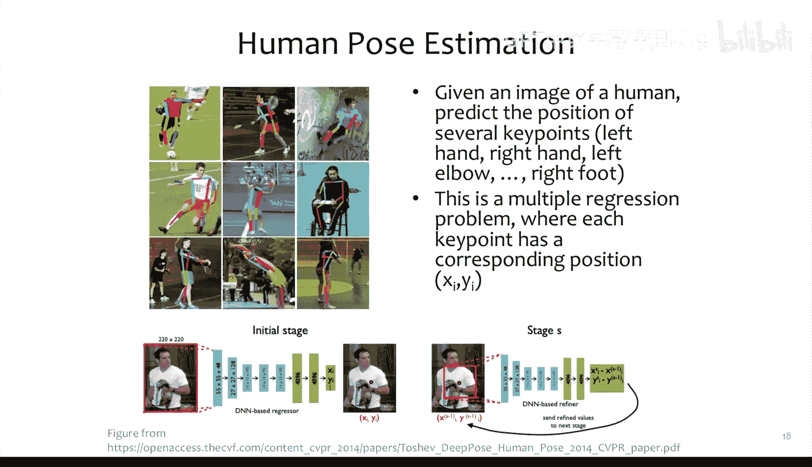

Semantic segmentation is rather a very different problem here you're actually trying to predict a label for every pixel in the entire image right so this is no longer you know sort of mere classification because you have like these correlations between pixels right and so what we're looking at here is like you know this picture of a cow standing in front of a car with some people behind it and we're trying to label some of those pictures as cows and some as car and some as person。

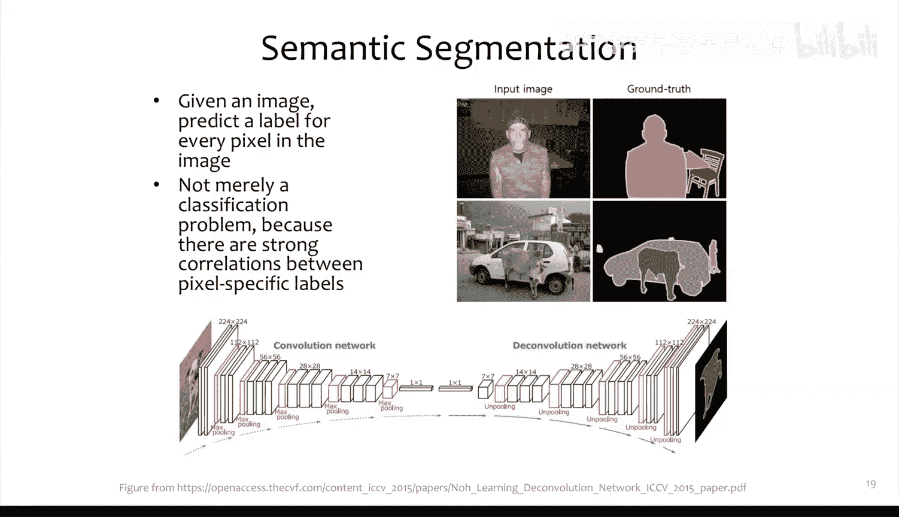

Object detection is where we're trying to put a box and a label about around a bunch of different objects that appear in the image。

😡。

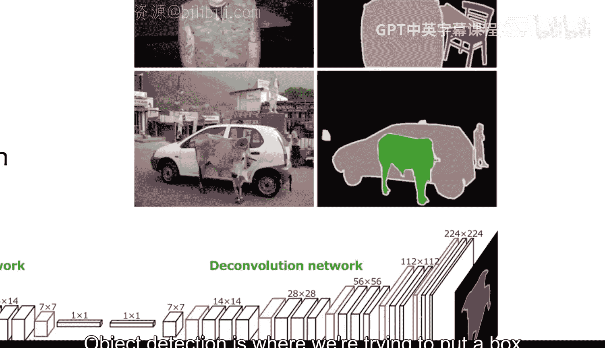

And then instant segmentation is sort of like semantic segmentation except we're trying to predict we're trying to differentiate between different instances of the same type so here let's look more closely at the top here we have two people right and so we want to separately label the pixels that are person hero and the pixels that are person one and we also have two umbrellas we don't want all of them to be you know the same pixel color we。

😊，The umbrella  zero and umbrella  one distinguished from each other。

Image captioning is where you want to actually like generate a caption for an image and。

So this is kind of sort of a combination of a problem for language and vision。And u。Yeah。

 so actually if you look this is kind of a fun table to look at。

 so if you look at sort of how models were being built for image captioning。

 you can see that generally there's like an image encoder and then a language model put together。

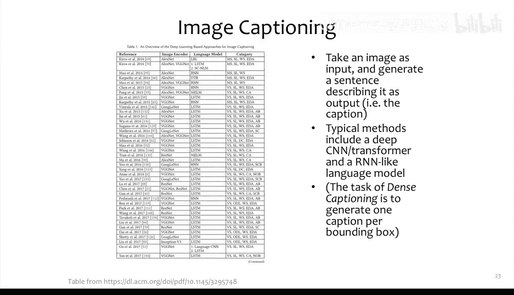

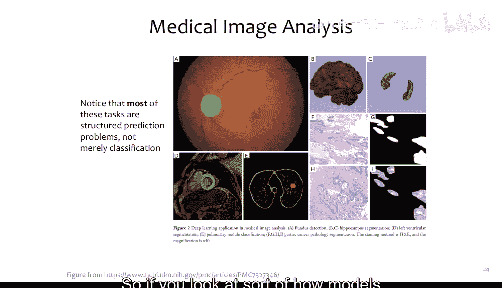

And so for the years 2014 through 2017， basically like every single model here was some combination of a CNN image encoder。

And an LSTM or some sort of RNN language model。And then 2017 is where at least on the language modeling side。

 things started to move a little bit towards transformers。Okay。

 medical image analysis has all sorts of interesting problems that are kind of analogous to these。

Okay， so now I want to think about。嗯。Encoder only transformers now technically。

 this is actually kind of a language topic， but I introduce it here because it's going to inform what a vision transformer looks like。

Okay。So we define an autoregressive language model to be a probabilitypability distribution over sequences of this form。

 right you all know this， so a decoder only transformer is what we've been calling a transformer language model and the idea is that the attention is only looking back to the left over previous words。

😊，And we said that， the whole idea here is built on this idea of causal attention where we have this attention mask that masks out any of the words that came after the current token。

Okay， but along the way as we were trying to establish how to do this。

 we had this slide where we said， oh well， actually， if you want to do the matrix version。

 we were kind of thinking about it， like what does it look like before we even added the causal mask and this is what it looks like right where where all of the vectors attend to all of the other vectors。

Or all of each time step attends to every other time step。So in this case。

 this cannot be used to build an autogress this would not build us an autoregressive language model anymore。

 because now the representation of time step1 is based partly on the value for V4， V3， V2。

 as well as V1。So it's looking forward now。Okay， so an encoder only transformer uses this form of。

Single headed attention， meaning the non causal version of attention。And otherwise。

 an encodeder only transformer is kind of the same as that decoder only transformer， it's just。

 but now we've basically added more arrows to each of these transformer layers so that each hidden vector is looking at the hidden vectors of all time steps in the previous lake。

Whereas before in the decoder only， each hidden vector was only looking at the vectors of the previous time step at or before the current time step。

Okay。So。So if you've heard of the model Bert。It really sort of popularized this encoder only transformer。

 I mean it was introduced along with the transformer paper that appeared in 2017。

 but Bert really kind of like took just this encoder only model and had great success with a particular kind of training called mass language modeling。

And here's how that works， so you do this as as pretrain right so we have again a bunch of unlabeled sentences but we can't just sort of maximize an auto regressive language model likelihood of those sentences anymore。

😡，Like this this model。It doesn't give us a a probability of the next word given the previous words。

So what do we do so what we do instead is we mask out or like hide some of the words in the input sentence and try to predict those missing words from the remaining ones。

Okay。So before I do this。Let me just ask by way of your question， so if we' called this word one。

 this word two and this word three。Then。What is。This probability distribution。

See I wrote it here as P of W2 given H3， but what is it in terms of just Ws？

I'll give you a hint of what it's not， it's not P of W2 given W。1。What is it？Yeah。

It's P of W2 given x x1 x2 and x4 right Yeah， so it's P of W sorry2。Given if we're passing in。

 so you did it， yeah， in terms of x's， let's we can do it that way， x1。

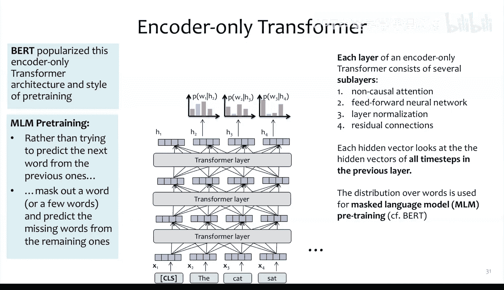

X 2。X3 and X4。RightAnd with these labeled as W13 W3， right， what this would be is P of W2 given W1。

W2， W3， right？So that's weird right， why would we have like a distribution over the second word when we're passing the second word in。

 right？Like。Interesting， I don't know。ええ。😊，Let's go find out。

I think it's kind of invisible when I'm mirroring。

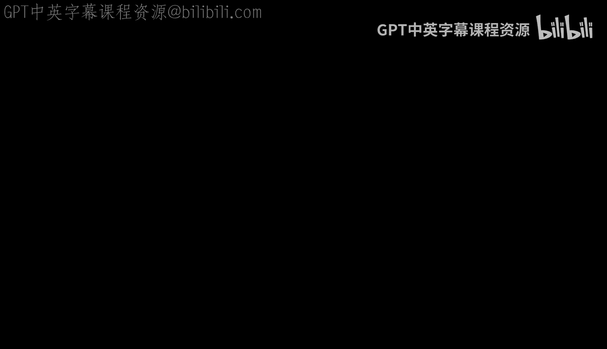

That's a new one Okay， are we I think we are now back Okay。

 let me mirror again and we should be good to go。

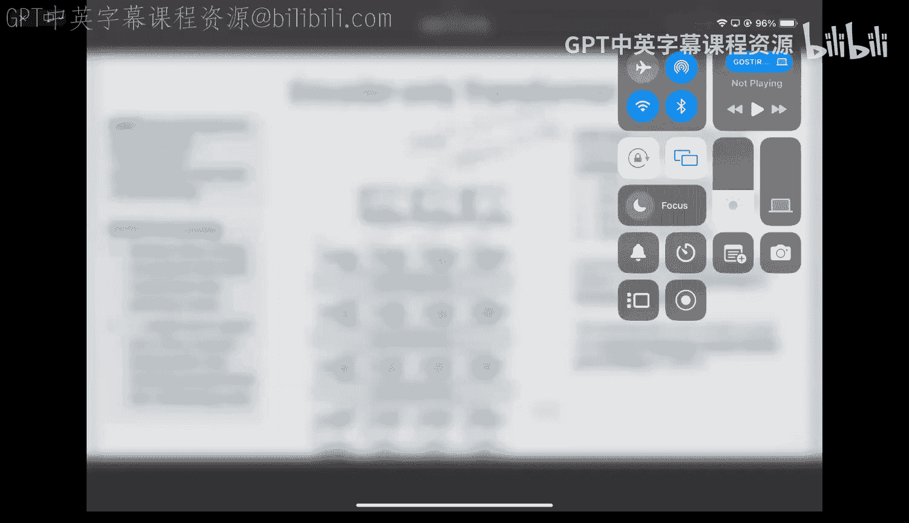

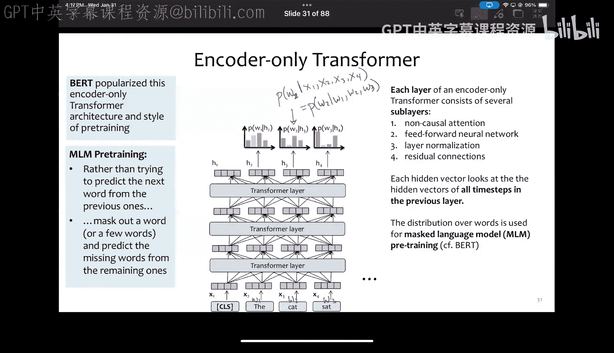

There we go。

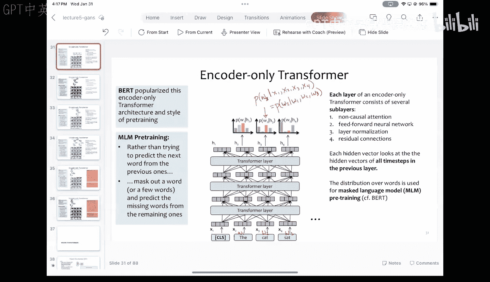

Okay， so this as a probability distribution seems kind of broken。Right？OrAt least kind of odd。

Why would we want such a distribution， right？The reason that we do this is because。

If you mask out a word， like say we replace x2， which was W1 before with just this special token called maskask。

Now we could get a probability distribution over word one that actually kind of seems meaningful right what we want is what is a probability distribution over words that could fill in for this mask token。

😡，Given all of the surrounding context。Right。And and so this is actually the way that we set up the loss right so this is now like the probability of word one given words two and three。

Okay， here， if we masked out cat， so the cat sat is now the mask sat。

 we could get a loss function that's trying to maximize the probability of。

Ha given the and sat in those positions。And we could also do this for multiple words。

 we can mask out the and satAT。And now we could。Sort of jointly maximize the probability of words one and free given two。

And so it。Okay， so。So we've we've got this little CLS token at the start Cs was an abbreviation for class and it comes in when we want to do supervised fine tuning right so remember this was this。

This is how we were doing pretraining and you have unlimited sort of data available to do this kind of pretraining it's as much you know unlabeled sentences as you can find out there。

 but if you want to say actually train a model like this now fine tune it for a classification task。

 then what you would do is you would take the embedding corresponding to the CLS token。

 and predict whatever your class label is given the embedding for that。

And then fine tune the model to be good at classification in this way。Okay， so。

 you know in this case， you know， maybe you want to label all the sentences about chats as having label one and all the sentences about dogs having label zero right so this would be two training examples in a supervised setting where we're trying to maximize the log likelihood of the gold label。

Okay， so this is not set up to be a generative language model。

 but it can be a very effective discriminator。Okay。

 any questions before I go on to visionkenken question is there any reason why this is the first token and not the last token so I think it was just sort of convention so again remember that this transformer like any other is is position invariant and so the only like information we would have about the Cs token would be baked on a position embedding and so conventionally the Cs token doesn't even involve a position embedding it's just a single so each of these is a word embedding plus a position embedding if you're doing absolute position embeddings the Cs token is just some。

Vector of parameters that we're going to learn。Great question， yeah。什么。来好。

Oh is there a reason why we wouldn't use all of the hidden states to calculate the y so you could you could actually like put yet another say attention over all of them if you wanted to and that would be perfectly fine and many models do actually do that I just didn't do it in this figure。

Yeah。Yes， so unfortunately this is yet another hyperparameter to tune right so typically you're randomly selecting some subset of words to be mask tokens and both which words and the number of words you select is generally treated as a hyperparameter that you kind of like to tune and you people have been training this kind of model for long enough that there are pretty sensible defaults for most languages。

要啊这说。一开。そは so中多。scaleげ that。对。ワしそいてもダです。Yeah， so in this case I didn't mask out W2 here。他刚才在下面查。Yeah。

 so so this distribution is now conditioning on you could think of it as conditioning on x1， x2。

 x3 and x4， and now x3 doesn't have any information about what word W2 is。Exact。

So so now you're trying to like I mean it's like a fill in the blank problem right humans are really good at this right like if if I give you like some long sentence。

 you can tell me what my last word was going to。Thanks。Okay。Yeah，没か这。

Yeah so so this is the same embedding setup that we were working with before so so the input is typically one hot encoded and then there's an embedding layer so we're taking so my picture is a little bit hazy here there's I'm not showing that embedding layer right but really like what we talked about before with the embedding layers is still applying here。

And those embeddings are learned， yes。Good question。Okay， so。Vision transformers。

Were introduced so that they were basically identical to Bert。

 except that instead of words input as input， we take little patches of our image。

And they were like P by P pixel patches where P was something like 14 by 14 or 16 by 16， 32 by 32。

 and the original vision transformer did no overlap with the patches and it's embedded linearly into a vector of size 1024 so you could imagine you take that patch。

It'sProbably if it's color it' it's not just， you know， and then it's 16 by 16。

 there's three channels， so it's 16 times 16 times three numbers or your input。

 you push that into a linear layer and you get back a 1024 vector。

And then you take that 1024 vector instead of a word embedding。😡，And you feed it into a burnRT model。

 like an encoder only transformer。And you use onedial positional embeddings so that we have。

 here's the first image patch from this top left corner。

 we linearly embedded into this vector and we add to it a 1D positional embedding for position1。

 here's the second patch we put position two next to that here's the third patch position3。

 here's the fourth patch from the second row and we put position4 next to that and so on down the line and then it just goes into the encoder only transformer and then on the they don't call it a CLS token anymore。

 but the class embedding at position zero， we put a little multilayer perceptionception head to predict the class of the image that we care about for an image classification problem。

Okay。To train this， our pretraining is optimizing it for a supervised image classification problem on a large data set like ImageNet 21k or JFT 300 mil。

 so this is the same training setup as for a convolutional neuralNe like the ones that we were looking at last time。

😡，And then if you want to do fine tuning， say on a different image classification problem。

 then you would take off that little MLP head that you were using for pretraining and put in a new one with fresh uninitialized parameters or maybe randomly initialized。

 and then you could fine tune the whole thing for whatever new task you wanted to do。

If you wanted to do something other than image classification。

 if you want bounding boxes or human pose estimation， great。

 put an appropriate little neural network at the top that outputs。

 the positions of the bounding box or whatever it is that you need。😊，い。你 she成噶。

I am saying that a language transformer and a vision transformer are exactly the same except for how we transform our input into vectors it is like comically identical。

😊，define let me hold off on the position question because I'm going to ask it to you guys。Okay。

 so how can how can we possibly learn 2D positional embedding information or not no no。

 let me rephrase， not positional embedding， how can we learn two dimensional positional information from one dimensional position embedding？

😊，This is the question， how could you learn 2D information if all you have is 1D information？Okay。

 let me pause， talk to your neighbor about this and then we'll resume in a second。好。然后对。三位都他方。我告现在。

我的你。你啲点讲出嚟都。我就发。好好。这道。So。Okay。也可以。Okay， does anyone want to suggest how this is possible？

Let me get someone else。Any suggestion for how this could possibly work？Yeah， it's just。

Maybe it's at each row of the image so that it can move that into batch here and for example。

 for the middle middle。Whats from the。Im sure it can be permitted into middle of the。

that chair that it about。But it cannot cannot do with the rotation of the image and so that I don't see it as a good way to do that image Yeah。

 so so you're sort of saying that like it could potentially work because。

Because we've essentially flattened。So yeah， so because we've essentially flattened it now。

But this might not be like a very effective way of doing it。

 so I claim that somehow this can still work and why why do we have any hope of this working。

Let meI already pointed up here， so let me go with that。

You can like you know patches can learn to attend to patches that are nearby them so like the middle patch even though five is not near two can learn to attend two because two is probably associated with five' training down right so maybe the key thing here is that we assume。

That。Images。Ourre。Always the same size。And what that means is that now over time。

 so the model starts out knowing absolutely nothing about relative positions of these patches。

 but over time， it sees enough images that it starts to figure out， you know。

 it sort of seems like this patch， particularly this edge of this patch。

 always seems to be related to， you know， something about this patch， right？

And so even though the model is not given any information about the two dimensional relationships between these patches。

😊，If there's always nine patches。And they're always taken in the same order by sort of flattening out the image。

 then over time the model can on its own figure out what the relationship between you know positions one and four it and how that's a different relationship than between positions one and two。

Okay， yeah。Set about how vision customer can learn the potential between batches。

 but we put the same batch student。Yes， so so。Ily， you have do shuffle pixels within each batch the same way。

Is the custom are just as well。Oh， so the question was， if you shuffled the pixels within a patch？呃。

The same way every time could it do just as well。 So I guess what I would claim is within so the linear projection is aware in the same way of of like the fact that there is。

 you know， if we have a 16 by 16 hatch， right， it's always going to consist of。

Some linearization of that such that we have if they were gray scale， it would be。

you know up to 31 32 right and so it would actually always be treating the first pixel as the top left pixel and the second pixel the the one immediately to the right and so on down the line such that the 16th pixel was the first pixel in the second row so on and so so that that linear projection is aware of the positions of the pixel。

In the same way that our。Our 1D positional embeddings are aware of the position of the patches。

So it's not given any two dimensional information about those patches。

 but it could potentially that linear projection could potentially learn something about that。い。

So how part of so are they they're just from the same set of images or they're like taking the similar objects because they're very similar then or the same objects taken back in an angles so you can even recover even more like 3 for shipment。

 but if they're very different， can you just learn。For example。

 it different tax construction and the others totally different things like how they really relate。

The very differentYeah， so I actually don't have the numbers off hand。

 but maybe someone could Google for me how many images are in image net 21 k so 21 k I believe refers to the number of classes but I think that we're talking about like something on the order of like hundreds of millions of。

Images。And。At that scale， you're thinking like think like all of Flickr， oh， did you Google this？Oh。

Oh， okay。as well， so if I take the same image throw and then take a look to what we're going to do to this assignment。

RightSo if you take one image and you put it in， then you rotate the image and then put it in。

 then then essentially like。There's no inductive bias in the model that sort of prepares it to recognize that but let's actually talk about translation because I think that one's easier than rotation so in the CNN we talked about how if there was a in the upper left corner of all of your images and then you started putting cats in the bottom right corner of all of your images if it was trained on all the cats in the upper left hand corner。

 it could learn something about what to do with cats that appear in the bottom left here that's not the case。

 there's nothing about this model that if it only ever saw cats in the upper left hand corner would have an inductive bias to understand that it should behave similarly for cats appearing in bottom left hand corners。

And so what's interesting about this is that。That lack of inductive bias is probably why it took so long for vision transformers to take off。

So if you remember， transformers appeared in 2017 and they immediately took over NLP。

 everybody started using them。But for whatever reason。

 they didn't appear sort of as like a prominent solution alternative to the CNN until 2021。

 four years later。So why did it take so long for these to become popular in computer vision？

And I think the paper actually kind of gives us a good answer。So。呃。So basically。

 when trained on midsized data sets like INe without strong sorry， and by INenet here。

 they don't mean Iagenet 21K， I mean in the smaller one without strong regularization。

 these modelsists yield modest accuracies of a few percentage points below renets of comparable size。

So the transformer is worse than the CNN and this。Seemingly discouraging outcome may be expected because transformers lack some of the inductive bias inherent to CNNs like translation equivariance and locality。

 and they don't generalize well when trained on insufficient amounts of data。However。

 the picture changes if the models are trained on larger data sets like 14 to 300 million images。

 and we find that large scale training trumps inductive bias。

And they say our vision our VIT attains excellent results when trained at sufficient scale so this is an actual look at that so what they're doing is they're comparing two model families VIT are these like large CNNs based on ResNe and VIT are vision transformers of different sizes。

So the the dash B is base dash L is large dash H is huge and the backslash followed by a number is like the the actual value of P so the patch size and。

So you can see in terms of IageNe top one on accuracy， when pre traineded on JFT 300 million。

 the huge transformer comes out at the very top， right， it wins。UUh。

 and but on if you pre train the transformers just small on this small INe data set。

 they all pretty much do worse than the CNN of comparable sites。

Where the CNN compare of different sizes are kind of in this range between these grade。Points。And。呃。

And so it's really not until you get to a data set of this sort of middle size。

 which I think is like 14 million images， that it starts to get to be as good as the CNN。

 and then it exceeds the CNN performance once you get to a truly massive pretraining data set。

So so I guess my answer to， you know。What does it do when you rotate the image is， well。

 it needs to see so much data during pretraining that it figures out for itself what rotation is and learns to capitalize on。

Okay， so yeah， we've been talking about some huge models。But the original vision transformer。

 they were all kind of small。VIT base was 86 million parameters， VIT large was 307 million。

 VIT huge was 632 million。To get like comparable large language models。

 you need to multiply those numbers by1 thousand0。We are counting large language model parameters in the billions。

嗯。Okay， so in 2023， by then， VIT had been scaled to like 22 billion parameters with some good success。

It took a couple years， but now that same trend seems to be coming about。Okay。

 so what we want to talk about next is image generation。And。

There's a lot of different sort of ways that you can do image generation。

So let me talk about some of these， so class conditional generation。

 the idea here is that you're given a class。😊，And you want to generate an image of that type。😡，Okay。

 so this is like the exact opposite of image classification right image classification is trying to learn some p of y given x where y is the label and x is the image and class conditional generation is trying to do P is trying to learn p of x given y right a generative model of x。

😊，So here， if you're trying to say generate images of C andemones， right， here's a bunch of examples。

 here's a bunch of coral。可以。Super resolution， the idea is is basically like you're given some low resolution image as input。

 so that would be this column and your goal is to generate as output。😊。

Some high resolution version of that image。So。And this this is like， I mean。

 I'm showing you this super low resolution example。

 but this is also effective on sort of existing high resolution images。

 you can take a pretty high res image and you can make it even more high res using this method by the way。

 if you've ever， you know， how many of you like have watched some movie recently where like they they。

You know they do this right like there's like that that like tech guy who's like sitting at the computer and someone's looking over his shoulder at like some grainy。

 you know black and white CCTV footage and he's like zoom in on on this suspicious looking person and the guy like takes away and then like it zooms in on the bad guy。

 you know so I mean， essentially what we're saying is that is possible but you need to stop and think about what these models are actually doing they were pretrained on like the entire know all the images on the internet right and now the model is basically like using what it knows about images on the internet to fill in some grainy pixels with like knowledge of what those grainy pixels could look like if they were from the internet So basically so the next time you're watching a movie like this。

 you know， if the bad guy is like a famous person who's all over the Internet his face。

Might actually be really likely to appear on the suspicious character right but if you you know so there's a sort of odd thing where like you know now we need to start thinking carefully like you know is the bad guy that I'm tracking a high profile person with a lot of images of them or are they like relatively unknown because that greatly influence whether or not they show up in that CCTV footage it's basically just making stuff up is my point okay so image editing is a great picture of making stuff up very explicitly like in painting is actually where you take out some part of the image and then you fill in the missing pixels。

😊，Colorization， you take a gray scale version of an image and then you color it maybe different ways uncropping is kind of like in painting。

Style transfer， the goal is to blend two images so the idea is that you want one image to represent semantic content and another image to represent style so if you took say image A here as representing your semantic content then and then you took some famous image like starry night as your style then you can make a new version of image A in the style of starry night。

The imageage generation is where you're given a text description and you want to sample one that depicts that prompt and。

So this is from a model calledSable diffusion Excel， which is we'll talk about diffusion model soon。

 so here like a propaganda poster depicting a cat dressed as a French emperor and Napoleon holding a piece of cheese and like I'm pretty sure that didn't exist on the internet before this paper was published in 2023 right this is a stunning image of a cityscape flooded by over ocean with overgrown buildings。

And it has like these additional sort of characteristics like cinematic shot highly detailed。

 and indeed it really is highly detailed， you can see like you know， ripples in the water and such。

and remarkably can it can create images of people and they're often like not super creepy。

 which was not true of generative models even just， you know， a year ago。嗯。Okay。

 so we'll skip this and come back to it so I think actually。All right。

 so what we want to do next is talk about generative adversarial networks and so I thought that it would be nice if if I got an actual you know image generation model to make the rest of my slides for this section。

 so I went ahead and did that and it gave me this。

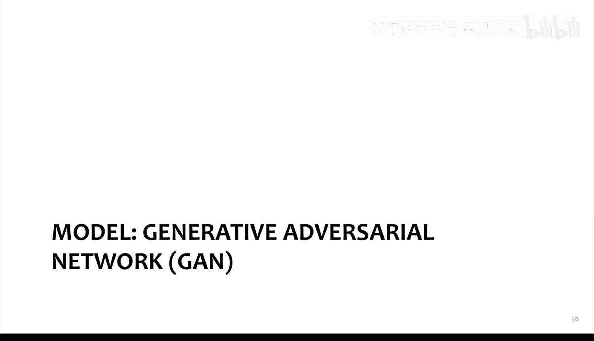

呃。Prompt slide explainingganNs for intro machine making course carefully designed easy to follow negative prompt is sort of saying like don't make it boring unclear non technicalchnical I would argue that this is actually kind of boring unclear and non technicalchnical and it's not in any human language that I am aware of so I'm going to have to go make some slides on this I guess so let's just end class a couple minutes early and and talk about we'll talk about Gs when we come back next time。

😊。

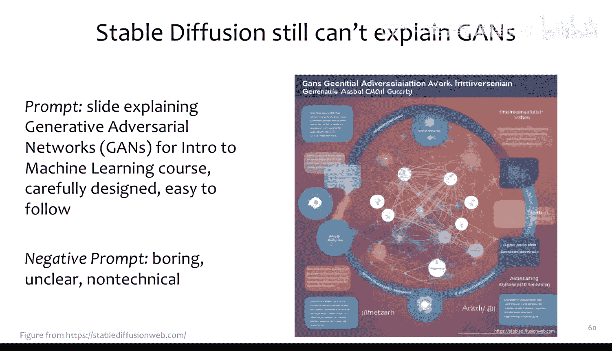

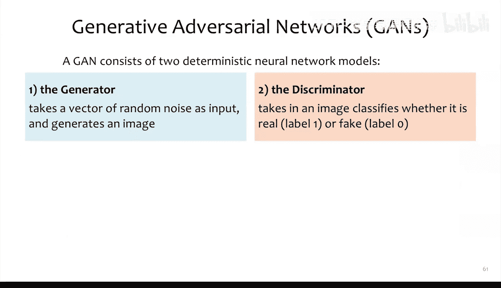

Okay， see that。