# CMU《生成式AI｜10-423 generative ai 2024》中英字幕 - P6：-P06-Lecture 06- General Adversarial Networks (GANs) + Variational Inferences.zh - GPT中英字幕课程资源 - BV1CyC9BPEhG

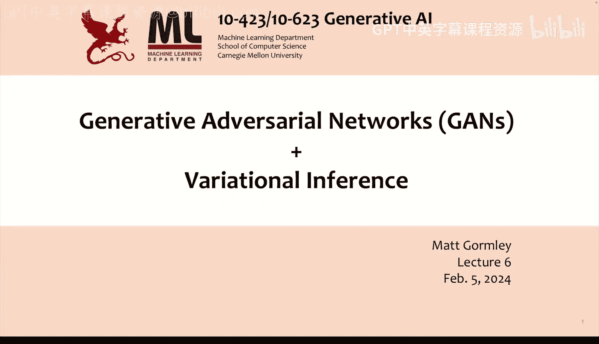

对。All right， welcome back today in GenAI we're going to be thinking about two things。

 the first is generative adversarial networks or GANs。

And the second is the topic of variational inference。And。Originally。

 when I was sort of sketching out what。My lectures on diffusion and VAE would be。

 I thought that maybe I could kind of get away with skipping the topic of variational inference。

 it's rather technical and yeah， I thought maybe we could kind of like work around it。

 but I think that it's actually worth taking the time today。

 to sort of set this up this background up so that when we talk about， diffusion or end or VIEs。

 we'll have this grounding in variational inference to stand on。

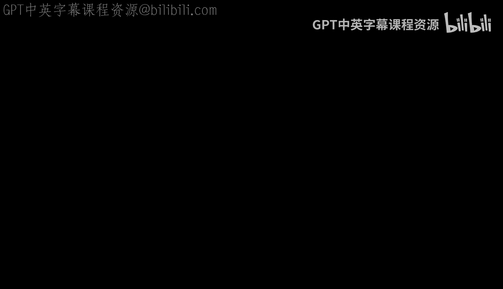

So the same reminders as last time， let's jump into Gs okay， so we said that。

These models kind of second generating slides let's see what they actually are so again consists of。

😊。

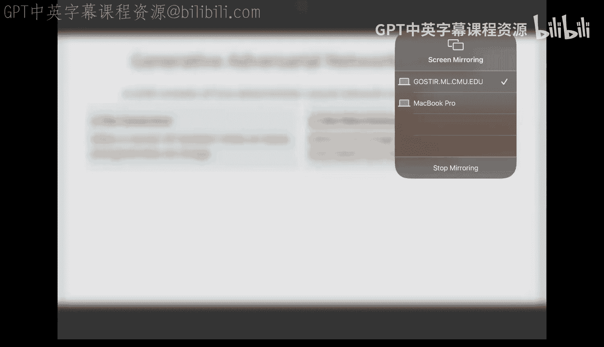

Two deterministic neural networks， okay， these are distinct neural networkss， models。

That happened last time， right？Here might be。No， it not the it's not the mirror though。

 it's the actual zoom oh no， it disconnected me。

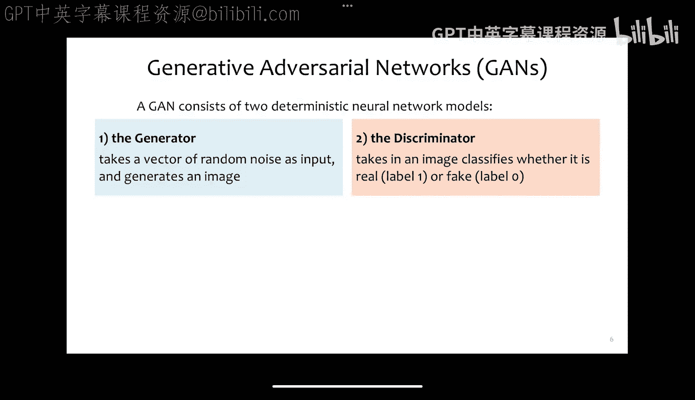

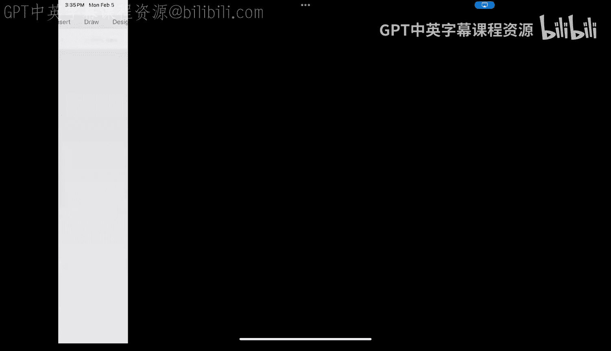

I like completely dropped the Zoom call。

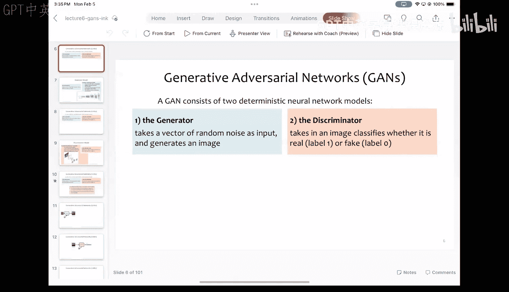

对。Let's see what we can do here， it's track to reconnect。

You could go to EduU Rome， I guess。There we go。Wed yeah， I mean， it literally just dropped me。

So I think it's the network。Here we can。Yes。Yeah， I think if we start bringing in Ethernet thing。

 that might be my that might be my workaround， I think I have one in my eyes。够。Okay， so。

And just reset this。There we go， Okay， so the generator is going to be one neural net that takes in a vector of random noise and generates an image。

And then the discriminator is going to be。An actual classifier that's trying to classify whether。😊。

An image is real or fake。Um， meaning whether it was from the real world。

 like taken by a camera or whether it was artificially generated by this gene。Okay。

 so what might such a generator model look like？One option would be something that's kind of similar to the CNNs that we've been talking about。

 except that it could。Essentially， do the inverse of what we had been seeing with convolution。

So when we were doing strideed convolution， we were seeing that you could downs sampleample an image right so if the convolution takes a stride of two。

 it's kind of jumping two pixels at a time and then the output of that convolution gets smaller。😊。

So with a fractionally strideed convolution layer。You can actually grow the size of the image from layer to layer right so what this is like is now you're moving that convolution layer half a pixel at a time。

Okay， and so if say you have a four pixel by four pixel image and you have a。

A convolution of size two by two。Then。呃。If we move。This convolution。

At a fractional stride of one half。We could actually get back。An image that。

So while it depends on whether we use padding， did I talk about padding at all？

I don't think I may I may have skipped over that so i'll just ignore that detail so if we're moving half a pixel at a time then。

😊，Then， you know， the first convolution would be here。

 the second convolution would actually be kind of like not really over any particular set of images。

 it would be kind of over half of these pixels and half those pixels and the full pixels in the middle。

😊，Right and in doing so， we would end up with more pixels in the output than we had previously。

 and so that's why this figure you can actually see this is a DC this is a particular generator used by DCgan that the actual image starts out as 4 by 4 and then goes up to 8 by 8 and then 16 by 16。

 32 by 32 and then the output image is 164 by 64 with three channels meaning red green and blue。😊。

Okay， so there's something else called deconvolution this is not the same thing if you ever encounter that Okay。

 so back to the discriminator model what could this look like well。

So Patchcan is this model that uses just sort of a regular old convolutional neural network for the discriminator with the caveat that it actually looks at each patch of the image and tries to predict whether or not each patch is real or fake。

So at the end of this， what it tells you is say it divides。

 this is like maybe a 64 by 64 pixel image， say it divides it into four by four patches。Okay。

 the same way that that vision transformer was Now what it's doing is it's making a prediction for each of those little or those little patches。

 I this a real image or not Okay， so the ground truth here。😊，If it's a real image would be all once。

 right because all of the patches are real。And if the image coming in was from the generator。

 then all of the labels for all of the patches would be zero to indicate that they're all fake。

And so this， it turns out that looking at each patch actually helps to kind of avoid producing blurry images。

 there's something about this in the dynamics of the discriminator and generator。😊，Okay so。

When we train a generative adversarial network。What we're doing is setting up like a two， oh yeah。

 question。These zero and once for all of the passes or can also be overnight。で。Yeah。

 so the word they have this set up it's all ones or it's all zeros like those are the only two possible correct answers your model could output a mix of them right so how do you think it takes a mix of zero and ones and gets a final prediction。

It' probably just like take a majority vote， but in practice what we care about is the actual loss of the discriminator。

 we don't really care whether you know how many times it's correct or not we're more interested in the loss that it actually produces and so that's why we're kind of interested in this。

So just at this time， I just get a fit。So we get back by the of our value。

It looks like do we do it and every distance everything。So that not on the road。

I'm just giving you one example of a discriminator。

 there are others that don't do this and I think there are other tricks to like combat blurriiness。

 I don't know what they are off the top of my head but this is like one way that people have tried to tackle it。

对。So you could use， for example， the vision transformer that we were just looking at as your discriminator。

 and that would also be fine。Oh。And actually， I think Patcan came before， it was like oh well。

 it was 2018， so it was before vision transformers。

 so it's possible that vision transformer might have very different behavior when it comes to blurry images。

我前的这个还是。That makes absolute paid earlier。How do they look different do you mean so I think that。

I have an example here， so here is a generator image of a plane。This is from 2017 paper。

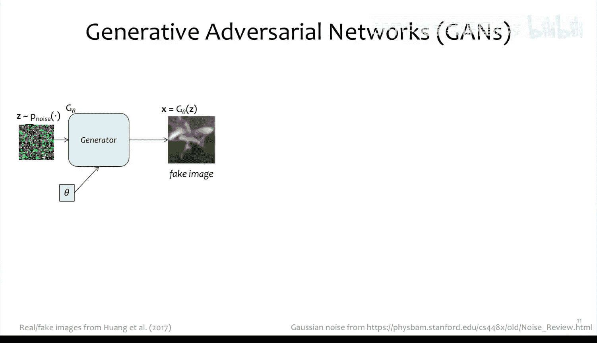

And here is a real image of a plane。So real image。Generated an image。

So in this case right I think we're used to seeing like the 2023 generated images where like you can like barely tell the difference you like zoom in on someone's eye and it looks like a real iris。

 you know， in 2017 like that was how good we could generate planes so。😊。

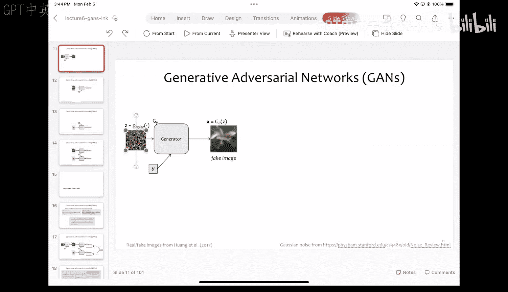

I think the discriminator might have had an easier time back in 2017。

But I think there are other probably artifacts that we can't even visually see that it could also pick up on and those hopefully the generator would learn to kind of like get rid of so that the discriminator can't pick up on them。

So let's think about how these two are going to interact when we train these。

 the generator is going to try to create realistic images to fool the discriminator。😊。

Into thinking that they're real。And then the discriminator is going to try to identify the real images from the fake ones。

Okay， so they're in competition right and so what does this look like？😊。

So we're going to have some vector Z and actually on my original slide this。This Z。

I literally a vector hiding under there。And。But I kind of want you to think about that noise visually because it's going to be useful to think about it visually as noise when we get to diffusion models。

Okay， so。So we have this vector Z of noise and。And the generator is going to take in that noise vector。

 along with some parameters theta。 And then it's going to， from that noise。

 do that kind of fractionally strideed convolution or something like it to output some fake image。

 So that's G theta of the noise vector Z。Okay， so then the discriminator would take in。

That fake image and its parameters phi。And it would output。A probability of being real。Okay。

 so what it does not have access to crucially。Is this label？

That's only there like for your edification， all it gets to see is the actual pixels of the image。

 so it doesn't know whether this is real or thick， right？😊，Okay。

 so if instead you did have a real image， which again is not available to the discriminator。

 that information that was sampled， say randomly from your training data。Then。

The discriminator here is going to do the same thing。

 it's going to use these parameters and output a probability that that image is real。Okay。

So sometimes it's useful to actually like kind of put these side by side and think about， you know。

 okay， we have this discriminator and it can either take in a fake or a real image。😊。

And whether or not it does a fake image or a real image， it's using the same set of parameters fine。

Okay， so to actually think about how learning is happening here。

We could we could think about the actual。Objective function that we're building up to sort of instantiate this game。

Okay， so。Specifically the if you just think about a standard cross entropy loss function right this is like。

 you know when whenever in I assume in your introml class you probably implemented a neural network it was probably using a cross entropy loss right negative log likelihood or something like that that's exactly what we're doing here we're just saying that。

J here is the log likelihood， or let's actually start down here。

 So J here is the cross entropy loss for the real image。

 So that would be the log probability that comes out of defy X prime where X prime is the real image。

Okay， and here this is the probability that the image is real given the image。

 and so higher values of Dfi X prime mean it's more likely to be real and lower values mean it's more likely to be fake。

😊，And then it takes them the true label， Y prime， which is one。Okay。😊，So analogously up here。

 we want to actually go in the opposite direction， now we want to take probability the long probability that the image is fake and drive that probability up。

And so we do that by setting J to1 minus dehi G theta。Of Z， right。

 because G theta of z is the fake image X。And so our lost if we had one real image and one fake image would just be the sum of these two。

So it's like now we have two training examples for this game。Okay， in practice。

 we're going to have many more training examples for the GAN because basically for every real image we'll generate a fake image and now it's like we have these little pairs of training examples。

 one's always real and one's always fake。Okay， so。So why do we call this a miniax game？

So if you write down what the actual objective function is。

 it would look like this top part right here。Okay， so you can see it's like if we have again。

 if we have this pair of images， so for X I， we have。

The long probability of the real image plus the long probability of the fake image。

And the discriminator。Is trying to maximize this objective function over phi。And so you could。

 you could think of this， We could think of this like a a some function J of。Phi and theta。

And the discriminator is keeping theta fixed and trying to choose the phi that maximizes that loss function。

So it's basically like maximizing a binary classifier likelihood。By contrast。

 the generator is trying to minimize the likelihood of。

It's generated fake image being classified as fake。So what that means is。It's。It's minimizing。

Over theta。The same objective function， J of phi and theta。Okay。

But we can see that there's only one of the two addoms in JF Phi and theta that actually involves theta。

So we can rewrite min over theta of G5hi theta as just this， the min of the second term。

 which is the only one involving theta。So the point here is that the generator is going to leave the discriminator fixed。

And try to minimize the。It's going to adjust its own parameters so that it generates images that make the discriminator more likely to be fool。

Yeah， so when you say like the again it's trying to play like a mini Max game， is the。

 I guess solution concept is assumed to be Nash or it could it be like。

But the stockholderber when investative。So。I guess。It's a good question。 So the question was。

 is it assumed that that the solution is Nsh。 So like do we actually hit a national。

 So I guess maybe the。The point is that we。We won't care in the end。Oh。And。

And so I think it's like a useful。Like so what we're actually doing， right is。Is this。And。嗯。

And so eventually should we should arrive at some saddle point and maybe that's actually what we care about in thinking about the miniax game is that if you were to imagine like the objective function surface over both theta and phi。

 like we expect that，There exists some saddle point that we'll converge to。

And that' that's maybe the primary takeaway here。Good question。Okay。

 so how does this actually play out？嗯。So。The objective function is this J of theta phi。

 it's a fairly simple differentiable function， simple in the sense that we can draw a picture of it on a slide。

 but thirdly we did choose G and D to be these fairly complicated neural networks but once you kind of encapsulate those neural networks in some hightorrch module。

 then the rest of it is actually pretty simple。😊，So what we're going to do is alternate back and forth。

😡，Between keeping G theta fixed and backping through D Phi and then vice versa。

 so let's see how that works。So the first step here is we're going to keep。The generator back here。

 completely fixed， so its parameters aren't changing。

And we're just going to back propagate through the loss function to the parameter spot here。嗯。

So in this sense， you could almost think of this like the generator creates some fixed static image and then we just。

Use this pair as like a training example for the discriminator。Okay， in step two。

 we're going to keep these parameters phi， completely fixed and back propagate through G theta。

So here， this is kind of interesting。Because。What you can see is that sort of we have this。

Haath that we can back propagate to theta。That。That involves explicitly the parameters file。Right。

And yet。Because of how we've set things up， everything here is continuous right there's nothing there's no variables in here that are say discrete。

 and so we really can back propagate through all of this Everything here is differentiable。Okay。

So so generally。This noise distribution is chosen to be a multivariate Gaussian distribution。

With mean 0。 and then some variance。 So this is called an isotropic， isotropic， isotropic Gaussian。

 And that just means that the。The covariance of the Gaussian can be expressed as some scalar sigma squared times the identity matrix。

看。And。呃。And so what we can say then is how do we actually back propagate through G theta？

If there's a stochastic Gaussian distribution involved。

This feels a little weird right you were used to kind of like everything in our neural networks being deterministic。

 but now we're saying that G theta involves this noise term Z that was sampled from a Gaussian distribution。

Okay， so why don't you guys pause here for a second。

 think about this question and then we'll see what you come up with。They doesn't have exercise。

Yes right。don。嗯没有。Yes。Because we're not going to use it for anything and we're not going to change our input distribution so just。

Don't see the gradient at that point Yeah， so this is a fine answer So the answer was basically something like。

 you know， over here we have an image coming in we could compute the gradient with respect to the image。

 but we usually don't because we don't actually need it。Okay， so similarly here， we could say， well。

 this is kind of like a， well， an image of noise and we can just kind of treat it as something that we don't need to back propagate through。

 but it doesn't break the mechanics of back propagation to have this。Okay。

 so we can be a little more careful about this though， and we could say that。

What we're actually doing。Is we're thinking about。呃。The sum function。That involves。Both。

Some input X and some noise term epsilon， where here epsilon is our Z。

And if what we're concerned with is。Is actually the。The gradient with respect to x。

 which you could think of as our parameters theta， so let me just sort of annotate this so if this is like theta。

This is like our Z。Right， then。Then what we're saying is we are concerned just with the gradient with respect to xs and so if we think about the gradient under sort of the expectation of this noise term。

Then that's actually kind of really what we would care about， right？

Like if we were really trying to work with。This Z， then then probably what we should do is we should say。

 well， you know， this J。Is kind of our function F。给。And it involves some parameters， theta。

 but it also involves some noise Z。Okay， so when we do this back propagation。

 what we should probably really be doing is taking the as our loss function。

 the expected value of J under this noise。OkayAnd and then further we could say。

 so if that's what we're actually trying to work with。Then also as。As the variance goes to zero。

 the gradient of this expectation converges to the gradient of F of x with no noise term whatsoever。

Okay。So so another way of thinking about it is if you're familiar with Monte Carlo methods that we're basically estimating this expectation with a single sample of noise。

 I'm not going to go into Monte Carlo methods here just wanted to kind of make that connection。Okay。

So the training data。Is actually going to consist of this collection of a bunch of unlabeled images。

 right？You could just imagine they're kind of a sample of images from the internet。

And then optimization is going to follow sort of this this algorithm that's kind of similar to block coordinate descent。

 block coordinate descent is where you take a collect a block or a collection of your parameters and you optimize like this half of them and then you optimize that half of them and then you go back and you optimize this half of that。

同。And so instead of exactly solving that miniax problem that we set up。

 we're just going to take a step of mini batch stochastic gradient descent to kind of move in the direction of minimization and then in the direction of maximization back and forth。

Okay， well it's actually a little more complicated than that。

 so let's actually look at what the algorithm says。Okay， so what we're going to say here is。嗯。

So we have some number of training iterations and。For case steps。

We're going to sample a mini batch of noise samples。these are our vectors， so Z1 through Zm。

And our batch size here is Emma。And then we'll sample a mini batch of images that's x1 through XM from the actual sample of images that we have。

And then we're going to update the discriminator。By。Ucending， because we're doing maximization here。

 it's sicantic gradient on that mini batch。Okay。So。

After we do K steps of stochastic mini batch gradient descent here， then we're going to do one step。

Of stochastic mini batch descent on the parameters of the generator。

So we'll go back and forth like this alternating between， you know。

 case steps on the discriminator and。And then one step on the generator。Okay。

 so what's kind of fun about this is you'll notice that this was from the actual sort of original paper。

 they say we used K equals one。The least expensive in our experiment。Okay， that said。

 I think it's actually useful in sort of understanding what this training algorithm is doing to think about why they might have put that for loop over K on the discriminator part and not the generator part does anyone have any ideas why they might have done that。

At least you know why might like sort of the first readers of this paper actually appreciated that yeahep？

Are you giving like maybe you can think of it as like giving an advantage to the discriminator so if you can fool a harder discriminator you're pretty some better images Yeah。

 so we're kind of basically saying that。So we're going back in this miniax problem。

And we're basically saying when we actually update the generator。

 we want the discriminator to be actually pretty good at its job。

And so you could imagine that it might be useful to almost run the discriminator training。

 almost to convergence or something so that you have like a really good discriminator that's good at。

😊，Sort of sussing out the difference between the generated images and the real images。

So that when we take a step on the generator， we're actually like moving in a useful direction。

And and further， another way of thinking about this is that the sort of object that we actually want out of this training is the generator right。

 the discriminator is just a tool for getting us a good generator。Okay。

So you'll remember that we talked about a bunch of different。Sort of tasks。

 oh yeah question back the point。Wouldn't the discriminator job be much easier at the beginning if the generator is like shoes absolutely absolutely？

Should have easy time。How about the difference between generator generated and real images at the beginning of training and then gradually over time they'll get more attention。

It's our point in doing hey， not able to win。So I think that well。

 I think so why why do they end up with As one is probably for what you're getting。

 which is that practice at first， like the distributorriminator is just having a pretty easy time。

It doesn't mean a lot the kind of conversion ist even useful and then by the time the generator has gotten better at that point the discriminator has been training along with the generator all this time and it's probably like by that point gotten good at sort of like like working with whether the generator。

W。Okay， so we've thought all these sort of different if a generation tasks like image editing in painting。

 colorization， and so on。So we can also do things like I think I mentioned class conditional generation and I think it's useful to actually think about how you can do class conditional generation here。

So if you have something label。Saying like， I don't know。

 your labels are planes and cats and boats and dogs。

 then you could take a label as input to the generator so that it can actually learn to generate specific types of images。

And then in this way， oh， I guess I should have connected this here as well， so is that enable。

So you can think of the label as one hot encoing of the fact that we're supposed to be generating planes。

And then you could pass that same label into the discriminator so that it knows that it's trying to discriminate between a real picture of a plane and a fake picture of a plane。

And that我。UThe the disity that you had and a very easy time in for example。

 long times an in generalable plane from like the rear of that and long times something looks like a boat。

Say of the generator， right？And so with the other edition。

 we have to work to use that information to start generating things that look like actual ages。Okay。

 so。So the actual samples that I was giving you of generator and discriminator models。

 those weren't maybe more similar to what the models look like when GNs were first coming out in recent years the actual model sizes have scaled up a lot and so here on the right side it's actually a little bit think but this is a lot scale so this is 0。

1 billion to 05，15 10 and 20。And then you can see it's also actually colored by whether or not they're usinggans or diffusion。

I actually don't remember why。Oh glue dots are auto aggressiveive chance okay so this is something else that maybe we won't as much but so basically the gainss here were super popular kind in the early years they were doing really well and then there was kind of this point where people started switching to diffusion models and you can see that the size of the models kind of grew to be quite large as we got sort of past 2020。

So this is one example。Of a very large model， I think it was one of the tallest lists to 20 billion per model。

 so this is the pathways utter text to image model or party model and the idea is that you treat image generation as a sequence to sequence generation problem。

So you basically are sticking in。Text prompt that's your're input to the encoder right so here's the text prompt text few dollars running in a field and so this is an encoder only transformer that knows how with the text and so building up some representation of that prompt。

And then it has a transform of Dakota local。That is actually generating a sequence of image currents。

And those image tokens， I don't think I actually have a picture of them。

 So the image tokens are actually these sort of discrete representations of。

Other like little imaging。And the idea is that it's going to generate。呃。

Essentially this sequence of I1 I 2 I3 and so on that that of like patches like。

 you know here they going generate a patch that's sort of representing like。

 you know some sort of patch that involvess like a of sun flare and like the ear of an animal and then an X patch is going to be like another ear of an animal and a little more sun flare and then this will be like you know the top half of a face of a dog and so it'll generate these image patches。

And。Once it's generated the sequence of image patches that again。

 are discrete tokens in like a library of little image patches。Then it uses this other model。

 VIT VQ GN to take in the image tokens and generate a high quality image。Okay。

 so this this is actually kind of this two stage model that does involve a G where it's first generating some like high level semantic representation of what is in the image and what the sort of layout of that semantic content should be。

And it's doing that based on the text， but then the actual semantic content wouldn't look reasonable。

 it would just be like these discrete tokens and then it uses those to actually feed into agan that generates something that looks more realistic。

And so this model， they kind of looked at the party model with different model sizes。

 so here the prompt let's pay close attention to it is a portrait photo of a kangaroo wearing an orange hoodie and blue sunglasses standing on the grass in front of the Sydney Opera house holding a sign on the chest that says welcomee friends。

Okay， so over here。😊，Don't worry， they'll get increasingly less scary。

 something that does not say welcome friends。😊，It's like maybe there's like multiple kangaroos like back to back wrapped up in like a snggy or something I don't know This one is like particularly odd that I think that like it almost was using like where that year of the kangaroo would be to like be part of the Sydney Opera house or something here it's like starting to look like some sort of coherent language and by the end it actually kind of nails it。

 it gets like kind of all of the different things that it's supposed to and so it's actually doing a nice job of actually capturing that semantic content but it it looks like you know it actually took a really large parameterized model to actually get there。

😊，嗯。Okay， so I'll ignore that and we'll come back to it yeah。What the what4 that。The Sa。啊。

YYeah that's a great great question so I guess like it added water of the Sydney Opera house so I guess like it's sitting on water so it probably like in some sort of freetrain actually learned something that might have give it a hint to know that Sydney Opera house is near water I guess I don't know。

我ルがリら。Yeah， so the decoder is generating， you could think of them like。

Some intermediate representation of tokens。That are going to correspond to you know， I1， I2， I3。I4。

 I5， and these these tokens are going to be some represent some intermediate representation。Of。

Of the image that's then separately like used as input to the G that gives。Yeah。哎不老说。Oh。

 why isn it an regressive model？Probably for for the thing， like because transformers。

Lend themselves to training auto regressive models， I don't think there's like a great reason。

That's right。They might你 then back该有的。Yeah， so I mean this this figure probably isn't like a perfect representation of what I want it to be because this is actually。

This bottom image is actually being used to like it like really the bottom image is actually going into like I'm kind of。

I've abused this image， so so really this bottom image is going into an image tokenizer at training time that's then taking a real image and breaking it into tokens。

😊，And so we train the autoregressive transformer based on this tokenizer and then at inference time we run。

the decoder， and we get out some sequence of tokens that is fed into the sort of detokenizer。

 which takes the tokens， which is sort of what I was scribbling on the bottom image and feeds them into some detokenizer that generates our actual image。

Technology。That's right， so if I don't even know if I can do this can I like take my na on my me。

Anyway， really， this should be like here。

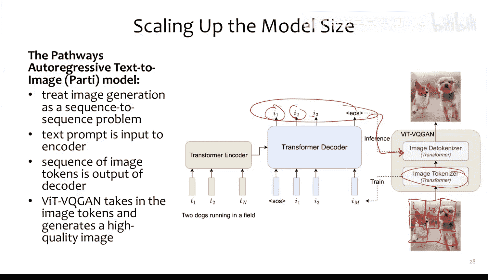

If that makes sense。Actually， I could probably just leave it there actually。

 that that still actually is probably a better drawing than of what's going on here。

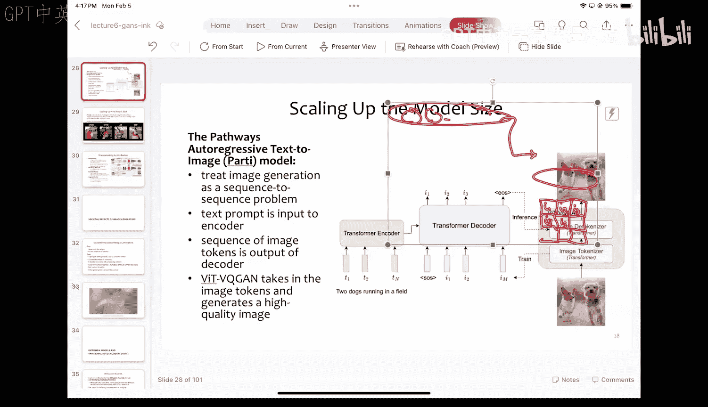

Put it there。Okay， great。Good question， thanks。

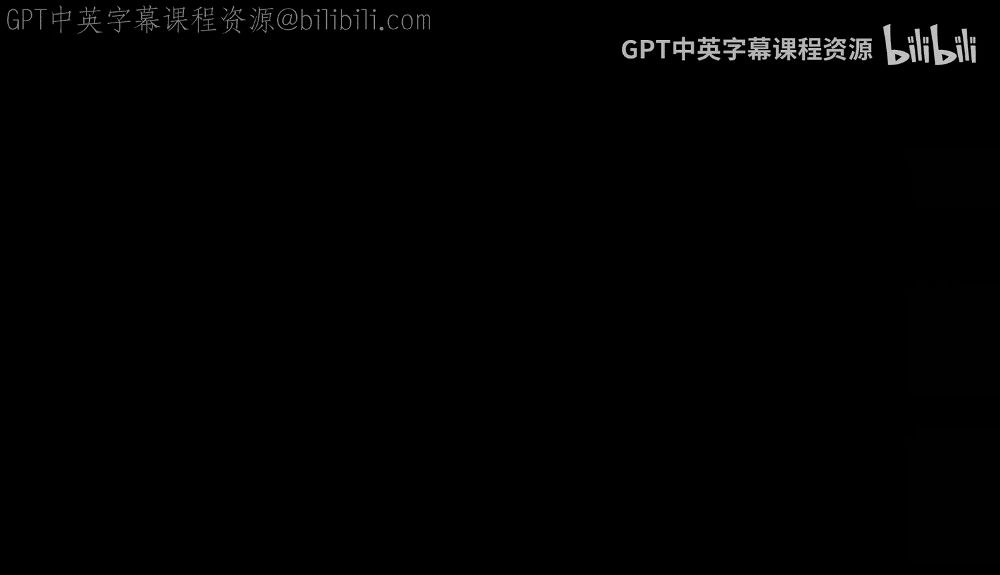

Okay。So just mention the have just mentioned the。More than this the the water body might be an examination is it kind of because of the of the inter that they could be water person。

So I don't know the details of how theyve pre traineded their models here or if they pre traineded them and so I don't I don't really know what what could lead to that。

 but I could kind of imagine that。Some combination of like how however they're kind of fusing the Texan vision model that it probably could pick that up Sydney Opera House and water together。

 that's my guess。Okay， so on。Societal impacts are image。Let's pause here for a second。

 so I think that it's interesting to think about。The actual sort of possible。

sideide effects of the fact that these models have gotten quite good so I think a definite like positive is that you know we're kind of building new tools for artists and so you know if you think about the possibilities that come up particularly with image editing there are now artists that are actually using sort of the conditional generation models to do interesting things where you kind of take take an image that you want as your starting point and then you you modify it in interesting ways either by like removing things from it or adapting things from it and so I think that there's this sort of this rapid development of like sort of。

Quickly generated almost new forms of sketching that didn't exist before these kinds of models。

I think there's also a long list of cons to all of this there's things like。

Copyright infringement is a big one right so right now most of the copyright law is kind of siding with the model and saying the model is is generating something new and the copyright belongs to no one and so I think that there's this potential for like sort of lost。

Loss work or revenue for artists as a result of that。

There's there's the potential that we could have sort of like this general decrease in creativity in society right like if if every child grow up thinking like。

 oh， I don't need to learn how to draw， I can just pro their model。

 this might actually be bad for us。😊，And then there's certainly like the potential to create sort of dehumanizing content。

 fake news， false realities， all of these things that kind of kind of potentially could go wrong with these kinds of things we're already seeing some of those。

 and then I think video generations around the corner and that poses additional risks for sort of increased difficulty in fact checking right。

 like now， you it used to be that if something was on video then you kind of assumed that it was real。

 but now that might be more and more difficult。So so there are tools for watermarking and attribution。

 so a digital watermark basically allows you to identify land an image that has been created by a model。

 so most methods for image generation can like very directly be augmented with water marking。

So if you're if you're trying so there's different things that you might want to do though。

 so if you were just trying to do fake image detection。

 that's essentially what the the discriminator is trying to do。

 which is identify the fakes even without a watermark。

Then this is maybe like societally useful and there's another problem which is just sort of model attribution。

 which is about identifying which generative model actually created an image right is it Dolly2 or is it SDXL。

 it turns out that even if you don't put watermarks in the images。

 you can build a model that can tell the difference between a Dolly2 image and an SDXL model very successfully and。

And then finally， I think the great open challenge is image attribution right so if you want to actually identify the source images that led to the generation of a new image。

 this is an extremely challenging problem right this is trying to give you know basically this is trying to give attribution back to the original source of an idea or of a style or something that led to the new image and this is very much an open problem and the fact that it's still open。

 I think is a big problem。😊，Yeah。Okay， so。So now I want to make a big pivot to diffusion models and variation autoeners now these are another two models for generating images。

And although VAE came first， we're actually going to start with diffusion models since they're going to receive more of our attention and the steps for defining these models roughly goes like this。

 we're going to define a probability distribution involving some Gaussian noise， we just did that。

Then we're going to use what's called a variational lower bound as an objective function。

And then we're going to learn the parameters of the probability distribution by optimizing that objective function。

O。So the key question is what on earth is a variational lower bound Okay。

 since that is basically like step two of this process Okay， so to get there。

 I need a couple definitions， the first one is a directed graphical model Okay。

 so there's actually three kinds of graphical models。

 these are just a visual tool for helping us to express interesting properties of probability distributions。

😊，And a directed graphical model is also sometimes called a Bayesian network。

 just two names for the same thing。And here's an example of one on the left。

 so you can see we have five variables， x1 through x5。

 and when we write down a little figure like that， what we're saying is that there exists some joint distribution probability over x1 through x5 that factorizes like this。

 the probability of x5， given its parent， x3， times the probability of x4， given its parents。

 x2 and3， probability of x3， given its parents， which is none probability of x2。

 given x1 times the probability of x1 which also has no parents。Okay， so more generally。

 we say that a Bayesian network is some distribution over variables x1 through Xt。

Where the form of that probability distribution is always the probability of each variable。

 which is one of the nodes in the graph， condition on all the variables that are parents of that one in the graph。

So it's going to consist of two parts， the actual graph and then which is sort of like a qualitative specification。

 and then some actual conditional probability distributions， these things。

 which are the quantitative specification。😊，Okay， so the qualitative specification could come from a variety of different sources。

 usually you have in mind some prior knowledge of causal relationships between or more modular relationships between variables and that gives rise to it。

 sometimes you just prefer certain architectures because they have nice computational properties as we'll see with markcons。

😊，Okay so here's an example of what the quantitative specification could look like。

 so if we have a graphical model over variables ABCD。

 then we could say that it must factorize as P of A times P of B times P of C given A B because that's the parents times P of B given its parents。

 which is just C。Okay， so P of A could be something like this distribution。

And maybe all of these are say binary variables so a can take values a0 or a1 and then this is so this is P of a and then this is P of B and then here we have P of C given A and B and then finally a P of D given C。

And so here we're representing these distributions as discrete tables over discrete values。😊，Okay。

 so you could instead say well actually I want my variables to be continuous values okay that's not a problem。

 the factorization would look exactly the same， but now the quantitative specification could change such that we would say something like A follows a Gaussian distribution with mean mu a and variance sigma A and then B follows a different Gaussian distribution with different parameters U a sigma B。

😊，And then C is a function of AB， so it's a Gaussian whose mean is a plus B。

 and then D is another Gaussian that's some parameter plus C。😊，对。

And then you could also combine discrete and continuous variables so that some of them are discrete like A and B。

 and then some of them are continuous like C and D。Okay。

 and then in general graphical models we often shade in nodes that are observed when their values are given。

 so here if we knew the values of x1， x3 and x4， then we could write you P of x it's like thinking of it as a distribution over just x2 and x5 given the values of the other shaded in variabless。

Okay， so one of the models that we're going to be thinking about is a Markov model and so for that we need a Markov assumption so a Markov assumption for a sequence of random variables。

😊，Is going to be that the probability distribution over Xt given x1 through xt minus1。It's just。

Boils down to probability of xt， given xt minus1。😡。

And what this assumption is really doing is it's making a conditional independence assumption。

That says Xt is conditionally independent of x1 through xt minus2 given xt minus1。

 so we don't need to condition on the rest of it。Okay。So we would write a first order Markov model。

As。A probability distribution over， say x1 to x capital T as some distribution over P of x1。

Times p of x2 given x1 times p of x3 given x1 times sorry。

 x2 times p of x4 given x3 and then5 given4 and so on。Could。

And we can write that down further as a graphical model。

Where you see that it just is represented as a long chain。可。Okay。

 so once I wanted to write a say recurrent neural net， let's see， not an RN。

 but rather an RNN language model as a directed graphical model。So now in this case。

 we're going to have variables like x1 is or we could write this as word one right because this is going to be a distribution over a P of word one up to word T。

And so our first variable is W1， and then we have word W2。And then， W3。W4。

And let's say our sequence length t is equal to five， and so we just have these five variant。Okay。

 so。If we wanted to have an RNNLM。Defining this distribution。

What would the directed graphical model look like？Why don't we pause and actually you guys can talk about it and then give me an answer。

Okay， does anyone offer an answer here？😊，Ideas。You guys think， what would this look claim？Thank。Okay。

 so this is definitely part of it。But we're actually missing some things。So what else are we missing？

AnyYeah， so lets let's think about W3 so W3 definitely depends on W2。

So what we've just written here in red。Let's let's actually mark these as blue。

So if we only use the bluearrow， then we have a markout chain which factorizes according to。

 so that would be P of W1 times P of W2， given W1 times P of W3， given W2。Up to P of W5， given in W4。

 right？But what we want is a distribution that looks a little different。

 it should be P of W1 times P of W2 given one。Times P of W3 given。W1 and W2。

All the way up to P of W5 given four， three2， one。And oh yes we weren't assuming the Markov assumption here so here we're we're basically oh sorry I guess I should so yeah。

 let's draw the green arrows to represent what we're seeing here so essentially the arrows go fully forward。

😊，Between all。All pairs like so。So the green arrows would give us the correct distribution that we're after。

Okay， so yeah， questions。No。What is。Yeah， so what we're saying here is that the hidden state。At say。

 so like say the hidden state at time step four。is actually a representation of W12 or sorry。

 the hidden state at time step。There might be off by one here step yeah， yeah。

 time step four because wed have a start token is going to be a representation of words one。

 two and three。So similarly， the hidden state at time step five is a representation of one through four。

So when we say， you know， the probability of word five here。

It notIt's conditioned just on one hidden state， H4。

But that hidden state is actually a function of W1 through W4。

And so it really is a probability distribution where each word depends on all the previous words that came before it。

😊，So what's nice about this is these these graphs actually kind of give us a visual representation for how the actual conditional dependencies of the model are borne out。

😊，There's a lot less arrows in the blue than the green because we've made a lot of really strong conditional independence assumptions there。

Okay， so here so there's three types of graphical models。

 the second type would be undirected graphical models and to talk about them we would talk about cliques and maximal cliques and then we'd think about separation and a graph and。

😊。

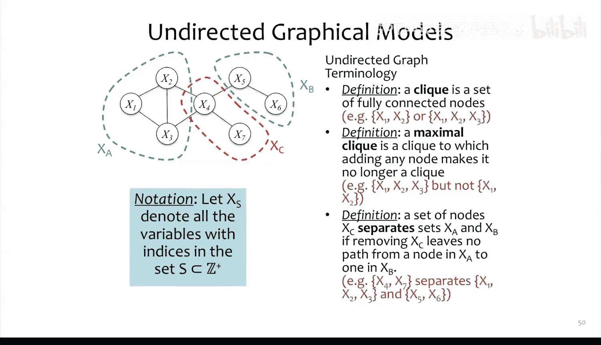

Honestly， these are just kind of complicated and we don't really need them Sore to talk about them if you want you can go learn about them。

 I will take like two minutes just to tell you what a factor graph is because I think it's much more intuitive and a factor graph which is our third type here actually can encapsulate both a directed and an undirected model so in a factor graph we may or may not need these we have variables that are circles and factors that are squares and each random variable can be assigned of value so so for example the first variable could be chocolate and the second one could be assigned the value of peanut butter and factors have local opinions about the assignments to their variables right so if this was chocolate and peanut butter the factor might be happy whereas if it was you know chocolate and ice and vanilla ice cream also happy and if it was vanilla ice cream and tuna fish it might be unhappy right。

😊。

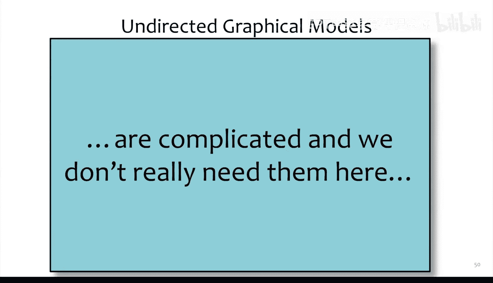

An unfortunate pairing， but we could actually express this with a little table of numbers right。

 we could say that you know when we have chocolate with peanut butter we get a high score and when we have chocolate with ice cream we get a high score。

 when we have ice cream with tuna fish， we get a really low score。😊，Good。

And we can add in also sort of factors that only look at one variable。

 this one's looking at two variables， that's why it's connected to two。

 whereas that factor only looks at this top variable。

 and maybe it really likes tuna fish right and so it could give a high score to the fact that that variable is tuna。

 but the sort of factor that touches both might overrule the top factors like for tuna fish in trying to put those together。

And so if we actually wanted to then compute， say the probability of tuna fish and ice cream。

 we could do that by taking the values of the factors。

 which are these tables and multiplying them together。

So the probability of tuna and ice cream is now  six times 7 times 01。Oh， but that doesn't work。

 right？Because six times 7 times 01 is more than one。 That's not a probability。 Okay。

 so what we need then is to actually divide them by some constant Z。

So that the whole probability distribution over all of the possible variable assignments adds up to one。

Okay， so we can use factor graphs to describe directed graphical models， undirected graphical models。

 conditional random fields market random so they're're very general and essentially the probability distributions that they define are just a little bit different than directed so directed graphical models each of the conditional probability distributions。

😊，In the quantitative specification。Was locally normalized， meaning it added up to one。

 whereas here we're saying。To define a joint distribution over these nine variables。

 we're just going to have a bunch of different little factor tables and they don't need to add up to one or anything。

 they can just be any sort of collection of positive numbers and then we'll have this constant factor one over Z that makes sure that we always get back a properly normalized probability distribution。

Okay， and so you could think of these little distribute， these little factors like tensors right。

 if it's just touching one variable， it's a vector， if it's two variables， it's a matrix。

 if it's three variables then well it's like a three dimensional tensor because this factor is touching three different variables and so you have to have three different axes of variation in your tensor。

😊，可以。😔，So。So we have names for these uninary factor， binary factor， turnernary factor。

 indicating how many variables each is touching。And。

And the key thing is just that they're taking non negative values in those factor tables。Okay。

 so here's here's like another example of a factor graph。

 say over binary variables right and so we have the factor graph up here showing us that there's three variables。

Capital A， B， and C。 So we， and we have three factors。

 So the the first one is a unary factor that's only touching a。

 And so it gives scores to the possible values of a。The second factor here。

Is a binary factor over A and B？And so here's a little table expressing the numbers for that。

And here's the turnernary factor over on the far side。

 indicating the values for this turnernary factor。So then when we want to。Get some distribution。

Like a joint distribution over A， B and C， we say we have some joint distribution that is the factor。

 the product of the three factors for the particular values of A， B and C。

 maybe those little values are like zero， zero and1 or something。Timeim was one of Z。

So what on earth is Z？Okay， so we can actually。Just figure that out。😡。

If we think of the product of the factors as some little function S of ABC like an unnormalized probability distribution。

 so you could just list out all the possible assignments to all the variant so how many different assignments are there here。

 how many rows are in this table， if they're all binary variables。E， right， yeah？

So two to the threes， eight。And we're saying that， you。

 Psi A gives a factor by looking at the value of A and Psi A B looks at these two values and gives a number and Psi A B C looks at all three and gives a number。

 right？And to get S， we just multiply these three numbers together， and that gives us the score S。

Okay， so if you did this for every assignment， you would get a score for every assignment they might and then if you took this column and you added them all up。

 they would total sum number Z。So if you want your probabilities。

 you just take whatever the score was and you divide by that total。Yeah。

Or why isn't there a Psiac C column？Only because I didn't draw a PsiAC factor in the factor graph。

So if I had， if I had put in。A factor here。Like that little green factor。

Now we would have to go over here and we'd add in a C and Psi A C。And we'd have yet one more。

And now you'd multiply four numbers together to get the score。Okay， so。

So the reason that that I spent like five minutes talking about that is I think it's actually kind of useful for us to be able to talk about locally normalized models versus globally normalized models okay in some sense I don't really care terribly about the factor graphs。

 but this distinction of locally normalized models which is，😊，The directed graphical model。

And globally normalized models， which are the。Undirected graphical model and the factor graph。

Is that in the directed graphical model each of these little factors right these are by here now by factors I mean things that we multiply together that's what the word factor actually means and so you could think of this as a bunch of things that we multiply together and they're always probabilities they're always between zero and one and so when we multiply these together。

😊，They're going to give us back a properly normalized probability distribution。

 We don't need an extra constant out front。But over here， we're saying， well。

 because we're just multiplying a bunch of non-neative numbers together。

 we actually do need this normalization constant， and it's called global normalization because we have to sum over all of the possible values of x1 through xt to get that value of z。

掉。The少。Second。Proper is property that are available exactly another way that suspension are available。

 but how do we get the factor values over how are these factor values different of that？

Oh the question was how do we actually get the values of these factors and that's a parameter estimation question。

 so how do you get the values and the conditional probabilities tables。

 how do you get the values of the factors usually you treat them as parameters and you learn them from data。

😊，And so what we've seen so far in this class is that we're generally working with what are called auto regressive models。

An auto regressive model is a particular kind of locally auto regressive。😊，There we go。

 autoregressive models are a particular kind of locally normalized model。😊。

That generates x1 and then conditions on that to generate x2 and then conditions on those two to generate x3 and does so in sequence。

 always conditioning on what came before。Okay and and so how you could even sample from a globally normalized distribution is should should feel a little bit puzzling at this point and you can go take a class called Gal models if you want to learn more about that okay so。

😊，So what we're going to do next is actually think about that variational lower bound that I was talking about and essentially what we'll think about is now that variational lower bound allows us to。

Essentially estimate quantities that we might think are intractable。So for example。

 we might often encounter a situation where we have some observed variables X and some latent variables Z。

And estimating a posterior distribution， P of Z given x is in。

Or maybe x are data and z are parameters and estimating z given x is intractable。

And so variational inference is actually going to allow us to。😊。

Come up with approximations to these seemingly intractable problems through optimization。

And so we'll stop here for today and when we pick up next time。

 we'll kind of talk about why variational inference can be helpful to us and then we'll use that to segue into diffusion models。

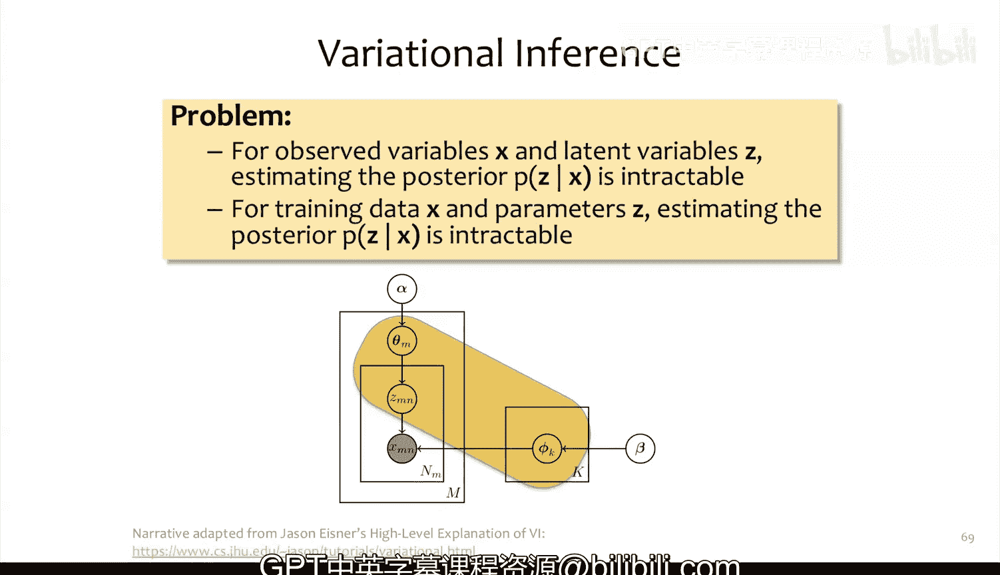