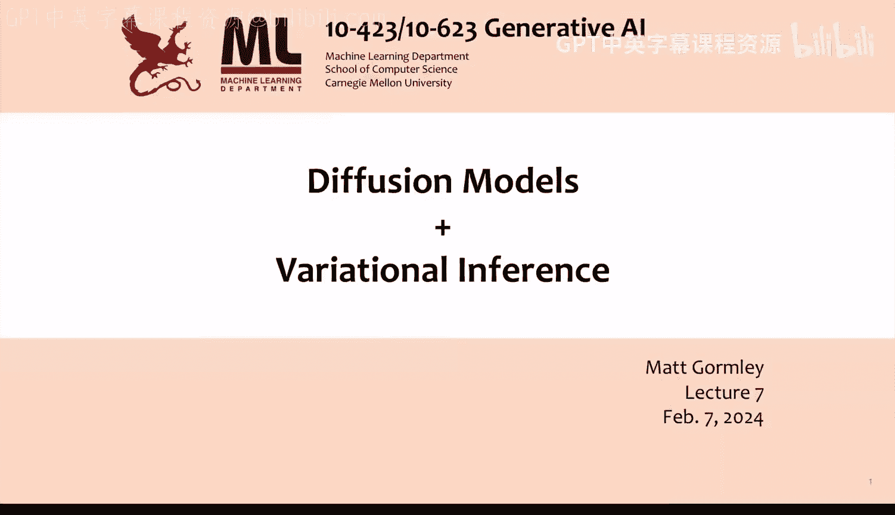
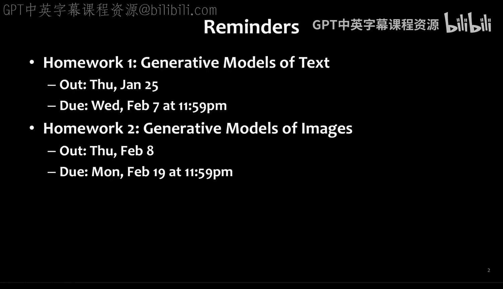
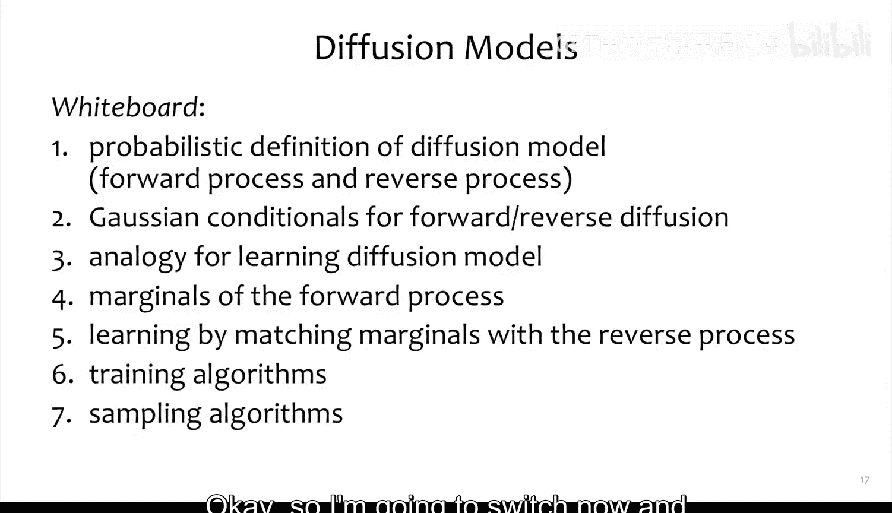
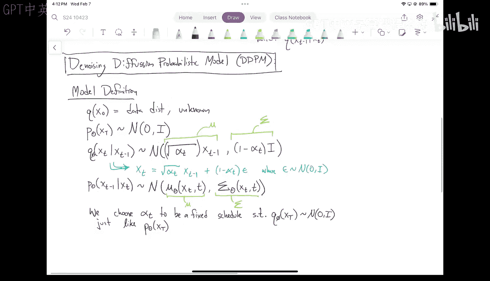
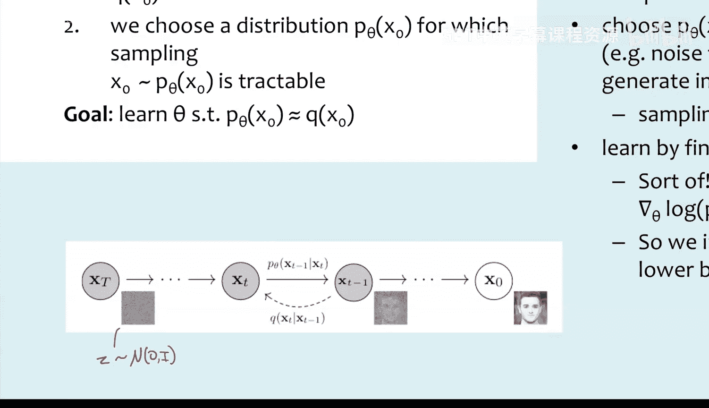
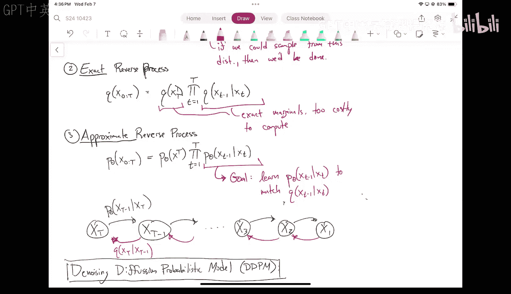
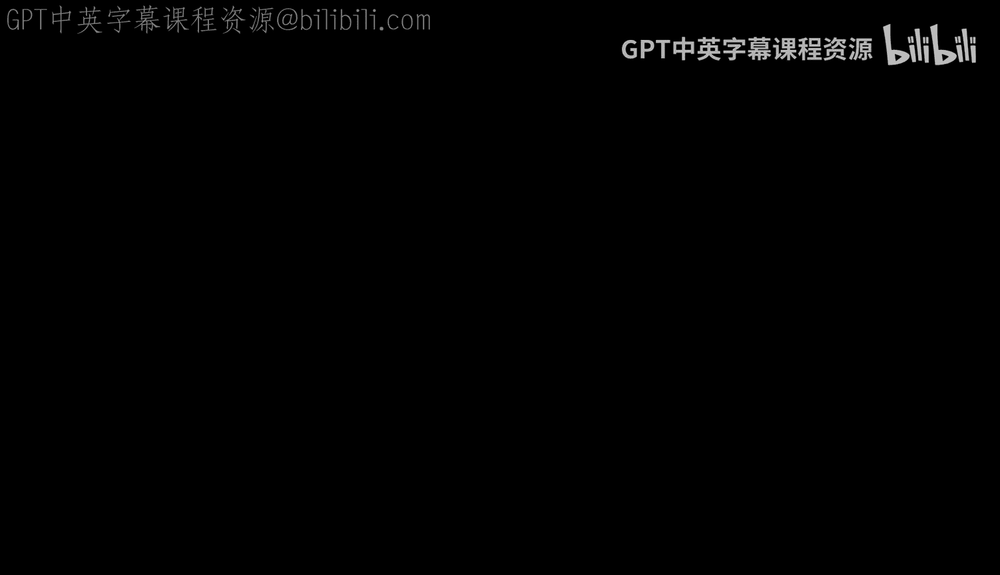
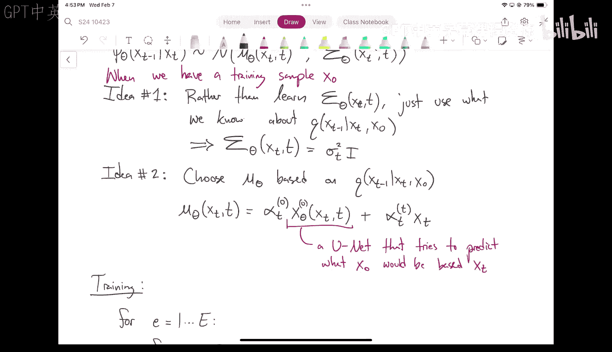

# CMU《生成式AI｜10-423 generative ai 2024》中英字幕 - P7：-P07-Lecture 07- Diffusion Models and Variational Inference.zh_en - GPT中英字幕课程资源 - BV1CyC9BPEhG

Okay， let's go ahead and get started here。Today we're going to be talking about diffusion models。

So I had。I had this kind of plan in mind for how I was going to go about presenting this self。

 because if you look at kind of all the standard presentations of diffusion or specifically variational diffusion models there's sort of a couple different varieties。

 but the standard thing would be to assume that you know what variational inference is and then to introduce the diffusion model。

 we're actually going to do the opposite， we're going to first look at diffusion models without variational inference。

And then we'll go back and we'll say， oh， if you look at this through the lens of variational inference。

 it still makes sense。 And so I think that this kind of untangles some of the。Well。

 it'll still be a bunch of math， but it untangle some of the complexity so that we can actually see why it is that the diffusion model is doing what it's doing when it's training and when it's sampling and then variational inference will offer some additional insight into sort of its connections to other algorithms the oddity about diffusion models is that it's not really doing any variational inference at all。

 and so this is why I think it actually works that we'll be doing it this way。Okay。

 so the usual reminders abouts， homework two will be on generative models of images。

Okay， so I want to start just by giving a little bit of background about this model called UNNe。

 we're going to use it when we kind of define a diffusion model。

 but it's it's just a particular kind of convolutional neural network so you'll recall there's this task semantic segmentation and we saw this before where you're given some image and you want to predict a label for every pixel in the image and so at the bottom here we were actually looking at deconvolutional network which takes in an image on this side and does a bunch of convolution and then some deconvolution to get back up to an output tensor that has the same dimensions as the input。

Granted， it might have a different number of channels。

 depending on how you're using those channels for a task like setic segmentation or instant segmentation。

 but the key property here is that the input and the output dimensions are the same。

And so UNt is another model that does similar that basically has this same property。And。

And so its name comes from the diagram， which kind of makes it look like a U。

 or the actual computation graph looks like a U。And so there's two sides to this thing on the left of the middle is what they call the contracting path and on the right is the expanding path。

Right so you can imagine then that the contracting path is taking the original input image and then shrinking it down to smaller and smaller dimensions。

 possibly with higher and higher numbers of channels。

And the expanding path is expanding back out to the same dimensions。 Okay。

 so the way this works is it's kind of repeating the same block like the the way that we have a transformer block。

 there's kind of a block here that consists of a 3 by three convolution。

 another 3 by3 convolution and a re and then。诶。And then a max pooling layer with a Stride of 2。

 which is doing some downsling。So you can see you this here would be the first block。

 and then this would be the second block， third block and fourth block。

And then on the expanding path， it's sort of similar， so we use convolution to do upsling。

And and then。There's this concateation that I'll come back to in a second。

 followed by three by three convolutions with RE。Soum。

So the sort of interesting bit of this is the concateation， which is that after the upsling。

 you get back some higher dimensional representation。And rather than just using that by itself。

 they're actually passing along a copy of the features from the contracting path and concatenating those into the expanding path and in the end we get this output that could be used for various different things when the model was introduced。

 it was actually being applied to problems in biomedical segmentation so here are just sort of some examples where they were trying to do some cell tracking in images A and B。

 and then some other sort of segmentation of cells in images C and D。Okay。So。

So when you think about this model， I guess what I want you to have in mind is that。

That it has the convenient property that it takes in some input image and it outputs some other image of the same size。

Okay， so before we get into diffusion， we want to sort of think at a high level about unsupervised learning。

So that we kind of have this framework in mind， so our assumptions are that our data comes from some distribution。

Okay， and I'm sort of setting us up notationally here that x0 is going to denote like say an image in our data set and so we're going to say that the distribution over those images。

 say， or maybe it's text is going to be some Q of x0。And。

We are going to choose some distribution P theta。For which sampling is tractable。

So if we couldn't sample from the model or if sampling was intractable。That's not a deal breaker。

 it's just that now we would need some approximate method to actually do generation right I mean like when we talk about you know。

 generative AI， what we're really talking about is building models from which we can sample。

And so this is sort of maybe a soft requirement。So our goal is then to learn some theta such that P theta。

 the distribution is approximately equal to the distribution Q。

 the actual distribution over our data set。Okay， so when we were thinking about auto regressive language models。

The true Q distribution， Q of x0 is the human process that produced text on the web。

And we choose P theta to be some autoregressive language model now this choice was not arbitrary that autoregressive structure means that the conditional distribution P of xt given x1 through xt minus1。

Is going to be categorical， right， it's just a soft max。Usually at the end of a neural network。

 and so the ancestral sampling algorithm that we looked at is both efficient and exact。😊。

Okay and then we learn by finding some theta that maximizes the log probability of our sample and here I'm writing this just for one sample。

 though you know you could you could conceptualize this as like a sum from I equals one to n over。😊。

Many things。Okay， and then we use gradient based updates on the gradient of the log of the likelihood。

So basically this is maximum likelihood estimation。

 right we're trying to choose the parameters the that make our data as likely as possible and this is going to get us some distribution that hopefully matches at least for the data points that we observe the probabilities output by the distribution queue。

😊，And in fact， if we had infinite data， then it and P theta was。

Was sufficiently expressive than we could even exactly match Q in this way。Okay。

 so GNs were also in this framework where we said the true Q distribution is like the distribution over I don't know all the photos that were taken and then posted to Flickr。

 so again there's some actual human process that's generating the data but then we choose some P theta to be this expressive model that can generate images right and so you could think of this as like you know noise being fed into so this is our our generative process here it's like noise being fed into something like this like inverted CNN that can take the noise and generate an image。

And sampling is typically easy， we just sample some noise vector Z from a Gaussian distribution。

 and then we compute deterministically the image as some neural network function of that noise vector。

Okay， so then， you know， you could say， oh， well， so we should learn then by maximizing the log probability of our data。

 right？And here， our answer was actually like， no， we're not going to do that because we can't even compute the log probability of the data or its gradient。

😊，Under this GA model， this GAm generator。Okay， so why not？Well。

 if you think about what P Theta of x0 actually is。😡，It's really。A marginal distribution。

Where we have marginalized over this latent variable Z。Okay。

 so so how would you evaluate p theta of x0， well you would need to integrate over all possible vectors Z。

The product of p theta of x0 given z times p of z。RightWhere。

Where this is some Gaussian distribution。And this is that deterministic function F theta。

It's kind of like a point mass distribution for that particular Z， there's like an exactly one。

X that comes out。So。It turns out that this integral is intractable even for just sort of a simple one hidden layer neural network with nonlinear activation。

😊，Okay， so。So this is why we were doing something so dramatically different when training this scan。

 because we couldn't just sort of follow the recipe of the utterregressive language model and maximize likelihood。

At least not tractably， if we wanted to do this， we would have had to resort to some approximations and and we'll sort of see that borne out。

In other ways。So diffusion models， the setup is kind of the same as theganN Q is the same P theta is sort of the same and then。

呃。The point of P Theta is going to be that it's going to be a different distribution。

 but sampling will still be easy。😡，And then again， you know you could ask this question。

 are we going to find theta by maximizing likelihood well sort of we cant compute the gradient。😊。

So instead， we would optimize some variational lower bound。Okay。

 and we'll kind of come back to more on that。Later。Okay， so latent variable models。

are are kind of coming up here now andgans are kind of a nice example of them and so we're assuming that there are some unknown or latent variables that give rise to our observations right so the noise vector Z。

It's actually a you could think of it like a collection of latent variables。

 each element of that vector is a different latent variable。😊。

And it turns out that after learning again， you can actually interpolate between images in that latent Z space。

Okay， so what we're looking at here is。嗯。Is say for a particular。

Let's you could think of it as like a particular。Pair of images on the far right， and the far left。

Both of these are samples。From。From an actual GAN model， let's zoom in a little bit here。

And what's happening is as you go from the left one to the right one。We have。

Different values of Z that are being used。 So here is some Z1 and this is some。Z2 and Z3。You know。

 and so on all the way up to。5， six，7， eight9，10 or something and。And so。As we。

And so basically from each of these， we're actually feeding it into the same F function to actually get back some image。

喂。And yet you can kind of see that as you interpolate over different values of Z。

 the images come back like and in this case， these are all supposed to be images of rooms and you can kind of see like they generally do resemble rooms right and you know the things in between also makes sense so like here like this looks like a room where maybe this is a TV on the wall but then as you go across like gradually like maybe here it looks like it could be a painting or something and then over here you go like oh。

 this is definitely windows right so the model actually kind of finding reasonable generations of images for different values of the latent variable。

😊，So diffusion models are also going to make use， oh yeah。

different direction and coming back through so yeah so basically like what we。

What we're postulating here is that there is some directed graphical model。

And it's a really simple one， it looks like this。And。

And so we have some Gaussian prior distribution over Z and that。

We're sampling that that latent variable and and the hypothesis would be that you know different dimensions of that Z space represent different things right so there might be one dimension that is like if if if all of if the whole Z space is representing I don't know rooms right like there's a dimension and along that dimension you know one extreme is TV on the wall and the other extreme is windows on the wall。

And maybe for the second row， I have no idea what that orange and yellow thing is。

Maybe maybe there's another dimension that like is is there a bright colorful object in the room yes or no。

 and so like as you move along that dimension we're actually getting bright colorful objects in the room or not and so so the actual dimensions that we learn don't necessarily correspond exactly to things like this but the hypothesis is that in the model it would make sense if there were such dimensions and when you're actually sampling an image from Z。

 it's like you're first picking out the properties of the image along these you know1 hundred different dimensions and then once you have those properties of the image as represented by Z you know whether there's a TV versus a window colorful object or not you know how many pieces of furniture in the room then when you sample the image it like exposes those properties into an image。

😊，我是。电视机。This is nothing that we get from but supervised learning last year， lastly year in fe。

It's a same thing except for the genuine part for the Gs。So it's maybe not good to think about Z。

As analogous to hidden layer。Because here Z has like a probabilistic semantics that the hidden layer of a neural network does not have so hidden layers of a neural network are deterministic functions of their inputs。

 whereas in in a graphical model we're saying that that diagram represents some probability distribution P of X given its parent Z times P of Z given its parents。

 which is nothing。And so that's the key distinction here is that we do actually think of these as random quantities as representing through probability distributions。

Good questions。Okay， so。Okay， so I said last time that。You know。

The typical kind of way that you would define diffusion models and VIEs was like defining a probability distribution using a variational lower bound and then learning the parameters to optimize that objective function so today we're going to do an alternate presentation without variational inference and then if there's time i'll talk about a variational inference and we'll come back and do that other presentation。

Okay， so here we want to define a very simple probabilistic model。

 and we're going to call it the forward process。And it's going to be a way of taking some data like x0 and adding some noise to it over time。

So here we have the actual probability distribution。Q5hi of x1 to T。

So this is a distribution over capital T different random variables and Q of x0 is the data distribution that we've been talking about and then we have these new distributions Q phi of Xt given xt minus1 and these are some simple tractable distributions。

😊，Maybe like they're going to end up being some Gaussians。And we could draw a little graphical model。

😊，That has x0 over here and then x1 x2 xt minus1 xt xt plus1 and so on down to xt and you can see sort of where these distributions are kind of coming into play and I guess there's a Q of x0 kind of hiding in here and。

Okay， so。So what's interesting is。If we're thinking about x0 as our data。

Then this forward process is actually kind of the opposite of what we want in generation。

It's taking our data。😡，And it's sort of garblling it up through this Q Phi distribution。By I say。

 adding some noise to it。And so the。The reverse process。Is actually going to。嗯。😊。

Be sort of more what we would want when we think about generation。

So here I've written down this joint distribution Q phi of x1 to t again。

 but now I've done it the opposite way， Okay， so here the point is that we're going to define Q phi of x T given x t minus1 that's what the actual。

Graphical model is。But I could write down just using the actual sort of Markov property of this graph。

 a different distribution that uses marginals， so here this is Q phi of X T。

 that's the last variable。And then we could say this is times a product from t equals1 to capital t of Q phi of xt minus1 given xt。

Okay， so I took those conditionals and I flipped them。And。Even though。This。Top Q P is simple。

This bottom Q Phi， which is the reverse， is actually potentially intractable。😊。

And the interesting question is why would that be the case， right？

If this is a simple distribution like a Gaussian， why would the reverse not be simple？

And it turns out that this is because Q of x0 might not be simple。And so。嗯。Okay。

 so there's a couple questions that should come up as we're looking at this。 One of them is。

Where are the latent variables in this diffusion model？

We were just talking about latent variable models。嗯。And we were labeling them at disease。

What happened to the latent variables here， are there any？you've added the noise from some Gaussian。

 so there is a little c la care about this。Yeah， so basically what we have here is we've written everything down as x's。

 but I could have renotated this as say Z1 to T。呃。Instead of x1 to T。So these。Are latent。

X0 is observed。Right， x0 is like the actual。If we were to shade in the observed node。

 x0 is going to be the observed node in our graphical model。

 but x1 up to Xt are the latent variables that we don't observe in our training dataset set。

Okay and so we're actually going to treat them as unobserved。

And we'll still try to do something that in the end looks like maximizing the likelihood of just x0。

Okay， so。Another question。呃。What does Q Phi here have to do with Q0， right。

 I just said that computing this。And general is going to be intractable。Because of。QX0。

But what does this have to do with QX0？Yeah。It may feel all fine。7百就分。Yeah。

 so let's actually think about what is this。This marginal distribution。

So if we were to write this down， it would look like an integral。Over。嗯。

Or rather we could we could the first thing that we could do is we could write it as。P of。

X t minus 1 and X T divided by p of xt。So each of these is actually a marginal distribution。And。

The top one is integrating over all of。X 1。2 x。T minus2。And X。T plus1 up to T。

Of the full joint distribution。Oops， sorry， x0 all the way up。

And the denominator is integrating just over。X0 to x t minus1。And x T plus1 to T。Of the same thing。

So the point here is that。嗯。That this Q distribution。

 this particular cu is something that we would actually because that's how we have actually defined the model in terms of these little conditionals。

 we would have to compute these integrals if we wanted to get this。Okay， so。I're going to switch now。

😔，And actually do some more scribbling。

So。So the first thing to think about with is I want to actually kind of define this so called forward process a little more specifically。

So。That's weird。So this forward process。Let's just scribble this down again。

Here we're going to think of this as。A queue of。X0 up to T。And。And you could， if you like。

 you could write that as Q of x0 and Q of x1 to T if you really wanted to like sort of separate out the lants。

From the observed。And。This is going to be our data distribution  Q of x0 times the product from t equals one to capital t ofq of。

X T given xt minus1。Okay， so。The first thing to observe here。Is。呃。If we could sample。

From this distribution。Then we'd be done。喂。😊，This is the data generating distribution if you can sample from Q of x0。

 you've got it made， that is the actual distribution you want。

 that's what we're trying to mirror but we can't， we're only going to have sample access to it through our training set。

😊，Okay， so。Then we could think about。The exact reverse process。嗯。As。

Involving the marginals that we were just thinking about。 So this was a different。

Way of actually writing down the same joint distribution。But reversing it so that we start with。

Q of Xt。And then。We take our product。Using Xt minus1。Give an X T。Okay。So these are。Exact marginals。

Too costly to compute。Okay， so looking ahead。嗯。What we're going to do。Is actually learn。嗯。

A reverse process。So our approximate reverse process。Is going to。

Is going to be some parameterized distribution。And it's going to consist not of a distribution cube。

 but rather of some P theta。So we're going to define some P theta that is also a distribution。

Over P of x zero to a T and this distribution is now。Going to。

Be defined with the same structure as the exact reverse process， so we're going to have some P theta。

Of X T。And then this will be a product from t equals one to capital T of P theta of。Xt minus1。

 given xt。是。And。The goal is actually going to be to learn some theta。

Such that it's a good approximation of the exact marginal。So we'll try to learn some。

P theta xt minus1 given xt。嗯。To match。The actual Qt minus1 given xt。Okay， so。嗯。

So now we can actually get a little more specific and define a very sort of narrow instantiation of this model。

 so to do that we're going to think about。😊，What are called denoising。Diffusion。Probabilistic models。

Or DDPM。And。So。TheseThis is a particular kind of diffusion model。And。The model definition。

That comes along with it always involves Gaussians。Okay。

 so what we've written up here is super general， like you could have Bernoulli distributions in here and you could sort of think about all sorts of different properties of that。

 but we want to get narrow and think specifically about Gaussian distributions。Okay， so to do that。

 we're going to let。Q of。X0 equal our data distribution。And it's assumed to be unknown。

And then we're going to have。P theta of。X T。Follow a Gaussian distribution。

With mean zero and identity covariance。Okay。So。So one thing that I should note here is that I think basically every probability distribution that we're going to define today is going to be over the same dimensional objects right so if you if your image x0 is a 256 by 256 pixel image。

Then every other object that we have a distribution over is also going to be at 256 by 256。Object。

Okay， and possibly with three channels if you're talking about color。Okay。

 so then we're going to say， and this is sort of the key step。

 we're going to say that to define that graphical model。We need Q P phi of。X T given x t minus1。

To be defined as some。Gauussian distribution。So namely， it'll be a Gaussian parameterized by。

Conditioning on。The actual。呃。Previous image， xt minus1 to generate the next one Xt。And so to do that。

 we're going to use some constants， we'll define these in a minute。Namely alphapha T。

And in this case， it's the square root of alpha t times。Xt minus1， so that's the mean mu。

And then the covariance is going to be。1 minus some alphapha2。Times an identity。So here。

This is our mu。And this is our sigma。Okay， for that multivariate Gaussian。Okay， so。呃。

One sort of useful thing to kind of keep in mind。Is that this implies like a very specific structure for。

嗯。For how we could actually think about this this variable。

 so one way to do that is to think about x T as a function of x t minus1。

And so there's this simple thing that you can do， which is you can rewrite this as taking your mean you。

Which is square root alpha t times。X T minus-1。And then adding to that。Your covariance。

Times some variable epsilon that's just。Zero1 Gaussian noise。2。Zero identity because again。

 everything is image shaped here。Okay。So now we can define our。

Our actual the distribution that we're going to try to learn so that's our P theta and remember it goes in the opposite direction。

 So if if this is going x T given x t minus1 the reverse cross the the actual reverse process that we're going to try to learn is going to be x t minus1 given x T。

And this is also going to follow some Gaussian distribution。But here， finally。

 things get a little more interesting because we're going to define this distribution so that the mean mu。

😊，Is some function。New theta。Of X T and the current type step T。And likewise for the covariance。

 it's going to be some function， sigma theta。A X T T。

So what we're saying here is that this is the mean of the Gaussian distribution。

 and this is the covariance matrix， but those are potentially nonlinear functions of Xt and T。

And and this is actually where UN is going to come in。

 though not maybe as quite as simply or as soon as you might hope。嗯。

We'll think about different ways that we could actually parameterize this with UN。

 and then we'll keep the variance actually kind of simple。Okay。

 so the last detail that I've left out here is。These alphas。So。We're going to choose。Alpha T。To。1。

A fixed schedule。嗯。And we're going to choose it such that。嗯。Q phi of xt。Follows。

A Gaussian distribution。Just like。P theta of xt。嗯。So here。

The way to actually kind of conceptualize what's going on here。O。

Is to actually think about。嗯。To think about the。The reverse process。As taking some image。

And step by step， gradually adding Gaussian noise to the image。

Until you get to some Xt at which point？The distribution over that latent variable Xt is literally just a is just the same as a zero1 Gaussian。

Okay。And then the reverse process is what we're trying to learn。

 we're trying to learn how to take some noise， you could think of this like some Z sampled from the zero1 Gaussian。

And to run it a multivariate， of course， and then to use these distributions。

 P theta of x t minus1 given xt to keep resampling different sort of copies of the image such that you get back something like an x0。

Where that x0 is a sample from Q of x0， the data distribution。Yeah。

Does that getting to some XT where it' just where it's exactly put Gaussian01 actually happen in a finite number of steps？

Oh yeah， so let's go back to that。

So I said that we choose alpha t to be a fixed schedule such that this happens。

 so specifically what we're going to do is。Is we're going to say that。Let me see， oh。

 maybe I was going to defer this， but。So。Yeah， we'll just do this right now。Okay， so。

So what we're interested in is sort of properties。Of the。呃。Of the sort of exact。Forward。And reverse。

Process。So what I'm interested in here is specifically that Q distribution， okay。

 so ignore P theta for a minute and let's just think about Q okay so。

So the first thing that we should observe here。Is that。We have this very convenient property。

That stems directly from our definition of Q phi here， so I guess in this case， I should note that。嗯。

So phi is really just going to represent。The schedule， Al1 up to。Alpha T。Okay。And。

And so the properties sort of very convenient。Property。

This will be very convenient property number one。Is that。嗯。Q of X T。Given x0。

Is going to follow a Gaussian distribution。Where we have。The square root of。Alpha bar T。

 which I'll define momentarily， times x 0。As the mean and one minus alpha bar t。

Times I as the covariance。嗯。Where？Alpha bar T。Is just the product from s equals 1 to T of all the alphas so far。

Okay， so。So the actual schedules that we're going to work with。Are going to look。

So if we were to draw what the schedule would look like。It will range from。Z to1 over time steps1。2。

3。Up to capital T。And。The schedule is going to start。Something like this。

 and it'll sort of swoop down like that。Okay， and this will be。

 this would be like if you choose a linear schedule。

 what we' have what people came along later and said， oh， well。

 actually that thing it sweepwos down too quickly， it's better if you choose this red thing。

Which is a cosine schedule。Rather than the linear schedule。

Where both of these are what we're looking at is not a function of alpha， but rather alpha bar。Okay。

 so what this means is that alpha bar T in these schedules。By the time it gets to capital T。

 it's basically gone to zero。So。What does that schedule？嗯。Imply。For Q of x capital T given x0。Yeah。

 should be about zero。Okay。Yeah， so if you think about it， it's saying that。呃。

Q of x capital T given x0。Is roughly going to be square root of alpha bar t。

 which we can see at capital t is almost zero。So this should be some meanme mu。

That is approximately zero。And then one minus about zero is about one。

 and so the covariance should be approximately。Identity。

And so just by carefully choosing our schedule， we've actually ensured that the distribution over XT is going to be。

Zero one。Or zero a。Okay， so。Let's think about some other questions here。嗯。So question one。Would be。呃。

Wait a second。So， if。Q theta。Of。啊。This Q theta distribution。Is really just adding noise。嗯。Then。

How can P theta？比。Interesting。At all。Any thoughts on how that can be in which if we don't add too much noise。

 maybe the reverse process can be somehow parameterizable。Yeah， so the。So。

So the reverse so we've already parameterized these we've already like stuck we've like narrowed down to a specific parameterization here right we've said。

The forward process is just taking the previous value。X t minus-1 as the mean。And then。

Like it's literally just adding more noise to it。And the reverse process is going to be this mu theta thing。

Yeah， any other thoughts？哦对。M be interesting because of these distributions rather than fixed values that it's choosing。

I to like add it noise is such a noise like it's。Conditions that counteracts the noise that was added to bring it away from。

The original yeah， so this is on the right path that and this might actually be sort of what you were getting at right that。

嗯。Here we're adding noise， but here we're takinging away noise right it's like we're trying to we're trying to say like this p of xt minus1 given Xt is supposed to go back。

 it's supposed to take Xt and sort of remove noise from it。And。

And so really the key connection here is that the forward process， yeah， it's adding noise。

 but it's still interesting because of QX0 right the forward process still involves this term。😊。

Which is super interesting and if we're trying to learn something like this distribution。😊。

It's going to have to incorporate something about Q of x0 as well。

So even though like the bulk of the forward process is kind of uninteresting。

 Q of x0 is still potentially a very interesting distribution。

 and that is going to somehow have to be captured by P theta。😊。

Because it should eventually yield samples from something that looks like Q of x0。Okay， so。

So how can this be interesting？Because。呃。Q of x0。呃。Is not。Just a noise distribution。And。嗯。

And maybe further P theta。Let sort of capture。That interesting variability。As well。Okay， so。

So this is fine now let's but we should pause again。Because here we should ask another question。😊。

But if。P theta of。Xt minus1 given xt。Is Gaussian？嗯。Then。How can。It ever hoped to。Learn theta。

Such that。嗯。The marginal P theta of x0 is approximately。Q of x0。Or putting it another way。

Won't that be Gaussian too？Any thoughts on that？对个す。Well， theta of x0 be Gaussian 2。

If P Theta is just this。Let's go back up and look at P Theta again here。So we're saying。

Here's our joint distribution P of x0 up to t， and it's p of xt， which is just01。

 and then follow that with like a bunch of Gaussians that just keep taking in the previous Xt and generating some new thing。

So does that mean that p of x0 is going to be Gaussian？Okay。

 so maybe you don't know this off the top of your head。Let's talk a little bit about Gaussians。嗯。

So Gaussians。What are some things that we know？About Gaussians that are useful here。So one。The sum。

Of two。Gauussians is。Gausian， good。Okay， so if you had some X。That is。

Following some Gaussian distribution。Let's just do this in the 1D case。

For simplicity sigma squared x and then you have some y。

 so this is a one dimensional Gaussian sigma squared y then。X plus y is just normal of。MX plus mu y。

 sigma squared x plus sigma squared y。Okay， what else do we know？The difference。Of。Two Gaussians。Is。

Also， Gaussians。Okay， so x minus y is going to be normal with me U x minus mu y and the same。

Sigma x squared plus sigma squared y。Okay。Okay， so now let's think about the case that we seem to be concerned with here。

Mean of a Gaussian。I iss Gaussian？So in this case。Or let me write this another way。A Gaussian。With。

Gausian mean。Has。Gausian。Conditional。Okay， so that's a mouthful。

 But what I mean here is if x and y are as defined， except now we have some。Z， that is。

Let's have muse Z。Be defined by X。And then we have some covariance。Then。What this means is that。

This is kind of like a little graphical model right it's like a graphical model where x gives rise to z and now what we're saying is P of z given x。

😊，Is a Gaussian distribution。Okay， so does that mean？That。So here let's go look at these。So P theta。

Is a Gaussian。With a mean mu theta that takes in。There's some function of Xt。Okay。

 so we know that x capital T is Gaussian。So is the distribution over x capital t minus1。

 also Gaussian？Yeah。And thats you can。Maybe it's not just so we got exactly great observations。

This is not just that the mean is Xt， the mean is being passed through some function。Muth theta。

And we didn't say what mu theta is Okay， so let's go back to our our little log here of things we know about Gaussians it turns out that。

Gussian。With。诶。Gosh， how do you even write this？😊，So this。Yeah。In English， it's easy to write math。

 it's hard to write in English。😊，But this is not true。Necessarily。If。It's past。Through。

A nonlinear function。Okay， so what I mean by that is if we define some w that is normal with mu W equal to some function F of x。

And Sigma W here。That does not imply。That P of W given x。Is normal。

It might be normal if it's a linear function。嗯。And there might be like a class of functions for which this would still be Gaussian。

 I'd have to be careful exactly of what that class is， but in general， it's not the case。Okay。

 so what that means for us is that。The actual distribution that we're going to care about。

 which is the generating distribution of x zeros。It might actually be some really interesting distribution。

And in fact， here we have something very interesting to say， no， in fact。😊，U。A diffusion model。

Like this。嗯。Of sufficiently。Long time span。Capital T。Can capture。Any smooth target distribution。

So this is the powerful property of the diffusion model。

 right the reverse process is not just some simple Gaussian thing it's a little bit smarter than that。

😊，And so here， maybe it's actually useful for you to have an analogy in mind。嗯。😊，So。Suppose。

Let's go all the way back up to our diffusion model picture here。Suppose we were trying to。我不是。😔。

Okay。I want to get our little graph， I mean， we had this graphical model picture。In slides。

 but I want to hear as well。So we have these sort of two。Ways of thinking about this model。Right。

 one way is。Going in this direction。And。These arrows that I'm drawing now correspond to。

Say p of or p theta of x。T minus-1 given x T。 This is the reverse process。

 and then we also have arrows going in the opposite direction that correspond to the forward process。

 and those are our Q of x E given x t -1。ARS， right？

Okay so the analogy that you could think of here is how could you create a painting full of noise？

How many of you know who Jackson Polack is？quick show of hands oh like not nearly enough of you Okay so after this class you can all go and find a video of Jackson Polock painting the way that he did this was something like to the untrained eye it kind of looked like he would take a paintbrush and stick it in a big can of paint and then he would have this massive canvas on the ground and he would stand over it and he would whip the paintbrush at the canvas and it would throw paint onto the canvas。

😊，Okay now Jackson Polack was pretty unarguably a genius and a spectacular painter so imagine instead if you gave a bunch of kindergartners paintbhees。

 let's say like tea equals I don't know， 25 kindergarts paint brushhees and they each have their own can of paint and and they have a giant canvas and now you ask each kindergartner in turn to walk up to the canvas and to dip their paintbush in the paint can and to throw some paint at the canvas okay now suppose first before you asked the first kindergartner to do this。

 you actually printed out a nice image of I don't know a cat。😊。

so you have this big image on your canvas and the first kindergartner walks up and adds some random noise with their paintbrush right okay and then the second kindergartner walks up and they dip their brush in the can and they add some other random noise to the painting and you get down to the 25th kindergartner who by this point is looking at like not a cat anymore it's just this smattering of dots of paint everywhere and they throw some more paint on it and and finally at this point we have what is essentially just a random collection of dollops of paint and。

😊。

So。So this is kind of what we think of as what's happening in。

The reverse process， okay？So。啊啊。Or sorry， in the forward process。

So now imagine the reverse process as you go off and you find some absolutely brilliant painter。

And you give them a can of paint thinner。And。And they have 25 tries of this。

 so you give them thecan of paint thinner and you ask them to throw some paint thinner basically at the canvas and to essentially like subtract away some of the paint or maybe it's more complicated than that maybe it's actually like they're melting the paint together and anyway the point is that they're kind of like removing some of that that noise on the canvas and。

They're not necessarily going to end up back at the original X0 that was the cat。Okay。

 but what they're doing rather is they're they're throwing some paint thinner that is essentially subtracting away some of that noise。

But they're not just throwing randomly because what they're doing is they throw at t equals 25 some of that paint thinner and then they go down and they wait and see what reaction happens okay and this is the key thing right that they are then conditioning on the current state of that canvas。

To throw some additional paint thinner onto it。And not only that。

 they're doing so in some intelligent way， right， they're doing so using some really highly calibrated。

 careful。Neurural net like function in their brain to expertly remove paint。

 and they keep repeating this process until they eventually end up at some beautiful looking painting that maybe resembles a cat。

😊，Or a dog。Okay， so now。Let's think about another very convenient property here。So。Let's see。Okay。

 so。Also very convenient。 This is so this is very。This is very convenient property number two。So。

We said that estimating。Q of。X t minus1， this is the exact reverse process。Is intractable。嗯。

Because of dependence on。嗯。AQ of x0。Okay。あ。But。We have this convenient property that if we condition on x0。

Everything is very simple。So if we condition on x0。

What I mean by that is Q of xt minus1 given xt and a specific x0。Okay， what we're seeing now is。

Suppose you have the original painting。And you have tea kindergartners later。

A version X T of a noise up version of that painting。The question is。

 can you recover the distribution over xt minus1？If you don't know what x0 is。

 you have no chance because there's just from Xt minus1 to Xt。

 you've added random noise you can't like reverse that random noise to get back interesting structure。

 but if you know what x0 is then all you really need to do is be able to subtract away random noise。

And so it turns out that this distribution， you have xt minus1 given xt and x0。

 also follows a Gaussian。And we'll denote its mean by Utda。With a cu in the subscript of。X T。And x0。

 so it's some function of x T into x0。And。And then it's going to have。Covariance， sigma squared T。

Times identity。Okay， so what is this mute Tilda？So this mutilda。Is。

Falls directly out of the fact that we're just adding a bunch of random Gaussians to x0 and so we can actually exactly recover what this means should be it turns out to be the square root of I'm going to state this without proof alpha t minus1。

Times1 minus alpha t。Divided by。1 minus。Alpha T bar。The quantity times。X0。And。That plus。

 this whole thing is just a scalar， plus the square root of alpha t。Times1 minus。Alpha bar t minus1。

Divided by one minusnu。Alpha bar t times。X T。Okay， and so。

This is a bit of a this looks a bit of a mess right so what we could do is we could sort of rewrite this as something like introducing a new variable here alpha t zero。

As this and say。Alpha。To superscript， so these little things in parentheses here are just labels。

But then we could write it as those two scalrs。Which are just some function of all the alphas times x0。

Plus， some other interesting function of the alpha is times xt。知道。😔，And。呃。Sigma squared T。

Is also just a function of the alpha， so it turns out to be one minus。Alpha t minus1 bar。Over1 minus。

Alpha t bar times1 minus。Healva tea。Okay。And。So what's interesting here is that the。The actual。

Distribution that we care about going in reverse。呃。If you know what x0 is。

I some very simple to compute function， right we can do this all in closed form。

And that falls out directly because of sort of nice properties of Gaussians added to Gaussians。

 right？And so。This is essentially doing the opposite of so very convenient property。

Let's see where was that very convenient property number one was just based on sort of getting Xt from x0 because we're just adding a bunch of Gaussians。

 we're doing the same thing here except now we're saying if you know x0 and you know Xt。

 what was xt minus1？可以。So。Here we kind of come to the punchline。Which is。嗯。

So what we could do now is return to。The learned。Reverse process。So this was。嗯。

Properties of the exact reverse process， which we can infer from the forward process。

But now we can think about， okay， what about this P theta， I think？Right。

Can we use some of these very convenient properties to say something about what P theta should be？

And it turns out that so idea number one here。Is。Rather than try to。Learn。

So remember that let me just remind you here of。The form of P theta。 So P theta of。Xt minus1。

 given X T follows a normal。With mean mu theta。XtT and covariance sigma theta of XTT。Okay。

 so idea number one is rather than learn。Sigma theta X TT。嗯。Just use。What we know。About。

Q of xt minus1 t。Xt。Meaning。We could just set。Sigma theta of XTT。To be。The variance that shows up。

In the reverse， the exact reverse distribution。喂。Okay， so let me add a big caveat here， which is。

When we。Have a training example。X0。We could just set this to be Sigma squared T。

Because we know just from properties of Gaussians that the true。

 the exact reverse process should have that variance， so we might as well use it here。Okay。

 idea number two。Is。嗯。To。呃。Choose。Mseda。Based on this Q of xt minus1， given xt。Exerra。Okay。

 so namely what we could do is we could say let's have。Mus theta。Of X， T， T。Simply be。Alpha t0。Times。

Some X theta。Of。So this is some new function x theta。Of X T and T。We could label this with zero。Co。

Alpha T T。Of the real X T。Okay， so here's what we're saying when we're computing。P of x t minus1。

 given x T。We don't actually know what x0 is。Okay， but we know that if we did。

Then the right way to set up the mean of the reverse process would be this annoying constant alpha t0 times the real x0 plus this annoying constant times xt。

That would be the subtraction away of noise that we really want。

 and so what we're saying down here is why don't we choose mu theta？So that。We actually。

Take these annoying constants。And multiply this constant times xt and multiply this constant times sum function。

That is a big complicated neural network that's trying to take in Xt and predict what x0 would have been。

Right。Say like a unit。Theyre basically tries to predict。What x0 would be？Just by looking at Xt。Okay。

 so。The key intuition then。Is that if you were to。Say train this thing。

The way that you could go about this。Would be as follows。We could say we're going to actually。

We're going to say。For Epoch E。From one up to capital E。

We're going to loop through training examples x0。In our data set D。And then。Oh， we're at time。

 that's way。Let me actually let me pause here and let's just let's make sure that this last statement is super clear because this is really the punchline。

 so what we're trying to say here is that we've just established these properties of the known distribution queue。

And we're saying if only we could learn a model that basically mirrors that。

And it turns out that we have training examples。Of x zeros。

And so what we need to do is we need to get some Xts。Which are noise up versions of x0。

And then train a model so that it can reverse and go back from Xt to x0。Okay。

 where do we get xts from Well， that comes from convenient property number one， right。

 which says that if you have an x zero。It's super easy to get an XT。😡。

You just compute this constant and that constant and then sample from a closed form multivariate distribution to get a noise up version of your x0。

And so when we come back， we'll see that essentially we can just sort of train a model that is going to do something like minimize mean squared error between this x theta and the actual x0 using a noise up version of the image Xt。

Okay， from there， we'll say， oh， in fact， empirically it works out better that you can reparameterize it using some noise in a not so intuitive way。

 but we'll talk about that more on Monday。

Okay， see you guys。