# CMU《生成式AI｜10-423 generative ai 2024》中英字幕 - P8：-P08-Lecture 08- Diffusion Models and Variational Inference.zh_en - GPT中英字幕课程资源 - BV1CyC9BPEhG

No， I think we're good。All right， welcome to this Friday edition of。Jen AI。

Today we're going to do a little bit of a recap of the diffusion stuff that we've seen so far。

 and then we'll finish this kind of picture of how to build a diffusion model。

And then we'll pivot towards thinking about variational inference and possibly even VAEs。

 but I don't know if we'll have time quite to get to that part。Okay。

 so recall that last time we brought up unit as sort of like a possible backbone model that can take in an image of some size and output some layer that has the same dimensions。

 possibly with different numbers of channels and that this could be useful for us when we're thinking about how to do unit。

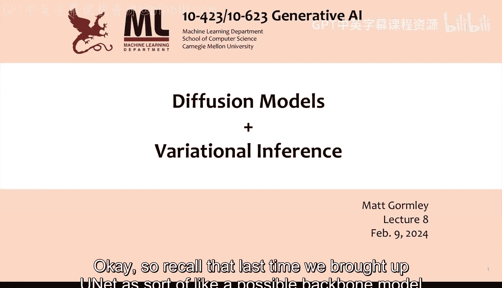

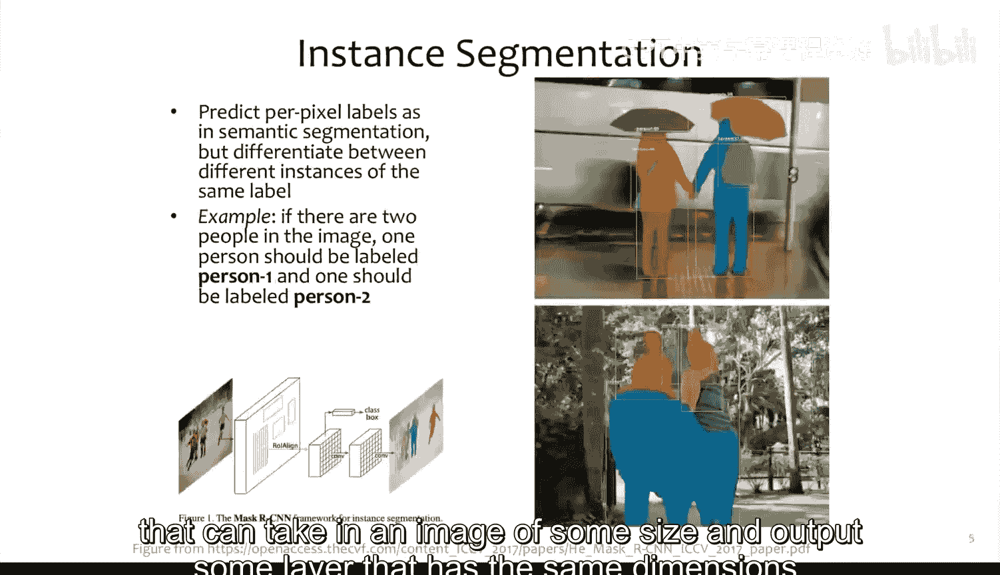

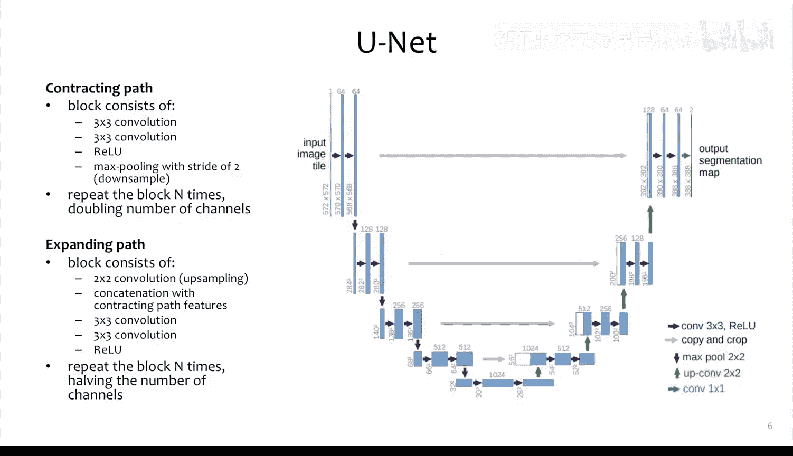

We also thought through unsupervised learning and said。

What we're trying to do here is basically learn a distribution P theta。

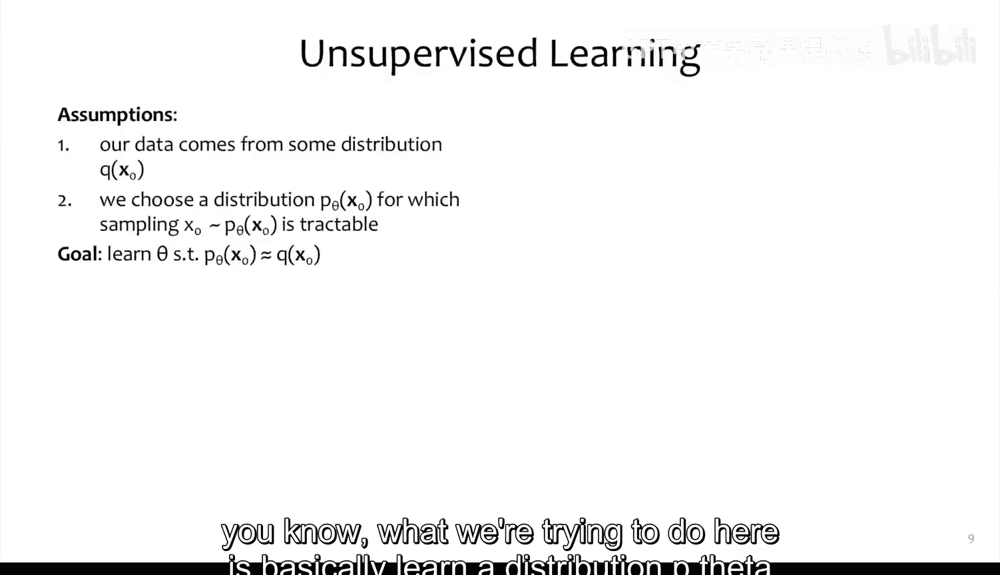

That is approximately equal to some Q distribution that is our data distribution。

 and so we could think of that as a distribution over text on the web and P theta as a language model we could think about as a distribution over images。

 real images and P theta as some generative model like we saw with GNs or like the one that we saw with diffusion and the interesting thing is that for language models。

 we found that if you choose autoregressive model often it is tractable to use a gradient-based optimizer to find the value of theta that maximizes the likelihood of the data examples that you observe。

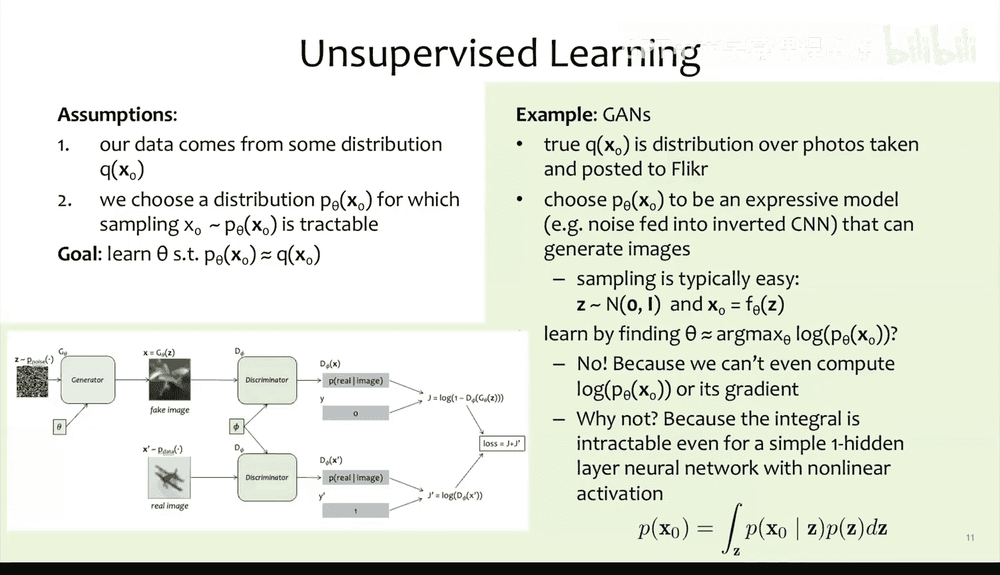

And yet even for simple architectures for image generation， like the ones that we saw for Gs。

 that wasn't necessarily tractable。

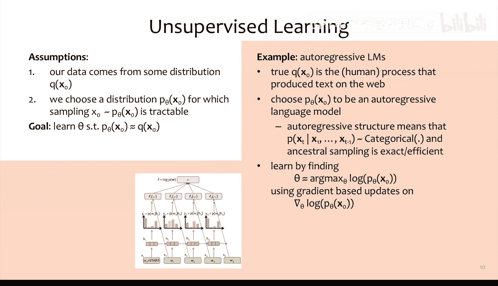

呃。And so。I guess actually as I'm saying this， there's actually a class of image generation models maybe we'll talk about them that actually I guess I did mention these before that are autoregressive image generators so party the party model that we saw like PR TI was a model that we saw last time where it was actually generating autoregressively a sequence of sort of image tokens。

 and so that would be a slightly different setup where you could actually at least for that part of the autoregressive model learn it directly。

 but these models that we're working with withganNs and diffusion we can't actually easily just take the Rmax of the log likelihood of the data。

😊。

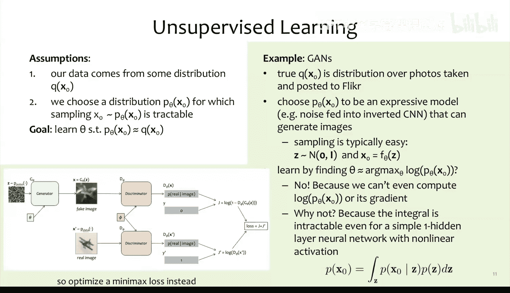

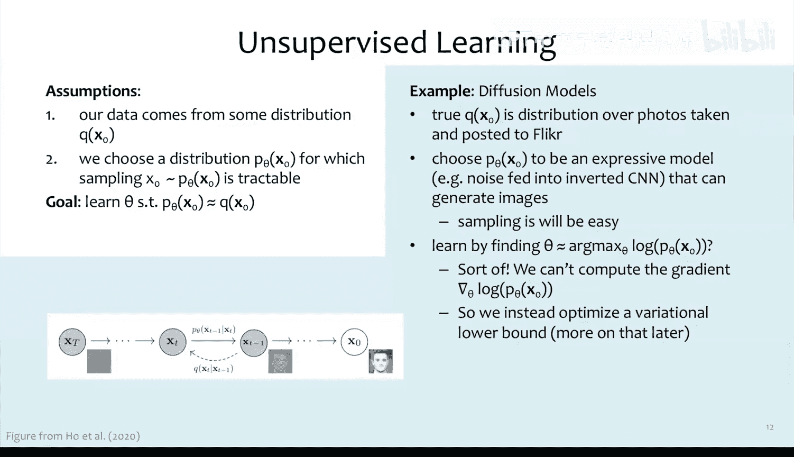

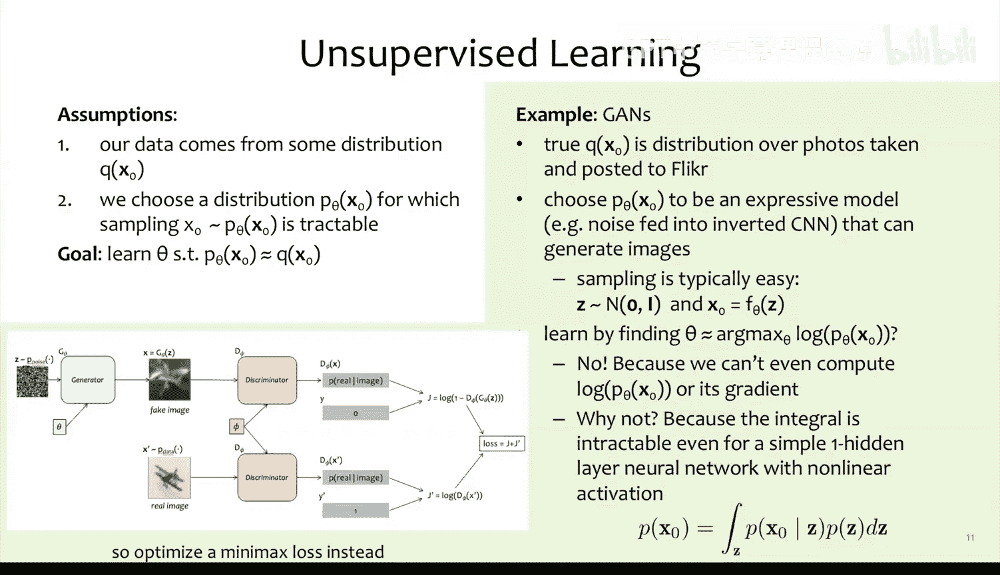

So。嗯。

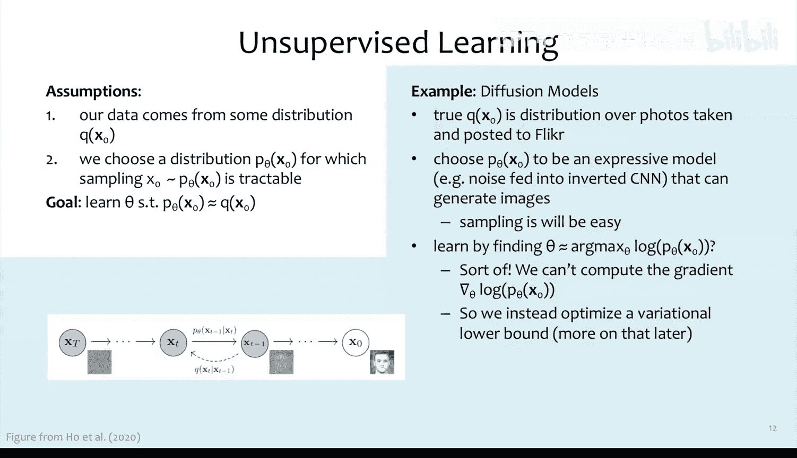

So for both GNs and diffusion models， we want to think about this idea that we're actually maximizing what's called a marginal likelihood when we have these latent variables。

 essentially what we're doing is we're maximizing P of x。

 which is integrating over some latent variable Z。And typically we have a form of P of x that involves z in this way。

So diffusion models then。Consist of a forward process and a reverse process。And。

And so here we're looking at。嗯。At the forward process in red。

And so you can see that we have these red arrows kind of signifying what the forward process is doing。

 and if you were to think about this as a Bayesian network。

I guess I kind of I broke it because I included this additional red arrow。

 so in a Bayesian directed graphical model we wouldn't include this additional red arrow。

 we would just have the red arrows besides that one and that would represent for us a directed graphical model over the variables x0 to Xt and you can see that we've written it down according to the directed graphical model distribution which is the probability of x0 given its parents which is no parents and then the probability of each Xt given its parent which is just xt minus1。

Okay， so。When we draw in these blue Arabs to signify the reverse process。

 you could also think of that again， in this case， excluding。

This extra arrow here as a directed graphical model but over the same variables going in the opposite direction right and it has a different set of conditional independence assumptions that give us this structure where we start with P of Xt given no parents。

 and then we have P of xt minus1 given Xt all the way down。😊，From capital T to one。Out sweet beach。

I it just laid up that at the end and we'll get some caution。

This is a great question how is capital T usually chosen so this is actually a big issue with diffusion models which is as we're going to see we're going to parameterize this distribution with something like UN some big neural network and it means that every time step that we want in the end if we want to sample a new image we're going to have to do it capital we're going to have to run that big neural network capital T times so if you if you were wondering when you were using that you know I forget we were using Dolly for image generation in order to generate images of narws and parrots and。

😊，Axolots， atroots anyway。The reason that that was taking so much time is because it was using a model that has a fairly large number a large number of capital T time steps but so in general。

 most of the high quality image generators are using of value of T that is large enough that you know you don't like that's in the tens or maybe sometimes even in the hundreds but so large enough that it can take a while but isn't too computationally expensive。

 there's been some work on how to like drive that number T down smaller so that you can work more efficiently with these。

Thank一。The just make sure that we to get people to something。

 so it might take a bit longer than how to staying in power。Yeah。

 so what we'll see later is that we can efficiently。

 I mean actually maybe we sort of already establish this。

 but we can efficiently jump from x0 to any value little T in the using the forward process。

 it's really just the reverse process that is expensive further during training we're actually just going to randomly sample one of the time steps and update our parameters for that time step and so really the only place where capital T has sort of great importance is in the final sampling step。

Good questions。So。What else to say here， so this exact reverse process。

This is the sort of thing that you would write down in a probability class not a machine learning class right what we've done here is we've taken the same distribution Q P and we've written using sort of a rearrangement of。

The actual variables。Okay。So。This is justifiable because of the structure of that directed graphical model we haven't spent a lot of time thinking about exactly why。

 but you could convince yourself that X t minus1 only needs to condition on。

Xt here and not also Xt plus1 and Xt plus2 and xt plus3。

 but suffice to say that this exact reverse process is what we were saying requires inference right to actually compute this thing requires you to do integration over these terms。

From the original distribution and and it's exactly those sorts of。呃。

This sort of integration that can be very expensive。And so。Okay。

 so and that intractability comes from the fact that to compute this。

 we actually need to involve Q of x0 in that computation。Okay， so。So by way of reminder。

 the forward process is taking X0， it's adding noise。

 and if we could just sample from Q of X0 we'd be done。

 the reverse process is removing noise and the goal is to learn this one。

Okay and then further when we're done， what we're going to have is a model that can use P theta to start from some random value of xt。

 which is just Gaussian random noise and then over time steps little t so this is time step capital t for four different this is like a batch of size four and this is time step t minus1 and t minus2 all the way down to。

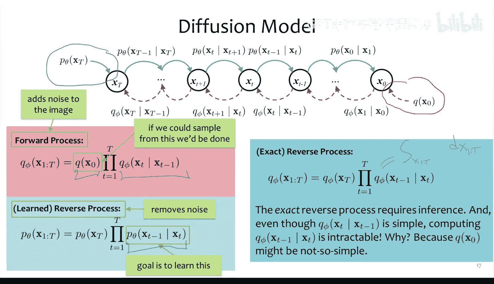

1 and zero and so here at the end we're actually seeing images emerge that in this case are looking kind of like the classes of images that appear in CFR 10。

Yeah。That。We haven't really said， but they're going to be the parameters of a UN model。

So it's a lot of parameters。And exactly how we use that unit model。

 we kind of just barely touched on it in like the last five minutes。

 but I'm going to completely rehash all that。い。you always do this is a great question so we haven't said anything about conditioning so you'll remember that forgans at the end we said oh you could also condition on some class and then you could do class conditional generation so all of these things you can you can also do with diffusion models we're not going to get to those here today but you can do things like class conditional generation in painting you know image editing and all sorts of fun things like that。

And essentially， you can imagine how that might work。

 which is you're going to have some additional side information that P Theta is able to condition on。

😊，Okay， so the two things we had these kind of like Q&A that came up last time as well。

 so we said you know if Q theta is just adding noise。

 how can p theta be interesting at all and we said well because P theta also has to learn something about Q of x0 the data distribution and then we also asked well if these individual conditionals the xt minus1 given xt or Gaussian。

 how can we learn something such that p theta。

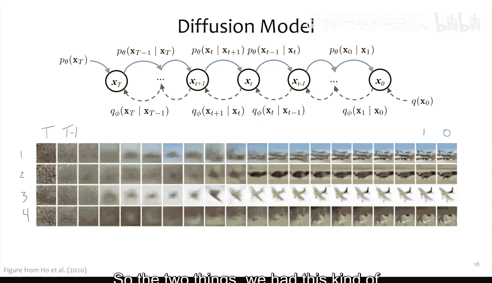

This is a marginal distribution of just x0 is equal toq of x0， won't this be Gaussian2？And in fact。

 the diffusion model， we said is for appropriately chosen time Spti can capture any smooth target distribution。

And。

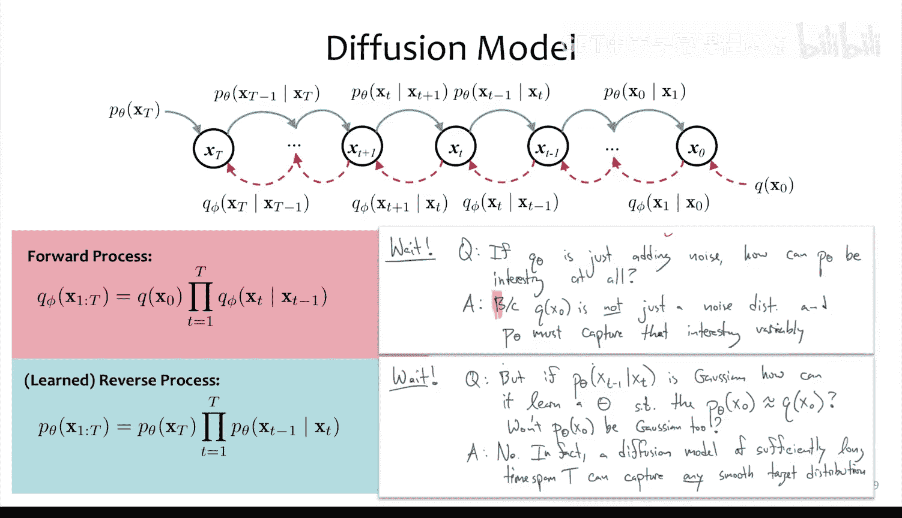

And then we also thought about a diffusion model analogy， this was what I forget when my prompt was。

 we still think about like a cat Jackson Polock style。

 this is actually like way more detailed than I think Jackson Polock would ever put in his paintings but oh well the model tried so。

Okay， so then we defined the reverse process in terms of Gaussians right and this is what gives us the DDPM model。

 the denoizing diffusion probabilistic model where we said， okay， this is our data distribution。

 but Q Phi is now going to be defined as a Gaussian distribution that takes the previous。Image。

As the mean。Times sum scalar square root of alpha t。With variance that is isotropic。

 meaning it's just a scalar times an identity matrix。

Okay and so similarly our learned reverse process is also going to be Gaussian right we're going to have the distribution over x capital t just be01 Gaussian。

 but then this distribution is actually going to have a model capable of giving us the mean and possibly a model capable of giving us the variance。

😊，Okay， so and then we'll choose alpha T to follow some fixed schedule such that Q phi's distribution over Xt is also01 Gaussian。

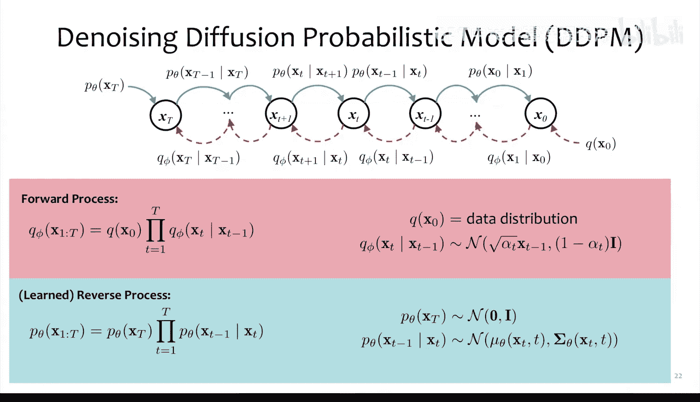

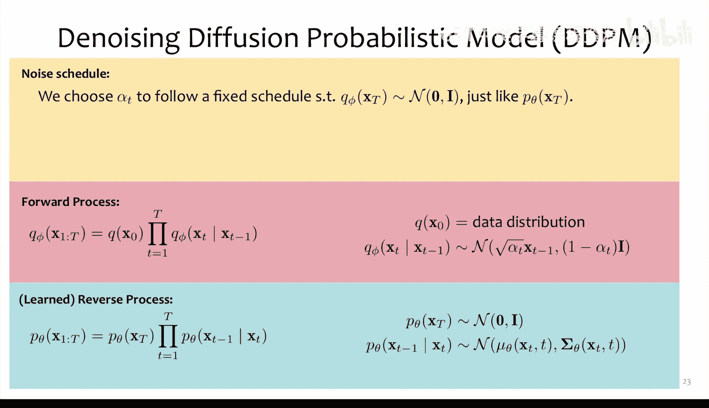

And then we had a couple of important facts about Gaussians， some of two Gaussians， it's Gaussians。

 difference of two Gaussians it Gaussian Gaussian with a Gaussian mean has a Gaussian conditional。

 this was the interesting one where we said Z is a Gaussian where muzi is equal to X。😊。

And this implies that P of Z given x is Gaussian， but then we said， oh。

 but if you put a function like a nonlinearar function around x。

 now this implication doesn't hold any anymore， and this is actually what kind of makes these models interesting is we're not just in the reverse process。

 we're not just getting back some Gaussian distribution here。

 right we're conditioning on the previous image， but we're passing it through a nonlinearar function before passing it to the Gaussian。

😊。

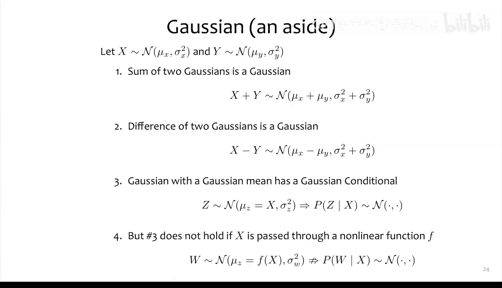

And that is what essentially allows us to learn an interesting distribution。

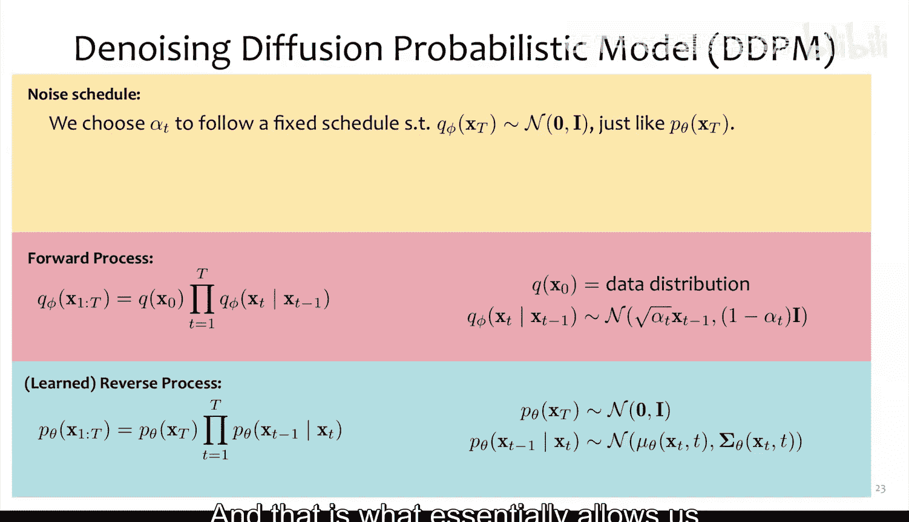

Okay， so some properties of the forward and exact so this is let me be very very careful here。

 so these are properties of the forward process and of the exact reverse process okay so we're only concerned with Q here。

😊。

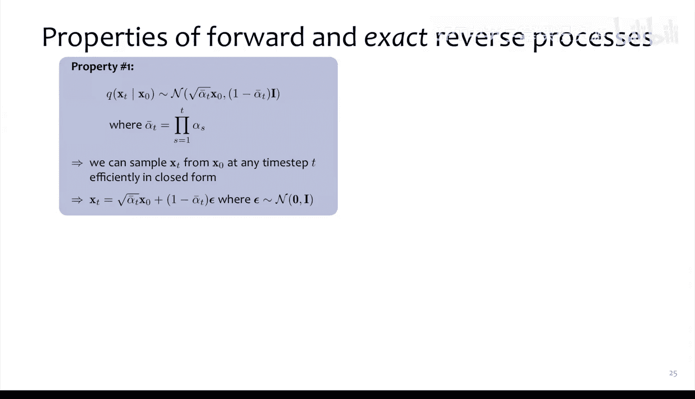

Here's property number one。So we said last time that Q of xt given x0 is going to follow this distribution。

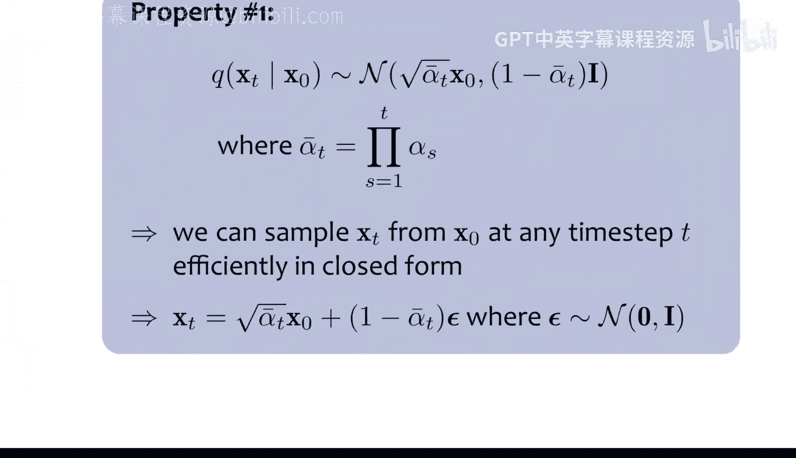

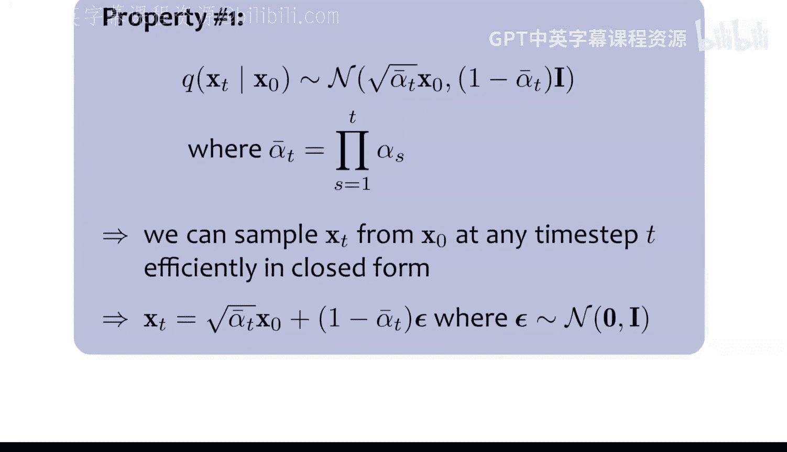

Which is square root of bar alpha t times x0。Times an isotropic variant with an isotropic variance。

 so where bar alpha t is just the product of all the alphas up to time step T。

And what's fascinating about this for us is it means that we can directly work with Xt if we have an x0。

 we can just sample Gaussian noise epsilon。Multiply by the variance and add the mean and then we get back an Xt right away in one step。

Okay。Okay， so then。

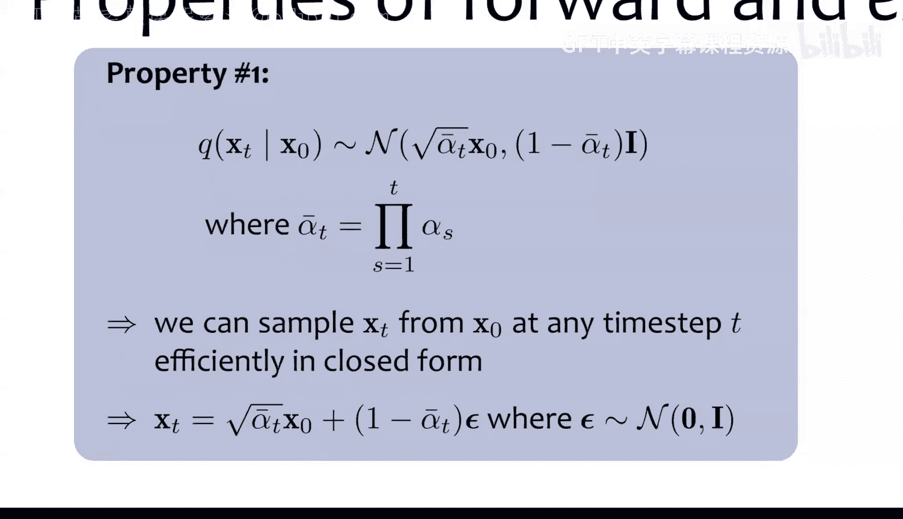

Oh， and then once we know what alpha bar t is， we saw that。

ThatBecause of the choice of cosine or linear schedule。

 the distribution over the final time step x capital T under Q would also be Gaussian0 pi。Okay。

 property number two， so this we said that estimating。

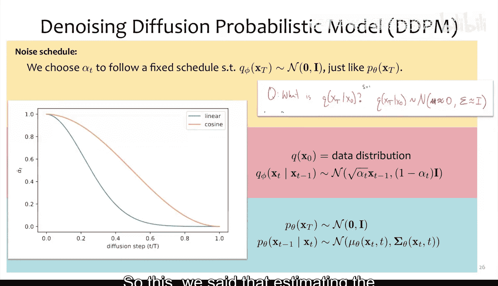

嗯。The exact reverse process conditional。So this is Q of Xt minus1 given xt。

 so this is the distribution that goes from a noisier image to a less noisy image。Is intractable。

 but。If we condition on x0， we can efficiently work with it。And it's going to be another Gaussian。

That has some nice properties。Number one。Because of our isotroppic。Gussian in the forward process。

 we get that the variance here is just a scalar times I。

And that particular scalar is shown here at the bottom。Okay， so this is the。嗯。

The one piece of the puzzle。And then。The mean of the Gaussian。Is actually a little more complicated。

So it is here。And。You can actually see that it's a function of our schedule， our alphas。

But it's really just。W。This is a loaded word in this class， a linear combination of x0 and Xt。😊，Okay。

 so it's a scalar times x0 plus another scalar times Xt。

And that is going to be the actual mean of the distribution over xt minus1。Okay。

 and then just as a shorthand， we're going to denote。This。Big constant here。

As alpha t with a superscript zero and this big constant here is alpha T with a superscript T。Okay。

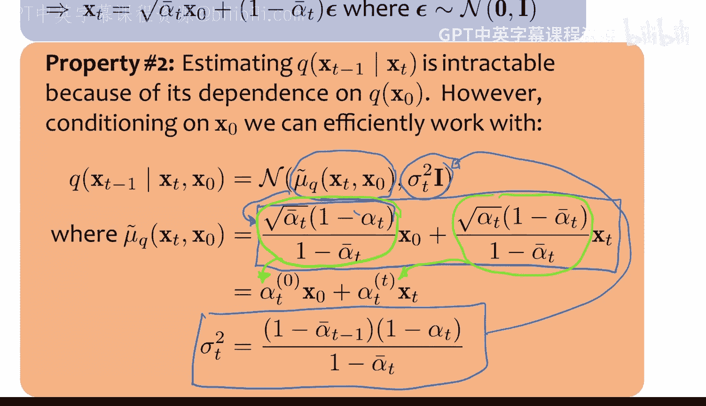

So now we want to think about how could we parameterize the learned reverse process？

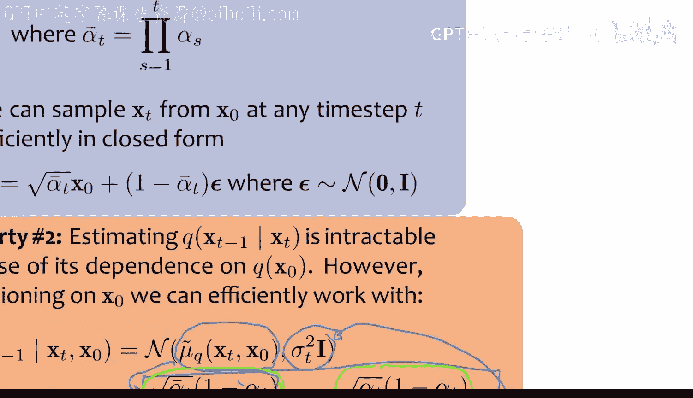

Okay。So remember， the reverse process is really based on these little conditional distributions and we said they're going to have a learnable mean and a learnable variance that's based on the current Xt and the current value of little T。

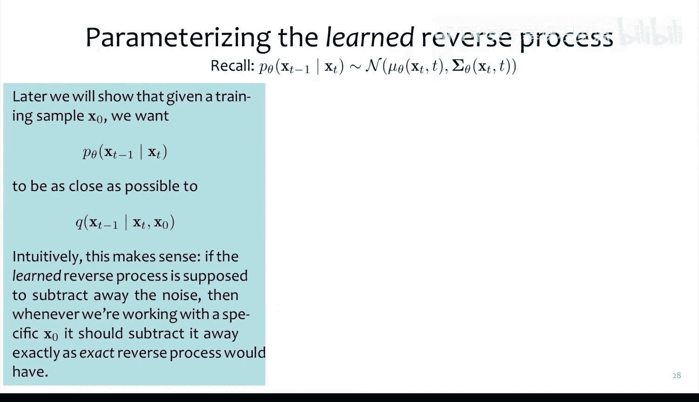

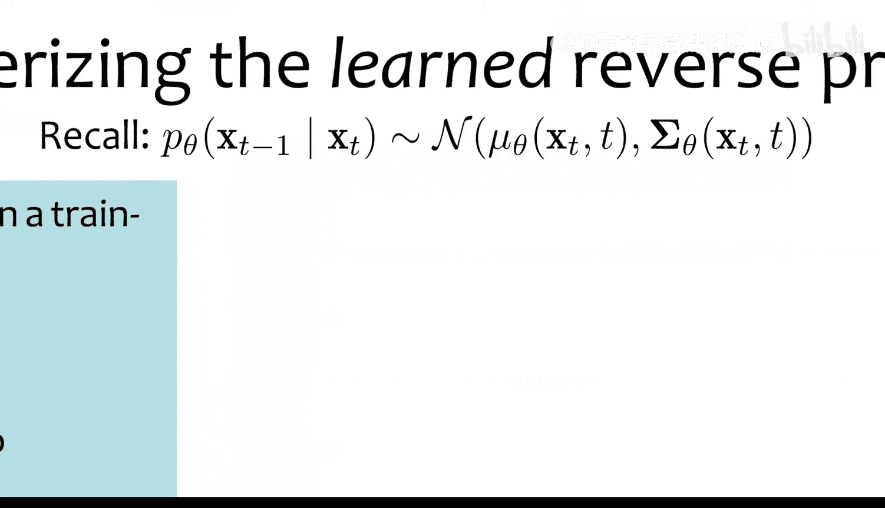

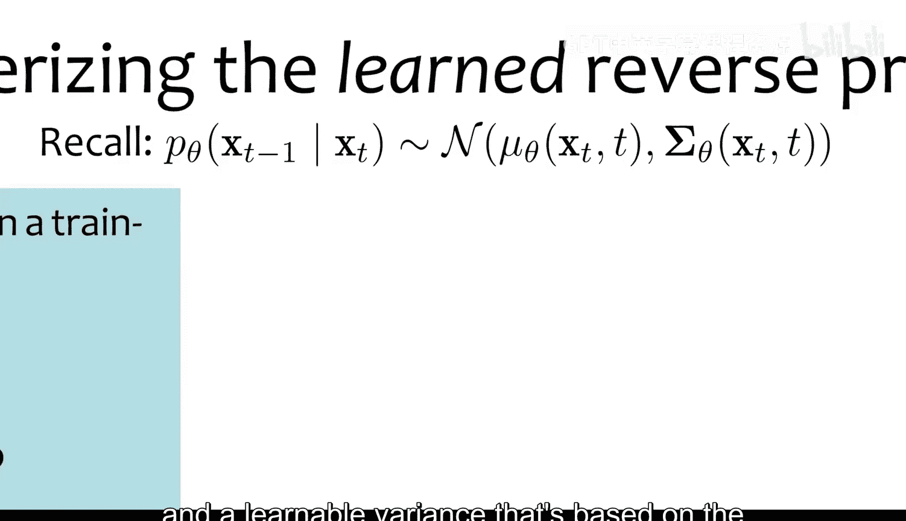

And what we're going to do later is we're going to say， well， given a training sample like zero。😡。

What we want is for。This p theta of xt minus1 given xt to be as close as possible to the exact reverse conditional where we condition also on x0。

And intuitively this kind of makes sense， right if the learned reverse process is supposed to subtract away the noise。

 then whenever we're working with a specific x0， it should subtract the learned one should learn should subtract away sort of exactly as the exact reverse process would have。

😊，O。So here are our two big ideas。Idea number one。Is rather than learn sigma theta。

Just use what we know about the exact reverse process， namely。

It has this form with a sigma squared T variance。So let's just set。Our capital sigma theta。

To return sigma squared t times I。Okay。Just out of curiosity。

 how many of you have ever heard of the term moment matching， does that ever come up in？

Like one person Okay， yeah well I won't what we're doing I might as well mention what that in machine learning。

 we often talk about moment matching the first moment of a distribution is the mean the second moment is the variance the third moment is something else whose name I don't remember。

 but maybe you can tell me later and the idea is that if you were to match between two distributions all of the moment。

😊，Then you would have identical distributions。Okay， so what we're going to try to do here。

 if we want these things to be close is we're going to try to match。The first moment。

 which is the mean and the second moment， which is the variance。

And that would make sure that at least to some extent， these distributions are close。Okay。

 so big idea number two is let's choose this learned mu theta。

 which you could think of as like a neural network。To be based on the exact reverse process。

 So we want mu theta to be close to。Youil the queue。But look at how different they are。

What's the big difference between these？Yeah。X0 X0， right？

U told the cube gets to see the actual image itself， the clear image。But new theta does not。

All it gets is XT and how far or how many steps of noise had been added。Okay。

 so the idea is let's learn a network that approximates mutilde to Q just by looking at xt and little T okay and so idea number one is set mu theta。

😊，Which is a function of Xt X and T to just feed these into UN。

So there's a little bit of a technical detail here。

 I actually tried to like go back and look at the original code for DDPM to figure this out。

 there's a question of how do you get T into UN。😊，Right。So unit， it takes in an image， right？

But it didn't say anything about taking as input like an additional integer。

So it turns out that they seem to be doing something where they take that integer T and they have a learned embedding。

For the time step T。And they're kind of including that in， maybe by addition。

 I wasn't entirely clear in with the image Xt and then feeding that whole thing into UNt and the idea is that now UNt is aware of how many time steps have gone by。

😊，Okay， so the idea then would be that。呃。We could。We can。Learn some parameters theta。So that。Oops。

 what was option B so that this mu theta will be as close to uildaq as possible？Okay， so。

Maybe I should actually。Let me just do this right now， okay， so what this could look like。

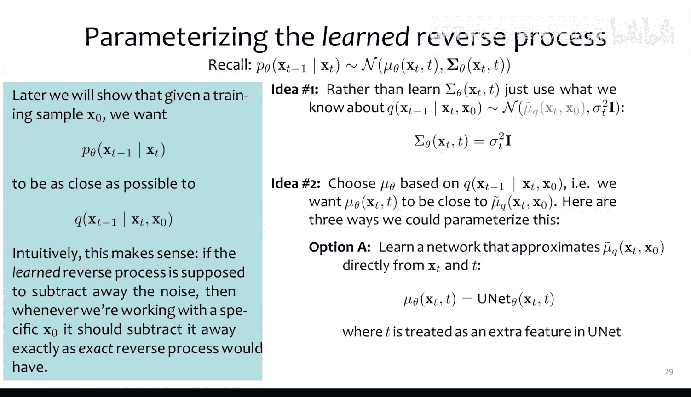

Is something like this？So we could say， let's initialize theta。

And then we're going to have some number of epochs of training capital E。

 and then for each x0 in our data set， D。We're going to take a gradient step。RightOkay。

 so how do we get the gradient that we're stepping with so we're going to say there's an error here。

So we're going to loop through T from1 to capital T。And。

And then we're going to sample some variance epsilon。And we'll use that epsilon to construct our Xt。

 right and we can do that with the forward process immediately。One step， we just construct Xt。

And then。We could actually construct。Sort of what we think。Youil the Q。With。Oh no， actually。

 this is an exact construction， so we can construct exactly what mutilda Q is。

Because it's a function of x0 and xt with some complicated constants。Based on our alpha schedule。

Okay， and then this is the big idea we're just going to。Have as our loss function。

The mean squared error between the real muttilde cube。And。R mu theta， the output of UnN。Yeah。

So we take a lot of x zeros right but obviously new data doesn't know what x zero is so doest mean that you like work really hard to have like an even data set because if you see pictures of B then it makes sense that we probably learned don output3。

Absolutely right so so in your homework one of the great challenges that your TAs through great effort overcame was we needed to figure out how on Earth could we take a model like diffusion。

 which is typically trained on you know， like eight V100 GPs for about a week。😊。

And get it to work for you in about 10 minutes on a free crappy collabab GPU。

And so one of the great tricks that they realized was by only giving the model images of cats。

 it learns to do a pretty good job of generating images of cats。😊，So。What that means then is that。

The distribution over images that it's learning is actually kind of narrow right like the cat images are they're all like close up shots of cats faces and so I think that made it actually a lot easier for the model to learn those parameters theta so that it could it could do this quickly in practice the models that that are generating like high quality images are getting a real diversity of images and and。

But we do know， for example， that the internet has an unusually high percentage of images that are cats。

And so I would expect that the Q of x0 distribution from the internet has a high probability of generating a cat and so if you just use that distribution。

 then P Theta is also going to have high probability of generating cats。😊，Yeah。

Within sort of how do you try and get like imsion behavior in the sense that how do you make how do you make it good at generating something that I start see right。

 so I think that。That。ThatMaybe there's two things so one is that a lot of like the really interesting images that I think come out of these models tend to be conditioned on something and we'll think about how to like condition on say a text prompt later in the course but。

I would say that you know this is sort of one of the interesting aspects of the latent variables of the model right we're saying that essentially if you have some latent variable that represents properties of your image in essentially like a low dimensional space as you move through that low dimensional space right you know one from one point to another。

You're essentially like at any given point there's actually a probability of a distribution over all possible output images right it's not that like from a given latent variable position that there's only some images that have。

High probability like that have nonzero probability we're saying that it literally because of the Gaussian involved here is giving a distribution over all possible images and so I think what's happening and what appears emergence or something like that or what appears creative is really just like that there is this that this model is learning that there's there's like a spectrum of things between this data point X0 and its training set and that data point and its training set and it's learning to to come up with。

A distribution P theta such that the things in between those also。

Seem to be maybe realistic some to our eyes anyway。And I think that's kind of what's happening here。

Do you have another。batch process absolutely absolutely yes so so this step。呃。In practice。呃。Yeah。

 this is thated。And so。You can actually sort of think about how how that might work actually let's go to the next slide and then think about batch so here's the next slide you'll see what I did is I got rid of for t and one to capital t that's because this is not actually how people train these here's how people actually train these models。

You take your data sample and then you randomly pick a value of T。Little T from one to capital T。

Okay， so you're along that spectrum of， you know， if you think back to the kindergartner analogy。

 right where we have 25 different versions of the image， it's like you're picking one of those steps。

And now what you're trying to do is you're saying， okay。

 I'm going to get my epsilon so that I can immediately construct Xt。

And then I'm going to construct the muq， which is the actual mean that the exact reverse process would use to sample Xt minus1。

Okay。And I'm going to update my parameters theta now。

So that the mean that would be used by P theta to construct xt minus1 is going to be close to whatever the exact process would have used。

So here。😊，If we think about batching。嗯。Then the sort of interesting thing is I guess that we can actually probably sort of batch the generation of noise right so you could parallelze your generation of these noise images this is just some matrix addition and scalar multiplication。

 this is just some more uninteresting like scalar multiplication and addition of matrices and then this is just some very simple loss。

So this is very much like in the realm of what is easily batchable and maybe the most like interesting part of the combination computation is all happening right here in mu theta。

跟 you。secondWould you elaborate bit more about？Yeah， so we said that mu cute Tilde here。

Is let's go way back to。

Property numbers。2。

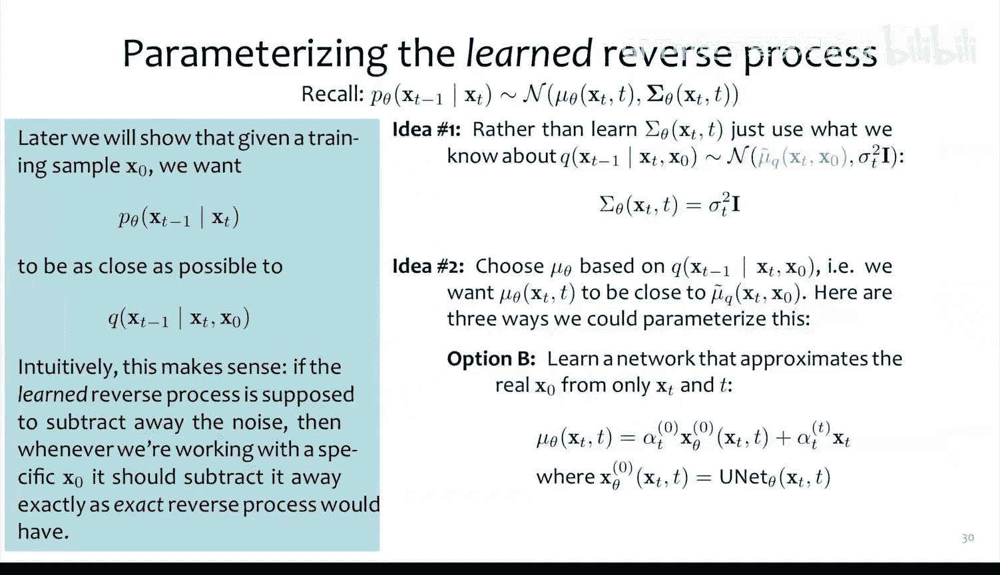

So we said that mu Q Tiledde。Please。

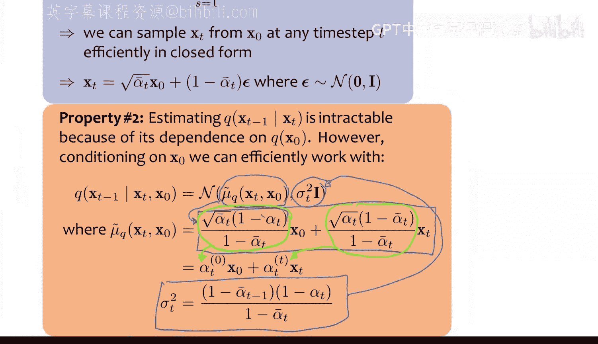

So we can exactly reason about this distribution。And。

Because we've constructed Q to be such a simple distribution。

And what we find is that this distribution。Is。Parameterterized by a mean and a variance and the variance is very simple。

 it's just the scale。The mean。嗯。Works out to be a scalar times x0 plus another scalar times xt。Okay。

 and so what this distribution is telling us is if you know x0 and you know xt。

There is a specific distribution。Over xt minus1， which is the image with a little bit of noise removed。

And so what we're doing in training is we're saying， well。

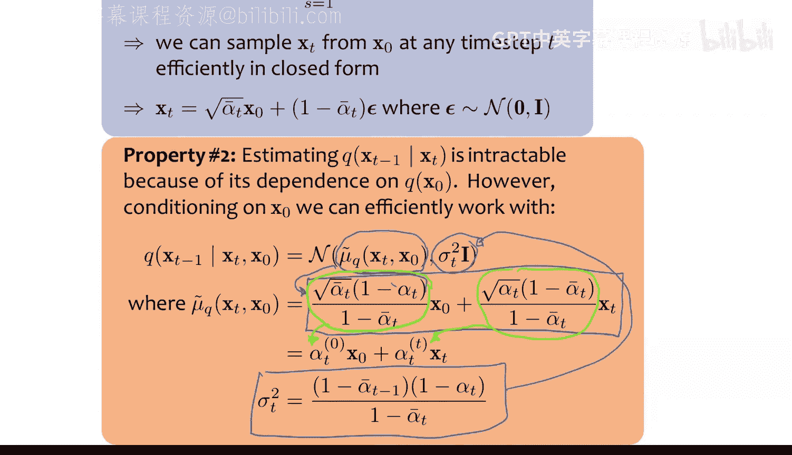

In fact。

We can exactly construct。And Xt for this x0， right？Or we can exactly sample NxT for this。

 there's many different possible ones， this is the one that we got。

And for this particular XT that we sampled。😊，There is exactly one mean of the distribution。2。That。

That we construct。Like so。And now we're trying to get the first moment of our distribution P Theta to match on that first moment。

Okay， so I bypassed。Two interesting other options for idea number two so here we said you can learn to directly predict mu theta well option B here would be you can also。

You could instead， you could say， let's learn a network that approximates the real x0 from only Xt andt。

 right？Why would this make sense？Let's go back to。To this definition。

 so we said that this uilda Q is constant times x0 plus constant times x t。

So what if we know when we know Xt， what if we just learned to estimate x0 and then reconstructed。

A mu from that estimate of x0。

Okay， so that's what option should be is saying it's saying， okay， let's try to build up。

This new theta。By taking these constants because we know what they are and taking XT because we know what it is。

And let's only learn to generate x0。Okay， so now this is just getting notationally like comical。

 I needed some way of denoting that this is like a function so we have theta in the subscript。

 the superscript zero is just denoting this is trying to reconstruct X0。

And it takes as parameters xt and little T just like before。Okay。But we could go one step further。

Because if you look very carefully at this mu。

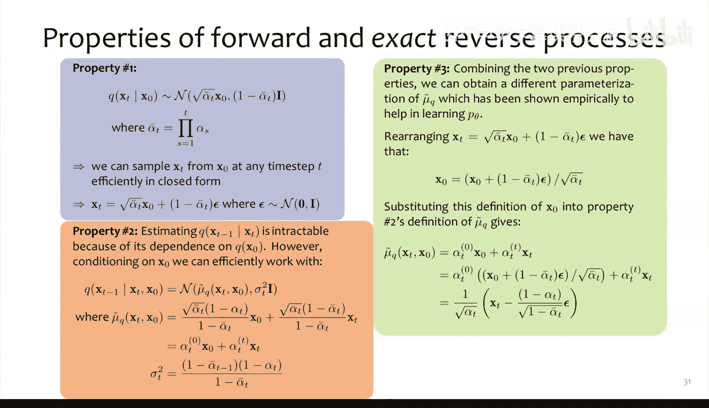

They get property fee。Okay， so we can combine the two previous properties to obtain a yet different parameterization of mute tilde Q。

😊。

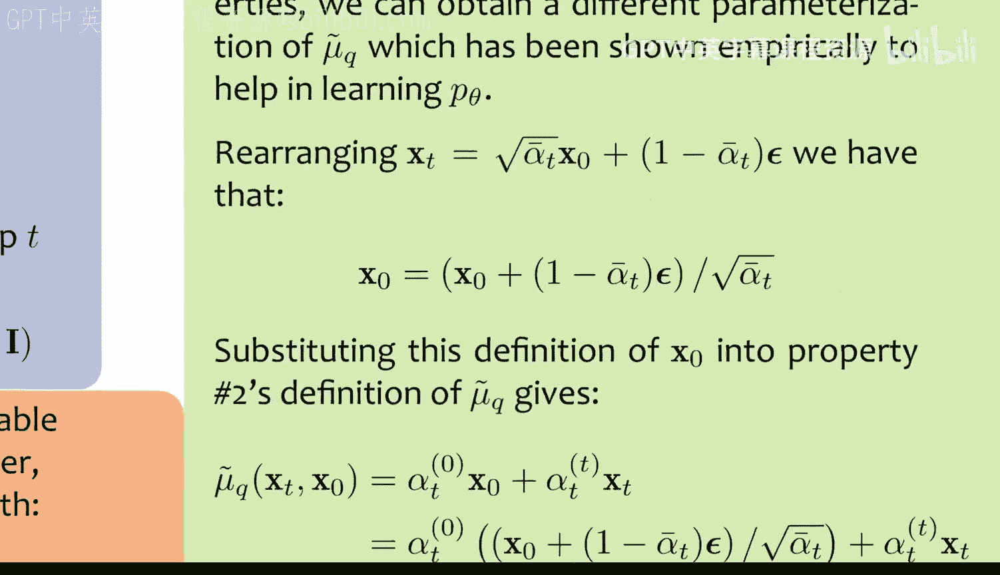

Okay。嗯。And。Okay， so here's what we're going to do so X T is this function of x0 and depthpsil， right？

So we can rearrange that equation to write x0 in terms of。Oh， that's egg though of X。

Make sure that's very clear。This is X。And epsilon。Okay。And。Okay， so what that means for us。

Is that and I have that scene typo right here。Sorry， I'll try to fix that later。So完。

So here we have a new definition of x0 that we can compute directly from Xt and epsilon if we know the epsilon that gave rise to Xt。

Okay， so remember， there's many different Xts for a given x0 for a particular Xt， though。

 if you know the epsilon that created it like exactly which noise was added。

 then you could just subtract that noise away。😊，That's what we're saying。

If we substitute in that definition of x0 to this equation， this is our definition of utida Q。

So take that and slot it in for x0 here。Then we get back。

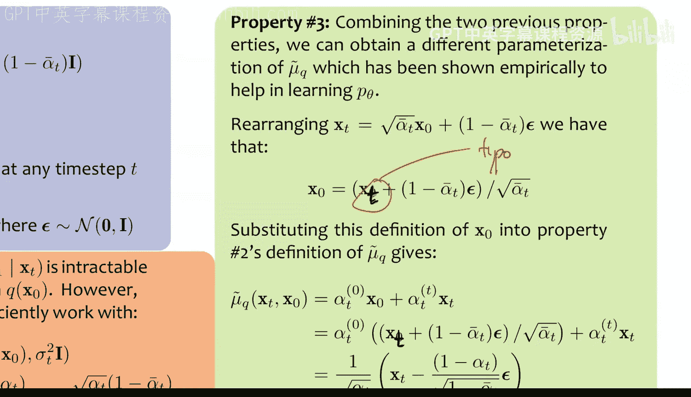

So this is just a new。Term。Then， and then if we do some sort of algebraic manipulation that I'm not going to bother stepping through。

 we get back this simpler definition well not simpler。

 it's maybe a more complicated definition of mut til the Q。😊。

Which is one over square root alpha t times xt minus some other constant times epsilon。Okay。

 so if you know the epsilon that created that Xt， then you can write down utilde Q in terms of Xt and epsilon。

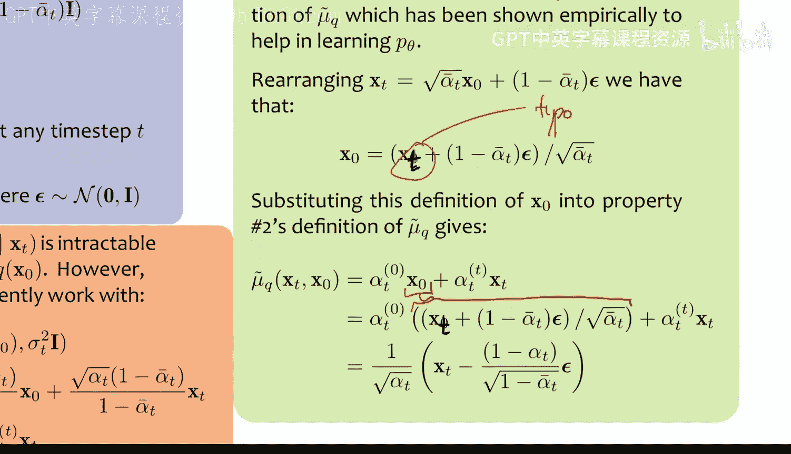

喂。😊，Okay。Optten C。

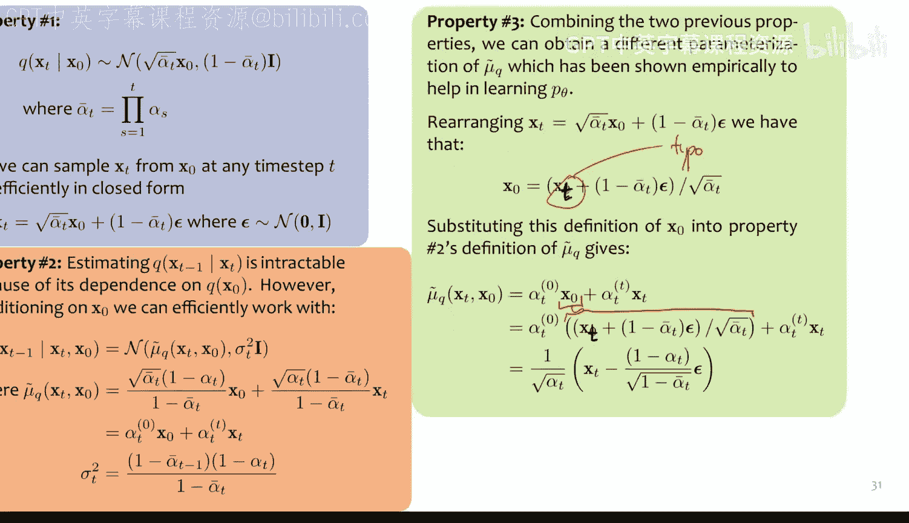

Option C says。Why don't we learn a network？That approximates the epsilon。

That gave rise to xt from x0 in the forward process。Okay， so。Here's our mu theta， just like option B。

Where we're going to construct our x0。But we're not going to construct our x0 from unitNe。

We're going to construct our x0 since the sametypo a third time。Sorry。

We're going to construct our x0 using Xt this constant。And epsilon theta。

 which is parameterized by unit。Okay， so now。It turns out now we have three different options for training right so option a was if you want to train。

You theta network to match the first moment option B would be if you wanted to train。

An x0 unit that learns to predict x0。Okay， and option C would be if you wanted to learn a unit that tries to predict epsilon from XT。

And。嗯。The interesting bit here is that。It's this third option predicting this epsilon that seems to work best empirically。

😊，Does anyone have any thoughts on why that might be the case？Yeah。还有好的。That。

Yeah that's true we do know that the noise comes from a Gaussian distribution。

 what could be another benefit of option C？I as as possible and getting closer to the meeting and just putting them to spouse you can exactly right。

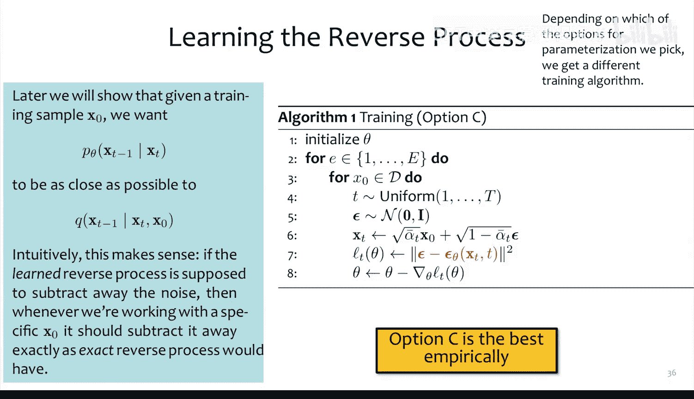

Property three here， we worked really hard to get down to like sort of using as much knowledge as we could about the Gaussian construction。

Or the Gaussian nature of muttiildaQ， we were able to get this representation out。

And so we're kind of using all of that information that we have about this distribution to kind of keep pulling away little parts and making sure that we keep as much information as possible。

 such that in option C， you know we're constructing the mean using these particular parameters and Xt and we're constructing X0 using this particular parameterization that we know is correct if the noise is correct and only then are we going to learn that one variable。

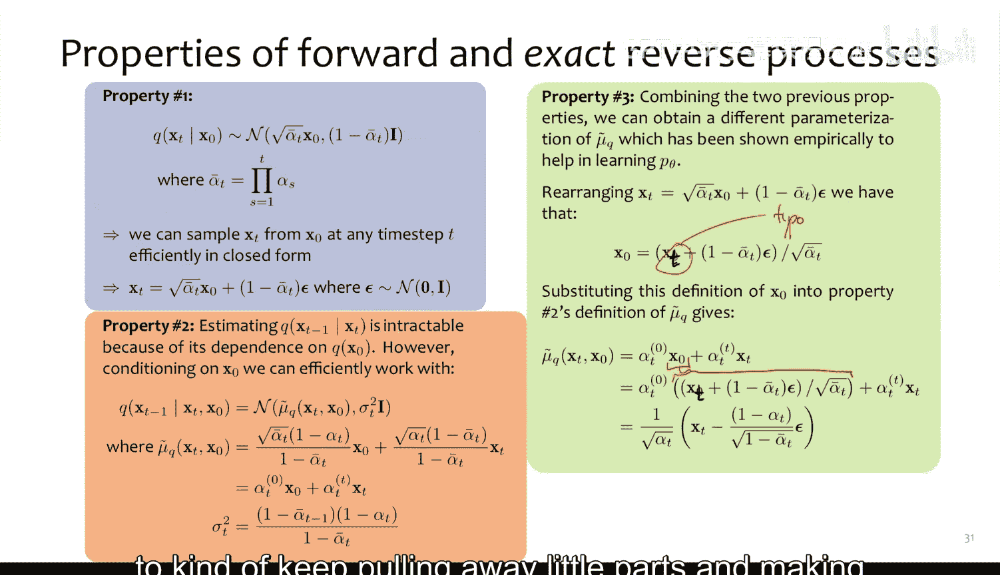

So I think that's probably why option C works best in practice。

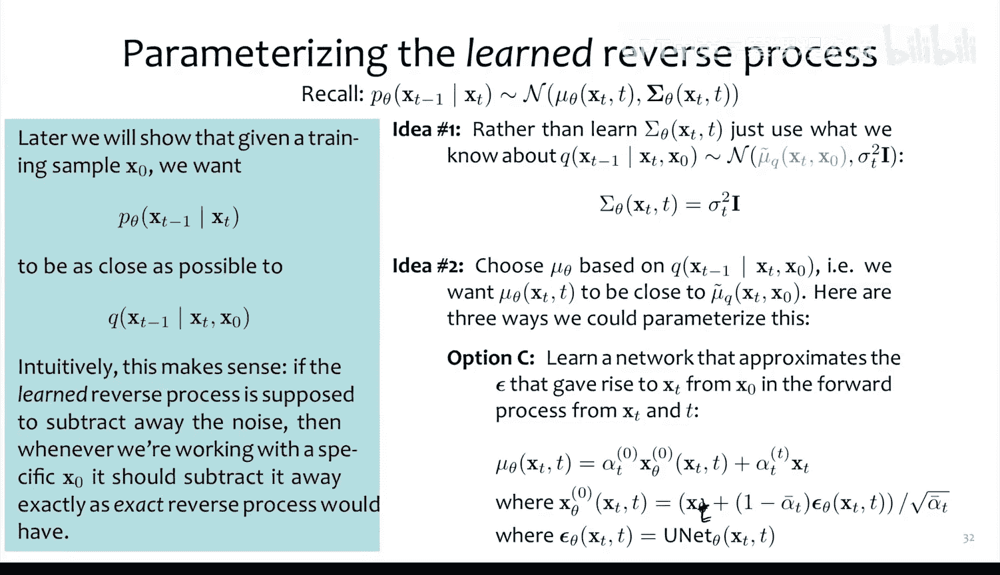

Sorry， could you just go through once again which what each of the like just the I don't know。

 be back on the on the final equation， what what each thing is learning like versus epsilon versus learning the new versus learning？

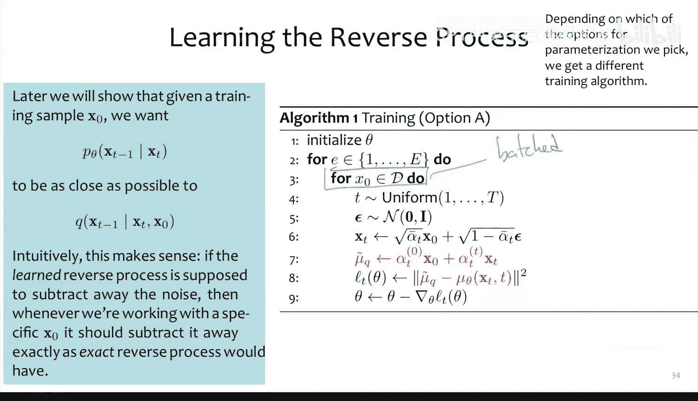

Yeah， so option A。We learn to approximate mutil the cube directly。

Just learn a unit that just tries to predict it immediately。Opttion B， learn。

A unit that tries to predict x0， which we'll use to construct utility Q。And option C is learn。

A unit that predicts epsilon， which we'll use to construct x0。

 which we'll use to construct and maybe get tilled to Q。Ok。So in some sense。

Maybe I'll leave this as an exercise where you could draw out sort of a computation graph representing like。

 you know what all the pieces of the bed now let's just do this and we'll just take a second。

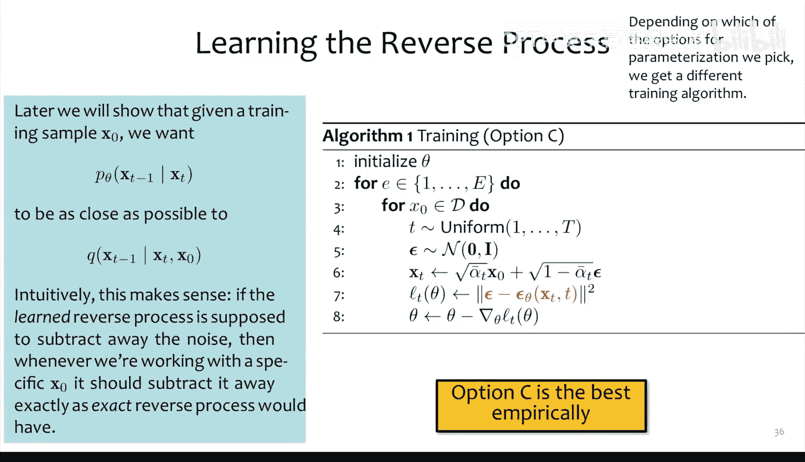

What if we wanted to draw a computation graph here？We're going to sample some epsilon。

And that is going to be。Our noise distribution。Our noise image。We're also going to have some x0。

That with high probability is an image of a cap。I don't know what a cat looks like something like this。

And。And then。In let's think about option C here， the computation graph that we're we're working towards is going to。

嗯。Let's see， so we're going to use epsilon and x0。To together。

Let's say through some function F construct R Xt， right？So this Xt is sort of。

It's the image of the cat。But with some amount of noise。

Over top of it right and this F also involves。Our schedule。Pgrammeter alpha 1 to T。嗯。

But this is a direct computation。And then what we're going to do is we're going to have our unit model。

So you Nick。Taste as input。Xt， but and I guess there's one more sort of almost silly parameter here。

 which is the integer T。And unit takes Xt and it also takes T。And it outputs。

Some estimate of our noise。Which is what we're calling。Epsilon theta of X T and T。是。And then finally。

To compute our loss function， we take。A real epsonk。And。Our epsilon theta。And。

We feed that into a mean squared error loss。To get。LT of theta。

And I guess the missing picture missing detail here is just。

Our parameters theta are also going into unit。嗯。So this is what we're back propagating through。

To actually learn this yeah。嗯。Again， this is their train time。

Is T like always formally sampled in all the three methods to show。

 so like any case one allTs hurt similar。Yeah， so here for the way that I'm drawing this。

 we're assuming that this is sampled uniformly。So if you wanted to。

 you could imagine like I don't know using some sort of plate notation or I don't know。

 you could use all the Ts from one up to capital T to construct a loss over all of them， but yep。

Keepick why like。啊。It's been new training。I guess for each example， you don't scale it 1。Yes。

Oh great question yeah， so why why would we use just one T instead of all the Ts for a single image does anybody have any ideas of why we would do that？

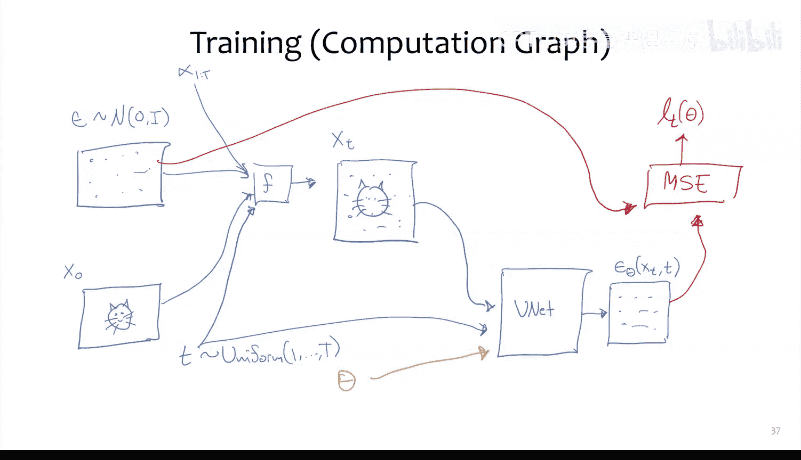

Yeah。I imagine it's sort of for the same reason that we randomized the ordering of our data set every time that'll we running through。

And that it's possible that because those are all going to be correlated。

 I would we would be training the network too much in。One direction。For time set。Exactly right。

So the gradients for。Any x0。Across different Ts。嗯。Are correlated。And so。

By picking just one in like a stochastic gradient sense， we're kind of getting more。

 we're bringing in more diversity to our the gradients that we're actually looking at more quickly。

Are all of the Ts uniformly important？Because it sort of' would have been my assumption that maybe。

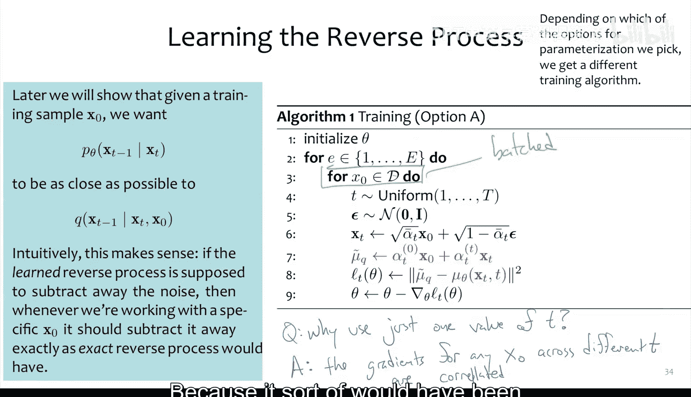

Well， that's a good question， you would want to skew it towards being better at the end of of the reverse process or something。

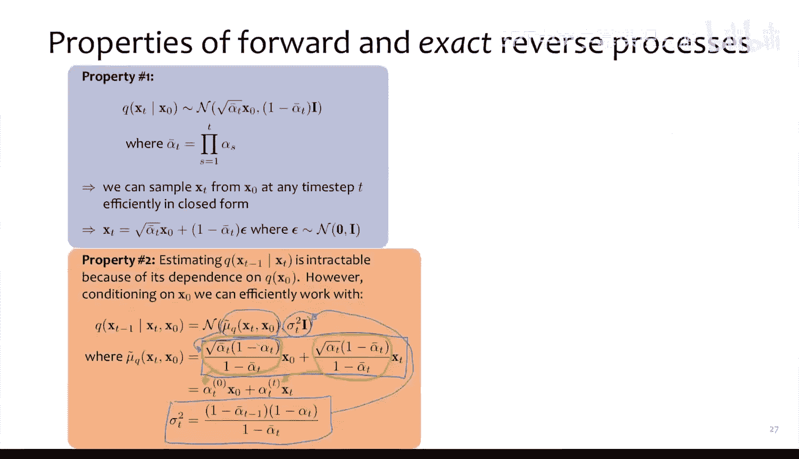

Yeah， so so this is actually from a 2021 paper that came out after DDPM and what they what they observed was that the actual schedule the linear schedule that was used by。

呃。By the original paper， this linear thing， it was simple。

 but it meant that when you computed alpha barti， which is what this what this is plotting。

 it ended up like。Basically saturating with too much noise very early on in the forward process。

 so like most of the image was already gone by the time you got halfway through。

And so their switch to this cosine schedule was actually in order to make it so that the addition of noise was a little more even across the passage of time。

呃有。

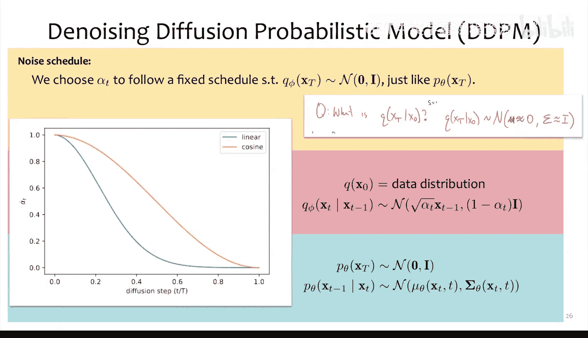

And that was like an empirical finding more than a theoretical one Okay， so what about yep？

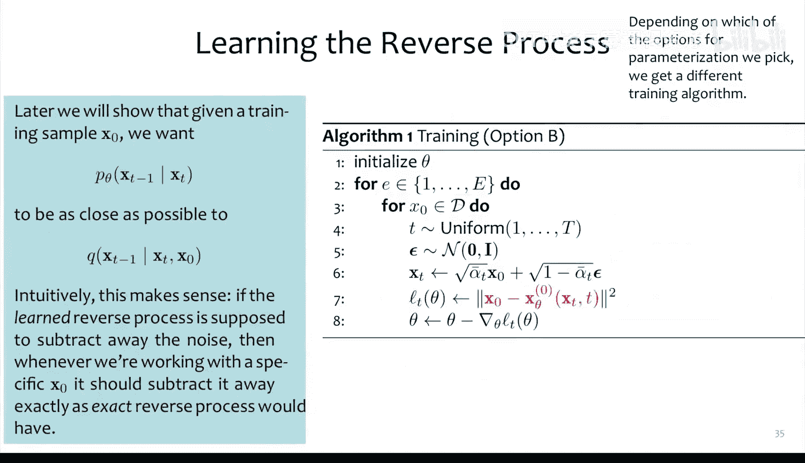

啊，是的。哦。Comit or notes。And also input the original definition as well capital。

So remember that this epsilon up here in the corner。

Is the this epsilon is the epsilon that we used to construct Xt。Yes。Yeah okay， that just。不要。

So that's why we're trying to match these two。Exactly。Okay， so at the end of this。

 you've learned your diffusion model and now you actually want to sample from the reverse process and sometimes maybe I should have had this slide first。

 but it felt kind of obvious right in the sense that it's sampling kind of like the this you know its just it's just this Markov model right where you sample your noise。

That's X T and then。One oh I guess I kind of have this backwards。

 this is really this should be like capital T。Down to one。In that order。You should。呃。

You should sample you know the the image with a little less noise and then a little less noise and a little less noise one step at a time Okay so what's interesting is we could think about how we actually parameterized P theta。

And we said， well， over a p of x capital t is really just n0 i。And then。

The distribution over xt minus1 is given by this Gaussian。

And so we could now think about our three different options right and how we would sample with the three different options so if you're using option a。

 which is where you have just you're just directly constructing mu theta，Then you would sample。

An epsilon。So what we're trying to do is now sample from this Gaussian。So what this implies。

Is that Xt minus1， this is true for any Gaussian， is just it mean。は。Plus。It's very covariance。

Times epsilon。Where epsilon。Is zero I。So this is true of any Gaussian we've been using this fact in a particular way during training right but now we're doing sampling this is like with the trained model so we're going to have a different epsilon at every time step。

To sample from that Gaussian。Okay。Okay， so at time step， you know。

Capital T will sample an epsilon and then we'll compute what we think the mean of muq tilde should be。

 and then we'll add epsilon times the variance。And we'll just keep doing that all the way down until we get back in x0。

 and then we'll return it。Here's often B， this was where we were building a neural net that tries to construct x0 directly。

But we don't just use that network to construct X0 directly。Instead。

 we sample our epsilon and we use that neural network to construct a mu hat T， right。

 this is sort of the representation of what we think the uil the Q should be。

And then we get our xt minus1 using that new hat T。And then option C is sort of。

The version that you would expect， which is you construct， oh is this out of order？No， this is fine。

 so you construct your x0 using your epsilon network。

And then you construct your new hat T using your guess at what x0 is and Xt。

And then you construct your Xt minus1 using that mean and some variance。Yeah。

I would be adding like a varianceance in noise ways when we do sand like you always guessing the need would be like most slightly estimate for the diion model。

Oh， that's a great question， why are we adding noise when in line six？😊。

Why don't we just return Mu hat tea？Any thoughts？Yeah。

the modalities full distribution meanYeah so well the mean might actually look perfectly good I think that's the argument the mean might actually be a good image but this is an algorithm for sampling right what we're trying to do is draw a sample from the distribution P theta of x0。

And so I guess what I'm， I'm kind of sweeping something under the rug here， which is that。

P theta of x0 is actually the distribution where you marginalize or integrate out x1 to T。

Of the distribution。X0 and x1 to t。Right。So we're not doing integration， though。

 we're instead doing what's called a money Carlo estimate。

So our Monte Carlo estimate is where we sample each of。呃。X T。嗯。From the distribution P of Xt。

 and then we sample。You know， all the way down to。The distribution over x3。

 which is P of x3 given x4 and then x2 from p of x2。Give an x3， right， and then。

And so on down through x0 and x1 right and so what we're doing is a Monte Carlo estimate of this integral through sampling each of the variables in turn。

Yeah， so is x zero or is it the noise x0 is the final image， this is the Kent。And this is the noise。

So we're starting at noise and we're generating hopefully some good looking image。

Because because we're trying to generate plug trade。

 why do we have like the x to zero in line for on the right ship？不可。Oh， because this is the version。

Where。We are constructing the noise that is。Used to construct a particular version of an Nx0。

That is used to construct a particular mean， that is the mean from which we do our Gaussian sample。

So this is essentially all coming back to convenient property number three where we really like unpacked what it was that the real muttilda Q actually was so maybe this is option a I think is the most intuitive right it's saying we have a network its job is to estimate what the mean should be at this time step and that's the mean that we use and we're just saying that option C is sort of a better way of actually constructing our estimate of new hat T。

对。Sure on the right side be。Oh yeah that's the same typo this this oh this is the same typo right I've had this typo like five different times obviously I just have the same lotx error that keeps them cropping up over and over yeah I see it that that is definitely X T Thank you。

😊，So through all the time steps we are estimating a loss of big， right， so I'm just wondering。

How do they look like， right， We are lots of a0。 So are they also looking at a system final or they are like。

Great question should we end this is a homework question I don't know maybe we haven't released it yet right we could。

2。I mean， I don't actually know。That would be a really good homework question。It's tempting， well。

 let's think about it， Okay， good questions。

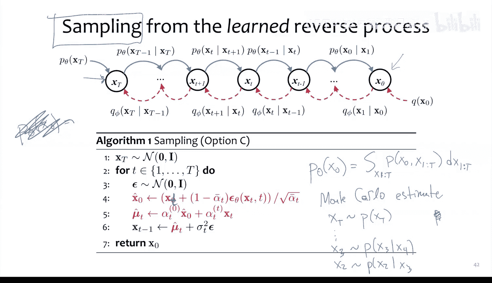

So okay， so we started here with unsupervised learning。We said you know we。

We can't compute the gradient of the log likelihood。嗯。

So instead we use a variational bound and so this is a look at that variational bound。

 we'll think more about this。

In the future。But what it's seeing is that。Here is the objective function that we want to work with。

诶。And unfortunately， we can't work directly with that distribution， negative log P theta x0。

And so instead。We're going to come up with a variational bound on that。

And it' it's typically often called the elbow。Sppelled this way， it's an acronym。And。

And you can see that this for any distribution queue。

Is a lower bound on the sorry we have a negative in front of the likelihood I'm going to get rid of that negative in coming slides。

 but so in this case because there's the negative in front。

 this is an upper bound on the negative log likelihood so when you're thinking negative log likelihood you're trying to minimize the negative log likelihood the same way that you would try to maximize log likelihood。

And so what we're saying here is。This is an upper bound on the quantity that you're trying to minimize。

So say you find some parameters theta for P theta。That are minimizing this elbow。

What that means is that your log likelihood when you compute that elbow。It must be。

At least as good as that， maybe better。Okay， so now if you find another theta that pushes down the elbow。

It's like you're saying， well now my log likelihood needs to be better than that slightly better value and so as you keep pushing the elbow lower and lower and lower by optimizing over theta。

You're going to be decreasing your upper bound on the lu likelihood。No， in fact。

If Q was exactly the distribution sorry， if Q and theta were equally expressive then。

Then then you could actually get them to match exactly so what we're concerned with here though。

 is this conditional version where we actually condition on x0。😊。

In Q and so we can take this elbow and we can actually decompose it into three terms。

Okay so how does that decomposition work？I think this might be one of your yeah this is actually one of your homework questions I think so how to go from say you know here to here is something that you guys can work through on homework but the。

😊，The idea is that we sort of first say， okay， this。

This term inside the brackets can break into the negative log probability of the last variable。

 the noise variable x capital T minus a sum from t equals 1 to capital T of the log probability under P theta of x t minus1 given xt。

Divided by the Q probability of xt given xt minus1。

So it's kind of like we're looking at these two variables， Xt。And X T minus1 here。

And we're always looking at the ratio。😊，Of the P theta term on top， which is xt minus1， given xt。

With the Q term on the bottom， which is xt given xt minus1。ok。

And we're trying to make it so that those ratios are as small as possible。

So that basically the probability of sort of moving forward is the same as the probability of moving back。

And so if we look at。How this further breaks down， we get that there are three terms that are what are called kL divergences。

 which I'll define on a slide coming up here。And the middle term。

 here this is the punchline of this section。

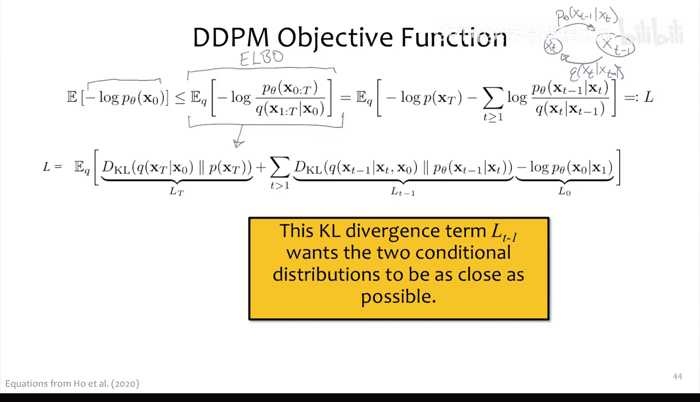

Is is a k so let let me just make sure I kind of wipe some things out of the way。

 so this is constant。

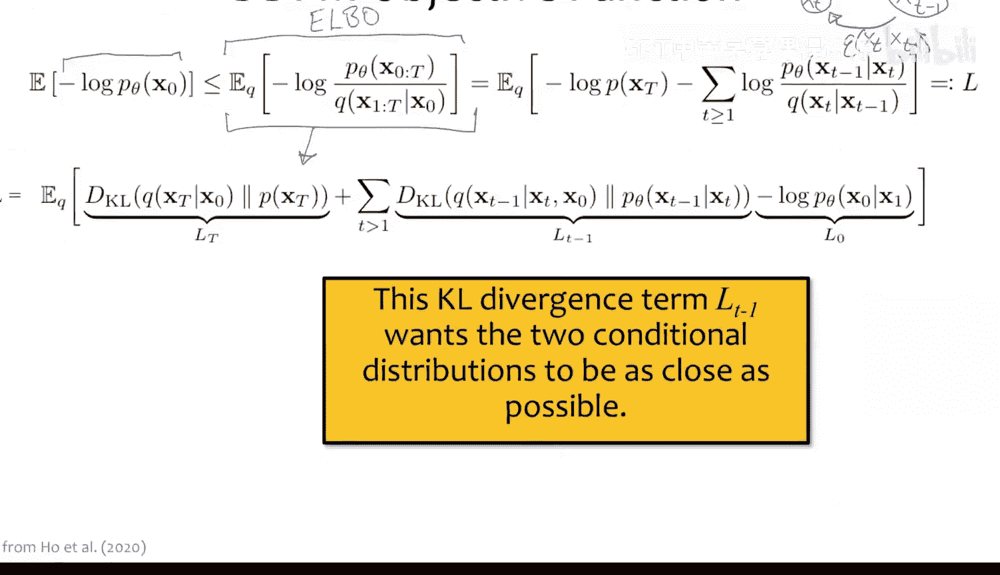

With respect to。セだ。So essentially when you're trying to minimize this objective function。

 you can just skip this term。Okay， so what's left is and then this L zero。

 you could actually fold in。嗯。Can fold into Lt minus one as like just another one so basically this Lt minus1。

 this is the thing that we're actually trying to minimize and look at what it is。

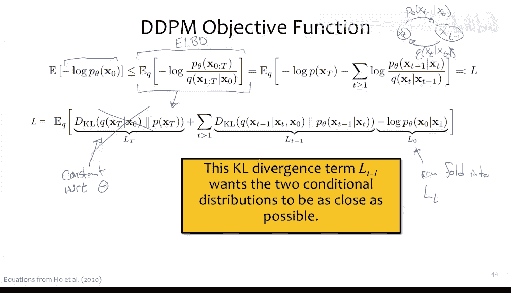

So the kale divergence is a measure of how far away two probability distributions are。

And what are the two probability distributions that we're trying to close the gap between？

The two that it kind of made sense to close the gap between， right。

 p theta of xt minus1 given xt and the exact distributionq of xt minus1 given xt in x0。

And so we can use this variational bound to justify why it makes sense to try to make these two distributions as close as possible。

And so when we're actually doing that training， what we're actually effectively doing is minimizing this kL divergence term for a particular randomly chosen little T。

😊。

Okay。

So。嗯。

So variational inference is all about trying to work with these sorts of P and Q distributions in a general way。

And。嗯。And actually let me think about this for a second yeah and so what what we care to do is we think about how。

呃。Oh， no， you know what， actually。

When do you think let me just talk about we only have like five minutes left let me just talk about KL divergence and we'll come back to variational inference Okay KL divergence for two distributions Q and P。

嗯。Is a distance metric and you define it like this so that KL between Q and P。

We're assuming that they are over the same variables x。Is the expected value？

Of the log of Q of x over p of x under Q of x。Okay， so if X is discrete。Then this expectation。

 you would write it down as a sum over all possible x of Q of x log q of x over p of x。

 if x is continuous， then you'd have an integral over x。

 this is just I mean I'm literally just defining what an expectation is。

 but it's useful to see it this way， which is Q of x times log Q of x over p of x。

So it measures the proximity of two distributions， you'll notice that it's not symmetric。

 so KL of QP does not equal KL ofPq。😊，And it's minimized when Q of x equals p of x for all x。Okay。

 so it's kind of useful to think about like k divergence as an objective function because it's showing up in our objective function。

😊。

So keeping all else constant， we could consider the effect of a particular X crime on the Kale divergence。

 which I'm showing in the top left corner like way up here。

Okay， so what we're saying is ifq of x prime is like 0。9 and p of x prime is 0。9， then。

The particular term， right kL is a sum over all the x's， so for this particular x prime。呃。

You're going to getq of x prime divided by p of x prime is one。The log of one is。Zero。

 so this whole term must be zero。Okay， so its effect on that big sum over all x's is going to be kind of like little effect。

 right， no increase。If instead Q of x prime was 0。9 and p of x prime was 0。1， now this term。

 that ratio is going to be large and you get something like 1。97。

 so you're going to get a big increase in KO。So basically， the KL is angry ifq of x prime is large。

 when p of x prime is small。Okay， but what if we flip it right so if we flip it and now Q of x prime is small and p of x prime is big。

 well， it gets us a little decrease so it's a little bit happy。😊，In that case。嗯。

Where basically what we're saying is。That。The approximation Q is。

 say low when the true distribution P is high。And then when they're equal and small， then again。

 we get zero。

Okay， so。It does insist on good approximations for values that have high probability in Q。

It does not insist on good approximations for values that have low probability in Q。Okay。

 so we could ask which distribution Q minimizes the KL of Q and P。So here we have P is 0。7， 0。2。1。

And you have two distributions， one third， one， third， one third， and 0。7。2。1。Okay。

 so what's the answer？Q2， right？Okay， so what if。What if instead we used Q3？Why not return that？

That would actually have， if you computed the KL between P and Q3。You get a lower number。

But it should throw like an assertion error or something because Q3 isn't a valid probability distribution。

 it doesn't sum up to one。So you know， so basically the k dive vers is trying to drive these numbers down if you were trying to choose a queue that minimized。

 but this wouldn't be a valid one。

So here we have another interesting example， which is in some different Gaussian distributions。😊。

And we could say， here's our distribution p of x， which is the Q that minimizes the k divergence with p of x。

人六肉呢。Venture a guess here。The upper right， that's correct， right。

 because what did we say we said the。The KL cares a lot。That where the approximation， where Q is I。

P must also be high。But if P is high， say like out here and out here， and Q is low in those regions。

No problem， KL doesn't really care。So okay。This should give you pause。

Because it feels a little weird， right， like like why does it like？

That like why is it okay with that right？ So this is the the objective function that we are trying to minimize when we actually are trying to do。

Something like the learning that we've been talking about and。And this particular objective。

 this kale divergence objective， is kind of at the heart of variational inference。

 which is about finding a cu that is a good match for some fixed p。😊，Okay。

 so we'll stop there for today and。We'll see I'm not exactly sure where we'll pick up next time。

 but on Monday you guys have homework two recitation that was the whole point we learned to really like get all of diffusion in today and then you guys can pick up with TAs on that topic on Monday and then I'll see you back here on Wednesday for another lecture。

