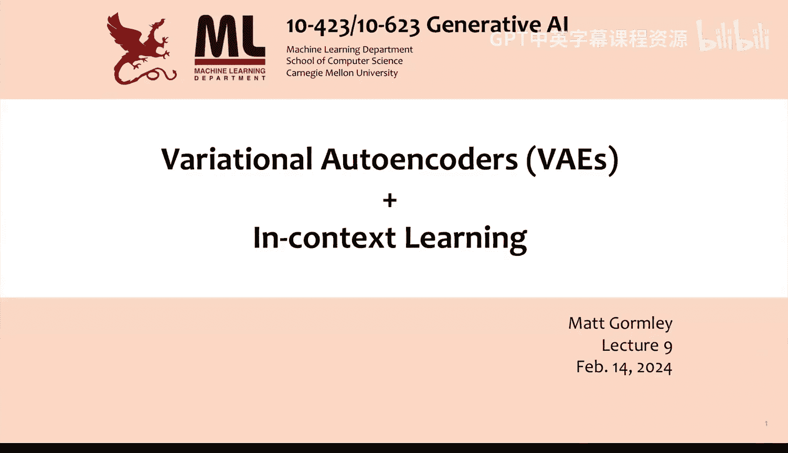
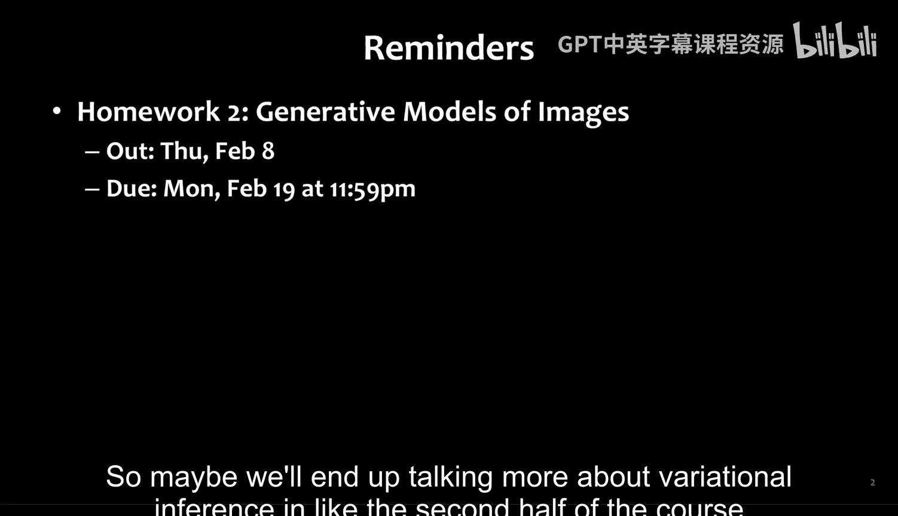
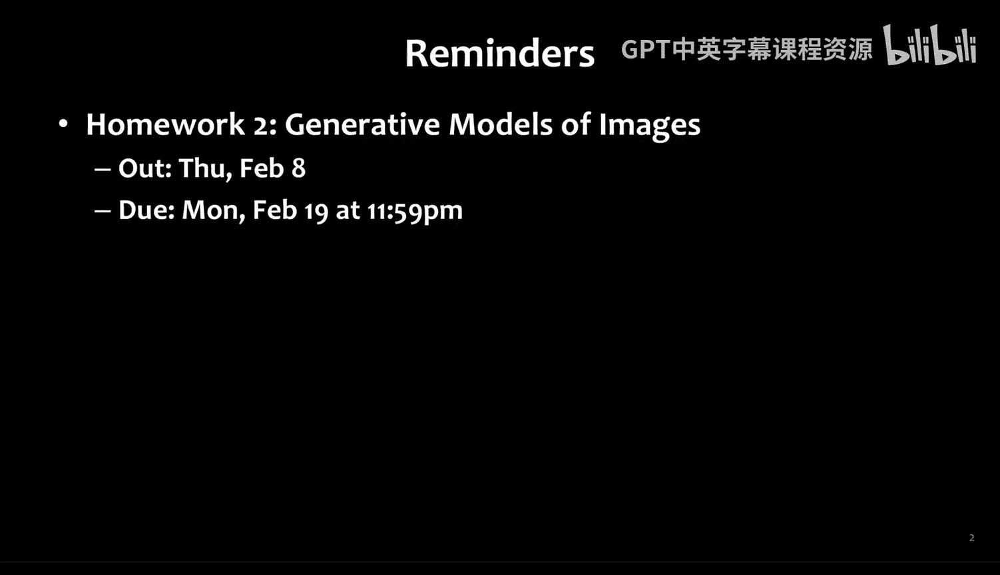
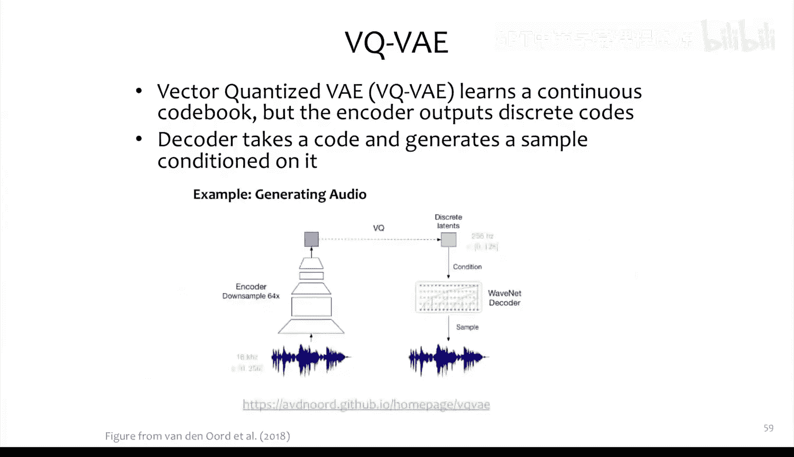
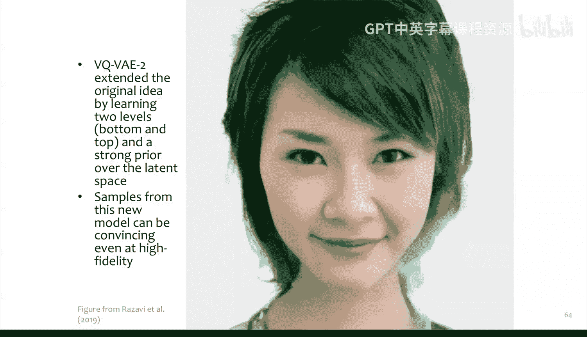
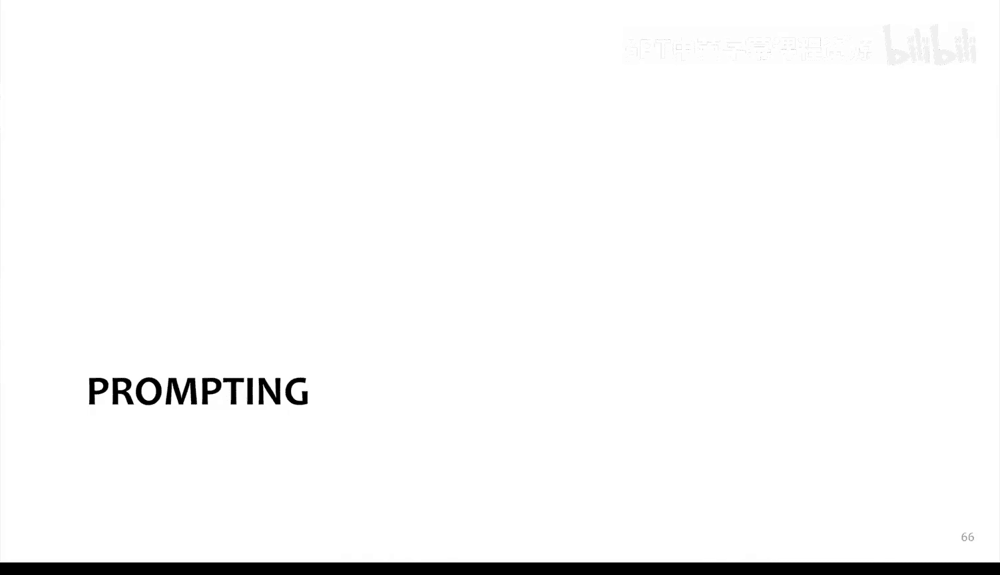

# CMU《生成式AI｜10-423 generative ai 2024》中英字幕 - P9：-P09-Lecture 09- Variantional Autoencoders (VAE).zh_en - GPT中英字幕课程资源 - BV1CyC9BPEhG

So so speak。I think our。There's like this sound that starts to happen at the end of a quiz when you know it's like the shuffling of paper you know there's like a little more like scuring of feet when you know that okay some people have have finished the quiz so I think the three minutes was was well spent here so today we're going to finally to talk about VAEs I've been like kind of pushing this off pushing this off today it was finally going to do it and then we'll transition into in context learning I should warn you that on the subject of VAEes I'm going to give this like way less time than I would normally give it in another course I think there's there's tons to say about variational inference there's lots that we could say about VAEes and I'm going kind of purposefully cram this into like an almost disrespectful amount of time and。

And。😊，Partly that's just a decision， like there there's so many things that we want to talk about in this course。

 we ended up putting more emphasis on， say GNs and diffusion models and you know at the expense of something else so maybe we'll end up talking more about variation inference for instance like the second half of the course if we can create time there。

Okay， so homework two you guys already know about so KL divergence is sort of where we left off last time we were thinking about this metric for evaluating essentially the distance distance is not quite the right word between two probability distributions and we observed a couple things that that it's not symmetric。

 so it's not actually a distance metric which would be symmetric。

 so the KL of Q versus P is not the same as P versus Q。

And。But it is minimized when the two distributions are。

And so we kind of looked at a couple different examples of when it would be minimized。

 and then now we can finally transition into thinking about this variational lower bound。

 so the high level motivation for variational inference really comes from this idea of wanting to work with complicated probability distributions。

😊，And so so let me give some examples of that， so if we had some observed variables X。

 you could think of those like I don't know， pixels in an image and some latent variables Z。

 like I don't know， labels of different parts of the image。

 then you might be in a situation where estimating the posterior distribution， P of Z given x is in。

So this could come up if you had a factor graph like this one that has cycles in it。

So if you have a factor graph that doesn't have cycles。

 then this estimation of the posterior is generally depends on whether neural nets are involved。

 but in general it's fairly easy but once you have these cycles it becomes intractable。

 another case would be if you had training data X and then some latent variable Z where sorry latent parameters C and you are trying to estimate a probability distribution over parameters so this is kind of a Bayesian view。

So the solution to this problem is you could approximate that posterior p of z given an x with some simpler distribution q of z。

And typically， Q of Z has more independence assumptions than P of Z given x。

 which is fine because Q of z is going to be tuned for some very specific x。😊。

And the key idea then is to pick a single Q of Z distribution from some family queue that best approximates Q of Z given x。

So we would say Q of z is the variational approximation， capital Q is the variational family。

 this is the set of all probability distributions that are under consideration and usually Q theta of z is parameterized by some theta that we call the variational parameters。

And then。P alpha of Z given x is parameterized by some fixed alpha， and we'll call those parameters。

Okay， so in this moment， we can think about diffusion models where we could say， well。

We had a distribution like Q phi of some latent variables Z， right。

 the latent variables in that case were x1 to T， right？And then our x。

 what we're calling x here was kind of like the actual image that we observe x0。And。

And so in the diffusion model， that Q theta was the forward process。And then P alpha。

Was the reverse process that we learned。Right。And so what's interesting here is that the variational inference part。

I different than what we were actually doing？In diffusion。In diffusion。

 we were trying to learn alpha and here I'm saying something very different。

 I'm saying if you already know what alpha is。😡，But you just can't work with the distribution。😡。

Then you could infer some parameters theta that allow you to work with an approximation of that distribution。

😡，So this is different than learning。Okay， there's a bunch of examples of algorithms for variational inference。

 mean field variational inference， Libby belief propagation。

 tree re weight BPP expectation propagation I'm just going to mention mean field so you could ask is this trivial so。

😊，Well。We're not defining。A new sort of distribution。

Like someq theta of z given x there's actually like one distribution Q theta of z for each p alpha of z given x right so like we're given some x and。

😡，The theta that we use for that x might be different than the next x prime that comes along。

So if you have one image， you might infer one theta for the next image。

 you might infer a different data。ProfesI might be the only one that's lost here。

 so can we go over quickly what Q Zx and alpha are as parameters？So da。

 sorry like you explained it for the last five minutes but I was new so what we're saying here is。

So we'll ground this in variational inference in a second the point is that。

So when you think about alpha， these are like the parameters of your model right so you could think of these as the parameters of a neural network or of one of those graphical models that we were looking at like a factor graph or a Bayesian network。

The Z and the X， those are variables in the directed or undirected graphical model picture。

So those are nodes in the graph。The only distinction between Z and x is whether or not we actually know what their values are。

So to say that X is observed。Is to say that we actually。Like no。

That we have some particular given image right and so the fact that Z is not observed would be like at test time So let's let's go all the way back here that's what we called the late variables that's what we're calling latent variables And so so the question is when do you have latent variables and and one answer is well at test time you always have latent variables right because if you're doing say this was like something like semantic segmentation here right so here say we have one variable for every pixel in our image right so now what we're saying is that。

😊，Keep those we're saying that Z are like the pixel labels。For semantic segmentation。Okay。

 X is our image。Okay。And what we're trying to do is actually reason about some distribution P of the actual labels given the image X。

And what we're saying here crucially is that。We know what the parameters alpha of that distribution are。

Okay。And so one way that we could come up with a distribution that's intractable is just use the G distribution that we've been talking about right so we could say suppose here that the way that we define this distribution is some deterministic function F alpha of Z and also of x。

 right？Where？Z was sampled from a Gaussian。Okay。And。F alpha。Is。A multi layerer perceptron。

 a neural network。So this was the motivation for GNs， we said we can't even compute。This likelihood。

This log likelihood， tractably for the G。And so we're not going to。

Necess we're sorry I guess we can't this isn't quite what I want let me be careful here。嗯。

This still works， but it's not it's not the same as the it's not the same as generating an image so so now right what we're talking about is。

But the same reason that it was intractable for the GA is why it's intractable here。

 so we have some pixel labels Z right and I'm trying to get some probability distribution over the pixel labels and it's intractable because I parameterized it using this big complicated nonlinear neural network。

That takes as input some randomly sampled latent variable Z。So oh and let me do one more change here。

 let's change this to epsilon just so that this is clear。

Because right now I have sort of colliding notation。There we go Okay， so now we've fixed it so。

So now what we're saying is that the distribution over Z is given by this big complicated neural network。

And here， epsilon are the actual noise variables。Okay， so in this setting。嗯。

What we would want to be able to do， for example， is say work with the probability distribution over semantic segmentations。

😡，Like say， I wanted to ask you， what is the marginal probability of this pixel being labeled as a car。

 summing over all possible labelings of the image？😡，Right。

That marginal distribution might be intractable， and we want a way to work with that。Okay。So。Okay。

 so one。Yeah。they could read English or like a segmentgregation art。

So it doesn't work with it will in a minute， the notation on the slide here is。

ItIt's going to work as soon as we talk about VAEs here the way that I set up the last example。

 I was conditioning on the image， so if you want the image to be the latent variables that's also fine。

😊，And in that case， we might not even be conditioning on anything at all。

So we could just have a distribution over images and then we don't need to condition on any X。

So that would that would also make sense， so then Z would be the image that you're generating。Okay。

 so。You could one way that you could think about this is say。

Say you were able to draw samples from P of Z given X。So。

What you could imagine like a sort of a strawman solution to variational inference being is if you drew a bunch of samples from the distribution that you cared about。

 then you could train a little Q theta of Z model on those samples。

OkayAnd then you could hope that the samples that you drew were sort of representative for that particular X。

Okay，And that now the Q theta of Z that you just trained would be representative。Okay， so。呃。

So this would be strange because if you can sample from the distribution。

 then you can probably already work with the distribution right And we just said that the whole point of this was that you can't attractively work with the distribution。

 So this step is generally not possible。 So you couldn't actually do this。 But but this is in effect。

 kind of what it is that we're about to do。 And the difference is that variational inference isn't going to involve sampling。

 it's fast and deterministic。 And the reason for that is that we're going to choose an objective function。

 such that when we optimize it， Q theta will be a good approximation of P alpha。And not surprisingly。

 that's going to be a KL divergence。Okay， so。So what's interesting here is that variational inference is basically saying。

 okay， now you can choose the distribution P alpha that you really want， right？😊。

You don't have to simplify it to make it computationally efficient。

And then just design a structure of some other distribution to theta such that your variational inference algorithm is efficient。

Okay， so the whole idea of a mean field approximation。Is that。

You can have this Q theta of z treat each variable as completely independent。

So here on the top is a factor graph and you'll remember each of these little factors is either a vector or a matrix or a 3D tensor or a 4D tensor depending on how many variables it's touching。

And so like this one would be a vector， this one would be a matrix and this one would be a tinsor。

 so this is 1D， 2D and 3D。And。And so the mean field approximation。

I would say instead of having all of these complicated tensors that are kind of tanggling the variables up。

 let's just pretend in the mean field approximation that every variable is completely independent of every other variable。

Okay。So this sounds like a terrible distribution to work with。😡，Except。

If you're only working with one particular X， then this might actually be reasonable。Okay。

 so now let's think back to our semantic segmentation problem。So there we were saying。

 you know p of alpha of Z given x is like a distribution over semantic segmentations for an image。

Okay and maybe what it does is it says， you know adjacent pixels should have the same label right that would sort of make sense so so each output pixel can actually look at the label of the adjacent pixel。

And now if they're the same， then the factor graph is happier， right？

The factor graph is also looking at the image X to say， for each pixel。

 does this seem like a reasonable label given whatever is going on in the picture？😡，Okay。

 so if instead we have just learned a probability distribution over。

Pixels like this where they were all independent， that would be silly because now two pixels like there's nothing tying them together。

 they don't know their neighbors values。Okay， but for a given image。

 we might still be able to work with this distribution。Oh， sorry， and there's the picture I think。

AndI had one of these。So this would be like tying them together and this would be decoupling them。

Okay， so。So there's sort of two different cases that we can think about。

 one is you're given a joint distribution P of x and z。

And you want to work with the distribution P of Z given x。And。

Here you would assume that you can't work with this distribution because the denominator here is intractable and here the other would be you're given a factor graph and some potentials and you'll remember for a factor graph it's globally normalized。

 meaning you have the product of all those factors divided by that normalization constant。

And here you would assume that this denominator is in。Okay， so either way。

 what we're saying here is you want to work with this P of z given an x。

 but the denominator is intractable to compute， it's like a sum over exponentially many different things and you don't have an efficient algorithm for doing that。

Okay， so。The idea of meanfield is that。呃。You make this assumption that you have this Q theta distribution that's your approximating distribution。

And it decomposes over all the variables。And then you solve a little optimization problem。

 you pick the Q that minimizes KLQP。😡，And so， now at the， if you do that。

 if you choose the Q that minimizes Kl of Q and P at the end for this particular。

PFor this particular P in this particular X， you'll have a Q hat。That is super easy to work with。

 right， because you assumed that all of the variables are independent of each other。

So it's very easy there's no dependencies between variables， super easy to work with。And。

And to actually obtain that Q hat， well， how do you do it。

 you solve it using some optimization algorithm， it could be coordinate descent。

 it could be gradient descent， whatever you want to do。Okay。And。Equivalently。

 if you parameterize Q with some theta， then picking the Q that minimizes the k divergence is the same as picking the theta that minimizes the kL divergence。

哎。Yeah。Why is this useful for like？If we're fitting huge data to some particular act。

 sure if we have training data of acts， we could do this， but then during test time。

 we have different exits。So。Oh no， this is that text this is Yeah， yeah yeah so。

So what I'm saying is at test， you've already trained your model， you already know what alpha is。

The parameters of your probability distribution。And all I'm doing here is。

Very simply coming up with a simpler distribution。That we can work with very efficiently because the original distribution。

It would be too computationally intensive to work with。

Okay so this is this is the key thing if you're thinking that like we're learning a model here。

 you're you're thinking wrongly， we are not learning a model。

 the model has already been learned someone gave you the model。But they said， oh he。

 I just learned this really great model， oh， by the way， you won't be able to use it for anything。

Because it's intractable。Okay。So how are you going to use it for something？ Well。

 you could come up with this Q beta that for a particular X at test time for one image。

 you optimize this objective function。And then you work with Q for that one image。😡。

And that's how you would do it。Okay， so this is this should feel very strange for you to you if you've never done inference before。

 which probably many of you haven't。And and don't worry， in a minute， we're going to say， oh。

 by the way， one of the reasons that you might want to do inference is so that you can learn alpha。

Okay， but that's a totally separate thing right here。

 I'm assuming somebody just like an oracle just gave you your parameters of your probability distribution。

Yeah，Yeah。没有的。也一样。Sp best。No， no， no， someone gave you the distribution key。

And so you can do something very simpleful， like you can evaluate the probability。Of。

Particular Zgon x。Well actually you， you can't actually do that either because that's intractable。

So gave， but someone gave you the parameters of alpha such that if you had infinite computation。

You could evaluate P of Z given X。Okay， so crucial。When we minimize the k divergence。

 we're not going to need to compute these things。Okay。

 so you know how you could compute P of Z given x， like on paper。

 you can write down an expression for it。You just don't have， you know， you only have one。

Unniverse is lifetime to wait around and not two or three。

 and it would take say two or three universes lifetimes to actually compute those denomins。

But we're assuming that if you end infinite time， you do know how to do the computation。Okay。Okay。

 so let me pause here for a that。Where might these parameters alpha come from？

Does anyone have any ideas？Yeah， Oracle gives them to you where else I think？Yeah。

 maybe they come from from gradient descent right initially they're randomly specified alpha is initially random right and then you're going to use this inference procedure。

To come up with your Q theta。And then you're going to backpro through something like that so that you can update your alpha。

Using a gradient step and now you'll have another alpha okay， and you still。

 because this these are intractable won't be able to work directly with P alpha。

But you can come up with the next Q theta and so on。Okay。Okay， but we're getting ahead of ourselves。

 that's variational EM here， we're assuming that alpha is just fixed in time。诶 yeah。

excellentThere's a statement that it's hard to work with and still。

Is like we are assuming that we were given a P like the joint distribution and the hard part was to normalize it but then if we model that with neural networks is the normalization constant still a problem。

呃。It depends on how we set it up。So when we set it up。As。呃。Let's see。

 so I might have actually broken。ThisSo this statement。This statement， once I switched to Epsilon。

 might be broken。In that maybe。Maybe here we could actually attractiveably work with it。

If instead what we cared about was。呃。So。Let me be very careful here。Let's go back to Z here。

And let's make sure that this is indeed intractable。Okay， so if we said。

Here what we've done is we've just defined a probability distribution over x。And see。Yeah。

 this is now okay so。So what this does。Is this function？Takes in。Just a Z。And it returns and。An a。So。

So this doesn't hold with equality。But this is now the GA setup，So what we can say is P alpha of。

X and Z follows。P of X given Z。Is like a point mass at this。This neural network。

 so given that Z there's exactly1 x and then Z follows a normal distribution。So in this case。

 if we wanted to reason about。P of Z given x， this would be intractable。

Okay so the problem here is that。Typically， pixel labels are discrete。

 and so we couldn't actually have a normal distribution。So what we would need here is actually like。

Some categorical distribution。That gives us， say， an actual semantic segmentation。So。

So now this is definitely。Intractable。So。Okay， so how then could we actually come up with？This。

This Q or this theta。So we do this by optimizing kale divergence。

And so here our care divergence term is going to。Be a little bit problematic because it would seem as though we can't even compute this kL divergence by assumption。

 right we said that。Well let me write out what this is first。

 so KL of Q P is going to be an expectation under Q of log of Q over P。

And then taking the log of that。woWould be log of Q of Z minus log of the denominator。

 so it's expectation of Q of log of Q， expectation Q log of P。

Okay and then this is a conditional distribution， so you could rewrite this as p of z and x divided by p of x。

 right？😊，And then we could take the denominator out。

 so now we have expectation of Q log of p of x and z plus expectation of Q log of P of x。Well， here。

 this is interesting because we're taking an expectation over a variable Z。

But this doesn't involve the variable Z。😡，So log of P of x under an expectation over z is just a constant。

So this last term really is just log P of x。But that's what we assumed was intractable to compute。Oh。

So we want to minimize this kale divergence， but by assumption we can't actually compute the kL divergence okay and so。

嗯。This problem comes up whether you have an intractable data likelihood。

 P of x or an intractable partition function， Z of x right so if we wanted to be talking about factor graphs。

 we'd just swap in z of x instead of p of x， but we'll be thinking about P of x。So the answer though。

 is actually a little more nuanced than that because what we said was not that we wanted to compute the kale divergence。

 but that we wanted to minimize it。Okay， and if you want to minimize something。

 then really all you need is something a little bit easier to work with。

 so you can instead maximize what's called the elbow or the evidence lower bound。Okay。

 and the elbow for for this setting is going to look almost like this。

 so let's look at these terms carefully so we have expectation under Q of log Q expectation under Q of log。

P of X and Z。Let's look at the elbow。Oh， they're the same terms just flipped expectation under Q of log P。

 expectation under Q of log Q。系。So here's why this works， if you want to minimize the KL。

 then you could write out the KL as we did before， observing that this is intractable to compute。

But then you could say， well， if we're minimizing over theta。😊，This is just a constant。

So minimization over。Theta doesn't care what that intractable constant is。

So let's instead just drop it。Because the argumentmin is going to be the same if we get rid of it。

Okay。And at that point， then you could just negate this because here we're minimizing so negate this。

 and now if you maximize， you'd be left with the elbow that we wrote down。Okay， so。She。

What does this accomplish so we have two things happening the first expectation is high if  Q theta puts probability mass on the same values of z that P alpha puts probability mass on。

And so basically， this first term is doing a good job if。If essentially the distribution Q。

Sort of matches P alpha。In terms of like where they're putting high probability。

The second term is kind of acting like a regularizer。

 it's saying it's really just the entropy of Q theta。

 which will be high if Q theta spreads its probability mass evenly like a uniform distribution。And。

Okay， so。So I claim that this elbow is a lower bound for log P of x， we'll show that in a second。

 and so the idea is that in variational inference you're finding a cu that gives the tightest bound on the normalization constant for P of Z given x。

Okay， okay， so why is it the case that this is a tight bound so for any for any cu。

The theorem statement here is that log p of x is greater n or equal to elbow of Q。

And so elbow of Q is a lower bound on log P of x。Okay so here's proof number one。

 so the first thing that we need is Yensen's inequality。

So Yensen's inequality says that if you have a concave function F。

Then f of an expectation of some random variable x is greater than or equal to expectation of f of x。

Okay， so。What is log P of x， it's just a marginal distribution where we marginalized out Z right。

 so it's the log of P of x and Z marginalizing over Z or integrating over Z。😡，Okay。

 so the next step is， let's multiply by one here。Which is just Q of z over Q of Z。If we move this。

Q out front。Then you can see we actually have。The definition of an expectation here， right。

 it's the expectation under Q of p of x and z over Q of z。可以。And now， if we just。

Use Yenssen's inequality。Because the log function is concave。We could push it inside the expectation。

And switch to an inequality here。Com。And then finally， if we just sort of expand those two terms out。

 we get back the elbow， and so what that means is that log P of x。Is greater than or equal to elbow？

Okay。Here's another proof up in the corner， the key takeaway is that minimizing the KL is the same as finding a tight lower bound for the log probability。

Okay。What does this have to do with variational autoencors？So。

We've seen autoencoders before there where you have some input X and you train like a little bottleneck network that tries to learn some lowdisional representation of X。

 and then a decoder network， so that's the encoder and then a decoder network that tries to go from that hidden representation back to a reconstruction of your original input X。

Okay， so。嗯。One of the key limitations of auto encoders， though。

 is that there's no way to sample from them。So if you think about that neural network that takes in some X。

And then this is like a multi layerer perceptron that gives you back a low dimensional Z。

And then you have some other multilay perceptron。That gives you back。

Some x prime that's a reconstruction of x。That whole thing is just a deterministic function。

 you feed in an X， you get a Z， and then it returns back some x prime。Everything is deterministic。

 there's no probabilities。😡，But if you want to have a generative model。

 then you probably want to be able to sample from your model。

That's everything that we've been doing up until now。Okay。

 so a variational auto encodecor is going to learn a continuous latent space like that Z that's easy to sample from。

😊，And we're going to generate new data images by sampling from the learned generative model。Okay， so。

So there's two perspectives， there's sort of a neural net perspective and a graphical model perspective。

So the graphical model perspective here is that the VAE model is this very simple graphical model。So。

We have some latent variable Z， and given that we sample X。

 and you could think of Z as like a latent vector in continuous space。And X as an image。And。呃。

And the key idea is that。Z is always going to be sampled from。A Gaussian distribution。

 a multivariate Gaussian。But that。We're going to have some function G Phi that takes N Z and deterministically computes some。

Some X from it。Okay。So this is just like what the G was doing。Okay。

 so the neural network perspective， we could sort of do things a little bit differently。

 we could actually think of this kind of like an auto encodecor。Okay。

 and we could we could think of it like a probabilistic auto encoder。

 so it's going to define two distributions， Q theta and P Phi。Here。

 Q theta is the encoder distribution， so it's going to give you a distribution over z given x and p phi is a distribution of x given z。

And。The parameters， theta and Phi are actually going to be the neural network parameters。And here。

You could just think of these like two little neural networks。Where the。

The encoder goes from x to your Z， and the decoder goes from your Z to your x。And so。

So how does this fit back into variational inference？So what we're saying here is that for the VAE。

The model。Is this thing？对。And the variational approximation。Is going to be this thing。Okay。

 so the point here is that it's very easy to have。A model set where we sample Z from a Gaussian。

 and then given that Z， we deterministically generate x。

But if you define your probability distribution that way。And you wanted to， for example。

Learn by maximizing。Over a bunch of training examples， the log probability of XI。Well。

 you're going to be out of luck because the way that we've defined this distribution。

 you're not going to be able to compute this。Probability distribution because it's going to be intractable。

To marginalize over。The latent variable Z。Okay。So。So this is our problem。And。Um。And so。

So what we care about then。Is。Is coming up with some。

Simple distribution that we can efficiently work with， and that's what the encoder is going to be。

Okay， so let's actually look at what these probability distributions are in some detail。

So let's start with the decoder because I think that's the。

That's the one that's maybe more obvious at this point。Okay， so if we sample some Z。

 that's our latent variable。We feed it into our decoder neural network。

This is like a deconvolutional。Network。And。Actually。

 it might just be actually a simple example over here。

 It might just be a multi layer perceptron right so you take in your vector Z。

 you do some multi layer perceptron on stuff and you get back a mean and。😊。

A covariance matrix or actually a standard deviation matrix。

And so those are the outputs of your neural network。

 and then you feed those into a Gaussian distribution as your mean and variance。😊。

And you can sample directly from。对。And that's how you could get a distribution over images。Okay。

 up here。This is going in the opposite direction。So we're saying here。

 this is a distribution over z's given x's and the way that it's going to work is you take an x in。😊。

To your neural network。And it outputs a mean and a variance。😡，对。

Which are the mean invaris of a Gaussian， like for a Q distribution。And that gives you back a Z。Okay。

So let's pause here for a second。And try to map this back to a diffusion model。

Because what we're doing here is actually remarkably close to。

I claim a to one step of a diffusion model。Here's x zero。Here's x1。

And what does anything we're doing here have to do with a diffusion model？So this is diffusion。

With T equal to one。Can anyone connect some of the dots here？

What would this decoder and encodeder be in sort of diffusion language？一。Ping the day and quarter。

Would be the X1 model。And then we kind ahead put that back， distributional like zero is in imp。Yeah。

 so if we think of this as so going from x1 to x0。In diffusion terms， we write that as like you know。

 p Phi of。X0。Give an x1。And then in this direction is sort of the。Q theta of。X1。Given x0。Right and。

So we could think of this kind of like。A setup where。The。In the terminology that we have here。

 we're sort of saying Z is like x1。And x is like x0。我是谁好。Exactly right。

 So the encoder is like the forward process and the decoder is like the reverse process。Okay， so。

In diffusion。We actually bypass variational inferences。We didn't need to do any inference at all。

Why is that？Yeah。In Victoria， we did not know what the input was。Well， the input was x0， right。

 it was the observation。And then the late vegetables were like the noise up。

Versions of that observation。it is yeah。They do depends。Yes。

like we didn't have this neural network ethic。Earning。啊、そ of的。

The Gausian and were closing elections that were adding invoice exactly right。In diffusion。

 we defined this Q theta explicitly， right， There was no complicated neural network encoder。

We just directly defined a distribution queue。😡，That was just like， add some 0。

1 Gaussian noise to each pixel right， and then do it again at the next step step。 right， Well， here。

 we're just at one time step。 So in in diffusion， this would literally just be add some Gaussian noise。

😊，Full stop。Okay，And the parameters theta here， they were fixed， they were that alpha schedule。

 right？😊，So there was no parameters theta to infer because we were just working with a fixed Q distribution。

Okay。So。In diffusion。We were sidestepping this problem of inference altogether and only learning the parameters of our distribution P P。

Now we've opened things up a little。And we've said， okay， it's like a one step diffusion model。

 but now we're going to learn the parameters of this。Distribution that goes from image to noise。

And we're going to learn the distribution P PI as well。We're going to learn both at once。And。

And the way that we do that。Is。We're going to have a data set。

Consisting of a bunch of unlabeled images。And our loss function is just going to be。咁。The elbow。

So we're going to， instead of optimizing。嗯。So this is like instead of。The log phi of Xi。Okay。😔。

So what we're going to do is we're going to say。We have。嗯。Kind of two terms in the elbow。

One is like an a reconstruction loss， where we're trying to。

Say an expectation under a distribution over the noise variables。

We want the probability of the x's that we observe to be high。

And then the other is like a regularizer。That's trying to sort of keep。The distribution's simple。

Okay， so further that expectation under Q。We're going to approximate it by sampling。

So we're going to take a bunch of samples。From our encoder。

So we'll take our image and we'll draw a bunch of noise samples。And then we'll just。

Approximate that expectation as a sum over the samples where we take the probability of each noise sample times the log probability。

Under P P。And then from like a neural net perspective to train this thing。

 now we have a loss function of some parameters theta and some parameters fly。

And we'll just back propagate through this to train them both at once。

But what we're doing is optimizing a lower bound on the log likelihood that we actually care about。😊。

And so if we do a good job of optimizing this， then the parameters that we choose are going to be driving up higher and higher are lower bound on the log likelihood that we actually care about。

Okay， so you could think of this as like the。Big computation graph。

 it's kind of all happening at once， so we take in our image X。

We encode it with a neural network to get a mean and a variance of a Gaussian。

And then we sample a Z from that Gaussian。Which feeds into our decoder neural network。😊。

To give us another mean variance to a Gaussian， and then we sample back our reconstruction of x for well。

 it's just a sample from the distribution。 It's not necessarily a reconstruction。

But now we have two loss terms， one is a kind of a reconstruction loss so that these two have sort of similar distributions and the other is sort of a regularizer loss。

Okay， so the problem here is that now we have。An actual sample showing up in this computation graph。

 and you can't back propagate through a sample。Well， at least not directly。Right。

 so what we can do is use that reparameterization trick that we've seen before here。

 which is if you want to do， as this red box says， which is sample Z from a Gaussian， then instead。

Sample some noise from a Gaussian and just multiply that noise by your standard deviation and then add the。

Add the mean to it and that's equivalent to the sampling process。

 but now you've moved the actual sampling process so that it's a leaf in the computation graph。Okay。

 so it。So this is the whole idea of a VAE， you could think of it like just like one step of diffusion。

Where instead of constraining yourself to a very specific forward process。

 we're now saying that the forward process is itself some interesting。

 complicated neural network distribution。That we can work with。

And the result is that we can simultaneously train that reverse and that forward process together。

And at the end we'll be able to sample from the reverse process the same way that we could sample from diffusion from one a t equals one diffusion level okay so I'll leave off with some just some results so VAs were originally done for image generation but this was like in 2014 and so they were doing you know simple things like MN digits and these little faces but know at the time this looks really good they can also be used for text generation to explain how it would take me more than the time that I have then later people kind of came up with things like vector quantized VAEs that could actually get you higher quality images even to the point that they could do sort of high fidelity images that looked pretty reasonable and so through so basically what we have in this sort of VAE framework is a。

variariational method for sampling and if you're curious about this stuff。

 there's also a fully variational version of diffusion models where basically we say that whole forward diffusion process over capital T time steps。

 you could actually parameterize that with a neural network and learn the parameters of that forward process as you go and that's called for example。

 one method like that is called variational DDPM。😊，So。Okay。

 we'll stop Ben and we'll pick up next time thinking about in context learning。

