# CMU《语言建模的推断算法｜11-664 763 Inference Algorithms for Language Modeling (Fall 2025)》 - P10：-03-CMU LLM Inference (10)_ Incorporating Tools.zh_en - GPT中英字幕课程资源 - BV1xsFjz3EoQ

Hello everyone so we had a few questions about the assignment the first question about the assignment was were people having trouble with the inference on the like graph problem where it was taking a really long time with your bottles？

Yes。DidI see some people nodding？对。Yes， okay， did you have like the thinking token on for Quen3 note？

You explicitly turn it off Okay， we will need to look into that because I didn't I didn't see that when we ran it ourselves。

 but willll。Willll see And then the other thing is I had a question about when the homework the next homework is going to be out I'll let the Ts answer that when they get here they are running a little bit late。

 I don't know if they stayed up late for the deadline I cleared a blind last night or something but yeah I know at least at least some of them did。

嗯。Cool but yeah， I don't want to waste time how many people do we have presenting today， one， two。

 three， okay。I have a lot of content today， so I will get started and try to go quickly。不。Okay。

 so this time I'm going to talk about tool use and。

The basic idea is that we want to provide the agent with tools that it can use and in terms of the definition of tools。

 we're talking about things that are external to the LM and they're part of an environment that the LM is kind of placed in。

And they have a functional interface and so we think of them as functions in a programming language。

 callable with input parameters and output that you get from them。

 and they're generally executable as programs。And there's a survey paper that I did together with one of the one of my students who are called water toolsol anyway it's on the site and you can go in and read a lot of the slides here are kind of based on that to some extent。

 but in coming up with that survey we tried to think of like the categories of tools that you use and there's basically three different categories of tools that you might use So the first one is perception and what we mean by perception is basically giving the language model the ability to access information that is not included in its parameters So they can collect information from the web or they can read a file system or you know interact with the user in some way or something like that。

The second thing is taking actions and so actions are things that can directly affect change on the environment so perception is basically you know just gathering information from the environment where action is actually you know making some sort of change to the environment and then the final one is computation and what this is is this is not necessarily interacting with an external environment so you're not providing the agent with or the LM with any more information than it has originally。

 but it can do sorts of computations that like aren't easy to do within a language model。

Here are some examples of them and so you can have things that provide additional knowledge so you can like call a search engine。

 make database queries， you can do computation， either using like just a calculator or a Python interpreter you can get information about the world like getting the weather fetching events from a calendar and you can also do other things like calling tools that allow you to interact with other modalities that the LM can interact with immediately so like doing visual UA over an image。

 converting video to its transcript， playing music on Spotify you know other stuff like that。

Any questions about that？

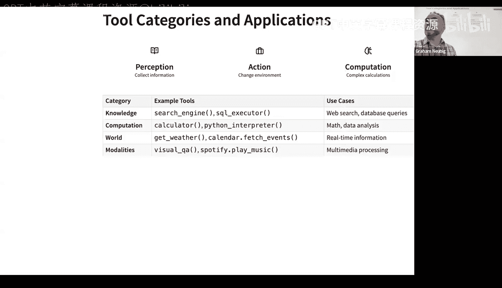

Okay， cool。So。The basic tool use paradigm， this is not the only way to call tools。

 but this is one of the common ways to call tools and language models is you have a user query and then before you actually generate the output。

 have some way of calling a function and typically what this means is you have a tag that's like something like start tool call or something like this which indicates that you're starting to call a tool。

 you write the tool call and then you you finish。And so here this actually this figure might。

Not be the best it should be like tool you should have a tool tag and then check whether and then like a closed tool tag or or something like that。

 But this is you know the example of how it works And so then you get the tool call you call the remote server and you return the API output and you can either like concatenate it directly into the stream that the agent is generating or you can give it to the agent as an observation and then based on that observation it can go back and like。

You know， generate the response to you。过。Everything good。So the first。

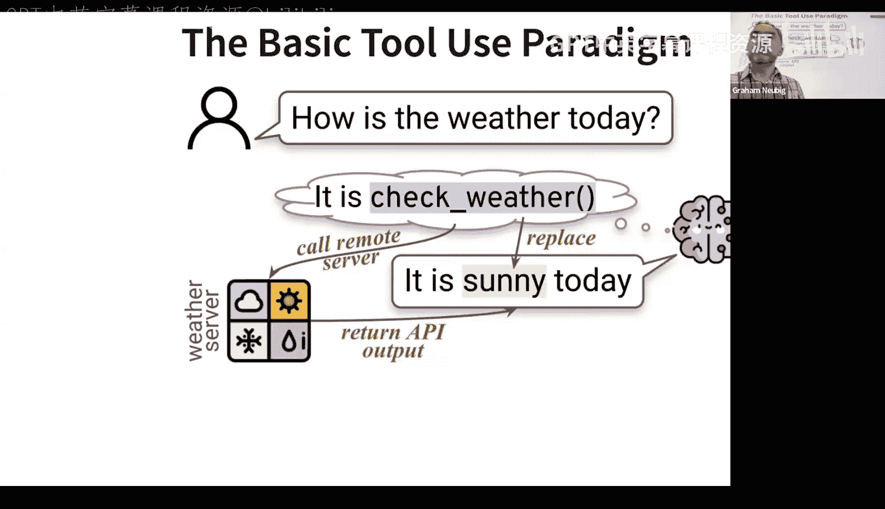

Example of this kind of in the large modern large language model era actually one thing I should mention is before the modern large language model era。

 this existed in lots and lots of cases like Siri and you know Alexa and all of your personal assistance but they did it in a different way the way they did it is they had classifiers and they would have a classifier that says I need this API call So like the user says something you classify into over all of the APIs that you were calling and then after that for each API you would then fill in the arguments So you would have like an argument filling model So that's the way you would do it now previously now you usually do it by just having the language model directly generate the code to call the tool。

😊，So the first example of this that I'm aware of in the modern LM era is WebGT。

 and this was basically taking the GPT models and giving them a tool to do web search。

So if it sounds familiar because every large language model provider chatbot does this nowadays。

 it actually was a research paper four years ago， so it came from this。

And so the issue is language models lack access to current information。

 so they do text based web browsing as a tool。They had a text based interface that allowed the GPT model at the time。

 which I think was maybe GPT2 to search click scroll in quote。

And so you know they could search for a webage， click on links， scroll。

 and then extract quotes from them。And they actually trained it using reinforcement learning from human feedback。

 so not from verifiable rewards， but directly from a feedback model。

And I'm not going to cover RLHF a whole lot in this class。 Hopefully。

 most of you have seen it somewhere before。 but the basic idea behind it is they started out with behavior clo。

 So they created a web interface where humans could actually like。

Search for things and click on links and scroll and gather information and information gathering tasks。

 they instrumented it so they could gather all the data of how humans were doing it and then train GPT with that data。

They then did reward modeling so they had the behavior clone model you know generate two outputs and then humans would pick which one they like the best and so that would give you preference data and then based on that they would train the reward model and then the reward model would be used to grade like essentially WebGBT generations。

So you know， every time you're in Ch EPT and you get the two things side by side and you press。

 you know， I like this one better or I like this one better you're basically doing number two for them so thank you for your service。

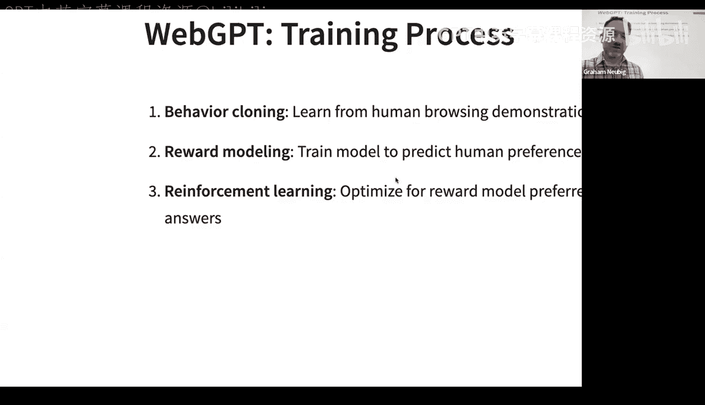

嗯。So。Here here were the results and one interesting thing that they showed was they compared the small models with each other。

 and then they also compared small models with medium models was with big models and then they also compared models without search and with search but they finally compared with like human demonstrations that they got from their annotators and the best answer on Reddit。

 So here their baseline was a random Redor who got upvoed so which in 2021 was pretty impressive that they could they could beat the random Redor that got up voteded。

 but they evaluated it， I think manually evaluated it based on overall usefulness coherence in factual accuracy and demonstrated that their 175 B models。

 So maybe this was G3 actually sorry G3 it was able to do better than these。😊。

Another important thing of using a tool for this is that you can get citations so you can look up outputs。

And provide links so people can look and of course。

 you know you see this all the time in your interfaces nowadays。So any questions about this？

I have one question which is。Does this sound like retrieval augmented generation to anybody？

Like have you built a rag system or done something like this， does it seem like that， yeah？

So like yes， people were nodding any idea what makes this a little bit different than many ragg systems？

Yes。Think it makes us sound stabbing。The index is not static yeah good point the web is constantly evolving that's not what I was thinking about。

 but it's pretty close yeah。Yeah， exactly retrieval is a tool call。

 So typically when you build a ragg system， the most typical way to do it is to take in the query。

 do a look up， get all the relevant documents and generate。

 But here they gave the LM the ability to do tools so so that was kind of the innovation in this。😊。

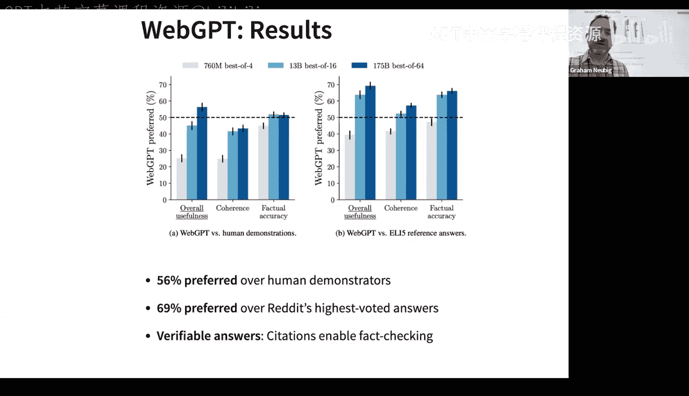

嗯。So moving a little bit ahead in time we have toolformers。

 so this was like the paper that really kicked off the interest in tools and I think the reason why was because for a couple reasons。

 number one a previous approaches required manual annotation like behavior cloning the second reason was that this was actually done on like decently sized model that other people would be able to train GPTJ and so the idea was that they wanted to generate they wanted to teach the model to learn when how to use tools。

And the way they did this was through self supervised learning from unlabeled text and I think this is a really clever method。

 I like it a lot。And part of the reason why it's clever is that it worked really well with the weaker models that we have then。

 so it would certainly work with the smaller models that we have now now you might be able to do something that's a little bit less you know complex than this and still get good results。

 but let's take a look at what they did first。So the basic way it works is they would have a language model data surprisingly this is not a CMU paper but their example is still about Pittsburgh。

 it's actually from metata in London but you know thank you for that and then so they have the LM data and the query was like Pittsburgh is known as they turned it into like what other name is Pittsburgh known by in things like this。

They sampled the API calls in this case， this was an APII call to an external question answering system。

And then they would execute the API calls and they would check if the API call generated an output where conditioning on this output from the API call increased the probability of the correct answer being output compared to if you had no no API call so。

The the way they added this is they basically had Pittsburgh is known as they had an open bracket where the open bracket and the tool name was an indicator that they should be starting a tool call。

 they would add like what other names is Pittsburgh known by and then。They would generate the arrow。

And after they generated the arrow， it would actually make the tool call。

 return the tool call answer， close a bracket and close sorry。

 close a parentheses and close a bracket。And you would append this to the context and then calculate the probability of the steel city。

After appending this after not appending this and make sure that the probability after you appended it is higher。

So that would mean that the tool call was useful，This is an existing question answering tool and the reason why they did this was B then GPPG could not answer questions very well so this would be like a kind of out of the box QA system I can actually talk a little bit more about like which tools you should be using now but yeah。

我边 the bus。It's oh what what was the question this question Oh yeah。

 so we have some other tools in this paper and then I'm going to talk a little bit more about tools in general Yeah it can be your honor even if the probability。

Even if the probability improves doesn't necessarily mean that the answer is correct。

 but their only criterion for choosing tools is whether the output was useful。

 The output of the tool called was useful。꼭 any other。Yeah。😊。

That's great glad you like it it's not my not my paper。

 but I'll convey it to the paper author if you'd like so basically the they learned tool use without human supervision through a process of self annotation。

 generating potential tool automatically filtering and keeping only the ones that proved prediction and fine tuning on the successful ones so this is kind of like quasi Rl it's just like filtered filtered behavior clo basically one other thing I forgot to mention is they had a prompt that just said these are all of the tools that you have access to and trained the model started the model using that prompt。

😊，Now， language models would probably just follow that prompt back when they started this。

 language models would not necessarily follow this prompt。

 so they really need this process of like bootstrapping in gradual improvement to make this work。

And they demonstrated that they got better and better as the model parameters increased all the way up to a 6。

5 billion， which was a large model for them training two years ago。And interestingly。

 the improvement from using tools actually increased as the model size got larger。

 and I think the reason why is just because the models were just too poor at generating good tool calls when they were smaller that you needed a certain level of accuracy before it got better。

 but actually like probably if you got bigger bigger and bigger， you know。

 the benefit of having a tool would decrease because the base model was able to do things well。

 so I don't think this would continue forever。So one limitation of this is they really only added four tools。

 I thought I added the four tools on the slides but maybe condsed them for space。

 but this was things like actually maybe I can just open the paper to make sure I get all these right。

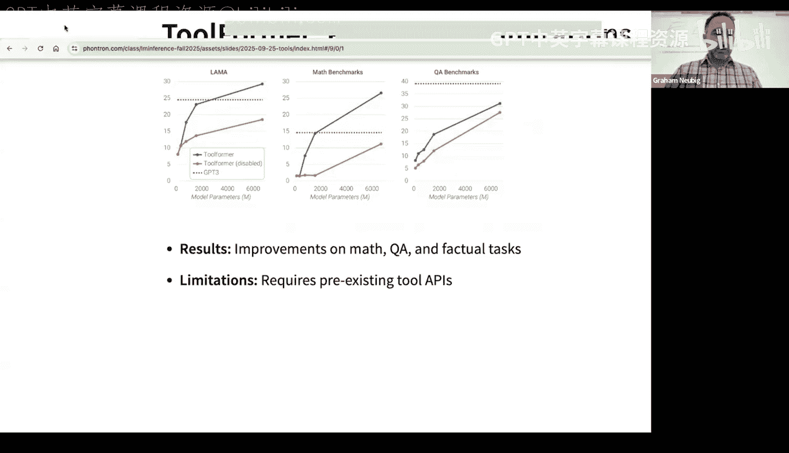

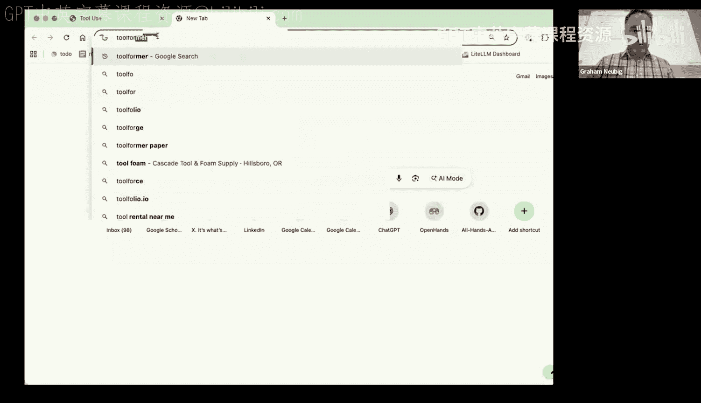

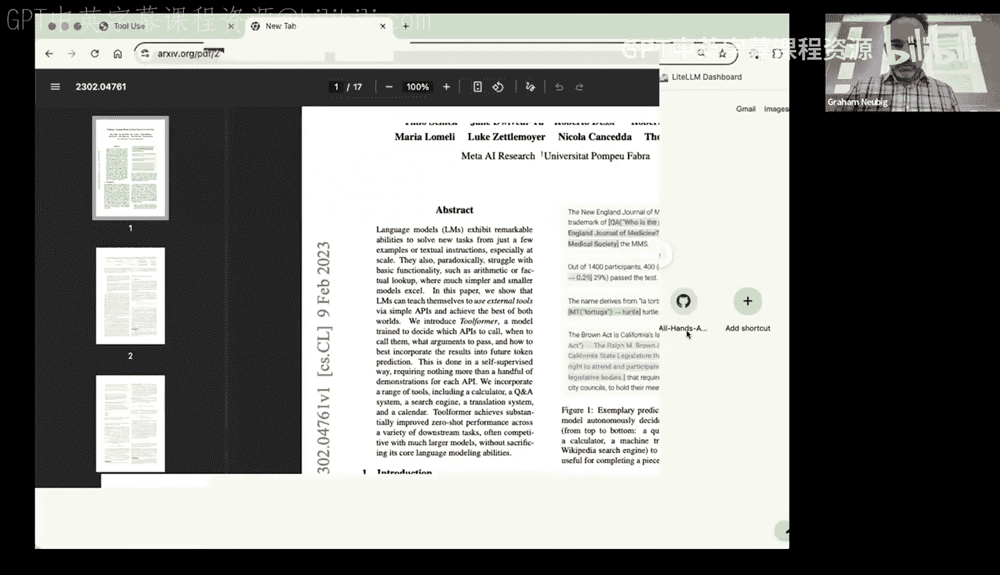

Yeah， it was these ones， a question answering tool， a calculator tool。

 a machine translation tool and a wki search tool where the tools that they're used to。

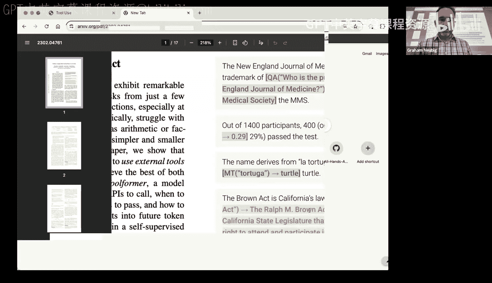

过。Yes， so did they train the model to into the within the race currently basis。

 Did they train the model to。Modify the problem to use the tool or like。

 was it done manually through of。It was done through prompting。

 So they got like examples of each of the tools in the prompt originally。

But that's like not enough to get it to learn how to like when and how to use tools well。

 so you need the like kind of RL style right after that。郭恩。Question。

So perspective by the increase in computational ability per to in to the use vehicles。

The increase in computational ability per token。 I mean， you can quantify the。

Improvement in modeling the next token through perplexity or something like this， but yeah。

 I guess the question would be like， how do you define computational ability if not for something like perplexity？

Yeah， good question though。So now fast forwarding into maybe 2024 or at least the present。

 what we do for the present。Around 2024， open AI released their function calling standard where their function calling standard。

 basically you can。

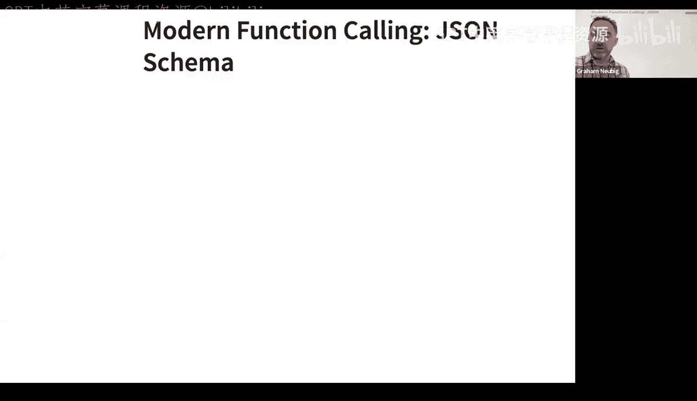

Specify tools in a format like this。 and so each tool。

Is essentially like get weather and then it will have like a name like get weather a description。

 like get the current weather for a location and then you have parameters like type object you know。

Then or sorry， this is the parameters。 And then each parameter is something like you have a string that is location string。

 which is a city name and then unit， which is a string， Celsius and Fahrenheit。

 and then location is required。 So this basically like looks like you know。

 a Python definition with a dock string or something like that， right。

They chose JSON Schema is the way to like express this because JSON Schema was a thing around。

 I would have preferred Python but because I find it a lot easier to read than JSON schema but this is what they decided so that's were what we use。

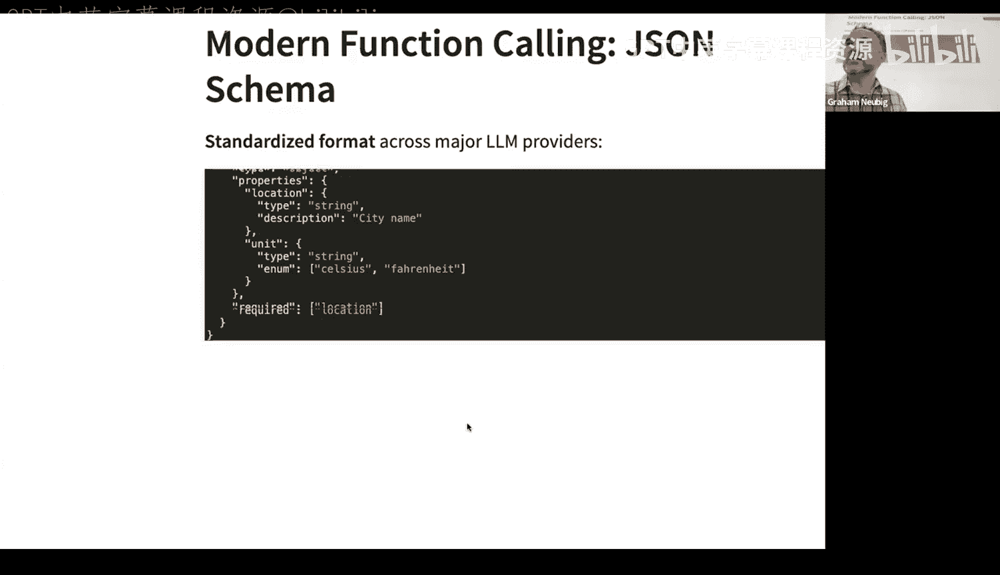

And then the function skull calling response is that the when an LM makes a function call。

 it will generate a like。

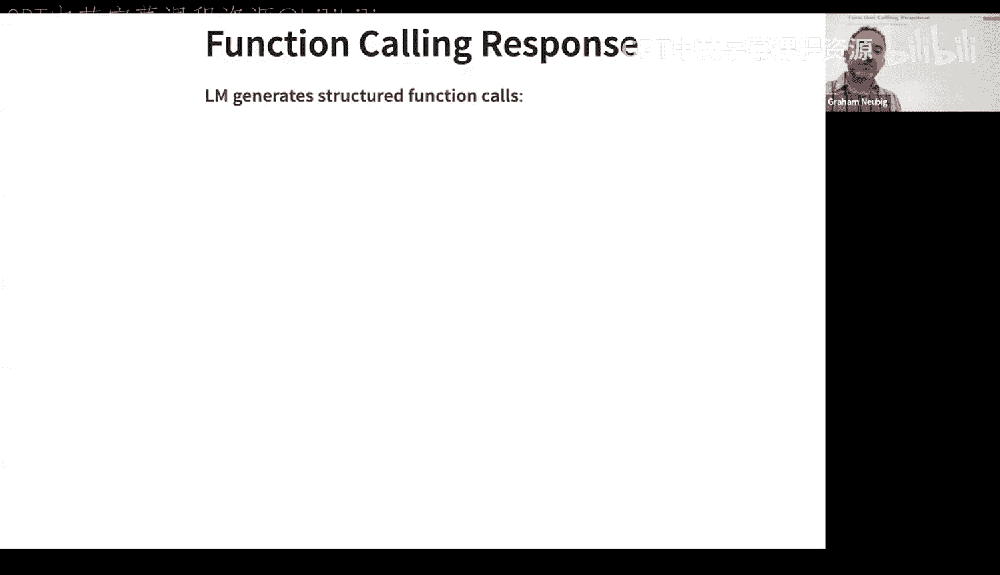

A call like this， and then it will generate a response that matches the profile of the response。

Sorry， the LM will generate a structured function called that matches the profile of the function。

 and it will look a bit like this。The content might be null。

 so this is typically like the output of the text that the language model generates。

 but the function call is not null。 and so what that means is you should like your system should take the function call and execute it essentially。

And the good thing about this is you can do like type safety。

 you can do validation consistent parsing Another advantage is all of the language models have been trained on tons and tons of function calling data so basically like if you specify it in this format the LM sure it will make mistakes some of the time but it's been trained so heavily and some of the API providers are certainly like enforcing this function calling format behind the scenes too。

Yeah。WillM Mc。Your system is responsible for handling the function call so the LM will just return this function call and then after that it's your responsibility to actually execute the code corresponding by this。

Instead of asking the element to just it us the。Well， but the input to the LM is like。

 what is the weather in Pittsburgh today？And the output of the LN or what is the weather in Boston in Celsius today correct？

So it just passes the question。it has the input correct。

 but taking in natural language and turning it into a function call is not an easy thing today。

 let me put it that way。😊，So that 920 is only responsible for converting it natural language to correct。

 yeah， yeah。Yeah for lot more systems do they always output like a giant J object include all the free form content and some of this object basically so the the question was like。

 do they always output this JO object and contain all the Texas free form fields， basically yes。

It sounds kind of crazy in some cases， like it's especially crazy when it's code because。😊，Jason。

 you need to escape quotes， right？ So if your code has a do string， it's like you're escaping。

Each thing of the docs， each quote in the dock string。 So you have a ton of back slashes and stuff。

 And that's actually why coding agents didn't work very well originally because they couldn't like make these function calls with all these back slashes。

 They'd like miss a back slash somewhere or they'd miss a tab somewhere and like things would break。

 Now， all of them are trained on so much data that it just works。 But， but yeah。

There might be better ways to do this， so you could think about that。

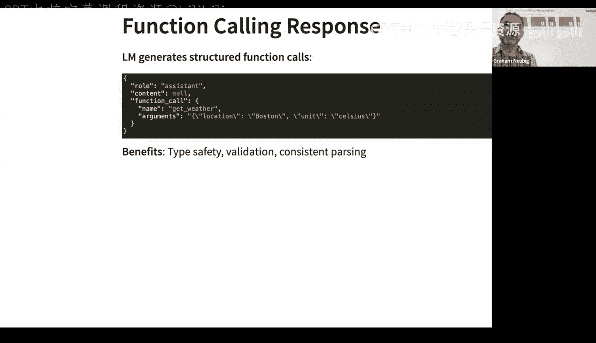

AnotherAnother thing that just I should mention that it's a thing is a parallel function calling and so you might think that you would make one one call and get one response to a function call but you can actually execute multiple things simultaneously so the responses is like tool calls and then you could get like these multiple tool call so you can actually look up the weather in like both boss in and New York in a single tool call。

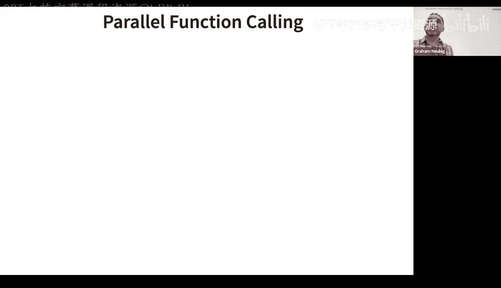

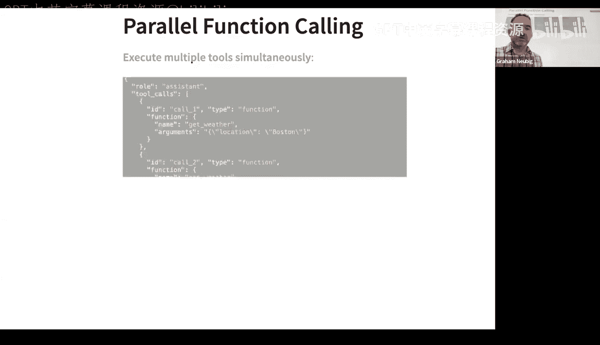

Or in a single conversation turn with multiple vehicles。

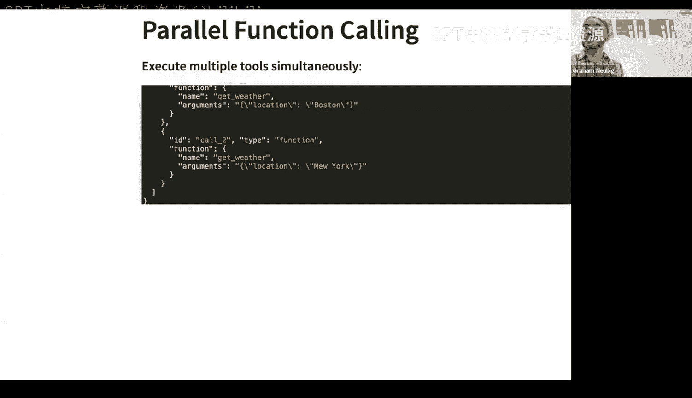

So one thing that I should mention and probably a lot of people have heard about this is the model context protocol。

 and the model context protocol is a standard protocol for connecting AI applications to external systems。

And。It's basically the easy way to think about it is it's like APIs for agents or APIs for language models to use。

And the way it works is number one， you have a standardized format and it adopts a client server protocol where each server has a set of tools that it provides to the agent So like。

You know， if you have a file system server， the file system server might have like list files。

 list files， read file and edit files， so it could have like multiple tools associated with it。

And then you have like the MCP host， which is your AI application， like your language model， u。

 you know， your language model client， and then it connects to all of these MCP servers。嗯。

You may wonder why this is why they needed to reinvent APIs to give access to agents。

 I think the reason was。Mostly。Mostly onefold， which is like a lot of APIs。

Require an API key and if you require an API key like you would have to give the agent access to the API key in order for it to use the API what they do with the MCP server is they hide the API key behind the MCP server and then give the agent access to the MCP server so it's like a special way of authenticating to the tools so that's kind of like the the reason why it was originally developed by like enthropic because they had plot and they wanted it to be secure and they didn't want to expose API keys to the agents。

So they wanted this like middle essentially middleware between the agent and like external APIs or something else like that。

 but what happened was everybody wanted APIs for agents so much that they were just like okay anthropic made APIs for agents let's use that and so now MCP is everywhere and there's no escaping it so now you need to bring up a node server for every service you want to communicate with and it's all ever baseball fault basically but yeah so that this is what this is what MCP is。

😊，And in the second assignment， we're probably going to ask you to connect to an MCP server in your inference center。

Cool， yes， but in practice is an MCP essentially just a tool where there is a prompt section detail what the tool have to use in andep。

 the easiest way to think about it is it's a server。

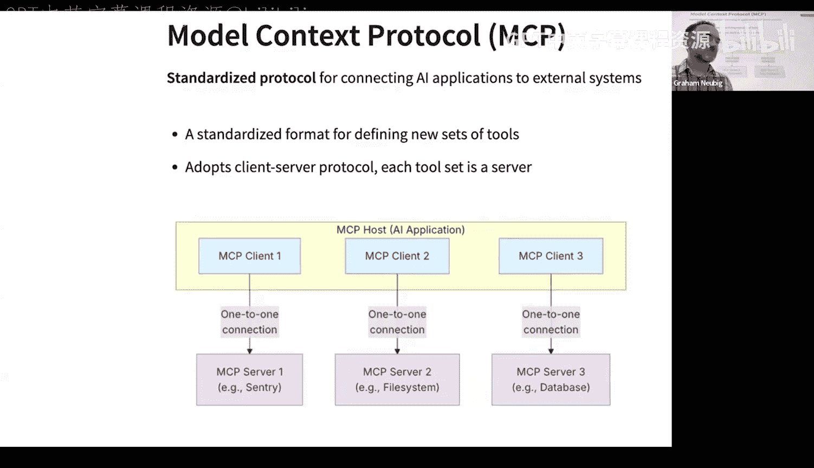

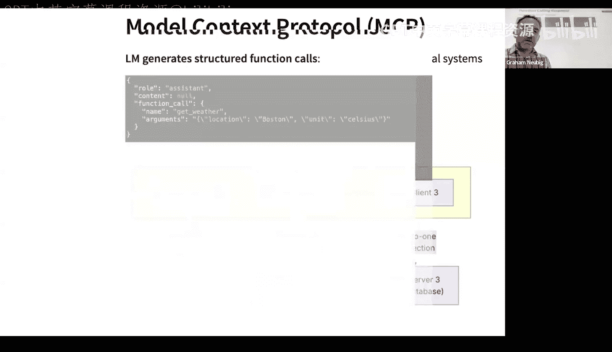

It's a server that has two jobs the first job is to。是。Like when queried。

 like what tools do you have to return this。So it will return the set of tools that the agent that the MCP server provides to the agent。

 and then when you call the tool。

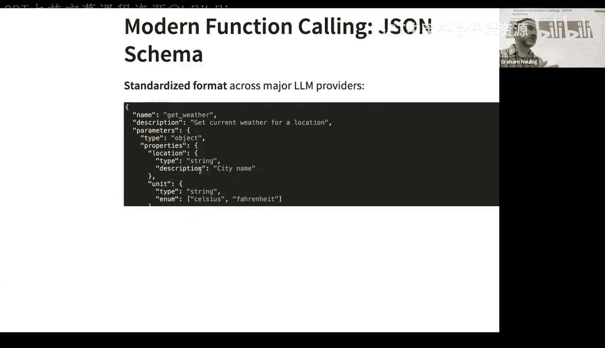

When you call the tool with this payload， it will actually return those filess。

 so the MCP server will like handle the function call for you。

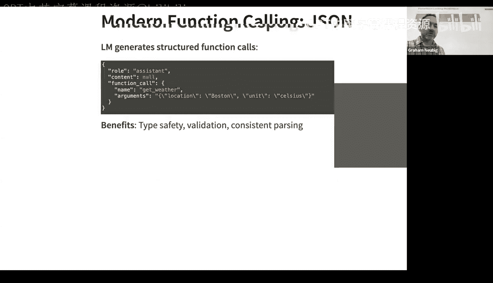

But how does the model know？

What the MCP tool is just loaded into the So every MCP server has an endpoint that returns the specification of all the tools it provides。

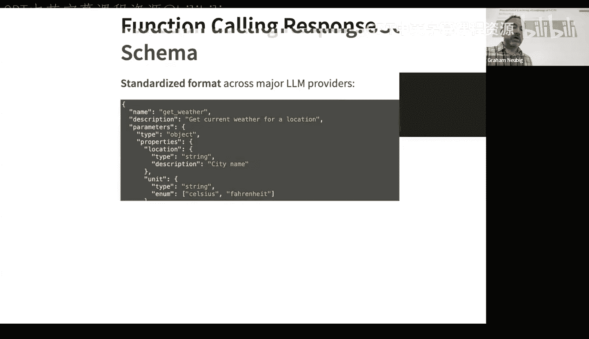

So that is useful， right， But like an open API server would do that as well。 It's not like。

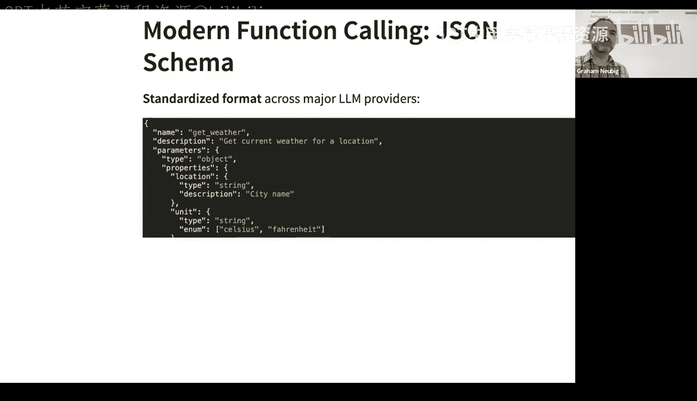

Specific to MCP。嗯， coolol。

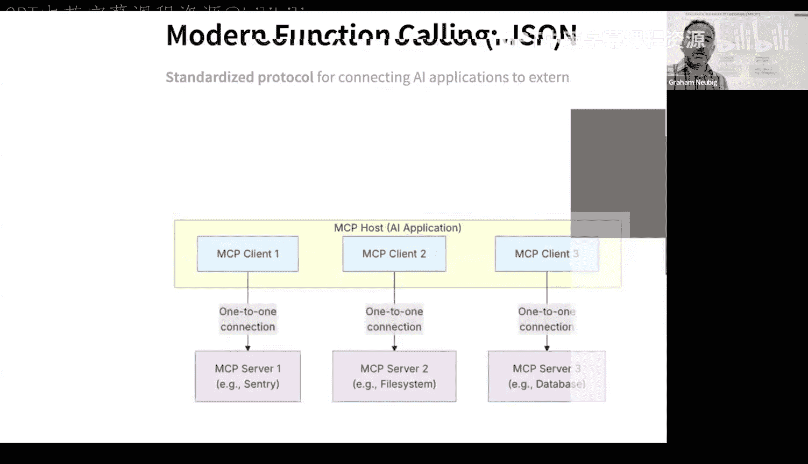

So。With respect to MCP， I think right now there's at least 17000 different MCP servers As I said。

 this was like very became very very popular very， very quickly。

 I think it started like February or something like that it's already very much an industry standard very recently the MCP organization which includes people in Anthropic and and other places created a centralized MCP registry that's supposed to be like the main MCP registry and it has a whole bunch of things。

 but like this will a whole bunch of MCPs， but it provides MCPs for things like empowering AI agents to access realtime web data or crawl websites or generate speech or generate modern UI components browse the web things like that So it gives you a lot of a lot of things。

😊，Rpped it inside an MCP server。 Yeah， that's the best way to think about it again。

So this is basically a more structured way of generating like JavaScript web components。

Like this is just one example of MCP， it's not really that important。Yeah， you can。

 you can look it up if you're if you're interested， Yeah， it seems a big business。Yeah， yeah。 Well。

 So this is a very。This is a very like industry centric thing。

 but it is also the industry standard for how agents interact with tools。 so it's important to them。

It。Yeah。你考虑身日。So A to A you're talking about A to A I'll maybe talk about that a little bit next time actually I should take a note to talk about that next time。

 but basically A to A is for agents to talk to agents and MCP is for agents to talk to tools。

You could have an agent behind the tool， but most of the time you don't。

 most of the time the tool is like something more deterministic。

And also it won't like talk back with you， it won't convert， it's not a two way conversation。

 it's basically a do this， and I did this yeah。嗯。Also if you want to build an MCP server。

 it's very easy this is an MCP server and has anybody used fast API before so easy way to make an API server replace fast API with fast MCP and you can get an MCP server so I've used this a little bit recently and it's very nice you just put a decorator on your Pon functions。

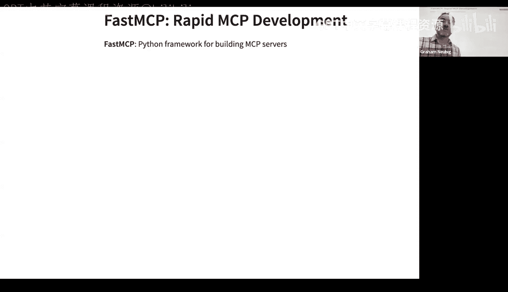

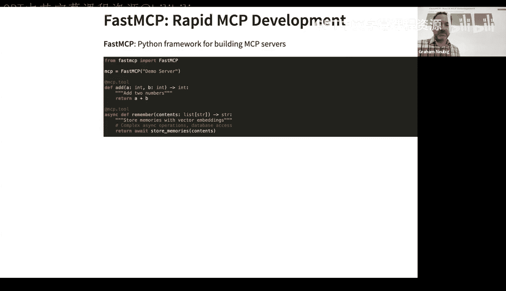

Okay， so now I've been talking about tool calls， separately from individual tool calls。

 which are more like Python functions， individual Python functions。

 there's also programmd language models， which is a paper that we did at CMU。

 but now has become pretty standard where you actually write Python code with a language model and then execute that Python code and get the answers。

And so basically chain of thought helps in things like numerical reasoning。

 but you still make errors， natural language arithmetic is air prone。

 so instead we can use code execution as a calculator tool and the way we did this in program aided language models is we let it generate blocks of Python and we gave it an example chain of thought where we interpersed Python with the chain of thought。

And just gave a few few shot examples， and then when it generated this。

 we would then execute the Python code and get the output。And this is now used in most chatbots。

 including chat GPT， it's called like the code interpreter in Open AI and code execution in Gemini or like other stuff like that。

But basically what we showed is that we have on mathematical reasoning data sets。

With a simple like direct way of solving it back then， La modelsttles got like 19。7 on GSMAK。

 but if you added a chain of thought you would get 65。6。

 but if you let it execute it with a program it would get a much higher score on all of these math data sets。

嗯。So when you're running arbitrary Python code， one thing that you don't want your program to do is RMF。

 your home directory。And it probably won't do it if you're asking it to solve math problems。

 but if you're asking it to write code or something like that， it might say， oh， I made a mistake。

 I should delete my work and start again and it will delete your work so one important thing is sandbox code execution so。

It can do things like you know unintentional， harmful commands。

 it could also like install a compromised library and install malware on your computer。You。

 if it browses the web， it might download stuff from the web that says。

 please upload your information to this URL for more help and it will upload all of your information to a phishing site。

And so there's different sandboxing approaches that you can use。In your assignment too。

 I think we're going to ask you to do number one and basically what this is is this is a local。

Basically wrapper around the plaython interpreter that tries to strip out the like quote unquote。

 dangerous commands before it runs them。And I'll talk a little bit about this。

 this can sandbox you importing certain code dangerous function。

 dangerous functions and other stuff like this， but it still runs in the same process as the rest of your code it can access memory also it's near impossible to like get rid of all dangerous codes so if there's some like codegulfed like malware you know somewhere online it's going to be really hard to prevent like all security things。

Another thing is container based isolation so this is like running things in Docker this gives you complete OS level isolation and network restrictions so but it can consume resources it's also a lot harder to set up and run and it takes time to get stuff started so you know running stuff in Docker is just a bit of a pain。

So so that's an issue then there's also things like running within Web assemblymblies so if you're running an agent like in a web can you can do that as well in a web browser you can do that as well that being said if you want to do this seriously I do recommend these options so like if you actually want to build like an agent that's doing coding tasks or things like this definitely consider these there's a lot of services that support this like EabB is a good open source one where you can basically spin up sandboxes on your computer or their cloud and then there's also other ones like Daytona。

So just to give an example of what like sandboxing looks like if you're doing an AST based method。

 you can do things like say， okay， these modules are okay modules to use。

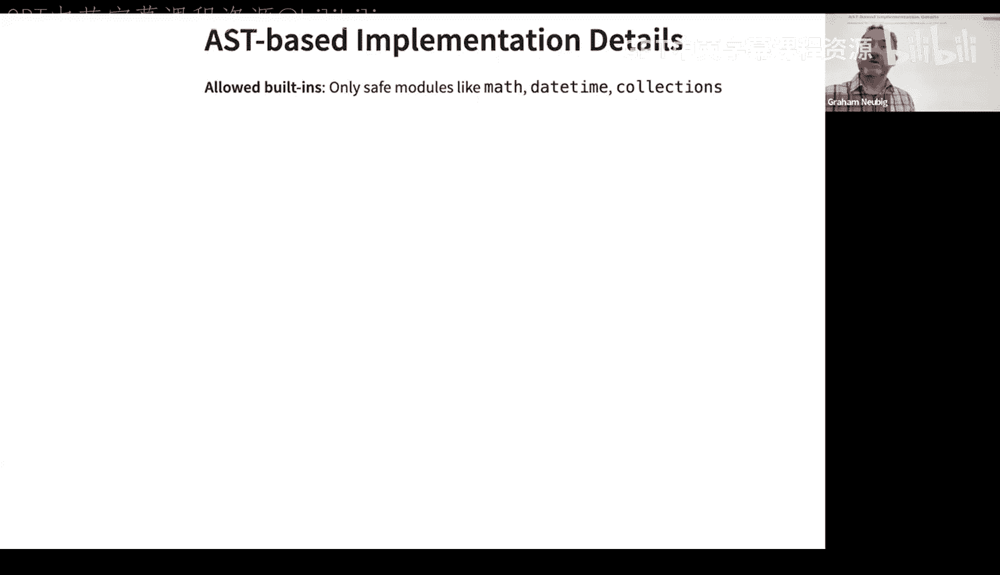

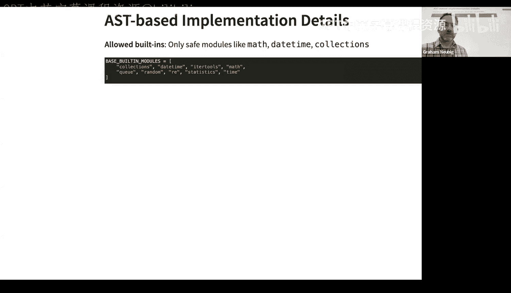

And then you can block other modules so you can block things like OS subprocess SA and Cs and not allow them to be used and you can you know also look for like double underbars that allow you to access particular types of methods like you know the built in methods of Python。

So this is the implementation within the Huging F Small agents repository， for instance。

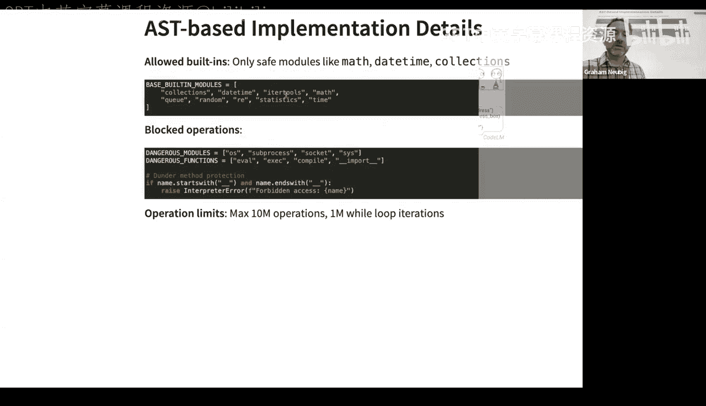

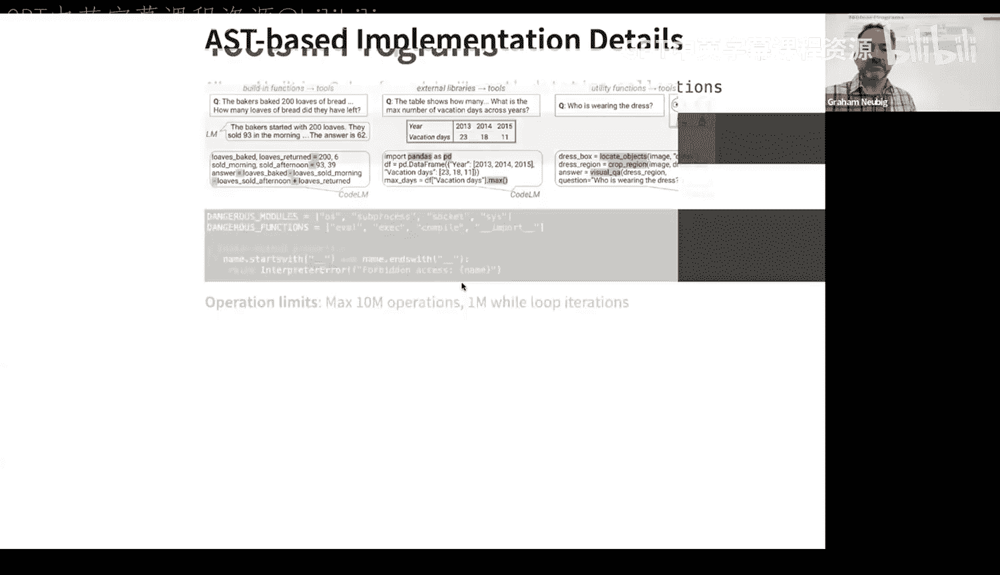

So you can use tools within programs and so I talked about parallel tool callings so you could like do parallel tool calls normally。

 but that doesn't give you things like control flow or you know composition of tool calls in interesting ways or things。

And so。要见。When performing more complex tasks， sometimes it's better to incorporate tools by just like providing the agent with the ability to run Python and say these are the tools that you're allowed to use。

 and then you can use things like Pada's Maplot Lab or even task specific expert crafted tools。

So the most famous work on doing this is gorilla， and basically it creates data sets with thousands of APIs with different interfaces and tries to get the model to be able to call them。

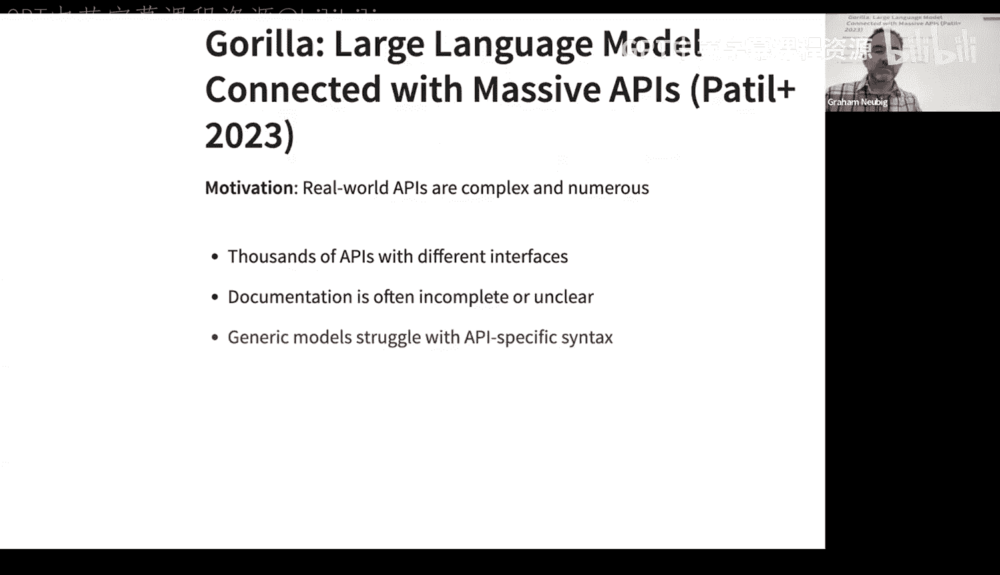

嗯。Sorry， I'm going to go a little bit quickly because we have lots of student presentations that I want to make sure we get to them。

 but so the way it works is they curated a data set where they downloaded a whole bunch of API calls。

 I think people didn't notice this， but in the original like gorilla paper。

 they're all like torch torch and Tensorflow and hugging phase。

 so they're all like machine learning related stuff， but they create a。

A corpus where basically they do self-instruct and they generate synthetic data given like APIs where it says come up with an instruction that would require you to use this API to solve it and so they create training data for this and then they train their gorilla model。

And then you can retrieve the potential APIs from the API database and generate the output。

So there's a number of things going on here the first thing is like this is a good way to create training data if you want to create training data。

 but also during inference time， you need to do retrieval of the APIs that you have access to and then provide them as function calls as potential functions that you could call and then have the model actually called the functions。

You can retrieve potential APIpis by training a retriever essentially， so you。

Like in this selfinstruct instant， like in these instruction API pairs。

 you know the gold standard API because you generated the instruction from the API so you can train a retriever that tries to retrieve the gold standard API out of all the other APIs and like training retrieveeverrs is kind of like out of the scope of the class。

 but basically you try to do embedding matching between the like encoded instruction encoded API docs。

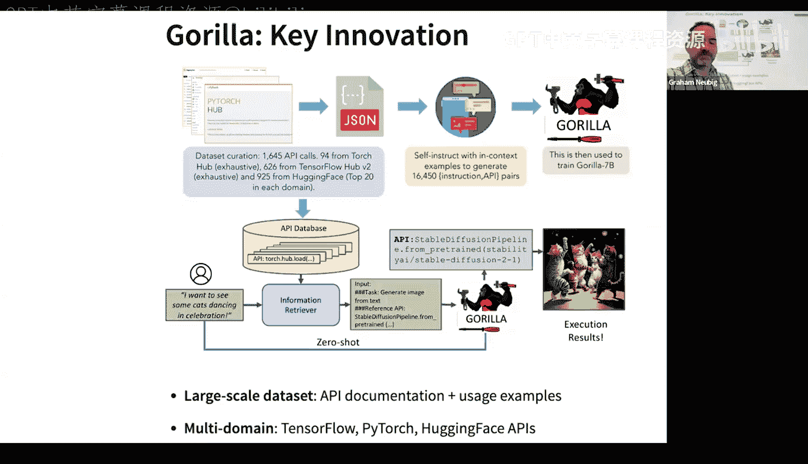

So。I guess it works。 And then the the other thing to note here is for tool use。

 the data set that came out of goerrilla became kind of like the standard benchmark for benchmarking tool use in language models。

 And I think people look at it maybe a little bit less nowadays， but still use it。

 but it's called the Berkeley function calling leaderboard And you can go and search for this and look at like which language models are the best ones for like。

😊。

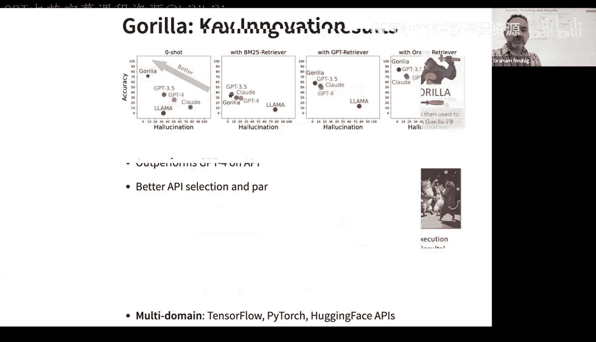

Calling APIs appropriately based on API descriptions。

And one important thing here is this is not a fixed set of APIs like Toformware。

 this is like you provide the API set the agent has access to and then you check whether it's able to predict based on the like API set are provided in context。

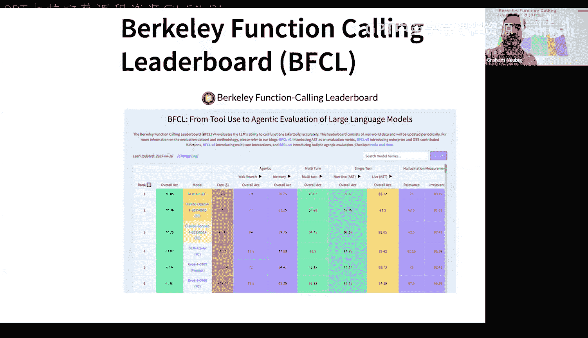

So recently， of course， 2020 fast forward to 2025 and。

Reasoning and reinforcement learning is popular， so of course we have reinforcement learning for tool use and the motivation is that SFT struggles with complex tool use and they basically do a comprehensive study on reward design for doing reasoning models that have the ability to use tools。

And they followed the deepS R one paper in providing both format rewards and correctness rewards。

So the format reward is like the tool call is in the correct format。Sure， that's easy to check right。

 we just validated against the JSON schema and we're done。

The correctness reward here is kind of interesting because it allows them to gradually push towards a completely correct tool haul and give partial credit。

 So basically they checked if the。The tool names in the generated output overlap with the tool names in the gold standard tools。

And so then also if you're generating too many tool calls， you get penalized for that。

And then they also measure the overlap for each of the tool calls among the parameter names and the parameter content。

 so you know like this gradually and like if in order to get the completely correct tool call you need to get all of these at 100%。

And the range is between minus three if you get like all of these。

 if you get all of them wrong and elsewhere。

So what's G this is gold standard and predicted， I think yeah。

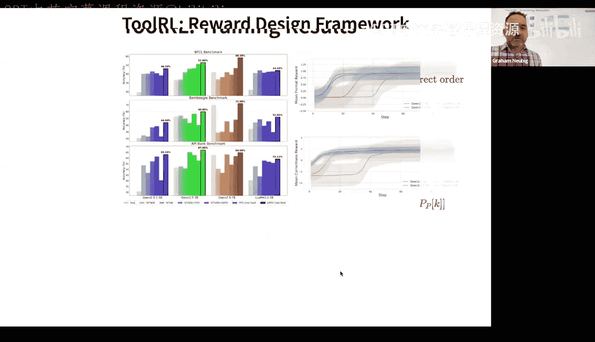

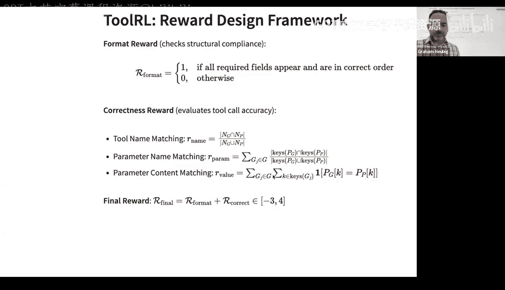

And basically they have some interesting results here I'm just going to very quickly say the main one and the main one is they actually found better results with cold start reasoning than they did with SFT based reasoning so they did a little bit of supervised fine tuning and then they did just trading the reasoning model from scratch and they actually got the best results from training from scratch I had them looked super deeply into the paper to see if they have a like better you know explanation of why that is but it's also a trend that we see in deep sea car1 and another like that as well。

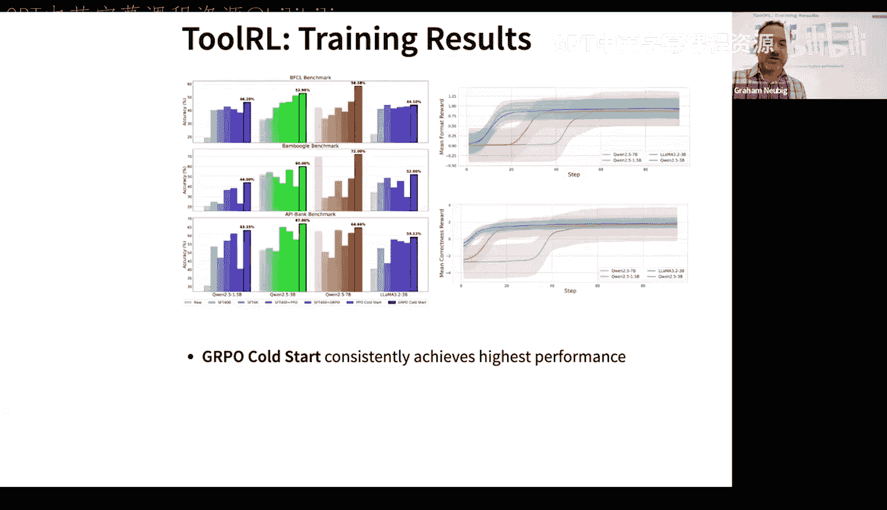

One not it means no SFT beforehand， yeah。So like if you had SFT。

 you can call it a warm start because you've kind of warmed up the model to be good at it before you start doing RL。

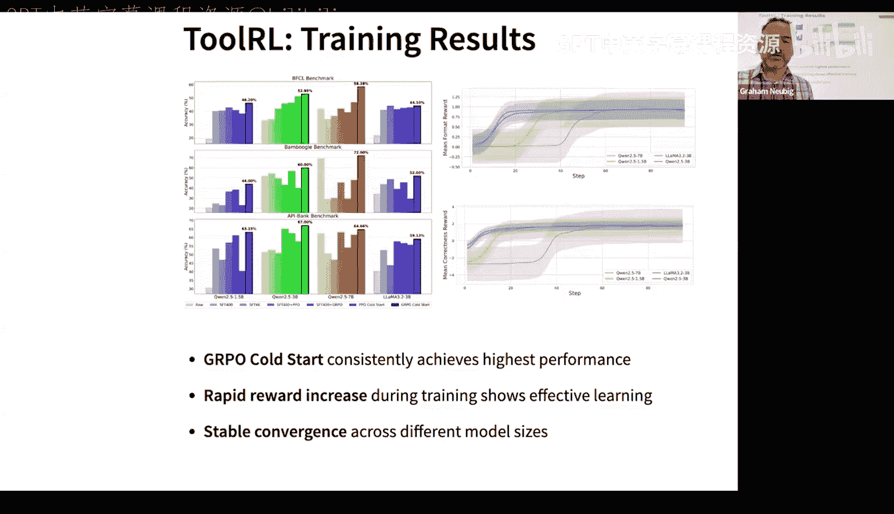

And so we talked about reasoning for tool use and so of course we have tool use for reasoning as well。

 so this is the opposite one and so basically it's leveraging external tools within LM reasoning they do RL directly from base models in a code interpreters within the RL training loop and they demonstrate that if they do this they get much higher results much better results and the model is able to learn to like maintain those results even after you train a reasoning model。

😊，Yeah， I have some contrast here， but maybe I'll skip it in the interest of time。

And then a final thing that we need to think about in addition to safety and sandboxing and stuff is robustness。

 This is a problem from the point of view of benchmarking and a problem from the point of view of language models being able to use tools effectively and the issue is APIs go out of date or you might run。

A file editing tool and the file editing tool will fail because you have the parameters a little bit wrong and language models need to be good at being able to deal with this。

 And so this is a paper that we did on benchmarking failures and tool augmented language models。

 And what we did is we essentially like broke some of the APIpis to make make it so that they didn't work。

 And often they and we measured a few things。

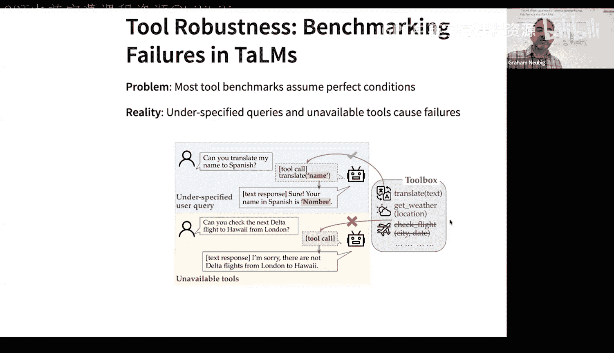

The first thing that we measured is。

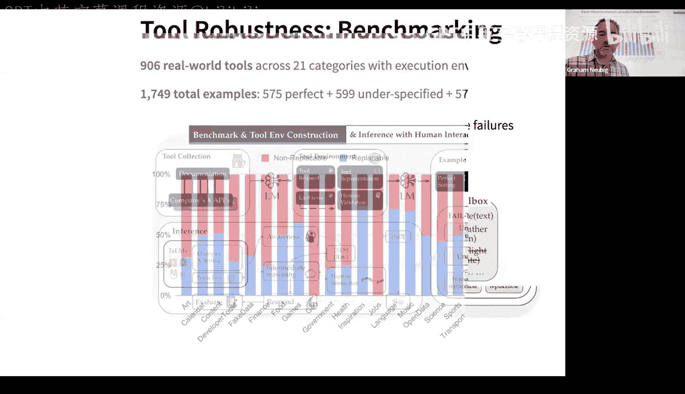

That we。Meeaased the awareness of models to like。We measured the awareness of models。

That the tool was broken， so we tried to check whether the model said oh。

 this tool is broken I won't be able to use it and that's kind of important because like the agent if the agent sees a tool is broken。

 it should be able to try to come up with something else instead of just like calling the tool over and over and over again they actually surprisingly few models were able to tell that like the results were wrong or that you know wasn't returning something and then we also tested the case where some of the tools were replaceable across different like tasks。

 so for example， for。Or like。Yeah， let's say let's say language like this if this was a language related tool。

 there were like other tools in the toolbox that could be used and so they would be able to replace it with another tool。

 and then they would try to we'd see if they'd be able to use the other tool。

 But like one thing we noticed is the awareness was not at least equal to test success。

 So just because it could recognize that the tool was broken didn't necessarily mean that it would be able to you know fix it or figure it out。

 So basically this is at least when we benchmark the models about a year ago， this was a major issue。

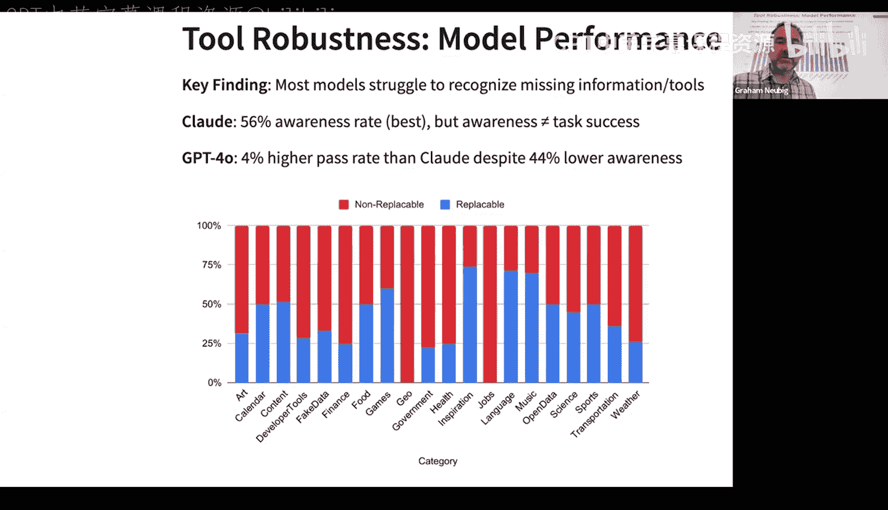

And then one final thing that I will talk about in the like maybe one one minute that I have before we switch over to the student presentations is creating tools so language models actually are able to create tools and the way we did this is we started out with primitive functions which are things like basic mathematical primitives or you know individual pandas functions。

And we ran models that basically。We ran models and we prompted the model to either import existing tools。

 create new tools or don't use any tool at all to try to solve the problem and we ran these three different methods and we did each of them K times and like k equals five and what that meant was we essentially were doing 15 different rollouts with different varieties of tools。

And。Then we did self consistency and。Based on the self consistency。

 we decided which answer was correct， and then we found if creating a tool resulted in a higher level of correctness。

 this is maybe an example where it would be good to have a tool that would help us out with us。

 And so we added this to our toolbox。 And so we gradually like increased the size of our toolbox。

And then if we add tools that weren't used very often， we prune them out of our toolbox。

 And so this is a test time thing that we can do where we like continually process test time instances。

 we see if it seems like creating a tool would result in， you know。

 more consistent outputs or better accuracy or something like that and gradually add to the toolbox。

And basically， what we were able to find was this gave us significant accuracy improvements。

 and it was also able to。Create toolbox that had relatively small sizes。

 but significantly outperformed just using no induction at all。Cool。

 yeah that's what I have about tools， are there any questions here？Yeah。

 that the instance in like how user is the LC server without changing your application that you still have to change all the prompt so that the model knows。

How usable is an MCP server without changing your core application code？

I would say that if you have a sufficiently good。Tool calling language model。

 It should be okay because the tool calling language models have been。Basically。

 primed to be able to like。Look at the function descriptions in the tool description and call if it's appropriate and just to have an example like we're developing like the open hands agent and like if it has access to a search tool and I ask it to search for something it will search for something otherwise it will try to use its web browser tool and go to Google and search。

 So like it's able to recognize that if it has a search tool， it should use that。

 if it doesn't have a search tool， it should takes some other you know meet。呃。

If there's multiple tools available， how does it depict the best one。

How good is it depicting the best one？That's a good question。

 I don't think they are particularly good at this。 If you give it a policy about what it should do。

 then like， I think it will。It will be better， but you'll need to like explicitly instruct it or train it。

 And if you train it then sure， you know through RL it can decide which one to use but and just to give one example of this。

 it's usually a good idea to prompt the model to use a tool if you have a relevant tool because like it's usually better to use a tool to do like。

 for example， calculation and。呃。Doing it yourself， although recently it's maybe not as clear because all the models have been trained super hard to do like lots of math。

 but。But对。

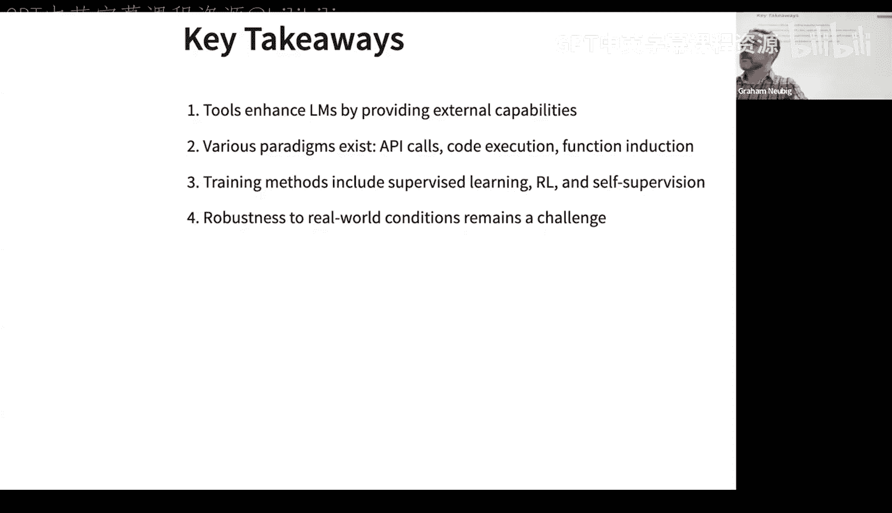

这个。没是。Yeah， if you're presenting， it'd be great to get one person up yourL maybe continue so who's presenting。

Thing copers。You definitely don't want to provide lots of duplicate tools because it'll blow up your context window and the confuse the model。

 but like I think overall having the necessary tools is probably better than not having them。

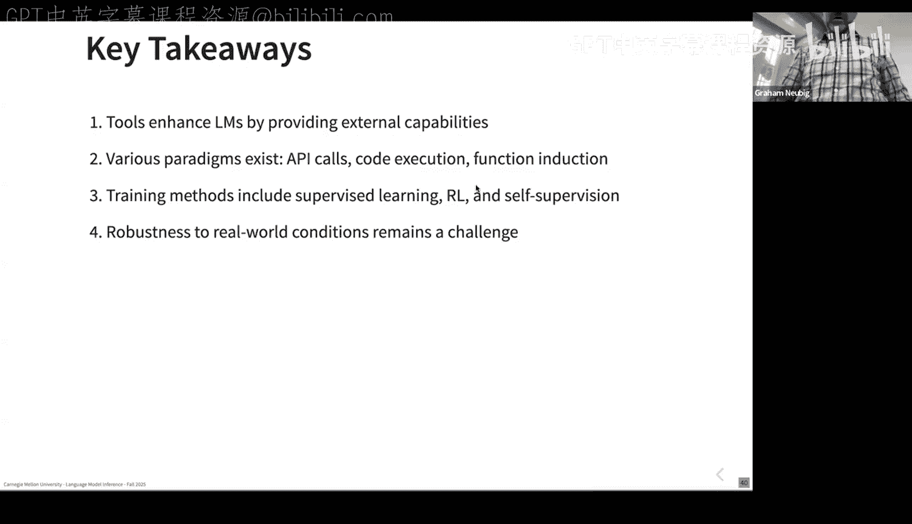

I saw another hand。