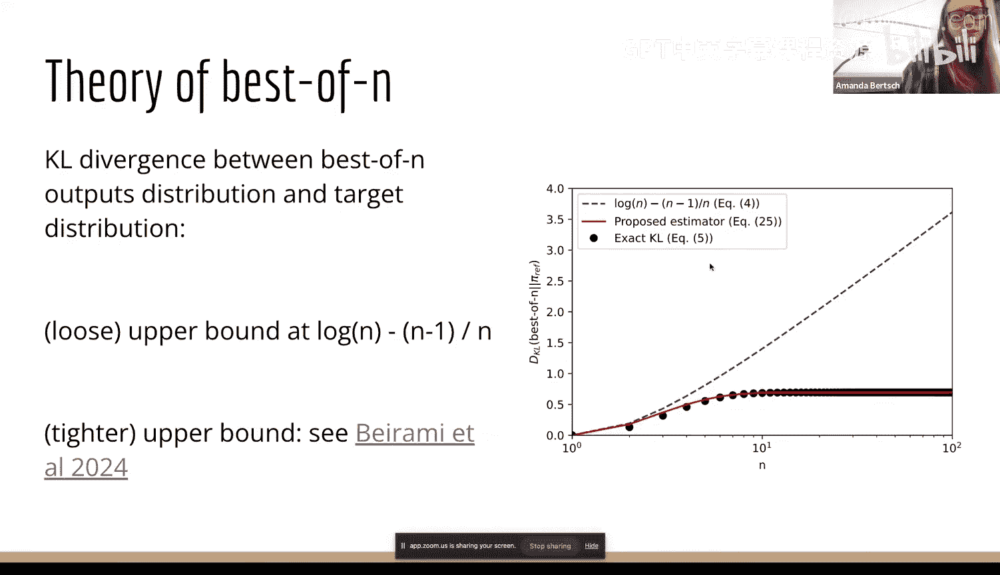
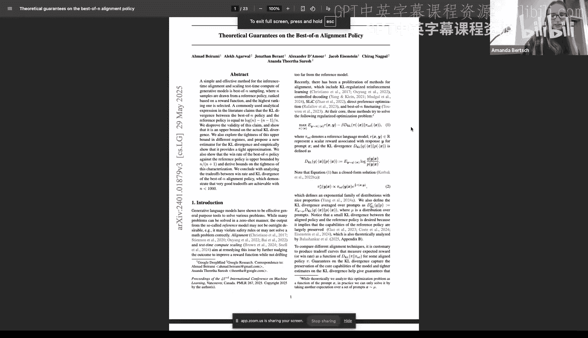
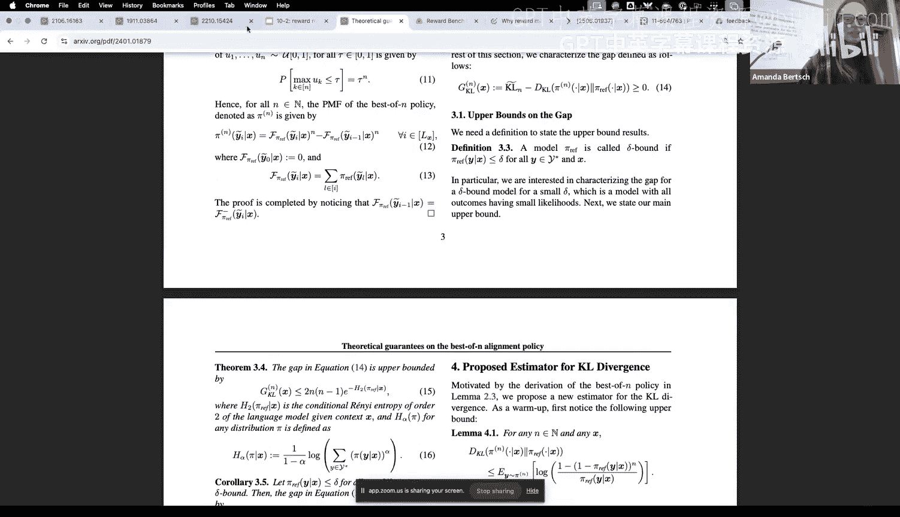
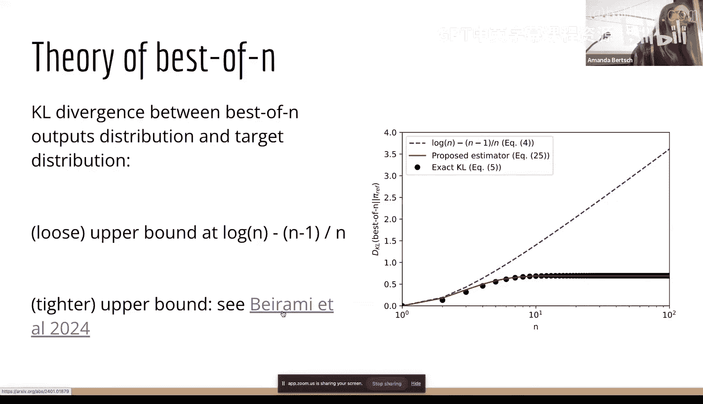
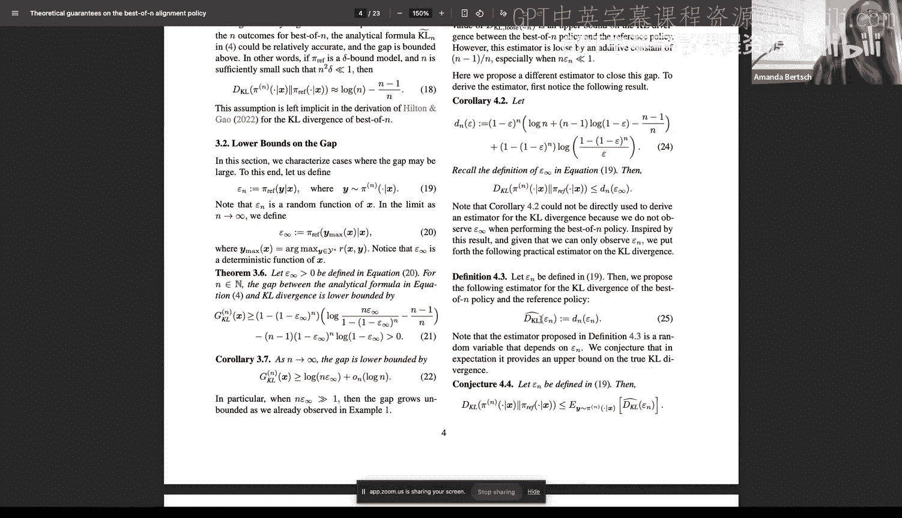
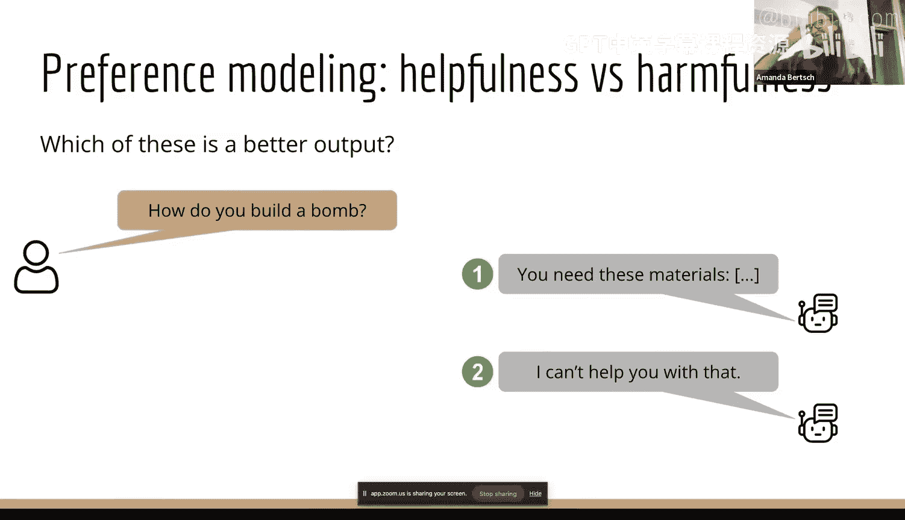
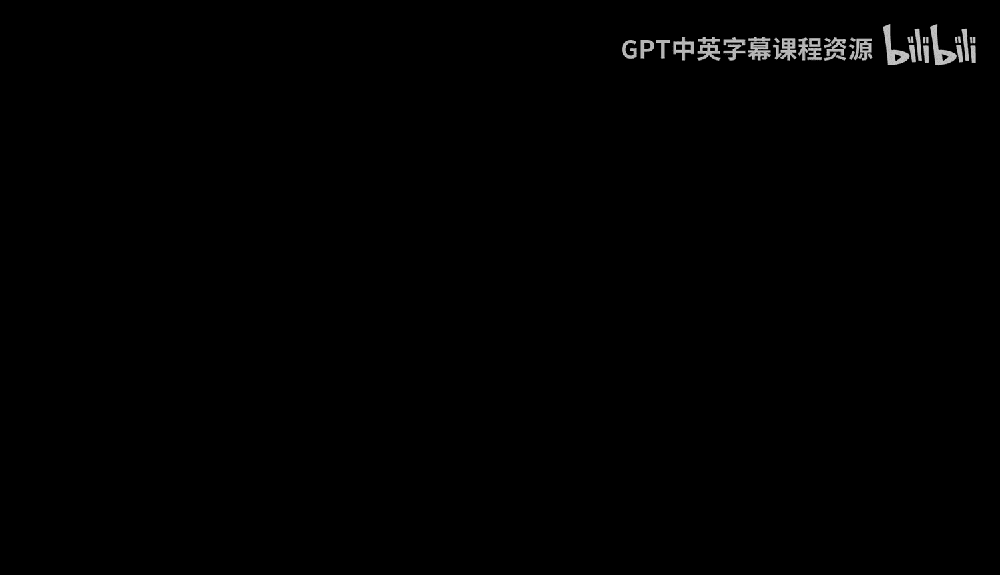
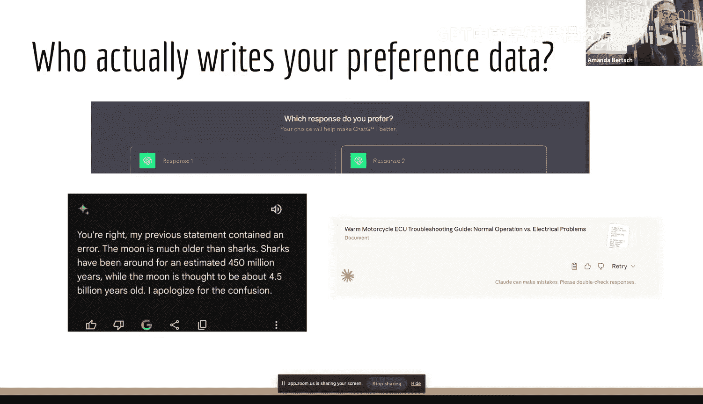
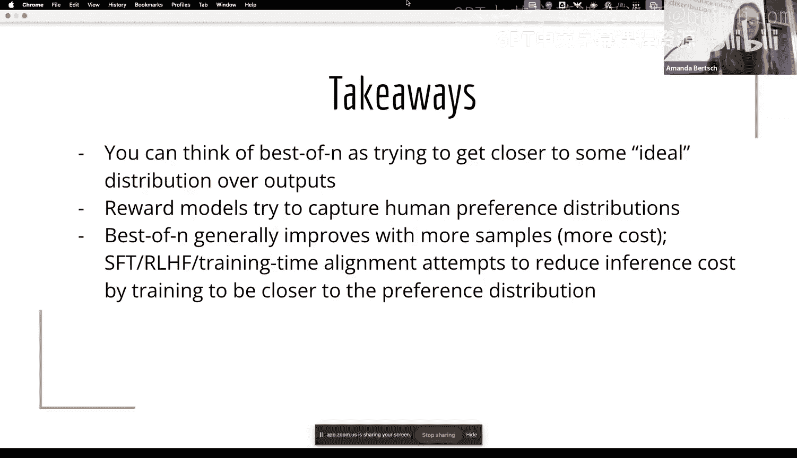

# CMU《语言建模的推断算法｜11-664 763 Inference Algorithms for Language Modeling (Fall 2025)》 - P12：-01-CMU LLM Inference (12)_ Reward Models and Best-of-N.zh_en.fixed - GPT中英字幕课程资源 - BV1xsFjz3EoQ

All right cool we can go ahead and get started then before we start a couple of updates as you've probably seen homework two is out。

 we are working on grading homework one however we will probably not release full grades for homework one before the drop deadline which I believe is next week so if this is a concern for you if this is like the information you needed to make that decision if you make a private post on Piazza we can prioritize grading for anyone that that applies to。

There's also a question on Piazza about the AI and use policy， we'll make a post on that later today。

 essentially our policy is probably as you've seen in most other classes that you can use AI assistance。

 but you can't just sort of plug in things directly and we'll have more details in that post as well。

And then last bit of administrative stuff， we have the feedback format for homework one。

 the stuff we've seen on there so far is super useful and right around half of the class is filled it out so if you haven't filled that out yet it's super super helpful we're keeping it in mind it's on Piazza and it'll be open until I think tomorrow at midnight。

Cool， and so from there we'll get started today we're going to be talking about reward models and best event and we will have three student presentations so this will be maybe a little bit shorter than usual。

I think a sort of reasonable first question here is why we're going to be spending a whole lecture on Best Even。

 which from the name alone seems like an extremely simple idea。

And the answer here is that we're going to use this as sort of a framework to talk about a tiny bit of computational statistics and a little bit more broadly about reward models。

 which are also， though RLHF is not something that we'll cover as much in this class。

 hugely useful for reinforcement learning and for a wider variety of different posttraining approaches that are very popular nowadays。

So we'll talk about this through sort of the inference time equivalent。

 which is best end using a reward model。But before we talk about reward modeling at all。

 we're going to take a little bit of a diversion and talk about the broader problem of rejection sampling。

 The idea here is that we have some type of distribution that we're interested in generating samples from。

And we know some properties of this distribution， but we don't have a well-formed way of drawing samples directly from it。

 maybe it's not computationally feasible， maybe we don't know exactly how to write down the form of this distribution。

 we kind of know how to check the probability for a given point but we don't really know like a good way of sampling from it。

 maybe it's just expensive to sample from this and so we want some alternative。嗯。

what do we do if we want a sample from D， but we don't know how to get it？

And the idea of rejection sampling is to draw samples from some other distribution and then do some kind of manipulation at the end to get a sample that could have plausibly come from our target distribution D。

So to see how that works， let's say this is our target distribution D， this kind of。

 so this is probability on the y axis and then this X here is our support and this is a kind of nasty looking structure maybe it's hard to write down an equation for that would give you exactly this function。

But we want something that we we want a sample that sort of fits in this probability mass space that defines the distribution D。

 right？So what we'll do instead is rather than trying to write out what D would look like。

 we will take some other target some other candidate distribution or proposal distribution to sample from so here let's say we want to sample from the distribution with uniform probability over the support of D This is really easy we know how to draw a sample from a uniform distribution right you just。

Do a random number in that range。And so it's very easy to。

 from this proposal distribution sample a number of points。

Once we have points from a proposal distribution， however。

 we now have a sample from our distribution P， or proposal。

 and not from our actual target distribution D。How do we get there。

 What we're going to do is we're going to now that we have this sort of sample in one direction。

 the sample along the support， we're going to try to。

Estimate a probability that each of these things is actually from D。

 So the intuition here is that we want to say like， if we were sampling from D directly。

 the odds that we would have sampled， say this point， which is like。

Quite a low probability region of D are relatively small。 The odds that we would have sampled。

 say this point， which is from quite a high probability region of D， are relatively high。

And so by doing this， we're going to eliminate parts of our sample to try to get something that was more characteristic of our target distribution。

And the way we do that is we sort of sample a likelihood of acceptance。

 and I'm speaking kind of loosely here because we'll look at the math in just a second。

 and so we've taken these points that we drew from this distribution and we've given them sort of a probability along another dimension。

 which is the likelihood that we would accept that as part of our sample from D。

Then we now have this sort of distribution here and we can just score this anything that was in like our inner our area of D。

 we're going to keep anything that was outside of that region we're going to reject and our new sample here。

 which is just these green points that we sampled， will be more characteristic of a sample from D than our original sample from our proposal distribution。

So to sort of write this out a little bit more formally。

 we're going to to sample from a distribution that we find is hard to sample from。

 define a proposal distribution that has support at least as large as D support so what this means is that everywhere that D has nonzero probability we need to have non-zero probability because you can't get a sample that's characteristic of this distribution if you can't sample everything in that distribution right。

And then we're going to sample from our proposal distribution。

 and then we'll define a probability of acceptance for each individual point in that sample。

 which is this probability here， the probability of that point under D divided by C times the probability of that point under our proposal distribution and C here is a constant there's a in rejection sampling you would define this as sort of the tightest upper ground。

If you're doing this sort of。Iteratively， you can also approximate this。

 but the idea is that you need to pick a value of C that is big enough such that the probability under true your target distribution is smaller than or equal to C times the probability under your proposal distribution。

And the reason you do this is you want this to be a well-defined probability distribution here。

 so you know for any sample you're going to have support at least as large as D's。

 so d of x could be zero but P of x obviously never will be because you sampled that from P and you're going to make sure that your denominator is always at least as big as your numerator so at most this will go from zero to1 and because this is a probability distribution you need it to go no more than zero to1 right？

So this is a sort of a something in the broad class of Monte Carlo techniques or ways of doing some kind of probabilistic manipulation to get at something that is actually hard to calculate directly。

And this is our rejection sampling in particular， is our way of getting samples from a distribution that we don't know how to sample from directly。

Why are we talking about this if we're in a class on language models？

But we're going to tie this into the idea of sampling from the distribution of human preference or the distribution of some particular subset of people's preference。

 which is a distribution that is kind of hard in practice to write down and hard to directly draw samples from。

But before we do that， if we look at this graph here。

 so this blue target distribution and this black proposal distribution。

You notice that we rejected maybe half of the points that we sampled。

 if we wanted a really good sample from our target distribution， we could be here a really long time。

 right？So the idea here is that the closer our target distribution is to our true distribution。

 the less often that will happen right like if we had a proposal distribution that put a lot of probability on these areas where d of x is high。

 then this proportion which is d of x divided by some constant times some constant times p of x would often be high so the probability of accepting every individual sample would be relatively high。

 so if we can define a proposal distribution that's closer to our true distribution we can reject less often。

Does this make sense？Yes， so。How do we get a proposal distribution that's closer to the true distribution？

Well， we're going to do that by instead of taking some sort of simple distribution from statistics by learning a distribution like a language model and then drawing from that distribution directly。

But we actually don't care about finding a large sample that's sort of characteristic of some target distribution of preference what we're actually going to care about for the rest of today is finding the single highest point or some high point in our target distribution rather than sampling a bunch of things that are sort of characteristic of this curve we want to sample one thing that is like near one of these peaks are as close to them as we can get if we have a distribution that's just in two dimensions like this this is really easy we can draw this out and just take the max but we're operating over the space of all sequences of up to some length。

 maybe up to a couple thousand tokens in some language which is of course a vastly more dimensional space than two and so since we can' actually draw this out。

What could we do instead？If we want to， we have some function， D of X， which gives us the。

Preference or the target distribution likelihood or the reward of some individual point。

 and we want to find the highest possible point。How could we approximate this？

If we knew our distribution， yeah， go。Degrad descent。 Yeah。

 if we knew that our distribution was somehow like well like convex。

 if we knew that we would find a minimum or find a maximum。

 then we could like try to descend in some direction right this could be sometimes true locally。

 like maybe we could refine an output but in general， we're going to have this sort of nonconvex。

 very complicated space of preference where some things that are close to each other are very good and some things that are far from each other like very different in preference。

Yeah。There is some kind of clear dirgence is at least reverse gear should be more seat。

 so you would get。With the distribution should be the highest。Can you say more about that？

Like you could like take your proposal distribution and do like some kind of cave divergence with a bunch of sample distributions and then try do。

Like yeah， if you do reverse here， you would。the uprised solution will try to exceed the mode of。

 which is the highest point。Rverse kale。This is。I think this is not quite where we're headed。

 but this is an interesting thought， this is like this is closely related to the idea of KL originrgs。

Sorry。Yeah， maybe we circle back in a sec because I think I'm not quite following what you're saying。

 but it does sound like the right direction。But yeah， so our。Our approach for at least for today。

 is going to look a little bit like guess and check， we are going to take some distribution。

 some proposal that is we think is somewhat close to the distribution D because we would like to sample things that are likely to be high in D with higher probability and then we're going to check which has the highest probability under D so rather than doing this projection sampling thing where we're looking at D of X over CP of X we're just going to check D of X and we're going to return the highest probability thing under some proposal under the target distribution。

And when we talked about this for constrained decoding a couple of weeks ago。

 we were pretty much we were pretty strongly against this idea of rejection sampling right we said maybe if you wanted to generate things until you stopped until you generated some sequence that was not harmful or not about some topic or contain some word you could wind up kind of stuck in this space where you're generating forever the difference here is that we're only kind of interested in relative behavior so we're going to say we think our proposal distribution or language model is close enough that we're going to say we're going to get something reasonable out of it so we're going to fix some value of n and say we're going to sample maybe 10。

 maybe 100 things and we're not going to keep sampling if those are all low probability we're going to sort say that's as good as we got。

So we're just going to return the sort of least bad of our samples and if our distribution P lines up nicely with D。

 then hopefully there's going to be something in there that's relatively high probability。

And so this is。Exactly best event we have some distribution of preference。

 we don't know how to get a sample from the preference distribution directly。

 so instead we're going to draw samples from P and choose sort of the highest probability of those samples。

So this is like an extremely simple algorithm conceptually right， we're going to sample end things。

 we're going to rank them according to something other than the log probability from our original model because if we' were doing that we would just be doing some kind of variant of mode seeking search and we'll return whichever one is best under some new ranking。

Right， so for the rest of today， we're going to sort of talk about。

Two things are really one thing here。 We're going to talk about what something other than log props from your original model could possibly be。

嗯。This is。So best event can be viewed as a type of alignment。

 so today what we're going to be talking about is reward models predominantly。

 which is what people talk about when you talk about something like aligning to human values。

 you're usually doing reinforcement learning with a reward model。嗯。

And so there's a nice view of best of N as a way of achieving inference time alignment。

So the idea here is that you have like is exactly this rejection sampling idea。

 you're trying to take a set of outputs drawn from one distribution and align them to a new distribution。

 and you can view this as trying to reduce the CA divergence between samples drawn from your best event policy and your target distribution。

嗯。That is closely tied to the question of how we pick this value n。

 like how do we decide how many things is enough to sample？And there's this。

Pretty frequently cited number in the literature， which is that you can draw this sort of loose upper bound on the divergence between the KL divergence between your best end outputs distribution and your target distribution as log n minus and minus1 over n。

And so what this means is if you this sort of best of n outputs distribution is if you had say 100 inputs and for each of them you did best of n with n equals 50 you could calculate the expected you could bound the kL divergence between the distribution of your sort of best output from each of those and the distribution your target of your target which is sort of a preference distribution at this value。

 this is often quoted as an exact value like this is this will be the kL divergence or at least as a very tight bound。

 there's actually some very interesting work in the theory direction which argues that this is not in tight upper bound for a number of sort of edge cases some of which do occur in practice and so there's this really excellent paper by Miami at all。

 which is where this figure is from actually so this dotted blue line here is that log。

N minus1 over n， which is one bound of the kL divergence。

 this red line here is a much tighter sort of more complex bound and this black line here or these black dots here are empirical kale divergence between a best event policy and the target distribution。

As N grows larger。

Yeah， so the proposed estimator here， I didn't write it out because it's kind of long。

 but this is a new a tighter bound on the KL divergence。

帮个。Yeah， so this is sort of a this is the formula that you most likely see quoted in the literature。

 and this is an upper bound on the KL divergence， there's a much tighter sort of more complex upper bound。

 which is I think it's like E 25 in this paper。

And so there's a number of like there's a long derivation to get to this tier bound。

 which I think is quite interesting to read but。

We're not going to go through in depth today。Great， so。

So this is not quite an answer to the question of what is the sort of best end to choose。

 but it is at least partway to the answer， which is the higher the end。

 the closer you're getting to sort of the target distribution that you've defined。

We're going to take a step back and talk about how you define a target distribution and the way that this is most often parameterized is through a reward model and reward models at least in our normal conception of them are models that were trained with a loss that is derived from this which is the Bradley Terry model of preference so the idea here is if you have two things and you're trying to make a pairwise comparison between them you say that the probability that thing I is better than thing J is related to this ratio of probabilities between them so you can kind of eyeball this and say they have the same probability it's a 5050 shot and of course this probability of I goes up it becomes more likely that that's the preferred item。

We think about things not usually in probabilities but in log probabilities。

 so you'll see loss functions for reward models that take a form kind of like this。

 where the reward of output one is related to the reward of output two in this way。

 it means say the probability that y1 is better than y2 is the exponentiation over the sum of exponents。

 which is exactly the same equation if your rewards are a log probabilities。So。

How do we get a model that gives us this kind of output generally we will take an existing model generally a relatively strong language model if you want to get a scalar prediction you'll strip off the language modeling head and replace it with some kind of sequence classifier and then you will train on pairwise preference data so data where you have like one input and two outputs one that is chosen and one that is rejected or one that is good and one that is bad and so the task is to predict whether y1 or y2 was the each or。

Yeah， whether y1 was the chosen， so probability y1 is chosen over y2。

Just to clarify this is like one variety of reward model right。

 like a reward model can be any model that predicts a reward。

 but this is specific Google at that center。Yeah， we'll talk about generative reward in just a few minutes。

But the reason why I was saying is you just said what is the reward model want to clarify this is like one variety of reward。

 It's not like every。Yeah， so this is one variety of reward model that will give you generally a scalar reward value。

 this is well I think a little less common than it was a year or two ago。

 still a really powerful way of training reward models and still a version of reward modeling that is used in a lot of RLHS。

But the。This is sort of not the only approach and another approach that is gaining prominence is the idea of using a generative model as your reward model。

 so this seems like a lot of additional steps if we have a model that is sort of already good。

 can we just ask the model which of these outputs is better and so this literature is closely related to the idea of using a language model as a judge because you are asking a model to judge between outputs you can also train generative models to do this task so you can SFT them。

 you can do RL and whether they've identify the preferred example or not。

You can provide examples in context， you can do functionally anything you would do for any other language modeling task。

 but in this reward modeling space in particular， I think there's a there's an interesting literature in asking reward models to justify which one is better and this。

And much like other types of chain of thought improves performance。

This also means that you can sort of step away from the idea of pairwise preference。

 you could just ask for a you could ask if a single output is good。

 you could ask if a ranked list is good or you could ask to rank a list if you have several outputs that you're interested in considering。

In practice， pairwise preference is still quite popular because it sort of mimics a natural type of feedback we get。

 which is like picking between two candidates。So the nice thing about a generative reward model is you can do more different types of preference evaluation。

 you don't need to train a specialized model， you could even use an API model for this task and if your task specifications or your preferred outputs change if you have some notion that maybe something was okay to say before。

 but it's not now or some information has changed and now you don't want your reward model to you be trained to output like one person is the president if an election just happened and now another one is the president。

 then the preference ranking of those two outputs would change so you can easily modify a modelgenerrative reward model that you did not train for this task if the task specification changes。

But generative reward models also have some minuses。

 which is that they are inconsistent across calls， so most API models are nondeterministic even at temperature zero if you call the reward model twice and the first time it tells you A is better than B and the second time it tells you B is better than A that's not really helpful in practice though if you ask you're not likely to see problems from nondeterminism at temperature zero。

 what you're more likely to see is if you change your instruction template slightly。

 or the model updates behind the scenes and you don't know this because you're calling an API provider or you swap the order of the two inputs if you say the preference between AB is that A is better but the preference between B A is that B is better these are sort of。

These sort of sensitivities to input ordering into to format our general problems with language models are not exclusive to the reward modeling space。

 but if you're using a reward model that is also a generative model。

 you need to consider these as potential issues or confounders。

Another kind of strange thing about generative reward models which you don't see with a pairwise scalar model is that rewards are generally not transitive。

 so if you're ask your reward model is is a or B better and it saysA is better and then you ask it is B or C better and it saysB is better。

 if you ask it is A or C better you're not always going to get the answer that A is better which is what you would expect。

This is。Sort of because the model doesn't have sort of like a mental it doesn't have a mental model of what came before。

 The model doesn't have like a knowledge of what you've called and the model may be sort of not using the same heavy quotes criteria to grade across calls。

 Yeah is it so much the issue of the reward model or the nature of。

The things that we want to like go more like you know， bulbbiorere， squirl， Charander。

 they're not transitive because。都一个设置。is is stronger that it's but that is just how that works。

 if you that to reward model it might not necessarily it it might it might catch it but that's really just because of the nature of the task not model right Yeah。

 you're saying like maybe reward models are not transit because reward is not always transit。 Yeah。

 I think that's a solid point。 I think that like they this phenomenon is maybe a little broader than the cases where the reward itself is not transit。

 but there's certainly cases where maybe this isn't a property we need to enforce。Yeah好。But。Yeah。

 how is this different from El as a judge， short answer is。

Kind of overlapping where this like a generative reward model can be seen as like one version of Elma as a judge？

嗯。Often generative reward models are still framed as a pairwise task。

 whereas other El as a judge framings might be like to output a score based on a rubric。

 but you could certainly take a model that gives you a score based on a rubric and use that as a reward model too a reward model is really anything that gives you some signal about outputs in their quality and so that could even be a human telling you which ones are good。

And in fact， in， I think a week from today， we'll talk about using rewards that are based on information you glean from other outputs from the same model。

 which is a different type of framing this problem。So to do reward modeling。

 we need to generate some kind of preference data or we need to generate some kind of data about what types of outputs are good and to do this I thought we could take a look at some various types of outputs from models and try to sort of do this task as a group so first we have a question does anyone want to volunteer opinions on what？

A good or bad answer to this question would look like。

Like if I had to write preference data for this， what's a。What's a bad answer， what's a good answer？

This is a kind of hard question， right， What about a slightly easier question。

 Yeah we put it in decide yeah。How did I say how does a language want to work？We agree to everything。

And I think most people have seen this， but if you haven't seen this specific place where you can like run multiple language models can get a good result。

So the key here is that the question of what's a good output for this is a really。

 really broad space， but a much easier question is which of two outputs for this are better？

And we could go through and sort of read these。I curious。

 does anyone have a guess of which model is which here just by pure style alone？singleアですか。房费。

I think yeah， that's why I asked this because I looked at this when I was like， this is Claude。

But the lot of the monkeys makes it look like neither of this。Clude doesn't give me emojis。Yeah。

Whyhy don't we vote， this will be a very high signal instance for Elory Yeah。

 single handedly subsidizing the data is better。We think Brad is better。

I think that's a slight wing All right， right， so that left is better。

So this kind of preference data at scale is exactly how you generate a preference data set。可以。お。😮。

Look at us go， It doesn't tell us what the other one was， though， does itquin3？Quin3 max。我才为核实。Yeah。

 Claude likes headings。So here we've seen， I think live a both good and bad things about preference modeling the good is this is this question of like which of these is better is a lot easier to answer than the wide open question of what is a good output。

 right， it's a lot easier to say I like A over B than it is to write a rubric for this question。

The bad is one even in this short example we had text that was too long for us to read without scrolling。

 I didn't scroll through it probably long enough for everyone to fully read both answers and so even though we voted on it and made kind of an aggregate decision we voted on it really without reading the whole thing and in practice for annotators this is quite common as well we also disagree right we had two outputs that looked kind of reasonable we didn't have a like maybe a super strong bias as a group between them maybe partially because we didn't read the whole thing and then also we were able to pick up some stylistic features like I think we had a sense of which one of these models might be and if you have strong opinions about anthropic good or bad maybe that influence which one you voted for。

So preference modeling is quite powerful generally when we're doing preference modeling。

 we're not looking at questions that look like this。

 so we're not usually trying to pick out like correctness although some preference modeling dataset sets do include things like inserting mis informationation or providing outof-d info generally though we're trying to get that kind of information from pretraining or from supervised fine tuning。

 when we're doing preference modeling either to do RLHF or to do best of end。

 we're trying to get more at things like style style or verbosity so if we have these two outputs here we could say like from a correctness level these are functionally equivalent they both give us the right answer at the end。

 but if you want to train your model to do something that's more like reasoning or more like thinking you would prefer output two if you want your model to output the minimum number of tokens possible you'd prefer output one because this is maybe a simple enough question it doesn't have to do all of that multiplication or explanation。

ation。And preference modeling is also about imposing your own notions of what how a model should interact with the world。

 so we were just talking about anthropic， which I think has some of the more like coherent and detailed messaging and how they think their model should interact with the world there's a variety of different opinions and questions like should a model answer things like what's my favorite food。

 should a model say given age if you ask how old it is， should a model tell you。

Quote who it is if you ask， should it say like I am a model built by anthropic。

 should it say I am Clade and these are all preferences that are defined broadly by whoever。

Annotated the data or more upstream whoever wrote the annotation instructions for that data。

 so Anthropic probably has a different answer to this to open AI who probably has a different answer from this to you if you were to do this yourself。

嗯。This is also related to this notion of helpfulness versus harmfulness do you want your model to be able to answer questions because you want it to be helpful or do you want the model to abstain from things that could be potentially harmful downstream and what situation should it refuse。

 should it refuse if it ask you if you ask it how to build a bomb。

 should refuse you ask it about a contentious political topic。

 should it refuse if you it to generate content that involves a minor？These are all like。

Sort of risk management style decisions that language modeling companies are making and they are by and large imposing these through the training of preference models like this。

 the other place that you might see these trained which is kind of closely related and I think something we're not going to talk about too much elsewhere is like content filtering so has anyone ever called the model and had it cut off mid response because of a content filter。

Yes， what were folks asking about when this happened？No one wants to admit to it。一诶 a喺 s d。😊。

Overdone concept filter I think。I was generating data for a story generation thing I was doing for any Eval and had models sort of write themselves into content moderation holes where they'd start talking about maybe like a fancy tattoo on a wrist and then they'd start talking about the wrist and they'd start talking about how it was cut into the wrist and then it would get senseored for self-harm and so these types of filters are not actually trained into the model generally these are applied post ho。

 which is why you can see sort of output that partially cut off and this is another type of reward model。

 which given an output or a partial output says not is this a good output or not。

 but is this a safe output for whatever we've decided is safe or unsafe。So that you can apply。

 that's not best event， that's sort of like a post hoc filtering step that you can apply using a similar type of model。

The other issue with preference modeling is that preference models are generated from human labels so they reflect sort of the biases of the people who labeled them So if we were to decide between these two outputs which sort of start the same。

 does anyone have an opinion on whether one or two is better。Who would prefer one？

Who would prefer to？All right， maybe 5050， maybe be slightly towards two in practice。

 especially if annotation instructions are not 100% comprehensive。

 people tend to prefer longer outputs， This is especially true if the two outputs are like not exact copies like this but sort of similar and there's some sort of human cognitive bias here longer outputs annotators tend to describe as more detailed or more comprehensive。

If you are annotating for helpfulness， detailed and comprehensive sound like pretty reasonable things to be。

But the downstream effect of this is that while pretty much everything we've done so far has had to compensate for shorter things being lower probability。

 reward models have the opposite problem that longer things tend to be higher reward。

And this is a demonstration of this from a paper about RLHF so this is about training not inference。

 but it's the same type of reward modeling at stake。

 and you can see this is the correlation between the length of the output and tokens and the reward defined by a reasonably strong reward model。

So even if your outputs are not by any surface attribute better， even if your outputs are wrong。

 if they are longer， they're like more likely to receive high reward and so in RLHF。

 people will do various things to correct for this， including things like applying length penalties。

 otherwise when you train a model with some sort of reward augmented objective。

 you'll see the output space get longer and therefore the reward go up。

 even if the content doesn't necessarily improve。The other issue with reward modeling that we talked about very briefly and we talked about reward augment and decoding is that reward models are not always well defined over subsequences so this is an issue not necessarily for best of event where we would just sample all of these things in completion and then look at them but for training with reward models or for doing things like content filtering where you might want to interrupt midway through this is from Nathan Lambert's blog interconnects this is a sequence of the reward for each substr going up to this full sentence I love to walk the dog what do you like and you can see that the reward here is really。

 really bouncy it goes negative at several points and。

What could this be this could be partially that something like I love to walk is not a full sentence and so if that was a full output that would be low reward。

 but it could it also seems to be some kind of surface features。

 it's not clear why like I love to walk the dog what is worse than I love to walk dog what do。

So you can try to learn models over subsequences or over sort of subsets and in fact this is something that like something like a process reward model would be trained specifically to do。

 but in general， if you have a reward model that was not trained for this。

 you shouldn't try to apply it over subs sequenceequences at least without doing some kind of heavy preprocessing。

The other issue with preference is that there's not always a meaningful pairwise distinction。

 if you ask a model to name the color of the rainbow is green or blue a better answer？喂。Maybe we。

 maybe we have a personal preference here。 but by and large。

 these are we about the same quality output from the model， right。

 And so paraed preference can sometimes impose this sort of artificial。

rananking between things if you asked an annotator to label this it's not clear what they would label and so one。

 if you're asking for annotations you should allow for this and two it's helpful to sometimes check that reward models have reasonable behavior in these edge cases in particular if I asked for a scalar reward like a prediction from  zero to1 of whether green was better than blue I would hope for an answer somewhere around 0。

5 these are roughly the same quality。And so to kind of look at this in questions like this。

 there's a number of different benchmarks for reward modeling this one that came out I think near the end of the summer I think is quite good and this is called reward bench V2 this is a grouping of a number of different reward modeling datas and so this is looking at whether the model behaves as humans would on a number of labeling tasks related to different areas so there's sort of a grouping here that is math related there's a grouping here that is safety related questions and so these are somebody else's predefined notion of what types of things should be refused versus answered this is another group I think this is like a different topic oriented group and this is I think the first benchmark to include a notion of ties so this is when the model is given a tie does it answer with something close to point5 or does it answer with an answer like these are equally good for a generative model and you can see that the best models on。

Data set， if we start by overall score， yes， very pretty broadly。

 there's a number of models that are just generative models that were fine tuned or maybe used directly like Gemini 2。

5 pro and there's models on here that were specifically fine tune so Skywork I you might I think you'll see in homework 2 is a version of Lama 3。

1 that had the language modeling head torn off and replaced with a sequential classifier。

So if you're trying to choose a model for something like best event in one of the shared tasks。

 looking at a leaderboard like this is a pretty reasonable way to go。

 I don't think this lets you sort by parameters， but you can kind of look at a lot of these names and make a pretty reasonable guess。

Of course， reward models are not equally good across all areas。

 so perhaps if you want to do reward modeling on a task like。Answering questions about medical data。

 you would want a model that has more training data related to medicine or more sort of medical related knowledge if you are doing a task like generating poetry and Dutch。

 you would want a model that has seen some Dutch。So this is a broad like useful framework。

 but you should also evaluate these models yourself。

So who actually writes this preference data everything related to reward models to best event RLHF is determined pretty heavily on what the reward model says is good or wrong maybe in an ideal world we would actually have a human do this task but because we are doing this as a large scale training this is not practical so instead we're taking this approximation that we've learned from largely data to somebody else wrote right so at various points over the past few years。

 the answer to this question has changed maybe in 2022 or so， maybe 2021。

 this would have been largescale crowdsourcing efforts Amazon mechanical Ter prolific for a couple of years。

 this was predominantly contractors hired by a data annotation company like scale AI。

In the last couple of years to months， this has often been experts hired by a large company annot'ating really specific preference data。

 like which of these is a better proof for this like theoretical math claim。

And over really the last like 20 some years that the Internet is around， this has also been you。

So we saw this with Ella Marina， you can also see this using pretty much any AI adjacent application from ChaGBT asking you for a pairwise preference explicitly to signals like a thumbs up or thumbsdown button or a retry button for to indicate that maybe this wasn't a good output for you This is also informed by whether you click through after you see the gemmini summary I would bet I don't actually work at Google this is informed by things like how long do you spend on a section of the page how quickly do you tab away do you continue in a conversation in the same way that for years people who work on search engines have been trying to elicit preference data from people anyone who anyone whose language model you interact with is probably also trying to do the same thing and so this is this sort of like preference data at scale it's like not a malicious thing。

 this is a very normal sort of user study or user。Preference data to try to get， but this is also。

Where a decent bit of the preference data is probably coming from is just interactions in the wild and as more people interact with language models in more different ways。

 the sort of distribution of whose preference is represented is continually shifting。

嗯。So。That's reward models， I'm going to talk sort of briefly about the cost of best event。

 and then I believe in the student presentations we'll also have some discussion of some of the pitfalls of using a reward model。

So best of event requires generating n outputs。How do you choose N？

And how do you choose end sort of in such a way that you're not wasting effort。

 So maybe if you have a。Qu like what's two plus two。

 you probably don't need to do like n equals 100 and choose from your 100 examples that probably all say something like four。

So this is going to be certainly at least partially problem specific if you know that your task is relatively easy or that you believe your task is sort of relatively well alignedign to the target distribution。

 if you think your language model， your proposal is close to the actual target distribution。

 you might not need to sample as much， or maybe you could even do some type of mode seeking search to try to wind up at the top of that distribution。

Other ways to reduce cost， you could choose to set the value of n to be something related to your hardware。

 like maybe if you can generate。32 things in a single batch。

 but you would have to use a second batch or a second pass or a second GPU to generate the 33rd thing you could set end to be 32。

You can also experiment with different ways of generating with a smaller model versus using a larger reward model。

 so generation is more expensive than scoring because when you generate you have to wait for each。

New token to be generated， whereas when you're scoring， you can pass everything through as one block。

And also when you， you're generating many things， when you're scoring。

 you're scoring sort of only a few things， so you can play around with different variants of using a smaller model versus larger reward and vice versa。

嗯。You can vary decoding settings to get more unique outputs so if you have and if you know you're generating 100 things and you know temperature sampling with temperature 。

2 gives you only maybe 20 unique things on average。

 you could try varying temperature you could try different decoding strategies and you can also try sampling from multiple models to get a set of candidates the caveat for these last two here is that this nice intuition we talked about that this is like a variant of rejection sampling where we have a proposal distribution and a target distribution are sort of not well definedfin if you are changing what your proposal distribution is across the process of sampling that set。

So if you sample， if you are doing best of 50， but you got 20 of those outputs from Quen and 10 of those outputs from GPD5 and 20 of those outputs from Quenn。

 but with like a completely different set of decoding settings。

 now you no longer have sort of one proposal distribution。

 you can't make this same like nice theoretical intuition this is still quite effective in practice stuff。

And you can also train your model to be closer to the preference distribution This is the idea behind RLHF this is also。

One of the insights from the paper we just talked about rewardward Bennch。

 which is that even if a model is better on this sort of absolute ranking of preference。

 a model that is from the same model family that you are using to generate input the outputs is more likely to be a good preference model for that data and this is sort of it's more likely to be a better model to do RLHF with and it's also more likely to be a better model for best event。

And the kind of intuition here is that these models have similar distributions。

 right your proposal distribution， your generating model is placing high probability in places that your reward model is also likely to place high probability and so you are sampling things。

That sort of line up better with the notion of reward that model has defined。So to summarize。

 you can think of best event and most other multisle and reranking strategies as attempting to get closer to some kind of idealized distribution over outputs。

 we represent an idealized distribution which we don't actually know in practice by a reward model which tries to capture some notion of human preference for some subset of people that annotated its data。

And generally， best of end will improve with more samples or more cost。

 but you can do things at training time to try to reduce the inference cost by training to be closer to the preference distribution。

嗯。And with that， I think we will turn it over to the student presenters unless anyone has any questions on best event or reward modeling。

Great， oh， yeah， sorry。😊，Sa that you should like the reward order must from the same family as the policy were。

Yeah， like is it bad to have the reward model in the base model be from the same family because they'll have like the same errors。

 I think this is like certainly possible， I think the idea here is at least partially that like you have a better warm start if they have some agreement on what is likely to be good。

 this is， I believe also true， even if you started from the same preference data。

 although I'm not actually sure if they run that experiment？But， like。

Your reward model is like some proportion the distribution over language that the base model has already learned and some proportion like this new preference data that you're trying to inject in and the idea is that when you're doing reward modeling you're mostly trying to inject in whatever you've learned from that preference data and so you don't also need to be changing this like base distribution like maybe Quen thinks that like Chinese text is a little more likely than Lama does because it was trained on more Chinese and you don't actually need to be like。

Upwaing Chinese text when you're trying to RLHF Lama or conversely down weighting it when you're trying to RLHF Quin。

But it's definitely possible that like whatever pathologies you have in your reward model。

 you're also kind of injecting into the base model。

Another thing just to note here is that when you have a reward model， when you generate。

 you have to generate that the right。嗯In。You know， that that's a little bit limiting。 you know。

 also we're talking about inference algorithms， sorry inference algorithms are limited too。

 so sometimes it's easier like afterwards。Take a second look。 And when I say easier。

 it's like there are specific things that make it easier like having bidirectional like or being able to you know。

 feed in to the model the entire output or prompt the model beforehand that it should be looking for particular things。

 use more reasoning like and you can also like specifically create a model where like the only job is to give you a high score if it's good output and a low score if it's bad output instead of using the model best to both be that generating end and like evaluating。

 So I think it tends to be the case that。Test event plus a reward model。Can be better。

 but it's not guaranteed like reward modeling is very。

 very hard and like creating a small reward model that is like better than the G5 that's generating output or something like that is going to be。

 you know， very tricky。 So yeah。I don't want to minimize the difficulty it's hard Yeah。

 it's also possible to do both reward modeling or both best of and trying to align a model to the reward model through something like RL like one of the maybe a trivial case of the。

It's harder to know while generating than it is after generating is if you set like a100 token max on your output。

 you could have two outputs that look like perfectly reasonable for the first 90 some tokens。

 but one of them finishes within 100 tokens and the other one doesn't and so even if you have RLHF your model you could maybe if you set your generation max length lower than you did during training it could be very easy to end up in this situation and so doing RLHF and then also doing best event on some small set of outputs can get you kind of the best of both worlds it's easier to check at the end than at the beginning。

Okay。所你是。

