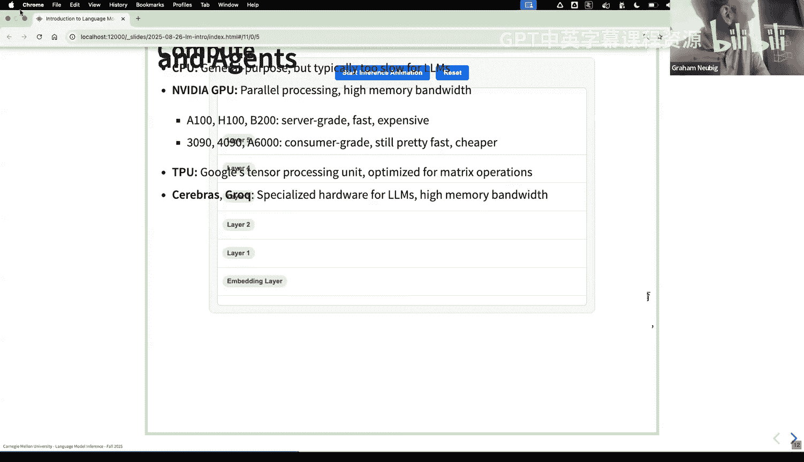
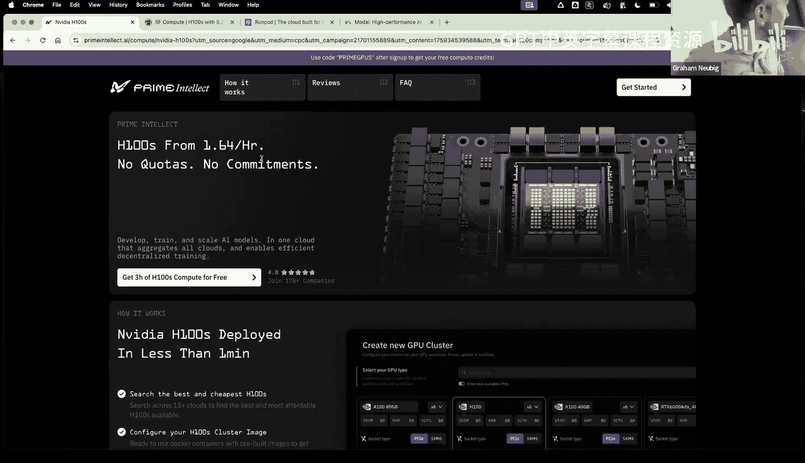
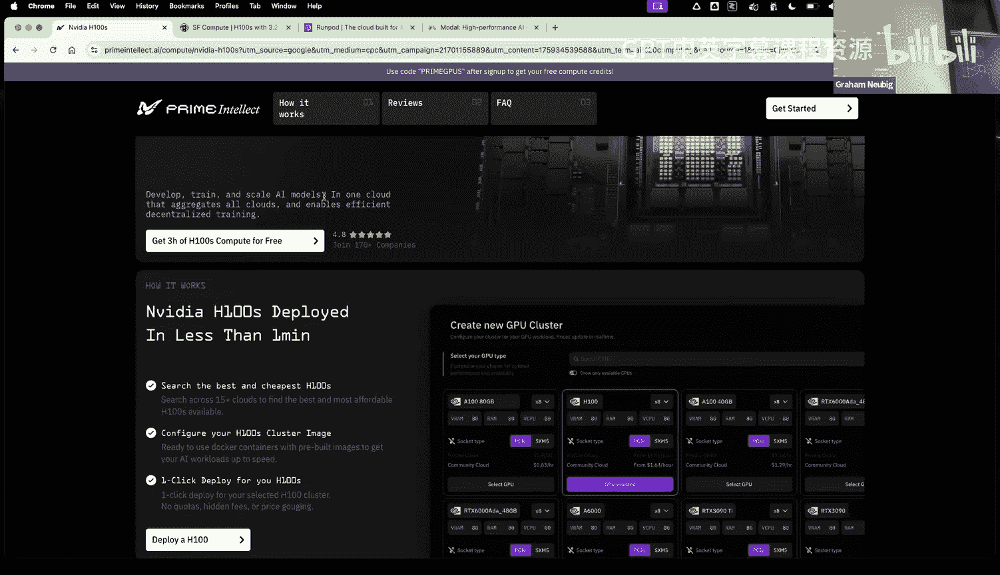
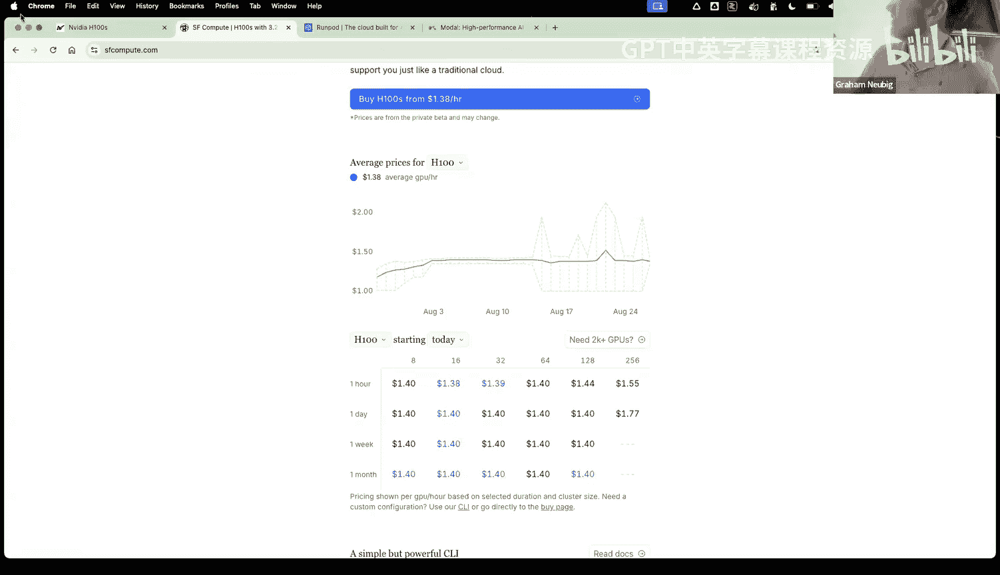
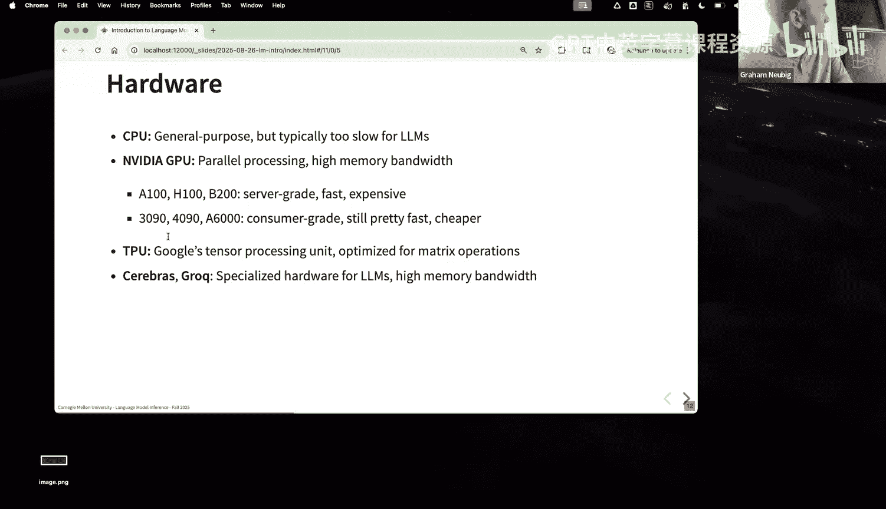

# CMU《语言建模的推断算法｜11-664 763 Inference Algorithms for Language Modeling (Fall 2025)》 - P1：-12-CMU LLM Inference (1)_ Introduction to Language Models and Inference.zh_en - GPT中英字幕课程资源 - BV1xsFjz3EoQ

Hello everyone， welcome to the new school year and welcome to this class so this is a new class and it's a class on kind of advanced topics so that are developing very rapidly in research so I would love we would all love feedback on what you think what you'd like to talk about more or less than what we are talking about here。

嗯。This is also a new room and it has this screen here。

 so I'm going to have to try to figure out what to do with this this screen so it doesn't get in the way。

 but yeah， so' be happy to get started let me make sure my screen is shared yeah。😊，Yes。

 I am' recording thank you for reminding me though because I might not be recording so you might want to remind me every time。

So yeah， let's get started at any time feel free to raise your hand and ask questions or make comments or whatever we tried to keep the size of the class manageable so that we can go we can you know have discussions every day。

Cool， so this is the obligatory slide that I need to show at the very beginning。

 I promise this is the only slide， but we all use language models all the time。

 so we use chat ET Google search coppit cursor for code completion coding agents like Codex Ss。

 open hands， specialized apps so no matter which industry you're in people are probably using language models in that industry so you know there's Harvey for legal or a bridge for medical etctera。

 etc。😊，So for a language model I'm coming into this assuming that almost everybody in this class or everybody in this class has either taken a natural language processing class or a deep learning class。

 so I'm assuming that most people know all of this stuff already。

 but I want to get us all on the same kind of page with respect to you know the notation that we're going to be using and other stuff the terminology that we're going to be using so a lot of this class is going to be an overview of that。

So for a language model， what we talk about when we are talking about a language model is a model that assigns probabilities to sequences of tokens。

嗯。😊，This could be conditioned on you know something else like an image or something。

 but mostly we're going to be talking about an output where it's a sequence of tokens。

 either in natural language or code or something like that。

And so we're calculating the probability of x for a sequence where the sequence is x1。

 x2 all the way up to XL。And the most common method。

 it's not the only method we're going to talk about。

 but it's the method we're going to be talking about most of the time is autoregressive bottles and so autoregressive bottles decompose like this where we have the probability of the next token。

 given the previous token， so we have P the P of the whole sequence is。

 the probability of the first token and then the probability of second token given the first token。

 probability of third given the previous ones， et cetera， et cea。嗯。

There are some counter examplesamp to this， so the one major counter example that we're going to talk about in this class is diffusion models and diffusion models are a very different type of model with a very different inference algorithm and so from the point of view of inference they're interesting in that way。

 but that's going to be like one class out of all of them so unless I mentioned that we're doing something different assume that we're talking about autore models。

嗯。😊，So we can look at some unconditioned completions， so I took a small ish model Queem3 1。

7 B base and generated some completions from the B token， the beginning of sentence token。

 actually Quen doesn't have a beginning of sentence token so I generated it from the end of sentence token。

 but it's more or less the same and I split these into high probability medium probability and low probability sequences out of the 100 sequences that I sampled anybody oh sorry one additional thing is when you do inference you need to decide when to stop and so I stopped when I got a period or an end of line So any idea what the highest probability token sequences are if you sample from nothing。

Yeah呃。TheToken this is a token sequence， Data token， so it's not just the token the yeah。Any ideas？

This is the。O， this is the baseball on。 It次。Go happy to for something that。 Yeah， it's。

 It's not an in tune model， no。Any any ideas？I that something in Chinese some of them are in Chinese。

 but it's not a these are not the highest probability ones Okay。

 so the highest probability ones are three period。😊。

Four period and zero zero parentheses in that end of line symbol so yeah these are these are relatively high probability。

 this is the long probabilities so you can see minus 4。

22 means if you sampled quite a few times you would get a bunch of these。

What about middle probability？This is from the Quen model if people are familiar with Quen。

This might， might have been a little bit unlucky might be a little bit of an artifact。

 but I got a lot of code。So these were kind of the middle probability ones out of the 100s that I sampled。

 also a lot of math。And then the lowest probability ones。

 which are still high probability because we're sampling 100 and picking the lowest probability ones were mostly Chinese。

 actually。😊，So lots of Chinese， I don't know if this is good Chinese or bad Chinese。

PoPolitical Chinese。 Okay， well。You could guess whatqui was a trade man。Cool。

 but that's actually not what we do most of the time we use a language model right instead what we want is we want to do something that's useful and usually something that's useful means conditioning on something else。

And。So。When we do this， basically we want to condition。

The previous sequence and generate the next sequence。

This is also written where the input sequence is x and the output sequence is y， and so in this case。

 we will treat the first part that we're conditioning on is the prefix or the query and the second part is the completion or response that we want to generate from this。

So。Mathematically， what this essentially means is if we have the autoregressive decomposition。

 that means we can just omit the first tokens in the in the product。 So， you know。

 we were conditioning on all the previous tokens， typically when we generate the output。

 but now we can just omit them， we calculate this autoregressive decomposition。So。

For my prompt here for the prefix， I use the best thing about Carnegie Mellon University is and any idea what the highest probability tokens are？

What everybody would be saying is the best thing about CMU。science computer science。

That's kind of a weird sentence， so the best thing about Carnegie Mellon University is computer science。

 maybe that's just。The faculty， that would be a pretty good one and thank you for flattering me。

You get a two bonus points。The community。Okay， we got its diversity so and that it's a community so。

That it's a community as kind of faint praise， I think， but you know， maybe maybe okay。

 middle probability we get ones are a little bit longer。😊。

It's location in the vibrant community it has built that there's always something else to learn that it gives you the ability to take your education to the next level。

 so these are you know a little bit longer but maybe still pretty typical sentences and that if we look at the lowest ones out of the ones I sampled it's focus on the interdisciplinary approach with students majoring in computer science。

 mathematics and engineering the community that you get with it so many people doing so many different things and not just its academics and research and engineering。

 computer science and business。It's the amazing out of the ordinary experiences your students create in the classroom so you know all pretty reasonable things。

 computer science made its appearance， I guess。What's something you notice about these other than just the text content？

The length， yeah， exactly。 And why are the shorter ones higher probability？

When you multily something was less than one， it's always even less Yeah。

 so when you multiply something by less than one， it's always less than the thing that you start off with。

 So like you notice here that we're， you know， making many multiplications。

 they're all probabilities。 So they need to be less than one。

 And so they will get shorter and shorter。Notably this I'm using the Quen base model and how do we train a base model I'll get to in a few seconds and then in a few slides and then get back to this so in terms of modeling again this is a bit of review I'm assuming that everybody here has looked at transformers and probably even implemented transformers in one of your previous classes。

But basically， we have transformer models。And unlike the transformer model in the original paper。

 this is a fully， it's a decoder only model。And。And what that means is if you look at the original paper。

 you had like an encoder and then you had a。Nonmased attention and you had cross attention and other things like this。

 but now in the decoder only models， essentially we have an embedding process， positional embeddings。

 masked multi head attention， so you're masking to not attend to future tokens or the yeah not attend to future tokens。

 layer norm and then the feed forward network， and then layer norm again。

 linear layer and a prediction。So。I guess this is probably familiar to everyone。

 given that you've taken the prerequisites for the course。

So there's lots of other options and I think we will talk about some of the other options as well like there are mixture of experts models which。

You know， don't necessarily do you know full full mixed feed forward layers or things like that。

 there's also recurrent neural networks or state space models such as MAMba。

 I don't necessarily assume that you know of all of these or at least are like super familiar with all of them。

 but we will cover these in more detail in future classes。But one thing that's super。

 super salient when we're doing inference is the modeling cost。

 and so I wanted to talk about transformers mostly from the point of view of modeling cost。And。

So there are two components that take the majority of the modeling costs that we deal with。

 which is that they have self attention and self attention is costly。

 but it's also quadratic in sequence length for some components in the attention。

And then the feed forward layers， which are wide and heavy。嗯。

And we also have n layers where N can be a relatively large number in our very big models。嗯。

So here's a quick quiz。Who thinks that in modern large language models， self attention。Takes more。

Time or is more costly than feed forward networks。 Any thinks self attention is more costly。

Anybody think feed forward networks are more costly？Anyone think this was a trick question？😀呵呵。😊。

Okay， it was， so I'll talk about that in a second， but thank you for volunteering answer anyway。

 I appreciate it。😊，So I'd like to talk a little bit about the number of flos that it takes to calculate a transformer model per layer。

 and specifically I'm going to focus on the grouped query attention transformer。

 which is a transformer that is used pretty widely nowadays and basically what grouped query attention does。

Is。It could put it on the board。So in the typical multi head attention in。And transformers。

 basically we what we do is we。Have some big vectors that are the hidden states that go into the attention function。

And then we split them into heads， and then each head kind of attends to the。

Each query of the head attends to the keys of the other head。

 and then you use that to weight the values。In grouped query attention。

 you essentially create groups。Of the key vectors and value vectors。And。要嗯。

You attend like this to say memory and so。What this entails is a self attention。First。

 you calculate the the projection of the。Of the queries in this。Basically costs you know all of the。

All of the compute， because you're calculating this for every head。

 but for the key in value projections， you calculate less because you're grouping them together。

And then you have the actual attention calculation and for all of these。

 if L is the length of the sequence and D is the dimensionality of the entire entire vector and。

DH is the dimensionity of the head。You are calculating this over the entire。Over the entire vector。

 but you're also doing a quadratic attention calculation because each position the query is attending to the keys or you're multiplying the queries in the keys。

 so this is the quadratic component。And then you have the output projection here but so you can split this into a quadratic component that grows quadraically as the sequence length gets longer。

 and then you have this component over here which and this component over here which is basically linear in the sequence length。

 you can see by looking at out。And then if you look at the feed forward network。

 the flos for layer is basically the dimensionality of the underlying embedding times the dimensionality of the feed forward network。

 and you calculate that for like。If you're using the sig glue。

 you have a gating function and then you have an up projection and down projection。

 so basically this is entirely linear in the sequence length。嗯。

So let's look at an example of how big these values are for each of the。For the Lama 3。1 series。

 And I just picked the  Lama 3。1 series because it has one example of like a very big dense model。

405 B。 this architecture is used pretty widely in a bunch of other model classes as well。

 But we can see we have like 32 layers and 80 layers in 126 layers。 The hidden size is like 4000。

8000 and 16000。The attention heads are kind of proportional to this。In group query attention。

 they always have eight over all of them in the Lama 3。1 series。

 and then the MLP size is approximately 3。5 times the hidden size。So。

One other thing I forgot to put in this table is that the maximum context length is 128 k。

 so because the maximum context length is 128 k， the largest e would become in these cases is 128K。

So let's look at the flos that we spend on each component versus context length。Basically。

 it looks like this。And。You can see that as the context length gets longer。

 the flos increase super linearly with the context length。

And so we can see the total fl scale quadraically with the context。

 at least if you look in big O notation， and when the context length is shorter， like 1000。

1 thousand is still not a super short context length， the MLP part。

Is the green part here This dominates the cost of the computation because it's 3。

5 times larger than the other parts， and then the linear part of attention。

 the projection is costs a lot of money and actually multiplying the attention to vectors together doesn't cost a whole lot。

But as you get up to larger context length， actually the quadratic part of attention starts to dominate and so this becomes a problem if you want to scale attention to much longer links。

And so practically what does this mean for inference， it means that it's expensive。

 so this is a lot of flos and it also means that you start to become limited as you have very long sequences that you're dealing with。

Great， so this is the base。 and this is kind of like the ideal。

Setting where we're only calculating flops and we're not worrying about like whether we can use all of the flops that our processor or chip allows us to use efficiently。

 And I'm going to talk a little bit more about that in a second。

 But are there any questions here so far。Or comments or discussion。Yeah。

 but you mentioned the L besides three and a half times。

Yeah it it's a good question I think there's two parts to this。

 The first part to this is just people have experimented a bit around it and this seems to work relatively well in terms of the like compute accuracy trade off。

It should be larger than the hidden size and the reason why it should be larger than the hidden size is this allows you to like combine learn combination features。

Another reason why is there's。And I'm not going to be able to give this super accurately off the top of my head。

 but there's like。This tends to be。This tends to be a。Like。

Exponent of two and this tends to not be an exponent of two but when you actually go in and calculate the like utilization of the GPU。

 having having this be like an 3。5 is good for GPU utilization based on threads， but yeah。

 sorry that's I'll have to go back and look up the like actual justification for that to say that more accurately。

This slide is open the number for fl e。 So I find that very。Oh yeah。

 great question why are all of these things multiplied by two and the reason why is the matrix multiply is a multiplication in addition？

So you multiply by the weight and then you add it to the sum。Yes， exactly， yeah。Cool， anything else？

O。Cool， so anyway， this is really， really expensive and so we need to find ways to， you know。

 we're willing to pay the cost if this gives us a really good model， but you know。

 we need to find the way to utilize these swaps as efficiently as possible。过。So。

Another big theme of this class is going to be you know。

 how we can make inference efficient and to make inference efficient。

 you need to know a lot about hardware。And typically we use different varieties of hardware for inference。

 what we don't use that often for larger models， but we still use for smaller models as CPUs。

And CPUUs are， you know， general purpose compute， but they don't have a very high level of threading and so because of this。

 they're not particularly good at the operations we need to do for neural networks。嗯。

Then there are NviIDIdia GPUs and NviIDdia GPUs are kind of the gold standard of what everybody uses。

 there's also like AMD GPUs and other things like this which are very good hardware but not as well supported in the software ecosystem so people don't use them quite as broadly。

But。With respect to NviDdia GPUs， there are。A variety of GPUs that people use the typical ones are like a 100 H100 B200。

 these are kind of serverber great ones that you know if you have lots of money。

 you spend that money hiring these expensive GPUs or buying these GPUs。

There's also cheaper kind of like non server grade ones that people typically use for gaming or other applications。

 but these still are quite powerful and much better than using a CPU。嗯。

There's also special purpose hardwares， so there's things like the Google TPUus and Google TPUus are maybe the second most commonly used type of hardware for this sort of training just because Google uses them a Latin they're available in Google Cloud。

These are optimized。So GPUs you originally started for gaming so they weren't originally made for training you know AI models now arguably they are made specifically for training AI models just because that's how NVDdia makes all their money。

 but GPUs were created from the ground up for doing this and they have things like very large memory very fast interconnect。

And then there's also other special purpose hardware。

 like Sieverebbis and Gock and other things like this。嗯。

One one thing actually is a little bit of a logistics thing for this class so in this class we're going to want to run some inference on GPUs and we're going to try to provide this for you we have maybe three main ways。

 One is if you already have access to inference compute or to compute that you can use for inference you can use that so like for example。

 if you're an LTI and you have access to the babble cluster or something like that you're welcome to use that for the class。

We're also going to provide AWS credits。 AWS credits can get you some amount of compute， but。

I will warn you in advance that it takes a relatively long time for us between when we apply for them and when you actually get it。

 So having a backup plan is good。 it's not our fault。 it's AWS fault。

 but and thank you if anybody's let's say thank you AWS for giving us free credits not blaming you for anything and then also we've had a lot of success with Google coab Pro which costs a little bit of money。

 but it's you know very convenient for running running experiments。

 It's like 999 a month and actually I think you can get it for free for students So that's another one we recommend。

Another thing that you may be interested in， I don't necessarily recommend that you do this you know for this class project。

 but。There's also a lot of。sorry。By press escape。

By press escape， this happens， but。

There's also recently a lot of GPU like marketplaces。So just to give an example。So if I。

 if I wanted to actually go out and do training or serve something myself in kind of a more like。

Industrial。Setting。There's kind of two varieties of。

Of GPU service that I would suggest ones that I have used are modal and runpod and modal and runpod are particularly good for like if you want to spin up a bunch of GPUus quickly or you want to have like serverless GPs or things like this。

 And so one of the assignments in this class is going to build an inference server。

 And then if I actually wanted to build an inference server and deploy it somewhere。

 what I would do is I would serve it here and then I would use serverless endpoint。

 So like when somebody hit。 they would， you know， they would be able to do inference there。

 And then separately for things like training， there's also things like San Francisco compute company and prime intellect and these are basically GPU marketplaces where you can like rent GPUus。

 And what they do is they have people who sell GPus or rent out GPUs and then people who want to rent GPus。

 And so they have a market。 So you can actually see the。

Actually， I don't see it right now， but like Prime intellect has like a stock price。

 like a stock ticker， but for GPU prices。 So it's kind of， yeah， here， here。

 So this is like the price for an H 100。 And you can actually see it go up and down like the stock market。

 So it's kind of kind of fun。😊。

Cool， sorry， that's a little bit of a divergence， but compute is going to be important。

 so just to summarize， you can use existing compute if you have it。

 we will try to get you AWS credits and you can use Google Google Coab for free Google Co La for free。

 So those are my suggestions for this class。

嗯。Actually， Ts， could you take a note that we need to do that。Cool， any questions here？

Okay， great。

嗯。So next I'd like to go into training we are not going to do very much training if at all none of our assignments require training because this is a class on inference。

 it's not a class on training， but you might nonetheless be interested in doing this and it's particularly salient for me to like explain the most important differences between training and inference。

And so usually we train on large corpora of text and then you know maybe do pretrain on you know all of the text on the internet and then do post training or fine tuning on instruction data and recently lots of reinforcement learning。

呃，嗯。So here the goal is to learn parameters such that the probability approximates the probability of the true distribution using maximum likelihood estimation。

 I assume everybody knows this and has done this in previous classes and you know we want to maximize the log likelihood of whatever data we have。

嗯。Importantly， oh yeah， sorry and we do a forward pass。

 backward pass to compute gradients and a parameter update where we have a learning rate and practically we process large batches of text with tensor operations using GPUs or whatever else。

And so what this looks like is a little bit like this。So essentially。

 we have an embedding layer and we step through each layer of the model until we get to the very end and we predict the loss and then we add the loss together and we get a final loss for our entire data。

So just to do that again， to contrast with the one I'm about to show for inference。

 it's like this so big block， big block， big block， big block， big block。

 big block and then finally predictive outputs So this is really important because it's very different from inference。

And when you're doing training， if things go well， you can like completely saturate a GPU all the time or you know get very very high flop utilization。

So what about inference， inference， given a prompt x we want to generate a continuation。

 there's two main approaches here。The first is drawinging samples。

 so from the probability distribution or from a probability distribution。

 we randomly draw samples from the model。The other one is search and here search instead is trying to a some score of the output。

And this score may or may not be the probability， and in fact。

 in many cases it's not the probability。嗯。And I'll explain why we would choose something other than the probability in a second。

 But going back to the diagram that I showed before， let's look at inferencefr。

 So now we have smaller block， smaller black， smaller black， smaller block， smaller block。

Predict a word and now。We're kind of walking through in an auto regressive fashion to do。

To calculate the outputs like this， and then we finally get to the end ofcented symbol here。So。

What do people notice or know about the difference between trading and inference？Yeah。

Yeah so great great i'll just repeat it so training you know all of the tokens beforehand so you only need to make one essentially one step through each layer。

 right。Here we had three in the prefix， and then three tokens we generated。

 So we had to make four steps for each layer。 We had the first three and then one and then one。

 and then one。 And so we have a lot more steps and。This is a problem。

 the reason why it's a problem is because each step。

Here essentially has a fixed cost in that we have to dispatch to our GPU and then we need to wait for the GPU to finish processing and both of those things can take time and also we might not fully saturate our GPU because GPUs have many。

 many threads。And we might not be using all the threads at the same time so this is a big challenge and efficient inference。

 and it's something we'll be talking about for like a good portion of the class how do we make how do we overcome this challenge。

Cool。Yeah， so when in January， you will stop update the event previouss。Oh， yeah。 So great question。

 When we generate new words， don't we have to update the embedding of the previous words And the answer is no。

 And the reason why we don't have to update the embedding of the previous words is because we're using mask attention。

 And so we're masking out all of the。All of the future inputs when we calculate the embeddings of the previous inputs。

 which means that the inputs at position three cannot depend on the word in position4。

And this is really important， the reason why it's important is。Clear if we go back。

All the way to the autoregressive decomposition。So。You'll notice that when we generate the words。

 we're always conditioning only on the previous words。And the reason or sorry tokens。

 when we generate the next token， we're only conditioning on the previous tokens。

 we're not conditioning on future tokens because otherwise the chain rule of probability doesn't hold here and we can't calculate this also practically it would be difficult to it would you know。

There there are practical difficulties with updating all the previous tokens。

 So that would be an issue There is a。The one exception to this that we're going to talk about is diffusion models and diffusion models you actually do generate like not entirely left to right。

 you generate from like the whole thing of the same time。嗯。

Yeah its it's related to the Markov assumption so it's like well。

Kind of the Markoff assumption is like assuming that some tokens far in the past are like not actually relevant。

 but we don't actually do that in transform the models typically。Great great question， though。

 any other questions？こ。So。Okay。So now I'd like to talk about basic generation algorithms。

 And basically， this class is kind of split into three parts。

 The first part is going to be more on basic generation algorithms。

 We often just call them generation algorithms or inference algorithms。

 But what I mean by this is essentially their algorithms that。嗯。

In autoregressive model are typically one token at a time or maybe one token at a time while maintaining multiple hypotheses that we're searching over lake in beam storage。

And so a simplified view， this is the most simplified view of this。

 which is that we have a generation function that takes in a model and then has an input as a list of tokens。

 which would be our prefix， and then while we have not finished generation。

And then we take the model and we calculate a probability。

 and then we somehow sample from this probability in appendice to Y。

And the model always takes in a prefix of the previous tokens in the next token and in reality。

 we're not like upending tokens like this we're you know upending to a tensor or something like this for efficiency。

 but this is a basic idea。嗯。And we'll cover many variants in the course starting two classes from now。

 basically， but this is kind of the first several classes that we're going to talk about in the course。

Should be familiar to everyone， I guess。So the next thing I'd like to talk about is something called metagen we quite in this term。

 so it's not like a super standard term I guess it's in the survey paper that was in the like reference for this course。

But I think it's a reasonably good term。 And basically what it means is it's a class of algorithms that generate token sequences。

More or less is a subrine to the main algorithm。And so， one。

Most common example of this is a reranking algorithm and there's many， many other examples。

 but this is the most common one。Which is we have generate and rera。

 so we have the model that we're using to generate， we have a reranking model。

 and then we have the number of candidates that we are going to generate。

 and then we have the prefix。And so we generate。嗯。We generate that many candidates。

We generate scores from the reraner。And then we return the candidate that has aia square。

 so this is just one example。嗯Any。And again， we're going to cover many of these of the course。

Any questions or anything okay。You say can doesn wait until the US open is received or like you start to leave that window middle alone。

Oh yeah。 that's that's a great question。 So this is number one。

 this is like that simplest possible metageneration algorithm。

 There are also other ones that would do something more like this。😊，But。

I didn't actually define done here， so I didn't define Dun as like why has you know hit the EOS token in fact。

 when I generated fromquin to generate the examples here。

 I define done as hitting the EOS token or the period token or the end of line tokens so you can define it in other ways and so you could also define it in a way which is like generate five tokens and then rewra them or something like that too。

过。嗯。So another thing we're going to talk about is latent variables。

 and this is really important recently in particular。

 very big like focus in that a lot of people are paying attention to like01 or R1 reasoning models and stuff。

But the basic idea is sometimes we want to model things other than the actual answer that we're going to be showing to the user。

And。The most common variety of this is chain of thought and so what this would mean is our input X would be something like how many years since the transformer paper was published。

 and then the latency would be now is 2025 and the transformer paper was published in 2017。

 2025 minus 2017 equals8， and then the output would be it has been eight years since the transformer paper was published。

And。This is。People have demonstrated that this is a really good way to improve the accuracy of models and in particular recently people have been training models to do this。

 but lay variables pose a lot of issues with respect to inference。

Notably two are the most obvious ones， the first one is efficiency， so who uses like GPD5。

Or you any of the other models， how long have you gotten it to think？Too long。

 anybody over five minutes。Okay， that's pretty impressive， anyone over 10 minutes。O。😊，Cool， okay。

 yeah。 so that's impressive。 But that's an efficiency problem， right。

 Like you would like your answers as quickly as possible。

 And so if the model needs to think for 10 minutes before you can do that， then， you know。

 maybe that's an issue。 So that's the first thing。 the second thing is， actually。

 you don't really care。😊，About。You don't really care about the latent variable a lot of the time right like often you just want the answer and in fact GPPT5 doesn't show you the latent variable。

 it doesn't show you the full thinking process of the model so you know if you're not showing it to users anyway。

 you don't really care about it。嗯。So or as as a model provider， you obviously don't care about it。

 So what。You could do is you could also consider multiple chains of thought and then finally decide to find the output that is the best given multiple ways of drivingriving that output。

 So like you could solve a proof and like。Or you could solve a math problem in like 10 different ways and find the answer that's most common and this is called self consistency。

 and so there's a bunch of different varieties of this too。Okay。

 so another big topic that we're going to cover in this class is evaluation of inference outputs and。

So we don't actually want high probability outputs。 Most of the time。

 we want good outputs by some measure of good。 and it's not necessarily the case that high probability outputs will be good。

So there's a lot of ways you could define good， you could define good as human preference being。

 you know what humans like the most？You could also define good by asking in LLM to grade the outputs。

In the same way that you ask humans to grade the outputs。

 so this is typically nowadays called LM is a judge。

You could also use deterministic metrics so like if you're solving a math problem。

 there might be only one real answer and so you could just check if the answer equal is equal to the correct answer Also。

 these are less common nowadays， but there are deterministic metrics to evaluate generated text as well like blue or Rouge。

If you're talking about reinforcement learning or talking to somebody who knows a lot about reinforcement learning。

 they'll often also call this a reward and。I will basically use these interchangeably like an evaluation metric or a reward。

 they basically mean the same thing， it's just like how good your output is。

So a really important concept which everybody who is working on inference should know。

 but unfortunately not everybody working on inference knows is the idea of search errors and model errors。

And a search error is where the search algorithm failed to find the output that gives you the highest model score。

 and so if your model is a probabilistic model， the model score is a probability。

And so basically what this means is。When you ran whatever generation algorithm you were using。

 it did not find the highest scoring。High scoring output。

 and so this could be S could be the highest probability。

 or it could also be you know the most consistent output。

 the thing with the highest marginal probability when you're marginalizing over over chains of thought or something like this。

So what this means is basically your search algorithm failed if you're using an Ag max search algorithm。

 it did not find the max。嗯。So if search years are your problem。

 this can be mitigated by better inference algorithms so you can find a better search algorithm and this will do a better job at finding the highest probability thing。

 so you might switch greedy search into beam search or you might switch beam search into a star search or like some search some other search algorithm。

The other thing is model errors and model errors are basically when your models score S theta。

Is not a good output according to whatever evaluation metric you care about？

And so what this means is you get a lower reward for your generated output than you get for。

Then you get when you。Actually， now that I look at this again， I don't， I don't like this。 Sorry。

 this might be wrong。 I might have to fix my slides。This is the first time I teach this last。

 so I might have lots of errorss in my slides， I'll try to catch them。

 but if you catch them instead of me that's very welcome sell as well。

 So basically here what this means is。So we define why hat is the highest scoring output。And。Then。

Based on that， we have。So what this means is whichever output is scored the highest by your model is not as good an output as the as the best output so what this means is your model is miscoring the outputs and it's basically assigning a higher score to bad outputs or outputs that are not ideal。

嗯。😊，And the reason why this is an important distinction is。

This can be mitigated by better model training or inference。 And what I mean by this is。

Probably the quote unquote， correct way of solving this problem is by training your model better because your model is wrong。

 right， Your model is giving a low score to a good output and a high score to a bad output， so。

Back when I was more strongly opinionated， I would actually say this should not be fixed by inference。

 This should be fixed by， you know， coming up with a better scoring function by like better training your model or using some alternative decision criterion or something like that。

 using a different reranking。 Now I have seen enough people succeed at fixing these problems through inference that I also think it can be fixed through inference。

 So but we need to think about what fixing this problem through inference means。

 It basically means breaking your inference algorithm to get a better output。

 So not intentionally not finding the highest scoring output so that you get a better output。

 So you just need to keep that in the back of your mind whenever you're doing what tweaks to your inference algorithm to get a better score So this is an important thing。

 And we can talk about it again when you talk about beam search or versus sampling and other stuff like that。

Yes。Now I level question about the goal of instance， goal of instance to sample or to optimize。

 So am I interested， I have a property distribution of course I want to。

Soo many outputs of sample the other board or one want the board Yeah that I mean that's a great question and I actually。

Provided to alternatives， right， to do Arcm or to sample， I would say。The what is which。Yeah， so。

it's a good question， I think typically we use it to refer to both and there are two different varieties。

 two different varieties of inferences， I understand if you come from statistics or something like that。

 there's probably a more strict definition， but I think it's used for both of them mostly。

But if it's called something then the first one doesn't feel like a search generator。

 because I wasn't trying talk them I generated something maybe yeah， this is。And actually。

 this is this is particularly focused towards the。Case where you want to get a good output。 And so。

People use sampling algorithms to get good outputs nowadays。

 largely because models tend to be broken。 One thing I should point out is。嗯。

With the best language models that we have nowadays， people are sampling less in searching more。

 So like the best models， if you want to get them to do things like codegen or mathematical reasoning。

 very often people are using greedy search， which is not a great search algorithm。

 but it's still like much more likely to give a high probability sequence。

 And the reason why is because they fixed a lot of the search errors through model training。

 So they've like trained models to be really good at at like actually generate good outputs。

 it used to be that this was a really bad idea。 like if you use greedy search。

 it would repeat itself over and over again。 And in fact， next class。

 I'm going to show how to generate from G2 and you're going to see greedy search completely fall apart on G2 but which is an old model maybe I should mention that but。

But yeah， this is particularly focused on the case where you want good outputs， this discussion here。

And so as the amount of like search error you have and model error you have。

 does that vary on like how you're soring and what？Good means。嗯。Yes， definitely。

 So like if you switch your scoring。So like the question was the amount of search error and model error that you have。

Does it depend on what your reward function is， basically， And the answer is yes。

 definitely because the reward like for。Model layers。

 oh actually that only applies to model layers because how you're defining good only shows up in model layers if you look at the equations for search errors so it doesn't show anywhere。

 so the search errors are only defined by model by the model source themselves。Yeah。

 I cant even know if giventta is like the solar channel or model how you distinguish Yeah， I mean。

 I gave you equations to distinguish between them， but like。You can。

How do you know if a search here exists， One way you can do that is come up with a better search algorithm and see if you can find a better hypothesis。

And so if beam search is an example that we're going to talk about and you can expand your beam and search more and see if you can find better hypotheses and if you don't find any better hypotheses。

 it's not an existence proof， it's not a proof that your best hypothesis is the best ever。

 but it you some evidence for it， if you do a star search， which we're going to talk about too。

 there you can actually prove that you found the optimal output。

 but A star search is not feasible in neural networks。嗯。Then for model errors。

 if you find many hypotheses and you can find at least one where this equation holdss。

 then you have a model error。So you could output 100 hypotheses and you could try to find one where the sigage holds。

Great， great question。过。O嗯。So I'd also like to talk about diversity versus quality。

 which is kind of like going into the same point， like what's our goal of of searching or what's our goal of doing inference And so the first。

Is if we do agm search， if we search for things that maximize the probability。

 this will often give us lower diversity。 And so like if we're only picking the top one。

 then we're not going to get any diversity at all in modulo like numerical instability due to GPU processing or something like this。

嗯。But if we do an end best search where we try to find that at a top n example。

 sometimes they'll vary by like one token or something like that and we're not going to get a whole lot of diversity in our outputs。

In contrast， sampling gives high diversity and sometimes lower quality。And that。

Especially if we have a relatively good model with few model errors。Typically。

 the highest scoring one will be the best。 So our V search will， will give you the best results。

But both are useful in different cases， does anyone have an idea where we want to have more diversity for sampling？

Yeah， it's like writing from B MSA where you want to like being more expressive。

 so maybe something like that is if you were like predicting something which is more empathized by finance。

 you want to。Yeah， so that's a great point， the answer was something like creative writing。Arguably。

 yes。 But what if you could come up with a really good evaluation metric for creativity and optimize it。

 Maybe you only need one output given a prompt。 So if I say like， you know， tell me。

 tell me a story about a fairy that really likes to do math。😊，Maybe your A max is good enough but。

If you want the case where you show 10 different outputs to a writer and let them choose the one they like the best。

 then you obviously need some diversity in there yeah。I saw some other hints yeah。OK对。

Yeah synthetic data set creation so you want to create data that like mimics a true data distribution that's a great example another example might be reinforcement learning so if you're like training a model and you want to sample lots of outputs you want to make sure that you have enough outputs to represent the true like variety and so there you'd want diversity as well。

And we'll talk a bit more about that later。Cool， so this is the recap。

 We're approaching the end of the like actual content of this class。

 but we want outputs that give us go to evaluation scores。 We also might want。😊，Low latency。

 so in terms of like you put in a prompt and you get the output pretty quickly。

If you're a model provider like Open AI or Anthropic。

 you might want high throughput because you're getting millions of people asking you queries so you want it to be able to generate lots and lots of them。

Possibly high diversity for bottle training or for showing different outputs to different users。

 things like that。And depending on the application， the priorities might vary。

 so it's very dependent on what specifically you're trying to do。So in this course。

 I'm just going to go through all of the topics that we're going to cover。 So the first one is。

What we just did now next time I'm going to talk a bit of probability review and I'm actually going to mostly do Jupiter notebooks next time instead of slides and give some quick examples of each of the three topics we talked about。

 so talk about some probability backgrounds and probability basics， generation algorithms。

 oh sorry like a simple implementation of the transformer generation algorithms。

 metagen algorithms and then then inference。Sorry， efficiency。

Then we're going to talk about common sampling methods， beam search andvari。

 intro to A star and bestpher search and other varieties of controlled generation。

 so this is going to be like kind of the generation section that we're going to be talking about。

Next we're going to be talking about reasoning tool use in agents and so these are basically topics where we do chains of thought and kind of like intermediate steps。

 self-refined and self- correctionrection methods so these are methods where we go in and like correct the outputs。

 reasoning models， incorporating tools in inference so this is like where you actually can make calls to external tools and do inference and then agents and multiagent communication。

嗯。Next， we will talk about metageneration methods or ways to scale inferencefer time compute by using generation as kind of like a subroutine。

 and so this includes a minimum base risk in multisle strategies。

 reward models in best event reranking how we build kind of language model systems。

 not models themselves， contrasting inferencefr scaling and model size。And using external verifiers。

As well as token budgets and trading time distillation。And then finally。

 we're going to talk about kind of efficiency and system level optimization。

 like defining efficiency， library implementations and optimizations， KV cache optimization。

 draft models and speculative decoding， and ways to come up with alternative modeling strategies like MoOE or sparse attention。

 other things like that。And then also probably transformer alternatives。

What won't we cover so we're very going to talk in a very limited context about model training only together with inference algorithms that these are training is used to optimize。

We're not going to talk a whole lot about model architecture， only a very small amount。

INot going to talk a whole lot about evaluation or reward models。

And inference is basically going to be on text data。In terms of grading。

 15% is going to be either quizzes or in- class participation for in- class participation because we really want to cover kind of like the cutting edge techniques that people are using this actually wasn't written on the site but we're going to ask everybody to give a short talk about a paper sometime during the semester it's going to be about five minutes where you go and read a paper and introduce it on one of the topics we're going to talk about in the class so that will be about 5% the grade in the other title will be like quizzes or small things like that。

60% is going to be the assignments， so there's going to be three of these total。

And then 25% is going to be the final project in terms of what the assignments oh yeah。

 sorry And so the assignments， I'll explain what they're going to look like in a second。

 but they're all going to be shared tasks and we're going to have three tasks that we ask you to handle through inference and we think this is interesting because they handle kind of different types of things people are doing with language models and also they have different challenges for inference algorithms。

 So the first one is mathematical reasoning very popular nowadays So basically trying to solve math problems。

The second one is multiple choice question answering this is kind of interesting because your choices are very limited。

 but you can use latent variables like thinking to try to improve your accuracy and also evaluation is very simple。

And then the final one is open ended generation， so this is like generating just text and this is interesting because actually evaluation of it is tricky and there's less reasoning that will go into it and maybe more like refining the output。

嗯。Details to be released soon， this is a new class， so pardon our desk。Then the assignments。

 what they're going to look like is the first one is going to be on generation algorithms we have the actual schedule on the site。

 but this is like roughly September end of September。

 bettergen algorithms so this is you know things like reranking or minimumbased risk and so this is going to be roughly end of October hardware and optimization。

 this is going to be roughly end of November and then the final project basically we're going to ask you to put all of them together and you get to be you get to be open AI and come up with your GP GP whatever you can name it whatever you want and you give us an API endpoint and we hit your API endpoint and measure its latency throughput and accuracy and so whichever one you're most excited about you can optimize the most so you can try to be the person who gets the most latency the person who gets the best throughput or the person。

It's the best accuracy but you can't be really bad at any of them so so thats that's basically the idea and the idea is homework one two and three should give you a foundation to do the final project so you shouldn't have to throw everything out you can go in use the stuff that you did before。

Great， that's all I have。 But I realized I forgot the T A introduction slide， so I'd love to。😊，Yeah。

 I did mention it。 Yeah， sorry， I'd like to introduce our Ts and Amanda， who's head T A in Co in。

 so if you guys can come up。Yeah actually I didn't introduce myself I'm Graham so in particular with respect to inference。

 I'm interested in reasoning I'm interested in agents in tool use and kind of things in that general direction so those are kind of my specialties here and then Amanda if you want to I'm Amanda I'm here I'm a fifth year PhD student with Gham with Matt Brumleyaf for machine learning and I'll be giving about half the lectures and we'll be seeing a lot of me I'm particularly interested in long context and sort of scaling up inference time compute to accomplish different tasks and then retrofitting or changing models to behave differently at inference time than they were originally trained to be。

😊，Hi， my name is Boch Bist， I am a first year PhD student in LTA figuring out my interests。

 but I'm largely interested in making smaller models better so whether it be from a compression angle or from a training angle with synthetic data or distillation。

Hi guys I'm Clara， I'm also a fifth year PhD student at LTI。

 I work on efficiency so then inferences become more and more relevant to that side of things as well。

对对。And。Yeah， and unfortunately Shira could not be here for good reasons。

 but he will be here next week and maybe with the self-introduction then。

 So that's all we have the questions in discussion are up here Oh one other thing I forgot forgot to mention is there's a poster presentation at the end of the course it's going to be on December 2 so make sure you have that on your schedule and don't forget about it all the other course policies are on the website one thing I'd like to do now before everyone leaves is I talked about what we're going to talk about and I would love feedback on what was missing but you would like to hear more of it might be that I just didn't mention it and we're already planning on handling it but I'd love to hear like。

You know， things that people are interested in either now we can also take them on piazza。

 but you know， any anyone。Have questions or have any ideas of things you'd like to hear more about？

Oh yes， and there's going to be a quiz on Can and that quiz for this class is basically going to be that feedback so you can put it on the quiz。

 but if you want to raise your hand and talk about it now I'm happy to do that as well。

Yeah maybe a little bit about GPU basics so you talked a little bit about how GPs are not being utilizedized at the type of inferences that I clearly do not understand completely because I what that A with me yeah GPU basics we have a one class on heart so yes。

最对的。Yeah， one is like so three movies， I don't know which causes would have happened in the same right。

Yeah， serving with Ms so for all of the assignments。We haven't complete we worked this up。

 but I think what we want to do is we want to say you need to implement two things and we will give maybe two to three recommended things and then if you want to implement something else that's not the recommended things maybe you can have one three like free thing where you can propose a thing that you you implement moOs would be great for the efficiency portion I think。

But one thing I didn't mention is we are kind of like。

Fixing the models that people are allowed to use for the last for the last assignment because we need want everybody to be on efficient foot sorry on the same footing and so I don't think at the moment we plan to have an MoOE model there just because it be more work and more tricky but yeah that's very feedback and we will talk about MoO Yeah so how requests are batch together we're going to talk about that a little bit when we talk about libraries like the all M& lay because that's basically like one of the big innovations they have there but yeah we'll not cover it that。

Moel size and how it affects that you're seeing if that's a mode to increase inference speed and stuff like that yeah for sure model model size and I think we're going to talk about the tradeoffs between spending time on using a big model versus spending time on you know like doing lots of rollouts and re rankingking them so yeah on the menu yeah。

不然后你卡。Is rag going to be covered， Ra is。Probably not going to be covered。

 but we're going to be covering yeah， we're not we're not going to be talking about embedding lookup really probably。

Yes。Okay， yeah， so we'll talk about it briefly in the system sta models thing， but yeah。Again。

 I social little bit。哦的。Which search algorithm to pick for the problem， Yeah。

 hopefully we'll have lots lots of that in the first part yeah。Yeah。

How is thing come up with the insurance so is going on in the back end。Is there in the lecture of。嗯。

What's going on with reasoning models。 That's a good question。

 I wish I knew the answer to that question too， but we we might talk about that a little bit in the reasoning models section to the extent that anybody knows the answer to that。

 but yeah。😊，Yes，We will talk about distillation， I don't think we're going to talk about pruning because that's more a model size model side thing。

 but maybe we could talk about it a little bit。Yes。系。All visit lunch morning called a multi language。

嗯。We're not going to talk about generation of stuff other than token sequences， you know。

 which is usually text。For multimodal language models。

 I actually don't know like if the decoder is the same。

 I don't know how much the inference process changes。It could， but like it's not my specialty fee。

 so if you have anything in particular that you'd like to hear about it happy to get the feedback。

Okay， yeah， thanks a lot everyone great great feedback and we will。😊，See you on person。

