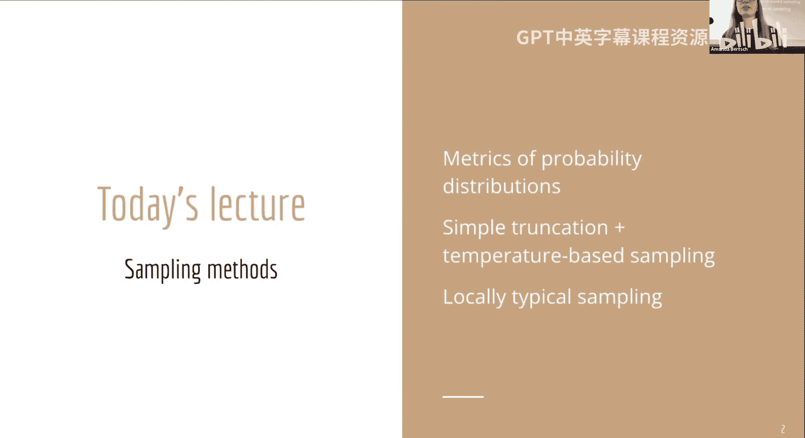
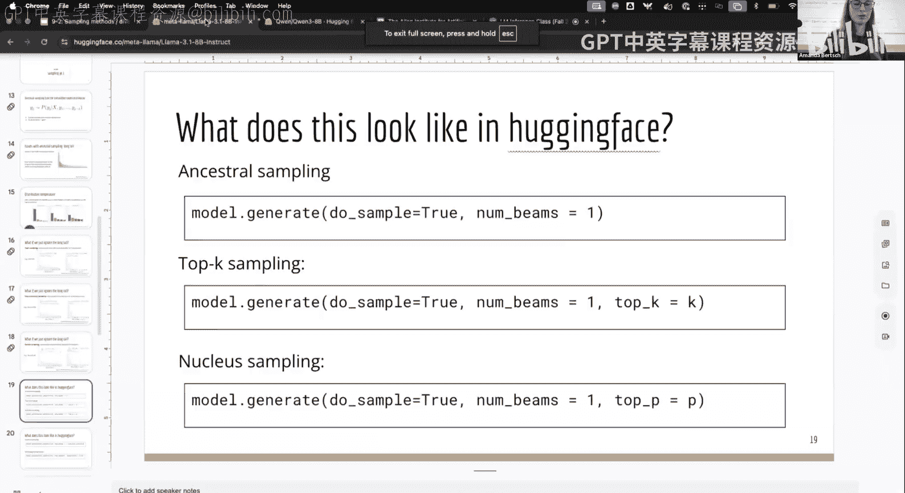
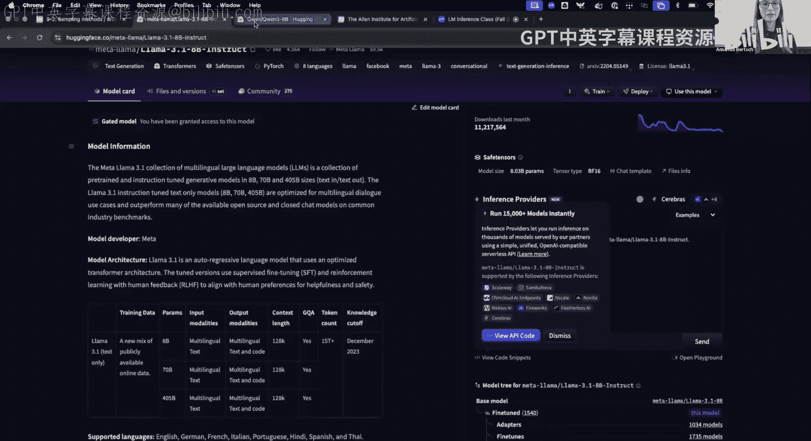
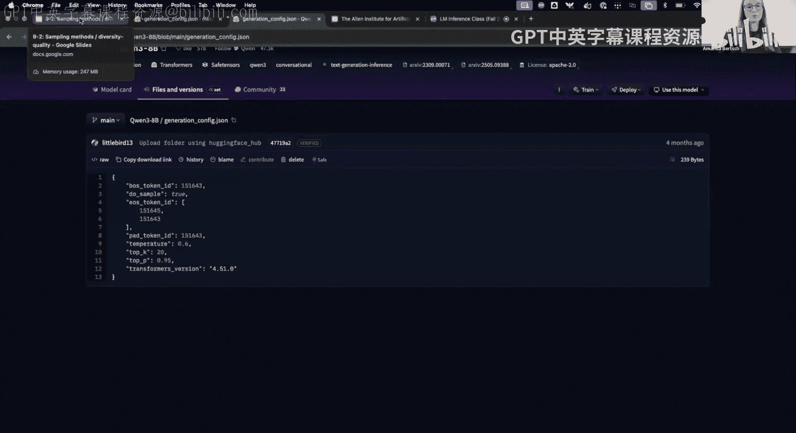
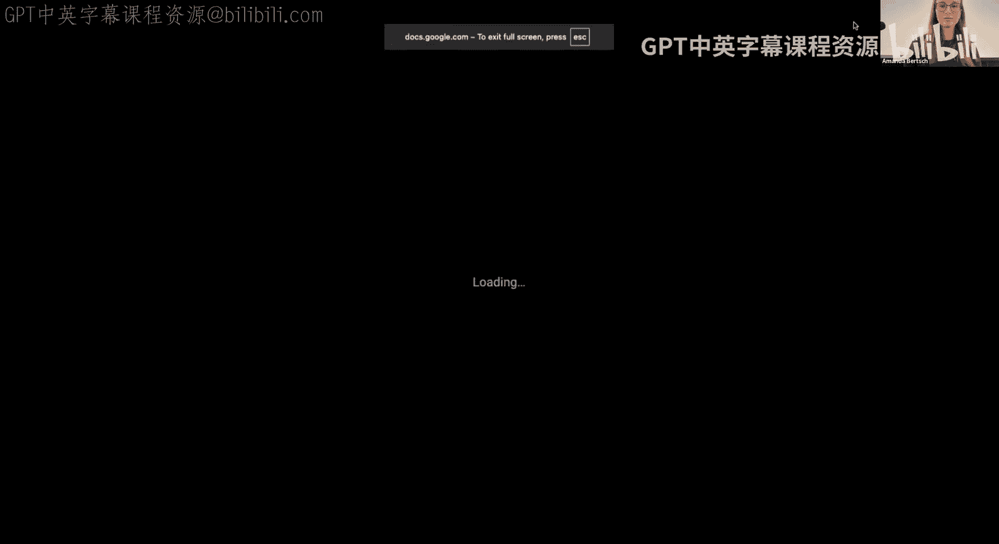
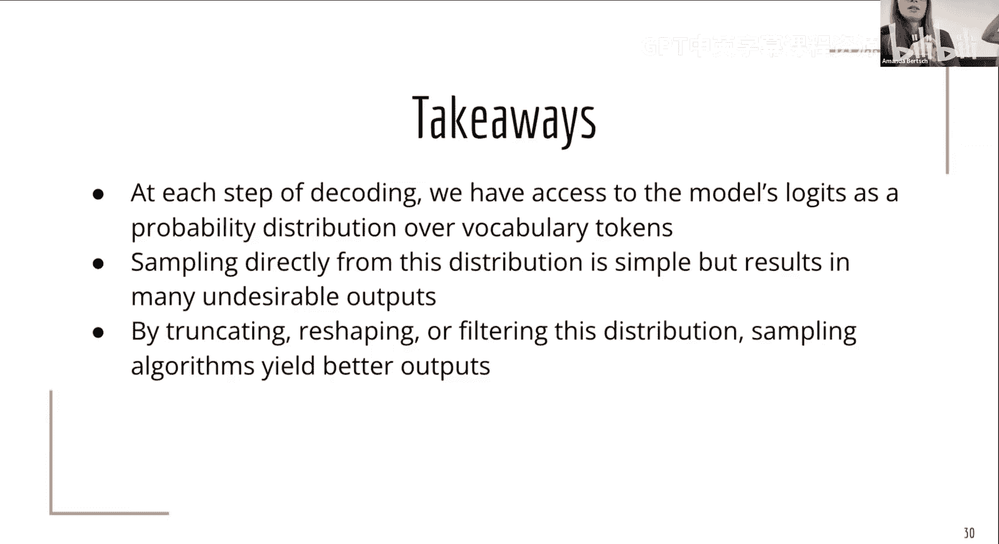
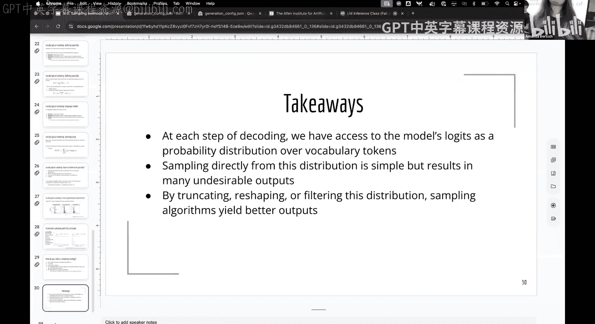

# CMU《语言建模的推断算法｜11-664 763 Inference Algorithms for Language Modeling (Fall 2025)》 - P3：-10-CMU LLM Inference (3)_ Common Sampling Methods.zh_en - GPT中英字幕课程资源 - BV1xsFjz3EoQ

Cool， hey folks welcome back just as a reminder I'm Amanda I'll be giving the next couple of lectures and today we're going to be talking about sort of the first class of algorithms for sampling from a models so we're going to start with this week with sampling and some other sort of classical decoding methods and then we'll move past there into more modern inference algorithms that require reasoning over multiple decod tokens at once instead of sort of these token by token decoding。

😊，And just as a heads up， I know the website says that homework one is coming out today that will actually be out probably Thursday and we sort of adjust the deadlines sort of like that。

So today we're going to be talking kind of exclusively about sampling。

We'll talk a little bit about models as probability distributions and some metrics we can use to reason about that and then we'll use that to talk about sort of two different groups of sampling methods。

 the first sort of simple and truncation and temperature based ones and then a more sort of complex or nuanced method using some of these metrics of probability distributions that we'll talk about first。

So as we talked about in the very first class we could think about a model in a couple of different framings。

 but the framing that we're sticking with at least for today is that a model is just a conditional probability distribution。

 we're not particularly concerned today with how we arrived at that distribution。

 we just know given some input and the prior output tokens at each step we have a distribution over the vocabulary space for the next token。

And under this definition， we can say a couple of different things about this distribution。

The first is that the models that we'll be talking about today are locally normalized what this means is that at each step we are going to get a distribution over tokens for that individual step rather than getting something at each individual step that may or may not be a distribution and then having to sort of normalize at the end of decoding。

So one way to think about this is that our scores will be monotonically non-increasing right we talked about this in the first class where if you're multiplying by a number between0 and1 your probability will decrease what each additional token this also means that if you start with a prefix that maybe doesn't look that good there's no way to add probability masked back in later so in this example if you were decoding the US president in 2023 was and you sort of get the start of this continuation does the top or the bottom look like a better output so far。

The bottom I see people pointing out excellent yeah。

 so the US president in 2023 was Joseph Biden looks like a reasonable output。

 but then maybe if you like the sentence sort of wrapped back around Barack Obama's former VP we would want to have sort of a higher total probability than Joseph Biden's daughter does this mean that in a locally normalized model the top could never have higher probability in the bottom。

 No right models learn distribution over all kinds of sentences。

 it's entirely possible that this sort of construction is a pretty common way to talk about Joe Biden and so it's possible that this actually winds up with a higher score。

 especially because daughter might have a very low weight。

 but there's no way once you ascribe a relatively low probability mass here for this end up with high probability mass later。

 it might be higher than this other relatively low probability output。

 but there's no way to sort of backtrack and say actually I think this should have more probability mass maybe the beginning was a little misleading。

And we can see that as well with this visualization where the top here is how our models our locally normalized models work where these two outputs A and B and each B are getting assigned probabilities that will sum to one in a globally normalized model you get a score at each step instead and these scores can be much greater than one so here a gets a score of 3。

1 so this like uplifts a over the other candidates in a way that is sort of not possible with a locally normalized model we do local normalization for a number of reasons for one it's very easy and fast to train you sort of don't have to worry about these constraints on a sequence level but the sort of flip side of that is that when you want to impose global constraints at inference time。

 you need to do a little more thinking about how to do that and in fact a lot of the methods that we'll talk about for the rest of the semester will be ways of trying to impose global constraints on a model that was only trained sort of with these local normalization。

If you're interested in globally normalized models。

 this figure is from a paper that I've linked at the bottom of the slide， which is a good。

 if a little bit older reference on how to do this for sequence models， you can also take PGMs。

 which has a lot of information about how to do this for graphical models。

 which is a sort of more common setting。What else can we say about a probability distribution we also care about some other features of the distribution and one that we'll touch on a little bit here is calibration so you may have seen a plot kind of like this before we say a model is calibrated if the model's confidence score is well correlated with the probability of correctness so if we have a multiple choice question the model puts 50% of the probability mass on outputting B we would like that B to be the correct answer about 50% of the time and this is useful because then you can take a look at the logics and use that as sort of a direct measure of confidence I this a property that our models normally have does anyone know。

Yeah。They're pretty reasonable， I think now， but I think out of lecture。Makes your burst open。

 I think it makes it better。And then it used to be pretty bad。

The earlier mark it could be like the could be the actual performance Yeah so they used to be worse。

 they're better now but RLHF does something to the calibration Yeah exactly so this is actually this graph is Bt and you can see this is sort of the reasonable calibration this is GPD4 on MMOU in particular and this is a really nice calibration curve this is the model before RLHF。

😊，This is the model after RLHF。So yeah so our pretrained models， if they're relatively strong。

 if they're trained over a good data， the likelihood corresponds reasonably well with the truth or the likelihood of that being the true answer when we do these post-training steps which are super useful and which generally give us better outputs they mess with this property of the distribution。

 so if you're looking at a model that is post-trained you don't have really a lot of guarantee of calibration。

Another feature of probability distributions is that we're generally putting non-zero mass on a pretty wide variety of things in particular in these sort of situations where we have a semi-obvious ground truth we're putting at least some probability mass on incorrect outputs so your model is not putting 100% probability on two plus two equals4 this is this can be good。

 this can be bad there's some interesting ML theory work on whether this is possible to eliminate entirely and the answer here is that if you want your model to also have this property being calibrated it is not possible to also to eliminate this sort of。

Putting some mass on things not that are not factual and this is a there's a sort of like detailed theory result behind this。

 which I' will just sort of point you at the paper for here。

So those are a couple of properties of our distribution。

 we'd now like to compute maybe some statistics about the distribution and these will be useful for the methods that we talk about later。

So the first and one that I think you've probably likely seen before is the entropy of a distribution。

 which we're just going to do generally at a single step and decoding。

 so over the vocabulary space at a single time step by computing the sum of the probability multiplied by the log probability。

If this is relatively high， does anyone know if we have sort of perfectly uniform model distribution。

 would we expect entropy to be relatively high or relatively low？好了。we got both answers。

High entropy means that we need this is entropy in sort of information theory sense Shannon's entropy and so high entropy means that we need more bits to encode the information that there's sort of less of a prior or a bias towards what the most likely outcome would be so if the distribution is perfectly uniform we would need a lot of bits to sort of specify any individual thing in the distribution so entropy would be high if entropy is really low it means that there's the distribution is really peaky so for instance if the distribution was 100% of the probability mass on one token and 0% on anything else。

 you could specify sort of your outputs of that distribution in like a very brief representation because you could say it's always token X and so that would be very low entropy。

We care sort of not about entropy just in the abstract。

 we also care about entropy relative to some ground truth。

And here when we say truth we usually mean we're looking at some kind of self-supervised objective or semisupervised objective。

 excuse me and so here we calculate something called cross entropy。

 which is entropy relative to some true distribution what do we mean by the true distribution in language models we're usually looking at next token prediction and so we look at what the actual next token was in whatever document that we're training on and we look at the。

We sort of set a vector where it's one， if that is the actual next token in zero otherwise。

 and there's also variants of this where you could sort of smooth that probability mass out。嗯。

So if you have ever trained a model， you've probably seen the cross- entropy loss and this is exactly this computed over a large set of tokens in a batch。

 so we multiply one hot probability vector with the log probability。

 which means that this is punctually the negative log likelihood of the correct next token。

And if you've ever read a paper about somebody else training a model。

 you've certainly seen perplexity， which is just two to the power of the cross entropy。嗯。

This is exactly that there's a sort of interesting connection between perplexity cross entropy and the kale divergence between the true distribution and the model distribution。

 which is something that you guys will see on your first homework。There's a。

Interpretation of perplexity which is presented as intuitive and may or may not be intuitive to you。

 which is that perplexity represents the odds of correctly predicting the next token if you had a die or a coin that has as many sides as your perplexity number so if you had your perplexity over some corpus of six that means that when the model is predicting the next token you could roll like a six sided die and every time it rolled a one it would get the token right every time it rolled another number it would predict some other token。

So that's a couple of different sort of properties models we'll be working with today。

 I will pause there for a quick second does anyone have any questions so far。Sweet。

 feel free to interrupt me if you do。So now we have this distribution， we know a few things about it。

 we would like to get some output。And。The easiest thing to do here。

 we have a probability distribution， we know how to sample from distributions。

 and this is called ancestral sampling and specifically here we're sampling from the unmodified model distribution。

 we are just going to draw a sample according to this distribution parameterized by our model。

This is great， this is the property that we're recovering the model distribution exactly and if this is a model we trained。

 we likely went into quite a bit of effort to get that distribution so this seems like a kind of reasonable thing to do。

And so we're done for the day and we can leave， right？But unfortunately。

 there's a number of pathologies of sampling directly from the model distribution。

 The one that we're going to spend probably the most time thinking about today is the long tail。

 so I originally made a variant of this slide in 2022 or 2023 where it started by sayingllama has 32000 vocabulary tokens that's so many there's so many tokens in this space there's so many things that have like small probability mass and since then this is only gotten to be sort of more of a problem So now the slide starts that Lama 3 has 128 k vocabulary tokens and this is sort of。

And I think a relatively reasonable median for like the vocabulary space of a modern model。

If every individual token that is sort of not in the reasonable 100 or 500 tokens to predict next has a tiny amount of probability。

 these small probabilities add up really really quickly and so this is a visualization of that where if you can see this little thin line here that represents the 50% point in the probability mass distribution so the tail from that point onwards is half of the probability mass so if you're sampling it every step and maybe you're sampling 100 or 200 times to get a decent little bit of text the odds of pulling something really really weird from this really long tail can be pretty nasty。

So what do we do to get around that we saw one option on Thursday which is to just make the tail sort of flatter narrower and so this is the idea of using a temperature to reshape the distribution so temperature one is the original distribution temperature is less than one sharpen the distribution so now we have a higher peak and a sort of flatter tail or less probability mass in the long tail temperature is greater than one flatten the distribution back out so if you're looking for sort of more diverse outputs or。

Yeah， I mean， if you're looking for more diverse outputs。

 you can flatten the distribution to increase the odds of pulling something that would is otherwise slightly less likely。

The other sort of broad class of approaches is if we think the long tail is a problem。

 we should just cut it off and so there's a variety of ways of doing this。

 I know most of you have probably seen a number of these before so we'll move through them relatively quickly the first is top K sampling so we only sample from the K most probable tokens depending on how peaky your probability distribution is this could be quite a few tokens or this could be quite a bit of the probability mass or just a little so here this sort of running example we're decoding the first token is the we're decoding the next token there's a variety of things that could go reasonably after the and so the probability mass in the top six is only 0。

68。If we then decode car and then we're looking for the next token after that。

 the space of things that could reasonably come after the car is a little smaller and so the top six tokens captures 99% of the probability mass。

This is a little bit weird that the amount of probability is sort of shifting over time。

 but sometimes we're capturing just a tiny set of the reasonable options and sometimes we're capturing even some tokens that have relatively small probability and so an alternative to this is to define an amount of probability mass you want to capture in your sample instead。

So we could say we want 94% of the probability mass and so for this particular for the first token here。

 that's almost all of the tokens in this little graph。

For the second token this is only the first three and this is called top P sampling or this is also sometimes called nucleus sampling and the intuition is that you start by sort of seeding with the most probable token and then you add on more and more tokens into your sample until you've hit that much probability mass。

And for any one of these， once we've cut off a good chunk of our probability distribution。

 we no longer have a normalized probability distribution。

 so you renormalize and then sample from within your subset。

TheAnother intuition is that maybe we don't care about having just the highest probability things。

 maybe what we're really worried about is only not having the very low probability things。

And so this is the concept behind epsilon sampling。

 only which is cutting off the proportion of the tail that has a probability less than or equal to some small epsilon。

So here， if everything is at least。Some reasonable amount of probability mass you could sample from the full distribution here if there's a number of things that don't have that sort of reasonable amount of probability mass。

 you would cut those out of the distribution。Of course， this is not exactly。

A language model here because we have a distribution over just like five tokens and the tokens。

 we have distributions overchan， but just for intuition。

And so I figured we could take a look at what this looks like in Hugingface。

 which is probably one of the first places that you would go to experiment with a model and this is these are all pretty intuitive parameters。

 you set sampling to true， you set the number of beams to one。

 you set top K or top P or epsilon or temperature， there's a little bit of a caveat to this。

 does anyone know what the default values of these settings are in Huging F。你咗 this睇 different分。

TopP is option 95。50。 T K is option 50， yep。嗯。There's a this is kind of a this is 50% of trick question in that like I think these are actually the defaults if you don't specify a parameter。

But most models will also specify， so I have here Lama 3。1 andquin3， and if you go into the model。

 the model files and you look at the generation config。

And you wait a couple minutes to load？Models will give you a sort of。

Model provider defined version of these decoding parameters。 So llmas temperature is 0。6 top P is 0。

9quin， I think sets a top P and a top K。And sets do sample to true so if you're specifying some generation parameters it's a good idea to check what the defaults offer are check what the model config says they are and then override everything that you care about model providers do this because different models work best with slightly different settings and they've done some kind of exhaustive hyperparameter sweep at some point to figure out what looks best for their evaluation so this gives you a sense of what is like commonly used and also what might work well with that particular model。

So that was a couple of。More classical decoding algorithms。

 I want to talk about one example of an algorithm that is a little more complex and maybe a little less widely used because I think it is a nice intuition on sort of a different way to think about sampling。

 And to do this， I want to frame a question。 So say I have a unfair coin right I flip it and it's 60% of the time it lands on heads。

 I flip my coin 100 times in a row and I sort of write down the sequence of results。

Does anyone know what the single most likely sequence of results is from this flipping the corner 100 times？

What would be the single most likely result of flipping the coin once？Hets。

What would be the single most likely sequence of flipping it twice。Yep， two heads。

 what about the single most likely sequence of flipping it three times？Three heads。

 So if I flip it 100 times the single most likely sequence out of all the sequences。

 you could enumerate it。Is 100 heads in a row， yeah。

Would this be a surprising output if you flip this coin？Yes， why it's the most probable output。

Also yes， yeah。Right， so this is a little bit counterintuitive。

 The thing that is most likely to happen is not sort of。The expected or in a very non rigorous sense。

 the typical output。What would sort of the typical output look like here？

What would you expect to get from this coin？Yeah， like some combination that is roughly 60% heads。

 roughly 40% tails。So this is the notion that the thing that is most likely in our probability distribution is maybe not actually somehow typical of that distribution to define what typical is requires a little bit more work。

So to do this we're going to draw on a notion of typicality as it's defined in the literature studying stochastic processes。

 so to do this instead we're going to think about our language model as a process that at each step emits a token according to the probability distribution at that step and then it is now parameterized excuse me it's now。

It's now conditioned on an additional token and the process sort of continues。

 so we're taking some kind of walk through the space of vocabulary by sampling at each step according to our language model。

So to define a notion of typicality and to have it be well defined according to the slide Cha。

 we need a couple of properties from this process。We need the process to be discrete。

 which means the output space is finite。We need the process to be stationary。

 which means that the probabilities output by the distribution don't change based on some notion of absolute position it's okay if they change based on some conditioning from prior tokens。

 but they shouldn't change based on whether we're like 300 steps into the process versus zero steps into the process。

And we need to satisfy this property called being ergootic。

 which means functionally that you can infer the properties of the distribution based on a single long sample instead of a number of small samples that you've aggregated functionally if I took this process and I took a very long random walk just continuing to sample from it。

 I would at the end of that know sort of all of the properties of this distribution that I care about for this to be the case there's one particular thing that has to happen。

 which is that you must be able to get to any emission or any output from any state if I want to know the properties of the distribution I need to be able to sort of look at everything。

嗯。Once we have these three properties， if we assume that we meet these criteria。

 you can define a couple of things and get to this notion of typicality so we want to know something called the entropy rate of this process what this means is rather than looking at the entropy at each individual time step will take a limit as we sort of generate from this process infinitely and average over it so if your process has the same entropy at every time step if you're drawinging IID samples from the same distribution this would be the same as the entropy of that distribution because we have something like a language model where our conditioning is changing at each time step this would not actually be that。

we justす。Yeah， yeah， so if we。At every time step in this process we have a distribution and we can calculate the entropy of that distribution we so that's the notion of entropy we talked about before。

 but we care about here is not that entropy at any individual step but sort of the average entropy over time so if our distribution stayed the same at every step like that coin that we are flipping right that's always 60% heads then the entropy over time would be exactly the same as the entropy at any step。

 but because our language model the entropy of the distribution changes at every step because we've now conditioned on some different text this is like a measure of entropy over the course of decoding。

you can this with the definition't change Yeah that's a really good question sorry so the question was how does this reconcile with like the definition of stationary if the entropy could change over time and this is a little bit harder to see with a language model because we assume that they're sort of conditioned on everything that's been generated before with a modern model but you can think about this with something like a sliding window or say a bygram language model like you。

Have you care about the maybe the X things that came before and so at step。20。

 you're conditioned on like maybe the X things that came before at step 2000。

 you're conditioned on the X things that came before。Um， but if you。

 but it doesn't matter to the model whether like past the sort of window of things we care about。

 like maybe past the the 20 things if we're a 20 gram model。

 it doesn't matter how many things happened before that point。

So you could think about this as like if you truncated the context for a sliding window or something。

It makes sense on the bad definition。 But like， I'm struggling to see like on like。Mo language model。

 Now， we can have both station I and a quality。Cant see how problem influence。

How both station being stationary and beingerta can coexistly。います。

Hold on to the stop for like 20 seconds this is a really good point。So。

if're so if we assume we meet these criteria and we'll come back to them in just a second。

 we can say we can define something called the typical set for a length and some cutoff epsilon and a typical set for some length of sequence is all sequences that are exactly that length。

And that have an average per symbol or per emission negative log probability close to the entropy rate of the process。

What that means if you kind of stare at this a little is we're going to calculate the log probability。

 we're going to average it over all symbols and we want that average to be close to the entropy of the distribution or to the entropy rate of the process。

And here close just means less than epsilon。So this definition of typicality is well maybe like a little weird to wrap your head around。

 captures this notion that we had from the coin fliplip that some things that are very probable are maybe not typical so if you think about the 100 heads in a row。

 100 heads in a row is like a very sort of the negative the log pro of that is actually like fairly high right this is fairly probable。

 but in the if it's sort of not close to the entropy of the distribution where the entropy of the distribution would suggest that we get something that is a little more like 60%。

 40%。This is a really nice definition of typicality。Oh sorry， my head is in the way。Yeah， of course。

This is a really nice definition， it's got like a really clear formalism。

 it's got some guarantees as a like of our sequence goes to infinity。

 can we apply it to language models？And so to apply to language models we need to meet a couple of criteria。

 I think we can agree that a language model you can treat as a stochastic process we're sampling atstep from a distribution so that seems pretty reasonable is a language model discrete right we have an output space that's finite which is our vocabulary space so that seems good。

Is a language model stationary we kind of just talked about this maybe it's a little bit complicated if you're assuming you can condition on infinite context。

 but if you think about a model that has from a finite context window at some point you're going to get hit something where there's some past context that is outside of your finite window and it doesn't matter to your model whether that past context exists or not it's only caring about the things within sort of its finite space so we'll say sure maybe it's stationary you know the probabilities don't really matter based on position they just matter based on what you've conditioned on。

Is the language modelergoic？So we said that the requirement for this was that you have to be able to get to any emission from any state and you seem to think that this is maybe not possible。

tyRight， so anything has a non zero probability mass attached to it so that seems reasonable right maybe you could babble forever Does anyone see a problem with this though。

It could be like it's a really low probability， but if we've got an infinite amount of time。

 eventually we'll wrap back around， right？What happens if we generate an end of sequence token？

So at least the way that we generally decode from models。

 if you generate an end of sequence token you stop right。

 and so in the language of a stochastic process we would say that this is an absorbing state。

 probability mass falls into end of sequence and it can't get back out。

So if we have an absorbing state， if we have a place that the distribution kind of stops and you can't get anywhere else from there。

 then you can't get to anywhere from anywhere， you hit the end of sequence open and you need to stop。

So this seems like maybe we just went through kind of a lot of maths for nothing if we can't use this definition。

 and so the really nice intuition or method from this paper called locally typical sampling。

 is that maybe if we have this sort of like global typicality as this like North Star that we would like to reach。

 but if we can't define this in a principled way， maybe we can make like a less principled local approximation and try to get there over time。

And so the idea here is that rather than saying that everything over the full sequence needs to be close to the entropy rate。

 we're just going to say that each new token should be close to some kind of expected amount of information that we thought we'd get out of that token。

What's the how do we tell the expected amount of information we wanted to get out of a token we look at the entropy of the distribution so at every individual time step we'll look at the poor token entropy and we'll use that to determine what we sample the other advantage of looking at this locally as we sample from our models one token at a time so a global constraint would have been a little bit hard to satisfy anyway。

How do we achieve local typicality we follow this。Algorithm looks something like this。

 so you start by calculating the conditional entropy H。

 which is the entropy of the logic distribution at whatever time step we're at now。Once you have H。

 you resort the logics distribution by closeness to H and when we're working with outputs generated from a language model。

 we're usually looking at a log probabilities， so this is sort of implicitly resort the log pros by closeness to H。

嗯。Then we use top P to truncate this new ordering of the distribution so before top P we started with our most probable token and we added probability on here we're starting with our token that has a log pro closest to H and adding probability on until we hit some value。

Realalculating agents check now close this to age like I。I the symbol。Yeah， so H is our entropy。

 so we're calculating how close the log probabilities are to the entropy and on a parttoken basis and the reason that we want to do this is because we're trying to get something implicitly that is close to this。

 which is the log how close the log probabilities on average are to the entropy rate of the process。

So this is sort of like entropy rate is over time， this is log pros over time。

 worth setting both of those aside and we're just trying to look at an individual time step。

And the idea is like if we're close the entropy of that individual time step。

 then you know as we average this over time steps， we should get close to the entropy rate So if understand correctlygrade the average entropy over the distribution at a particular time step let me calculate the individual condition entroies of each logic sort them in terms how close they are to this。

I have a check for。あ丈。Close but I think not quite so at an individual time step we can only get one entropy value and because entropy is a distribution of level of property and so we get that entropy by summing over all individual tokens in the vocabulary space。

 the probability of that token times the log probability of that token so this is what we're getting from the logics once we have that single value we'll resort the log probabilities by how close they are to that entropy Yes like it's a little confusing because we have this notion of entropy at every individual step and then we also have the notion of entropy rate which is like a single value over the whole process but because we don't satisfy these properties that you need to define typicality。

 we actually won't worry about entropy rate at all we'll just worry about individual local entroies。

Once we have this new distribution truncated by order closeness to H。

 we'll sample from that new distribution。And the kind of strange thing about this is that we might wind up actually cutting off。

 we're no longer sort of cutting off the long tail。

 we could actually be cutting off things that are relatively high probability。

So if we you can think about this in terms of if the conditional entropy is high or low。

 so if we say have。If we like want to make sure the highest probability token is in the locally typical set。

 is that more likely to happen if we have like really high or really low entropy。

 does anyone have an intuition for this？So if we have really high entropy。

Is our distribution peaky or flat？好。If we have high entropy， then our distribution is flat yeah。嗯。

If our distribution is relatively flat would and maybe you just kind of like at a slight angle here。

 would we be more likely to sample from sort of like the center of this distribution or from like one of the edges like the peak or the tail？

我是生。Sorry， if we're using locally typical sampling。

 would be more likely to sample from the center of the edges。

I hear whisperings of center sort of vaguely hissing in the back and that is correct so if we if our distribution has high entropy and it's relatively uniform we'd want to sample something that's sort of in the middle of it for a locally typical sampling if our distribution has low entropy and it's really peaky then we want to sample something that's kind of close to the edge because then the log probabilities of the high the log probabilities of the most probable token will be quite low because it's a relatively high probability token。

😊，Yes， let me draw this out。So。So we had two distributions over the next topic。

This distribution is pigy。I theHP higher的。呃是那。And this distribution is water。And。しら？呃。Let's say。

 let's say these are the same tos in the same order。啊，A意思。嗯。Is the probability of a relatively。

 higher or lower in the top。Probability that is is the。あ。It's a lot of probability。Okay。

 relatively higher or lower。在这个。It'sRemember our log of probaities we're taking the log with the less ones we anything negative。

So is it relatively closer or further than zero， I guess。close yes so closer to zero。嗯。

 which is actually gonna be。下。で。そなて。早です。Good morning。Are they there。

So here it's going closer to zero， which so the walk probabilityability here is going to be higher lower。

啊。最鞋啊系是谢啊。あ。あ。So if the entropy of this distribution is relatively low。

 it's going to biases for sampling in locally typical sampling that have relatively low entropy。

 which means it's in of biases for sampling these that are relatively close to。

If the entropy here is relatively high， it's biases towards's going to biases for sampling things that are relatively high。

Which could be sort of here because we're not to keep of the distribution。

 but we're also going to include a bunch of things。实生。但是我我 do次。Why is it moving to the middle？Yeah。

 so' we're going to be looking at like a。你一个那个是H对把。Mark on this curve。And so here。

 if the interviewpy is quite high， that mark on the curve is going to be relatively high up。

 and so it's going to be likely be something close to the peak here。

 if the interviewpy is relatively low。That mark in the curve is likely to actually intersect the curve somewhere in the kind of the middle of Yeah。

 thank you for asking because I think it is helpful around the。啊。Cover it in chocolate。

So the reason I keep asking about this is because I think that like entropy。

 when entropy is high and when entropy is low is really counterintuitive in my brain because it doesn't line up with like when probability is high and low。

 and so I think it's helpful to like continue reminding yourself of this intuition。So。

This is the notion of how we achieve local typicality。

 maybe we should take a step back and decide this is actually something we wanted in the first place and the argument that they make for why this is something that we want to optimize for is sort of like a cognitive science flavored information theory argument and the argument here is that this is somewhat close to what human language is doing。

So。To do this， they take a bunch of human language and they calculate these two characteristics。

 yeah。你知个。他人好是。我这。有这。高花出器。O你你你识界图啊。这得一个。他都。あです。How can answer。We've got lost in our slide。

If the log probability is higher。But the probability of AS higher is in the log cloud post of zero。

than like one啲 years。其不当底呢个是话嘅。那这到好认识。Yeah， it's less likely。Yes， so nice。So I had this back。

Let's go back。不。Let's go back to what we just said。So。Here is the entrypy is relatively low。😊。

times to0。Or we going you get this to the top。I think in this case。你は有。

I think only the last line was wrong， I think everything else was right。Yeah just last five this。

Yeah， because then this H line is going to be a little bit further down。

Which means that you are going to sample from possibly not the top of this。比赛。第。

If the proba is always one， you're always going to sample from that one because that's typical。

So if the probability is close to one。You're still， I think。

 likely to get the top of the distribution。But there is more of a chance of cutting off。

但是司就可一确下比较低的是。Does this reduced to exactly how go go money？あん。要要要要。There lot of啲 functions like the。

You take the log of it。 It doesn't change anything for the relative of ordering the logic distribution。

Right and using top you same the Yeah， so the key， the reason this isn't just top key is because of this step two sorry where you're going to take H。

And you're going to re your logic by closeness to H instead of my absolute value。

And it will always be less than the maximum。H will always be less than the maximum one。

I believe that's true， but I don't it will it won't make a difference to the algorithm if you're starting by close to stage if if it was if age was like at top E then you're right to be exactly the same as top E and I think that's the case G is describing where you're。

は。根据。あでい。So is this actually how human language works？So in this work。

 they measure the entropy of a bunch of human text and then score it。

Ies so they measure sort of entropy over time and then entropy at individual time steps and they graph sort of how well this lines up like you can calculate given a relatively strong language model。

 the entropy of the logic distribution and then the log pros of every individual token and they calculate for actual human written text。

 how often is the。Human written next token， sort of close to the entropy of the Loits distribution at that step。

And the answer is。Almost always so there's some variance here by domain。

 but generally human written text has the next token relatively close to this like entropy of the token distribution and the argument that they make here is that this is actually like a way of communicating information effectively where you don't necessarily always want to say something that is like really unexpected because then you would just be blabbering nonsense but you also don't want to say always like maybe the most obvious next thing because then you wouldn't be conveying any information to your audience at all。

啊，一。以前。Inent for like actual language test， but isn't this standard intuitive for factual outputs。

 like typically， a actual output should lie， I mean would not go with。去搞啲先力嘅。系 from。你发。

Yeah like would a factual output still line up with this theory like would a if there's a single like really high probability continuation would this be true I think this is a really good question this might be。

Yeah， this might be some of the distinction I think that another part of this is that there is very rarely actually like a single valid next thing maybe maybe in something like math or code this might look different。

 but in any like sort of natural language description of a fact there'll be a variety of ways to say it than are more or less typical。

😊，嗯。Does anyone have a sense of whether sort of like ancestral sampling from a model gives you outputs that are higher or lower perplexity than outputs from something like locally typical sampling if you think about this sort of like reshaping that we're doing here。

Do your outputs wind up being higher or lower perplexity with locally type？那你看。你开。

Yeah I see if you're not that's exactly right yeah so what we're doing here is we're reshaping to be closer to the entropy。

 which is generally not going to be like the very end of this distribution and so you wind it with outputs that are slightly higher complexity because of this notion that they're carrying slightly higher information content and so this is when we're training a model we want complexity to be really low because it shows we've learned the distribution well but sometimes when we're decoding from a model we want complexity to be slightly higher。

There's a method in sort of the same family of entropy manipulation of models that we won't talk very much about called Mirostat decoding。

 which is based on the same principle， but kind of in the opposite direction that you should specify a perplexity you want your text to be and then use a continuously updating update to try to generate tokens that you think will result in that final perplexity being close to that value。

And so these both come from the notion that what we want to optimize is actually some measure of information over time rather than perplexity itself。

Is also to go back to our truncation sampling for a moment a truncation sampling method that uses this principle。

 so this is something called ada sampling and the idea is to impose both epsilon sampling and then some like approximation of locally typical sampling at the same time so you'll define one threshold based on epsilon just like a。

As you did an epsilon sampling and then you'll also define a threshold that moves around with the probability。

 so this threshold is Eda， this is within Eda distance from the entropy of the distribution calculated at that step and so this is in practice not often terribly different from either locally typical or epsilon sampling but it's a little bit faster to compute。

And。So this is a whole lot of different ways to sample from the same model， how do you choose？

And I really wish that I could just give you an answer here。

 like always use this and never to use this， but of course。

 we wouldn't be here if things weren't so easy。So there's a number of different ways to think about this the first is I think pretty intuitive to think about how open ended the problem is if you have a problem like。

Write a creative story about a frog maybe there's a huge range of correct answers to that and what you care about is maybe diversity of your outputs more than these having like the single absolute best story about frog if you have something that's like explain the solar system to a five year old maybe this is in the relatively same boat where there's a range of correct answers that is really really variable if your question is like what's the capital of Massachusetts。

 maybe your options are a little bit more wellcod。嗯。

I think there's also a lot of value in anything in inference time algorithms and just trying it。

 These are super， super simple manipulations。 They're literally like。

eight characters of code to change and so you can generate a bunch from a small model and try the caveat here is that smaller and larger models behave very differently in particular you think about model versus search errors your search errors will be the same for the same decoding method but your model errors will change radically depending on how well fit your model is to trading data that looks like the problem you're trying to solve so in particular like smaller models will display a lot of pathologies of sampling that you might not see in a larger model so try these on the model that you're interested in studying。

And then look at the outputs， if you see outputs that look particularly repetitive or degenerate。

 if you see outputs that start going in a very weird direction。

 maybe you're sampling from the long tail， if you see outputs that are degenerating into sort of absolute nonsense。

 you're definitely sampling from the long tail， and if you see outputs that maybe if you sample 100 things and you get the same thing 100 times or you get very similar things。

 maybe you want to prioritize diversity and then you would look at expanding the amount of the tail you're sampling from or something like this。

And this is kind of， as I said before， as models have gotten better over time。

 it's become less crucial where you can sort of take the defaults either specified by that model or specified。

By a library like Hugen F and generally get sort of reasonable outputs if you're working with smaller models or older models it's like more important to spend some time here。

And then the last caveat here is to me very careful what you evaluate your model with because performance can look very different with different characteristics here。

 I talked to some friends of mine who work on model evaluation to try to find like a nice uniform answer here and what they said was essentially what。

My guess would have been anyway， which is that you should just try a bunch and see in particular。

 I've has some friends that are working on training a language model who went and sort of swept through a number of parameters for their evaluation suite。

 settled on a sort of range in which their performance of the model was relatively stable across checkpoints and then set that as the range for all of the evaluations so it could be like there's often like a region of performance in which these parameters are like performance is relatively stable with respect to these parameters so for them in particular。

 I think it was like temperature under seven top or temperature under 0。7 top P under like above 0。

7 or something， but if you find a range where your model becomes relatively predictably you pick one strategy。

 you standardize it across all of your evaluations because if you overfit to the best decoding strategy for each evaluation the users who then。

Up your model are unlikely to do you the same favor。嗯。So。

This is sort of a caveat for both if you're picking up somebody else's model。

 but especially if you're evaluating your own to kind of think a little bit about how you do this setup because those numbers in those generation confix did not come from a chance。

So sort of the overarching message here， we can think about decisions on each step of decoding as ways of manipulating or reshaping or resampling from a probability distribution over the vocabulary space。

 it's really easy to sample directly from this distribution， but reshaping it in various ways。

 kind of avoids undesirable or degenerate outputs。And then do we have any questions before we turn over to student presentations。

 yes？こそで来方。2。在配送开始。Is it possible that the language model decides the parameters？こいですか。嗯即其实。

If's an open question， open any question， they would show some strategy that。系 more read。Yeah。

 so is it possible that the language model can like choose a decoding strategy like for itself based on like the type of problem and two answers to this I think which is I think implicitly language models kind of do this if you think about like what the probability distribution looks like for over next tokens for two plus two equals blank versus like Graham's favorite color is blank one of those distributions is gonna to be really really sharply peaked at a single output and the other is going to be flatter and so this is like in some sense the model has learned a distribution that is like adjusted differently to the openendedness of the problem The other answer is that this is absolutely something you can decide on like a system level like if you're receiving prompts from users and then you're passing them to the model you can change the like generation settings under the hood in between like serving each request and I think that's like a really reasonable thing to do I don't know actually of any。

Work or system that does that， but I wouldn't be surprised if like some of the model APIs do。Yeah。ハさ。

Thiss about the shape of the public distribution of the access to。啊 like咁。6毛钟。Mtal language models。

 like what are certain proper like you were discussing various processes properties that these importance have。

is there any。So we sharply curve in certain sub regionss。

 but there are there any specific properties district we on urge we can study about the situation itself。

Yeah， are there any very quickly， Will you answer for the people who are present。

 Could you come up and like start setting up your computer and we'll continue。 Yeah。

 I think it's just one so the person who is yeah。Yeah。

 so the question was are there any properties like that we know of ancestral of like the unmodified model distribution I think the immediate on the sand that is calibration so we expect the distribution to be peakier if the model is sort of more likely to get that answer correct。

Because then that would mean that there's like more probability placed on the single correct answer it's in terms of like which portions of like the space are more or less likely to be peaky。

 I would place a personal bit that like if you're doing something related to math or code where there's maybe like more constrained space of answers that you would see a distribution that's peakier。

 but that would just be like a property of how the model learned the data that's not necessarily guaranteed。

No matter what you thought this model， there's going to be some jagonness in the public distribution。

 there's a way to measure that and probably mitigate that to sort recording structure。

There's going to be some jaggedness in the distribution by no matter what。

 what do you mean by jaggedness？It distribution but yeah Instagrams So these Instagrams are all working be pretty cooked and ja。

 thatll bell be that you don't expect and。Interesting behaviorm how you quantify speaks measure like measure this distribution I think entropy is going to give you at least some measure of this where entropy will give you some kind of hint as to like how jagged the distribution is you could also like certainly look at any other statistical property of a distribution。

 So you could look at things like the mean or median probability mass to a random token in practice。

 I think people are usually looking at these distributions sort of like several steps of like granularity further up where you're looking at something like a measure of perplexity over a corpus or a measure of like cross entropy over an entire batch and so you're not necessarily like looking at individual distribution。

 but particularly if you're doing some kind of task like。

Constrained decoding of like a label in ICL where you care about like the distribution over a single set of outputs like or maybe like you know you care about the distribution over like A。

 B and C and D for like some multiple choice question。

 then you can certainly like try to think about properties of that distribution。Of course。Yeah。

 one thing I'll mention in addition to this is like jaggedness is not necessarily a problem， so like。

When you have a reasoning chain， there's like many correct ways to reason about something and。

So just because something is jagged doesn't necessarily mean it's bad。 And so like because of this。

You would think that oh， like maybe the places with high entropy are like the dangerous places where you might make a mistake。

 but that's not necessarily the case like sometimes the dangerous like the the places with high entropy are the places where you just have many different ways of saying a particular like word or like forming a sentence structure and then。

The places where you make a mistake， there's actually just two options。

 it's like 533 and 534 or something like that， and then that actually doesn't have super high entropy。

 it's just log two， but it's still a problem right。

you can actually get kind of a notion of this if you compute perplexity over like a document and you graph it over time。

 you'll see the perplexity for the very first couple of tokens will be extremely high to the point where most graphs of perplexity kind of cut off the first 100 tokens or so were the first 10 they' 20 because the options in like starting from nothing are so vast and then perplexity kind of declines over time and then flattens out but that certainly doesn't mean that the most mistakes that language models make are in the very first few tokens right it just means that there's more valid options in that space。

こ。Sounds great and yeah starting this time we'll have a presentation。

 thank you for being brave and being the person who does it the first time and everybody please sign up on the side yes。

😊。

