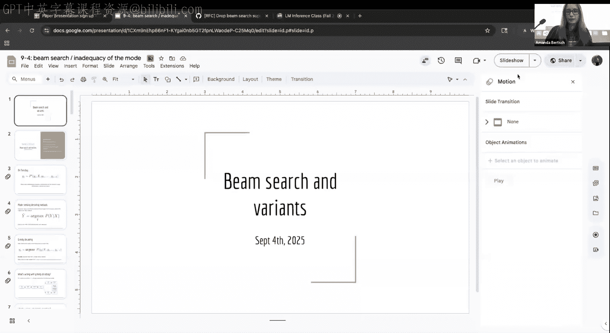
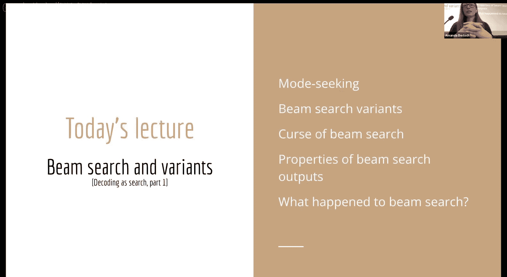
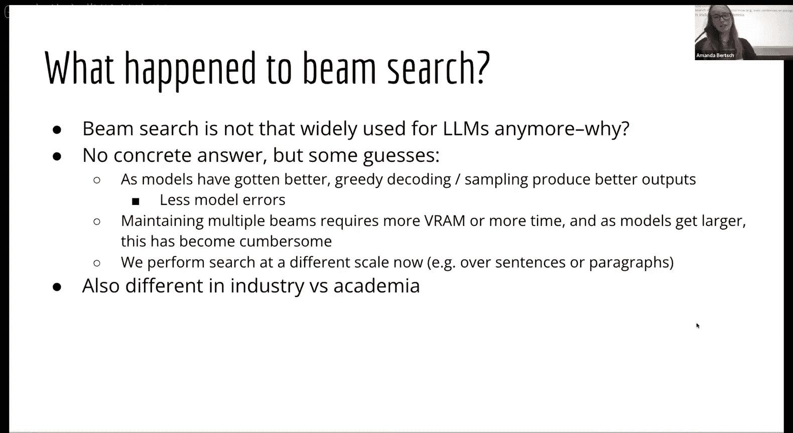
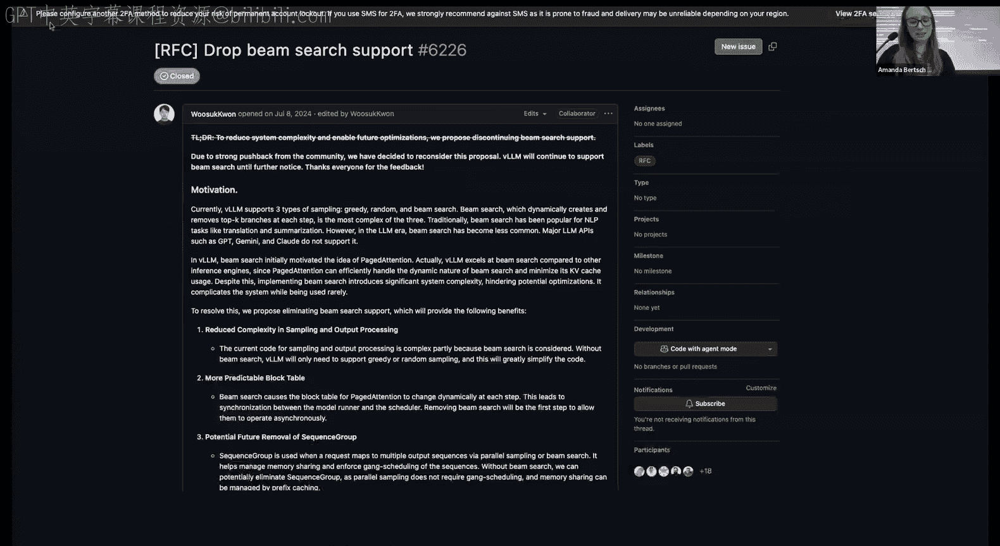
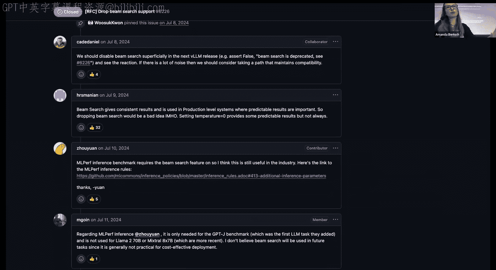
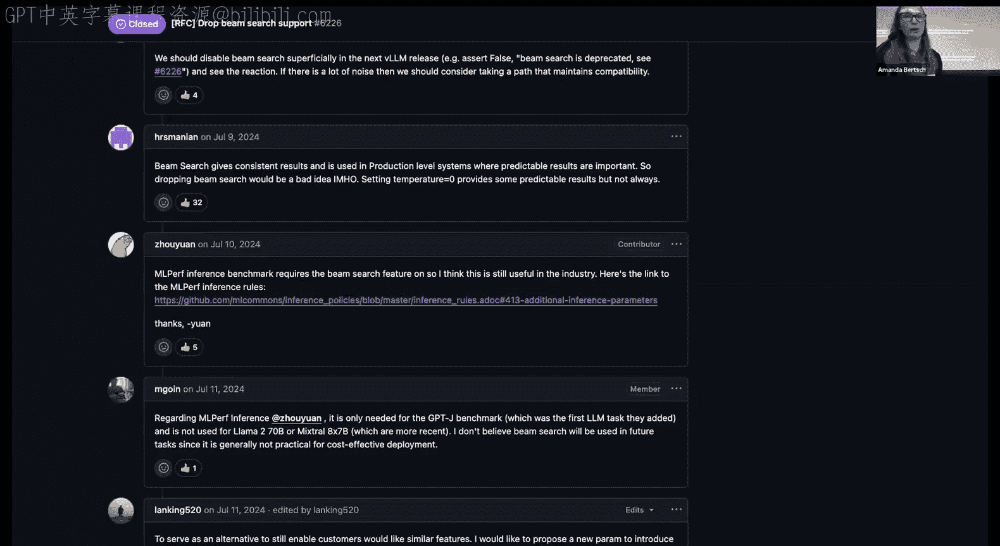
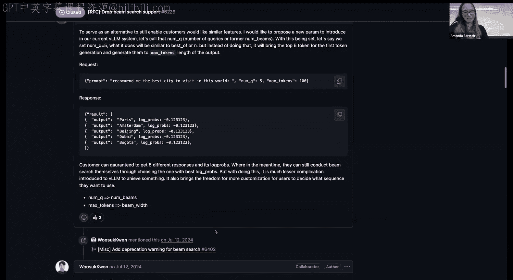
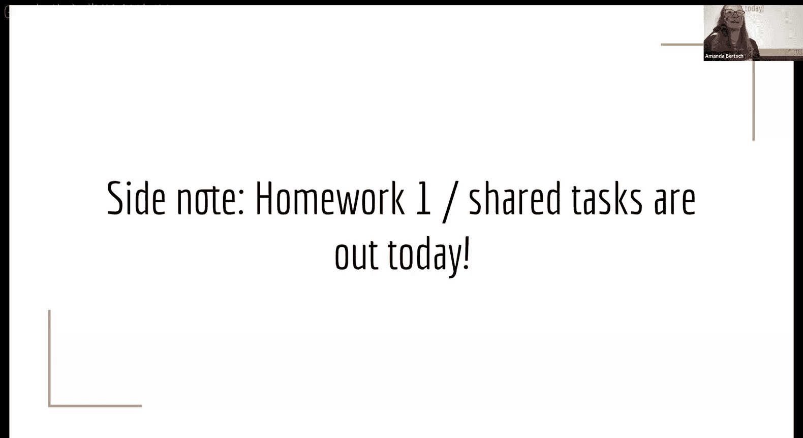

# CMU《语言建模的推断算法｜11-664 763 Inference Algorithms for Language Modeling (Fall 2025)》 - P4：-09-CMU LLM Inference (4)_ Beam Search and Variants.zh_en - GPT中英字幕课程资源 - BV1xsFjz3EoQ

And with that， we can get started。So today we're going to be talking about sort of beam search and a number of variants in the same family。

Yeah， I think so。 it's， I think it's。Recording by default， yeah。But thank you for double checking。

Well。So today we'll be talking about beam search and some variants in the same family。

 we'll talk a little bit about what it means to do a mode seeking search。Thanks yeah。

 so we'll talk a little bit about what it means to do a mode seeking search。

 we'll talk about beam search in kind of its original form and a number of variants。

 and then we'll talk about some properties of beam search including the kind of ominously named curse of beam search。

So when we last talk on Tuesday， we were talking about a variety of methods that all look like sampling from some distribution。

 whether that's the original model distribution or some modification we've made that might change at each step。

 for instance， if you're doing a top K the k tokens in your distribution might change over time。

So this is a pretty broad class of methods， but today we're going to look at the problem of decoding from a slightly different perspective。

 which is a little more optimization flavored so we want not just a good output from our model but the single most likely output given the distribution that we've learned over the parameters so given our evidence and the prior that we have from this model we want the single most likely sequence and so this is what we'll call mode seeking search and what is sometimes also called map decoding map being for a maximum a priori。

Now this is the mode of the distribution over outputs and if we're sampling just a single token from our language model。

 this is actually really easy to find right if we want to look at this distribution at a single time step you can take the max by just doing an aG max over your logics and we're done where this is exactly what we want for a single token output。

But if we're interested in decoding more than a single token at a time from our model。

 if we want a sequence， then this is a little bit more complicated， right？

And so this is sort of the the baseline that we'll be comparing yesterday is greedy decoding where we just take the single most likely token at each individual time step this is super trivial to compute。

But it has a number of sort of problems as we go from sampling or from decoding a single token into decoding multiple tokens。

嗯。The first of these is that we're not necessarily getting the highest probability output right so if we take the sequence that is greater than life one and we're trying to find the we're trying to use greedy decoding to find the true mode maybe this works okay for the first couple of tokens and then we reach a slitting point and here this is a little bit of an artificial example。

 but you could imagine you have two tokens that are relatively similar probabilities at some time step so here we have eatats and Cs。

And then。The one that has the higher probability at time step T has no particularly high probability completions happening at time step T plus1。

 so here the most probable token at T plus1 has a probability of 0。1。

Whereas the thing that is slightly less probable at time step T could have a really high probability completion at time step T plus1。

 and so if you actually multiply this out， you end up with a sequence that you would get from greedy decoding on the top that is substantially lower probability than the sequence in the bottom which may or may not even be the true mode of our distribution。

So this isn't good if we're trying to optimize we're not doing a very good job。

 but greedy decoding can also produce text that looks a little strange so this is an example from GBT3 and if you kind of we're playing around with models at the time period the GBT3 was a sort of frontier or frontier adjacent。

 you're probably familiar with text that looks a little bit like this this particular example is from a really interesting short story written with some like input or collaboration from GT3 called ghosts which I've linked here if you're interested in kind of like collaborative writing but this starts as a sort of reasonable statement or two of turned the space station into a spaceship and then it startss getting a little bit circular I'm traveling forward I'm traveling backward and I'm traveling sideways and then if you let it continue it's sort of completely falls off the rails until you're trapped in this week of just repeating the same 10 or 15 tokens over and over again。

Does anyone have a sense of why this might happen with greedy decoding？

Or anything about greeded decoding that would make this problem worse。

So imagine you start in like a space where you you've trained your model over a number of texts。

 some of which are good， reasonable looking writing and some of which are really degenerate things like just the same character repeated over and over again or some like really poorly formatted Xmls great from a website or something when you start getting into a space that is maybe a little bit repetitive like I'm traveling forward and backward in sideways。

 you're sort of getting closer and closer to a space of your where you've learned the repetitive texts you saw in through training right you've sort of learned that once you see something that starts repeating generally it starts repeating for and once you so maybe once you've seen like this I've heartding through the universe and I'm a ghost and I'm in spaceship once there's a number of things that are likely completions but once you've seen it twice in a row。

 the most likely thing is to see it a third time and then a fourth time and then a fifth time。

Maybe if you were sampling stochically， you could or if you were sampling if you were doing a stochastic decoding method。

 you could sample something that's a little bit different from what you had before and you could break out of this trap。

 but if you're always taking the aG max， you're kind of reinforcing this repetition and once you' repeated it twice you're going repeated a third time and once you're repeated a third time it becomes more and more likely itll be repeated a fourth time and so this is what we call the repetition trap。

And particularly for older or smaller models， this is a really common thing to see when you do greedy decoding。

And one other comment is this is like particularly frequent in like pace models that we trained with maximum likely。

 but it's a little bit less frequent in instruction to the models。

 it's even less frequent than reinforcement learning models because if a reinforcement learned model samples these repetitive things。

 it'll get a low score。 And so like you actually have an explicit bias， it repeating yourself。

 So there are ways to fix it through training。 But like， as I said in the first lecture。

 you can fix things through training or you can fix them through inference。

 So if you have a model that's susceptible to this。 you want to。😊，Like if you want to use that level。

 then your only place is to do it。其说我真是分的话。I mean， I don't know the training data of GP3。

 so I can't say for sure， but I don't have any like strong reason to believe。成楼啊照呢个四。So you。

 So after assuming it repeated twice， is it likely that it will repeat third times。

Because like in the original training data， the next sentence will be something else。

You're saying like if you trained GBT3 on a whole bunch of versions of the sequence that had like two repetitions and then a thing after。

 would it continue repeating？I think that's a great question， I think it would depend on how。

Like if you're training it on this exact sequence， I bet you would wind up like teaching it that there should be something of following after two completions because it would memorize like this two completions plus something else structure。

I don't know if you could train generally on that kind of data as a way to escape repetition。Yeah。

 a quick work， I don't know。And we curious the how of poverty to condition on the social changes of reputation like。

Do do the logics where the repetition brokenken is become increasingly and the repetitions。Like。

Yeah this is a great question so it's if the as you start repeating does the conditional distribution change to become like peakier on the logic of the thing that would be the next token in the repetition I think almost always the answer will be yes but I didn't actually like visualize it for this。

I呀。know as this taxes from G3 for one for the G virtuals channel。

Like if you to use recording on those would would like the chance of like probably falling into the reputation trap be lower because of like the that would it just like probably give you a similar Yeah。

 would better and newer model be as likely to fall into this trap I think they would be less likely for the reason that you name that for because they have like RF and instruction to and also because models that are。

Better trained or trained on more data or larger， I think are less likely to run into this repetition trap to begin with if you started them on some repetitive text。

 they would still start repeating but they're like a very anthropomorphizing way to say this is that the model kind of talk itself into this quarter of the space that's not rigorous and that's not like。

But kind you can see it started like doing this like quasi repeating thing before it wound up repeating because that was sort of like an easy thing to predict as a next token like us。

And so a model that is like better trained than a lot of like high quality text。

 I think is less likely to start doing that。In addition to like all the benefits of instruction tutor。

Another thing is like， you might think that there's low quality text that has lots of repetitions。

 but just leave up like all the semester files in Github or， you know， other stuff like this。

 There's just a lot of legitimate reasons why you have tons of tos of repets。 So like。

It's not necessarily just the generic models I see this all the time。

 it's like actually good models will Yeah， there's a lot of， there's a lot on the internet。

There there's a great section， I think， of the Doma paper that has examples of sort of degenerate things they found in reasonable looking places like Reddit posts with a hard large number of outvoats that are just the letter M repeated over and over from a subreddit that is about simulating the sound of a microwave going on。

So there's a lot on the internet and we're giving a lot of it to these models。Cool。

 so these are these are some issues with greedy decoding。

 One last one I want to mention is that when you're doing greedy decoding。

 the model is making a single sort of best average guess at each step。

 And so that means if you're trying to decode like sort of some。

Some meaning or express some sentiment that requires like a relatively high probability in a relatively low probability word you can wind up with these kind of like convoluted path sentences where the dog was seen by Jane is maybe a less fluent or less like naturalistic or smooth way to say this then Jane saw the dog。

 but because Jane is a relatively low probability token。

 any entity name is probably a relatively low probability token compared to something like the or dog。

 it will sort of make the choice that is higher probability until there's no kind of room left in the sentence but to output Jane。

And so you can get these sentences that seem like a little bit convoluted or a little bit backwards。

So we have the sense that greedy decoding is maybe not the best way to get outputs out of our model。

 but if we still want to stick with this intuition that we want something that is relatively high probability or close to the mode might be as close as we can get。

 what do we do and the answer here at least for today will be beam search so the idea of beamM search is that we don't want to make a hard top one commitment to the highest probability token we think there could be something kind of hiding under another high probability but not the highest probability token and so we're going to keep a couple of options around so we don't miss something that is relatively high probability that was maybe like the second or the third best path at a previous time step。

And the way we do this is a type of breadth first search so we'll expand at each step into a number of options and we'll prune that back down so that this doesn't become intractable and then we'll generate a number of candidates for the next step you can also think of this as a sort of subsett or like an approximation of atuby decoding which would be a way to exactly explore this probability space if you explored at every step every possible vocabulary token of course this would be pretty intractable if you want to decode more than like one or two steps at a time so we do this as an approximation and we're going to step through this in a decent bit of detail even though I know it's something that a lot of folks have likely seen before because we're going talk about a number of variants and it'll be helpful to kind of keep in mind the details。

So we'll start by conditioning on some prefix here it is when my cat gets hungry for reference this is cat and we're going to set our beam size to or our beam width to three。

 so we're going to keep three completions around at every step。

 so we take the three highest probability things at the first step which are she， he and it。

And then from there we expand out to the three most probable things following out from each of those lines。

 so now we have nine options from our time step two and so you read this as just like along these lines like Shimiows or it will these all have a score determined by sort of multiplying the probabilities that we took to get there and so now we are going to reduce our nine things back down to three so by pruning all but the top three most probable things。

So here this happens to be two things from sort of our first original beam and one thing from our second beam。

 this could just as equally be three things from three different beams or all three things from the top beam。

So now we've got sort of three valid paths going again， we're going to expand them back out。

 there's no particular sort of like mathematical reason there's no longer probabilities here it's just getting a little bit hard to see on the graph。

And so now we have nine options once more， we're going to take our top three。

And then we'll expand out again noticeice that now we've got only six things going here and this is because one of the things that we selected at time step what would this be three is the end of sequence to so now we have well my cat gets hungry Shiows is like a fully decoded potential candidate and we have in addition to that six other candidates that are sort of partway through decoding。

So now we have seven options instead of nine， that's okay because we're still trying to cut back down to three options。

 but now when we sort of look at scoring these seven options together。

 does anyone see a sort of immediate problem with this？

Or a reason that this might not be like a fair scoring， I see you nodding。我们你的是。佢接唔系得 plan。为什么？

The US is not fashion and radio。It has the much smallerest influence。Yeah。

 US is not getting a fair chance， is it getting an unfairly good or an unfairly bad chance？Sa。

Is getting a fairly good chance exactly so exactly as you said just repeating for the recording we our probabilities are monotonically non- increasingcreasing and generally monotonically decreasing so anything at time step four is going to on average have a much lower probability than anything at time step three。

😊，To counter this， we're going to do some kind of normalization of our scores by length and so here we've been looking at probabilities because they're sort of more intuitive。

 what we would actually be looking at in a model as a logpro so I'm just going to change those over and then the sort of simplest way to do this length normalization and a relatively common way to do it is to just divide each logpro by the length of the sequence up to that point。

So for our seven candidates here， we divide log problemss of EOS by three and we divide the log problem of everything else by four。

If you actually look at these EOS still winds up being cap as one of our potential completions。

 it's still relatively high scoring here， but as these other things get longer and longer。

 there's a chance that they'll sort of work out to be higher probability so we still maintain sort of the possibility of pruning EOS as we go and we'll continue this until we reach some sort of fixed max decoding length or until each of our top three highest probability beams ends in an EOS token and then we'll resco those three usually still using this length normalization method and we'll return the highest scoring of them。

诶。Sort of tangentially while we're here， does anyone know why we're usually using log probability instead of probability when we decode I don't know if we mentioned this yet。

nuummerical stability exactly so our probabilities。

 especially as we keep going further and further out here are going to become really really small numbers close to zero our hardware doesn't like really。

 really small numbers close to zero and so log probability is a way of preserving the probability and like preserving numerical stability。

😊，So I said this was a common way of normalizing beam search it's not sort of the only option。

 this is if we view the score of y being just the log probability is the unnormalized score。

 the version that I just showed you is dividing by the length of y or the length of the string so far another very common variant。

 and in fact the version that's implemented in Hudenface is divided by y raised to some hyperparameter alpha which I think Huden face calls the length penalty。

 so you can set this to be zero， if you want no normalization at all。

 you can set this to be1 or you can set this lower or higher depending on how sort of your prior and what sequence length should be。

You can also reframe this as imposing like an additive reward and then in some particularly I think in machine translation literature。

 you can also define some reward that is relative to some length that you expect your output to be this is not very commonly done anymore。

 but if you had some strong prior like you think you happen to know in your tokenizer that most sentences that are six tokens in English or usually like seven or eight tokens in French you could impose some kind of restrictions so that you wind up with an output that looks close to the length that you think it should be。

So this is our beam search algorithm， and to just sort of write out we just stepped through。

 we are going to start by making a decision on beam with。

And initializing by choosing sort of our top K probability tokens。

 then at every step after that we're going to expand our top K into the K best completions for each of those。

 so now we have K square adoptions or less if one of our beams is an EOS and we no longer expand from there then we're going to prune our potentially up to K squared adoptions back down to k again so that this doesn't sort of get out of hand according to some score function which is usually the log probabilities plus some length normalization。

We all on board so far。Great， yes。I you at any particular。Way to normalize less， such that。

Sequences of all could of all possible supported on equal is essentially that no matter the power you like sort of waiting it either one day or the other in terms of sequence level is there like some sort of。

物菜。我。secret that不 are一 for这个。Yeah， like is there some way of of doing a length penalty alpha or of rewritinginess such that every length is put on kind of equal footing？

My sense is that this is sort of the price we pay by making our models locally normalized I don't I can't think of anything that。

Would guarantee you'd have to， you'd have to know like some notion of true。

Probability that is distinct from your notion of how probability in the model works。

I don't think this is possible。 I think it's a good question It is a great question yeah。What。

How do you mathematically define what puttinging is a big question there？やとこルじゃないと。

Suppose I keep a very aggressive talent that put alpha to be really， really high。 So it's exploring。

 And clearly put the shorter sequences and a much better footing and the longer sequence。 Yeah。

 but put。嗯。It would be that like， if I can picture。Every possible sequence left from。

1 to infinity should be you should either belong uniform institutions。

I should be like uniform or perhaps a。But the one thing is the logical going what the mean should is such just a uniform distribution。

 So this is， this is kind of like what Amanda mentioned with the。

Ameda mentioned of the like method from machine translation where basically you say， okay。

 if I have an English sentence， that's a link。30 my French sentence is going to be of length20 with this probability。

 21 with this probability， 22 with this probability so you can describe a distribution over the length that you would expect and that you can multiply that prior into the probability that you get from the language model and then you can adjust that so that it ends up being the appropriate distribution so it doesn't necessarily even need to be uniform for。

 it can be any distribution that you defined I can I can share the paper。

But that does require you as the user to kind of define your own prior of what you think like reasonable like this。

So if beams are just great and you wind up with some outputs that look pretty reasonable。

 but the problem that we'll spend sort of the rest of today thinking about is that you also wind up with some outputs that look really really close to each other and the reason for this is that while you're not guaranteed that everything will wind up being from like one or two beams on average you've got sort of some very high probability thing and if you start with a high probability thing you're going to wind up with a lot of things along that beam that are also relatively high probability so this is an example from the first paper that we'll spend some time on today a beam search with beam with six doing image captioning for this sort of picture of a train going through the woods now a steam engine train traveling through blank down or through is certainly not like the only way to caption this image and in fact if you asked six people to give a caption they would probably give you six outputs that are all reasonable and look quite different from each other。

So we have some notion that like maybe if there's more than one correct answer or more than one reasonable answer。

 it would be nice to not just look at six things that are relatively close to each other but six things that are relatively good that are slightly different and we're look at kind of two different ways of achieving this the first is the paper that this figure is from and this is called diverse beam search so if we want to encourage diversity in this procedure somewhere setting a new beam width is probably not going to help if we think things are going to kind of reduce down to one or two beams choosing the top highest probability token still seems like a reasonable place to start and so instead we're going to look at modify these steps three and four here we're going to try to change the notion of what the highest probability continuation is to start a factor in some additional desired criteria which in this case is diversity or difference from other things。

Diversity is kind of a difficult concept to define and so the intuition and the reason that kind of makes this tractable is that we're not going to define diversity on some sort of absolute level we're just going to define it relative to what we've done before and then kind of step through this iteratively so rather than trying to encourage every output to be diverse。

 we're going to encourage each new output we decode to be different from everything else that we've decoded up to that point and I'll kind of step through and show what that looks like on a like token by token level。

So to do this we're going to define groups of outputs that we're going to decode at the same time if we set our group size to be one。

 we're decoding everything at the same time， this is going to be exactly the same as regular beam search。

If we set our group size to be larger than one， then we're going to deode each of these groups sort of in an iterative fashion。

 so in our first group we're going to expand exactly as we did before so this is the same example and I've pulled the log pros off because now we're going to be using probabilities that are influenced by or added to like some diversity penalty。

So in our first group we expand exactly as we did before in our second group this is the expansion that we would have if we were expanding exactly as we did before。

 but we're going to modify our log probabilities to penalize things that are too similar to what we just decoded for this time set for the group before So if you look at this you see we have shemiows and she starts and we also have he meows and he starts。

And so these we're going to apply a penalty to words that are too similar to what we had before and so what we'd actually wind up here with is two kind of slightly different things being the top in the top three most likely continuations according to like our modified distribution so maybe now we get he yells and he is and then we'll do the same thing with the third group but now taking into account all six things we've decoded before and here actually these were different enough that we don't need to change anything。

So this is sort of the idea and I sort of deliberately left what diversity means to be a little bit vague。

 but we're going to modify our log probabilities such that we wind up with something that is different in HBM group。

And then the other key intuition of diverse beam search is that to do this efficiently。

 we don't actually need to do this like one， two， three like。

Step through each of these individually at each step we just need to kind of stagger things through time a little bit so this is diverse beam search with a beam size of six and three groups so in our first group here we're doing our decoding and we're at time step six。

And then where our first group is just regular beam search so we don't need to condition on anything else。

 we can just continue stepping through in our second group we're doing regular beam search but we're applying diversity penalties based on whatever we decoded in group1 so in group two we're at time step5 and we're using whatever we decoded in time step5 from group one to apply the diversity penalty to determine what we'll pull up here and then in group three we're at time step4 because at time step4 we've already decided what's in group1 and two and so we can apply the diversity penalty based on what we computed in group1 and two so if normal beam search would have finished in T steps。

 diversity beam search will finish in T plus G minus1 steps because we need to finish each group 2，3。

4 and so on。This also means that when we prune we're pruning only with respect to things in the same group。

 so at time step six here we need to prune group one back down to two items。

 and so we'll prune only with respect to things in the rest of that group。

 similarly for group two when we hit time step five and for group three when we hit time step four。

So the result of this is that we're functionally， we're doing beam search three different times in slightly different settings using these probabilities that we've modified from the groups before。

So if we set this group size to one， this is exactly the same as regular beamM search。

If we set this group size to be the number of BMs， we're functionally doing greedy search in each individual group。

 we've just modified it by the。Diversity penalty from the groups before， right。

 because we're going to sample the one next thing from each group。

And if we set one to be if we set G to between one and the beam width。

 we're doing beam search within each group， but with these diversity aware penalties applied。

And they find that actually doing this sort of modified greedy search works quite well。

 so in practice they said the number of groups to be the same as the number of beams。

And then they look at a number of different diversity metrics。

 which we'll step through in just a sec， but to kind of visualize this out。

 we've got a number of time steps， we do a single step of normal beam search。

 which is this line three here。And then for every group after that， we augment the log probabilities。

 so this is our log probabilities， and then we're adding in some diversity penalty from all the groups before。

 and we perform one step of beamM search with our modified probabilities。

And then once this completes， once everything is reached standard of sequence token。

 we return a set of solutions and you could take the if you want a single thing out of this set。

 you could take the max log Pro or the max score。But generally， if you're doing diverse beam search。

 you're doing it because you want to see all of the outputs of the beams。

So how do we actually define this notion of diversity We have a number of options and the diverse beam search paper looks at four of them so the first and the one that they say in practice is actually sufficient is something called hamming diversity and what this does is this penalizes a token proportionally to the number of times it's occurred before in active beams from the groups that we're considering so if there's two beams in group one we count up every time the token the appeared across each of those two active beams and we penalize the emission of the token the and group two more if this appeared more times。

There's some notion that maybe this is a little bit unfair that it could be perfectly okay if group one is saying the notion at the beginning of the sentence and you want to say the now 20 tokens in。

 and so they also consider a variant which they call cumulative diversity。

 which is penalizing only if you're using the same token at the same time step。

 so if there's in group one， the tokens the and yell are emitted at this time step。

 it would reduce the probability of generating the or yell。

There's also a variant they consider which penalizes matches of exact engrams and the kind of nice thing about this is that this penalizes both individual tokens and also longer sequences。

 so you can imagine if there's the exact sage the cat yells has been emit before。

 you get some kind of penalty for the cat， some kind of penalty for the and some kind of penalty for the cat yells。

Yes，Yeah。's I'm just going to say that we have like one thing in group one。且呢啲啲。系。

Yes actually looks cute too。好。Yes。So these are two things in。

 can any everyone see this if I'm we have good， okay。

 so these are two things in group one and now we're trying to de something in group two。あ。

So group one is at time step four， which means group two。

 we're trying to predict something at time step three。嗯，So。The他。啊。我自即 a。

so if you would see sort of no penalty here for any token that is not in these prefixes here， right。

 so no penalty you would。有个身飞。If you wanted to generate the next token is。

This is like a two gram prefix， so you would get some penalty there for trying to generate something that matches a two gram prefix from group one。

 if you were trying to generate the cat yellows， that's a three gram prefix and so that would be a higher penalty than you would get on this。

い个す。Oh yeah， sorry， I have to change of halfway there。 so a cat is so cat is matches。

But not and then the hat yellows matches through and so this is the idea that like you it's worse to repeat like a full string and a full longer string and do like a single or a double by grass。

不想四天的。Across all the groups the same。概的概嗯。Would this happen or less this holiday？2。Yeah。

 could it happen that this is the same？This first step actually is impossible。

 this is a good catch because the first step you're choosing the top pay。

Like from a distribution and so those will all be unique。The second set。

Like could you decode cat if cat was alsoded above， depends on the strength of the。

So if you set your penalty to be very， very small and it there's like a relative。

Where cat is the most likely within my fair margin。My thinking is why not。你啊。In the group。

 because from the initial example that we showed the issue is similarity。At the beginning and not。だて。

Wwards the end。 So if you're not realizing within the group， then。A strong complete that up。

Why not channelize within the group because otherwise right， yeah。

 the reason that they don't penalize within a group is because you want to be able to sit to decode everything in the group at the same time。

But I think that this。question you ask kind of track what they find。

 which is this situation that setting the group size as small as possible lets you get more diverse outputs。

 which is why in practice they set group size to be one。

So this is the notion of diverse beamM search， and this is a pretty yes。

You said that they said group says a small level， but people。系话咁 you say that咁 you say is one。

Basically诶 night唔唔 search。When group size oh I'm sorry yeah they group size to be as they said group size to be as to be one。

 but the number of groups to be large， so when the number of groups。

 so here G here is the number of groups not the group size， so when the number of groups is one。Cool。

 so these are three of the three of the four diversity metrics。

 the last one they consider is maybe dating this paper a little bit。

 which is they also look at penalizing things that have overly close words of ebeddings。

 which is just sort of their the 2617 equivalent of penalizing things that are semantically close and they find in practice that this is not actually。

Worth the extra computational cost。啊。I think this kind of makes intuitive sense if you think about diverse views or just giving you outputs that are like surface form different。

 but might still be kind of close to the same semantic mean of the distribution。

So that's diverse beam search and then we're also going to look at another way of kind of getting at the same goal。

 which is stochastic beam search and stochastic beam search is based on this kind of nice idea that if you want more diversity。

 we know how to get more diversity out which is to sample from the distributions instead of trying to take an R max and so we're actually going to do like a very clever trick in order to sample from this distribution in a way that sort of lines up with our other constraints of beam search。

So here we've got the beamM search algorithm， but instead of expanding the top K。

 we're going to sample K things instead。The problem is that when we do beam search we expect that we're going to have k unique things there's not really a lot of point in carrying across like five beams that are all the same token even if that token happened to be really high probability so what we really want to do is get k unique samples from our distribution there's a number of ways we could do this maybe the easiest is to just do this iteratively so if we define like our distribution over V tokens we sample a single token we remove it from the distribution and renormalize and we sample a new token from the distribution of v minus one tokens we certainly know how to do this。

 but it's a little bit。Slow right， we're going to have to if we had a beam width of K。

 we're going to have to do this K times every time we expand out of beam。 and so this is。

Compared to taking an art max kind of a time intensive thing to do， yes。just like didn找 here。

Picking how does this differ picking the top K and1 go。

 So here we're sampling instead of doing an A max。 Yeah， yeah， sorry。 So this is going to be we。

 we want to sample kind of respecting the the probability distribution。

Another option if we want to sample is we could say well' we're just going to sample a whole bunch of things right we'll sample a big set maybe two or three or four times larger than we need because sampling a whole bunch at once is relatively cheap and then we're just going remove everything that's a duplicate like some kind of rejection sampling this is like not a terrible idea。

 but if our distribution and if our distribution is like relatively uniform or our tail is relatively fat maybe we'll wind up with actually sort of output in a reasonable number of steps here but if our distribution over next tokens is extremely peaky we could sample 100 or 200 things and only get one or two unique outputs So this is sort of unsatisfying right we're not really sure exactly how many steps this would take and it could be really computationally expensive。

It's got to be a better way and the better way here is actually going to take us on a little bit of a detour through what I think is one of the coolest little mathematical tricks that we use today。

 which is something called a gumble max trick。Erman Gomble was a German mathematician who is particularly interested in the study of extreme value distributions。

 so the sort of canonical example here is if you're thinking about rain or floodwater like floodwater from a river。

 you can measure the floodline of every rain from the season。

 but you also care about the the max floodline for every year。

 and so you want sort of the max from this distribution over a time。

And so gumble distributions represent well sort of the maximum of some other distribution that you might be sampling from this is the PDF of the distribution。

 this is also sometimes called a double exponential distribution because you've got an E to the E to the hanging out in here and this is what the gumble distribution looks like for a couple of different parameters I don't have the credit on here but this is straight off of Wikiped so here we call new the location of the distribution and beta the scale and so you'll notice like a lot of distributions parameterize this way if you change just new just the location you're going to move along without actually changing the shape of the distribution you're just going to change its location on the X axis。

So why do we care about this distribution and why are we suddenly taking a little corner turn into Statsland。

 the gumble distribution is this really interesting property。

 which is that if you take a collection of random variables Xi and you draw each of them from a gumble distribution with location Ui corresponding to that X。

You can calculate out the probability as you would。

 for any group of random variables that any one of these is the highest valued x in that set。

 and I'm not going to walk through the derivation here because you're actually going to prove sort of the base case of it in your homework。

 which will be out later today， I promise， but you can write this out and sort of satisfy yourself that the probability that any individual Xi is the max of this group is this E to the Mui over the sum of E to each individual muI does anyone know what this is。

This is softmax and so the collection so choosing the aGmax of this collection is functionally equivalent to taking the softmax over all of these newi values and sampling one from it you get something that is sampled from that conditional probability distribution which means that if you have a bunch of unized logics you have sort of two ways of trying to sample from them。

 you could softmax the logicts and take a sample and kind of the way we've been talking about for the past couple classes or you could add an independently drawn gumble noise to each logic and take the argmax of the resulting noise values and the way this works is your gumble noise if you draw it from the distribution of location zeroscale one and then you make your X eyess by adding your logicts to these gumble noises you wind up the location is just sort of scaling as along the X axis so you wind up with a bunch of random variables that are。

All gumble mu I1， and then this property from the last slide holds that the max of x is a sample from this softm distribution。

嗯This是 yeah， the meals mean right。The mu is actually the mode here。And see。

It's going to be the top of this peak。It's not exactly the mean of the distribution though。不是么。

Beta is like the it represents how much this spreads out how long the right tail here is so higher beta means a sort of like flatter distribution。

 but here for the gumble max print we're always going to set it to one and this is so that this works out to be exactly soft max。

我我这 say在。あのかじなし。How are the discuss。This is just going to be the logic you get out of your language model。

So what you what you would normally do is soft max them so that you get a probability distribution but we're going to take the unnormalized ones here it's kind of magic until you do the math but I actually I've done the math and I still think it's magic。

投是是吗。It just it doesn't yeah， so I mean I don't want to I don't want to spoil all the excitement from homework one。

 but what you'll do is you'll take this you'll calculate like the cumulative density function and you'll do an integral over it and a whole bunch of things will cancel such that you wind up with。

Something of this form， it's only possible with this distribution kind of because you've got this like each of the each of the thing in here。

后为。Yeah， so on the homework we're going to have you do this for the situation where you just have two random variables。

 you can then show it I think I think you usually just show it by induction from there。嗯。But yeah。

 I think this is maybe some of the coolest magic that we do。So。Now， armed with a little bit of magic。

 Yeah， always me you those。Yeah， how is me really does it？如果呢首 function都谢你。嗯后通好认为 we distribution嘅。

Yeah， how do we know the muI so we frame this in this particular way such that our muI were equal to our Zs because we wanted to if we take a bunch of X's drawn from guumbles of like a group of mu eyess we're going to sample from a categorical distribution that is what you get if you softmax those mu eyess and we want to softmax these Zs so we add gumble noise with a location of zero。

 such that our mu eyess will be equal to our Zs。Because it would be functional Zi+0。

So now armed with a little bit of magic， we're going to return to our original problem。

 which was drawing some samples from a distribution without replacement。Why does this help us， well。

 we can do this to find the a max of the distribution。

And then if we remove that single thing we just sampled。

 we say we take the top one away now we have z minus1 things in our distribution and so we have z minus1 go back。

 we have z minus one random variables here and so the next highest thing in our set of gumble noise logicts is going to be the softmax of this new distribution and so instead of taking the top one we can take the top K and we will get k things drawn from our distribution without replacement according to that like according to the distribution parameterized by our logics。

And that's magic are we done not quite unfortunately so now we've got a good way to example k things from our distribution。

 but if we score these K things according to a score function that's just based on log probability。

 we're going to kind of undo all of our good work here because then we're just going to choose whichever one of them was the highest probability to begin with and we might well might as well just take in the top K log pros。

So instead， we're going to try to like。Pass along some notion of soft committing to a sampled output。

We want to carry along the sampling decisions we made to the next step so that we don't immediately throw out these things that we just worked so hard to sample。

But we have to be a little bit careful here because we want our probabilities to be monotonically non- increasingcreasing and we're now adding noise at every step。

 so there's some chance we add too much noise and we wind up with something that has a higher probability at time t plus1 than T。

 which just like is sort of unsatisfying and also does weird things that we're also length normalizing ourbes。

So we're going to do a little bit of manipulation here functionally we want to carry along the gumble modified log probe but we want to so we're going to keep the noise that we added in as part of our final score。

 but we're going to add a little correction factor such that the modified log pros are never going to be higher than the log props of the node we sampled them。

Functionally， we want to like。We want to add some noise。

 but we never want to add enough noise that we go over the probability we started with。

And I'm not going to spend time actually going through that， but this is step 14 here。

This is calculating， this is the stochastic beam search algorithm and this is doing the gumble noise。

 but modifying things such that you're not winding up with anything that's sort of higher than you started with。

So if we actually step through the algorithm here， we're starting with these empty beams we're expanding here。

 we initialize the expansions， we pull the。Log probabilities so here we take the log probabilities and some gumble noise。

 we keep track of what the highest probability thing so far is by doing this max and then we go through and we resample sort of for the next step by applying and we make sure that nothing exceeds the max probability from the step before。

In practice， what you wind up with when you do this is a set of outputs that is more diverse but not necessarily worse than what you started with。

 which is a really lovely property， so this kind of squiggles on a graph。

Represents the at the top the max in the middle and solid lines the mean and on the bottom the min blue score。

 which is just an ngram quality metric of a group of beam search outputs using green is regular beam search。

A yellow here or kind of like dirty yellow is stochastic beam search red is sampling and blue is diverse beam search。

 How are we winding up sort of so much better in quality than sampled outputs。

 We're doing a kind of pruning based on this albeit modified log probability。

 So we're doing some kind of。Manipulation to try to make our outputs a little bit better。

 but because we're also doing this sampling step we're winding up with outputs that are more diverse than beamM search outputs and this is measured by a diversity metric here that I think is also end brand based。

So we wind up with not just a better top one result here at the very top but also more diversity and a better average case performance you notice the top one at this top is not actually very much better than the beam search output so these kind of like light green up here is actually still sometimes better than the stochastic beam search output but in both stochastic and nervous beam search what we care about is less top one performance and more getting a couple of reasonable outputs to look at so we say we're sort of maybe we're not gaining on our absolute top one what we care about this average case or the best end performance。

不二临时。How do you read this graph？If you look at the solid lines in the middle。

 this is the mean of a set of 10x， so the mean blue score average case performance。

 the on top of that the dotted lines are the max， the best one。

 the bottom the lines are the worst one。So this is saying you set beam size to 10 and you looked at your outputs。

 the average across those outputs will be like kind of okay。

 the single best one with beam search or stochastic beam search will be quite good better than the single best one you'd get with sampling or diverse beam search on this problem。

And the single worst one for all of them will be kind of similarly bad。爱。Yeah， of course。なかするとさ。

Instamatic research。私てコプでさ。Yeah can we also do top P or like some other decoding strategy during stochastic beam search you could do this。

 I think what you would need to do is you。Would need to determine like what you're truncating before you do the guble softennet or the gumble top k trick。

So you would need to sort of trim your distribution there and then you'd have a smaller distribution for that it's a little bit。

Strange， I think you'd have to softenax a distribution to do top P and then you'd want the unnmalized logics to do the gumble trick so you need to keep them both around。

 but there's no reason that you couldn't do that。I think like the intuition is good that that would reduce the odds of like one of these beames being really bad。

Yeah。Forly each of these points mean that what are we varying along the X axis Yeah。

 what are we varying along the X axis here These are modifying the parameters of the sampling stochastic beam search or diverse beam search to try to achieve this output diversity value of like more or less diverse things measured by ngram similarity between the beams so they actually don't specify here what they're doing。

 but you could imagine this as being like increasing or decreasing temperature for stochastic beam search。

Like they might be doing something like top K for diversity research。

 they're increasing or decreasing the diversity penalty Yeah， yeah。

Readreing the graph for the same quality of。generations上 wing嘅。際说。P is in that。

For the same quality of generations， yeah， for the same blue score， you get more diverse generations。

Yeah，你。So would you want to do sampling over a stochastic beam search I think it depends on what you want so if you want diversity that's sort of higher than this like 0。

22 metric here， you would need to do something like stochastic beam search to get like this increased diversity between nodes you're paying like a diversity quality trade off here。

But notice that your top one best diversity or not diversity。

 sorry your top one best blue score is always higher for stochastic beam search than it is for sampling。

百分。たべ。Why would you ever want to use like stochastic beam search here or the gumble trick。

 the gumble trick is what you need to make stochastic beam search work to make it work efficiently。

So you could instead do like sampling iteratively or like rejection sampling。

But the gumble trick is what we do what we use to make stochastic beam search sort of tractable in the same amount of time it takes to do diverse beam search。

I then in my word just sampling。呃。For introducing randomham。可以。Yeah。

 like the advantage is that you're doing this within the framework of beam search。

 so you're also doing this like pruning at each expansion。

So you could do the gumble trick to just sample from the distribution directly and that would be the same as these like red sampling lines here。

But if you do the gumble trick plus this like framework of beam search where you're also like expanding out your set of nodes pruning down and then expanding out again。

 you wind up with outputs that are better。You're getting sort of the benefits of doing some type of search。

Sorry， I'll come back diverse beam search is a good question。Yeah对是最好就是那个。So how。はい。

Since you're not using softmaxs in stochastic beam search。

 could you still apply something like temperature？で、そた。They used to quite the。啊。そ嗯。あしかてるか。Yeah。

 I don't actually know there's， there's probably a way to do temperature with stochastic beam search。

 but it would have to be。It would be complicated because temperature you're right introduce when you do soft maxing。

 so to change these like stochastic beam surge parameters。

 they're probably doing some kind of like truncation style modification in the distribution。Couldach。

Suffex isn't reversible， isn't it？maybe and this was something， but like。Could you。Oh no， yeah。

 you could like。Multiply each logic before you softmax Yeah， no grounds exactly right。

 So you could you can think of temperature as like multiplying each logic before you softmax or multi or applying like a parameter inside the softax operation。

MYeah。 isn't temperature implemented as just multiplying the logic。

 it's be multiplying before you did the softms in the normal case or in stochastic beam searching you multiply before you have the goble one。

Yeah。Well， so yes， No， you're really good。That step of yours to。

Limit the amount of noise on each stupid on each other。Proper like how often does it happen。

 Like is the actually if youre doing。I那便宜的 switch。Yeah。

 are you changing the distribution of noise when you apply this value so the answer is you want to do this only in the pruning not in the expanding so you apply the gumble noise without any kind of reduction to this max value when you expand so when you take the top K out of your gumble noise lodgets。

 you wind up with something that is exactly a sample from the distribution and then when you're pruning in your're scoring youD to adjust it back down so that you're not winding up with something that is like a higher scoring continuation of t plus1 than it is at T。

还不。我得啦。就可这一个。The what point is the compromise I。啊。Again， if I can sample for the mats。

 and might make this。what comes during the current if adjust before the coin。不。

I still see how the outputs are still alive。Having the same block the guumbble max solution so how are they still having the same outputs So you're right that they're no longer a proper like application of the gumble max trick at that point。

 but we need the gumble max trick to do the expansion not to do the pruning so you could imagine like a variant of this where you you sample the top K with the gumble trick at step three and then you prune it step four with the completely normal unnoised log pros this is like a compromised position it's saying we don't want to use the gumble noise log pros directly because they could have this weird property're that they're like potentially increasing over time right if you noise and you wind up with something that's higher than the probability of what you started with so we don't want to use them directly but we don't want to completely throw them out because we want to capture some kind of like commitment to the sampling choice we made and if we just did log props directly we would be throwing out all the effort we just did to sample by。

Keeping the gumble noise， but capping it so that it can't like increase our log probabilities over time were kind of like compromising between those two。

We at the talking which is compromise learning order。Even replied the special。嗯。😊，IYeah。

 if you had two， it were like both above the threshold， yeah， yeah。

 I think that's I think that's a good way to think about it， yeah。Yeah，不是。So。

This is our two ways of getting more diverse outputs we'll talked about just kind of one more set of things which is a couple of properties of beam search so kind of one thing that we hadn't talked at all about today is how to pick the beam size and there's like maybe two schools of thought here right if you have a smaller beam size you're decoding less things and you're also if you were trying to do all of these in parallel you're sort of keeping less potential paths through your decoding space alive which means that it's faster and if you were trying to do all of this in parallel you're also saving some memory。

But this also means you have more search error right this is an approximation to exact decoding over the space which would require setting your beam size to the size of the vocabulary so the smaller your beam size。

 the larger chance you don't find the true highest scored output。If your beam size is larger。

 it's a little slower and maybe more memory intensive。

 but it's closer to finding the true highest scoring output。It's also worse。

 and this is like particularly counterintuitive because we should be getting closer to finding the true mode of the distribution。

And so this is something called the cursesive beam search。

 which is the idea that on a variety of models mostly sort of benchmarked around 2018 to 2020 or so on a variety of tasks that were important at that time as you increase the beam size we've beam with here the performance downstream actually goes down for sort of the top one thing return from beam search and there's two schools of thought on why this might be happening and I'll sort of present them both to you so the first school of thought in the school of thought espoused by the paper that this particular figure is from is that this is a problem with our length ratios or our length normalization like not being perfect。

Since our probability is monotonically decreasing with length。

 we're searching more we're winding up slightly shorter outputs on average and for a wide variety of downstream tasks making our outputs shorter and shorter is actually not very helpful they show that in some situations for some tasks if you can design your length ratio or your length penalty correctly you can actually get rid of this decreasing with increased beam width。

The other argument is that the actual mode of the distribution is somehow degenerate or bad we don't actually want to find the true mode and so in some way these search errors are encoding like a helpful inductive bias that is steering us towards something that isn't the mode but is kind of helpful to find and there's some evidence sort of for both of these arguments。

So is it clear that the mode is actually what we want out of the distribution at the bottom of our probability space。

 it's pretty obvious that we have things that we do not want to find right things that are very low probability。

 maybe things that are in a different language than whatever language we're currently working in symbols that are not relevant to us like random emojis。

 things that are really unlikely completions， but the things the top of our probability distribution。

Are relatively close in their quality as well as their probability and in fact there's a number of cases and kind of relatively open ended generation where the probability mass of some sort of like semanically sorry some sort of like semantically similar thing could be split over multiple completions so in this case the cat sat down is our single highest probability completion but these three things that all mean the cat ran away are all kind of similarly high probability and between them have way more probability mass so you could argue that here maybe what you want is actually not the true mode of the distribution maybe one of these three would be a better output。

We'll come back to sort of this idea of how to find something that is like semantically consistent or consistent in feature space in like a week and a half。

嗯But。It gets even worse in this the true mode might be fully degenerate and many。

 especially in older models， if you go through all the effort of exactly searching through the vocabulary space。

 you get the kind of unsatisfying answer that the true mode is the empty string。诶。

And then if we're conditioning on something like repetitive text。

 the true mode of sort of the distribution past that point might be another repetition。

 but we might not want another repetition， we might want some other output that is relatively high probability。

So there's some notion that maybe the mode is not exactly what we want to find and in fact there's this great paper that Daphne wrote when she was a PhD student。

 which is looking at the log probability of a number of completions for a model relative to some human score of their quality and they define something they call the likelihood trap。

 which is that particularly in slightly older models and particularly in models that were not RLHF instruction student。

 the top of the distribution， the things that have the absolute highest probability are less preferred than by humans than things that are still like quite likely。

 so still we're talking like the top quarter of a percentile of probability scores from our model or like log pros from our model。

 but still like not exactly the mode， so the set of things that are most preferred by humans are close to the mode but are not exactly at the mode。

 and this is a version of model error。So if our model was a perfect representation of what we actually wanted to decode from it。

 the things that humans liked the most would be the things that were at the true mode and so while I don't have a version of this figure that's from something like GBBD5。

 I think there's at least like reason to guess that this might be a little bit less of a problem as our models get better and as we train them with sort of different objectives to get closer to human preference。

But nevertheless， this means that beamM search， if we get better at finding the mode。

 we actually might wind up with something that is a little bit less likely or a little bit or not less likely but less likely for humans to like。

So if beamM search is encoding some kind of helpful inductive bias or some kind of search error that is useful to us。

 what might that search error be， there's a really interesting paper that。

Ts to address this argument by functionally designing a exact objective that beam searcharch solves for they call this the blessing of beam search and sort of a parallel to the curse of beam search and if you're interested in this this paper is a lovely read it's called if beamam search is the answer。

 what is the question。So they argue that BM search with a relatively small size is more likely to enforce a uniform local information density。

 which they define as the standard deviation of the negative log likelihood of each individual token。

This is also sometimes called surprial and like information theory flavored work。

So they show that the as you lower beam size up to a certain point。

 you wind up with a lower standard deviation of negative log likelihood。

 every you wind up with tokens that have sort of more uniform information density。

 and they argue that this might be sort of a nice property that we're enforcing by accident when we do beam search with a low beam size。

I want to take this the last couple of minutes here to kind of ask what happened to beam searcharch so if you've been using a model in maybe the last like two years。

 chances are pretty good that you haven't been using beamam searcharch when you're decoding or when you're just sort of hitting an API people don't really use beamam searcharch for sort of frontier models anymore and while I don't have like an exact answer for you I have a couple of personal theories for what's going on。

嗯。As models get better， we're getting better outputs with simpler sampling methods。

 so this is sort of something we talked about on Tuesday。

 maybe we actually it's less crucial that we very carefully design these sort of token level decoding methods。

Maybe we're making less model errors so this likelihood trap is a little bit of less of an issue maintaining multiple beams requires either more VM or more time and this is a little bit cumbersome as models get sort of larger and larger we also in the next couple of weeks we'll talk about performing search at sort of different scales over sentences or over paragraphs and so we're still sort of doing some like notion of optimization over our search space we're kind of considering it on a different scale。

And then I was thinking about this and I was kind of trying to find examples of this and if you're interested in software engineer fights。

 you would love this thread from VLM， which is the VLM folks saying exactly what I just said that we don't use beam search anymore is it cool if you just get rid of it and it's dozens of different people being like absolutely not this is crucial for the very specific thing I am doing in industry if you change this everything will fall apart and Spotify will't work anymore。

 please don't Spotify is like one of the actual examples in here and so。

Well， sort of my instinct was that maybe we don't use B search anymore。

 I think this is another sort of academia industry mismatch where in practice for a lot of more specialized use cases。

 this might be like a perfectly reasonable solution to your problem。

So I know we're just at the end of time here， but just as a recap。

 beam searcharch is a sort of approximate solution to this optimization framing of decoding。

 we have a sense that maybe getting the exact answer might not be any better than what we're doing。

 maybe there's some desirable level of noise or error that we're introducing here and we can modify beam search in a number of ways if we care more about diversity or about getting kind of a couple of good outputs at once。

And homework one is going to be out， we think later today。

 so keep an eye out for that we'll post an announcement on theaz。thank you。

 I can do maybe like questions offline since we're right at the end of the time。

