# CMU《语言建模的推断算法｜11-664 763 Inference Algorithms for Language Modeling (Fall 2025)》 - P5：-08-CMU LLM Inference (5)_ A_ and Best First Search.zh_en - GPT中英字幕课程资源 - BV1xsFjz3EoQ

Okay so welcome back everyone I will be talking about best first search for language models and one thing before I do that that I'd like to talk about a little bit is just kind of in general on the way over here I was talking to Amanda about like the relative importance of the stuff we're talking about now compared to like the stuff that's used more frequently now so like to give an example。

 the stuff that's used frequently now is like sampling greedy search maybe to a lesser extent some beam search and then the stuff that we're doing that I'm going to talk about today is probably used the least out of all the stuff we have。

 but I actually think there's a reason for that， which is。有。Yeah had kind of like a G。GP like one。

To things like this， these were like。I don't know， really。Really broken models。

 And so they had lots of problems。 And so if you like tried to find the highest probability output from them。

 they would give you things that repeated over and over again。

 So like you did greed search or you did beam search。

 it would give you like an output of length of zero and that would be completely useless so in order to fix this basically what we did is we went in and we like broke inference。

 So we use sampling strategies where we didn't sample like directly from the distribution。

 we didn't use greedy search， we didn't use all of these other things。 And so。

This was kind of like the era of let's。This was the era of like break。Break search。

To get better results。Now we get to like GPT。3 and four we're starting to get like much better models like three still wasn't good enough like four was was kind of like getting to be good enough where it's like okay now search actually works so let's just do greedy let's just do greedy outputs。

嗯。And then we also have models like。You know， I'll just stick with the open AI models。

 so I'll say like 001 to 04。嗯。Now open AI like doesn't even allow you to do things other than temperature equals to one。

 it like forces you to sample from the model， and so this is like they give you a no choice。

I think a lot of other people have just spend following this and just sampling from the model of temperature wanted and so the idea is like okay。

We will。Just sample directly from the model's distribution because the model has been trained to be reasonably good when we sample directly from the distribution。

But。Like greed research actually kind of works with like our best models and it actually works better than sampling with temperature one。

 And so that kind of makes me think that it's like now is the time to go back to like actually searching better and like one way that people search better is they you know do really long rollouts of reasoning models and and sample lots of outputs and things like this and you know maybe maybe that's good。

 we're going to be talking a lot about that。 but maybe also we really want to be looking for the things where we get the highest model score And so maybe maybe now is the time to reconsider these methods that search efficiently for the things that have very high model scores。

 So that's kind of on a high level my thinking about this before we go into the details。😊，Any any。

Comments， sir thoughts。Okay， cool。

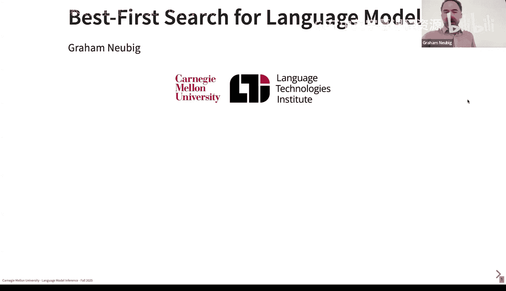

So。Just to go back to what we were talking about before。

 last time we talked about like things like greedy search and beamse。And to give a kind of outline。

 let's see if I can make that bigger， Okay， there we go。

So research basically selected the highest probability token at each step。And it's。

 you know very fast， but it's myopic， it can make very bad local decisions when a better global decision would be possible。

No backtracking of any variety is possible， no consideration in multiple hypotheses。

In contrast to this beam search maintained top K hypotheses。

 explored multiple pestite simultaneouslyly and gave。If you have a good model。

 it will give you better quality than research what's just to make sure that everybody's awake and paying attention。

 what's the relationship between these two。Yeah， you be with one。Yeah， exactly。

 So beam search with a beam width of one is screen search。

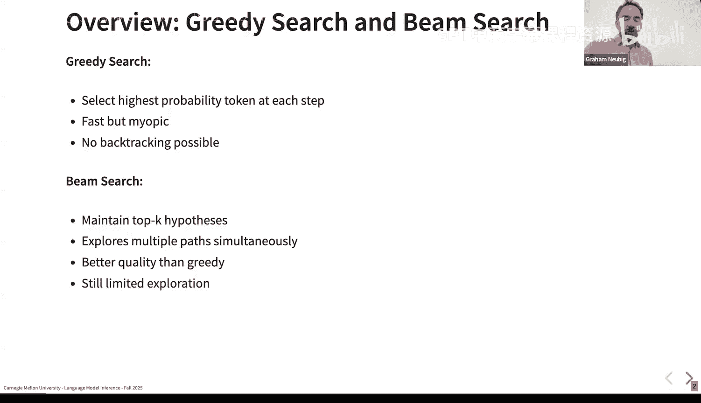

Cool， so。I'm going to talk about search spaces as graphs here because a lot of the algorithms that I will be talking about today were originally created for search over graphs。

And we can represent it specifically as a weighted finite state automaton。

And how many people have done this in some class？It's like 10 to 20% of people Okay that's great this is another place where I get to feel the 2025 because this used to be like a staple of computer science curriculum。

 but it's not it more so Okay， cool so basically S is a finite set of states and so these are all the states that we have in our graph。

😊，Sigma is a finite alphabet， so alphabet is another term for vocabulary。

 so we could also say it's a vocabulary of our language model。

We have transitions where basically you take in a state。

 you take an element for the vocabulary and transition to a next state， S zero is the initial state。

 we also have a sync state where things things end or a set of sync states。

 yeah a set of final states and we call thatF。And W is a weight where we assign real weights to transitions and in particular。

 things are a lot easier if you limit yourselves to purely positive or purely negative outputs here。

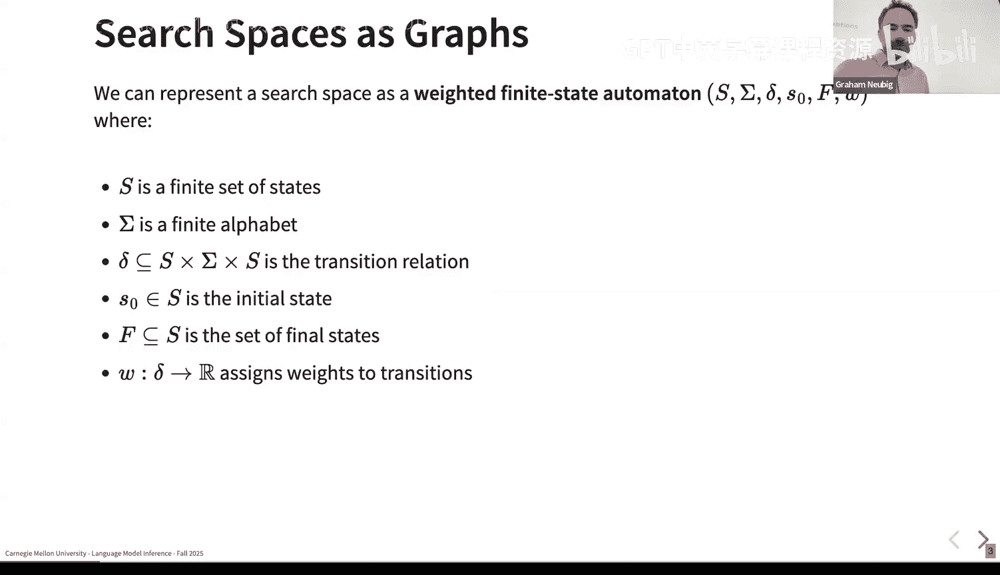

So this is an example graph maybe a little bit small Okay there we go and so here S0 is the initial state and or I guess you could call it S 10 is the final state and then we have。

Essentially elements of the vocabulary here vocabulary is ABC and of sentence。

 and we have each one of them is weighted。So here， each one of them is weighted with a probability。

And because this is a probability， all of these need to add to one coming out of the like node here。

哦根。

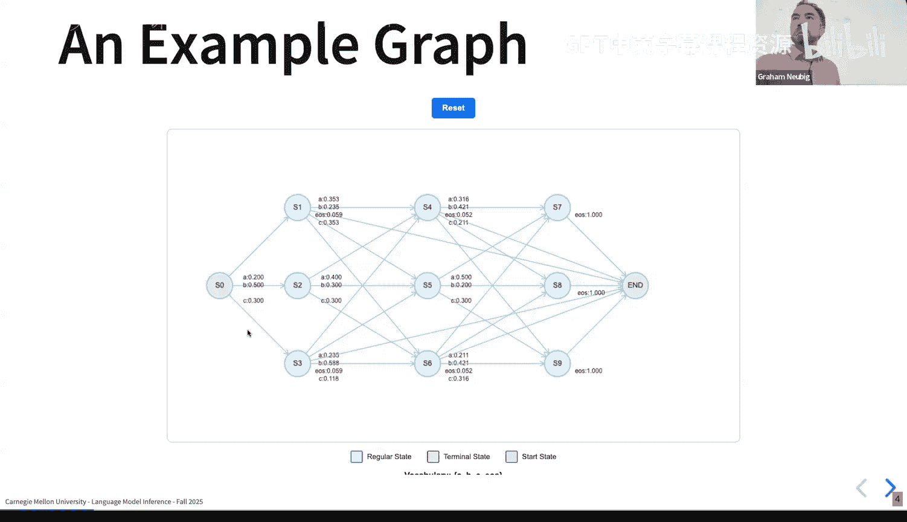

Okay， cool。So there's a number of different ways to express edge weights。

And I'll just talk about these kind of in the abstract， but like if you're interested in math。

 there's actually a concept called a semi ring that allows you to do all kinds of crazy things to express edge weights So if you're bored of hearing me talk you can look up what a semi ring is and try to figure out what's going on here。

 but basically some of the things you define when you want to define edge weights or you define the range in which the edge weight is valid So for a probability this would be between zero and one。

嗯。😊，Then you define a addition function。我不 say。You define an addition function and actually when you define a summary ring。

 the addition function is written like this。And what that means is it's abstracted away addition and it's what happens when you combine together two edges so in the case of a probability this function is is a multiplication function or no actually sorry。

This is like abstracted away， so this is aplication a multiplication function。

 and so here you multiply weights together。The way you do the best path is you take the Arms。

And the example of an example path would be like 0。5 times 0。3 times 0。2。

Another thing we can express is log probabilities and so the range for log probabilities is obviously minus infinity to zero。

 we add the weights together when we're doing path scoring， the best path would be the ArgaX。

 which is the highest sum and then we can take log P。Bg P like that。

And then negative log probabilities， of course， we do this。So typically when we're doing search。

 we usually do shortest path searches and so because we typically do shortest paths where we start with zero。

 then it's typical to use like negative log probabilities to express paths。

 so I'll be doing that for the rest of the time。But。

There's also if you go all the way to the semi ring formulation。

 you can have like also instead of doing this like best path， you do like。You replace the。

So when you're searching for a best path， you do this as the artrcM and when you're searching for the sum of the probabilities over all the paths you add the probabilities together and other stuff like that。

 there's lots lots of fancy stuff you can do there。

 but I'll skip over that because we don't use it very much for language models。

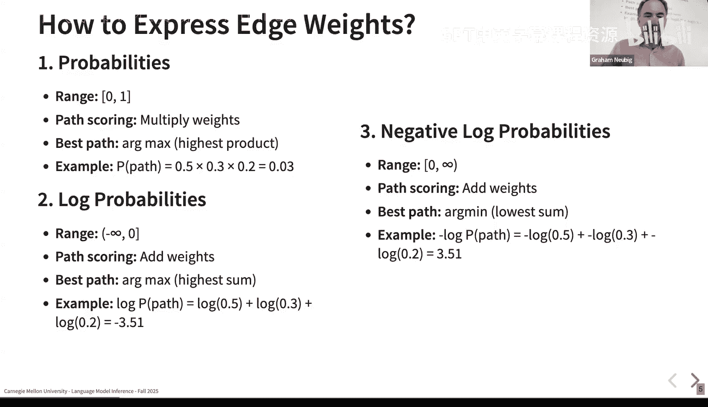

Cool， so this is our graph with negative wide probability diase of it。

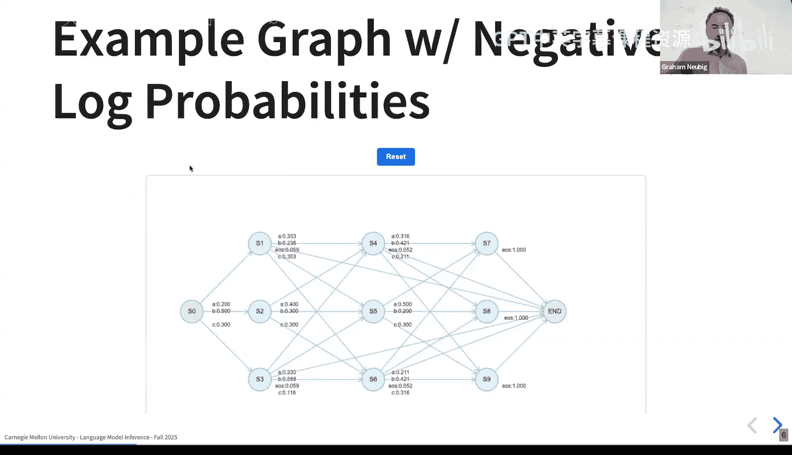

So greedy search， I think everybody knows what greedy Search looks like already。

 but I want to give the example of greedy search here so I can contrast it with like you the other varieties of search that we're going to use。

But。Every time what we do is we essentially find the best edge。

 so in this case that would be the lowest scoring edge。And we follow it。

 and so over here we have a priority queue and this is like the next hypothesis set we want to expand。

So previously our priority Q was S0， it had a score of zero。

It had a score of zero an overall score of zero， and this H is going to be a heuristic function that I'll talk about a little bit later。

So then we add the edge weight， which was 0。69 and then we get the score of 0。69 total score of 0。69。

 and we have a priority Q of size 1 And the reason why the priority queue is of size1 is because we're doing greedy search so our Q size is limited to one。

 so it will be never be larger than this。And so then we just expand the next one on the Q。

 And so that happens to be this one， add the squares together， expand the next one on the Q。

 and then finally get to our end state inter terminate。So pretty okay， or。So F is equal to G plus H。

 and right now we're defining H to always be zero， so we'll change that in a second。Okay。

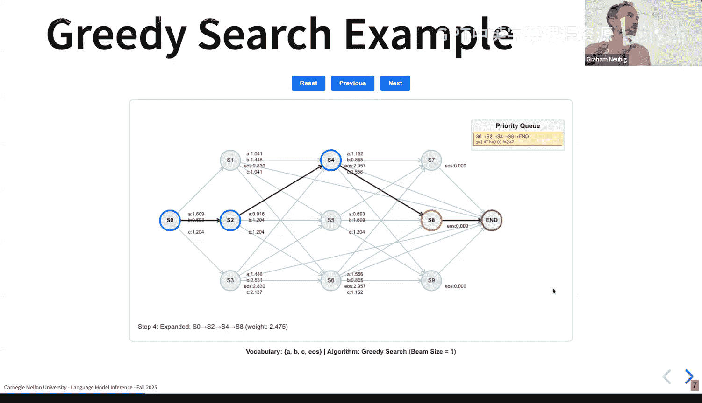

过。So。Next I'd like to go to beam search and beam search looks very similar。

 the only difference is that after we expand now our priority Q size is not one， but it's two。

And so we now have two things on the priority queue。嗯。These are ordered。In a particular order。

 so for beam search。There's two conditions about which hypothesis we expand next。

 Does anybody have an idea what those two conditions might be？

Which ones which ones do we expand first and which ones or so actually let me put it this way。

 why is S1 a0 to S1 knot on here？Yeah， we wanted to have the lowest score yeah it's the one that has the lowest score so we pruned it off so when we choose the priority we consider the score right and we consider better scoring ones more than the other ones。

Maybe I'll expand the next one， so we had S0 to S2 and we expanded some hypotheses here。

So there's one other thing we consider when deciding which one to expand next what's the other thing we consider when deciding which one to expand next Yeah the length yeah exactly so basically what we do for beam search is we expand the shorter ones first。

And then we make sure that the size of the elements on the Q is always no larger than the beam size for each length。

So right now we have one of one of length 2 and two of length  three。

 and then when we expand this one， now we only have two of length three here because our being sorry。

 our beam size is two in this example。Said that clear。五。Okay， so then we keep on expanding。

 we expand S0 S2 S4 and then we expand S0 S3 S5 because that's a shorter one and now we have our best output。

 which is negative log probability of 2。43。And。Notably。

 this is different than the one we found using greedy Search。

 the one we found using greedy Search was S0， S2， S4， S8。

One other thing I'd like everybody to pay attention to is how many steps it took me to finish the search。

 so here we finished the search with six steps。

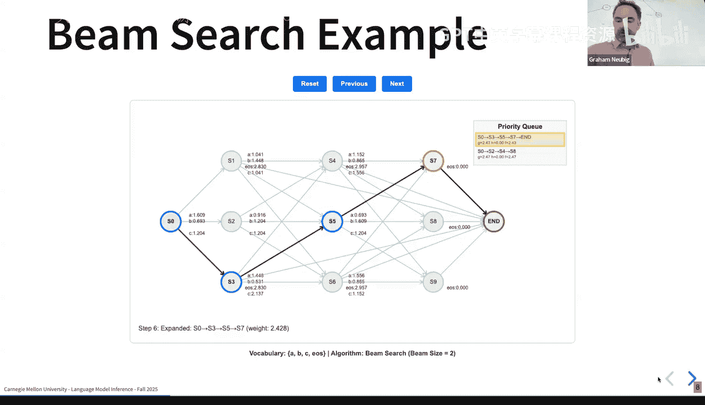

In the previous one， we finished it with four steps。 So like greedy search is more efficient， right。

 we were able to see this。

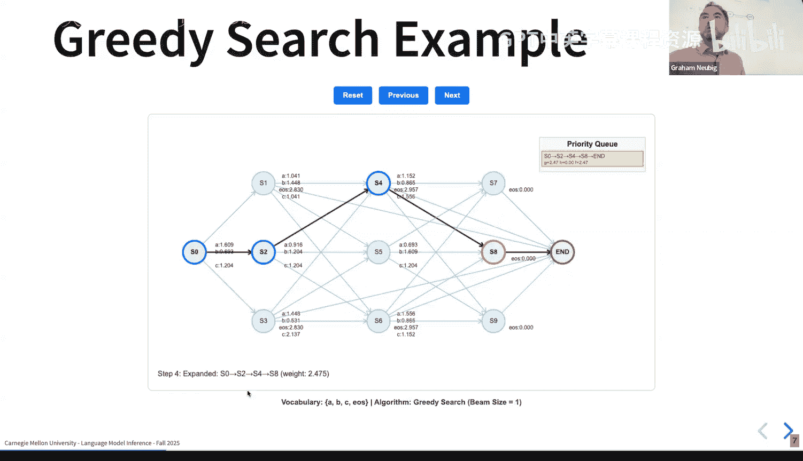

嗯。So for beam search， is beam search guaranteed to get the correct answer。

 we'll get the shortest path through this graph。No， I see people saying no， yeah， that's correct。

 It's an approximate search algorithm， and it can be a very efficient approximate search algorithm。

 it can be better than greedy search， but it will not be guaranteed to get the best answer。

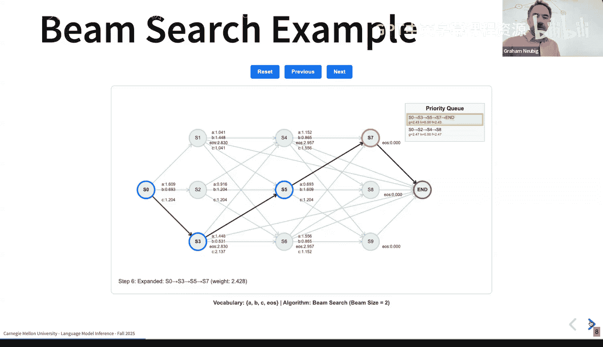

Cool so now I'd like to talk about optimal search algorithms and optimal search algorithms are algorithms that can search through a graph and and find the best output so I'm going to call this step first search it's very similar to Dixtra's algorithm if anybody has used Dxtra's algorithm before but I'm not going to talk about Dxtra's algorithm because it requires an additional step of backtracking which I'm not going to not going to be doing here。

But basically， what it does is it systematically explores all paths。

 it's guaranteed to find the optimal solution， and sorry Dtras does backtracking。嗯。

It will eventually find the path with minimum cost。

And the reason why it's optimal is because it does an exhaustive search of the entire space。

And there's no pruning of potentially optimal paths。

 So you're always expanding the path that has the best score。 And because of that。

 you will always find the path with the best score that ends up in the terminal node。

Before any other one， because you're kind of by definition。

 you're searching them in the word of the best score。

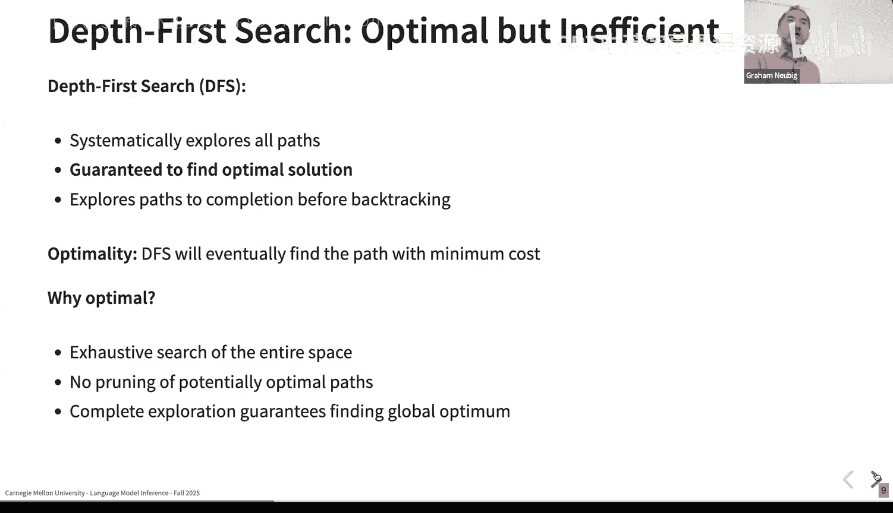

So let's take a look at what that looks like in our previous example。

 so the first thing we do is we expand all of them like notably we're not pruning any of out of our priority queue so we are additionally expanding S1 which we didn't do when we were doing beam search。

So we have this here， so we expand the bests we expand the best one first， so that's S0 to S2。

 then we do S0 to S3， then we do S0 to S1。S0 S2 S4， S0 S3 S5， S0 S2 S5， S0 S2 S6， S0 S3 S5 S7。

 and then we finally hit the end after nine steps。And so this is still manageable because we have a vocabulary size of three and we have because we have a vocabulary size of three。

 but imagine what would happen if we had a larger vocabulary size or a longer graph or something like that。

 basically we would spend our entire time sitting right at the very beginning and searching around the various things at the very beginning。

 unless we had a very， very peaky probability distribution of the outputs。Cool。呃，你呃。

Any questions here？Yeah， so G F equals G plus H， which is not very helpful for you because you don't know what H is yet。

 but G is the actual score and H is a heuristic function which I'm about to introduce I think in the next slide。

 so I'll talk about that。And F is the thing you actually use to prioritize search。

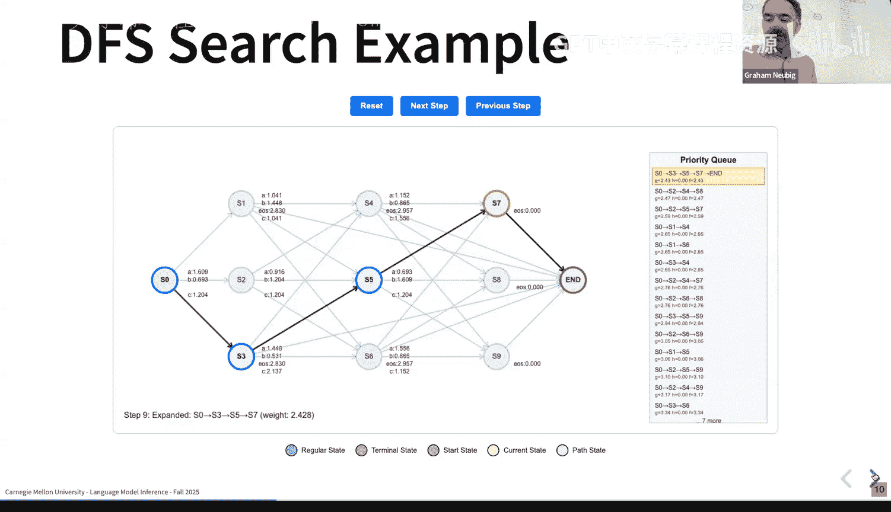

So the next thing I'd like to talk about is A star search and A star search is basically a search method that is more efficient than regular depth for search。

 but still optimal。And so it doesn't have any of the optimality like issues。

 or it's guaranteed to find the best output。But it is not not quite as bad as as depth research。

 And so basically， we define the function that we use for scoring hypotheses is F equals G plus H。

Where G is the actual cost， H is a heuristic cost from n to the goal。

And H is a heuristic cost from ethical， so I don't know if I actually have a good example of this on the slide so。

Let me see if I can write it here。Yes。So if I gave you this prefix。嗯。

How much more uncertainty do you think there is in a sentence？

Like how much more probability do you think it needs to spend to get to then the sentence？Any ideas？

BasBasically not right so I would say about long。The live probability of。The rest of life。

Ber than where we are right now。Its basically zero right or the we're using negative black probability。

 So this is basically zero。 But if I said like the。嗯。Solution。To。注意。First。11， six，6，4。7，6，3 homework。

不是。Is。I would hope that a language model would spend a lot more probability thinking about the correct answer here。

 if not we did a bad job of writing the homework。So， so there。

 you would expect that you need to spend a lot more probability to finish this completion。

 And so basically。HN is attempts to be a prediction of how much more probability you're going to need to spend to get to the end in the optimal path。

嗯。😊，So。A star search is optimal when a heuristic is admissible and an admissible heuristic is basically it never overestimates the true cost to the goal。

 It can underestimate the true cost to the goal， but it can't overestimate the true cost to the goal。

And so this provides a lower bound on the remaining cost。

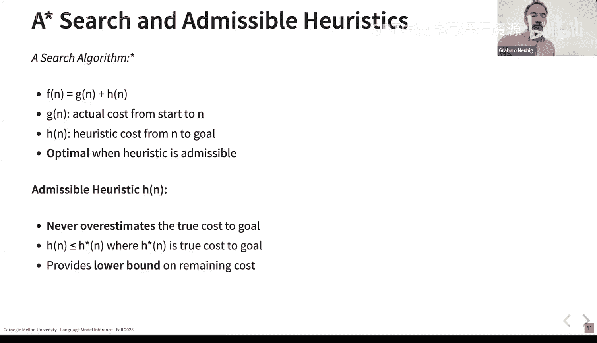

So let me give an example of this。 So here。A a heuristic function is typically designed to be something that you can very quickly calculate。

 but never overestimates。 so I can look at all of these。I can look at all these inputs here and say。

 okay， well， 0。693 is the like lowest number in this row。

So like maybe everything in this row should be like 0。 like the heuristic would be 0。5。

 so it's never going to be it's never going to cost less than 0。

5 to go from this row to the end state。Here。Again，0。5 is the lowest one in this row。

 and I know that 0。5 is the heuristic function for this row， So maybe 0 point or maybe 1。

0 is a good heuristic function for this row， So I'm just going to assign H。H equals 0。

5 for everything that ends in S4 to S6 and H equals 1。0 for everything that ends in S1 to S3。And。

There you can be creative with a heuristic function and come up with something that you know is able to search for this efficiently the one thing you can't have with a heuristic function is have something that takes just as much time as the search algorithm itself so like you need to come up with something that's like an approximation but not good。

So let's try to do a search with this and basically for a0。S 0 to S2。

 we have a heuristic function of1。 so now we have like 0。69 plus1 is equal to 1。69。

 so all of these we basically boosted their score by one。

 And remember when I boost their score by one that makes the score worse because like lower scoress are better。

So now I will。Expand S2。And。Despite the fact that I expanded S2。

 I still have a better I still have a better score for S0 S2， S4。

 because essentially it's heuristic function went down and so now the heuristic function is lower because I've made more progress with with this output and that means it's still better than S0 S3。

 which had made less progress。 So we can see it's F is 2。11。

 So I'm not expanding all of the ones at the very beginning first。

 I'm expanding like one that has made more progress。And so let me continue doing that， however。

 when I expanded this next one now the actual cost of doing this took over and so now I started expanding the SCCO S3。

嗯。So I will go through， I'll continue like sorting these by F。And and expanding。

And I finally get to this， this thing here in that reaches the end。

 And so you'll notice that I've reached the end and found the optimal output。

 But I never expanded the first one。 I never expanded the S or to S1 thing because the heuristic function plus the actual score never got like low enough that I would expand at。

嗯。And you can also take a look， notice I finished on step8 here。 so that is faster。

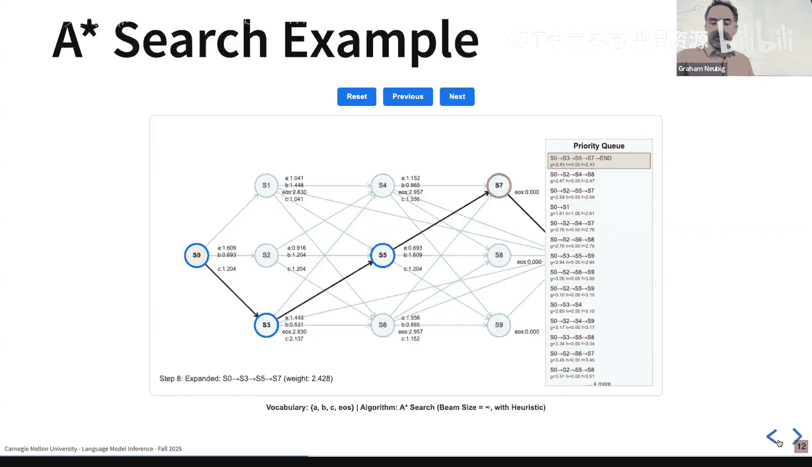

Then， last time。That is faster than last time when I finished on step nine because I didn't have to expand that extra hypothesis that I expanded maybe a。

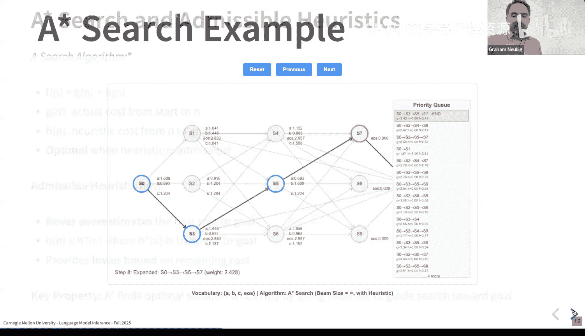

Cool， so this is the basic idea。 F equals G N plus H N。

 where H N is some prediction of how much probability you're going to spend going all the way to the end。

 Is this clear Any questions。 Yeah， fact that we never the true cost。嗯。

Where do you use the fact that you never overestimate the true cost。

 So that's a great question What would happen if you had the ability to overestimate the true cost？

Like， what if you didn't have an admissible heuristic？You might deviate from the optimal solution。

 you're not guaranteed to deviate from the optimal solution， but you might yeah。

We have the same question then how is it possible when the。

But the little cost is lower than the cost。Then it might select the wrong。

But familiar with the same problem in both。sorry， could you say that again。

 Yes basically it's not possible to estimate that but how is it possible to understand algorithm when we can underestimate the tool talks？

How is it possible to run this algorithm when you can underestimate the true cost Well。

 if you can underestimate the。Wait， so it should never overestimate the true cost。

 It can underestimate the true cost。 In fact， depth for a search is when you。

Always when the heuristic function is zero and will always be less than or equal to the true cost right so like it's okay to underestimate it's just not okay to overest over consistently about the amount。

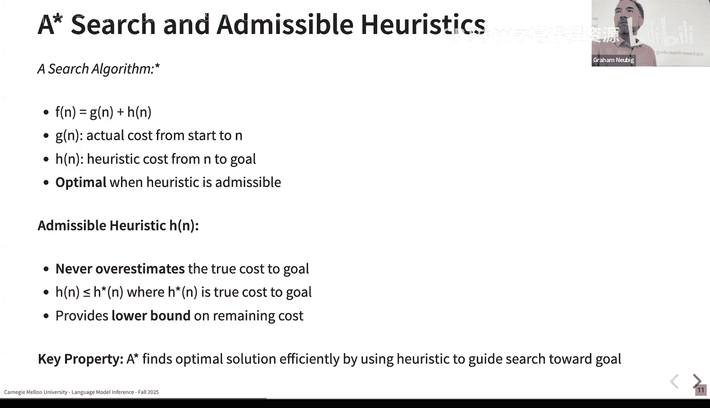

I mean， that's that's be underestimated these function， so great great points。

The heuristic function here underestimates the true cost。

 So like when I use the heuristic function going from S 0 to S 3， my heuristic function was 1。0。

 and the true cost was 2。43。 So I underestimated it。

 But the the reason why that's not a problem is because you always follow the shortest path。

 And so the shortest path will。You might have to expand war paths。 So if you have a bad heuristic。

 you might have to expand more， but it won't cause you to fail。

 What what convinced was that like that strong go。Sa it must never overest the true example I underestimate to for every single it's consistently overest what has same negative as Okay。

 so then your just to rephrase in case people couldn't hear like what what if it was a perfect heuristic function and it could always you know。

 exactly predict the future cost that would be great。 You know。

 you would only have to take one step through the graph and you would always get it right every time。

 but you added 10 to every。You added10 to every cost every cost yeah so that would be a good heuristic function that would help you out but that would help you be successful it's searching but that is an example where you overestimate but are successful despite the fact that you're overestimating so if you ever if you overestimate and you can't say like oh the relative order is the same then like the relative order of the cost is the same then you might make mistakes。

So。Yeah， being inaddmissible， heuristic is not a necessary condition to do good search。

 but it is a sufficient condition to do good search。我这有方个 about的是来。

You're not convinced about the efficiency or sufficiency。Yeah， I mean。

 it's okay if you have questions。

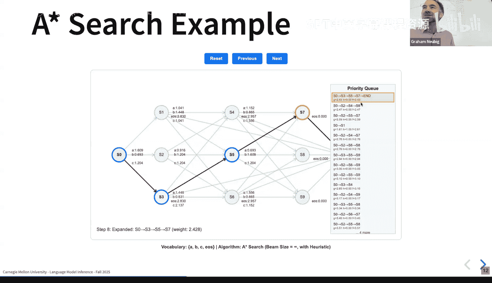

I like not convinced by okay， why use it never over since it possible time。

 I don't see like how everything from I understand you want to attend to every as like that's very pathological example。

But I'm just not convinced whether using the hypothesis well so the reason why let me put it this way。

 we're sorting by F。

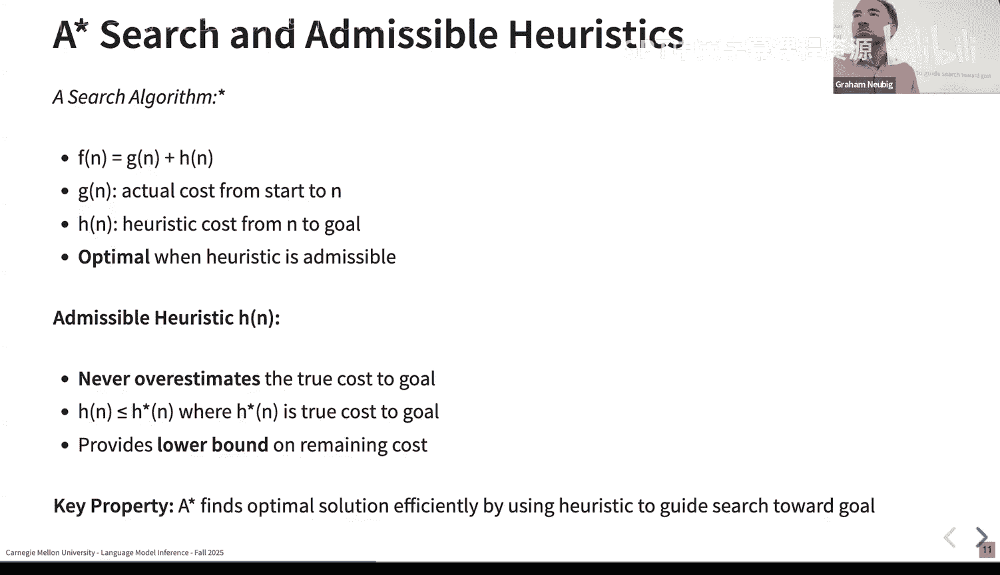

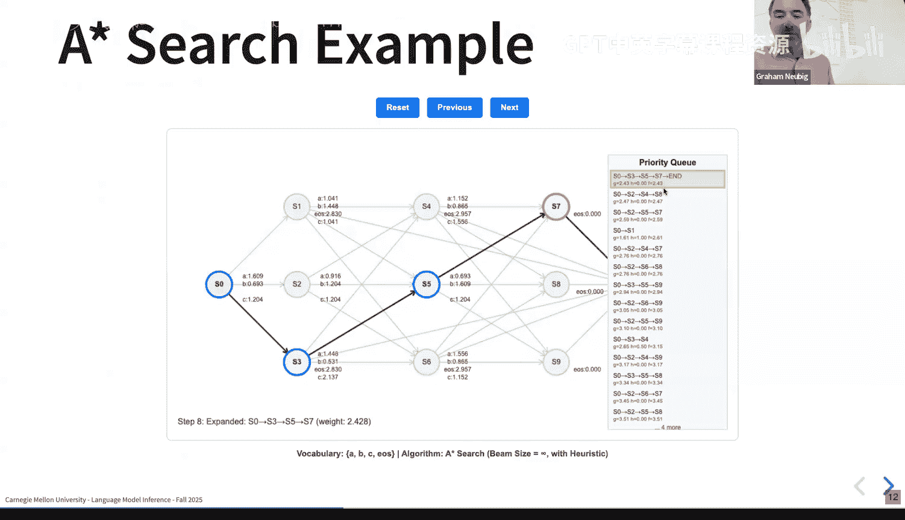

Let me go back here。

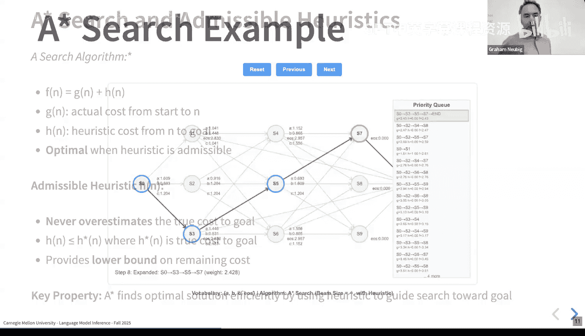

So were searching we're searching for A。咩。呃，哎。Of the cat， what we call capwa。

So we're trying to find the thing with the lowest the lowest thing here so the。

So this is the definition right， when you have finished， when you have terminated search。

 HY will become zero。Because there's no more cost left and you're done in the in you're in the final say so FY。

Eals。Let's say FYT。Which is like when it has reached the terminal state is equal to G y。And so。

Any intermediate state going to GYp if HYp。Is guaranteeren Keith be less than H star？W key。

 in other words， it doesn't， it never overestimates cost then this is guaranteed to be less than。

What this would be in the final state and so that means you will never rank。

You will never rank that hypothesis。Better than the one that you get in the final suite。

And so that means that。Once you reach a final state。

 you know that's better than all of the other final states that you have for the partial I now it president there an implicit assumption that at a point is like a wellbe function because otherwise I could just make a discrete function so this is satisfied point wise。

 but I can still construct those path multiple examples。Right， so as I said before。

 anaddmissible heuristic is a sufficient condition， but it's not a necessary condition。

 So you can come up with another function that still will give you a good result， But this will like。

If you satisfy this， you will get a good result， that's good too。Okay， yeah。

 and thank you for the question that wasn't you know super clear in my exposition。

 but happy to clarify。

Cool。So。Why don't we use a star search in transformer language models or R&N language models or basically any strong language model we have now？

The reason is this this is。A kind of like what the graph for a transformer language model looks like if you have a vocabulary size of ABC。

Basically every token you generate。You exponentially grow your graph。And。

If your vocabulary is very large， this graph you know very quickly becomes very large and you will be stuck at the beginning of the graph。

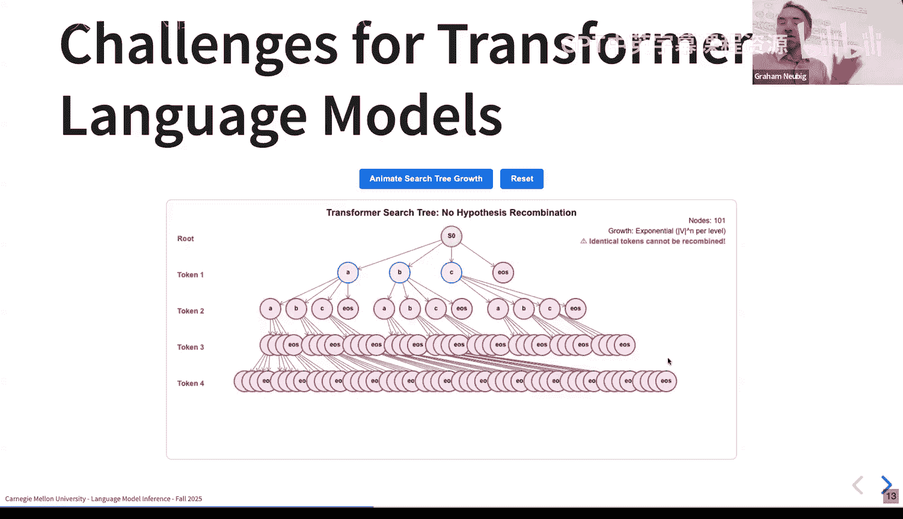

And what's even worse？Is like this is one thing。That we're expanding search graph exponential exponential growth。

The second thing is， there's no。It's very， very difficult to come up with an admissible heuristic。

 And the reason why is because a transformer based language model is。You know， huge。

 very hard to comprehend。 And it is quite possible that you could suddenly hit a sweet spot and pay like zero cost for the rest of the time。

 Like if I， if I told you。Please。Please say hello and then recite the US Constitution。

 a transformer language model by， you know， or please give a greeting and then recite the the US Constitution might be like。

😊，Greetings， it's， it's nice to hear that you're interested in the Constitution。

 The US Constitution is， and then it would generate like。

Thousands of tokens with like probability of one because it's exactly memorized the US Constitution right so it's hard to come up with this sort of admissible heuristic。

So what do we do there's two things that we can do， one thing is maybe necessary。

 maybe not necessary， another thing is certainly necessary if you want to use an AA style algorithm with this。

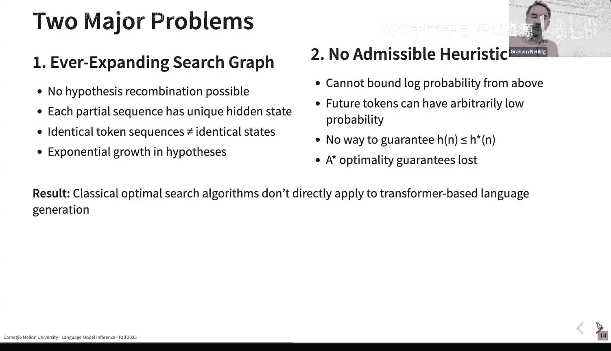

So the first thing that may or may not be necessary is hypothesis recombination。

AndWe kind of touched on this a bit in diverse beam search。

 so this may sound a little bit like diverse beam search。

 but the basic idea is that we want to group similar states together to reduce the number of hypotheses that we're dealing with to allow us to more efficiently search over outputs。

And the way we do this is we can cluster hypotheses together with similar。

Representations of some variety and keep the best of each for each cluster。

And so the benefits of this is this reduces exponential growth while maintaining quality and enables practical you know varieties of algorithms。

 So if we if we do this， basically we would expand and then combine together like similar hypotheses。

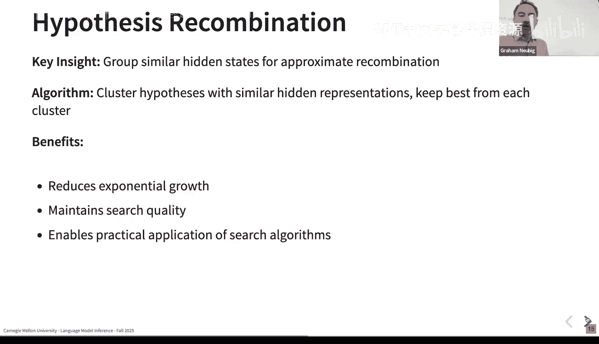

嗯。And do this over and over again here， it went from A to A and B to B and B to C that's like obviously not necessary。

 but you can combine things together to reduce the search space。

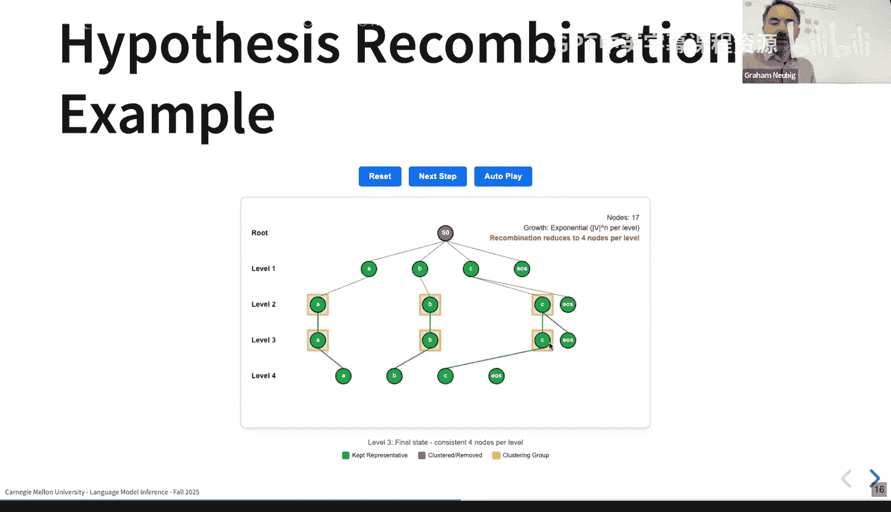

And there's a number of criteria that you can use for doing this。

 the first one is Ngram based clustering， and so the basic idea is if you look at shared recent word contexts。

 you cluster if the recent words are the same。嗯。So this， you can look at surface form similarity。

 it's very easy to implement in cache， it can work together with beam search。

And the truncation length controls precision so if you。嗯。Set the length of n to be infinity。

 then this is equal to no hypothesis recombination。 If you set the length of n to be short。

 like two or three， you would recombine all things where the most recent words were， you know。

 a particular two or three words。However。This might not be the best because， you know。

 you could get something that was very different previously， but similar for the most recent words。

 And so another way you can do this is through hidden vector distance and basically if you have the representations of your current state。

 you can cluster things together。 so you can use like Euclidean similarity cosine similarity or things like the kale divergence between the distributions induced over the next token。

嗯。And。

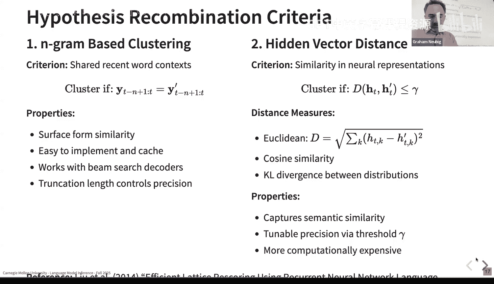

There's an actually kind of old paper that discusses all of these and compares some using older models。

 I haven't seen that much doing this with newer models other than outside the context of or inside the context of diverse beam search。

 but this is certainly like if you want to move in the direction of using these kind of like more optimality oriented search algorithms。

 I think this is certainly something you could consider because you don't want to sacrifice the diversity of the the space that you're searching over。

 so this is one one thing。Any questions about this yeah visualize the how you compute here dynamic Yeah you have multiple different。

Ps， jeans， branches mean a distance and。So are you doing like the are you taking the entire set of logics and then like computing care diversions and how we maintain these logics in that Yeah so basically it would be like next。

So you only use this for clustering。 So what you would do is you would calculate the probability over the next token for each of the。

Like each of the。Hidden states that you're searching over。 So like， let's say you had， you know。

16 if you had a beam size of 16 or something like that。

If you calculated the probability over the next token。

 which you probably want to do anyway if you're doing beam search。

 then you calculate the kale divergence between each of those 16。

 so you'd have like a 16 by 15 matrix of kale divergences or I guess 16 by 16 if you're doing it like bidirectally。

 and then you would prune out the ones where the kale divergence is like relatively low。

So like let's say。You have。So you have all of your histories here， right。

 and so then for all of them， you calculate。PY of T， given y of p y of less than T。

 and so this is the probability distribution over all the words in the vocabulary and so there gives you a whole bunch of probability vectors。

You can concatenate them into a matrix of probabilities and then you can calculate the like kale divergence between all of the columns in that matrix hidden the。

TheYeah yeah， it's essentially beages so actually maybe similarity in neural representations is not the correct term here。

 so I should actually probably fix that this would be more like similarity between the probability distribution。

No， okay， yeah， thank you。Yes。So。One thing to put together， which might also divers data than。

Good question。 It seems like a good research， you know， a good research topic。 Like。

 I think even just like looking into。😊，When things temporarily look similar and then end up looking different later。

 I don't know of any like work that looks into that。

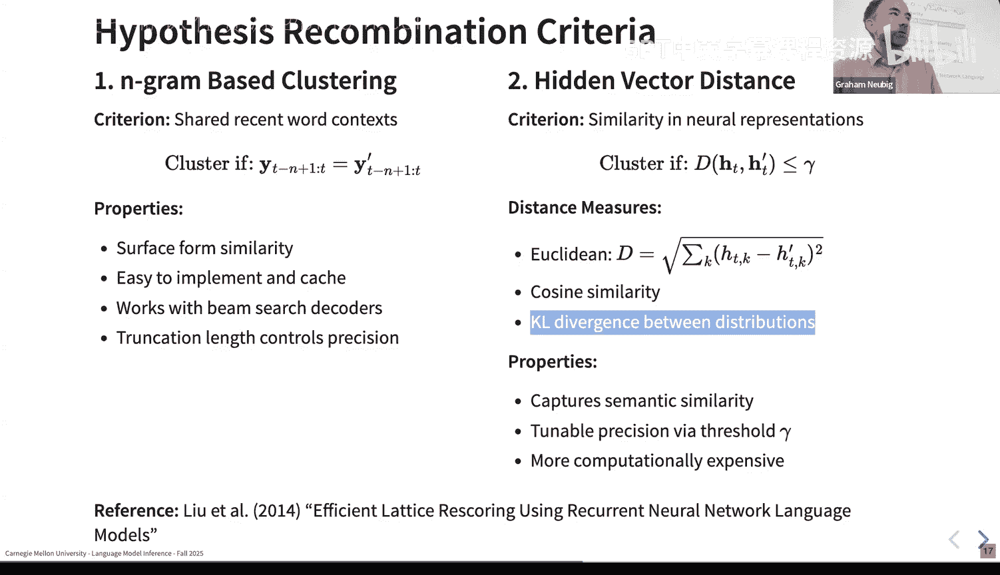

共。嗯。So the next thing I'd like to talk about is future cost and future cost is an inadmissible but useful heuristic。

 so this is exactly the case when we don't have a heuristic that satisfies you know admissibility but still could be useful。

And this has been around for actually a long time， but this paper modeling future cost in neural machine insulation talks about it from kind of neural model perspective。

And。What you do is you learn to predict the cost of completing a partial sequence。

 the future cost prediction basically is just given all of the information that you have now predict the cost of the completion。

According to whatever search algorithm use。And。The way you integrate this into search is you can have this multiplied by some discount。

 so you use the log probability of what you've done up until this point。

 and then you multiply multiply this in。 And so what this is doing is this is essentially making this more admissible right。

 It's making it closer to admissible because if we set this to zero， it is admissible right。

 it's guaranteed to be admissible because it's 0 and0 is never going to underestimate。嗯。

And the way we train this is we have a loss to essentially try to fit this function。

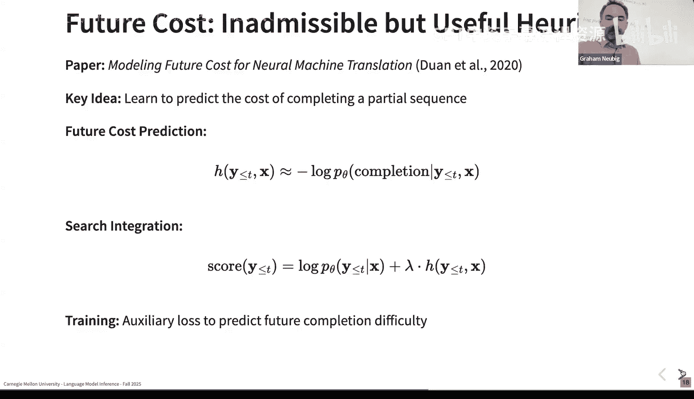

There's a couple ways we can use the future cost， the first way is that we can actually take the model。

 take the model that we were trying to train， and we can try to get it to fit fit the score of not the current cost。

 but the current cost plus the cost that we're going to pay in the future。嗯。

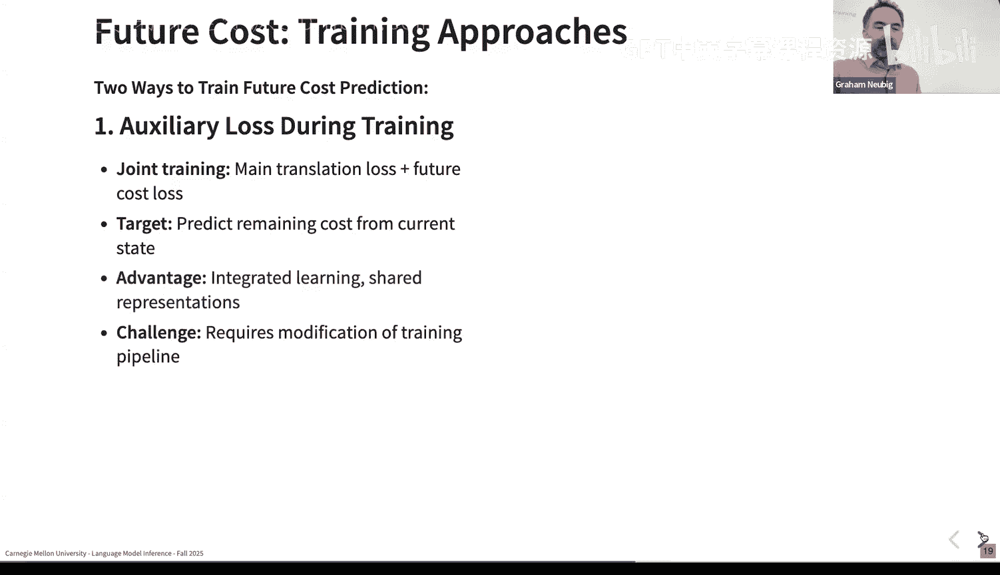

And the second thing is we can train a future cost predictor after the main model and use completed sequences to learn the cost patterns。

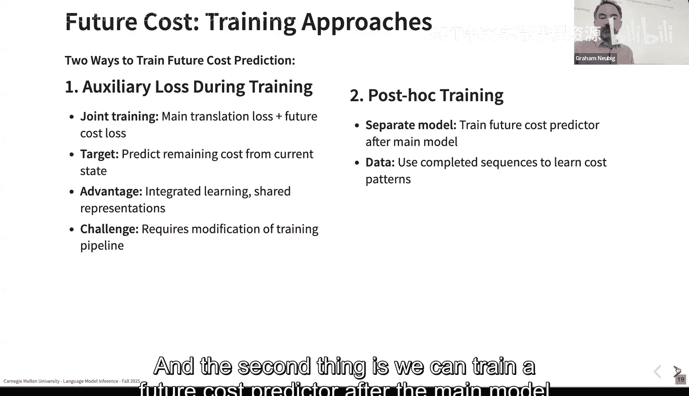

And so both approaches tried to estimate this heuristic function。

 but the actually maybe I should write。but basically the auxiliary lossstring training is you try to predict you try to train essentially the same model that is able to predict the auxiliary loss while you're training the while you're training the representations this is also faster because you can train them both at the same time so like this can be helpful as well。

If you have done reinforcement learning， this is very similar to like a value function you learn in reinforcement learning where the reward for the value function is the overall like log probability of the entire sequence。

 so it's similar in that way as well。Cool， any questions？

Okay， and now now I'm getting into some papers so。Here in in this experiment。

 this is like 2020 so take it with a grain of salt， it's not the same as what we have for LOs now。

 but they were able to demonstrate some pretty you know good gains on machine translation performance using pretty strong baselines。

 so this is a nice paper about that。

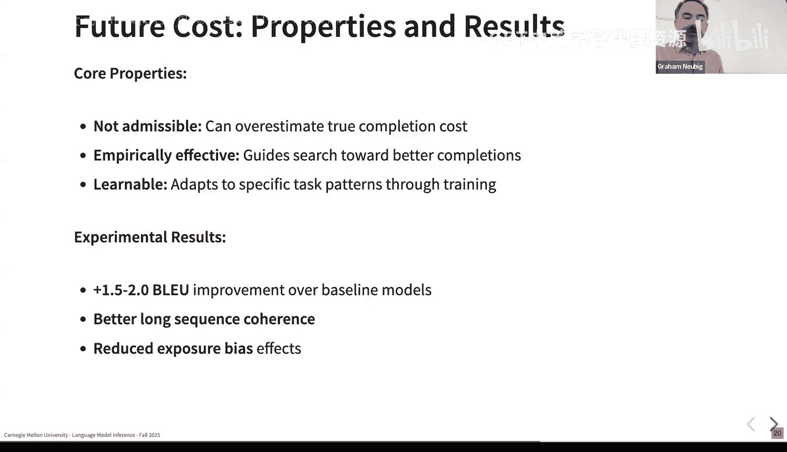

Cool， any questions here， this is actually not that hard to implement。

 so basically you just need to have a separate prediction head that in addition to predict predicting the probability regresses to the full sequence probability that you calculate during trading。

Yeah， so in advance， you're not sure what's going on is that we modify the training loop to sort of create that hereistic the function person to estimate how much further the completions are and that helps us when you decide that have just also been like you know beam recom and just be start decoding in particular。

Yeah， so。Yeah， and it's not， it's not a start decocoding because it's now a not an admissible heuristic。

 but you still add that heuristic in any way。 So it might make mistakes， but those mistakes are。

 those mistakes are mistakes that are like。Hopefully less bad than setting your function to zero。

 essentially。Yeah， a star with a asterisk， you know， it's not actually a star yeah。😊，So the data。

 yeah， actually， I realized maybe I shouldn't have that on my slide。对。Your loss function。

Your last function is basically this， right？This is the data you traded off of。

So you at every time step， you try to predict the final score that you're going to get by summing up oval losses over the entire does the ground？

This is the ground truth sword but the thing is like can you can calculate this by summing up all the log probabilities of all the hookkens。

 but you want to predict this after you've predicted the first。嗯。And that's really hard， right。

 You don't know what tokens are going to come next。

 So like your regression is going to be hard at the very beginning and it's going to get easier and easier。

 And so that's kind of like the whole point of the tourist function。

 And then but actually because it's a heuristic function， you're going to be。嗯。Actually， sorry。

 it's probably not。This， it is probably T。If I is your current。If I is your current state。

 it's going to be。This so you're going to add up all the all the ones you get in the future so at time step one time step zero or at time step one it's going to be like all the ones from one to you know the end at time step two it's going to be all the ones from time step two to the end。

Yeah。I that it was。有。It's basically whether you train it together with the model that you're training or whether you train it afterwards。

 so like if you train it together while you're training you're you know LLM or whatever。

 or if you have an LLM already， and then you train a model to predict that afterwards。

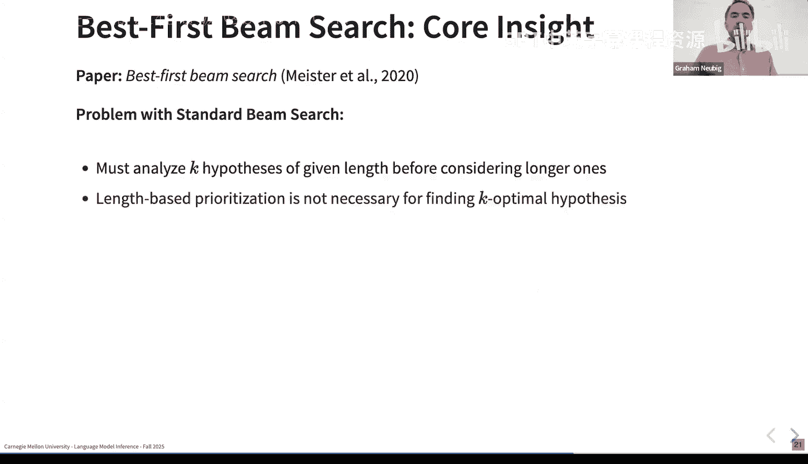

Yeah， exactly， yeah。嗯。Yeah， why are capturing modern specific patterns and depending on the sequences of knowledge generators。

嗯。So。This is particularly in the case where you're using like a different model or。

Where you're using a different base model or something like that to train the future cost predictor。

 it might be the case that you would actually want to update the model's parameters。

To make this prediction without training the full model。 So like to give another example， like。

 let's say you have a deep seek。V3 or something like that。 you want to train at future cost for it。

 but you don't want to train deepse V3 because it has too many parameters for you to train。

 And so if that's the case， then， you know， train deep seek V3 itself like deepse might have its。

 you know。Idea of what's going to be coming next， but your smallquin model doesn't have as good an idea of like what deep seek is going to predict next。

Yeah， I mean， have you tried to train a 400 billion parameter model before？嗯。😊。

So you might want to use a smaller model for your homework assignment is kind of mainly the main motivation。

 I guess。😊，Yeah。😊。

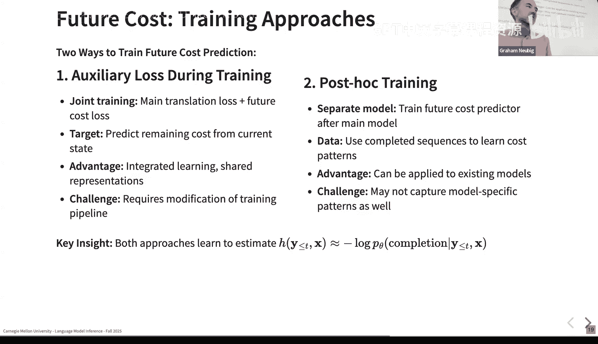

Cool， okay。So。

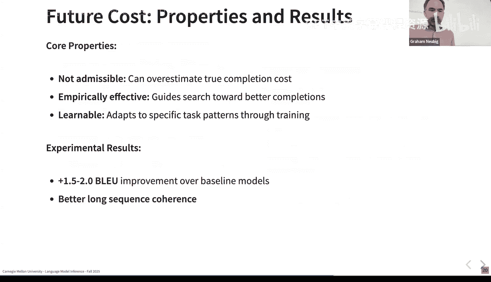

Yeah， next， I would like to talk about best first beam search。 So best first beam search this。

Paper is a little bit of a methods paper， but I actually like it better as a survey paper that kind of organizes some of the other methods。

And so the problem with standard beam search that they're trying to overcome is number one。It's。

Kind of like practically it always expands all of the inputs within your beam and so like let's say you have a 16 beam size of 16 or 32 or something like that it could be the case that like most of those 16 are just not good like kind of obviously really low probability solutions and it's not worth initially exploring into expanding them。

So。What they use is they use square based prioritization like a star while maintaining beam constraints and demonstrate that they get in a 10x speed up over standard beam search with identical results。

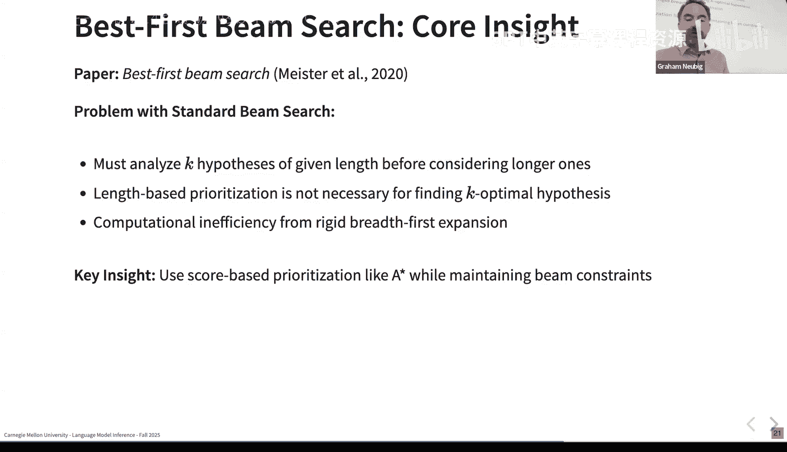

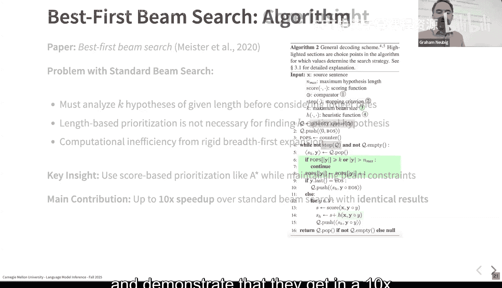

So this algorithm is like the most important part of the paper。

Based on a lot of the stuff that I've talked about so far。

 but it has a pretty elegant formulation of how you parameterize the comparator。

 the stopping criteria and the maximum beam size of the heuristic function。And so。Basically。

 scores can there's a few things， scores can only decrease when extended so。Basically the score here。

 I guess in this case， they focused on decreasing scores， so like log probability is getting worse。

So the log probability of a new output is going to be worse than the log probability of a current output。

And they do early pruning to remove hypotheses guaranteed to fall off the beam in early termination so they stop when a complete hypothesis is found。

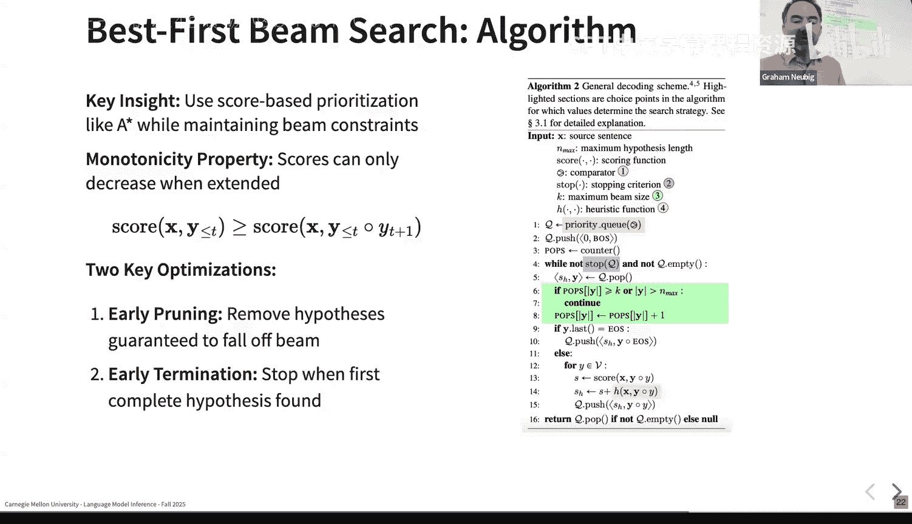

And this is my favorite part of the paper， which is basically like they demonstrate that all of these algorithms。

 like some of the algorithms that we talked about so far， including beam search best first search。

 A star search and breadth first search， all kind of can be parameterized by looking at a comparator。

 and so like as we talked about beam search always prioritizes things that are shorter。

So in this case， it first looks at whether the output is short。

And then it looks at if the output is same length it prioritizes based on the score。

 so this is beam searched like I talked about before。Best for a search on the other hand。

 always prioritizes based on score， but if the score is the same then it prioritizes based on length so you can you can do this and then。

You also have K so K is either equal to the beam size or for best first search it's infinite and so you can best first search needs to be infinite if you want accuracy guarantees and then the final thing they have is a heuristic function so beam search doesn't have one best first search doesn't have one but a star search does have one and so that's like the only difference between best first in a star search。

So they also add some interesting new things here like a star beam search I would say this is beam search with a future cost where the future cost is't admissible heuristic so what they don't list in here is what if the heuristic is not admissible well you can still do it you just might lose your accuracy guarantees and then for best first beam search basically what they did is they。

They sort on score as opposed to sorting on length， but they said the beam size is equal to k。

 so they allow this pruning to make sure that it doesn't get out of hand。

So I really like this paper a lot because it kind of like organizes all these ideas and demonstrates how they're conceptually similar。

 it also could be a good starting point if you want to work on any of the methods that we talked about today。

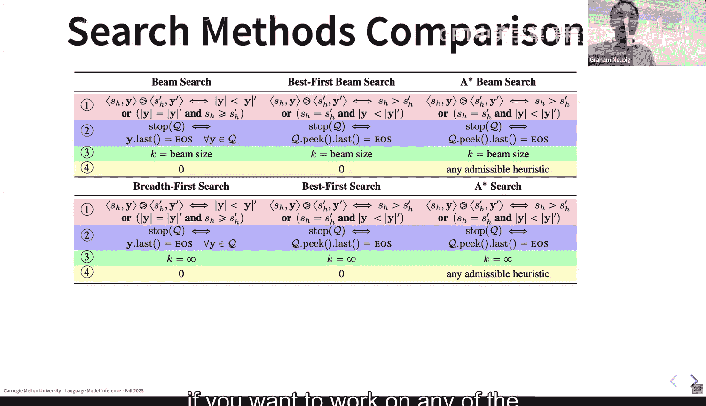

And the results are。Are nice， basically they demonstrate that you can maintain you can maintain the score that you get from beam search with great accuracy improvements or that also allows you to increase beam sizes。

 so if you increase the beam size typically you'll do a better job at search。

Some issues are memory overhead and implementation complexity， but it's actually not。

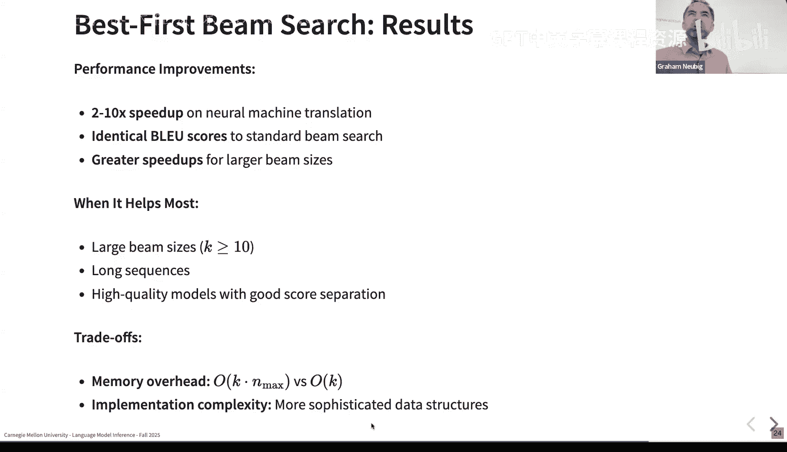

Dep bad， I guess。Cool， any questions about this part？Okay。

 so actually our paper presentation is about the next paper that I was going to talk about。

 so I might turn it over to our paper presentation to do the paper presentation today and I'll add any commentary that I have about it。

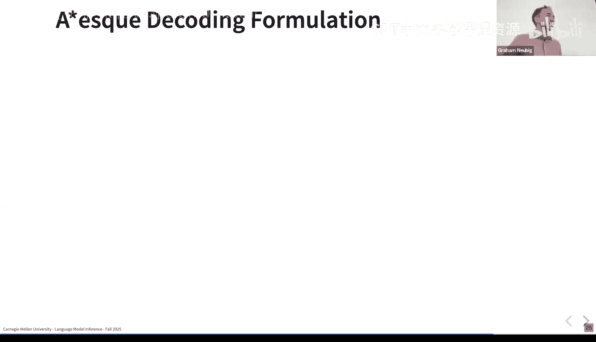