# CMU《语言建模的推断算法｜11-664 763 Inference Algorithms for Language Modeling (Fall 2025)》 - P6：-07-CMU LLM Inference (6)_ Other Controlled Generation Methods.zh_en - GPT中英字幕课程资源 - BV1xsFjz3EoQ

うん。And give a room kind of sec。Great， so today we're going to be talking about kind of a continuation of what we started talking about at the very end of Tuesday's lecture。

 which is various ways to control it to constrain generation and I'll use these more or less interchangeably throughout。

Also just as a note I'm sure almost everyone saw but homework one came out at the end of last week we've seen a number of questions on Piazza about it so that's great feel free also to come to office hours and in particular there's been kind of a number of questions about the question the beamM search puzzle and there will be I think a little bit of a hint for that and one of the things we'll talk about today so keep an eye out for that。

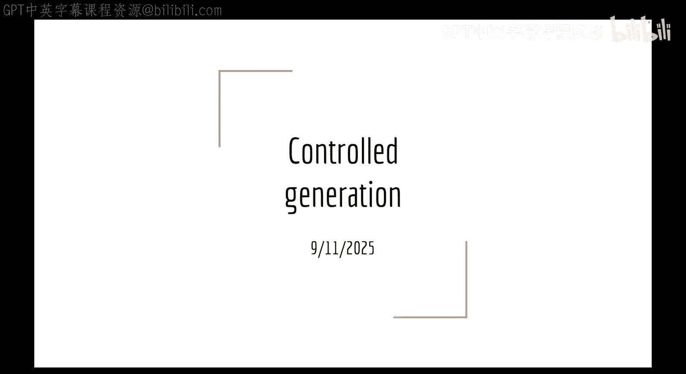

And with that in mind today we're going to talk kind of about two different broad sets of constraints。

 we're going to talk about these syntactic constraints constraints that are very easy to write down as sort of a list of allowable or unallowable tokens and then we'll talk about some more semantic constraints that are a little bit harder to define in that way and we'll make a connection between that and between like a token level notion of alignment which will sort of bring us a little bit close to talking about RLHF。

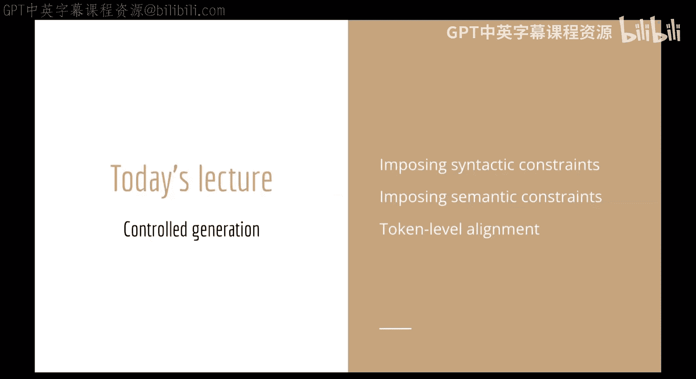

So over the last two lectures in both beamM search and a star and R first search we've kind of talked about ways of constraining output already。

 and this comes in the form of taking a search score that is not exactly the log of probabilities out of the model so we adjust our search scores for length when we apply a length penalty we adjust our search scores be to penalize similarity to or encourage different difference from other partial outputs in diverse beam search。

And we can factor in some additional heuristic for expected reward。

 which is kind of where we left things off on Tuesday with neurologic A Star ask。

We are going to continue on this theme today talking about constraints that aim to produce an output that is high probability and satisfyises some additional criteria on X on what x is will change kind of over the course of the lecture。

 but here we're no longer assuming that the best way to do this is through some kind of search although that might certainly be the answer we're also going to consider first just modifying the probability distribution and then resampling from it。

So in that process we'll talk about kind of a couple of different types of constraints we're going to start with constraints that are what I'm saying in kind a maybe sort of loose sense of the term verifiable which here defining for the purposes of today that you can write some deterministic function to check up the constraint was satisfied at the end of generation you could sort of make a list of all of the things that are allowable and we also care not just about if something is verifiable at the end of generation。

 but about whether it is verifiable at each individual token so you could imagine something like the output must be exactly 10 tokens long that's obviously verifiable it's very easy to check if that is true at the end of generation。

 but if in the course of generating that output youre not you don't have confidence at each step that the choice you're making is going to lead to that output that constraint being satisfied。

 it's sort of not tokenwise is verifiable whereas if you' constraint with。

Like every token needs to start with a space or every thing I output needs to be in Chinese or everything I am writing needs to be。

 for instance， Baad Json， this is something that you can determine if you're diverging from that constraint at any individual step of generation。

And so of course this is like a little bit easier to measure。

So the kind of tiebacks of the last lecture， I've taken this constraint directly from the neurologic Asterque paper。

 the constraint is to write a sentence with these concepts， car drive and snow。

 and in the context of this work， this functionally means write a sentence that includes these three words。

The this is clearly verifiable， the final output is a success if we have these words in it。

 but it's not tokenwise verifiable right if you start from the token the there's no guarantee that you're going to wind up generating car or drive or snow。

The intuition that we kind of talked about on Tuesday is that ACRS tries to estimate this heuristic likelihood of satisfying the constraint by the end of the。

By the end of the generation and so if we have the start of our completion I drive my car during the we already satisfied two of our three constraints。

 maybe we have a couple of options for our next token if we generate the next token summer that's a reasonably high probability completion I drive my car during the summer is a valid sentence。

 but that might make it a little bit harder for us to get to the concept snow by the end of the generation whereas winter maybe slightly lower probability I don't like driving in the winter but much more likely to wind up with generating the token snow at some point right so we have this inition that maybe the probability of summer is slightly higher than the probability of winter conditioned on this prefix。

 but if we do some type of look ahead。And here we're doing look ahead with ASRS。

 we can see that one of these is much more likely to lead to satisfying our constraint than the other。

 and so we apply some kind of reshaping or we choose the path that is more likely to satisfy our const。

Right， and this is。This is like the idea behind a lot of these。

So we're going to set that aside for a second and start with a easier case。

 which is a case where we can tokenwise verify if we've satisfied our constraint and this is a sort of like tempmatic generation so you could imagine you have some requirement for the outputs of your language model like every time you talk to the user you should start your message with Ho or you should always end every output with thanks for chatting with me or something like you should always output valid JON。

Could you train a model to satisfy this constraint？You see some nos。

 yeah like you could do some kind of you could give it a ton of training data that always has this at the beginning of everything。

 you could give it training data that always ends with this would you be guaranteed that it would always do that though？

No， right， there's always some chance， especially if you're sampling that you wind up in a space of the probability distribution where your output ends strangely or maybe it's too long and it gets cut off。

And particularly， there's a wide space of all Json and it could write something really weird。

Also what if you wanted to change your constraint over time。

 if you wanted to change hello to Bonjour for a week， maybe the Olympics are in Paris or something。

 would you want to retrain your model entirely to do that？

Probably not right so these are things that are possible to fine tune the model to do。

 but because they are so relatively simple to enforce at inference time。

 these are things that are probably better to do as like an inference time modification or as a constraint on generation。

We're going to spend some time on Val JA， but for these first two。

 does anyone have a sense of how you would enforce these at inference time？

Maybe just maybe for hello。Yeah。😊，So was it。でまて。To take the。Yeah。

 just like a pen hello at the very beginning of the exactly yeah。

 and for thanks for chatting with me at the end。Exactly。

 could just you could just append the output at the end， even outside of your sampling for the model。

These are the kinds of things that are relatively easy to do if you have control over like a system。

 right if you're receiving inputs from an API。How however are we going to get the model to always output valid JSON I think the reasonable thing in 2025 to ask first is can you just ask the model to do this and so I passed a GD5 this morning just convert this to a JSON for me and of course G5 knows what JSON format looks like but the sort of default here is that it also gives you a lot of little additional text on the sides you know it says hi I've done this thing for you I made this change which is probably reasonable do you want me to keep this format so if you were calling this as like an API call and you were expecting valid JSsonN as a result this would be maybe not not the output you were looking for。

Of course， if we give our models more clear instructions。

 they're generally capable of following them， so I then ask for just the object with no additional commentary or text。

AndAnd。Fronier model is perfectly capable of doing this Why are we then going to spend so much time today talking about JSO I think for two reasons so first。

These are kind of reasonable default choices， right， ID D name and birthday。

 Maybe this is a format that looks kind of reasonable to me。

 But if I'm working in some kind of production environment and I have a specific format that all of my data is formatted in and I'm not going to go like rename a key in my database because G5 decided that birth sounded better than like date of birth or something right。

 so the ability to into interplay neatly with another format。

It would be nice to have some kind of guarantee and then similarly。

 while I think you're unlikely to ever get an output from G5 that asks for valid Json that's like catastrophically bad。

 if you're maybe doing a million of these generations。

 you could get an output that looks a little weird or you could get an output that is like I'm sorry you've exceeded your rate limit。

 you want some kind of like validation if you're especially if you're using this in a larger scale operation that you're going to actually get valid JON out every time because the alternative is to get an output and then send it through a JSON checker anyway。

So how do we enforce that our model is giving us something like Ba Json？

The kind of key here is that this is a really narrow constraint at any individual decoing step we have over 100。

000 choices， but only like maybe 10 of them that will give us valid JON at the end。

So can we just write down all of the rules？So here we're going to talk through this with this example from my friend Matt at USC。

 Taylor Swift was born in December 13th， 1989， so we have these two keys and we decided we want to name them name and birth year。

The idea here is that we're going to represent the schema as a state machine that kind of tracks our progress through the generation so when we start our generation。

There's only one valid token to start the JSON， which is the opening curly Grace。

So if we are in this state here， state zero and blue。

 we have a number of tokens that the model thinks might be more or less likely。

 but we're functionally going to cross out or ignore everything that isn't a valid sort of path to the next state。

Once we get to state one， we have a number， we have two options right。

 we could emit name colon quotes or birth year colon quotes。And if we emitmit name。

 then we have we wind up in this state too where we can only output valid letters， this makes sense。

 names are usually letters。If we emit birth year， we get to the state where we can only output digits and this is using like a reject specification of each of these。

Once we finish the name， we need to end the quote。Once we finish it a year。

 we can just end with a comma and then we can optionally generate the other key and then in automata like this it's traditional to draw sort of a second concentric circle to indicate the end or the accept state so when you've finished you output your final curly brace and you end the generation。

Great， does this kind of make sense？Yes， this is actually a little bit tricky in practice。

 especially as these get a little more complicated。

 so in particular this finance dataalmeda has at least two problems with it。

 I wonder if anyone can see what they are。This will output。Generally valid JSON。

 but will it output kind of exactly what we were looking to specify？有有啊做咩。

No length limit say a little more about that。 Like I guess you can like just do say to like forever that's true。

 Yeah， so we could have like an infinite length name， which is maybe like not what we want。

Would we normally in Json though， like impose a limit on the length of the name？我 not jason。Yeah。

 maybe this is something like an additional criteria we want to add。Please。The repetitive what peace。

Yesすね。Yeah， repetitive keys， yeah exactly， so you could start at state one。

 you could generate birth year。You could stay in state four， you could generate a year。

 you could go back， you could generate birth year， you could generate a year， you could go back。

 so you could wind it with an output here that is technically valid J sum but has like  a thousand birth years in it。

 which is probably not true for a single person。我希不个 j你我觉得佢多时。

The first certificate was and takes after that the birth year。Yeah， you could output name。

 you could output a name， go to state six and then end without ever outputting the birth year so if you wanted to impose a criteria that they both need to be output then you need to。

咋队呀。我都你食自三点你唔得条。That's a great question what about Nestta JON we can't do that here and in fact we cannot do that in this type of construction at all and we will talk about that in just a few minutes。

 I think we need to look a slightly more expressive construction to do Nta JON。So yeah。

 so this is kind of a couple of issues with this maybe one more is that there's no real constraint here a birth year could be one number could be 1000 a name could be it can't have any spaces in it so these are sort of maybe nontrivial to write ourselves but also kind of fun puzzles if this is the sort of thing that you enjoy I think these are really neat the good news is that for pretty much any kind of enforcing templematic constraint you're actually not going to write these yourself you're going to provide some kind of set of rules or in the case of JSON in particular actual like keys and types and some various libraries will enforce these for you。

But theres one more problem with these that wasn't really possible to see there and before we talk about things like nested parentheses we're going spend just a little bit of time here。

 which is that when you do this kind of templated generation。

 you're putting these little like punctuation tokens kind of on their individual edges and this can wind up with token boundaries that are quote unquote unnatural and what I mean by that is that if your model was generating in an unconstrained way。

 it might generate something like the URL is http do s slash but if you were following this like path along along an automata to generate this you might wind up with the URL is http you go along an edge and the edge gives you the colon and then you need to generate without a space in front to slashes and this is certainly possible this is probably a token in the vocabulary but if the model in when the pretraining data was tokenized always tokenized this as this single token do s。

And URLs which is sort of a reasonable choice to make this could be a relatively difficult token to predict there could be like sort of not a lot of probability mass on it。

We don't have to just sort of accept this as a consequence， though， there's a way to correct this。

 which is kind of inventively called token healing。

So the idea here is we've already generated this colon。

 we know the colon has to be the start of the next token。😔。

But it doesn't necessarily have to be the full next token。

 so we'll roll back a token or very rarely too of generation。

 It willll just require that the next token starts with that token that we would have predicted before。

 So we know we wants a token that at least begins with colon。

 So we'll look at all of our candidates for the next token and will eliminate everything that doesn't start with colon So colon is still valid next token。

 but so is colon slash slash which has a lot higher probability and so is more likely to be selected。

Yes。記是は。お境。That's a great question。 There's no like。I think single accepted like。

Trigger to do this generally if you're doing some kind of templation generation or if you're enforcing some kind of schema。

 it's a good idea to。Allow for the possibility of token healing and then to trigger it according to like some heuristic rules。

Does anyone actually have a sense of like what those what a heuristic for that might be。

 it's kind of a couple that people use。Good。For when you should do token healing。

Keep a list of bad characters and keep a list of。Like， for example。

 golden space slash slash would be a bad gap。Yeah， you can keep like a list of like common offenders。

 like things like this colon on its own that is like likely to be something you might want to heal。

You see， you're preempting me just a little here。So you could also do this when the last token is very short。

 so this would catch the colon case as well， but if you have a sense that most of the tokens in your vocabulary are more than one character long。

 maybe if you generate a token that is a single character， you might want to apply token healing。

Another heuristic is that when the last token doesn't start or end with white space or punctuation so a lot of tokens will start with white space and that indicates they're generally the start of a word。

 a lot of tokens will end with punctuation or will end with a white space of course it's possible for a token to be like the end of a word and then there to be like a white space start of a new token after so that's not a perfect heuristic but for something like code this is a reasonable choice to make。

And when the last token predicted was an exact prefix of another likely token。

 so if you looked at that like step where you were generating colon instead of colon slash slash and you saw that there were two tokens that had both had relatively high probability and both started with this prefix that might be a sign that you might need to go back and do token healing or that you should。

Sort of rewrite your automa or rewrite your structure so that you don't have to make that choice。Yes。

 yeah， open be done outside of like these one structured。State machine。

Because like it seems to me as if。You're discovering something in the future which indicates you went down the wrong path like why can't that be done through generally？

First say， reasoning got stop solving and other things。

 and we discover that you at dead end that perhaps the last 30 tokens needed。Yeah。

 that was a great question， so I'm going to repeat it。

 it was why can't you just token heal like all the time for things like making a long for and also for sort of longer sets of tokens like to go back and backtrack。

I think the。The answer on the longer path is that this in particular won't work for a longer path because you won't have a token that's big enough to sort of。

Capture like if you had a。W。 it's not working。The hat went south。

And you wanted to like you decided at this point this was maybe a mistake and you wanted to token he cat went south cat went south is probably not the prefix to any token in your vocabulary so you couldn't do this particular trick of looking for prefixes You could at some point decide this is actually a bad completion and I want to like start over from the and rele again。

And there are inference algorithms that do that kind of thing to say like you've made a mistake you need to go further back or I've hit like a dead end in my reasoning。

 I need to go through another path of reasoning。And I think that we will talk in a week or two about tree of thoughts。

 which is you can think of as sort of like a branching of multiple sentences instead of a branching of individual tokens。

In this case， the part you' see that those defects of letitude as boost can。

But when we do token healing we're assuming that what we've generated is not incorrect。

 it's just like not the most efficient way to express that in the tokenizer。

 so we're saying like we still want to maintain whatever output representation we had。

 we just maybe need to tokenize it a different way。Because you could have like。首边系。个HTT。I。

You could tokenize this as two tokens。Or you could type in as this as three tokens and you would get the same output representation。

 so we're not actually whent we heal this faculty。We're not actually changing our output stream。

We're just changing the tokens of the album together there。啊 yeah。出嚟系你。クリかす。もある。你嘅才。

Some of which are not in the whitespace。嗯So that this。Yeah。

 does this work for other languages the like particular heuristic of starting or ending with white space doesn't for a lot of languages。

 but the notion of like healing a token by keeping the surface form the same but changing the token does and I think in particular it can be useful if you have like kind of weird unicode characters where you have like a diaritic or something that's actually treated as a separate token and some but is also like if you have like。

看。This is a token， but also like this plus the unicor to add that on top。Right tos。

You could heal this into this presentation。And so especially if your tokenizer is like not too clever about Unicode things that are actually multiple bytes。

 then this is a reasonable thing to do。And yeah， so kind of I don't know if I ever quite answered the original part of your question。

 which was can you do token healing if you're not generating like a tempemp platic generation and you could turn this on at any time it's probably most helpful if you're doing something that will mess with like the natural output because absence of any other constraint it's much more likely for it to generate the sort of healed token than the nonhealed version。

 but you could。Do this otherwise， and it would just if if you try to heal and the prefix you're trying to heal is just the most likely next token then nothing has changed。

The reason we don't just automatically do this at every step is it's just expensive。

 you have to go back and recompute。Yeah， of course。So what does this look like in Huging face？

Hug and F doesn't have a nice native way of doing the template constraints but luckily there are a lot of other good options out there that do Hu and F does have a token healing implementation and so you can just pass token healing equal true。

If you are interested in generating valid JSON， this is available almost everywhere that you can generate text in Lama CPP。

 there's like a really nice explanation of their conceptualization of grammars to enforce JSON。

 which I think is one of the things linked on the website is an optionals reading for this if you're interested in sort of like what types of things can be expressed in this way。

 but they have just so you can pass a response format as a JSON object and the way that this works under the hood is kind of exactly what we described before。

Mike a lot of libraries， they also allow you to impose a particular schema。

 so if you had some properties like you wanted your output to have exactly one name and one birthday。

 but maybe not  a thousand00 birthdays， you could pass a schema and enforce that for your generation。

This is sort of， yes。Because when we discuss this implementation。のバそ。我 time。Yeah。

 so what is the like way to enforce a schema you could actually have a great personal risk room all the way back you could actually redraw this in such a way that fixes those issues so you could say like you have a state where you have output the name but no birthday and you have a state where you've output the birthday but no name and then if you've output the birthday but no name you can only output a name and then you can end if you've output the name but no birthday you can only output a birthday and then end。

Fer complex。我跟那个。跟高诉吗？Yeah， for a really bigger complex schema。

 wouldn't this become impossible to manage if you were drawing it out by hand definitely。

 but if you have just like a set of states sort of programmatically somewhere where it's like the valid next tokens are all sort of outputs from that state。

 this can be kind of compiled down into a pretty like efficient just like check against a list and mask out the logics。

Yes，Production systems they use state machines for or generating J like like。W is like la。

 for example， still use state questions。They do models like yeah do models like lawwareGb4 still use state machines I mean they don't tell us I would be surprised if they were doing something different because this is like an exact solution to the problem。

The caveat here is that this， I think as someone pointed out。

 won't generate arbitrary A JO because it can't do nesting。

 but there's a way to design a variant of a state machine that will。We can't talk about open AI。

 but we can talk about like VLM or SGL and it is sort of yeah。Yes。

 just to be sure that I understand like I suppose I a like you write a God example to G5 chunk3。

Keys to it。 suppose I do provide a very500 key the main monster something。 that。

 How exactly is this graph checking do I specify it there。S去啊。Yeah。

 stuff come to be how does this graph come to be， I think that's a great question I will at great risk we're going to try to go to。

😊，The schedule， I think the best reference that I have seen for how this works is the one in Lama CPP。

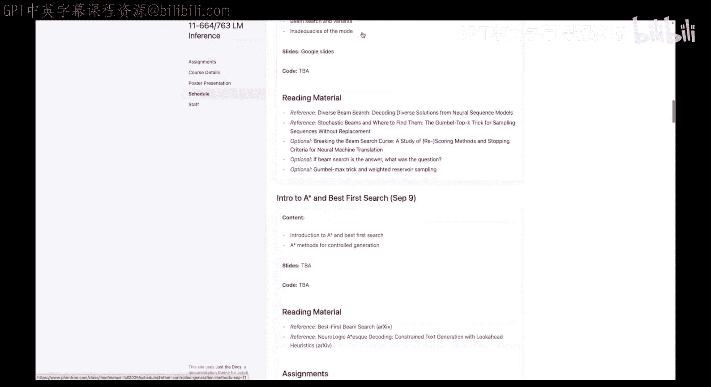

Which is they have they use a variant like a particular type of formal grammar so this like what can you produce given these rules。

 the way of specifying this in like theory of computation terms is writing a grammar for that language where the language could be all JSson that meets the schema and so this is a particular format for writing grammars and it will so it will start from like a root if you've done like any kind of theory of computation class。

 this would be more like a letter to an arrow to some output but this is their version of specifying that and then you define like terminals being like actual strings that can be output or character ranges like this like this could be text most of the I think pretty much all of these will have a helper for JSsonN because it's the most common version of this where if you just pass like a JSsonN schema or you pass like some Python。

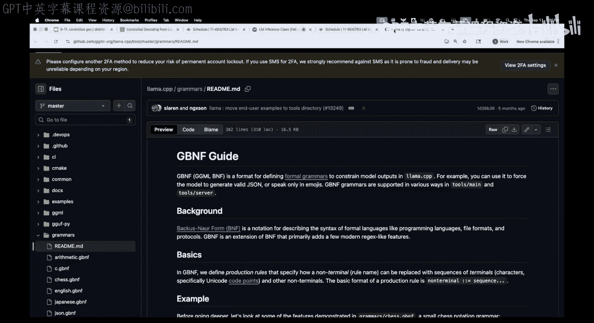

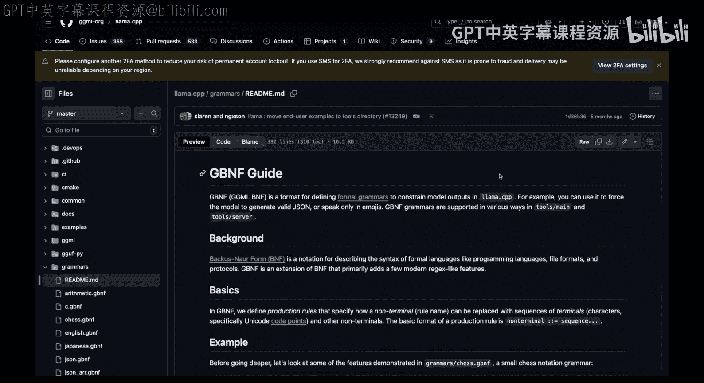

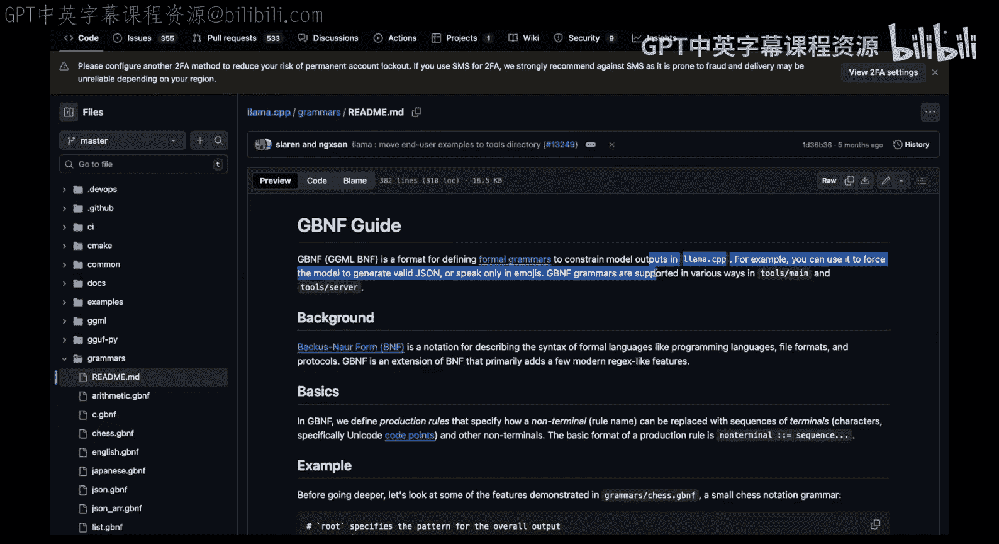

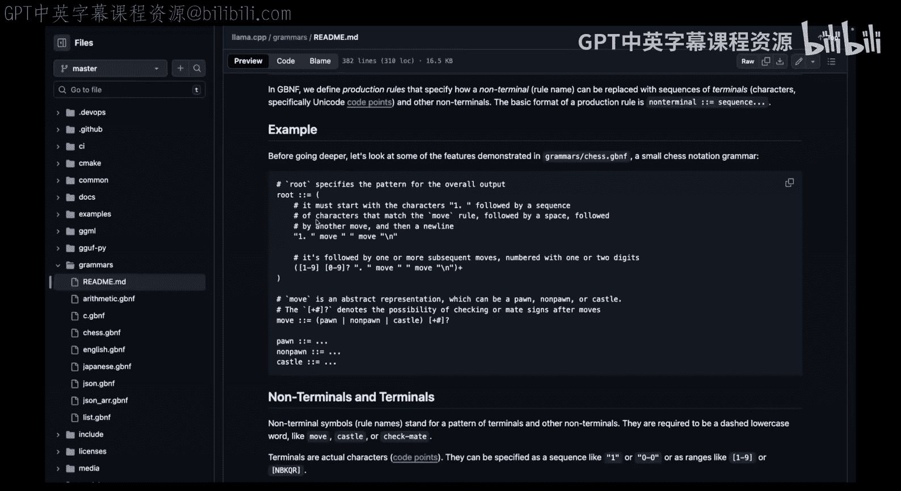

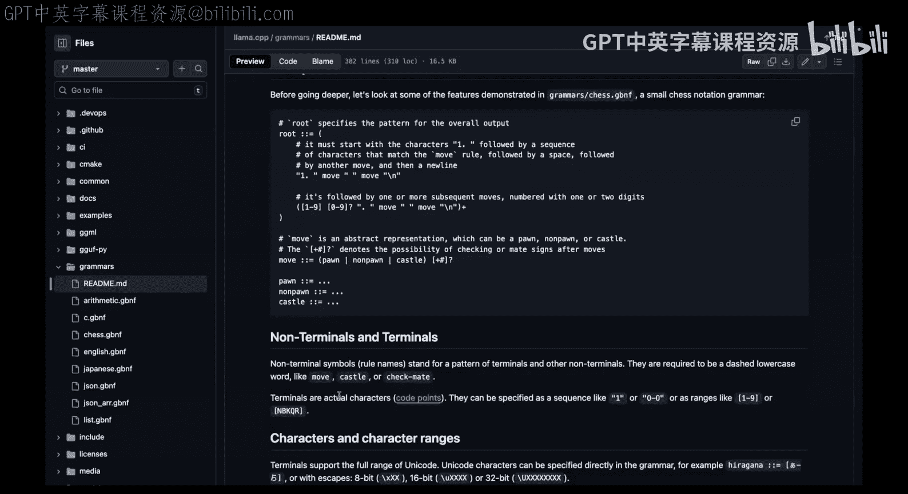

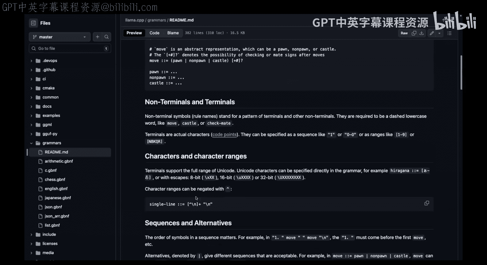

Tyd dictionaries it will convert it into a format like this and then once it's in a format like this。

 these can be sort of。

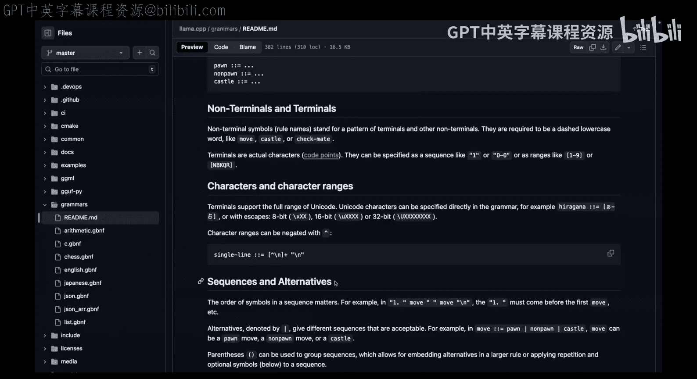

Tpied down into like a parser， This is adjacent to how parsing works So able to specify groundwater and that is used to construct this groundl I do not specify groundwater。

アさ。要。Then it will divide the ground that Yeah， if you've given a if you have a library that has like helpers like this。

 they will take the JSO you write and they will convert it into a representation like this grammar and then enforce it as a set of constraints。

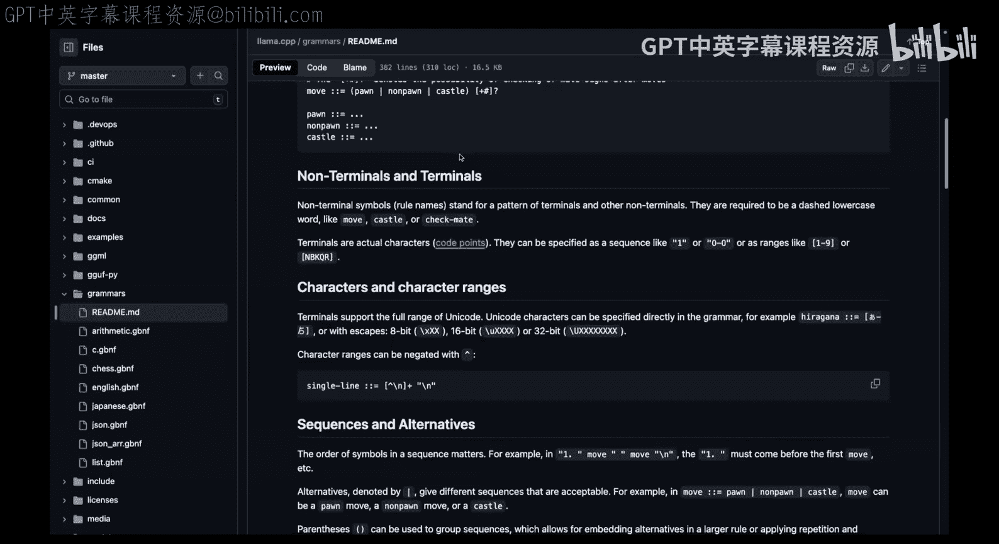

Yeah， I think this is a really nice little connection with theory of computation。

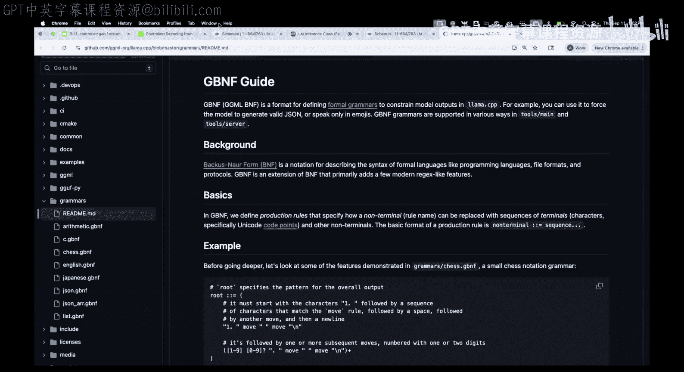

So。As we're going to wait a sec for this to load。So as Greg mentioned this is sort of available most places so you can do this in L chain。

 you can do this in open AI this used to be called JSON mode and they've kind of changed the name recently to structured outputs it's a little more general。

 you can do this in Gemini and here you're passing a schema which is actually like of Python type so you're saying it needs to be recipe name and ingredients and that will look at this format。

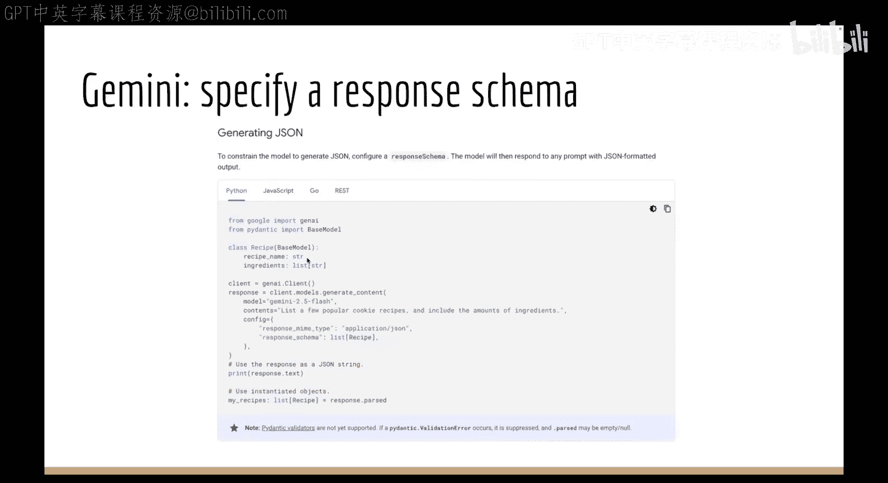

One of the possibly I think the original way of doing this was from this Willard and Lo paper and they wrote this library and I think founded a startup around this。

 so this is specifying outputs using like Python typing syntax much in the same way that Gemini is doing here now and any one of these is kind of an option for doing that。

 I think。I don't actually know if I have the VLLM one in here。

 but VLLM also you can pass like a JSON schema。说话去。

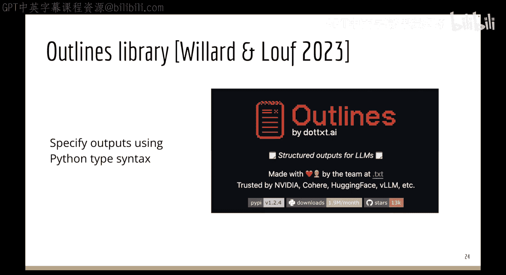

哦。Yeah and I feel like a valid question at this point is could you do this for like an arbitrary task like could you write balance could you say I need to write balance C and this gets into a kind of like。

Trickkey cornerner， which I think we hinted at earlier。

 we talked about things that can or cannot be expressed in a gramar。So who here。

 I think where asked this last class， but ask it again just。For my own sanity。

 who here has taken like a theory of computation or an automaa class？

OkayOr programming languages or compilers。 Yes， great。 Okay。

 so we've got like some subsection of the room If you haven't taken a class in this area and this kind of all sounds like a little bit of。

😊，Like insider baseball from a corner that you're not in that's okay this is just sort of for a little bit of extra context so we asked earlier can we write down all the rules that will produce JSON and this is kind of an interesting question from a computational perspective the immediate thing that somebody noted is that we have this like notion of nesting parentheses and so we would need to if we were writing a schema or a set of rules to produce all valid of JSON be able to say you can start with an arbitrary number of parentheses as long as you end with exactly the same number but this like autominagraph we drew a finance dataatmaa doesn't have any way of keeping track of how many times it's been in a state before right sort of it just kind of moves through without any record of where it's been before and so finance data automaa express a sort of class of languages that we call regular languages if you're。

A very particular schema unless that schema allows for some kind of arbitrary nesting。

 generally you can write it out in this format。Where you know exactly how deep your nesting will go so you can define like a really long automata that captures like exactly every level of nesting by just defining a set of different states like this is the state forhe for brackets nested five times versus6 versus7。

 if you want to do an arbitrary number of course that's not possible。

 and so you need to use a slightly more expressive class of languages called context free but not regular and the variation here or the way that you would see this represented on that graph is you get sort of one extra piece of information。

 which is you can keep track of a stack of prior values or a stack of prior information you've seen So you could track like the number of opening versus closing parentheses。

And this is a set of languages called context free。嗯。That is a what would be a pushdown automa。

 so you would write something that looks very much like this diagram that we drew out before。

 but that tracks like a little bit of extra information that gives you a little more expressive power and in general。

 anything that supports JSON's schemas is actually writing push down automata to enforce its constraints。

 not FAs。If you wanted to impose any more complicated things than that。

 like if you wanted to say you can have any arbitrary set of keys as long as they're all unique or if you are in C。

 maybe you can use any variable name you want that meets like these criteria as long as it's been defined earlier up in the same function or you can use nuI as long as you imported NI further up if you need to impose constraints that are more complicated than this you need something a little bit more powerful than context free gramars and so that's sort of the line where the ability to enforce this really efficiently in this really nice way for generation ends so you can do this you can enforce like a particular JSON schema you can enforce that it is。

Generically validate Json， but if you want to enforce other kind of more complex constraints like you want like particular keys to all have different you want all of your keys to be unique。

 but you don't want to define what all the keys could possibly be that gets into a class of languages that is not context free and so this is like not possible to represent in this format and maybe that was a little hand wavy if you haven't taken a theory of computation class。

 I think there's like so many cool computation connections here this is also like deeply connected to parsing Yeah。

Yeah， yeah， a one line definition for each of these。It's a whole order， but yeah。

 its this church sharing in the room with us right now， I think the the big， I think yeah。😊。

Not a line has shaped。嗯あ。So there's a class of things that you can express with。呃。

Just sort of things that don't require any。Extra bookkeeping outside of what you're currently saying。

That's really handy， but this is things like。Any number。Where you can write this as a redex。

 but it is like， you know。0 to9。把す。Things that are a little more complicated than that。

 where you need to like you don't need like a broad set of information。

 but you need to keep track of like some additional symmetry or connection between two parts of your input are context for。

だから。And so this is。One three languages。嗯，Tings are。And so this could be things like A， B。

match numbers of A's and B's or match numbers。Yes。诶。Or case on that numbers of。

There's a whole broad world outside of these two things。

 the regular languages or what can be expressed by the kind of finance state of commonmodo we drew on the board。

 which is something like，This is like。3 see。Zero denied in on that start state。

 and this would be like。If you want to draw something that is a little more complicated and keep track of some degree of state like this。

 you would have something that would look a little more like。Rememberm。

 but you would keep track of some amount of speed。Yeah。

And so you'll see something that has like these。W， little arrows indicate adding state is usually how they represented。

 and that pushed down its content。So regular languages。

 small set of things that are really easy to specify。

 this is also the original meaning of the term regular expression。

 although regular expression syntax in some language programming languages is actually more expressive than this。

So this is like easy to specify context3， a little harder to specify， but's still possible。

 And so this would be where you see how you see a commmin。

 This is where you see a push that and commmin。 This is where you would see like。

The world compilers is usually a little one step further up。

I'll just add if the term like express is like new to you， it's helpful to think of it as just like。

嗯。If you look back at like the。Figure from a few slides ago with like。The states instance。

 you just think about all of the possible things you could。Generate。From that kind of。Diger or like。

The sets of gs。Are similar to that diagram。Following certain rules as in like no state truck。

I'm sorry， yes， state tracking no additional information express is just like what can you possibly generate with like the combination of like all of the possible little automado。

Yeah me。Yes yeah another way to think about it is a language model。

 like a typical language model that we think about can generate anything with some probability。

 like it never gives zero probability to anything these give。😊，Uniform probability everything。

 so everything that's accepted by the can give zero probability everything else。

And so because of this， like these are not saying anything about whether that's a good string or not or a likely string or not。

 it's just telling you yes， this is an okay string， no this is not an okay string。

Another way you can think about it actually is you can multiply this language model by our other language model。

 So because this language model gives uniform probability to everything。

 if you multiply this probability by the other probability it will give zero to anything that's not accepted and like uniform probability everything else。

 So it won't change the probability of the things that are okay or won't change the relative probability the things that are okay but it will set the probability and when Graham was drawing like weighted finite stateatmaa last lecture。

 that's kind of exactly what you could think about is happening is it's the same level of expressivity that you can you can get the same set of things out of it。

 but now you've like attached probabilitybabilities to going like to two versus four and those you generally got from your language model。

Yeah， you' a theory of。 Yeah， No， no， take take theory of comfort。😊，改手が入らなくて。頑ばた。Now， my question is。

 like， I， how is this。I put a aside in that。 So like。After soft， we have approved。我啥。どきですか。

But please trying the government。Yeah， like how do you map from like the softm over your whole vocabulary into like enforcing constraints like this。

 you do a kind of like silly simple thing， which I think I didn't say too clearly。

 which is that you just sort of set the probabilities to everything that isn't a valid transition in this graph to be like arbitrarily low。

And you do that by adding like a large negative right before soft nets。

So that's the kind of notion of like crossing things out in here is you've just like you've zeroed out the probability of everything that's not in this graph。

Yeah， and another way to think about it actually， since we were talking about multiplying the probabilities together。

 let's say we have the probability of BLM。And then we have the probability of the automaton。

And we always express these in water probabilities when we do or like negative blood probabilities。

 right， and so。What's the likelihood probability of zero？

Minus infinity right so what you actually do when you calculate these in pipe for or something like that is you set the probable and you know if it's uniform we can just like set it to one and so that means all the things that are allowed is to x to are zero all the things that are not allowed it to the next to we add minus infinity and then we take the soft bat again to weorize into our probability and so that's how we mask out the next。

Mechanistically， but also like it directly multi quite piece things。Right， so all this to say。

 should take theory of computation。 And we've kind of gotten to a set of things that are like。

 there's a number of things that are possible to do with this kind of like automata inspired setup。

 But there's also a number of things that are not possible to do。

 So something like enforcing that it generates valid C， for instance。

 is not on context free because you have these requirements like variables must be defined before they are used。

 And so you could not do that with this type of method。So， yes， good。Or sorry。

 I thought you were raising here。And just a bit like the reason it's context the reason context with grounds avoid questions is because they have a notion of some sort of manually adjacent concepts like like the number of connections。

Yeah， you can think of them as they have a stack like a stack memory you can write and read from。Why。

Why can't that be added to the like regular so that can so you can do anything kind of up to a context free grammar。

With this type of like schema enforcing， what you can't do is add things like keep a list of all of the variables that have been defined before and check if the thing I'm generating is from that list because you couldn't do that with just reading writing from a single stack。

把 that非常快可思关这事情。If you have， if you can write to multiple stacks or if you have sort of like a long line of。

In these terms tape like a long line of places you can read and write， then you could do that。

 but that would be a more strictly more expressive thing than a context free language。

 that would be a turning machine。And so then we get into a whole other kind of words。

But that's not possible to enforce in this kind of like token by token checking way that we did here。

So we'll move now into a yeah， yeah， totally。请要我。that you seated up things in co distribution and let them think that's unchanged except。

好了呃 normal嗯那你这个UD notions of这种。augment the probability distribution you've done the sort of Yeah。

 could you like augment the probability distribution after you've done this sort of cutoff you can and you could not do so in such a way that would give you like the ability to to simulate like an arbitrary language like C what you could do is you could set aside the idea of automaa entirely and apply some constraints to your probability distribution to reshape it to make it more likely that you'd wind up with valid and that's what we're going to do next I think Yeah。

I think this stuff was really cool， I used to T a time us if you ever want to talk about it or I'm happy to。

Yeah， so now we have these kind of constraints for JSON that they have this nice property that token by token we know whether we' our satisfying our constraint or not。

If our constraint isn't doesn't have this sort of nice property。

 we need to do some sort of estimation of whether we're going to satisfy the constraint instead and here this is sort of。

Much broader class of constraints that includes things that can be a little more hand wavy maybe than the sort of strict format checking So for instance。

 if I say this semantic constraint I want to describe like a hobby I could try to stay in shape。

 but I do not want the model to tell me to go climbing like I've decided I don't want to go climbing I'm looking at Clara directly in the eyes please don't take me climbing。

This is not like possible to enforce through like an Nataa right。

 how do we prevent the model from suggesting this and？A year ago when when I first made this slide。

 I asked， I think this is Gemini 1。5 at the time。 and true to4。

 it got sort of a couple a couple lines into this generation。

 It suggested some great ideas and then it cycle back around the climbing。

 This has changed in the last like 10 months or so。 So G5 no longer suggests climbing to。

 if you say you don't want to go climbing， which efficiently means language models have beat my friends on the Amanda Hobb benchmark。

 but。Even so， say you have a model that's maybe be slightly less performant than that。

 is there something you can do to get it from to no longer suggest this to you？

Maybe if we were just talking about templates， the reasonable thing to do is just set the probability of the token climbing to be zero。

😔，This is like a kind of hard line approach， it's very easy to implement。

 we know how to do this right we just add a giant negative to the logict and softm again。

But it's bad if there are sort of synonyms， maybe if I don't want to go climbing。

 I also don't want to go bodering and it's bad if the tokens we restrict could be used in sort of loud ways。

 like maybe I want to talk about like hiking where you have to sort of go climbing up this mountain to see a good view that's a valid way of talking about hiking but it doesn't actually sort of convey this meaning or trying to restrict。

And it's also bad if we generate other related terms before the term we're trying to restrict。

 so if the model says a great activity you could do with your friends is rock and then we are not allowed to produce the term climbing。

 you could wind up with some like really nonnauralistic or nonfluent generation。

So just we're not going to get out of this problem by just sort of hitting it with a big softm like hammer。

We always sort of have this option that we talked about in den beam search as well where we could just generate a set and filter this could be extremely computationally expensive if the thing we're trying to restrict is a relatively common output。

 but it has this advantage that it's easier for us to check that full sequences violate the constraint than subsequences because we no longer have this like tokenwise verifiability。

We could do something like neurologic Astar S which we talked about before。

 it does allow us to look ahead which is nice， but this is a constraint that's a little harder to verify where I couldn't just sort of write a list of unallowable terms you know if I tried to write like a rule that indicates whether an output is about timing or not。

 I could maybe write like a very long set of heuristics you could check but this isn't really something I could specify with a redx right？

So we need to think about how we calculate this heuristic a little bit differently。

AndWe'll talk about sort of one pra method in this category， which is a method called fudge。

The idea here is that we started with this probability distribution。

 which is sort of our standard distribution over the next token given our inputs and our outputs so far。

We want to impose this additional constraint or condition on this additional factor A。

 and this could be we want the topic to be not climbing。

 this could be we want the in sort of the example we'll do here is could be we want the text to be formal or informal it could be we want the text to could even we want the text to be validateson just some kind of constraint that we want to modify the probability distribution according to。

The insight of fudge and of methods like fudge is that this is a relatively hard thing to do this middle equation if we we'd sort of need to train a model。

 maybe that conditions on a separate thing。 and this is certainly something you can do。

 this is a classconitioned language model So you could say like I trained a model that takes an input that is the style of text as well as the text that I just trained on and it will always if you give it the input formal。

 it'll give you formal， if you give it the input inform it'll give you informal。

 But if you want to take a model that wasn't trained in this manner。

 this is a relatively hard thing to solve， but by Bay rule， you can just rewrite this or with。

To within a constant， you can write this as proportional to P of the constraint being satisfied。

 given where we are so far， plus the probability of predicting that thing and here this is P of the constraint being satisfied given the substream up to the token we're about to produce and the probability of producing that token。

And this is a proportional， which is okay because we're going to softm everything anyway。

 so we don't care about sort of exact value。So how do we compute the probability that we're going to satisfy the constraint。

 given just like sort of the string up to the decision we're about to make？😔，嗯。

The idea here is that this is a much easier task than actually predicting the whole string and so we can take a bunch of data we already have if we have any kind of labeled data for this task and turn it into data for this So if we have this formal and informal data and we want to predict how likely it is that an output will meet the constrain of formality by the end we could tokenize each of our things inform and tokenize each of our things an informal and take every substr starting from the start as an input example So I would get the label formal I would we get the label formal I would appreciate。

 we get the label formal in this data and if you do this over a really large corpus。

 you'll wind up with a bunch of examples and you'll get some kind of notion like maybe starting with I has relatively equal probability of coming from formal or informal but starting with I would appreciate。

iss almost always only seen in the formal data and not the informal data。

 and so you could train a classifier given some one of these substrs to predict whether the whole output that was sampled from is formal or informal。

And this data is relatively easy to get。Once you have that data， you can take your language model。

 maybe with some input do you。And you can pass things through the model as you would have before。

 so here you pass through the model itself and you get some sort of distribution over some candidate output tokens。

But then you can also pass each of the input plus each of those candidate tokens through this scoring thing you've just trained so you say what's the probability that my output will be formal given do you want or do you prefer or do you thus and it will give you a sort of formality prediction。

 a prediction that you're going to wind up with a formal text。So you can see here。

 thus is a really low probability output in general because it's not maybe like the most standard way of saying this。

 but thus is a very do thus is a very formal like phrase and so it gets a high formality score。

 but a low overall score。Then you simply multiply these together or in logspace add and you wind it with scores that factor in both the overall probability and this sort of formality probability。

 so the thing that sort of we'd like to happen happens which is want and prefer were relatively even probability but prefer is more formal so it gets upgrade。

And so you wind up what the output do you prefer and this idea of sort of looking one token into the future and trying to make a binary decision is where the name fudge comes from this is future discriminators so you're discriminating formal or informal based on these next token。

And there's kind of a few limitations to this so this is generally a really nice idea。

 the first is that you have to pass the future discriminator over sort of all of the tokens you're going to decide between and the next step right the future discriminator takes one more token than you've actually predicted so you need to pass do you want do you prefer do thus each of these through your decision your discriminator。

The solution to this that they propose is sort of twofold。

 they only run the future discriminator on a small subset so if you take， for instance。

 in their case they take the top 200 most likely next tokens and you run on just those 200 instead of all 100。

000 in some because you know that even if something is really formal if it's the you know 100。

000 most likely token it's not going to get predicted anyway and then the other thing they do is they use a very small model and because this sort of01 choice is a relatively easy thing to learn is this is possible to do。

The other limitation is that this is not guaranteed to satisfy the constraint。

 this is true sort of in general of any method that's trying to predict the future so you could sort of in practice if you're doing something like formality you could say this is probably good enough it's okay if it occasionally sounds a little informal if you have a constraint that it's really important to you。

 you could couple this with something like rejection sampling over a set of outputs where you can then once you've seen the full output rescore and reject anything that doesn't seem like appropriate。

And this requires access to logicits， which is sort of a fundamental requirement of this method and of a number of methods like it。

There's a kind of interesting connection here， which I think we're not going to spend too much time on。

 but that is explored in detail in a paper， a very good paper called controlled decoding and also a very good paper called I think RLHF as Bayesian inference。

 which is the Corbec at all that these figures are from。

 and the connection here is that you can frame RLHF and they actually prove you can frame RLHF as this sort of manipulation in like a Bayesian inference sense。

 where your prior is the original language model before any kind of alignment。

 your evidence that you're using to update your prior is the reward model or the score that the reward model gives over each output and when you do sort of a kL divergence mineralization。

 you're producing an aligned model that is sampling from this posterior。

 this prior informed by this evidence。This is sort of an interpretation that lines up really nicely with our sort of Bayesian interpretation of fudge as well。

 and so the connection that people have drawn between these is that you could do something like fudge。

 but rather than trying to predict something that maybe seems a little toy now like formality。

 you could predict something like is this going to have a high reward according to my reward model at the end of decoding and maybe rather than doing RLHF。

 you could just sort of predict this tokenwise。And this is the idea behind reward augmented decoding。

 which I believe we're going to have someone talk about at the end of class。Yes。

 perfect so I will just leave it at that for now what does this look like in hugging F so I kind of kept this in here just to say that most of these methods are not sort of negatively implemented in hug and F or a number of these providers if you want to do something that's kind of this level of logics manipulation you do kind of have to play around with like yourself and we have I think a little something in the homework that's involves the logics processor so you will have at least seen this before。

There's one last method I want to talk about and for that we have to go back and mention one more sampling method that we actually missed the first time around so this is one last way of controlling generation and the idea here is that we want to control generation by sort of contrasting to what we shouldn't do so contrastive decoding as a whole is not specifically about constraining generation but it's about the idea that smaller models or weaker models or subsets of models make different mistakes than the broader system and so we could。

Not just choose outputs that our best model finds likely。

 but also choose outputs that are best model finds more likely than the weaker models。

 So if we have a weak model that's maybe prone to repetition and a stronger model that's less prone to repetition we subtract out the logics of the two models so we give them both the same input text these models need to have the same tokenizer for those to work we give them both the same input text。

 we look at the output logics and then we subtract them from each other and what you get here is you get things that are substantially more likely from the expert or the better model than they are from the amateur or the worst model and so in this particular example we have Barack Obama who was born in Honolulu Hawaii he was born in Hawaii is relatively high probability for both but weaker models are more prone to this sort of like whoing a repetition so it's maybe more likely for the weaker model so subtracting out the logics you。

downwiing things like Hawaii and getting surfacing things that maybe the weaker model didn't even know like Barack Obama's birth year that the stronger model would have placed more probability on。

So this is sort of a notion that you can like contrast like it's called contrastive decoding because you contrast two things that you think might make some similar mistakes。

 but one has more information than the other。How we use this to do constrained generation is there's sort of a couple of papers that have applied this idea with the principle that it is easier to specify the things you don't want to do than it is to specify all of the things that are allowable So if you want to particularly for safety。

 it's pretty easy to identify like these are the set of outputs that are really unsafe or that are really harmful or that are offensive it's much harder to write like a good description of all of the things that are not offensive。

So you could do this in two ways。 you could train a small model to produce particularly harmful or offensive content or in sort of the two papers that I have on here。

 you simply prompt the same model differently to produce offensive content versus to answer normally and then you subtract the two logics out from each other to choose outputs that are not as high probability under the unsafe setting as they are in a safe setting and so this is sort of a visualization from this from adversarial decoding。

 which is one method that does this， So you take a user instruction you give it like a safe system prompt like you're a helpful and not harmful assistant or whatever that gives you a set of logics for what to say to the user and then you also give the same user instruction to the model with a prompt like know you are harmful。

 you should be as offensive as possible， functionally be evil and then you get you get some set of logics out from the model it' best to be really offensive to you。

You get some set of logics out from the model， not particularly safety aligned or not。

 and you contrast the two so this sort of downwes everything that the model thought was a really likely offensive response to the question and so this is a nice way to sort of if you don't want to to train a separate thing let the model make the same kind of decision of what satisfies or doesn't satisfy your constraint the downside here。

 of course， is that if you're passing these both through the model you need to use twice as much compute to accomplish the same task。

And this is actually relatively easy to do because it's just a subtraction between two sets of lots。

 a little bit of a caution here is that Huging Place also supports something called contrastive search。

 which is not the same method。So kind of in conclusion here。

 sometimes it makes sense to train constraints into the model and in particular for things like RLHF where you know this is sort of a broadly a set of constraints you want to be broadly applicable to every output。

 it could save a lot of compute to do that sort of at training time。

 but for constraints that are a little more template based for constraints that set hard limits or for constraints where you can predict that each token。

 whether or not you're going to satisfy the constraint with a high degree of accuracy。

 it can be relatively flexible to add those in at inference time。

 and depending on whether your constraints are specifiable per token or whether they're sort of something that you can only really be sure about at the end of the sequence that changes the types of tools you have to answer that。

And then there's some this kind of nice connection between alignment and constrained generation where alignment is really like a set of constraints about what is or is not appropriate to say。

 and so there's some overlap of the things you can do for both。And with that。

 I will turn it over for a discussion of one particular way that you can use constrained generation to do alignment。

If you want to come up in present。are there any questions？Yeah we prepare for presentationci。

谁序那个的这个方法。I can't use addition。你 property distribution's only time我。于确就啊。你是想如个何都可。Yeah。

So the text code itself。 the text code itself learned a really strong connection between things。

 which has like， why not any method trying to use additional text code possibilities because have no words a bunch of words text code has already captured the relationship。

好不不是那个。咁安。Right。なす。You're saying like do something like word tove similarity to like a formality cluster。

 I think that's a discriminator you could use in fudge as your discriminator could be how close is like the average word embedding in this sentence so far to this cluster that I've defined as formal or this cluster I've defined as this topic。

But you could sort of plug that in。

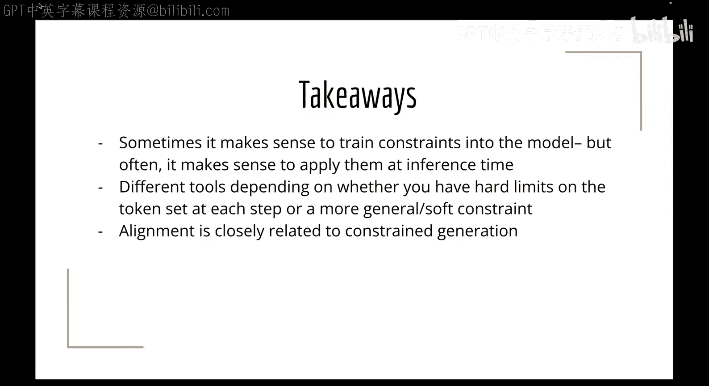