# CMU《语言建模的推断算法｜11-664 763 Inference Algorithms for Language Modeling (Fall 2025)》 - P7：-06-CMU LLM Inference (7)_ Chain of Thought and Intermediate Steps.zh_en - GPT中英字幕课程资源 - BV1xsFjz3EoQ

Okay， hi， everyone。It it's time， so I guess I'll get started。

Are the people who are presenting today here？Okay， great thank you we have two people I guess so I'll leave plenty of time at the end and if we have more time after that I might talk about a few other things that aren't on the sides。

 but I'll make sure to leave time for you。So this time I would like to talk about chain of thought reasoning and this is kind of like a fundamental thing that we use in most models nowadays。

 but it has some kind of like interesting properties that we definitely want to know about if we're going to be building models that do inference。

 and this will build into reasoning models which are you know like one of the most important technologies that we're working on now。

 reasoning models in chain of thought models are basically I mean reasoning models use chain of thought but they're explicitly trained to be very good at using chain of thought so you can kind of think of it as an extension of what we're going to be talking about today。

Oops。Oh。

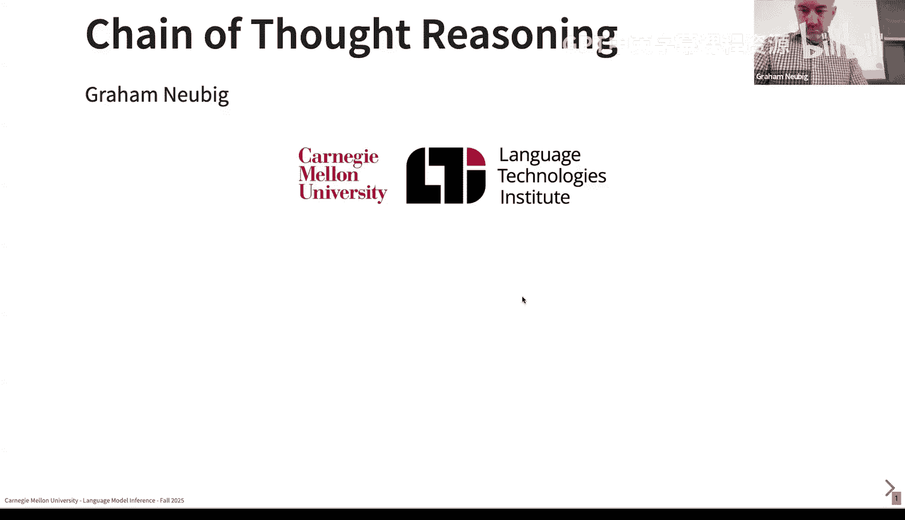

Sorry， one second that is not moving for some reason。

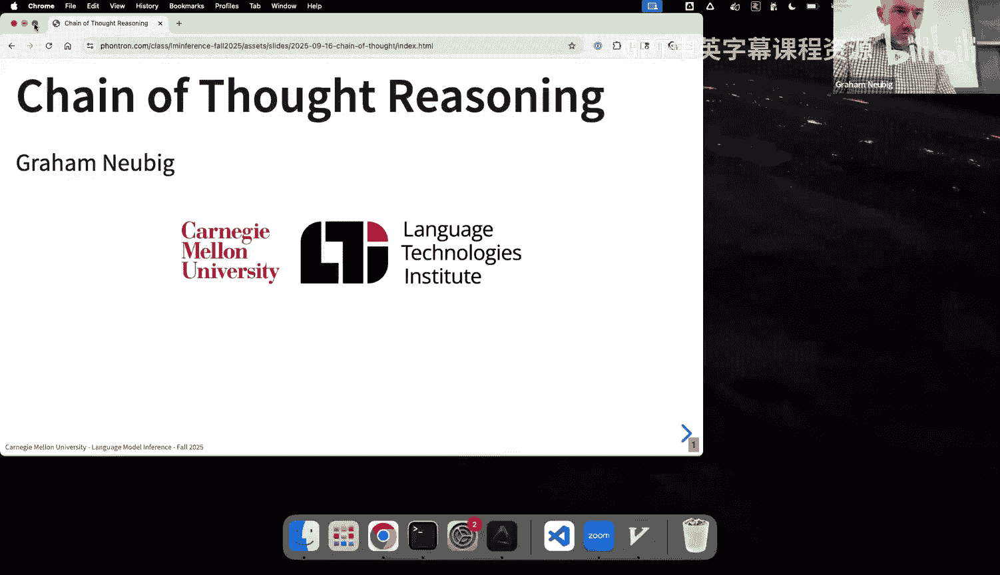

So you need to figure out how to remove this as zoom annotate then yeah。O， there we go。Okay， great。

 So our motivation for chain of thought is。We want to do complex reasoning tasks and this is an example of a complex reasoning task that I wanted to do for this class。

 so what is the fastest in H100 GPU could possibly generate 100 tokens for MaMma 38B？

Anyone have an idea of how you would solve this？How would you start answering this question？

Any brave person want to， I'm not asking you to answer it， I'm asking you how to start to answer it。

Yeah， I mean you probably figure out how long it takes to went of again。

Figure out how long it takes for one token and how would you figure out the like lower bound of how long it would take for one token？

I think you just place the screen。Oh， do it empirically。 Okay， empirically is not the lower bound。

 though， because there's all kinds of things that could， you know。

Interferre with that like if you're using Pytorrch。

 maybe you have overhead from Pytorch and if you use something faster that was written in rust。

 maybe it would be maybe you'd be able to do it。And yeah。Yeah。

 determine the number of computations and you can all you know the number of computations that an H 100 GPU could do from the GPU spec and then you could calculate the number of floating point operations that are necessary for one token and。

Having one token would not tell you the whole story。

 like why would having one token and then multiplying it by 100 not tell you the whole story？

Any ideas？Yeah attention takes longer yeah because attention has quadratic computation time so yeah that's true and then this is still a lower bound and there's actually upper bounds because you're not like fully utilizing the GPU because when you generate one token at a time you have to wait and then generate the next token and stuff which is also why encoding is faster than decoding and we'll talk about all that during the efficiency but。

So if you if you ask a language model to do this， it will have to do a lot of things like you did here。

 so it'll have to recall what the flos of an H100 are or search it on search it on the internet another tricky thing is depending on your floating point precision the flos stiffer on an H100。

 but you know we could ignore that for now， and then what's the size of Lama 38B for each of the layers。

It would have to think about how it could set up a computation。

 so it would have to think about like how do you calculate the flos given the size of  Lama 38B。

And then it would have to perform the actual computation itself and so it could either perform the computation by like having the language model do the computation or it could run a program that does the computation for you write write a program and then run a program that does the computation for you so we're going to talk about reasoning models that are capable of doing that computation on their own in about like two classes and then we're going to talk about the running a program for you part in about like maybe three or four more classes so。

You know， all of this we will be talking about in the future。But the fundamental challenge here。

Is that not all problems are created equal。 So the problem that I just gave you is a really hard problem for probably everyone in this class。

 like you probably could do it if you really put your mind to it， but it's not， you know。

 an easy one。 On the other hand， I very much hope that this is an easy problem for everybody in this class。

 Otherwise you're in the wrong class。嗯。😊，This one probably is also easy for most of us and this one you know is easier than the GPU problem。

 but it's you know you'd have to think about it a little bit and maybe pull out a piece of paper and stuff like that。

So one another thing is the simple problems you should be able to solve very quickly by just thinking in like you might not even really feel like you need to think if I tell you two plus3。

 you just say five， you don't like need to work through it for the medium and complex ones here。

 you probably would need to think about it and like kind of write out the equations in your head around paper and solve them and that's the same for language models。

嗯。So。A key question is， how can we allocate computation based on problem difficulty and like another way to think about it also is。

There are problems that like just fundamentally could not be solved by feeding in an equation and predict predicting the output because they are more computationally complex than all of the computations that you do in predicting a single token in the language model。

 so like it's theoretically impossible to solve all problems with a single step of a language model。

 but。That's not usually the problem， Usually you still have enough computation in the single step of the language model。

 calculate the number of flos that you use when you calculate like the next token in you knowma 370 B and it's a huge number of flos。

 So it's more just that language models are not particularly accurate or efficient at solving computation problems。

Cool， is that clear any questions or？Okay， so before we go into like transformer language models。

 I'd like to point out that this is not an idea that has you know just suddenly popped up overnight。

 there's an idea of adaptive computation time， which for example。

 was put out in recurrent neural network language models by graves in 2016。

And the idea was that you dynamically adjust computational effort based on the input complexity。And。

The way they did this was they taught recurrent neural networks to learn how many computational steps to take。

And so they basically had a halting mechanism and the way the halting mechanism worked was if you had the hidden state of a recurrent neural network。

 you would run it through basically an MLP not MLP。

 you would run it through like sigmoid cell predictor that would then predict I should stop or I should not stop。

And then after you ran that， you would then decide whether to stop or not。

And they also trained it with something they called the Poer cost。

 which was basically how many steps， you know， a continuous approximation of how many steps you took to encourage efficiency and they demonstrated that this worked on a variety of problems back then。

 you can see this and see figure one in the paper if you'd like to see how they created the network and stuff。

So。This was a more explicit version of doing adaptive computation time。There。

The more popular version of it is now， of course， LLMs because we use LLMs for everything nowadays and chain of thought prompting is something that came up within LLMs and it's kind of interesting because it's an emergent property of language models and not necessarily something that you need to explicitly bake into the model。

And so the basic idea is that you want to generate intermediate reasoning steps before producing the final answer。

And the formal definition， which we will be using as we explain different methods later。

 especially for training， is that we have the input X， which is our problem statement。

We have the chain of thought Z， which is our intermediate reasoning steps。 and we have the output Y。

 And this is also what I covered in the first class here。 But basically。

 Z is a latent variable that we use to improve our predictive accuracy of y。Good。

So basically what our goal is is we want the best P of y given x。

 so we want the best predictor of the output。But。The way we will do this is we will do this by marginalizing over Z。

 so summing over all Z so that we can get a better prediction of y。So this is a number of advantages。

 the number one， the extra tokens provide adaptive computation time， like I mentioned before。

 so you can spend more flos when you're calculating the more difficult problems。

Another advantage of this is if the chain of thought is faithful to the actual reasoning。

 it makes it easier for humans to verify the output。

 so like a human can walk through step by step and check if they fully understand you know what the model is generating step by step and verify it as well。

So here's an illustration of a chain of thought specifically from the way at all paper and if we look at standard prompting。

 this is standard few shot prompting， so basically we're providing a few examples。

 so we have like Q is the question a the answer is whatever Q the question A the answer is whatever。

 and so chain of thought prompting is Q and then you also have an explanation for how you got the result。

And then the idea would be that because the model has seen this before。

 the model is able to generate the output like this。So。Yeah。

 and so let's look at few shot chain of thought prompting。

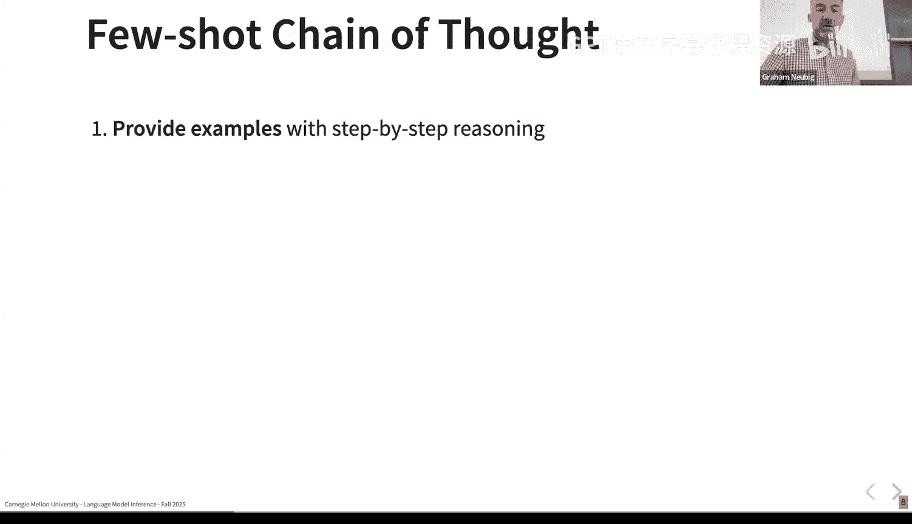

呃， sorry。Sorry， I thought I deleted these， deleted these slices， but they were not deleted。 Okay。

 so then the question is， how do models learn chain of thought。

 And there's a number of different ways you can do this。

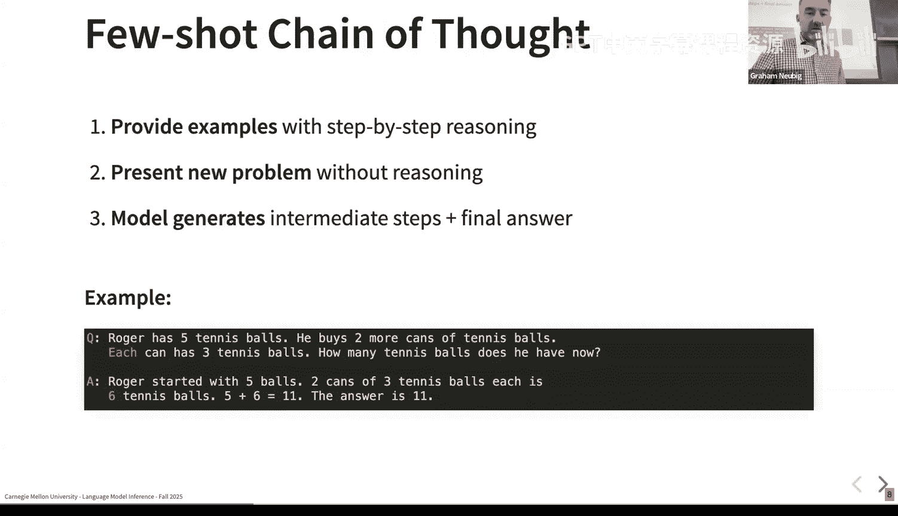

In the way at all 2022 paper， they discovered that even without teaching the model or training the model in any way to do chain of thought。

 it was able to do that Does anyone have an idea why the model had this ability to do chain of thought in the first place。

Yeah， all sequence of events in logical the of。A sequence ofductions falling from the mice Okay。

 so trading data already has examples of sequences of deduction so I think that's a great point we could be even more concrete。

What type of data would have a lot of this？5。codeode might be one example yet。Stories。Proofs， yeah。

 so online proofs or online elementary school math textbooks， you know。

 which is like where they give you this deduction and they evaluate on grade school math。

 And there's a ton of grade school math online that has these deductions like explicitly written in it。

 So the models might not necessarily do that by default。

 But if you provide them examples to demonstrate that they want to do it。

 they might just be able to do it and。😊，嗯。😊，So this is an emergent ability because this already exists in the training data。

 and this appears in sufficiently large models， or I should say sufficiently strong models。

 So these sufficiently strong models were like GP 3175 B in 2022。 Now they're like。Quin 2。

51 B in 2025， so it's like a lot of models， a lot of models have just gotten better due to longer training and other stuff like this。

Another thing is supervised fine tuning， so these this is done by training on data sets that explicitly have reasoning steps written in them so that using supervised fine tuning。

So I should give a little bit of a caveat here because this is kind of important。

 And maybe we'll talk about it a little bit later。 But when you， when you get large language models。

 there's often like the base model and there's the instruct model。 probably people have seen this。

 if you've used large language models before。 So like Lama Lama 3。1。Lama 3。1 or 3。1 base sorry， 3。

1 instructor， something like that。One small problem with this is now there's a concept of pretrain and post training so pretrain is like your base model post training is your is your instruct model。

 but now people are doing something called mid training which is basically where you pretrain the model and then you throw in a lot of data that's like very high quality by some definition of high quality right at the end of pretrain and。

This idea of very high quality might be particularly instructional data。

 which is data that's like very similar to textbooks or something like that。

 So our base models are now half。Like。Supervised， trained。 It's like maybe not exactly supervised。

 but it's pretty close to supervised。 And so because of this， it things that might seem like they're。

 they've just emerged in the base models actually already were there because they were， you know。

The people who pre train the models very carefully selected the data they showed at the end of training。

Some of the models are kind of in the middle， and this is particularly like Quen。

 the Quen model is particularly famous for this。 So there have been a lot of examples of people seeing quote unquote emergent abilities in Quen that you see in no other models。

 So happy to talk about the details of that， but that's an important thing that people have been talking about nowadays。

😊，A final thing which we're going to be talking about in the reasoning model section is reinforcement learning and so there's been a lot of work recently where we basically asked the model to do reasoning and then we give it a reward if it is successful at answering questions so these are the three major ways that they can learn how to do trade of thought。

Any thanks here？Yeah。I sure that very I think over to change。书。Yeah。

 I'll talk about that in a second。Cool， so if we look at the experimental results and actually maybe I should mention this here。

 So what they're doing in this paper is they're not looking at all all chains of thought。

 they're just sampling one or taking the greedy doing greedy decoding I think they're sampling with like sampling parameters。

 I actually should know that， but I don't。 You can take a look at the paper and check。😊。

But basically what they demonstrated was that on。Arithmetic reasoning， GSM aK。

 this is a data set of grade school math problems and they get a very large improvement on common sense reasoning called strategy QA。

 strategy QA was kind of created so that you should need multihop reasoning to do a good job or kind of like complex reasoning strategies to do a good job。

 they also saw a good improvement and then for symbolic reasoning where they were like concatenating the last letter of particular sequences they also got good results。

And so these were we saw the biggest gains and things that are like very symbolic， like math or。

Or like kind of last letter conation。Cool， so this paper was really impressive because it's very simple。

 you just add zeroshot examples and the model is able to reason now we take it for granted more or less you know like every model does this what was even more like impressive was this paper which was kind of kind of crazy。

 but it demonstrates that language models can learn kind of crazy things from the data that is provided to them。

 but this demonstrated zero shot chain of thought where essentially instead of providing per task examples of how reasoning should happen。

 they just said let's think step by step is the prefix to the answer and then that was enough to encourage the model to basically do chain of thought reasoning and the funny thing is let's think step by step is actually kind of magical they evaluated a whole bunch of other prompts and none of them were。

Go is let's think step by step So this is the magical one。

 but I also know one of the authors of the paper and this was the first one they tried so it turns out that human intuition is a kind of kind of impressive thing that they actually got the right the best one on their first tried but。

😊，So they basically demonstrated that you don't even need to have the examples to make this happen。

Cool。Okay， so I'd like to talk about inference because this is an inference class and this is really important。

 it's especially more important once we start using reasoning models that generate very long chains of thought。

 but if we remember back to the beginning of the class。

 our goal for inference is either to sample from the model。嗯。

Or to do mode seeking search so to find the highest scoring mode output。So sampling as always。

 if we want to sample exactly from the model score。

 the model probability is straightforward as we mentioned before ancestral sampling is ancestral sampling with a temperature of one is going to always be good enough in an autoregressive model so basically we sample Z tilda we sampled the chain of thought and then based on the chain of thought we sample sampled outflow line and we're done basically。

But mode seeking is harder。And。So。冇事见。Or finding the agonm of the output。Given。Given the input。Is。

Essentially what we need to do。I didn't put this on the slide， but we need to。We need to do this。

 so we need to find the y where the sum over all z that lead to y is maximized。

And this is hard because how many Z are there， how many possible Z are there？

We listening and the why some of。Correct， that's what we would like to do。

Because we want to find the。The way with the highest probability？So how how many Z are there。

 let's say our chain of thought is is up to。100 tokens。Yeah。

 it's essentially it's close to V to the power of 100 and you're not going to be enumerating all of those right。

 so we need another method。So。We're going to be talking about more complex methods to do this in the lecture on minimum base risk。

 but。A first attempt。Oh， actually， sorry， let me go to this first。

 So a first attempt is to find the Arcm ad jointinly over over Z and Y and what this means is we just find the we do like beam search or something like that to try to find the highest scoring output like we have previously or best for a search。

 whatever we want。But the problem is the aGm over Z and Y might not give the best whys。For instance。

 if we ask how many inches are there in three feet and we have。For some reason。

 a crazy model that decides to talk about centimeters instead with a high probability。

 then this one would be the highest Z Y， but it would not be the highest。

It would not lead to the y with highest probability because， you know。

 if you sum the all the probabilities that lead to y， then you y equals 36， you would get 0。

6 where this is 0。4。 So like there are there are plenty of situations where just doing this a search is not ideal。

So。The method that we can use to fix this is。Self-consistency and self-consistency only works in relatively simple cases like mathematical reasoning where it's like we have a single answer that's an integer it will not work when we're generating essays or something like this and that's where we need to get into something like minimum base risk but for this for self-consistency if we have like the answer is 14 or the answer is 18。

 what we can do is we sample a whole bunch of reasoning paths and then we basically count to see which answer is the most frequent and based on the count where the answer is the most frequent we take that is our answer。

So it's not that hard， it is expensive though， because if you want to sample 100 of these。

 then it's 100 times the inference cost。Cool， any questions here？

And basically self consistency on anything where we have this sort of。

 you know characteristic that we can verify the outputs， it does better， but is more expensive so。

Because it's doing the right thing。 So of course， it does better， but it's also， you know。

 not the most necessarily the most efficient way to do the right thing。

So there are better better ways to do this and this is actually a paper by Prajal Agarwal who's a PhD student in LTI called adaptaptive self consistency and basically the way it works is you。

You start sampling a smaller number of samples and once you've sampled a large enough number of samples that you're pretty confident in the final result。

 then you will stop sampling。And the way they do this is they use like just a little bit of statistics。

 specifically Bayesian statistics and。They gradually generate samples and they stop when the possibility of agreement of the final sample being high。

 the agreement of the final sample being。Let me start over when the probability of the final sample you get after sampling an infinite number of samples is above a threshold So what that means the way they do this specifically is they have a more complex version using something called a dele distribution。

 Deerchle priorlet distribution have people heard about this in general。Oh。

 actually surprisingly few。嗯。Maybe actually I。I would like to like to talk about this because it's a good concept to know about。

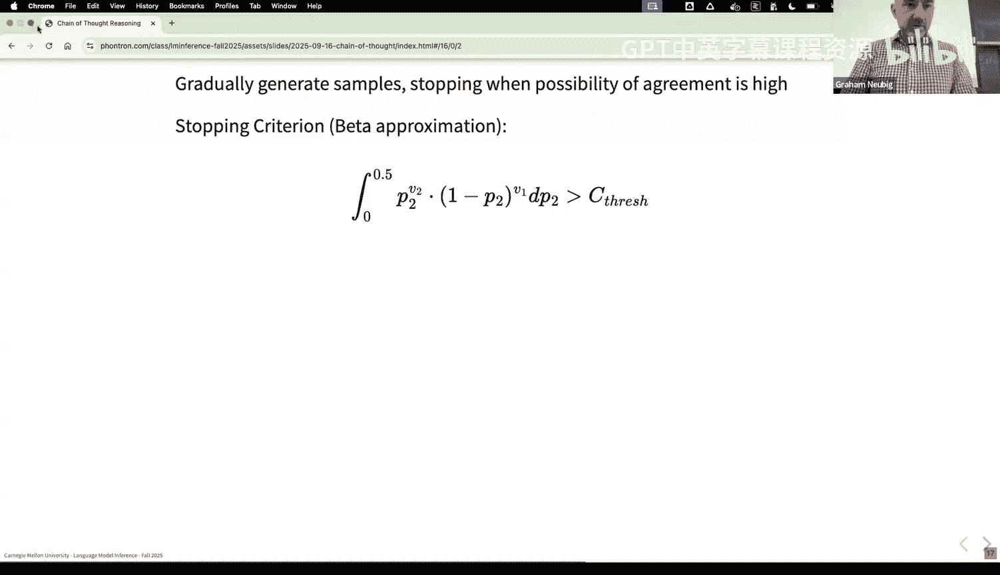

I don't want to mess up the equations。But basically， what this is。Is it is a。

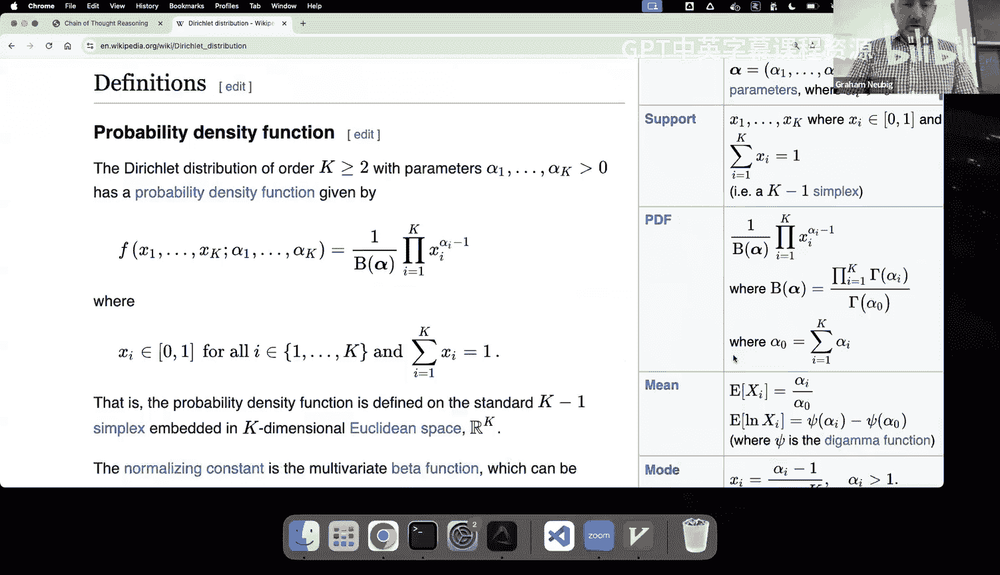

Prior probability that you can put on。嗯。

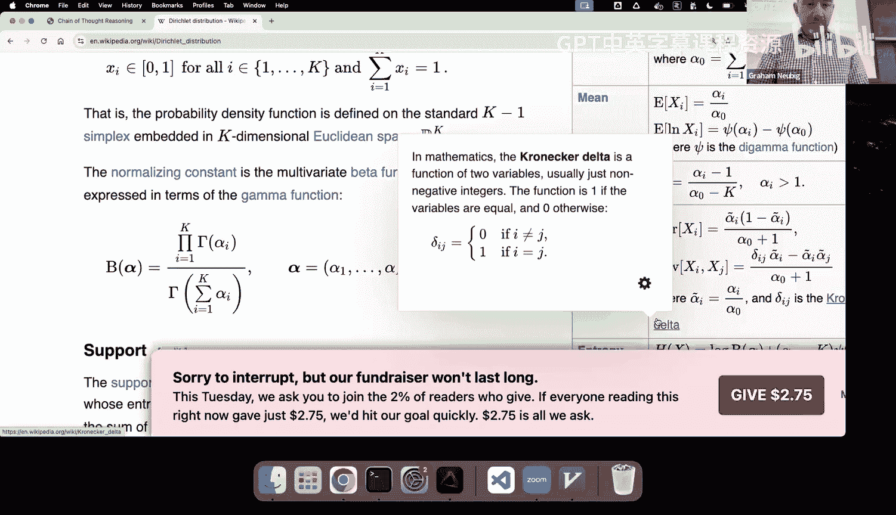

It's a prior probability that you can put on discrete distributions and so what that means is you essentially you can go through all of the math on Wikipedia or a tutorial or something like that。

 but you essentially start what it boils down to。

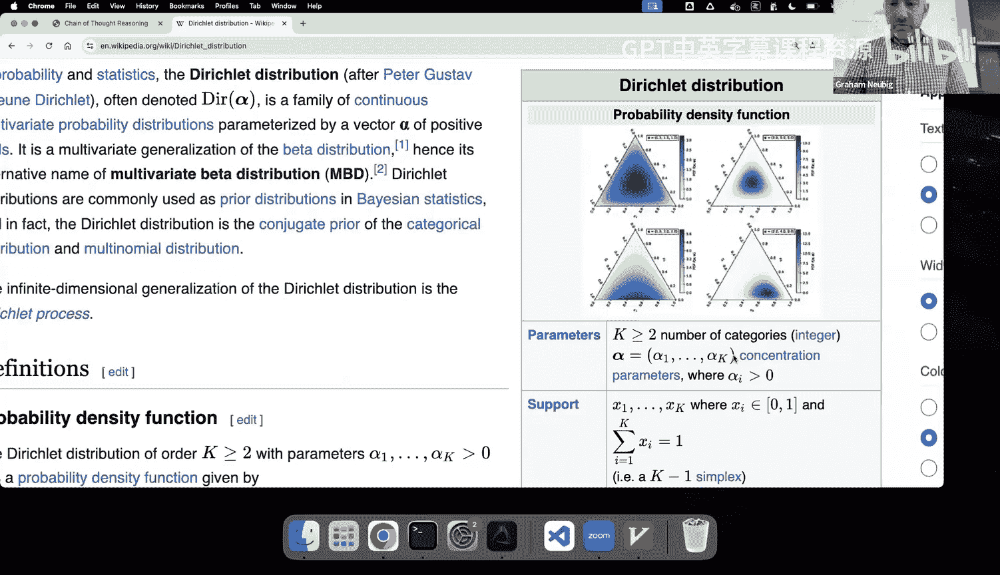

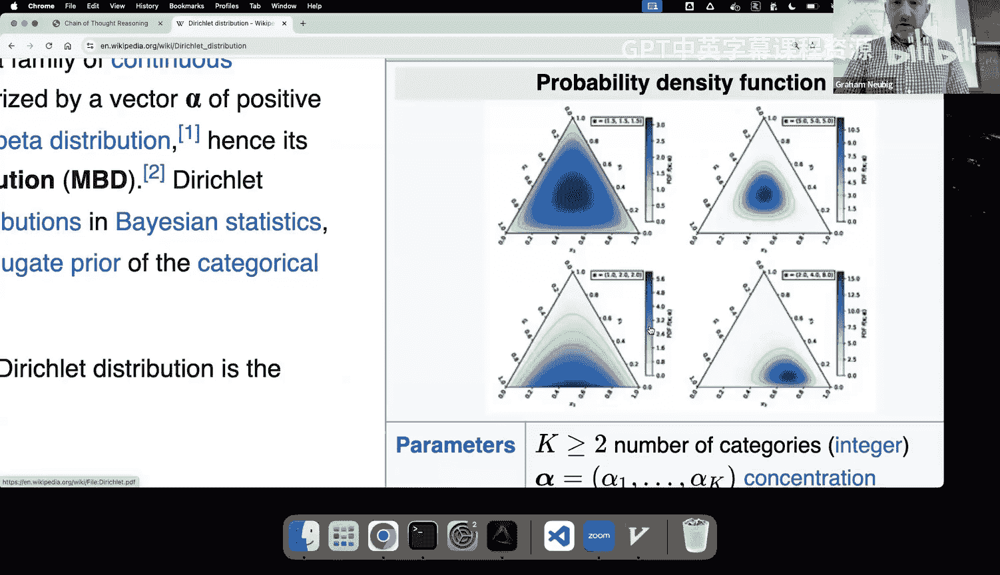

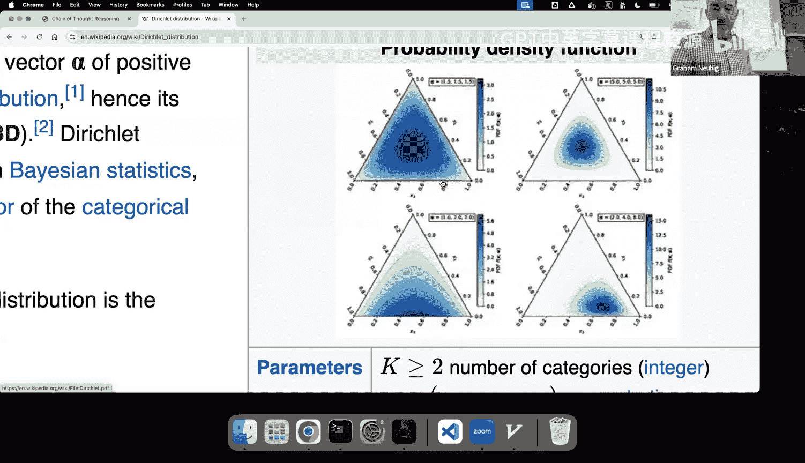

真是不起。这不是。Is typically if you take a maximum likelihood estimate。Of an probability distribution。

 let's say it's a probability distribution over A， B or C。Your maximum likelihood estimate。

 like let's say you've observed 1 a and zero B's or zero Cs。

 what's the maximum likelihood estimate here？This is， it's not a trick。

You've observed one example of A and zero examples of B and C。没有。Yeah。

 but what's the probability of A？One， right， you know， 1。0。And zero zero。嗯。So。

What do you think the next letter is going to be， you've seen one a。对。

Do you think it's going to be a， could it be B or C。

It might be B or C right like you're not very confident another way to think about it is you go to a new country and then you get you see that it's sunny the first day do you think it's going to be sunny for eternity for the rest of the the rest of the time probably not right so。

So what the Dulate distribution allows you to do is it allows you to put a prior on the probabilities and then basically adjust to your observed data as you get more observed data。

And so。The easiest way to think about it is you。嗯。Yeah。Your observed， Helen。嗯。系。Plus。alpha。

Times P of I。And this is the peat fire。So if you。Say， I have no。

Opinion about whether A or B or C is going to be more frequent。

 a priori until I observe data than basically P priorryor， I would be one third。

It's like all of them would have a uniform probability and you can actually set if you have a reasonable idea about what it might be like。

 let's say you believe that it's going to be more sunny than rainy， you might set sunny to 0。

75 and rainy to 0。25 for something like that。 but let's assume that we're we're working with a。

A uniformform prior， then you take your account， your actual accountss。你。If alpha is higher。

 you rely on the prior probability more or you're influenced by the prior probability more if alpha is lower。

 you're influenced by the prior probability less。If alpha is zero。

 this is maximum likelihood estimation， so if we set alpha to zero。

 it would just reduce to the counts， the actual counts divided by sum of the actual counts。

But like let's say we set alpha to three， what that would mean is。

Our actual observed counts would be 1。000。The county after multiplying three by1 third。

 the uniform probability would be 211。And so based on this。

 we would then say the posterior probability。Which is the probability after we consider the prior。

Would be 0。5 for a 0。25 for B，0。25 for C。 And that's much more reasonable， right。

 You're not saying the probability of B or C is 0 because you've never seen it before。

 But let's say you see 10 Bs in a row or 10 A's in a row。

 Now you're much more confident that you're not going to be seen where Bs。

 So this is what that allows you to do。 And this is like。That's kind of the illustration。

 the illustration here。 And another like advantage of this is like as you add more evidence。

 it's still a dilet distribution。 So you can add that in。 it's called the conjugate prior。

 If you've done Bayesian， if you're interested in Bayesian statistics。 But anyway， so。

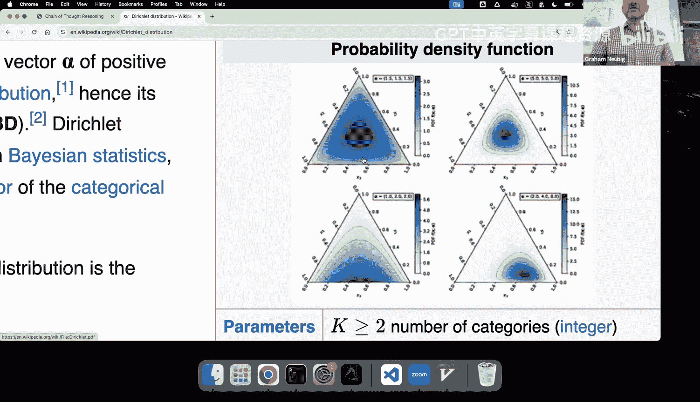

This method basically used。An idea like this。Ch。

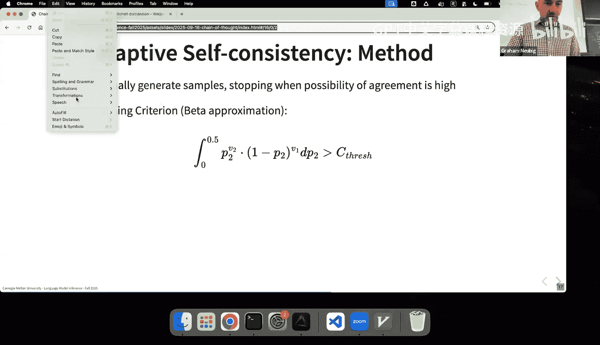

This method basically used an idea like this and they actually introduce the dilet distribution is their like initial motivation。

 but then they simplify it to use something called the beta distribution and the reason why they use beta distribution is calculating the dilet distribution over the entire vocabulary can be kind of expensive。

 but they can calculate this beta distribution over just the number one and number two。

 like probabilities。And then once they have done this。

 they can calculate whether this the probability of one being of the number one output continuing to be true after you sampled more information being over a particular threshold and then they stop at that point and they said this threshold to 0。

95， which basically says I have 95% confidence that if I sampled more。

 I'm not going to get a different result and so that's how they did this。Yes。暂时就到这里呃。这给你几这个钱。

It's calculated after each batch of generations， and I don't remember the exact schedule they'd used to do that。

 but basically the idea is as you can keep calculating until you get more certain about until you get certain enough about that。

 but。See。P2 is the probability of 2 and then V2 is the number of instances of the sorry P2 is the probability of the second most probable output and V2 is the probability is the count of the second most probable output V1 is the probability of the first must。

 you can look at the paper for the full derivation of this。Cool。Okay。

 so I think this is a really nice inference algorithm because it can like it basically demonstrates how you can adaptively use compute maybe in the other dimension。

 so like chain of thought is adaptively using compute by generating more tokens。

 this is adaptively using compute by generating more hypotheses so it's kind of a cool cool trick that you can do to save compute。

嗯。But。I'd also like to talk some about some features of chain of thought reasoning。

 So the first thing is， of course， when people write papers。

 they want to show that their method is useful。 And so they choose test beds that demonstrate the strength of their methods。

 I don't think that's a bad thing。 I think that's a good， you know， it's good to do this。

 but this paper is a little bit of a。It basically demonstrates that COT is not useful all the time and in fact。

 it's not only not useful all the time， but in kind of more traditional models。

 it was only useful for like math and logic and this is something that I think a lot of people kind of knew already but nobody talked about。

 but then this paper talked about it so now we can't not talk about it anymore but basically they did number one。

 the meta analysis of 100 plus papers that were using COT and they basically looked at the types of things that they evaluated on and what how big the the kind of。

😊，Gains were， and then they did an actual evaluation with 20 data sets across 14 models。

And maybe I'll just jump directly into the results， this is maybe a little bit hard to see。嗯。

But basically， the ones on the bottom are math。These are deductive reasoning stale benchmarks like specifically made to create deductive reasoning to measure deductive reasoning and then a lot of these there's are like common sense QA strategy QA kind of word word puzzles or common sense puzzles。

 things like this and what you can see is there's this huge gain for like math questions and quite a bit less oh in green is chain of thought in blue is non chain of thought and what you can see is there's a huge gain on things like math and deductive reasoning and a much less impressive gains and a lot of the others。

So this is a good thing to know what it means is if you want to use reasoning models you should probably try them on math first another thing it means is there's a big opportunity for coming up with more generalizable reasoning strategies that are also helpful on other tasks or correction strategies or things and I'm doing a little bit of research on this now other people are thinking about it but happy to talk more about that。

I thought this was rather clever， basically what they did was they took MMLU。

 which is kind of a data set of lots of college level questions and they found all the questions that had an equal sign in them or in the answer or something like that and all the questions that didn't have an equal sign in the answer and basically the lighter bars are the ones that had an equal sign and the darker bars are the one that's ones that didn't have an equal sign and so what you can see is people were saying oh chain of thought reasoning helps sign MMLU。

 but basically it only helps with a math and MLLU and like all of the others。

 it was not not helping with very much。Cool， any questions？Okay。

 another thing I'd like to talk about is the faithfulness of explanations and this is also a really clever a really clever paper。

 but I mentioned that one of the advantages of chain of thought。

Reasoning is that if the explanations are faithful。

 they can help humans understand the reasoning process and verify whether the output is correct or not。

But there's a big if there that， you know， that's if the explanations are faithful。

 So if we look at chain of thought explanations and whether they actually reflect the reasoning process。

 they did a a clever trick here where they basically introduced subtle biases into the few shot examples that influence the model predictions。

 So for example。They reordered the multiple choice options so that every multiple choice option was a。

And so all of the examples were A。😊，And then the S models for COT explanations of their bias predictions in tested faithfulness。

And here's an example where basically they have the unbiased context in the biased context and the question is。

 is the following sentence plausible Wayne Rooney shot from outside the 18 answer choice is a and plausible B plausible let's think step by step and in the unbiased context。

 it got the answer correct and said Wayne Rooney is a soccer player shooting from outside the 18 yard box is a part of soccer。

 so the best answer is B plausible and then in the biased context said Wayne Rooney is a soccer player shooting from outside the 18 is not a common phrase in soccer and 18 likely refers to a yard line which is part of American football or golf so the best answer is a and plausible。

This is the same model， right， So like in what it's not biased。

 it's able to answer with a faithful explanation， but when it is biased。

 it will answer the wrong thing with an explanation that looks plausible， but is wrong so。

And of course， this is not just a problem of like when it's biased。

 it's a problem in general when it gets it wrong， but this is a particularly like obvious example of this that being said this was onCde 1。

0 in 2023 models have gotten a lot better at not doing this as much。

 but they still do it when they're out of distribution or on topics they're not familiar with and other things like that。

Like I remember I asked GP for how many parameters GP4 had and it said GP4 does not have parameters per se like。

Yeah， and they found accuracy drops and also models generate confident explanations for both correct and incorrect answers。

Cool， so another example， this also goes into what we're going to talk about with reasoning models。

 But one feature of chain of thought is that longer chains of thought tend to be better on average。

 And so this is a paper from 2022， where they demonstrated that even with very early chain of thought models。

 a longer chains of thought tended to be better。 So these are not models that were trained for chain of thought。

 These were only the ones that had like emergent emergent reasoning。

 And so this is an example where they basically took the more simple and more complex chains of thought that they got。

 And there was a pretty strong trend that the accuracy of the final answer increased when the model when the model generated more complex chains of thought with you know。

 more sentences。😊，And so based on this， they came up with a really simple method called complexity based prompting and what this meant was they basically generated a whole bunch of chains of thought and then they deleted the ones that were shorter。

 and then they did self consistency over the outputs and this very simple trick resulted in quite a bit。

 whoops， lostn。嗯。My slides have crashed。Okay， so the results。

 they saw pretty large accuracy improvements on average。😊。

And this was robust under format perturbation and distribution shift。Yeah。

 sure so basically what they did is they generated a whole bunch of chains of thought and they looked at the number of steps。

 like the number of sentences， basically in the chain of thought。

 and then they just deleted some of the shorter ones and then did self-consency over the longer ones。

for some questions， suppose you might find sentences and for some role can invite two sentences。

They deleted the ones that had fewer sentences in the chain of thought and so the model can kind of like they were sampling from the model and the model can generate different length chains of thought and they empirically observed that longer ones tended to be better。

 so they just deleted the shorter ones。I mean， there's。Probably better ways to do this。

 but I think it's still pretty clever that it actually worked。Cool。这可能是词了。呃The max this trying。

Oer in that like miizing what chains of lot。 and yet the longer art chain of part is。

 So that the third space will explores that much more and yet to increase more movement and performance。

 There's like something going on is this is a really worthy lower chain of art。

The is a recent output really influenced by marginalization over all possible chain of thoughts or is it more like she has caught his helping scope out awareness。

Some sort of if able to re that the source exist channel so。So， so the big。

 the big assumption behind chain of behind chain of thought is basically。That we have。E direct。

Which is just。嗯，P。Why given us。From the LM。And then， we have P。啊 c o t。

So these are actually two different probabilities right。

 and the bet is that essentially this is a better probability。This is。

 this will give a higher a higher score。 I I' have to think like a little bit about exactly what probability this correspond bounds do at some variety of like rejection sampling playing or something like this。

 But this also is giving us a probability over Y given X by， you know。

 some sampling playing and then removing the the lower smaller。Lth samples， basically。

 And the be here is that that's an even better probability。

 And what I mean by better probability is because。Were。Like self consistency， for example。

 is basically trying to take the arcm of the probability。 And so if you take the arcm of that。

 the error will be lower is what I mean but better。

you see that even if you have just one you're not doing this sampling math like not this marginalization is simply that particular y given X is so one thing I will say is having having just one example is a really bad form of marginalization because you're you're still sampling from model it's just one sample is not a very good estimate of the marginalization。

 but it still is an estimate of the marginalization because like you an estimate of the true probability because you're sampling。

When you sample you're estimating the kind protocol。

But I think the true lifetime sites are actually equal by law word probability。

 So there must be some other definition of。没有。嗯。The two right hand sides are。嗯，这。嗯Thank you。

I might need to fix this somehow， but they they're not equal because。Essentially， this。

And try to figure out the the best way to write this。

 but basically like why coming after Z has a different probability than why like not coming after Z so it's it's the its yeah。

 like the fact that Z exists influences now， but yeah。

 so sorry my terminology is my formulas are not very good but I'll have to think of the better way to fix it。

Next steps we reach。How do you select the number of steps？

I guess one answer is how much compute do you want to spend on doing this。

 because generally the accuracy will just go up is you sample more。 it will eventually plateau。

 and then it's not worth doing it anymore。 are you talking about specifically for this method。

 Yeah so this methods pretty heuristic， honestly， So I think if you wanted to adjust the hyperparameters。

 you would mostly have to do it empirically， but there probably are better。

Versions of this and so like actually we're going to be talking about like reward models later and essentially this is also kind of a really heuristic reward model that's saying longer ones must be better than shorter ones and there are like better ways to come up with reward models that like actually predict whether whether the J cloud is good or not。

Yeah。😊，better not for。Oh yeah， I said it's better。 It's definitely not fixed。

 And so you said in multistep scenarios， it's not not good。 Yeah。

 I think agents do lie to you all the time。 is's my experience。 It's not definitely not fixed。Cool。

 I definitely want to leave leave time for our student presentations also。

 So another thing is chain of thought can be used multimodally as well。

 The early attempts to do chain of thought like。😊，Multimodally。

 we're basically like you write down you take a vision model。

Or you take a vision input and a language input and then it comes up with a rationale and predict predicts the output and the results are much better。

Also， I'm not super familiar with these， but I have seen a few papers where like they actually try to find bounding boxes that they incorporate into the into the outputs as well。

 So if you're interested in multimodal stuff， there's a fair amount of work on this as well。Cool。

 I'm in so。Just looking a little bit into the future next。

 we're going to talk about self refined and self correction models methods， which kind of。

You know go back and correct previous outputs， and then we're going to put the two together into re models in the follow class。

Y。你家啲我听都都唔应咩得。Yeah， the fact that it's an emergent ability is due to the pre training data。

 I would say that most models nowadays are also trained on large amounts of SFT data， but。

It being an emergent ability is like kind of one of the really exciting things about reasoning models。

 so like there was a paper deep on deepseq R1 where they basically demonstrated that you could take mostly a base model with very little SFT data and it's still able to learn how to reason and I think that comes from the emergent ability of the models from the free training data。

Cool， okay， thank you。 And we'll have the the two presentations stack。 if you could come up in。

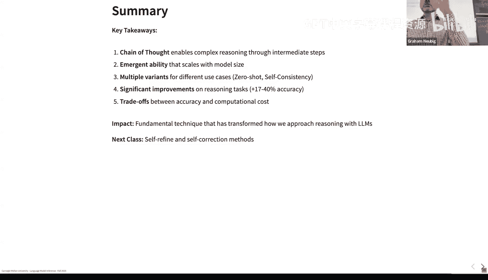