# CMU《语言建模的推断算法｜11-664 763 Inference Algorithms for Language Modeling (Fall 2025)》 - P8：-05-CMU LLM Inference (8)_ Self-Refine and Self-Correction Methods.zh_en - GPT中英字幕课程资源 - BV1xsFjz3EoQ

I think I saw that we have three student presentations today or is everyone here for that？one two。

对 maybe必的要会什么什。Okay， but that's a lot of presentations and I actually have a fair number of slides so maybe I will get started and I think more people will come in as they walk over。

嗯。So this time I want to talk about self refinement and self correction methods。

 and these are kind of like the more explicit self refinement and self correction methods and。

Last time we talked about chain of thought， next time we're going to talk about reasoning models and I kind of view reasoning models is like sticking self- refinement and self- correctionrection and chain of thought like together。

 but these are more explicit ways of doing things and they still can be very useful in a number of scenarios。

So LM generation is typically done in a single pass from left to right。

 and it's susceptible to errors in long or complex outputs。

And then if we contrast this to human iterative writing。

 you know very often you will write your essay or your code or whatever like that and then go in and you know refine and fix the details and so these methods are methods to help you do that。

In。In general， with some nuances， the self correction process looks a little bit like this。

 So it's basically。

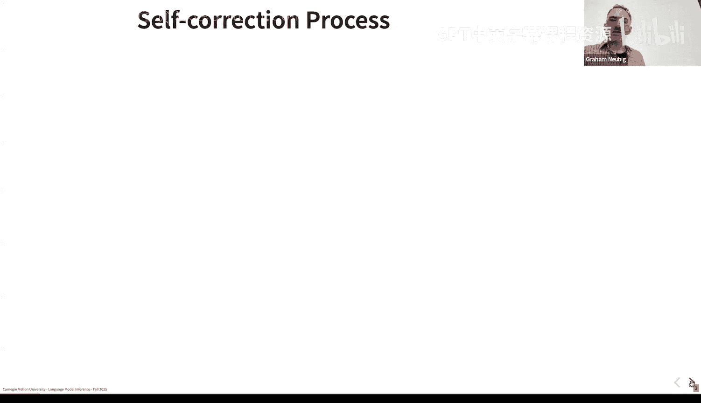

You have a self-correction loop and you have a certain number of maximum iterations and you have a stopping criterion and you generate your initial generation you step over the maximum number of iterations and you'll usually have a hard stop here so that you don't you know do this forever you have some evaluation of the input with you know some nuances about exactly how you do this or sorry of the output and you have some nuances with exactly how you do this。

 then you have your stopping criterion where you basically judge whether your critiques said the output was satisfactory or not。

And then if you didn't see it was satisfactory， you refined that like this。Nothing， nothing you know。

 that complex， but of course， the details matter here and most of the methods I'm going to introduce in this class are details of how you can get this to work。

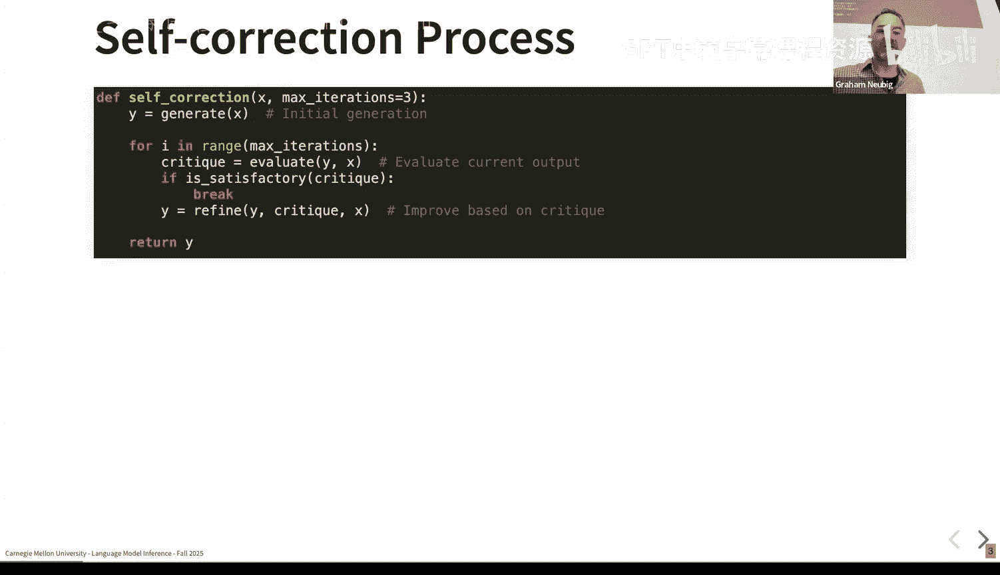

So in particular what I want to talk about is several design decisions。

 the first is for your critique， whether it's an explicit critique or an implicit critique and by explicit critique I mean you explicitly prompt the model or explicitly train the model to decide whether the output is good or not。

Implicit means that this isn't done explicitly， it's only done by having the language model itself。

 you know， maybe not generate any changes and when the language model doesn't generate any changes。

 then we judge that the output is already good enough and we don't need to make any more changes in the refinement set。

Another thing is training， so whether we explicitly train the model to be good at self refinement or we don't do this。

Another thing is what we condition the refinement step on so we can addition this on the input。

 we can addition this on the output and we can condition this on the critique itself and different methods use different varieties of this。

And finally， you can use external tools and so some of the critique methods just rely on the language level。

 some of the critique methods rely on external tools to judge whether the output is good or not。

And I'm going to be introducing seven different papers today。

 six of them are kind of self refineant methods， another one is maybe related。

 but not exactly the same。And they are these papers。We have this table here。

 I might come back to this table at the end， but basically you can see that some of them don't explicitly critique。

 some of them do， some of them train the models， some of them don't。

 they condition on various different things， they either use tools or do not， et cetera， et cetera。

So the first one I want to talk about is very simple， this is a paper that was done in 2017。

 so this was you know back when like neural neural models for language generation were very fresh and new basically。

 but the basic idea here is that you don't want to generate a single output。

 but you want to generate an output and then you want to go in and refine it。

And what they did here is they did two pass decoding with quote unquotedeliberation in refinement。

And so the first pass output， first pass generation generates an initial draft sequence。

 and then the second pass refines with global context of what the output might look like。

And so the algorithm is as simple as this。

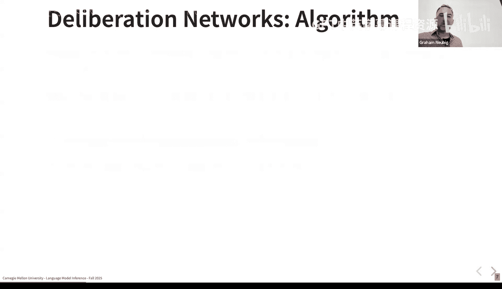

not very interesting， there's not even a for loop in it。

 but the important thing is they demonstrated that you can actually train models to be good at self refineement。

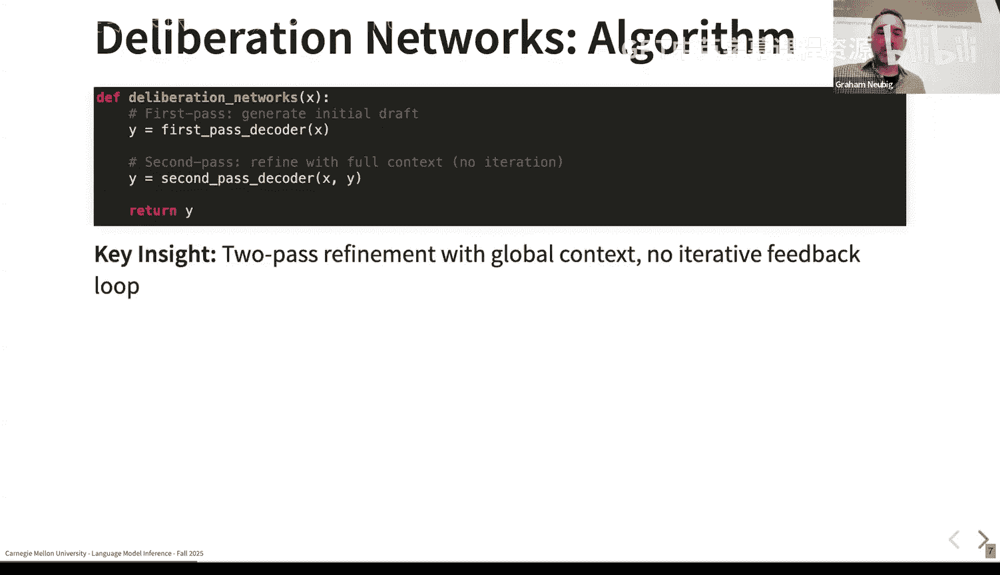

And the way they did this is they had a training objective where basically they expressed their objective as being the log probability of the final output conditioned on the intermediate output。

 so y prime is is the intermediate output and why is the final output。

And they sorry they have theta E here， this is the theta for the like encoder model because they were using encoder decoder models back then you can kind of just ignore this for now but so then you have parameters for the first model and parameters for the second model you can also like nowadays I think you wouldn't actually train two different models。

 I think you'd train a single model to be good at both these tasks but that's what they did in 2017。

So anybody have an idea what's wrong with this training objective here？

Why would this not be feasible？It conditions on the intermediate input。 Well。

 this is actually conditioning on the initial input and the intermediate input when it's calculating this here。

Any other ideas？几个几只卷。呃。GoodGood point， Can you compute the gradient is a good question to be asking。

 can you compute this function？What is the space of widepre？It is discrete， this is， oh yeah。

 actually here， maybe I should say x is your input sequence and y is your output sequence。

So how big would be the space supply pre？Infinitely large yeah so you don't want to be solving this sum right so that that is a big problem and so we need to find an alternative way of doing this。

 The reason why it's infinitely large is it's the space of all sequences yeah。Oh yeah， sure。

 So this is a model that takes in an input sequence and generates an output sequence。

 and you have an infinite number of possible input sequences， right？

And so or at least like let's say your sequences could be of length up to 100。

 it would be v to 100 V to the 100 so you can't enumerate over that。

So what's our standard way of solving this problem？SYeah， yeah， exactly sampling。

 So you sample a smaller model， a smaller number of outputs。

 and basically the way they did this is they they reformulated this。

 they sampled over the over the inputs here and then they generate the outputs。

 And if you sample a number greater than one here， you can actually see which intermediate state results in a higher probability here or a lower probability here。

 and you can bias the states。To do this in 2025 terms。

 this is basically GRPO if people have heard of GRPO it's a you know way it's not exactly the same as GRPO but it' it's an idea where you sample multiple outputs and you up the ones that give you a better reward or a worse reward where your reward is essentially this this vlog probability here yeah did you say will the inputs。

So you sample several intermediate states and then several intermediate sequences。

 and then after you sampled several intermediate sequences。

 you calculate the log probability of the output given these several intermediate sequences。你我你证 me。

The output sequence is always the same， so youre you have a supervised output sequence and so this。

 you know that could be whatever your target answer is yeah。

So we just like read something and then we just yeah and specifically they did this for machine translation so their input was a German sentence。

 their output was an English sentence， but if you wanted this to be sampling you know an output that was an answer to a question it could be the answer to the question also yeah yeah。

こ。So yeah they use sampling to approximate gradients and both were trained with a shared decoder and so they got they got good results with this demonstrated a pretty large improvement over a very strong baseline model back in 2017 which we don't care about anymore because it's not strong anymore but yeah。

 so that's a demonstration for how we can train these of course we can also train with multiple steps so we could do this you know multiple multiple steps at once。

 You could do that in a heuristic way and we're also going to talk about diffusion models which do something like this over and over again in an efficient way。

 but not in this class。The second thing I'd like to talk about is learning to model editing processes and this is a paper that I did and the basic idea is that we have a multistep editing processes and I think there is two interesting things in this paper the first interesting thing in this paper is that we were able to get data for editing processes that naturally occurs online and use that to trade models so the first interesting thing is the data the second interesting thing is the way we the way we expressed editing processes and the way we did this was not by g。

Not by just training a model to edit output text， but to train a model that actually identified like where should be edited and then based on identifying where should be edited and how like actually going in and doing the editing。

So the way the algorithm works is a bit like this， it's closer to the self refinement。

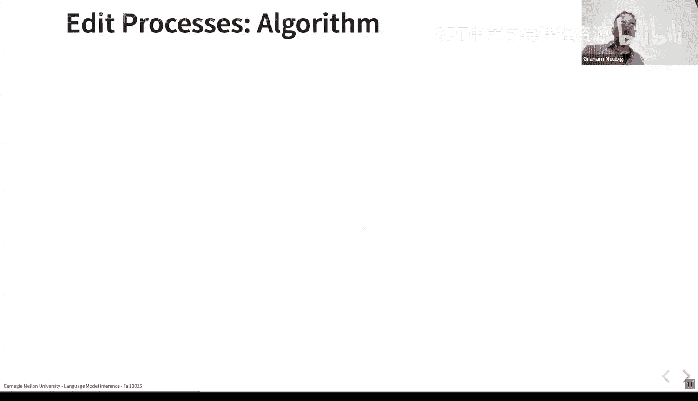

Algorithm that we had before with two major differences。 So the first thing is we have our input。

 We have our editing history。 We can。 We can start from a blank state or we can start from a null state where we have like something that we want to go in and edit。

But while we have not finished， which could be， you know predicting a null edit or running running out of iterations or something like this。

 the first thing we did was we predict edit operations where these edit operations are insert。

 delete， keep or replace。嗯。And then we generate content based on the edit operations and the history of the edits we've made so far。

And then， we have a。We apply the edits based on the generated content。

 This is a deterministic operation。 and then we。Add the edit history。

 add to the edit history so it can be referenced before。

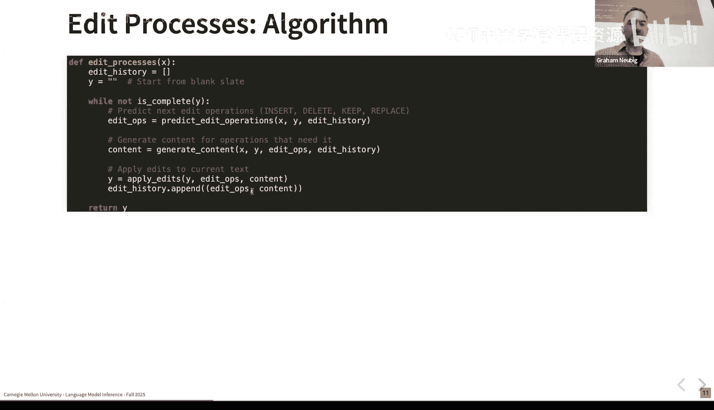

Yeah。

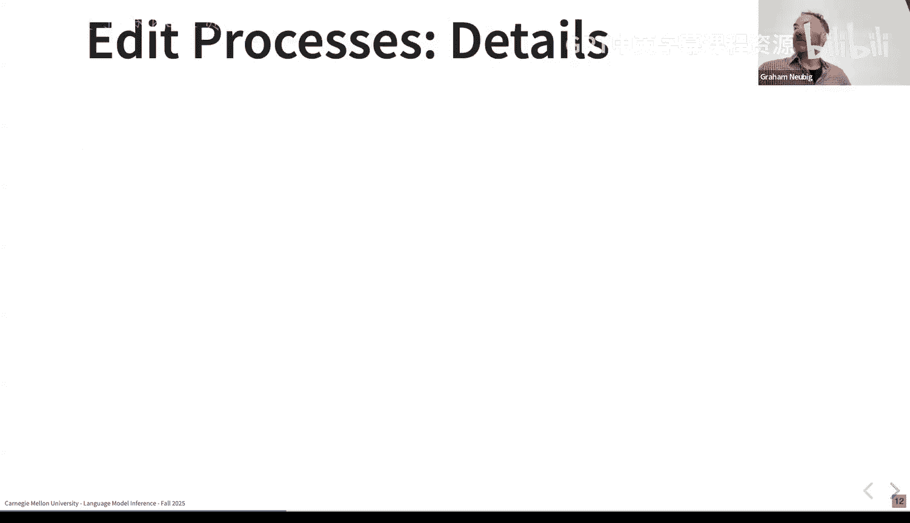

I have questions。 So does printed content only give out edit changes or does it go on like final state。

 So， I mean， I can understand the reason for applying。Yep， I'll have a diagram in the next slide。

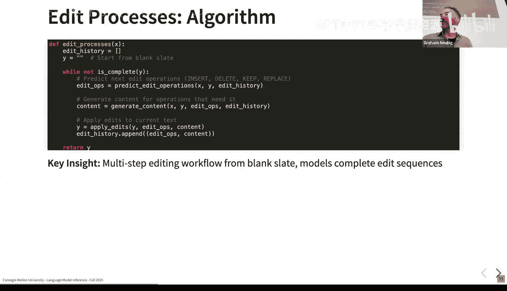

So。This is the core the core way we decompose。 So we have a prediction from。

The previous states and the edit sequences corresponding to the previous states and we predict the edits。

 and then given the edits， we predict the output content。

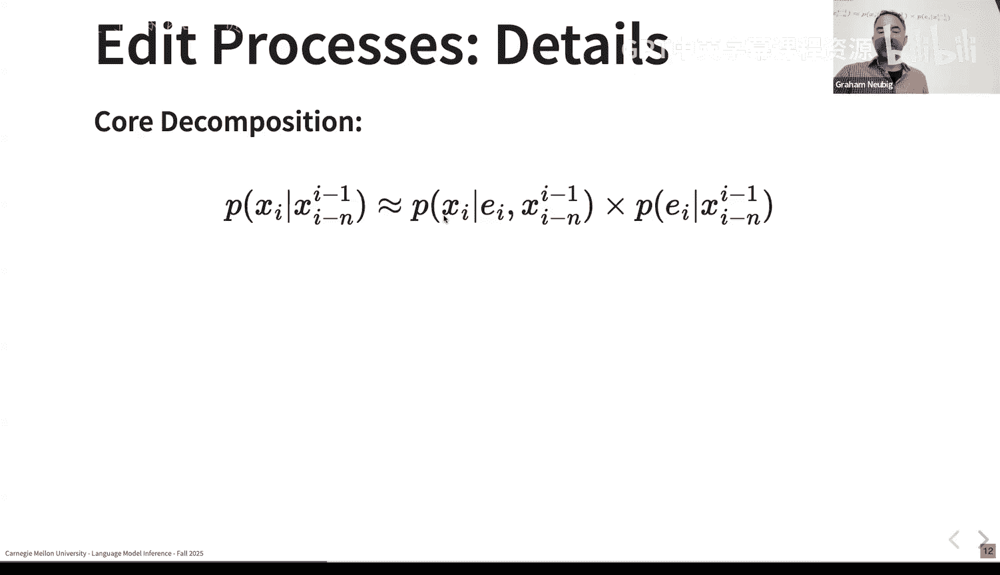

And。

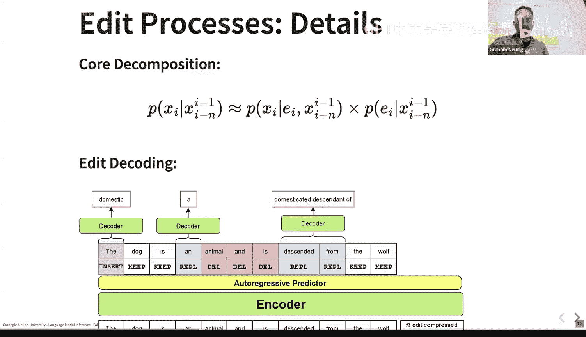

This is。So the first thing we do is we have a predictor where the predictor basically for each of the tokens predicts whether we want to insert something there。

 so here it would be like after the we want to insert a word。The other thing would be replace。

 so we want to replace this token sequence。We want to delete words。

Or we want to replace and so these are these are just it's like a token sorry cagging task that we apply to each token in the input sequence。

And then for delete delete is just deterministic， right。

 we just remove the content there for insert or replace， we need to generate new content。

 And so we were able to generate this content。 and we actually did it in a parallello manner。

 So for every insert sequence or replace sequence， we then you know。

 conditioned on the representation here and generate it like domestic or or domesticated descendant of。

 And so once we have the insert replace and delete sequences and the outputs from the decoder for each of the inserts or replace sequences。

 we can deterministically generate the domestic dog is。😊。

Domesticated descendant of the wolf like that， right？And so this is also really。

 really nice if you want to edit a really long document over and over again。

 because you don't need to actually generate each token here。

 you can just do a single pass to predict all of these tokens using a tagging model which is a lot faster because you're just doing encoding and then you can generate shorter sequences。

Yeah， the maybe the action。The E or the edit actions E also contains for inserted。

 replace the token that is supposed to replace it with。

It we need the extra condition of X I U and E that if edit side they。

And we know what the excile would be given X here。So the edits are just these tags。

 so you don't yet know these words up here when you predict。こ。Yeah， been generating a bit are we in。

Just end of sequence token。So we generate like domestic and then end of sequence。

 so it can generate as many tokens as it wants。嗯。So。

We the other thing I mentioned about this is we created two data sets。

 The first is Wiki revisions and code revisions。 So Wiki revisions was a data set from Wikipedia data and。

Interestingly， Wikipedia has all of the revision history right so you can go and actually see how Wikipedia was edited for code revisions。

 this was from Github。 and similarly， you can see how the code was edited on Github。

 So we we got this and we also did experiments where basically we just tried to predict the edits。

 Given the current。😊，Given the current。State of the text or code and an editing intent。

 So the editing intent comes from the the commit。Like the text that was along with the commit or the description of the change on Wikipedia。

And so that's the single order thing。 And this was our overall perplexity for making the edit。

The we also tried the thing where you looked at past edits and you tried to。

You tried to predict based on past edits。 And interestingly。

 this demonstrated that if you reference past edits， you can also， you know， predict future edits。

 So you can see that if this part was edited before now， this part will be likely edited again。 And。

 you know， it kind of makes sense because on Wikipedia，1。

 one thing we found a lot was like basically。对。Edit wars like spam spam wars where people like added spam and then the spam got deleted。

 So you could actually predict that that spam was going to be deleted afterwards。

 So it allows you to predict future edits more more easily。Cool。

 so this just demonstrates that there's you know like alternative ways to do modeling of editing processes。

 and I also wanted to introduce that like data creation methodology in case it's like interesting or insightful for any of your work。

嗯。Another thing that I'd like to talk about is learning to represent edits。

 and this is another paper that I did together with a student here at CMU。

 and the basic idea is that you can learn to represent the types of changes that are made when changing between different sequences。

And。That's a little small。 Let me make that bigger。 but the basic idea is that we have a we have two。

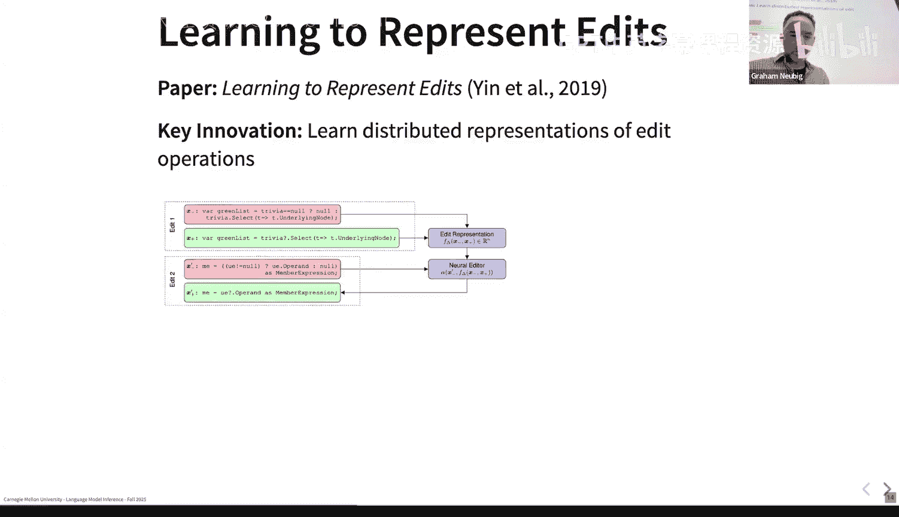

Like an input in an output， and based on the input in output。

 we get a single like vector representation of what type of edit it is。

And then we have another similar input in output， and we feed in the input and that edit representation to try to generate the output。

And so this can be trained。

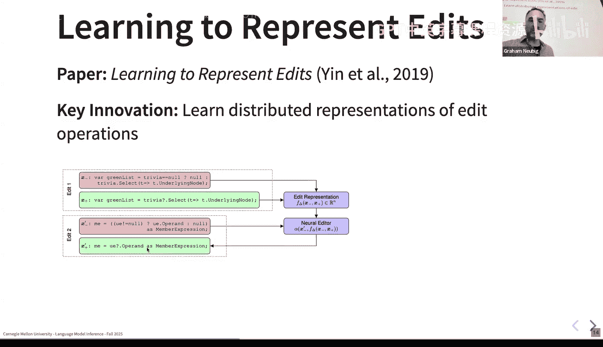

So this is essentially what it looks like。 You know， we have a source in a target we have in。

We have an edit vector edit encoder， and then if you have a new source。

 you can then apply this edit to a new source if you want to。

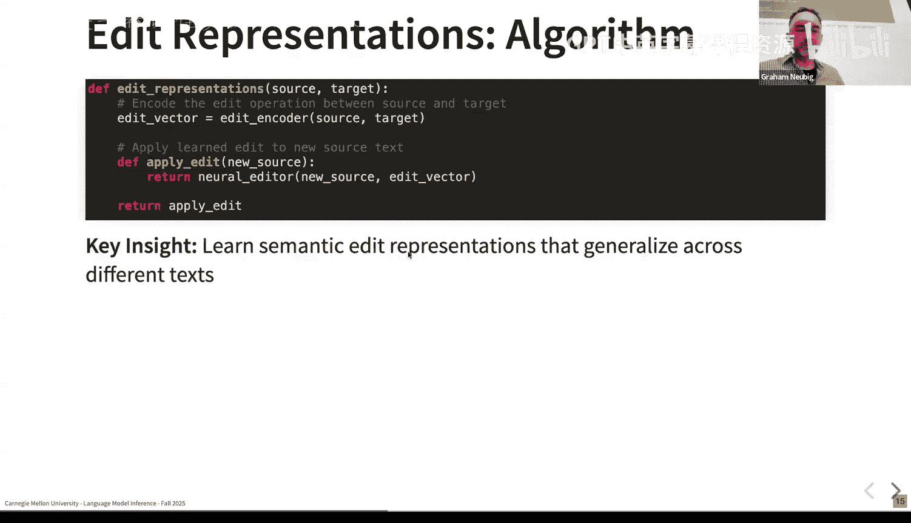

But the details are pretty simple， you can ignore the you know。

Particular type of edit encoder we used， it could be any variety of edit encoder。

 but now I'd probably just use a large language model with the two things fed in and fine tune it。

But the important thing is edit representation is limited to 512 dimensions and the reason why is we actually want to learn a good representation of what type of edit this is as opposed to like memorizing everything that was done so we basically like limited the size of the dimensions here so that we would actually be able to learn you know a representation of the edit as opposed to is opposed to just like memorizing everything。

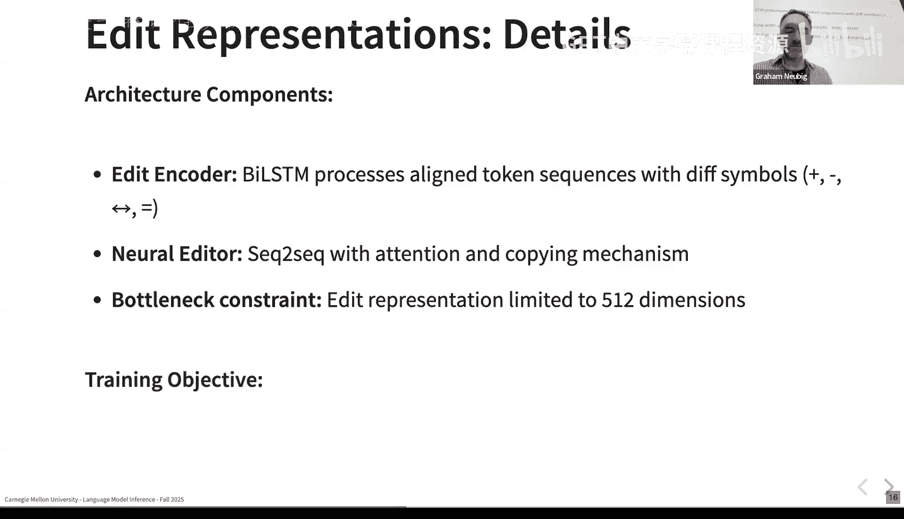

And the training objective is pretty simple。it's a kind of like auto encoder style objective where we learn the edit representation from before and after。

 and then conditioned on this edit representation， we calculate the probability。

 the log probability of the after token here。Does it make sense？Yeah， sure。

 so we have a encoder that encodes before and after into an edit representation and that edit representation is basically a 512 dimensional vector。

And then based on that 512 dimensional vector， we feed in the before token and that 512 dimensional vector。

 and we calculate the log probability of after。And so what that means is we need to like smooush as much information as possible into that 512 dimensional vector to tell like the model what sorts of edits it should be doing。

Yeah， is the encoder and trained jointly or they are trained jointly because you can see that both of them will affect the likelihood。

 this will affect the likelihood because it's this the output of this is condition on this and it's all different。

过。And so the way we。Primarily evaluated this was not based was not based on whether it was a good editor or not。

 but rather based on whether it was good at picking up similar edits that were made and we compared this with a bag of wordss model and we got much higher accuracy on like a data set of similar edits and we had some you know tricky stuff in the paper for some context。

 this was done by the Microsoft like code analysis is an internship with the Microsoft code analysis team and they wanted to pick up like similar kinds of edits that people were doing on GitHub so that they could say。

 oh like these are all the like。Fixes of a security a particular security vulnerability or something like that。

 So we we came up with a pseudo data set where we applied different kind of like code transformation tools and then tried to see whether it did a good job of identifying similar code transformation that were created by these tools。

But yeah， it's not limited to that application， of course。Cool， any questions about that？Okay。

 so that sounds good。 in particular， I would， if you're interested in。For instance。

 reasoning reasoning strategies or something like this like the stuff that's。

 you know very popular nowadays， I could definitely view this as being a tool to analyze the types of reasoning strategies that are performed。

 for instance， by encoding encoding each step and then predicting the next step， for instance。Cool。

 okay， so next I'd like to talk about self refine fine。 So this was one of the first papers。

On kind of self refinement with large language models in a training free context。And basically。

 what it demonstrated was that you can use large language models to essentially critique their own inputs and。

Criitique their own inputs and generate better outputs as a result。And。The idea is very simple。

 You know， you generate an output， refine it and get feedback。

 So the algorithm is is essentially exactly the self correction algorithm that I showed you before。

 nothing nothing particularly。

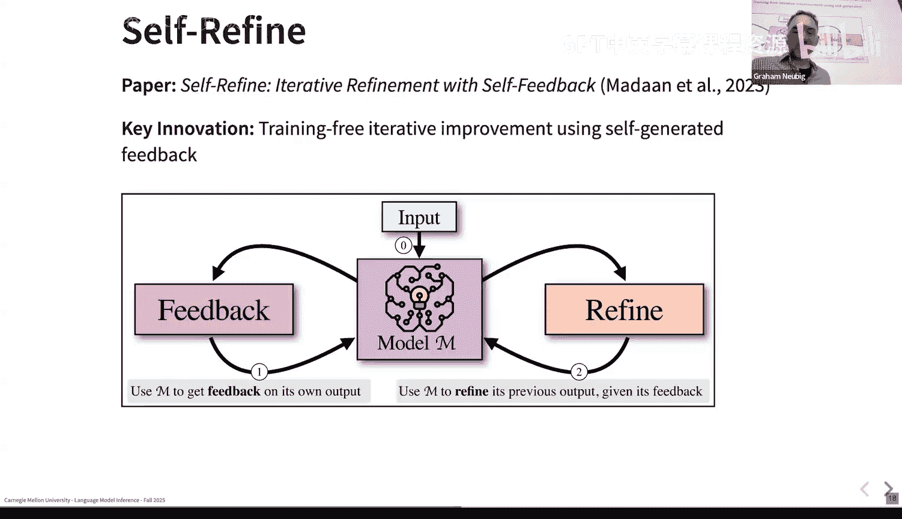

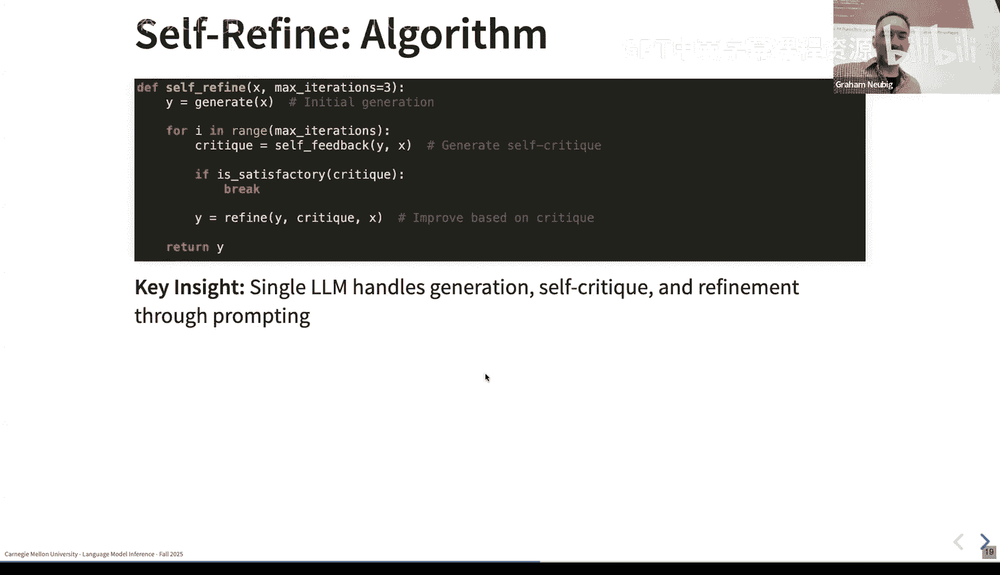

Like fancy here。But they， they did this all in a prompting fashion。 So they generated the output。

 standard F shot prompting with a few test specific examples。 They generated feedback。

 So their prompt template for this was why is this out， why is this output not， you know。

 correct or not fluent or whatever quality you wanted。

that would identify like specific areas of improvement。

And then they had the refined step where they essentially combined the original input。

 the current output and the feedback and。Said you know。

 improve this output based on the feedback and then it would generate the output and the stopping criterion was they had a simple heuristic checking for positive feedback or a fixed number of iterations。

And this was all done through a single L1。So the results were interesting。

 I would say the there's a few good results， the first result is that it helps a lot in some particular cases。

 so it helped in like for instance， improving the readability of code improving the you know。

I forget dialogue response was like friendliness， friendliness or sentiment of the dialogue response。

 changing the sentiment of outputs and other other things like this。

 notably did not help is much on mathematical reasoning。

 which is something that people are very interested in nowadays so I would say that one thing to note a little bit here is that all of these tasks are not super major tasks that were really hard for language models。

 they're kind of like tricky tricky tasks and I think the reason why is because there's certain varieties of tasks which we'll talk about like in a little bit where models they're not like numeric tasks but they're models where theyre task where the model has not been like trained to be really good at them and those are places where。

Self improvement without any external tools tends to be the most helpful。嗯。So this is very。

 very straightforward。 Oh， another thing is they demonstrated that there were greater improvements for stronger models。

 So like G4 got better results from self refinement。

 So this was interesting in the paper they said bigger models do better。 I think in reality。

 it's just like stronger models do better at this。 But yeah， that's another interesting finding。😊。

Cool， so another one that I would like to show is self debugging and again。

 this fits the general pattern。 This is teaching large language models to self debug。

And the basic idea is that unlike self refine where they and like actually all of the others that I talked about before。

 where they solely relied on the language model to improve the outputs。

Here they started introducing external tools。And specifically。

 they introduced code execution where you can do code generation。

 you actually execute the code to see if it passes unit tests or something like that。

 you get an explanation and feedback， you get an explanation from the unit test。

 you get create feedback， and then based on that you feed that back to the model to improve the outputs。

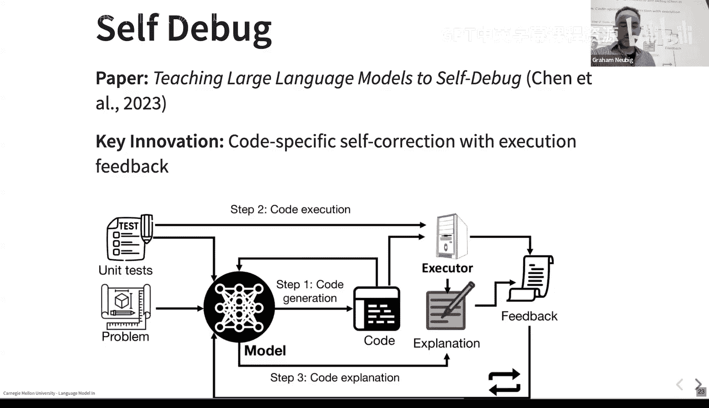

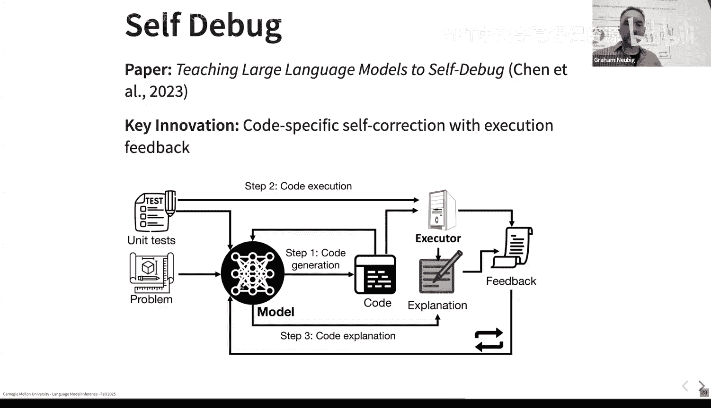

And so it looks a little bit like this you get you actually add a code execution loop in here if all the unit tests you have passed then you're done and you're happy if not you ask the language model to explain the error and then based on that you refine the critique so this is introducing an external signal。

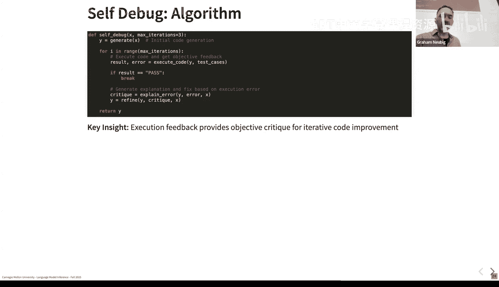

So。有。做有个。

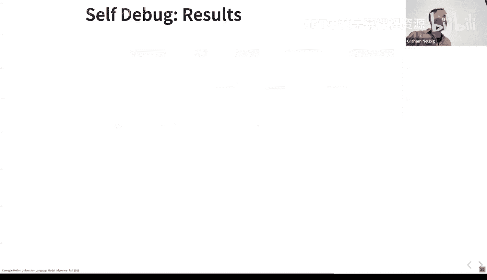

example why not just pass the stack trace back to the model that's a good question I think maybe they wanted to condense it down to be smaller again。

 this was like a paper in 2023 and it might be the case that models now have seen enough stack traces in their training data that you wouldn't need to do this anymore。

 but that's what they decided to do here。

And the same model even for pretty yeah， I think so。

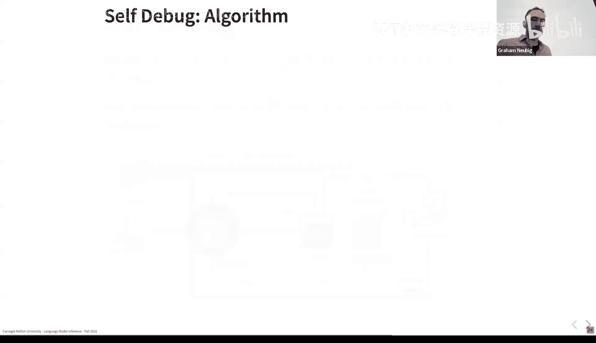

cool。

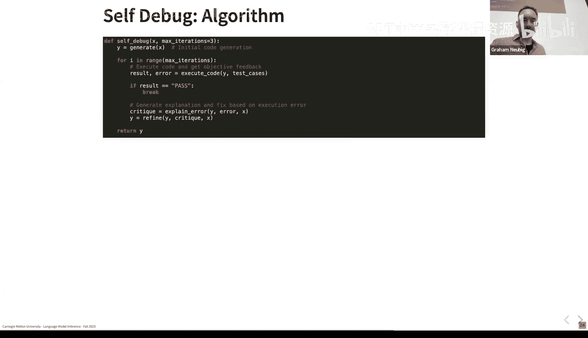

So if we look at the results， basically this was able to improve over the baseline by anywhere from a little bit to a lot。

 and this may not be you know super surprising now if you've used like language models to generate code for you。

 but this was the first result in that sort of area。

And they also found that execution feedback was really critical here and gave significant results on especially the harder tasks。

Another interesting finding is this was one of the one of the first papers that I know of where they compared。

Various varieties of inference time algorithms and so basically they also compared with self-conency and when they compared with selfcon。

 self-con， they had to sample 16 samples and then in contrast to that they did self- debugging and with self debugging。

 they only needed one sample from the model and so this demonstrates that you know if you pull in external signals or have other you know methods of spending inference time compute that can compete with the more brute force thing of expanding lots of hypotheses。

Which may be a very nice comparison for you to do in your homework， for instance。过灯。

So the next two papers are kind of just generally the in a similar direction reflection。

I would almost say this is a combination of self debugging and self refined self debugging and something similar to what we did in the learning to represent or learning to model editing processes paper。

 but they basically have。Process where they evaluate and then they have they get external feedback。

 they have self reflectionlection and they generate experience。

 which turns into memory and that can be used to further improve the LM on future iterations。

 and so this is an example you can see that like we were doing in the learning to model editing processes we are appending the critique to our memory and then you know doing loops where we where we。

Consider all the memory of the past critiques as opposed to just the current step。

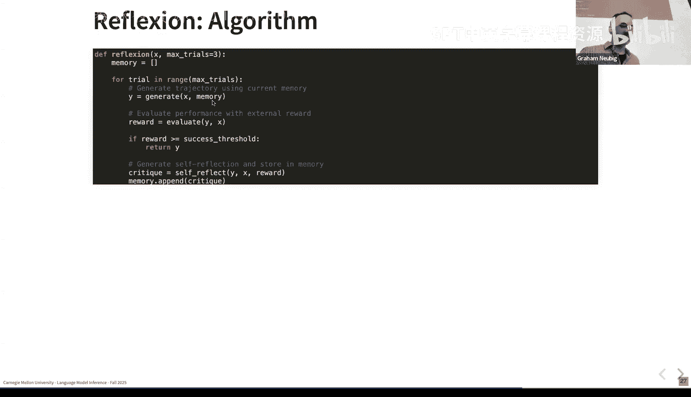

And they evaluate this on a whole bunch of different domains and demonstrate that it's quite effective。

So。This is another paper where essentially they。嗯。😊，Instead of having a fixed。codeode execution。

Pipeline， like we had in the self debug paper， we have a pipeline where the critic itself is allowed to use tools。

And so I think this is kind of interesting， the critic， when it does verification。

 it can look up things in a knowledge base or run a code interpreter or use the prospective API to check whether it's positive sentiment or use a search engine or something like this。

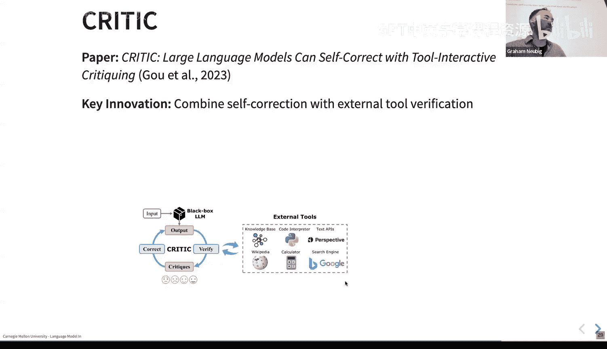

So the general idea is that you add tools during the critiquing process。And。

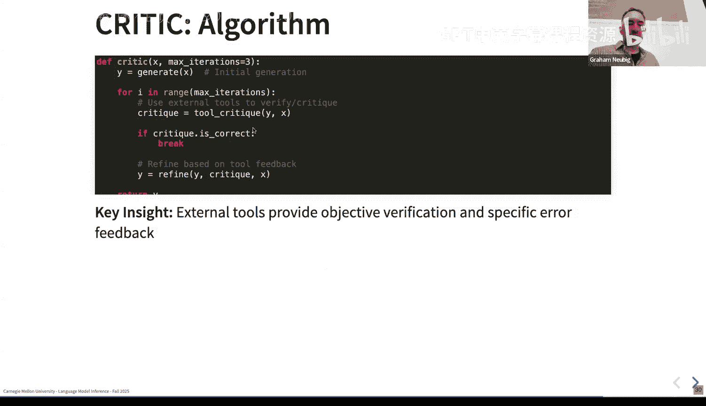

They added different tools depending on the type of task that they wanted to be handling。

And so they got quite significant improvements over you know all of the tasks that they evaluated on byincorporating tools in this way。

 so this is another another thing that you can think about as you build inference time algorithms do you want to add tools during your generation process would you like to add tools during a critique process or you know some other some other way of incorporating tools once we get to the tool use part。

こ。Any questions？Yeah。All of these workflows are visible only because the bathroom models is if you portal make some smaller models for。

 you don't have demonstrate and it to pay out。Yeah。

 it's a great question just to repeat it's like all of these workflows work only because the backbone model is very strong。

 I would say that's not the case for the first several that I introduced because those are much older papers when the backbone model was a lot weaker。

 but notably all of those methods had training involved in some way。 so I think。😊。

It's definitely not the case。 I would say that G4 is probably the first model that kind of like spontaneously had this ability to self correct without any explicit training。

 And now， you know， as we're going to talk about next class。

 we're training reasoning models so that they have this ability and compared to things like GP4。

 they're much better at self correcting So I think。嗯。Yeah。

 you'll need training in the process somewhere if the models are less powerful spontaneously。哦。Okay。

 so just to demonstrate that。You know， when people write papers。

 they tend to write papers about positive results and then every once in a while somebody comes in and writes a paper about negative results and so I want to present those as well so there was this paper large language models cannot self correctr reasoning yet。

😊，And their key findings were intrinsic self correction often fails without external feedback。

And performance can even degrade quite frequently if you're just asking it to self correct itself。嗯。

And。You know， many models struggle to identify their own errors。

 So things that are difficult for the model to。Check are also difficult things for it sorry。

 things that the models are difficult things that are difficult for the models to do or things for that are also difficult for them to check so。

And there's also a confirmation bias which for a tendency to reinforce initial reasoning。So。

They kind of lay out a number of successful scenarios where models tend to do well。

 And these are things like grammar style formatting。With external feedback。

 things like code execution and fact checking， you can get significantly improvements and it works significantly better with stronger base models like we just talked about of course。

 and then in challenging scenarios there are deep reasoning errors like mathematical proofs and logic so these experiments were run with you know models that were not specifically trained to be good at these tasks also knowledge gaps so if the model doesn't know you know a particular fact you can't really have it self-corr and also complex multistep reasoning。

And here are a few examples。For very simple math problems， it's able to do better。

 But on the other hand， for very simple math problems， it can go in and break itself。 So it's like。

It's not entirely。Like there's also not particularly a hard and fast rule that you should use it in this case and not use it in this case。

Great， so yeah， I mentioned a few dimensions。 hopefully these dimensions in these examples will be good for thinking about self-correction methods on a higher level。

 So if you want to use these in your you know class projects or your homeworks or something like this。

 you can think do I want to be adding explicit critiques or implicit critiques Do I want to be training my model to be good at these things what do I want to condition it on。

 do I want to condition it on you know a chain of thought。

 do I want to be doing it on you know multiple steps and do I want to be incorporating tools to you know clarify the outputs in some way。

😊，Cool any any questions before we move on to the student student presentations Yeah。

 why the answer to all of these things just like yes。Why don't we pick explicit with？

Fdition can as much as you can。I would say maybe computational cost so remember this is an inference class and we're going to want to。

Infer on large amounts of data and in fact your your final score on the leaderboard will depend on it so like you might not want to forrate tools if they're not necessary。

 for instance， also kind of if you think more on the industry side operational complexity so like spinning up a code sandbox is much much more operationally complex than just hitting a language model API because it's another moving part in your system and it might break or something so I'd say that's maybe another reason。

great great question though， these are like exactly the questions we should be asking for these guys。

😊，Cool， and we I think we have three presentations is everyone here okay， cool， if you could come up。

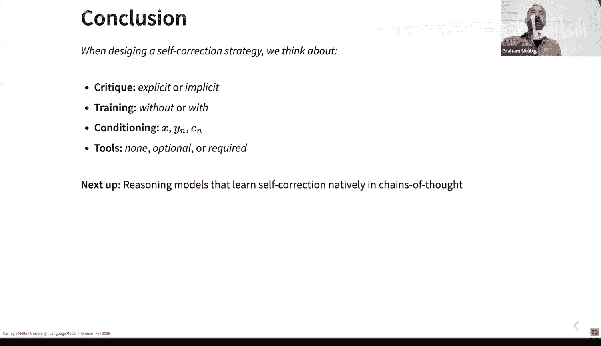