# CMU《语言建模的推断算法｜11-664 763 Inference Algorithms for Language Modeling (Fall 2025)》 - P9：-04-CMU LLM Inference (9)_ Reasoning Models.zh_en - GPT中英字幕课程资源 - BV1xsFjz3EoQ

hi everyone， sorry， we were a little late， we were discussing homework two and had to have some discussion items。

Cool， are there any questions about homework one at the moment I know we're getting close to it being finished。

对。is what？Extension， I mean， you have three days to extend if you would like， so yeah。嗯。deadlineYeah。

 I mean you have permission to extend the deadline by one or two days by using your late days。😀No。😊。

So any other ones？Yeah， last one but to the graph past findings。

 or do we have to pass it far the question put since like as far as average having face square does not have to college school or do we have to use something like co agent the real？

嗯 you。It shouldn't have to use an external library you can use。呃。

Like we talked about a number of ways of doing constrained decoding if you need to。

 you could also output'll put it in JSON if you'd like， so you can be creative there if you can't。

If you can't do that， I think it should be okay to also just parse the output and feed it out soon。

Yeah，Yeah it's annoying isn't it that we that's why we need inferencefr algorithms so like some of the stuff we some of the stuff we talked about here would would help solve those problems。

Like for water。All questions you have after submit are forward and like what I just tracking the results of。

Yeah， so for the problems where you submit the code like。

you you specify the format right everything the other so like say 2。32。

4 because nothing's mentioned except just a box like do have something kind for that or do I see？

If it asks vehicle to make your code， I think。So that's the fix there's so much important。

 no other fix。I mean if you if you're not sure I can submit it just in case yeah yeah and basically if it says submit your code you need to submit your code like honestly we're probably going to be looking at the code this time and not actually running it when we will be running the codes especially for the very last assignment and so like you need to be building up to the last assignment but we want to make sure that we have like proof that you actually did the thing so that that's why we'll have you submit the code and we'll browse through it but probably won't be running it ourselves。

Gリ we not sure to good大。是变了。You don't need to submit like models or stuff like that。

 so please don't please don't upload 132B or stuff like that together with your code。

 but we would like to see the code。Cool， any other things？Okay， cool。

 so now I'd like to talk about re models， so yeah let's get started。

So what do I mean when I say reasoning models？Essentially。You could argue about definitions。

 but the definition that most people use nowadays is a model trained。

 usually using reinforcement learning to leverage long chains of thought。

 to perform better on particular tasks and these long chains of thought the it's not just that they're long。

 but they have。particular properties and I'm going to talk specifically about those particular properties later in the class。

 but their extended reasoning sequences， they have traits like self correction。

 so it's like going back and reexning previous you know assumptions。And in general。

 with reasoning models， longer sequences are correlated with better performance。

 and so I talked about even short chains of thought you know longer sequences tended to be correlated with better performance。

 but that correlation is you know even more pronounced for reasoning models。And typically， but again。

 not always these are trained with verifiable rewards， and I'll you know。

 talk about the difference between that in a second。

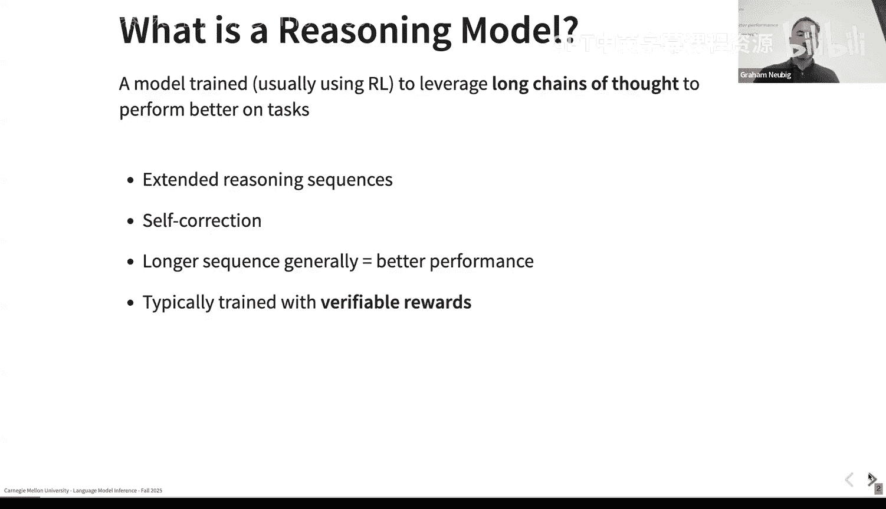

So the first paper that did this kind of from the point of view of LLMs is a paper called Star and this and all of these are in the references。

 but basically the idea of star and you know other similar models is that you have a question。

 you run it through the language model， you generate a rationale in an answer。

 and the rationale is essentially your chain of thought。And given the answer。

 you run a verifiable reward and check whether it's correct or whether it's wrong。

And the most typical verifiable reward is either math or code。And in the case of math。

 this means that you extract the answer to the math problem， you know。

 often it's written in the latex like boxed， you know。Command and you check whether it matches。

This is。Generally pretty simple， but it also can be tricky like what if you say 500 centimeters or 5 me。

 you know， those are equivalent， but you would need to know that in order to check to make sure it's correct。

 but in general， you know it's much simpler than checking whether free form text is correct。And then。

One thing that they did in star， which isn't necessarily done in other reasoning models is you have a wrong answer。

 If you get a wrong answer， it would then give a hint， So it would basically give the correct answer。

 You would run that through the language model。 And then the language model would generate a rationale that matched with the answers。

 So this is an extra thing that was added in star， but actually as an added in all language models nowadays。

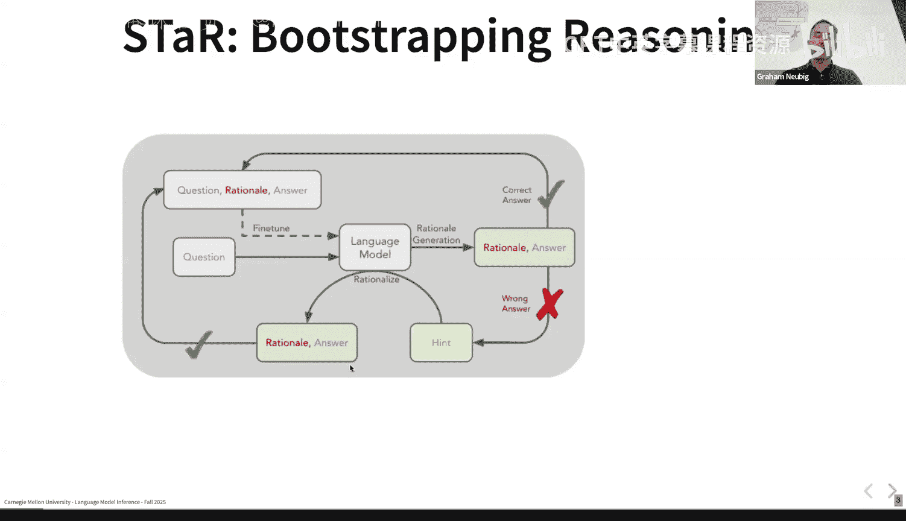

So I kind of went through this already， I guess， but like generate answers in rationals。

 filter correct chains based on reward， if correct， keep the full chain， if incorrect。

 generate a rationale given an answer， and then you fine tune on the filtered data。

So this is kind of reinforcement learning， it's you know very close to reinforcement learning or even maybe a particular variety of reinforcement learning where you roll out。

 you get results in U。So another way to think about it is through a policy gradient objective。

 do has everybody heard a policy gradient or some people？Maybe maybe most people。

 but basically the way the way a policy gradient works is you。You get a reward。

And based on the reward， you essentially multiply the。

The gradient of the log likelihood of the output by that reward。And so this is。

The general form of policy gradient algorithms and the most famous one is reinforce。

 there's a lot of variance on this。 You could almost argue that GRPO is also a variant on this And we'll talk about GRPO in a second。

 but this is like the most simple version， it's basically like if it's correct。

 you get a reward of one。 if it's incorrect， you get a reward of zero。

And so this will discard gradients for incorrect reasoning shades。So this is you know really simple。

 but they demonstrated that even you know three years ago or so this works。

 and so they tested a relatively small model GPTJ 6B and arithmetic common sense QA and GSMAK so arithmetic is an arithmetic data set Common senseense QA is just QA and GSMAK is kind of grade school math problems。

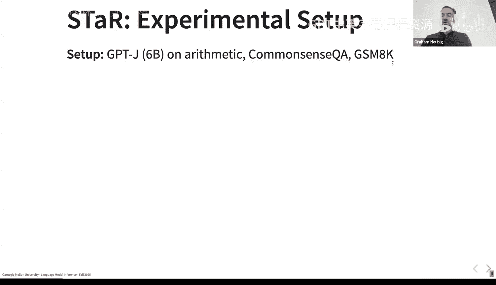

And the format that they took here was kind of interesting。

 they basically started out with a small amount of examples in this format。

So the input looked like this and the target looked like this and they had this scratch pad and so for the scratch pad basically they took this。

They checked how much you would carry， so basically this is9。9 plus4 is3 carry1。

 and then you would have two plus 5， which is the one in the middle。

 And so two plus5 plus carry1 is 8， and then you would have0 and do this。

 And then8 plus a plus3 or 883 is the final answer。

 And so this was like a very structured way of representing reasoning。

 and they actually generated this in a rule- based fashion to kind of like seed the model to be good enough to later be able to be trained using Rl。

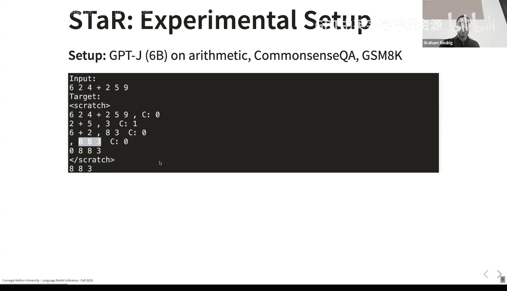

🤧And。They demonstrated that。You could train the model quite well on one digit edition with without rationalization。

 but with rationalist。Without rationalization， things like three digit and four digit just didn't work as well because you had very sparse rewards where it wasn't good at。

 you know。It wasn't able to get enough of the five digit edition ones correct in order to add them to the training data。

 but if you added rationalization you see a much faster uptake of like how well it is able to do the longer problems and one thing I should note is here the iterations is for。

Iterations  for is here。 So like that axis is actually different on these two figures。

 But you can see that the。It does a lot better when you generate the output based on hints。

It does the door。They the sames with actualization better or it So yeah。

 that's a great question So you see that this five is kind of plateauing。

 I actually wish they had brought this out farther so we could see that but I think indeed it is plateauing earlier and this is going to be a common theme in reasoning models actually which is if you kind of like oversupervised reasoning models they bootstrap a lot faster。

 but then they end up plateauing at a worse place than if you train them purely with reinforcement learning。

不是。Oh， these are different digits， like the number of digits in the addition problem。

And so like just just so I can get termno rationalizing reference inserting with the rationales。

 right？Correct， yeah， it's the bottom part of that， the figure that I should。

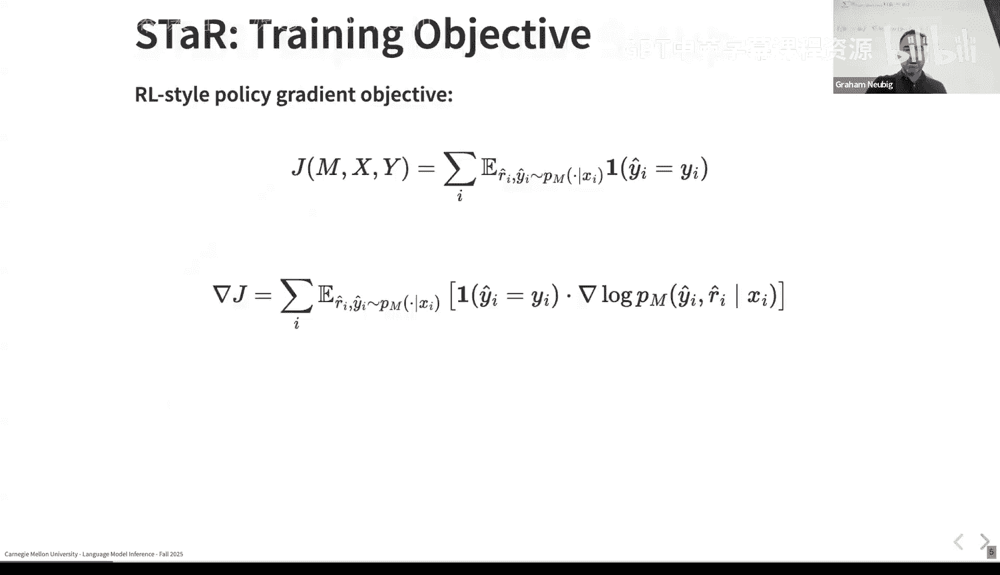

对。Only the bottom part， not the top part， top part just happens so without rational it's only doing the top part。

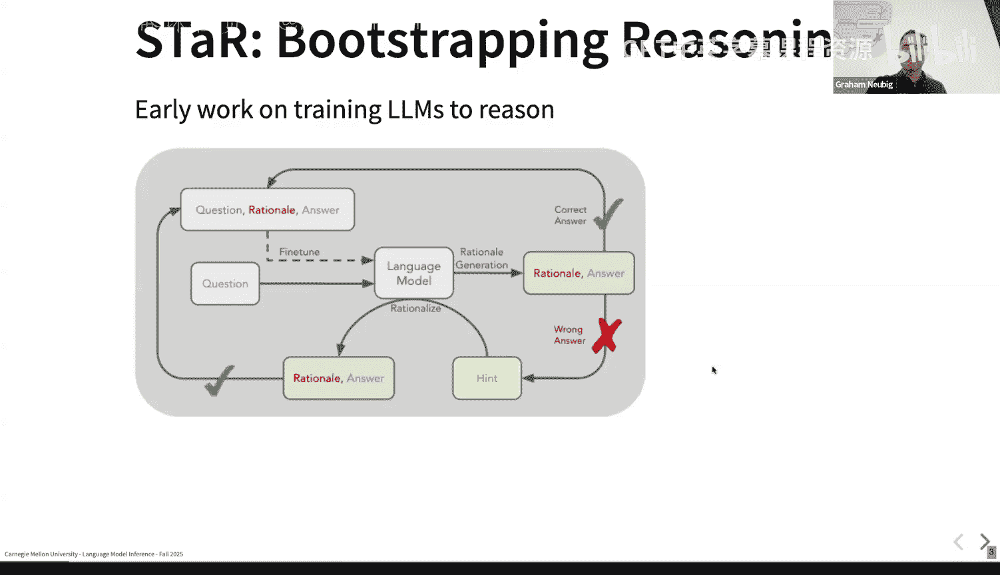

对，Y。过。So yeah， this was a very early attempt at doing reasoning models。

And it kind of seeed a whole bunch of， you know follow up work。

 I'm not sure which came first Open AIs reasoning model efforts or or this。

 but I feel like certainly it contributed to deep CR1。

 which probably a lot of people have heard about but basically deepCR1 was a reasoning model that was trained with large scale reinforcement learning directly on the base model。

 and one of the big kind of interesting in possibly you know even checking things is they did know supervised fine tuning at all first。

And。They they trained it using pure reinforcement learning objectives。

 so no like rationalization or anything like that， using an objective that they call GRPO。

And they also had a multi stage pipeline where they they started out with nothing。

 did RL and then based on the RL， they grabbed a whole bunch of successful trajectories and then they trained SFT model on the successful trajectories and then they did RL again in the end so like they both tested out with doing just like cold start RL where they did you know no supervised fine tutning first and then they also attempted one that did supervised fine tuuting first。

So the GRPO objective has become very popular basically because of this paper。

 but also because it's like just a good idea in the first place and it puts together。

Like when I saw this objective， I didn't think anything was new about it。

 It's not like a particularly new objective， but it combines together a lot of existing good ideas from R L。

 So it's very worth knowing about。So the basic idea is you first generate outputs in a group where the query is the same。

 so the input for all of these outputs is the same and for each one of them you get a reward。

 so you have all these outputs and you have a reward。

And then you use group statistics to compute an advantage function and an advantage function is basically like。

 how much better is this output than some other like comparison。And。

There's other meanings for advantage function also。

 So an advantage function can also be like you have a value function or something like this。

 And then you see how much better a particular output did than your value function。

 which predict predicts。 But the way they calculate the advantage function here is the advantage function for the Ih element of this is equal to the reward minus the mean of all of the rewards in the group divided by the standard deviation of all of the rewards in the group。

And so what that means is essentially。That。You're seeing how much better this output did than all of the other outputs in the group。

 and then you're normalizing by the standard deviation。Pretty clear。Okay。And so。

Then you have this kind of scary looking gloss， I promise it's not as scary as it actually looks。

 but basically。What you're doing is you're calculating the。The probability。

 according to the policy of that output divided by the probability。

 according to the policy of the old output， multiplied by the advantage function。

 And so basically this is saying if the advantage function is positive。

 you probably want to make this probability higher and if the advantage function is negative。

 you want to make this probability lower。Then separately from this。

 we also have this clipping function where you set Epsilon and the epsilon is basically a range of diverging from one。

Where the。We're basically like if you're。0。1 above one or 0。01 above one。

 you clip this so it doesn't exceed this range and then you multiply that by the advantage here。

And you take the minimum of these two。And so basically。

 what this is saying is you either want to increase the advantage for the， you know。

 positive advantage here or or you want to take this clipped value。 So you're not like decreasing。

You're not moving in a negative direction too much， basically。

 so like actually maybe it's better to draw it on the board。So basically， if a is positive。

If a is positive。You'll have。Pi1 divided by pi 2。Should have practiced this before I came here？

So typically， you would have pi theta divided by pi Theta old。Multipied by the advantage function。

And。Here you will clip。You will take the minimum。If。This is lower。You'll take the minimum if this is。

Higher than one plus theta， right？So if this is getting too high， you will clip。And then。

 if you take。If。This is negative。You will take。You will clip if it's less than 1 minus pi。 sorry。

1 minus epsilon。 So， so basically， what this is doing is it's preventing like two extreme values from kind of like messing up your gradients。

And yeah， actually， I should go back and like actually draw that and share it on Piazza。

 but the basic idea is to prevent instability when you're getting two extreme values in this ratio here。

Yeah， more extremes。我有个名灯拿之本一。It kind of looks like this。 So if this goes。Herear this。

Can go down to 0， basically。It could actually like if air is really negative and pi theta Y ofq is not to is not zero variable then you could have like the minimum far exceeding anything else。

Maybe-10021 by 10。Yeah， so this， this could go。 this could go way down。 And basically。

 you don't want to。Like you want to prevent it from pushing it way too far down， I guess。

 and so you don't want to remove the gradient when it's going really far down。

See any way do I sort of eat the。Like， you know， I I can see how policy changes aren't enforced to the clip does that Yeah。

 but I cannot see how the minimum changes are being enforced because the minimum is outside the clip。

 right Yeah， so the minimum basically like。If you what will， what will happen。

 let's focus on the case where advantage is positive， because that's like easier to easier to parse。

 So if the advantage is positive。It。No matter how far down this goes。

 the minimum of this will take this right And so this could go like to zero And if that goes to zero and the advantage of is positive。

 then that's kind of like bad right you don't want to be reducing the you don't want to be reducing the probability to zero when this is actually a good output and so because of that your gradient will never be clipped if you're like reducing too far on the other hand。

 if this is a good output， you don't want to increase its probability all the way to one because that's like too extreme of a change and that might be like hurting the probability of other things that you don't have in your like in your set of things to be considering。

But she what that。So if AI is negative， then you don't want to be。对。

You don't want the probability to increase really， really high and so you don't clip the gradient when the probability is increasing like so degrees。

Yeah， it there' a cap how increase that the could function which I'm sorry I'm sorry it's this I just want to see it is that like。

Suppose AI is minus10 pi theta driver， pi theta old is one by 10。

There is nothing stopping that extreme decrease harm happening。Because minus 100 small than he kept。

So。Well， this will be clips。Like let's say this was 0。1。So one divided by 10。W divided by 10。Times。

-1000。Is。Not as small is one divided by 10。9 divided by 10 times minus 1000。

 so that would be clipped。I think。Like。Only a subject inside the clip would beter so like that that thing outside Yeah。

 so so this would be this would be one divided by 10 this would or this would be 0。

1 and this would be 0。9。Because this would be clipped be like let's say epsilon was 0。

1 this would be clipped between 0。9 and it 1。1 that would be clipped was 0。

9 Yeah this one would go all the way towards minus100。

So this this would go to-100 and this would go to900 this is multiplied by the advantage too。

I don not see the KI all the same。Does a good sort of labor。阿老的。

Probably to go down like like like the greater level here is huge， right do not believe。

The the gradients can get big， but like you're normalizing by the standard deviation。

 you're dividing by G and stuff like that so they don't get really huge。

 they are normalized to be in a reasonable rangeep。Then part of this。

 this loss function is exactly equivalent to what the three athlete。

So what is the what is theO that makes so this clipping is very similar to PPO the normalization with the advantage function is the main thing that GRPO is here。

不请。Yeah， it's basically inspired by PPO， but taking normalizing the advantage by the grid。Yeah。

P他 would does。So theta old is the theta of an old policy。

 the old policy can be either the parameters before the update。

 which I believe is what they do in this paper， or it can be in even older policy depending on like how like。

Off policy your generations are。 so if like， for example。

 you generated over your whole corpus and then you gradually did updates and were're doing like off policy reinforcement learning。

 then this would be the policy that used to generate the outputs。Yeah。

One sometimes like what temperature settings do we generate all these outputs from the same temperature setting？

Yeah， and typically when you're training reasoning models， you use a temperature of one。Right。

 and then my follow question to bit is that， why do we do that。

 Because if people are able to sample from multiple temperature settings。

 aren't people like sampling from a whole family of property distributions？

You collectively optimizing over  a0 of bubble restrictionss might lead。Inesting， you could do that。

 but then you'd be off policy because you wouldn't be sampling from the policy that you're optimizing so typically you want to sample from the policy that you're optimizing and if you remember to like the very first class the only thing that gives you samples directly from the policy that is temperature what nice yeah。

 sure great questions。Sorry， I should have been more prepared to explain the complicated GO。

Think with a figure。So the next thing about deepCR1 is the prompt template and so as I mentioned。

 they started with no fine tuning whatsoever。And the prompt template looks a little bit like this。

 it's a conversation between a user and assistant the user asks a question and the assistant solves it the assistance for the assistant first thinks about the reasoning process in the mind and then provides the user with the answer the reasoning process and answer are enclosed within think think and answer answer tags respectively user prompt assistant and so this is the only priming that they use to make the model do you know do this task。

And one of the very interesting things about R1 that was very surprising when they did this was that this actually was sufficient to get the model to do a good enough job at this。

嗯。So what do you think？This is sufficient。Going back to one of the things we talked about in the previous class。

Any ideas。wasThis is it's sufficient to get the model to answer the questions well some of the time without any training。

可会。Yeah， exactly。 It's seen some stuff in the training data。

 And we're going talk a bit more about that。 And so this is enough。

So that a strong model trained on the entire internet with。

How many parameters was it 470 billion parameters is able to pick up the fact that it should be following this template some of the time。

 not all of the time， but enough that it's able to learn from the results？

And so basically these are the training results。 So even the very beginning has a little bit of training。

 I don't think they have the untrained model。But basically this is the R10 pass it1 accuracy。

 and this is the R10 consistency at 16 accuracy。 So this is what self-con and you can see it starts out very very low。

 you know like 15% top one accuracy， but after training it for a large number of steps with a very large batch size。

 they're able to get up to over 70% accuracy on AIME problems。

 which are like very hard math problems。

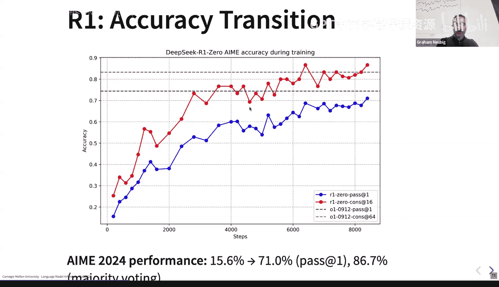

Another really interesting result from this paper is that the thinking time allocated to the reing model naturally increases from hundreds to thousands of tokens。

And so if we see hundreds of tokens here， maybe 800 tokens or something at the very beginning。

 you know as they trained it and trained it and trained it。

 it starts using more and more and more tokens。

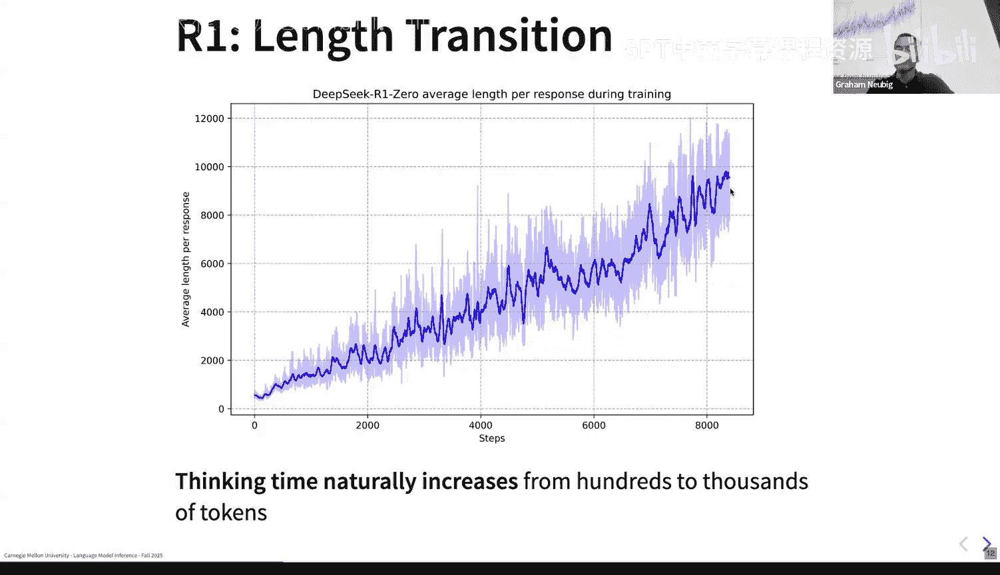

To solve the problems。And another very famous thing from this paper is they showed this example with R10 so again。

 this is not， you know specifically trained to like solve math problems or do self-correction。

 but basically there is a place where it says wait， wait。

 wait that's an aha moment I can flag here and so the like language model you know spontaneously kind of identified that there was a problem in its derivation and went back and fixed it。

And they also have a very cute thing in the paper where they said this was also an aha moment for us as researchers where we realized the power of reinforcement learning or something which you know。

 I thought that was。Kind of true， I mean， you know。

 if you see something like this just happen out of Tard。

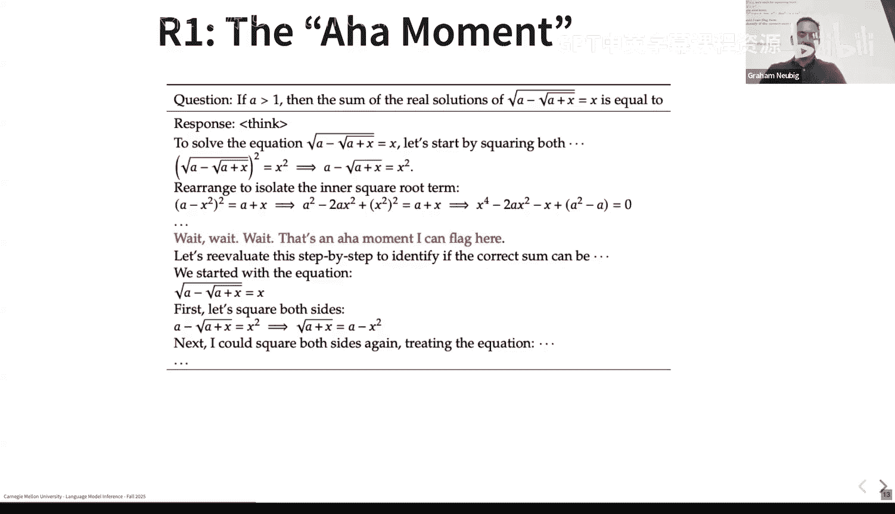

Another thing that they did in this paper was they demonstrated that you can distill the reasoning traces from these very large 470 billion parameter models down to models of more manageable sizes。

And。They have a deeps R 132B， which is a distilled version of the Quen model with only 32b parameters。

 and you can see that it has quite competitive results with other models and basically all they did was generate lots of reasoning traces with R1 filter the ones that were correct and then train train this deepCR 132b model and they have a whole bunch of different sizes and they also have experiments where they tried to do R1 from scratch with this smaller model and they demonstrated that distilling from the bigger model is much more effective and I think the reason why is basically just the larger model is more able to get like a decent non-zero accuracy when you train when you started off from training from scratch。

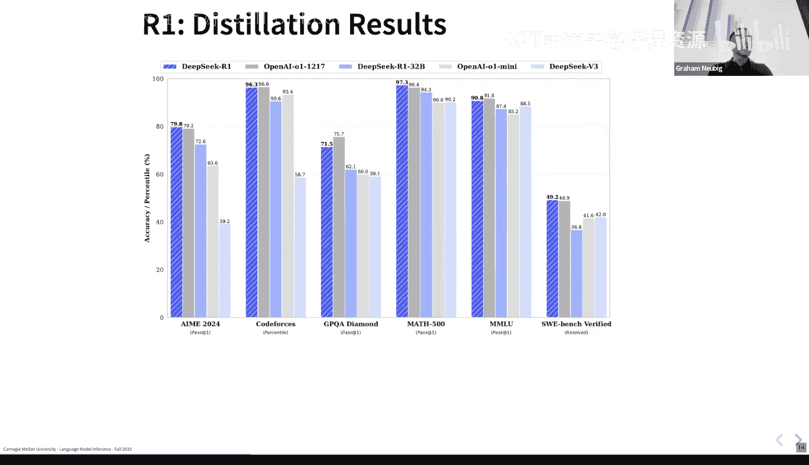

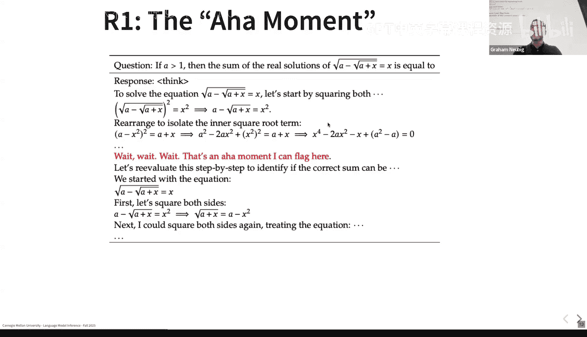

Cool any any questions about this yeah the length of certainly。

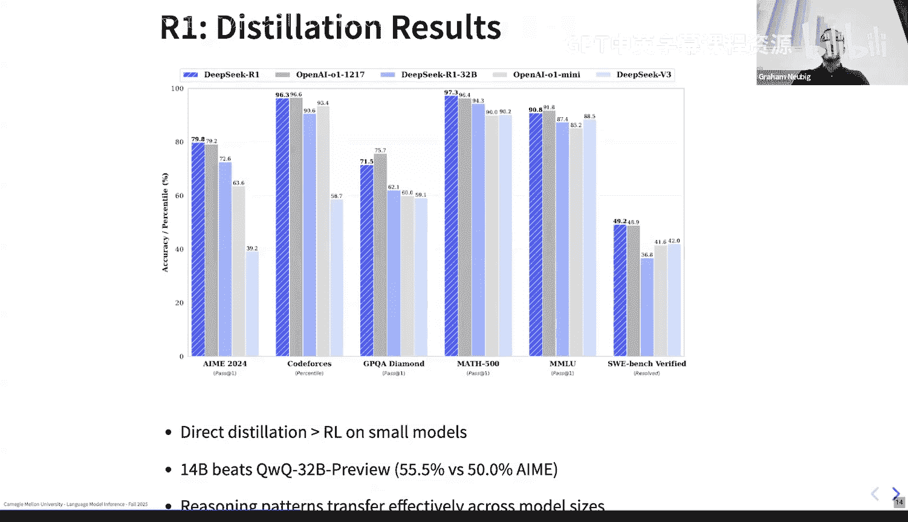

So not three， theres likely to been any followed up study showing if this has a platform because it looks to be just moreically increasing without any and insight yep。

 I will talk about that。

And any other questions？

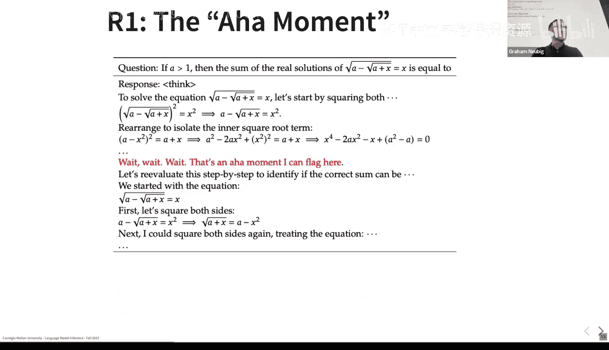

过。So what are the， this is an inference class， this is not a training class。

 which is also why I'm not you know， going super deep into how these models are trained。

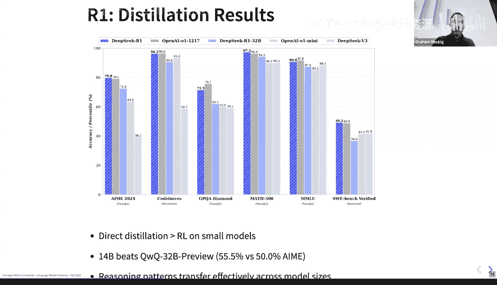

But like what are the implications for inference of this work， any， any ideas？

Anyone want me to ask you to run a 470 billion parameter model for 10，000 tokens and assignment too？

嗯。😊，对。Yeah， maybe maybe not。 So because of this and， you know。

 like the 01 Open AIs 010304 G 5 models。 you know， they're all using more tokens to think。

 which means inference is becoming more expensive， they're all getting larger。

 but it also can mean that a smaller model can beat a much larger model with more inference token。

 So if you look at this deeps R1，32b and compare it to deeps V3 deepse V3 is the base model that was used to train that was used to train deepsR1。

 and you can see this 32b model is beating this 470 B model。

 So you can spend like more tokens and inference with a smaller model and get better results。

 So this you know paradigm is really the one that made inference really。

 really popular at the beginning of this year， essentially。

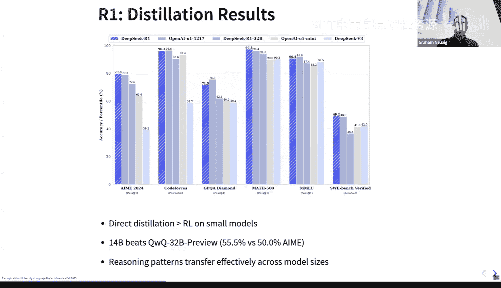

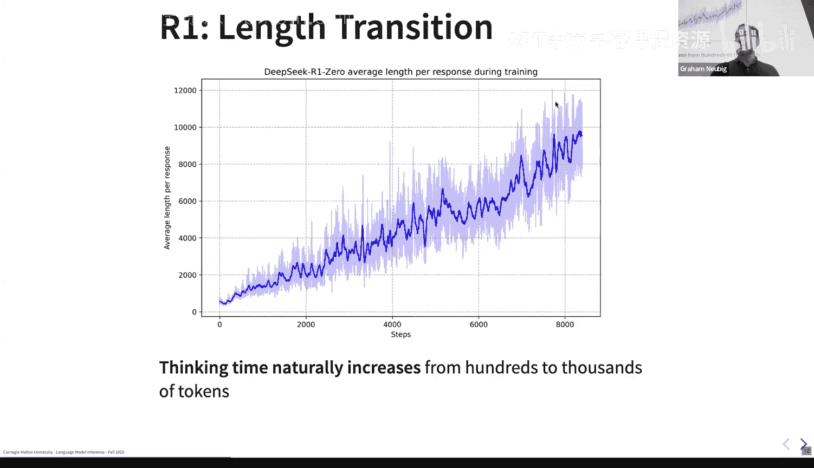

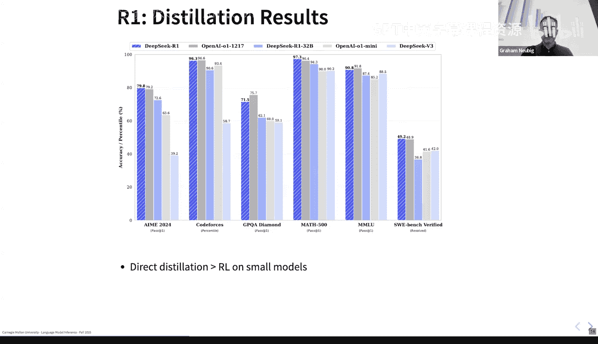

过。So now I would like to go into a new a new paper。

 So this is a paper called cognitive behaviors for self improvement and the basic idea behind the paper is as follows so the first one is。

This is RL style training with essentially ST， this was also by the same group that did the star algorithm。

And we can see that there's two models， there's the Quen model， and then there's the Lama model。

 and when you train the Quen model， the accuracy goes up quite quickly and gets good results。

 it does plateau， but it plateaus a bit higher than the place where the llma model plateaus。

 and separately， if we look at the response length， the response length for the Quen model goes up。

 whereas for thellma model， it basically goes down。Like this。

So what is the difference between these two models this paper basically analyzed four different behaviors that they thought were important for ensuring that is like zero shot like reinforcement learning would work and so the first one was verification so this is things like let me check my answer a second one is sub goalal setting let's try to get to a multiple of 10 backtracking let's try a different approach what if we did whatever and backward chaining which is working backwards 24 is eight times3 eta。

 etc ce。And we can look at the average count of these behaviors and essentially we can see that like verification and backtracking and other stuff like that were much higher for the Qued model than they were for the Lama model。

And so。

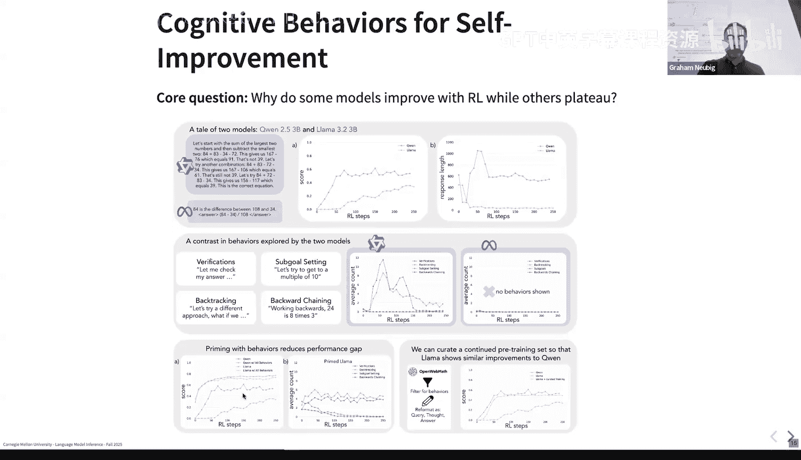

嗯。So yeah， I already talked about these behaviors。

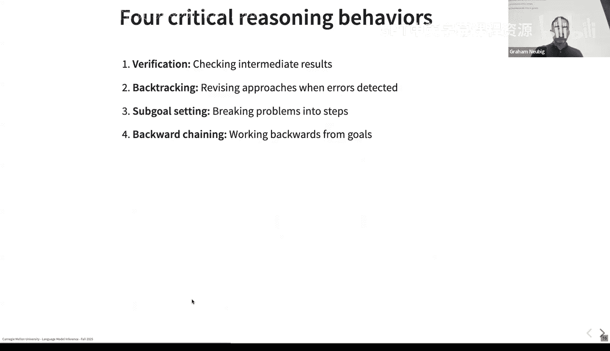

And they compared among a bunch of different models。 And basically。

 they saw the Quenb model displayed more of all of these behaviors than the Lama 3 B model and the Lama 70 B model。

 I believe the Quenb model was 7 B。 I would。

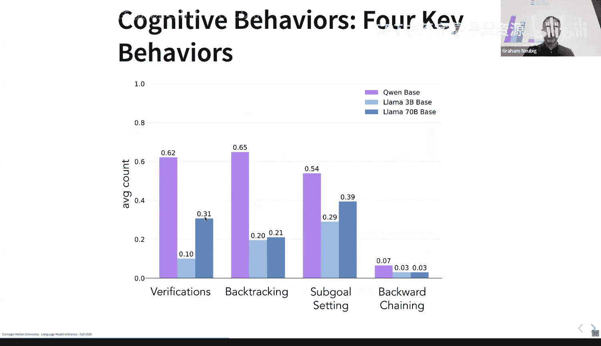

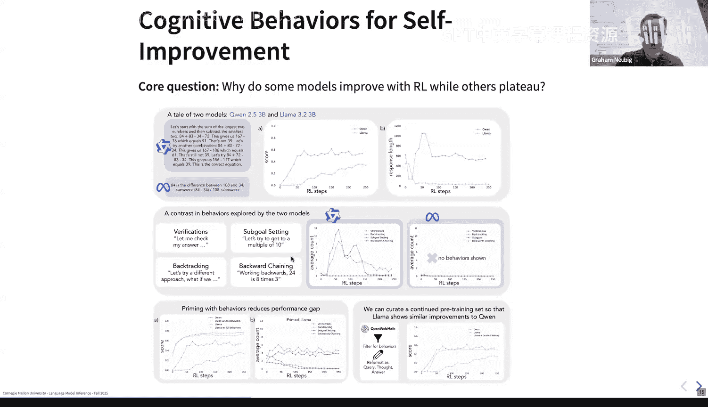

Oh no， sorry， Quinn was also 3b。So。It's not just。It's not just， you know size。

 it's also just kind of the underlying propensity of the model。These are all base models。

So like at least theoretically， they're not not instruction tune models。

 Does anyone have an idea why we might be seeing such a big difference。Yeah。没事。Mid training。 Yeah。

 so mid training is basically， I would say there's two possibilities here。

 Mid training is basically where you pre train on lots of noisy Internet text and then kind of。

In the middle of training right before you finish training。

 you train on quote unquote higher quality text in this higher quality text could either be text that was like mined from the internet in a specific way。

 so mining only you know math textbooks or like highly quote unquote highly educational content。

Even the more open language model providers like Quen， you know。

 they release many of their models open source， they usually don't talk very much about their data。

 but there are examples of this from like Omo and Huging face。And hugging pace。Has a project。Ohoops。

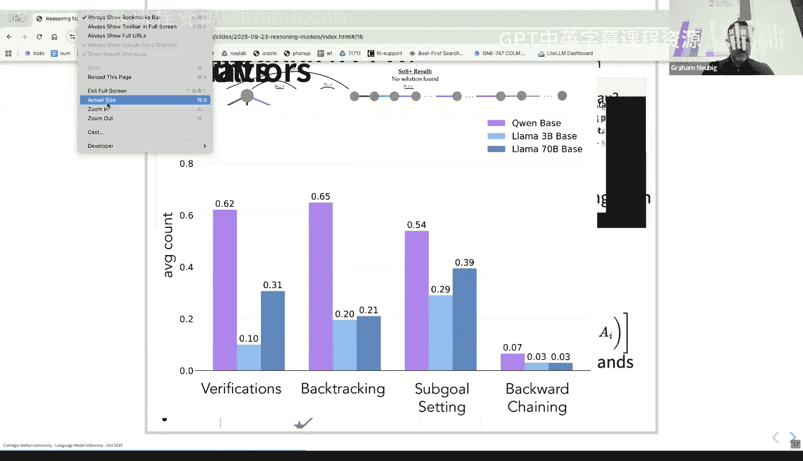

Called Fweb。And basically what Fineweb did is they like filtered down a whole bunch of stuff on a whole bunch of data from the Internet。

 and they demonstrated that if you trained on this like filtered down version of the Internet。

 you could get much better results， you know much faster。

 I would argue that this will probably plateau earlier than training on the whole Internet。

 So actually like training on the whole Internet is still a good idea。

 but you know what's typical now is you train on the whole Internet。

 and then you add a little bit of this like very high quality data right at that very end of training as you kind ofnel down to build your final base model and this is called midtrain。

 another possible reason is that this is using synthetic data of some varieties。 So regardless。

 despite the fact that they're all called a quote unquote base model。

 these base models can be trained in very different ways。

 And so that's the reason why these like cognitive behaviors might emerge for one。

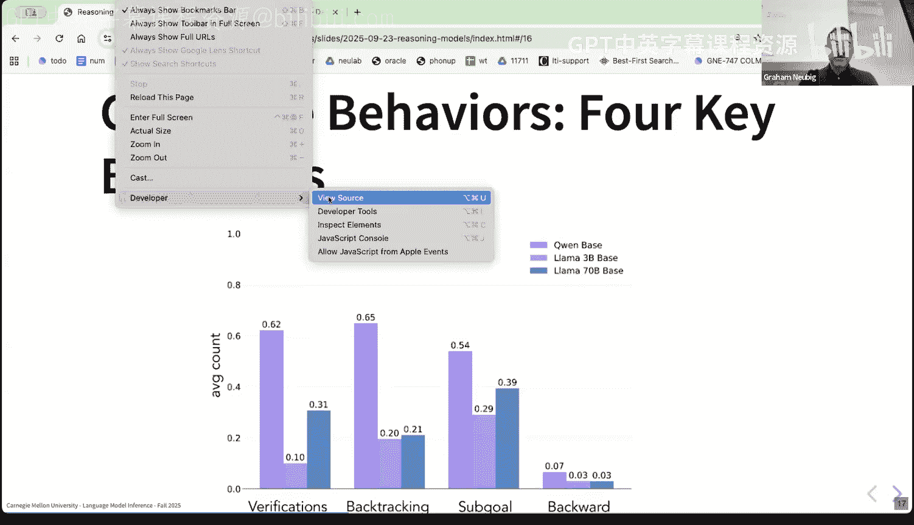

Models but not the others。Cool。Any questions？Okay， nice。嗯。

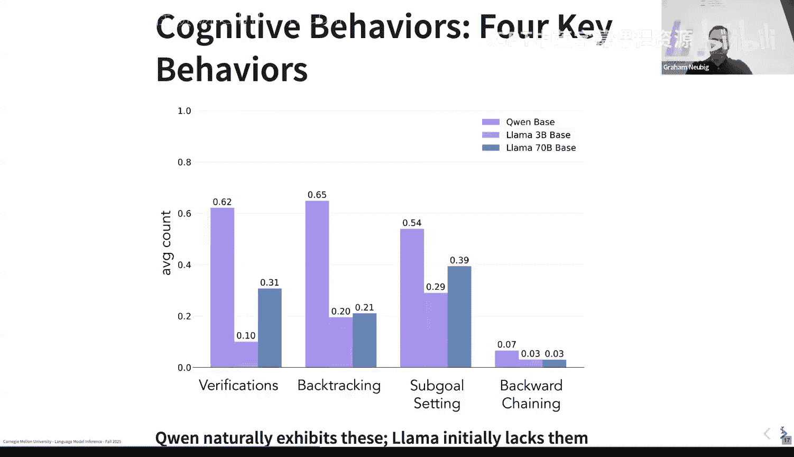

So they also demonstrated in this paper that you can kind of like prime the model by giving it a prompt that encourages it to take these behaviors and you give them a few examples of this。

 notably this is not what was done in the deepCR1 model， so deepCR1 to intentionally did not do this。

 but if you do do this this can you know improve the ability of the models to take these behaviors。过。

Yes， once thenYeah， sure。嗯。All of them seem to like converge roughly the same number of Facebook book the same much responsive body。

So for this。I think this is when they primed based on a particular strategy。

 so when they said use this particular strategy。Like。Use this particular strategy。

 It converge to a similar， but not exactly the same length。

 I think like they encourage particular strategies， but also on a higher level。

 that just encourages like reasoning in general。 And so like， I think by。

Encouraging structured reasoning， you can kind of get it to have a similar response like satellite。

You have told backtracking approaching the same length as backtracking plus something else backtracking and that backtracking suppose。

 So I was like wondering。Yeah， I think the models I think the models will。呃。You know。

 tend to finish when they like quote unquote think they have like solved the problem one other thing that Id I'd like to point out is I totally missed this when I first looked at this graph from deep SeaR1。

 but look， look carefully at this graph。And here we have steps， right， This is 8000 steps。

 I don't remember exactly what the batch size is， but the batch size is very large for this。

 They have lots of GPus for running these experiments。 And so they're using a large batch size。

The first 200 steps， the length doesn't increase at all。嗯。Now， go back here。Go back here。

 Look at where this stops。 This stops at 250。 And so you can see that this is stopping at 250。

 And I think the batch size for this is smaller than the batch size used for deepCR 1。

 So this is trying to even less than the deep C car1 that was plateauing。

 So I've also observed that when training reasoning models。

 the response length will stagnate for a while And then after it's stagnated for a while。

 it will increase when the model has learned to like use more extensive like backtracking strategies。

 So our more extensive reasoning strategies， not necessarily just backtracking。

 So I think this is also an important thing to know。So it could be like completely misleading myself。

This graph， if you think that the model has converged to a particular length and won't increase later。

 this could be misleading this，Thanks。嗯，过。So next， I'd like to talk about a paper that we did called demystifying Long chainin of Though。

And our question was to better understand when long chains of thought emerge。

In what conditions enable reasoning， how does training affect chain of thought length？

And so our experimental setting was say we wanted to do supervised fine tuning and compare it with reinforcement learning with various reward functions and training setups also how many student presentations do we have today just one？

Okay， good， I just want to make sure I don't run out of time。

So we have various reward functions and training setups。

And we did length analysis across iterations and we tried multiple model sizes and data sets。

So the first thing that we did was we compared the chain of thought type。And essentially。

 what we did was we did supervise fine tuning or we took models that had been supervised。

 fine tuned to either perform short chain of thought reasoning。 So basically perform reasoning with。

 you know， only the traditional chain of thought versus ones that had been trained kind of like distilled to do long chain of thought。

And we did。Supervised fine tuning on the kind of。On shorter and longer chain of thought data。

 And that's the dash line here。 And then we did reinforcement learning。

 And the thing that you can notice is the models that were originally like primed to do。Well。

 on short chains of thought did not benefit very much from RL。

 where the one cent were primed to do long chains of thought really increased a lot by doing RL and so this demonstrates that there's some you know major advantage in having like really long chains of thought trained by reinforcement learning。

Another thing that we looked at in this paper was we were training reasoning models。

 and we saw essentially that the models would。Go up。

They would improve for a while and then they would suddenly crash。

And we were confused by this for a bit。 But essentially what we found was that they were exceeding the maximum output length。

And some of these models had you know， a fixed maximum output length。

 and that's what we measured by the exceed rate。 And once they started exceeding the maximum output length。

 they would be getting all of the the problems wrong basically because the final answer was getting clipped and so that was a major。

 you know， major problem because he can't really extend the or well， in this paper。

 we didn't make an attempt to extend the output length and so basically just our training。Ded。

And so the way we fixed this was。Or we tried to fix this。

 And the way we did so was we proposed a new variety of reward where we considered both the。

Correctness and the length and so the classic reward gives you a you know reward of one when you get it correct and a reward of0 when you get it wrong。

 but in this paper we have this reward where we multiply it by the cosine and。

Where the cosine will converge to zero at the maximum output length and so if the answer is wrong。

 we basically give a larger negative reward when the answer is short and so what that's saying is if you're getting it wrong make it longer until we like approach the output length and then if you're getting it right make it shorter until we until you like no longer get it right and so this is a way to kind of balance the output and this allowed us to stably train models without exceeding the response length。

We also examined a little bit about the conditions for emergence。

 and we found that 7 B models really struggled to develop complexibilities。

And we came up with you know the cosine reward， also for the base model quality。

 we found that the overexposure to short data hindered the long COT development。

And RL from the Long COT improved。嗯。So another thing that we looked into was the quality of the verifier and we found that rule based verifiers basically worked better than model based verifiers。

And so there's a lot of。Things that need to go right for these abilities to emerge。

 and we just tried to like catalog a lot of them in this paper， basically。Cool。

 any questions about this？Okay， in particular， if you want a shortcut to making things work。

 I recommend this， we've tried it several times since we did this paper and it works quite well so you know if you're doing that sort of training。

 I'd suggest trying it out。Cool， another one is， as I mentioned in the cognitive behavior behaviors paper。

 a lot of people have。Don like basically you need very particular types of reasoning models to get emergent abilities to emerge and so basically this paper has a simple idea of trying to do RL for reasoning on a very large number of models of different sizes and they did direct RL from base models and no SFT and tried to find whether smaller diverse models could exhibit emergent reasoning。

And they found that it is true， for some extent， to some extent， the。

They definitely saw the greatest improvements on Quen。

 but if you trained for long enough and have a number of settings kind of like fine tuned in a way that can get the model to generate positive rewards in some cases。

 a lot of models are nonetheless able to see improvements。

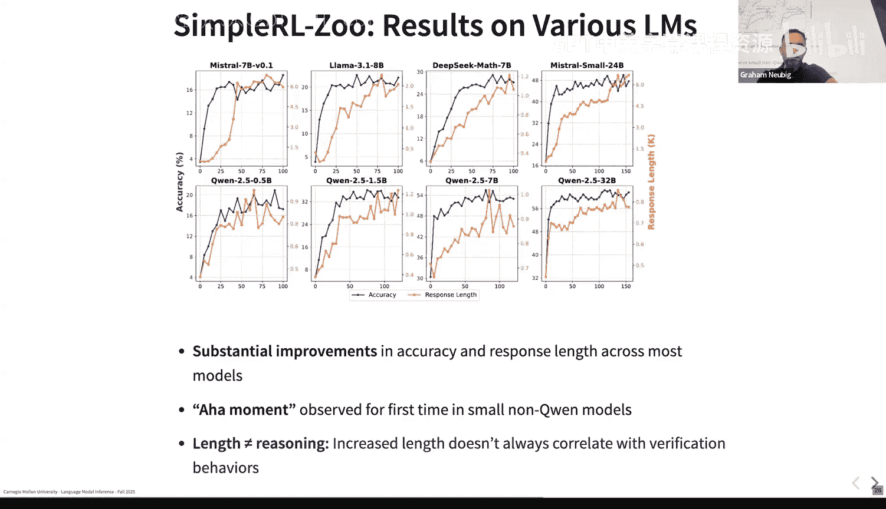

And。They also did。Kind of evaluations on whether they exhibited different behaviors。

 So we were they were able to see that， you know， Quin did lots of stuff like sub goalal setting。

 enumeration， verification， maybe less backtracking， And then myal you know。

 had more enumeration and other stuff like this。 So overall， this is mostly an empirical paper。

 but it's also a good code base if you want to do any sorts of these experiments。

 So you can definitely try that up。😊，G。So another thing that I'd like to talk about is a paper we recently did on reasoning transfer。

A lot of。Papers examine the ability of mathematical reasoning data to improve。

Scores are mathematical and code based reasoning data to improve the scores of models on。

Reasoning based tasks sorry of math or code based tasks。 So it's essentially like in domain training。

 It's not exactly the same data set， but it's like math for math， code for code and things like that。

And so our key question in this paper was， do gains in solving math problems transfer to other reasoning domains like scientific QA coding and agent planning？

And also other nonre tasks like conversation and its instruction following。

So the experimental setup was we did some controlled experiments on Qn 314B。

 where we did training data with math only， and we compared supervised fine tuning with reinforcement learning is the two paradigms。

And the SFT setup was basically rejectioning sampling with aquin 332B teacher and so。For SFD and RL。

 which one do you think would generalize better to other domains， any ideas？All， okay。

 any ideas why that might be the case？Vibbes， vibes。I mean。

 I have to agree that I had vibe said RL would work better too。

 but I actually have an explanation for the athlete's paper， okay。And so for the RL setup。

 we had to answer correctness is the reward。So。This is the an example of transferability across different tasks with different reasoning models。

 so this is our non controlled experiment where we basically took reasoning models in the base models that corresponded to those reasoning models。

And。We define something as the transferability index。

And the transferability index is essentially like if we look at the gains that we get on the task that the model was trained on and we compare them to the gains that we get on the tasks that the model was not trained on or the task categories that the model was not trained on。

 what's the difference between the two。And so what we oh no sorry I misspo there so if we look at the at the tests that the model was not trained on。

 does it improve or not improved there and so for other reasoning tasks what we found was that the models generally improved on other reasoning tasks but they improved more when they were trained using RL。

On the other hand， if we looked at non reasoning tasks。

 we found that actually the models trained with RL tended to still improve somewhat。

 but the models trained with SFT actually decreased。

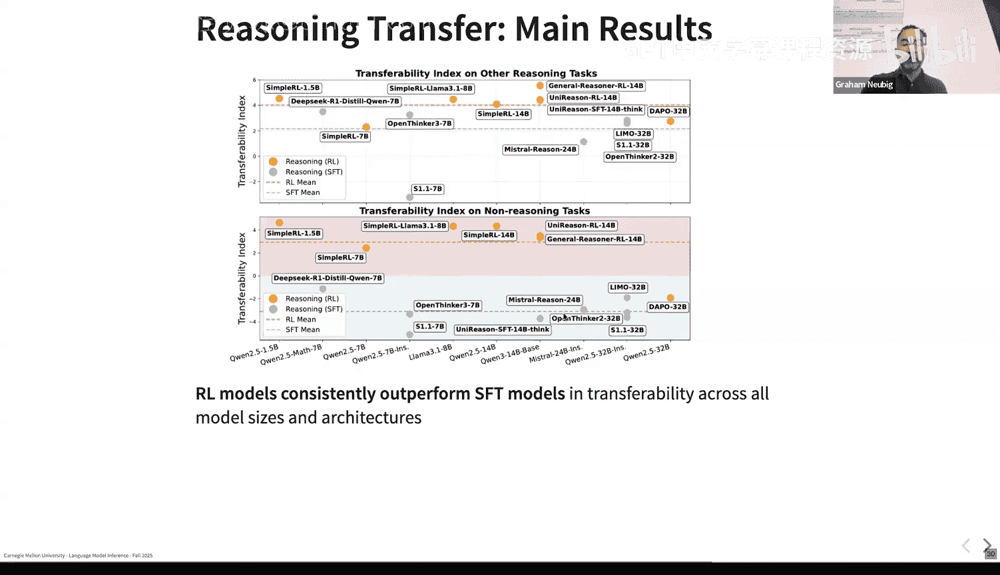

To some extent on the non recent tasks。And the reasoning or the reason why we think this is the case is actually maybe a little bit。

obbvious in hindsight， but we didn't know it before we started this experiment。

 but basically one of the things that we looked at was the change in the probability of various tokens that after the fine tuning process。

And here are some examples of tokens that changed greatly in the positive direction or the negative direction for RL in the SFT。

 and basically what you can see is that the SFT model leads to lots of change in the model。

 whereas the RL based model leads to relatively little change and it leads particularly to changes in words that seem related to reasoning。

So any idea why this is the case？Could I appear that like all encodes hereistic SF encodes biases。

RRl encodes heuristics and SFT encodes biases。 Let me also specifically say that this is GRPO。

And if we remember what GRPO does， it generates a bunch of hypotheses， it compares them。

 it ups the good ones and downweights bad ones。And also。

 maybe it might be worth thinking when you're doing SFT， what hypotheses are you down waiting？

You're uping the correct one， but what are you down waitinging？If you。

 if you do a parameter update on。A particular sequence with SF key。

 which sequences probability will increase and。Maybe in general。

 which sequences probability will decrease？Yeah。Yeah， exactly， basically everything else。

 So the difference between GRPO and SFT is that in GRPO。

 you're down weighting the negative sequences that were sampled。 that got a bad reward。 And in SFT。

 you're uping the one sequence that you sampled that got a good reward and downweighting everything else。

 So basically， you're modifying every sequence in S FT， whereas in Rl。

 you're only upweighting and down weighting like particular sequences。And so。

That we're not the first people to notice this， Other people have noticed this as well。

 but particularly from the point of view of reasoning。

 this means that you get minimal changes and we also have some examination in the paper that the difference in the like model parameters also is much lesser when you're training using RL than SFT and so that kind of makes sense that it would generalize better right you're not like deleting a lot of the or like damaging a lot of the knowledge from the other domains and it's still able to do relatively well。

SoEn will be only down weighted。I can also go back to the GPO equation。But basically。Were。Oops。

So the negative examples in GPO are the ones where the advantage is like less than zero right and so' you're mostly down weighting。

 you're mostly trying to reduce the probability of the examples where the advantage is less than zero compared to that old probability there as opposed to comparing it to everything else。

Yep。Is this reason I need。I don't think they explicitly wrote that in their paper。

 but I think the idea behind trying to train with R from scratch is that。

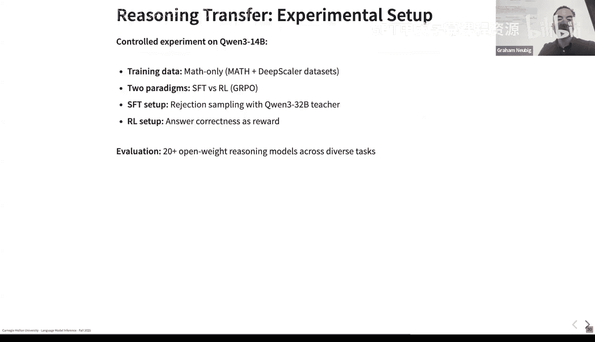

Like。This goes all the way back to Algo， I guess， like if you， like Algo had a lot of。

Influence on like the the people doing RL because Alphago was trained completely from scratch。

 but it was able to discover strategies that like you know。Most humans would not have thought of。

 And so the idea here is we'll just let the model do whatever。

Whatever it wants and if we let the model do whatever it wants and like it's getting at least some reward。

 then eventually it will you know， it will converge onto something good That being said we are using a large language model and the large language model has a lot of。

 you know prior knowledge in it， so we're not starting completely from scratch。

 but that's a basic idea， I think yeah。可可以。被到。Damage， some performance。But I think you can。

I think on mathematical reasoning， actually they did do SFTNRL and that gave better results on mathematical reasoning。

 but I think that might give worse results on on other tasks， that's what our paper shows anyway。

Cool， I'm going to sorry， kind of power through the final ones to make sure we have time for the student presentation。

 but these are a few kind of like interesting， but maybe less central findings。

 I think in the like in the okay they're still good I don't want to downplay them but I'll go through them quickly So the first one is simple test time scaling basically what they demonstrated is that you could use minimal data with like 1 thousand0 carefully curated reasoning examples and a very simple trick called budget forcing。

 which allows you to control thinking duration at test time to very efficiently trained reasoning models。

And the way they did this， and this allowed them to just do supervised fine tuning withQune 2。

532B and get good results in a very simple， efficient manner。嗯。And the basic idea here is like they。

Did two things。 The first thing they did is they had a short chain of thought model。

 generate the chain of thought。 and then they just put the word wait after it。

 and then they made it generate again。So it's really like it's essentially forcing it to do you know reexamination of its previous hypotheses and this actually worked so the second thing that they did was when it started reaching the end of its token limit they cut it off and they said times out now answer and it answered so completely heuristic but despite the fact that it's completely heuristic。

 it got like actually quite good examples with a very quite good results with a very small number of examples。

Another thing related to length and this is actually another paper by Pronal here at LTI is length controlled policy optimization and basically they wanted to come up with a way to control the reasoning length。

And they gave it a prompt like think for end tokens to try to get the model to like。

Think for a varying amount of time that you can control。And based on this。

 their results basically showed that they were able to get better token like token accuracy tradeoffs than other models。

 including S1， the one I just introduced。And the way they did this was by adding a new reward。

 they called it LCPO， but basically it's adding another term to the reward where you try to find the gold length and compare with the gold length。

And they got good results on all the data sets they evaluated on。

Another really interesting paper which this came out before R1 and actually until R1 came out。

 a lot of people thought that the open AI models were actually maybe doing something like this after R1 came out。

 I think most people switched to thinking that the open AI models did something more similar to R1。

 But basically the idea is you take a search algorithm。

 So you take like best first search or something like this。 you run that search algorithm。

 you get a solution， and then you turn it into a chain of thought。

 So you like heuristically turn the thing into a chain of thought。

 just like we did for the scratch pad in star。 So like star was a way of solving mathematical equations。

 Now this is a way of like taking a search algorithm and turning it into a chain of thought。

So they tried a bunch of different search strategies like breadth for search and depth for a search variant。

 you know all of these are things you've already learned basically。

 and then they took 500K search trajectories on a game called Countdown where you need to countdown to I forget the exact details。

 but it's a simple game that nonetheless requires reasoning。

And then they compared this and were able to get good results with this stream of search strategy。

And then finally， an interesting one that kind of mixes reasoning with tool use a little bit。

 sorry this figure is a little bit small is adaptive parallel search and basically the idea is they use something similar to stream of search。

 but they give the model the ability to spawn parallel search threads。

 so it's like a tool that allows you to like split off different threads in inference and join to return the results to a parent thread so it's like you know multithread programming basically。

And they do enter our optimization of this sort of like parent child coordination。

 And one interesting thing that they are able to show is that compared to stream of search where stream of search essentially had a limit on what you could do due to the overall token length。

 So like you know everybody talks about inference time scaling by like generating lots of tokens but。

If you run out of tokens， you can't generate anymore right so what this does is this allows you to split off and do parallel search threads and merge them back together while limiting the number of sequential tokens and greatly increasing the accuracy on the things they were're working on the overall latency gets slower because you need to generate more tokens overall。

 but nonetheless you can see it's recently beneficial。空。So this is kind of a high level overview。

 this is a very popular topic nowadays， so there's like tons and tons of stuff that I didn't cover。

 but hopefully these give you some ideas of general general things in that direction。😊，Cool。

 and then I guess we can switch over to the student presentation while we have the presenter come up。

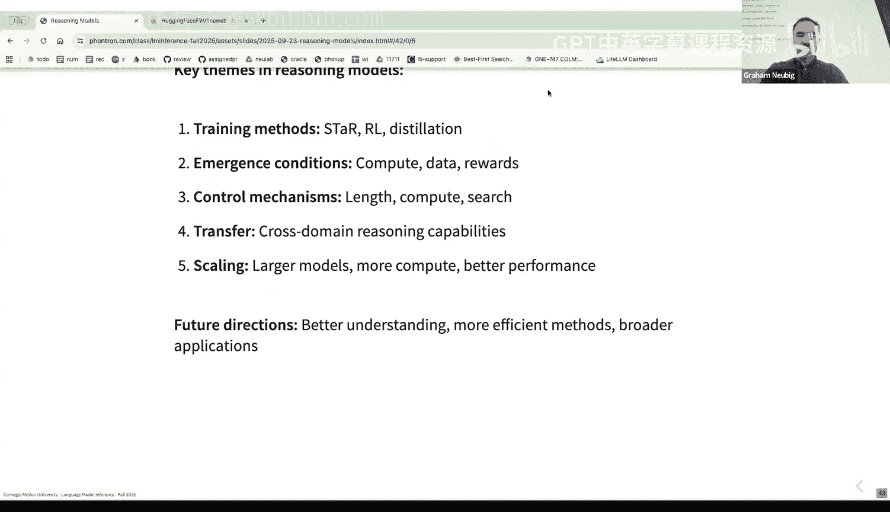