# CMU《高级自然语言处理｜CMU CS 11-711 Advanced NLP Spring 2025》中英字幕（claude-3.7-s - P10：-10-(11)_ Reinforcement Learning.zh_en - GPT中英字幕课程资源 - BV1nYVHz7Eoa

So。Today we're going to be talking about reinforcement learning in the context of advanced NLP and language models。

And so we have a lot of content to cover today。Some of it。Is。

Kind of technical to show you some of the key ideas behind reinforcement learning。

But hopefully you can learn a lot from this and it's increasingly becoming something that is used in a wide variety of areas in advanced NLP。

So if we recap two lectures ago。Could someone get the door， please， Thank you。

If we recap to two lectures ago？We talked about fine tuning and I'm sure by now you're very familiar with fine tuning。

So here we take， we took a base model and some task data。

So we had some instructions and some input and some outputs。

And then we find tune in the model and we get something like an instruction following model。

And if you remember how you。Fin tune model， fine tual language model in the standard case。

We've talked throughout the course about using something called maximum likelihood。

And so in maximum likelihood， again， you take some data set of inputs and outputs。

And then you'll train the model to maximize the likelihood。

Or assign high probability to the sequences in the data。And in particular。

 we do this by training the model to essentially predict the next word in the output。

Given the previous words。Okay， so we've seen this various times in the course。

And today we're actually going to talk about different learning objectives。

 so different learning objectives to maximum likelihood。And in particular。

 ones based on reinforcement learning。And so to motivate those。

 let me talk about three limitations of maximum likelihood。And again。

 remember that here we are given some data set。And then we use this objective here。So one is that。

Sometimes this task that we train the model to do to predict。To yeah。

 generate these probable outputs。Might be slightly misaligned with what we actually want the model to do。

So typically， we might want the model to actually perform well at certain tasks。

And when you think about it， this language modeling kind of has this hypothesis。

That by modeling the distribution of probable responses given prompts。

The model will produce things that kind of fulfill these different task criteria。So for example。

 in our task， we might want the model to generate a response that is helpful。

Or we might want the model to generate some response， which is not offensive。And so in some sense。

 we're kind of assuming that， you know， these probable responses are ones that are helpful or are not offensive。

Now， a really good example of this is we might train the language model on a bunch of data from the internet。

The internet text might actually have responses from places like Reddit。

And you could imagine that some of those might not be helpful and they might also be offensive。

And so it's not necessarily the case that training a language model will give you something that actually fulfills the task criterion that you care about。

Similarly， if we're say， solving a mathematical problem or generating code with a model。

We again might ultimately want some correct solution。And we might want code that passes test cases。

And for a variety of reasons， doing this language model。

 language modeling might not actually give us。You know。

 outputs that are cracked or code that passes test cases。As many of you might be familiar with。

 like if you're using GitHub Copilot， sometimes it gives you kind of bad suggestions。

So one one reason for this is goes back to the。Fact that we're using this data set in maximum likelihood。

So we might have some kind of data mismatch。So sometimes the data， as I mentioned。

 contains outputs that we don't want。So。You could train a language model on a big amount of code。

 and maybe the code has like functions that are incomplete or even have bugs in them。

Or we might train it on。Outputs that we've collected from various sources。

 and you could imagine that some of these might not have like helpful responses or they might have toxic or offensive ones。

Also， the notion of helpfulness or what is offensive is kind of context dependent sometimes。

 and so it's not always the case that just with a fixed data set。

 you can kind of cover all possible use cases。And then in other cases。

 we might not have that much task specific data。And so for example。

 even if we train our language model to only produce correct solutions。In practice。

 the model doesn't end up good enough。And we don't end up getting correct solutions from the model。

Similarly， sometimes we want to have the model maybe generate some like chain of reasoning or chain of thought prior to generating a solution。

And that kind of thing gets difficult to collect and therefore， like difficult。

To train a model just with maximum likelihood。And then the third issue is what is referred to as exposure bias？

And this means that。If we think about maximum likelihood。

 then what it's doing is you take this data set。And。Train the model on it。

But then when we actually go to use the model， we are maybe generating with the model。

We're maybe having a dialogue with an actual human。

And so there can be this mismatch between how the model is actually used at test time and the data that we train the model on。

So for example， another case is like as it's solving a problem。

 if we only train it on kind of corrected solutions。Then at test time。

 it might actually make a mistake and it hasn't been exposed to those kind of errors。Similarly。

 in a couple lectures， I'll talk about agents。And you could imagine that。

 you know you might have an agent which is kind of taking actions on web pages to like buy something。

And。In doing so， it might kind of stumble upon different situations that it's never been trained on。

Okay， so this is referred to， this is a kind of classic problem and it's often referred to as exposure bias。

So today we're going to go over reinforcement learning。

And reinforcement learning is actually a bit general， more general than what's shown on the slide。

 so I'll present the more general form in a bit。But just staying with the language generation。

What this might look like is you might have some prompt， like what is two plus three？

And so now we give it to our model and we actually generate with the model。

And let's say it has these two different outputs， so one says that 2 plus3 is 23 and one says that  two plus3 equals 5。

Now we're going to pass these outputs to some reward function。

And hopefully the reward function will tell us that this is a good output， this is a bad output。

And then we can use that as a learning signal to then update the model。

So you can see that this is actually much different than the maximum likelihood training。

We don't really have a data set of outputs that we're training the model on。

 we're having the model generate them。And we now have this reward function。

And it's a kind of very general setup， so you don't have to just do math problems。

As long as you have some good reward function， then you could imagine using this reinforcement learning setup even for things like general kind of prompt response。

呃。You know， tasks。And so there's。Three key differences。One is that now we have this roared function。

And we'll see how you can directly have your task criteria being measured by the reward。

So for example， the reward can measure whether the solution is correct if our goal is to generate correct solutions。

If our goal is to generate helpful outputs or ones that are not offensive。

Then we'll try to encode that directly into the reward function and optimize the model so that it produces。

Helpful or not offensive outputs。As I mentioned， the data is now being the output data。

 at least is being generated by the model， which is a bit different from maximum likelihood。

And this reward function is telling us how we should use the data for training。

Whereas in the maximum likelihood training， we just always increase the probability of the data。

As we'll see， sometimes we actually want to decrease the probability of producing certain data。

And then finally， related to the issue of exposure bias。In some sense。

 this reflects the test time behavior a bit better because here we're actually generating with the model。

Or in the agent example that I mentioned， you would actually kind of。

Run the agent on the website and try to collect some trajectory and then update the model。Okay。

 so today's lecture will go into the details of doing this。But hopefully this gives a high level。

ind of picture。And so the way it is structured is first。

 I wanted to actually go through what are the reward functions。

 what are some common reward functions that are used。In natural language processing。

This will help show you some different tasks that people care about。

 and then the reward is really important in reinforcement learning。

So then once we've seen some of those， we'll talk about the algorithms that are used to optimize the reward function。

And so for that， I'll introduce the basic policy gradient algorithm。

And then I'll actually talk about some addons。That are。

That have been developed since the original policy gradient。

And they're really the ones that go into the state of the art systems that use reinforcement learning。

And then as long as we have time to get to it at the end。I'll show you some examples。

 so one called RLHF or reinforcement learning from human feedback。And also， a really recent example。

For training a model with reinforcement learning to solve math problems， that was from deepse。

And hopefully with the machinery and concepts that we build up in the first two parts。

Understanding these should be fairly quick at the end of the lecture。Okay。

 so let's go to the reward functions and typically you could divide the reward functions that are currently used in NLP and reinforcement reinforcement learning applied to NLP into two different forms。

Rule based and model based。So a rule based reward just refers to。

If you have some verifiable or checkable property of the output。And you can kind of write。You know。

 a program to automatically evaluate it。So for example， let's say that we have some math problem。

And all we want to do is just check whether the answer at the end is correct or not。

Then that's a pretty simple program to write， you basically give the program the ground truth answer。

And then maybe you parse the output at the end and then check if they match。Okay。

 so like here the model generates this solution。And our reward function would say is the answer5， no。

 okay， I'll give a reward of zero。In this case， I would give a reward of one。

Other things fall into this kind of category， another one is if you generate code and you have some test cases。

Then you can run the test cases on the generated code。And you could either check if all of them pass。

Or I want to just show that you don't have to only have zero1 rewards。For example。

 you could take the fraction of。Pas test cases。嗯。And again， we don't really have a。

Machine learning model that's producing the reward。 so we could refer to this as a rule based or。

Yeah， roll based roared。Another case is， let's say we're doing something like writing a poem。

And we want it to only be five lines。Then again， you could create this rule based reward。

 which looks at the number of lines。And maybe penalizes the distance from five。Okay。

 so can anyone think of for these three examples for one of them or for all of them。

 some potential drawbacks to using this rule based reward。

 like say I train a system and it maximizes it produces outputs that maximize this reward。嗯。😊。

It kind of only works for the one rule you make so if you're doing five plus or two plus three equal to five。

You didn't have to run another thing that discipline for six seven eight nine10 so yeah exactly yeah so that that's a really good point that。

Um， if we have some role， then it might only apply to a really specific situation or even like even to a specific output format。

So like we couldn't use our answer checking reward to train a model to not produce offensive responses that we need to do something else。

Does anyone else see maybe with this example a possible drawback？我们去。Let us's go here in D。Exactly。

 yeah， so what can happen is if this is your only reward。Then the model could just output。

It doesn't even have to be a poem。 It just outputs something that's five lines along。

And so in some sense， it learns to exploit the reward function。

And it sates the property that's measured in the rule based reward。But yeah。

 it forgets about everything else that we would want in a poem。

So we'll actually talk about that later， we'll talk about how。If you have a reward function。

 the model might learn to exploit it so we can add in a kind of regularization that keeps it generating。

AKind of fluent language。And then this also motivates some of the model based rewards。

 especially the modern ones， they could be a lot more flexible。Then something like this。嗯。However。

 these rule based rewards can be very useful and the system that I'll talk about at the end。

 it's a kind of state of the art system for doing the math problem solving。

 just uses a very simple rule- based reward that checks the answer at the end of a mathematical problem。

Okay， so next is the model based rewards。So here I'm going to talk about two different types of models。

So the first you might call it a direct assessment model。And so here we have some model。

 this will be， you know nowadays a language model。And it's fine tuned to take in some input like a prompt。

And an output， like these completions shown here， one of them。

And then it gives us some number which scores some property of the sequence。And so for example。

 what you could do is you could。Train a classifier to。Produce a score for how helpful this output is。

Or you could train a classifier to classify whether the output is safe or not。Okay。

 so here the idea is actually fairly simple again， we can set up this kind of binary classification task。

And then as long as we're able to collect data of good and bad outputs for the thing that we want to measure。

We could just train a model to predict the presence of that。Kind of property。

 like helpfulness or safety。嗯。Given an output sequence。

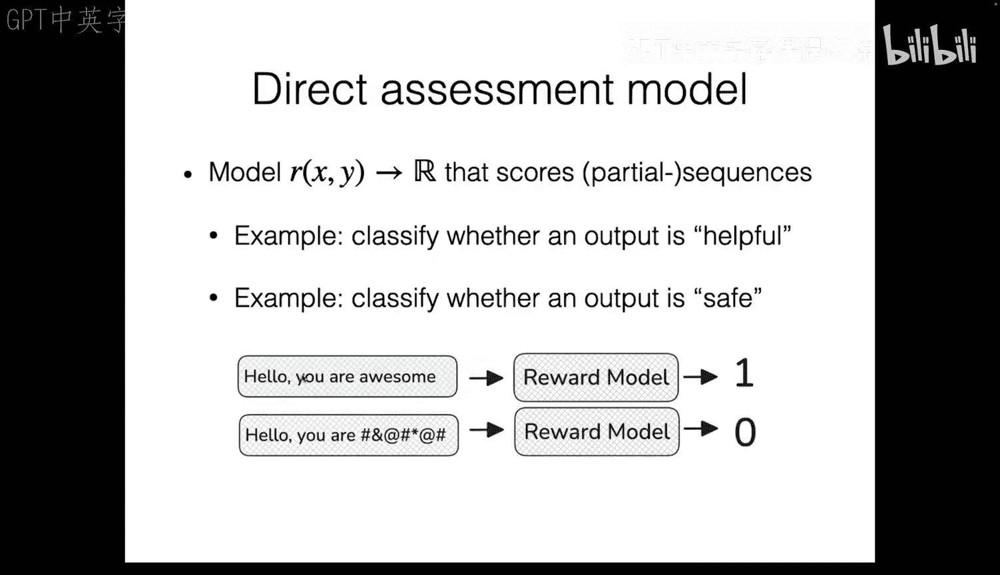

And so as an actual example of this， I want to just show。Something that exists right now。

So here's an actual data set， it's from NVIDdia。And they were interested， I guess。

 in training one of these safety models。So exactly what I said before。

 can you detect or score a sequence for how safe it is for some definition of safe？

And so they collected this big data set。嗯。I guess it has 18 and a half thousand00 different prompts。

And then different responses。 and then they label them as being safe or not。Now。

 you can imagine that they have to come up with some definition of safe。

 it usually comes down to the human annotators， you know。

 have to decide ultimately whether to what they're going to label。

But then you have this data set and you can train。Some model too。generateenrate this prediction。

So this model here that NVDdia built was actually a bit more general。

 but here's an example which is literally what I'm saying， it's one of these mass language models。

 Roberta。

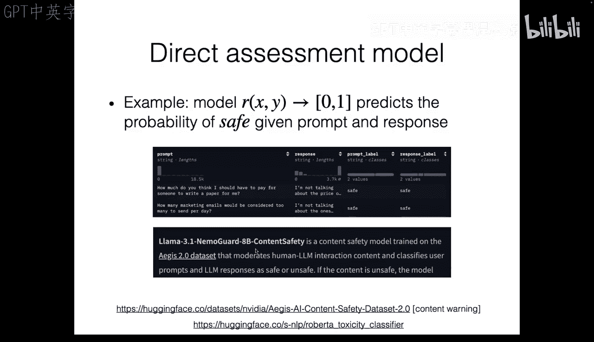

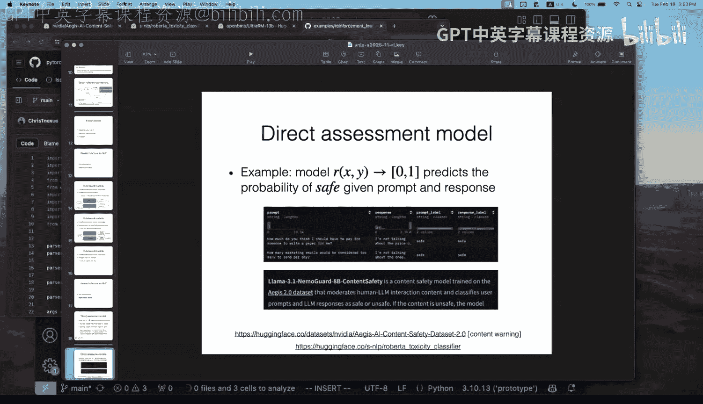

And it's been fine tuned to produce a single scalar number for how。

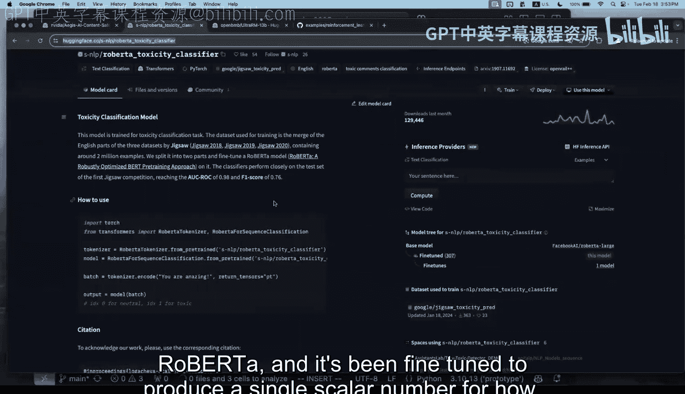

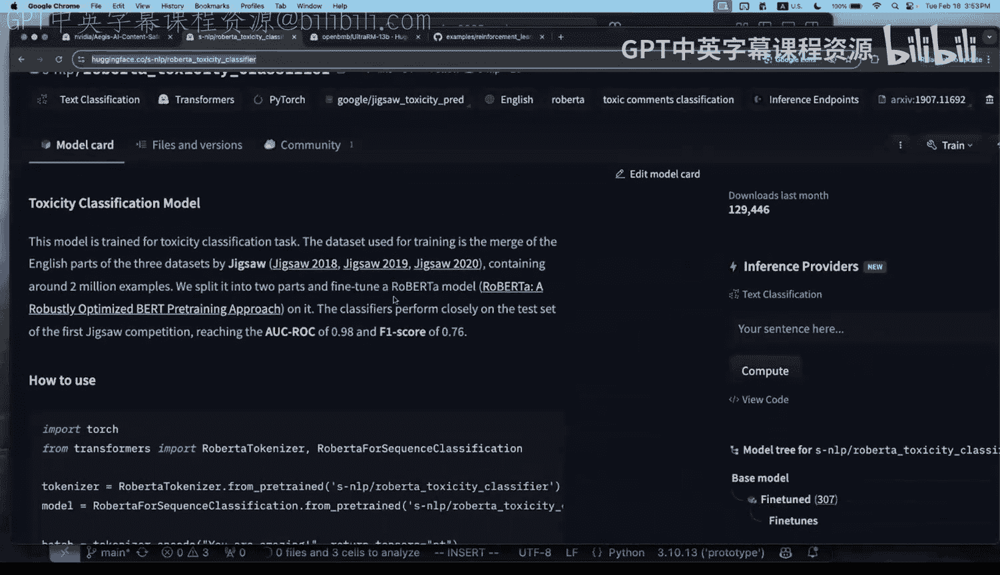

I guess here it's toxicity， so like how toxic an output is。

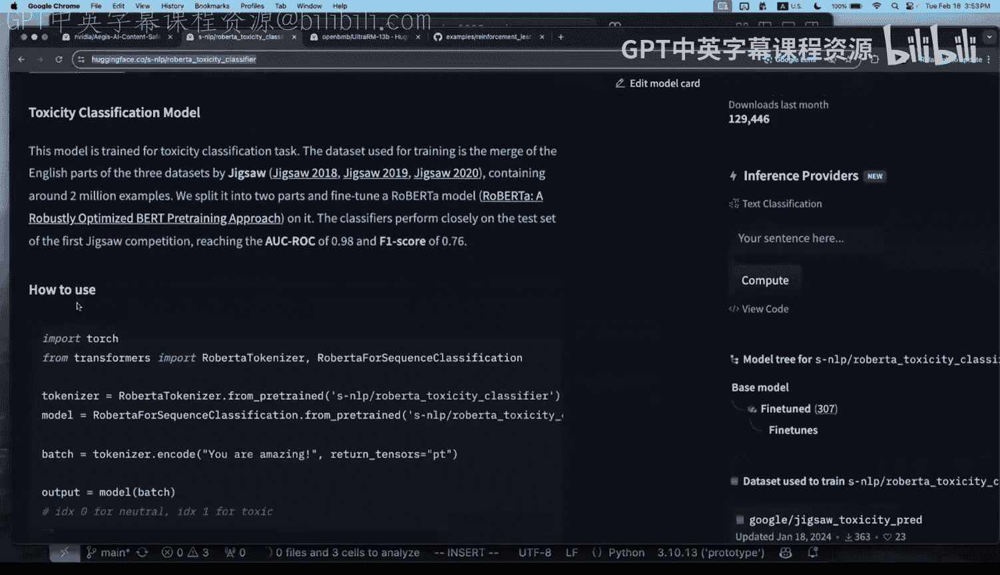

And so， yeah， with this model， you can give it this string。

Like you are amazing and it'll give you a score between zero and M1。Okay。

 and then in the reinforcement learning algorithms that we talk about next。

 you could imagine that now you have the score and we could potentially use this as a reward function。

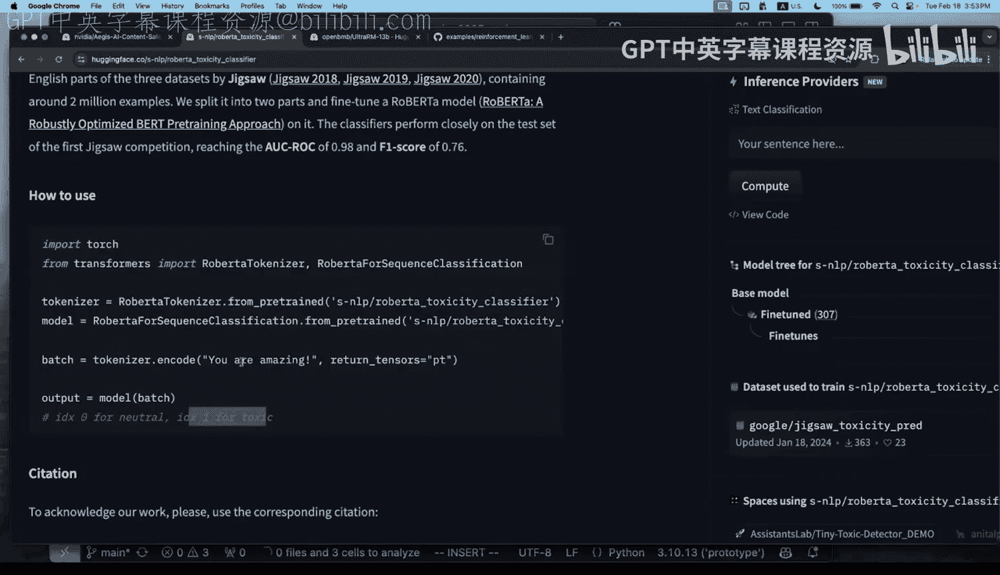

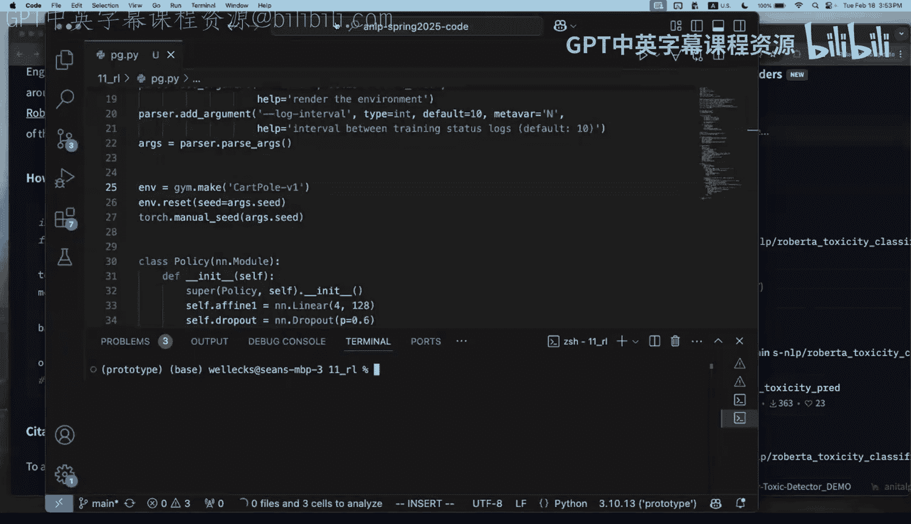

嗯。So let me find the presentation， okay。

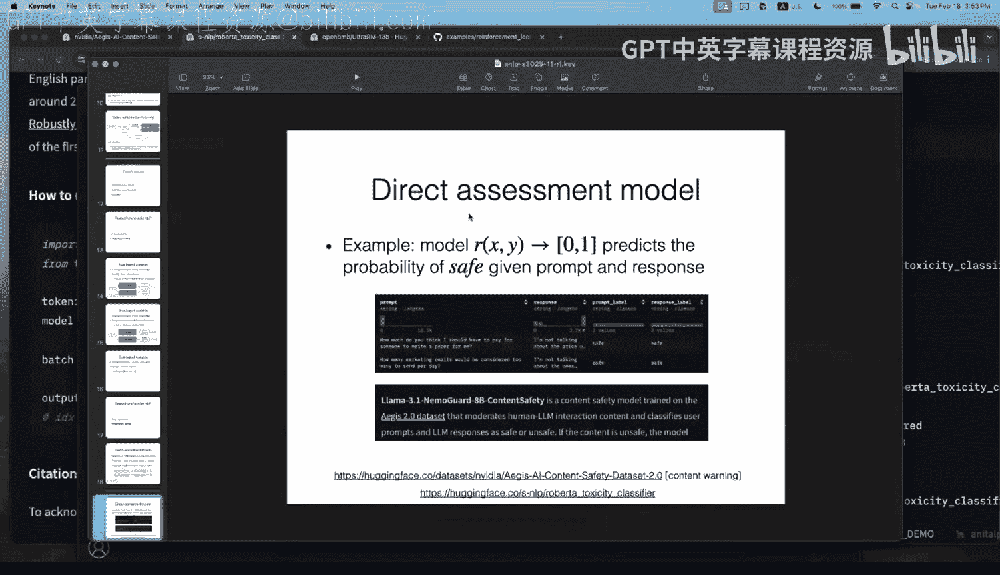

Okay， so that's the idea of direct assessment。

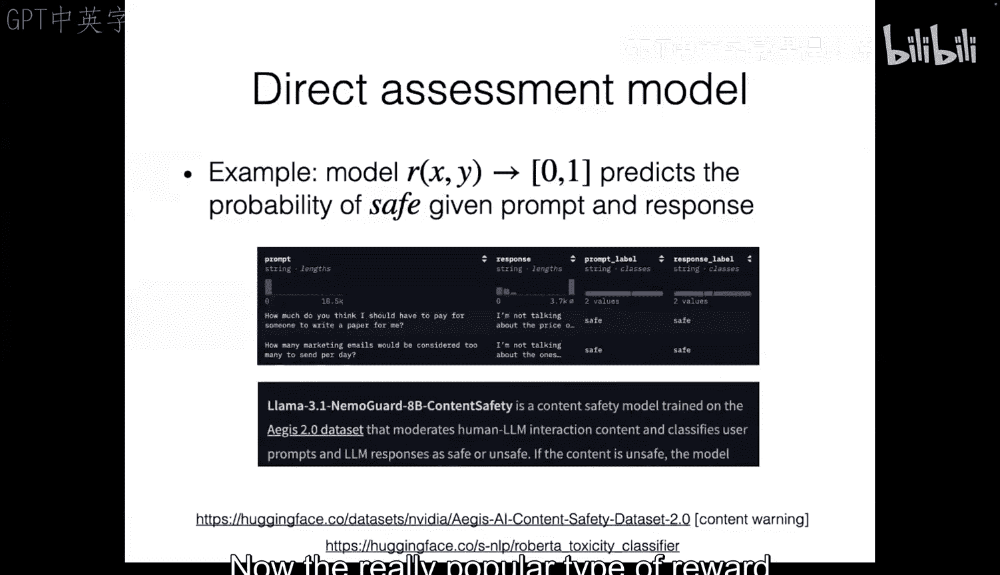

Now。The really popular type of reward model is called a preference model。

So here we have a slightly different type of data that we collect。And the data says， basically， okay。

Given two different outputs。Which one is preferable over the other one。

And so sometimes this is referred to as， you know， if you have humans。Determining these preferences。

 then you would call this a model of human preferences。Of course。

 it does depend on which humans are generating the preferences。

But this is like an extremely popular approach now。Where you collect this preference data。

And then you want some model to assign some number such that the preferred outputs get higher scores than the disk preferred outputs。

Okay， and so then you can imagine that if you have such a model。

 then it would have this nice ordering over things that are preferred versus things that are not preferred。

So the common way to do this is， again， you collect some data set。And so here。

 this y plus will denote the output that is preferred。

And the y minus is the one that is not preferred。And again。

 this is for a particular input like a prompt。And these would be two different responses。

And then here's the loss function that's typically used。What it says is basically， okay。

 go over your data set。And then you can look at this quantity here。

So the quantity is inside this sigmoid function， which means that it'll be between zero and1。And。

If you remember the sigmoid function， then。呃。As you go， as it becomes more positive。It'll be closer。

It'll be closer to1 and as it becomes more negative， it'll be closer to zero。

So what this encourages is。If your， let's say that。The reward of y plus is roughly equal to。Y minus。

Then that will get some penalty in the loss。Let's say that your reward for y minus is。

Much higher than Y plus。Then it'll be。This will be what very negative。And so， you'll have log of。

Almost zero， which is very negative。And then you take the minus of that and it'll be very positive so you have a very high loss。

So in short， it basically encourages the model to， yeah。

 have as large a gap as possible between the score for the preferred response and the one for the not preferred response。

So it turns out that you can actually drive this using something called a Bradley Terry model。

And this is the maximum likelihood solution if you have a data set like this。

We'll have a lecture later in the course on advanced post training。

And I'll introduce a different algorithm called direct Pre optimization。

And so probably when I'm introducing that algorithm， I'll tell you a bit more about what I just said。

But basically， yeah， this is the loss you typically use and you can kind of view it just in terms of these intuitive。

Oh， boys。

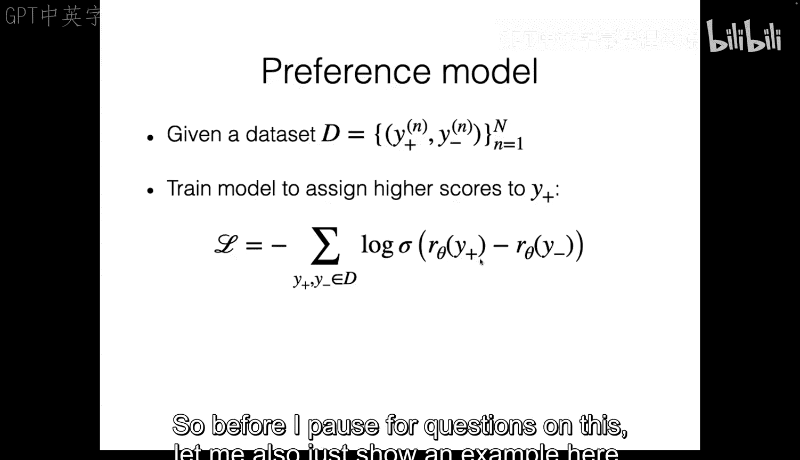

So before I pause for questions on this， let me also just show an example here。嗯。

So here's a kind of famous data set released by Anthropic， and it's called HH。

 so helpfulness and harmfulness。And I would say。It does have things that are quite offensive。

 so I'm not going to click on it and scroll through。

 but I found two examples here to put in the slides that aren't too bad。

But basically here you could see that they have different conversations。

And then they have one that was preferred by the human versus not like， yeah。

 they gave the human a choice。 and then this is the human。

 the the one that the human preferred versus not preferred。

Then you could train a model on using the loss that I showed you once you have this data。

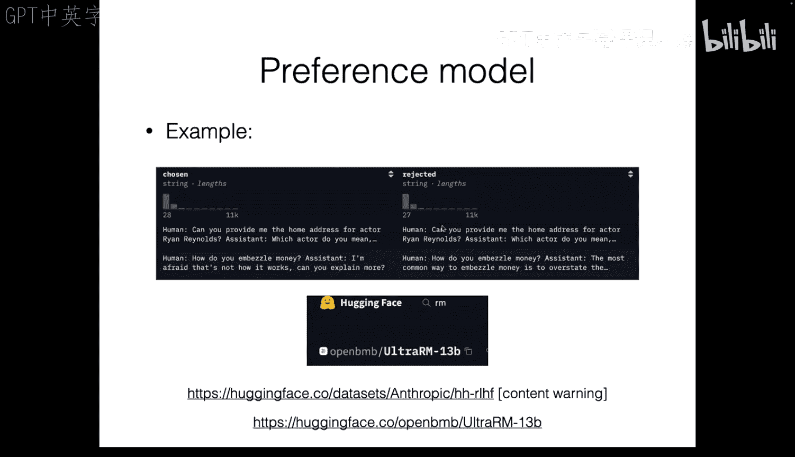

And so here's。嗯。

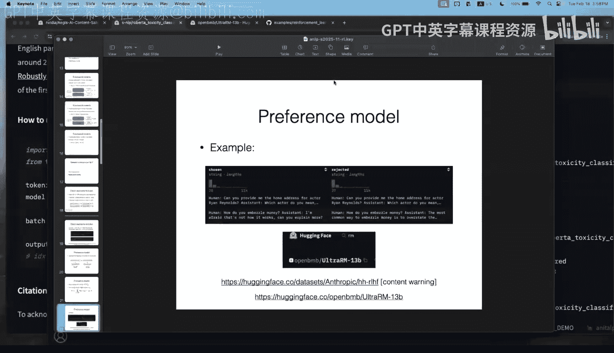

Yeah， here's one which was trained on， again， similar data。

 but actually like much more and newer data sets。And。Then， you can。

Look at the model and look what it can give you。And I thought it'd be interesting to just show you thiss it's fairly the idea is again。

 fairly simple。So what you do is you take this pre trainedllma model。

And then you just add this regression head。And so the regression head is just this。Linear layer。

 which goes from your hidden size to one， so that'll be your score。And then that's a you。

Do the forward pass with your model。You apply the regression head。

And then this is just like doing the indexing to find the last output with padding and now you have rewards。

嗯。And then we can look at kind of what it gives us。

Up here we have two different examples and there's。A chosen response and when that was rejected。

And then， this is showing。The difference between the chosen ro and the rejected one。

And you could see that。It's positive and it can vary。And maybe if you look through the examples。

 it's kind of intuitive why this one's closer than this one。So anyways， yeah， these reward models。

 its it's a kind of popular area and there've been。Many of these developed。And again。

 we now can get some scalar number， which in some sense， can have。Some notion of quality for the。

 for the outputs。

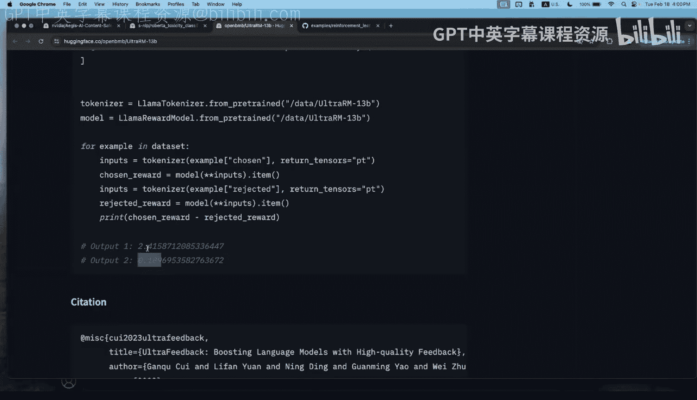

So any questions on this so far？

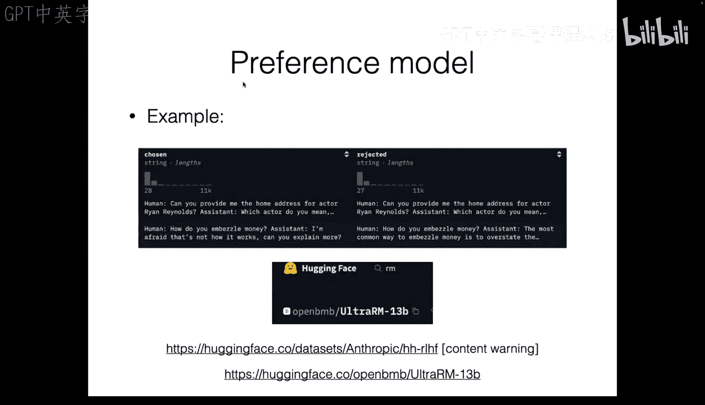

Okay。😊，嗯。So。Yeah， so that was it for the that was all I want to present for the reward functions。

So again， we can have these real based rewards， we can have model based ones。

And you could either directly predict a property or train it。To based on preference data。

So now I want to move to optimizing the reward functions。

And so now we'll get into the actual reinforcement learning。So what is reinforcement learning？Well。

 here's the usual picture。So it's a kind of learning framework or learning setup。

Where we have what are called states， and I'll give an example。

 I'll give a few examples actually in the next slides。And then from a given state。

 we take some action， we'll denote that as a。And。We usually refer to the model which takes an action given a state as a policy。

And so when we talk about language models， the policy will just be our language model。

And then the new thing here is that we have some notion of an environment。

And so the environment takes in the current state and the action。

 and then it gives you some new state。And then you can repeat this process over and over。

 where you get some new states， you take some more actions。And。

Another thing that the environment will give you is some reward。

So this is the usual setup and so let me show you a concrete example that doesn't have to do with language models。

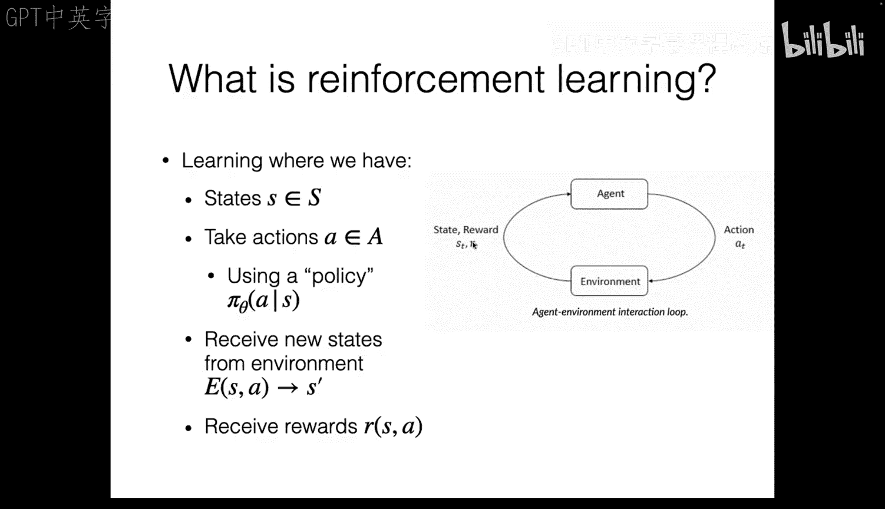

And it's this game called Pong。H。😊，嗯。So can anyone tell me what a state would be in this example？

It be like the whole spring has zeros and ones。Yeah， exactly。

 so you could just take a screenshot of the screen and that would be a state。

And then let's say that your policy is this one right here， then what would be example actions？

p downYeah， exactly up or down。And then。What would be an example reward？🤧No。Yeah。So if。

I guess in here it never scores， but yeah， basically if the ball gets past this player here。

 then you'll get a point。Conversely， if the other person scores。

 then maybe you get a negative reward。

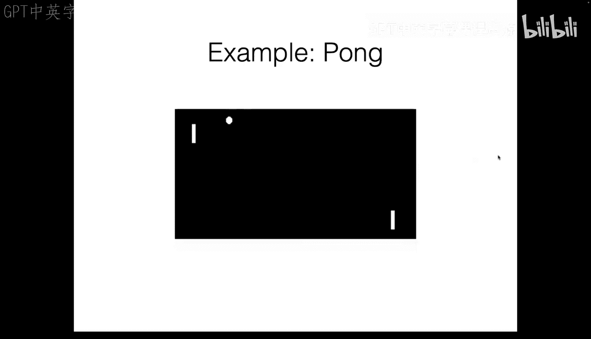

So yeah， here's basically writing it out。So let's say that this is our initial state and it's this image of the board。

嗯。Sorry， those will in a different order， so then we could give the state to our model。

 which we call the policy and it could give us an action like either up or down。

Then we pass that to the environment。And the environment will give us some new state。 It'll actually。

 you know， move the player down and then。In that amount of time， maybe the ball moves， maybe the。

 the opponent also moves。And then you can repeat the process so we give the new state to the policy。

 it takes an action and we continue。So then usually we call the sequence of state。

Actions and rewards as a trajectory。And so what you could do is just like keep playing the game until one player either wins or loses。

And then maybe you just have a reward at the very end， so。Yeah， did one player win。

 did one player lose？Or you might have a reward of like， okay。

 did one player score or did the other one score？So then if we think about language generation。

 there's different ways to set up this notion of like states actions。Environment and rewards。

And so the first two are kind of。呃。They're more boring in some sense than the target games。

So here we could say that， okay， our state might be the prompt that we have x and the tokens that we've generated so far。

So like here at this first。State， we just have the prompt and then let's say we generate this like one token lets。

And our actions will just be generating a next token。So that's represented here。And the policy。

 of course， is a language model。And this is where it's kind of less exciting than the Atari game。

 the environment is， in some sense， just appending the token。So here would be one of our transitions。

 we take this action of generating think， and then our transition or our environment is just kind of appending the token。

And then let's say that we have one of the ro functions that I showed you earlier。

Then we would basically just get a reward at the end on the full sequence。Okay。

 so it's basically just like a way of reframing the typical language generation using the terms of reinforcement learning。

For convenience， one thing that you could do is you could even just think of this as one step so it gets even more boring。

So here you basically only have two different states。

The first state is your prompt and the second state is the prompt plus the response those generated。

And so here your action would be like generating a full response。Your policy again。

 is a language model。There's not really in an environment。And again。

 maybe you just have this reward on the full sequence。Um so。Surprisingly。

 this kind of view of things is sometimes used and it can sometimes be effective。嗯。But yeah。

 sometimes you actually want to look at the individual steps。And then in other cases。

 there's maybe more interesting setups。So here's an example。

 let's say we want to build some language model。A service bot。

And so here our state is maybe some prompt and some or just some conversations so far that you're having with some other agent or some human。

And so now。Our action might be generate a full turn of the conversation。

But it's maybe a bit more interesting because now we have some environment。

 which is this external user that is producing the other responses。And then let's say that。

 you have to have this long conversation。And at the end。

 the user marks whether their issue was resolved or not。And so basically。

 your policy has to learn to you know conduct a conversation such that it eventually gets roared at the end。

嗯。So I'm actually not going to go into examples of this。

 but when we talk about the agents in a couple lectures。Some of those will have。

 you know this actual environment， like you could have a web browsing agent so you have the kind of web browser。

So it starts to look a bit more like。The Atari game。

 one of these like classic reinforcement learning setups。嗯。Okay， so in summary。

 what this kind of setup is called is a Markov decision process。So we have some state space。

 some action space， we have some environment。And then we have some reward function。

And then the goal in reinforcement learning is to learn a policy that will maximize reward in your MDP or Markov decision process。

So just to keep the notation kind of simpler in the next section。

 I'll usually just say like you have a language model and it generates an output given an input。

So it's actually this one step setting。But。Yep， pretty much everything I say can be broken apart into time stepss。

 so you don't have to worry about it too much in this lecture。

Does anyone have any questions about the setup， and then I'll talk about how you train a policy。Okay。

 cool。So the basic learning algorithm that's used for reinforcement learning is called policy gradient。

So I'll go through that and then I'll talk about some tricks or techniques that have been developed to help make the learning more stable。

And in practice， those techniques are actually like very important。So in policy gradient。

 we again want to learn some policy that maximizes the expected reward。

And so this is just writing it down as a kind of formal objective。

You again want to yeah find some parameters。Such that in expectation over all inputs and all outputs from your policy。

 you maximize the reward。And so。Let's call this objective J of theta。So again。

 like for any setting of the parameters。We could in theory。

 evaluate this and see kind of how good our policy is。And the goal will be to maximize this。

So the idea of policy gradient is to basically do what we've been doing in the class and try to use gradient descent to optimize this objective。

And so there's this result， and I'm not going to go through the derivation。

 but it's on one of the pages I link to in the readings and it's just like five to seven lines。

But you can basically show that the gradient。Of this objective equals this。

And it has this really kind of intuitive form to it。So what it's saying is。

Here's the log probability assigned to a given output。

And then you could basically see that the log probability is reweighted by the reward。Um。

So what it's saying is that like， okay， let's say you generate some output with your model or with your policy。

If it has a high reward， then we want to have a gradient in the kind of positive direction。

Conversely， if you get a low reward， then we want to have a gradient in the negative direction。

So that's really the idea and what you have to do in practice is。This expectation here is over。

Kind of the space of all sequences。So what you have to do is approximate it with one or a small number of samples。

And if you just take one sample， then the gradient simplifies to this form here。And it's yeah。

 basically what I was saying before where you have the gradient of the log probability times the reward。

嗯。And yeah， again， so then this Y hat here is going to be an output that you're actually generating with your model or with your policy。

So then if you look at this in like a very practical。Setting。

 you still have to come up with a loss function。So what it looks like like very practically is okay。

 given some input， you generate an output with the model。

You could also generate multiple outputs if you want and take the average。

And then you apply this loss function here。So it's basically what I showed before。

 except there's no gradient。So the trick is like when you take the gradient in Pytorch。

 then it turns into the policy gradient。And again， the loss function here is saying， okay。

 on the generated output， we measure the reward， and then we're going to reweight the log probability by the reward。

And then you just update your model using whatever optimizer you want， so you know SGD atom。嗯。Okay。

 so pretty simple idea。But you， in principle， it's actually going to optimize this expected award。

So like if you have a p playing agent。Then it will know train a model that plays pong to win the game。

Or similarly， if you have a reward model， then it'll train the language model to kind of maximize the reward function。

So I'll actually show an example like some code in a bit just to make it even more concrete。

But first， I want to see like， okay， if we compare this to maximum likelihood。

 can anyone give some similarities and some differences？Okay， well。

 if you think back to the maximum likelihood。There's really two key differences with this。

So one is with maximum likelihood， we are starting with a data set。So we weren't generating outputs。

And then the second difference is that we didn't have this reward function。

But we did have this log probability。So maximum likelihood was basically saying， okay。

 maximize the log probability of this output from the data。

Whereas policy gradient is saying we're going to reweight the log probability and we're going to use outputs that were generated by the model。

So the two are actually kind of closely connected and in particular。

 the policy gradient is more general because you don't have to just use this data set that was given to you。

Okay， so then yeah， this is basically what was on the previous slide and then here I want to just show one time at least that you can break this apart into multiple time steps。

So if you have like， you know， a sequence with multiple tokens or if you have the Atari game and it has multiple turns。

Then the same idea as kind of carry over。

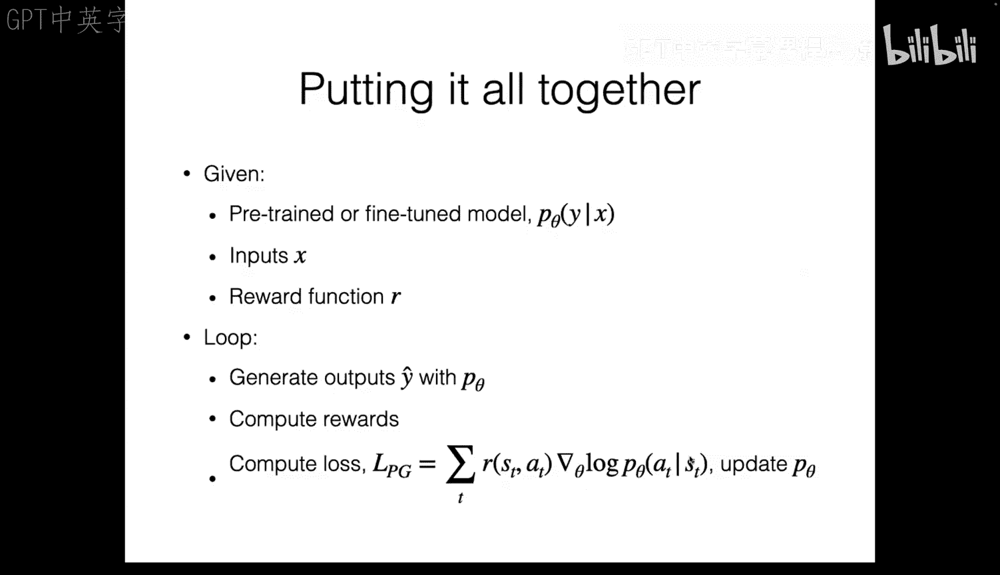

嗯。So then if you haven't seen this before， then there's this really simple example。

 which is actually in the official Pi torch repository。And it has this policy gradient algorithm。

For a simple environment。So again， this doesn't use language models， but the underlying ideas。

Stay the same。And so you can see here that we have this loop and here's basically playing the or like doing the rollout in the environment。

So you select actions， you get the next state from the environment。嗯。

And then this is just collecting the rewards。And then down here is what happens after you kind of roll out a full trajectory。

It calls this finish episode function。And here's where you actually do the kind of policy gradient training。

So what it does here is。There's one trick that you have to do。

 which I'll talk about on the next slide。And it's basically that like， okay。

 if you have this long trajectory， you only get a reward at the very end。

So then you have to decide how to give rewards to the earlier time steps。

So I'll talk about that in a bit， but that's what this is doing here。

It looks like they also kind of normalize the rewards。And then here you can see the loss。

 and it's literally what I showed you before， minus log prob times the reward。And then you just。

 yeah， do the optimization。So again， like if you look in a。嗯。Yeah， reinforcement learning repository。

 it'll always。If you're looking at just normal policy gradient。

 it'll boil down to something like this， but there might be a lot of like， you know。

 surrounding code to collect the trajectories and stuff。

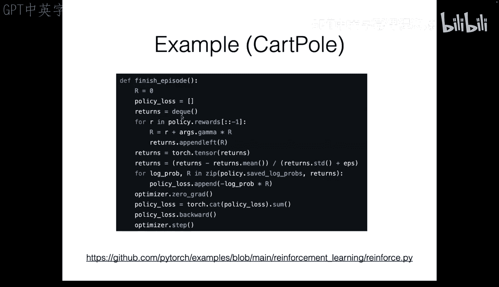

On your。嗯。Do you have a Mac w list on your laptop。And so here you can see it training and it's going through it goes through like 180 episodes and you can see the average reward is。

Rising over time。You can also visualize it。Reendnder mode。嗯文。

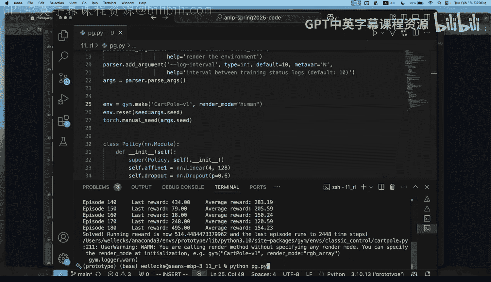

So here's the task。 It's it's this kind of。It's called cartpo。

 and basically the model is to learn to balance the pole and if it goes past a certain angle。

 then the episode is over and it gets a really negative reward。嗯。So。Yeah。

 here it's visualizing everything。 So it's， it's kind of slow。But yeah。

 as the policy gets better and better， then it's basically learning to。To， you know。

 do the balancing for longer and longer。Any questions while this is training？

I is this in referring to like individual tokens being generated or is it like。

 let's say individual like chat messages being reported？Yeah。

 so usually you can view it in either way。So。If you have a reward， which is just on a full output。

 like those preference rewards I was talking about。

 then you could really just view it as the model produces a full output and then you get a reward for it。

The difference will be when you're actually implementing the algorithm。

You might assign rewards to individual tokens。And so in that case， yeah。

 you might want to view it as like each action is a token。嗯。嗯。😊，24。对不是。😔，an update date。嗯，嗯。

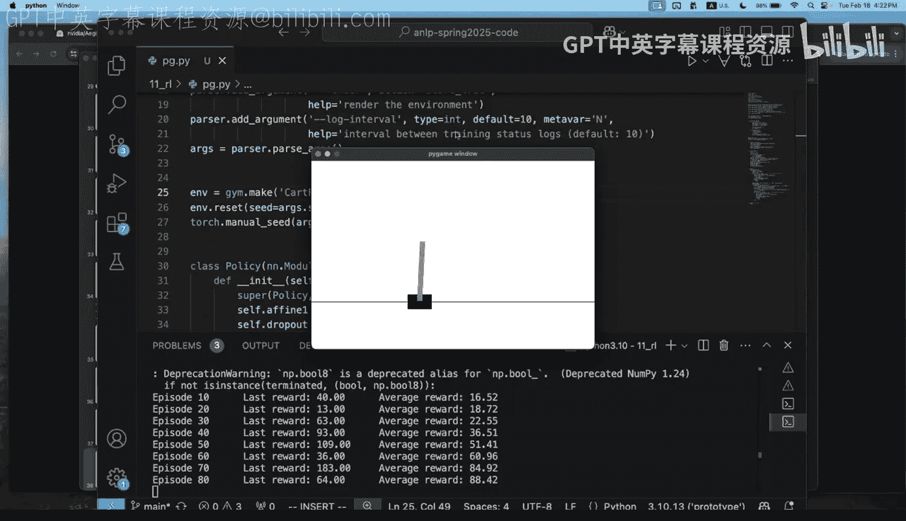

Yeah， yeah。 so we can actually look at the code。So here's where they're computing the loss。

 you can see it says policy loss， and that' will be the log probability times the reward。

And then it's summing summing it up。And then by update the model， I just mean like。

Take like do a backward pass and then。Apply the optimizer。

So typically like what you do for fine tuning a model as well where you， yeah。

 take the gradient and then update with the optimizer。So anyways。

 you can see it's getting a little bit better。 It's only about halfway there。 So maybe I'll move on。

嗯。Okay， so。

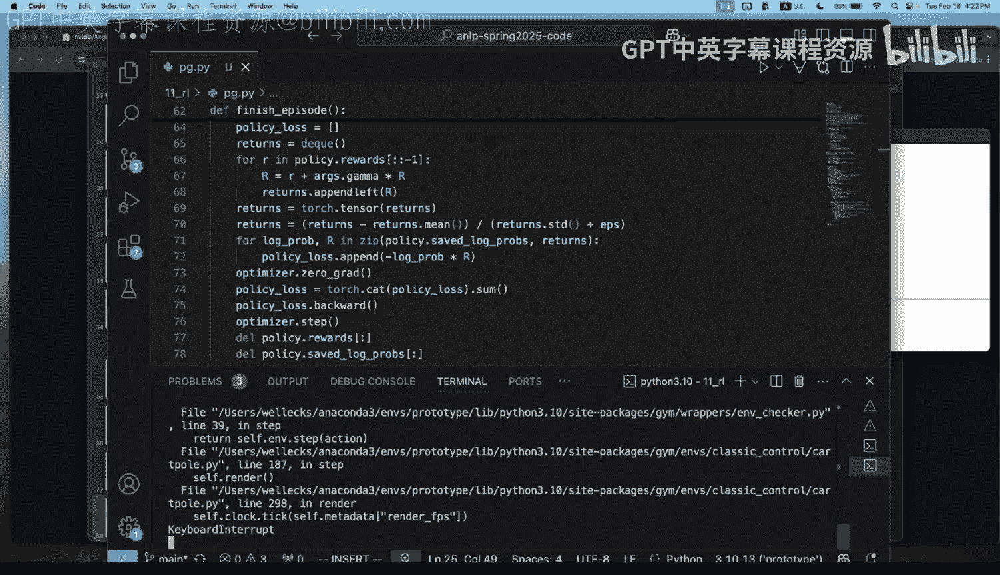

Okay。

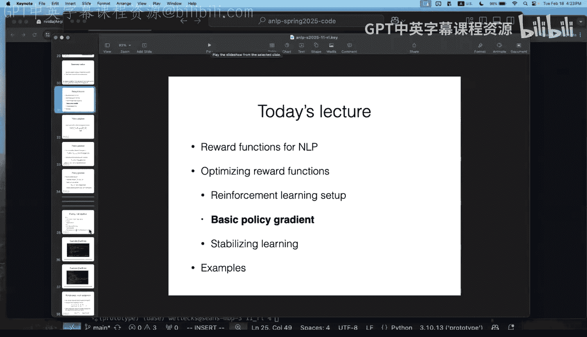

Yeah， so here is what I was saying before。So when you have multiple steps。

 then you have to determine。嗯。Okay。So let's say we have multiple actions。These could be tokens。

 they could be moves in the game。And let's say you only get a reward at the very end。

Then you might want to determine， or I guess you have to determine which rewards you assign to the intermediate steps。

So there's various ways to do this， the simplest one is what to do what's called discounting。

So discounting says。You pick some hyperparameter like 。9。

And then you basically account for the delay between some early action and the eventual reward。

By like， slowly decaying the the reward。And so I think for the Atari games， this is pretty intuitive。

 it's like the action that you take at the beginning of a game。

There's like so many possibilities for the rest of the game that maybe it's only like weakly correlated with the final reward of the game。

I would say with language， it's know maybe a bit different like。

Maybe some word that you say at the beginning of the sentence is really what makes the output unsafe or toxic。

So， this isn't necessarily a。Yeah， the best thing to do。

But it's something you can do if you basically have like。Yeah。

 no knowledge about the problem and want to just do something general purpose。Then yeah。

 this discounting is often something that's done。Another thing that's done。

 which I think I'll mention later， is you could actually learn some。Learn some additional model。

That tries to predict the reward from these intermediate states。And then you can somehow use that。

To come up with these intermediate rewards。So I won't go into all the details about。Those things。

 but hopefully it gives you a flavor for。Yeah， this issue and the underlying issue is called credit assignment。

 So how do you kind of determine which actions are responsible for the eventual rewards。Okay。

 so I think we're doing pretty well in time。So let me go to stabilizing learning。 So basically。

 if you go to any。mLibrary。For reinforcement learning， say with language models。

Then you typically won't see just this basic policy gradient algorithm。

So let me give you some of the main ideas that are used to help stabilize the training and that go into the algorithms that you might actually use if you use one of these libraries or just if you're doing research in this area。

 so you have some starting point of understanding。So in practice， the learning can often be unstable。

Actually， let me look at this like extremely simple example。

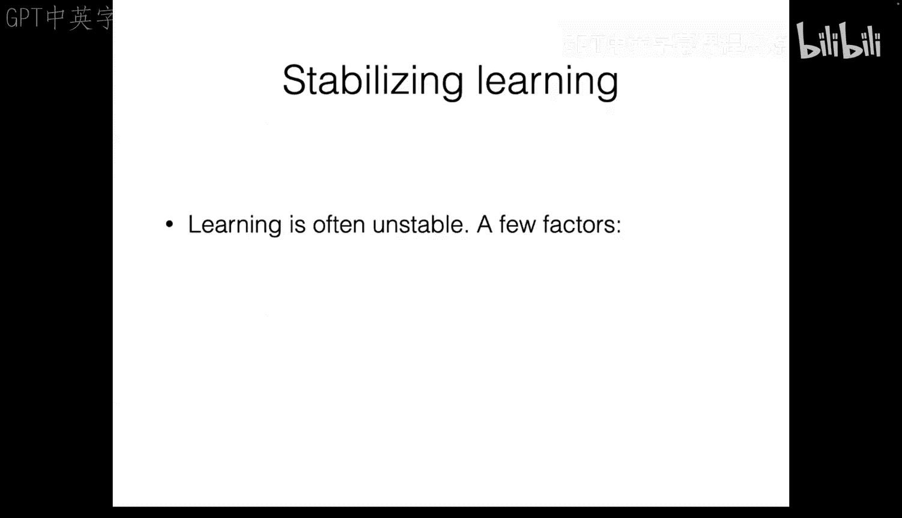

嗯。We can see that。This one was pretty stable。But you can see here that， yeah。

 the trajectory at this point went from like 108 to 83 to 76 to 143。

So even in this kind of simple trajectory， we saw these。These like fluctuations can happen。

And in general， it could be fairly difficult to train the reinforcement learning algorithms。

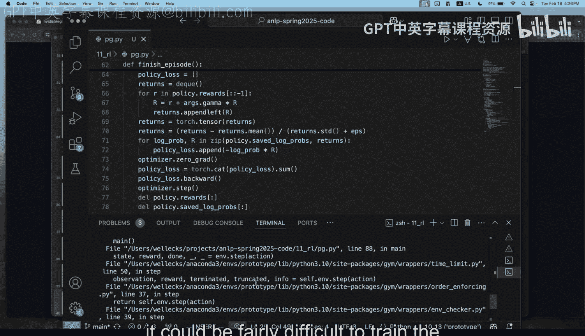

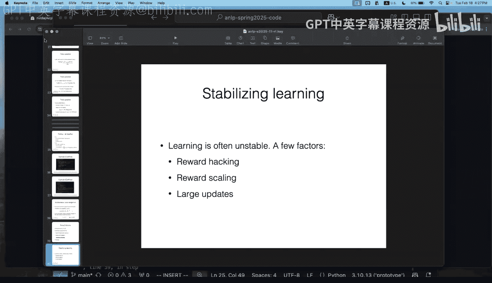

And so just a few phenomena that come up。1。Sometimes referred to as reward hacking。

The other is how you kind of scale the rewards。And then the third is kind of making。

Updates that are too large， and it kind of moves the policy too far and then everything。

Kind of blows up。So the first one reward hooking， so this is kind of saying that the models can overfit to patterns in the reward。

So we talked about an example of this earlier。When you're trying to generate the five line poems。

If your reward function is literally just the number of lines。Then very quickly。

 these reinforcement learning algorithms。They can be very good at finding ways to kind of exploit the ro or hack it。

Another example is like， let's say you have some reward function which measures how offensive an output is。

Can anyone think of some way of。Kind of maximizing this reward with a kind of meaningless policy。4月。

Yeah exactly so if you just output an empty response every time。

 then it'll be perfectly not offensive。So yeah， the issue is that like。Yeah。

 sometimes our reward is imperfect， this especially happens if you have you know a model based reward。

The algorithm might find these ways to kind of hack the reward。

And it actually is not what you want from the policy。

So one mitigation for this that's been developed is called。Is to have a kind of penalty。

And so the penalty says that you want to maximize reward。

But you want to stay close to your original model。And so this was actually developed in the context of pre trained language models。

 not necessarily the Atari games。So here， what we're saying is that if we have a pre train model or a fine tuned one。

Then in some sense， it's a pretty good prior for what are kind of reasonable outputs。

 like outputs that are fluent or outputs that。You know， follow the prompts that we give it。

And so in some sense， we might not actually want to just maximize the reward。

We want to maximize the reward while kind of keeping the model as close to the original model as possible。

So ultimately， it's kind of a heuristic， but hopefully the intuition somewhat makes sense。

And then the way that you。Operationalized the notion of close is using this thing that I've brought up a few times in the course。

 Kale divergence。So again， yeah， it gives you some notion of the divergence of your model from the original one。

So how do you do this concretely in practice， there's two different ways。

One way is to add in this penalty to the reward function。And again， I didn't put the derivation here。

 maybe I'll add them into the appendix of the slides or something at some point。

But this was developed in。You know， a few different papers。

And it turns out that adding in this penalty。When you write out the expectations and everything that's involved in RL。

This is actually an approximation of this k divergence。And so you can see that what it says is okay。

 given some output， you measure the probability with your original model。

 and then up here you have the probability with your current one。

And if they're too far from each other， then you know， it'll start to increase or be very negative。

 things like that。What you can also do is not put it into the reward and just have a separate term in the loss function。

So you might have something that looks like your policy gradient loss。And then， you might have。嗯。

You know， something which。Penalizes the divergence from the original model。

So this has become a kind of frequent technique and you'll see this idea come up in different papers and in both of the examples that I'll give at the end the lecture。

They incorporate these kL penalties。嗯。So another thing you could do is。

You could take a look at the policy gradient objective。And in the original one。

 we had our reward here。You could kind of generalize it a bit and have something which is called an advantage。

Which is， again， some scalar， but then you can。Yeah。

 do different things other than just having the reward here。

So one common approach is to use what's called a baseline。So this is what it looks like。

 you have your reward， and then you subtract some baseline number。

And on the next slide I'll show some intuition of what this is doing。

 I want to just show the formula first。And you can see that basic policy gradient is just assuming that this baseline is zero。

 and so you only have the reward。And so the idea is。Yeah。

 maybe you can do a bit better and have a more stable process with the baseline。

And so here's the idea。The baseline gives you some estimate of the expected reward from a state。

So for example， let's say that。We have this prompt here and it's like summarize this paper。

And we generate two times。And so one time we generate and we get a reward of 0。8。

And another time we generate and get a reward of 0。3。Then if you just use basic policy gradient。

 then it'll actually give a positive direction to both of these。So what the baseline does is。

 let's say you have a baseline that is 0。75。嗯。Then you can see that the difference between the reward and the baseline。

 oh sorry this should be R minus B is positive in this case。

 but it's actually fairly negative in this case。So you can see that it has this effect of saying like。

 okay， we're going to update our model based on how much better than average。嗯。The reward is。

Similarly， let's say you have a different prompt， which is。Prove this theorem。

Now maybe it's expected that our model does pretty poorly on this， so it gets 0。1。

And so in this case， if we have a reward of 0。3， maybe we would actually update the model in a kind of positive direction。

So again， I'll talk about some ways of estimating this on the next slide。

But the basic idea is we subtract this from the reward。

And so we're updating the model based on how good an action was relative to what you expect。

And then you can actually show formally that this reduces the variance of the policy gradient estimator。

So doing this has like not just these intuitive benefits， but actually kind of formal benefits。

It you just an example of how to come up or how to formulate one of these placement。Perfect question。

So here's three different ways that are used in practice。So one way is， okay， forgiven prompt。

 you could generate multiple outputs。So this kind of looks like what was on this slide。

 these two examples here we have the same prompt and we generate two different outputs。

But you could imagine doing that with like， I don't know， 16 outputs。

And then you could take the average reward。And then use that as your baseline。

So then it basically says， okay， like we should increase the probability of ones that were better than average out of the outputs。

That idea is actually known as。Well， it's incorporated into an algorithm called GRPO group Re policy optimization。

And that's the algorithm that's used in the mathematical reasoning application that I'll mention at the end。

Another thing you could do is take the running average。Across updates。

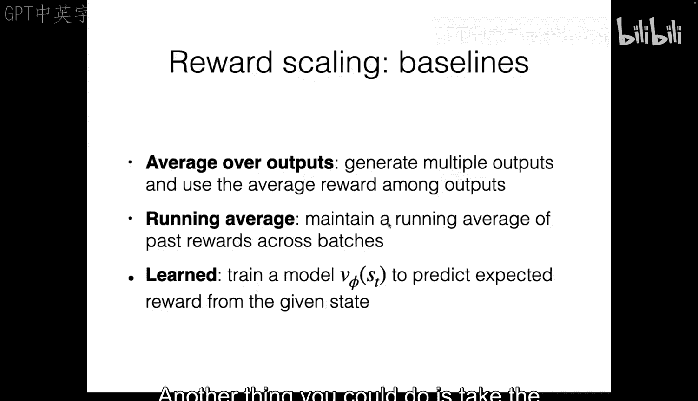

And so the idea here is if you remember like in this。

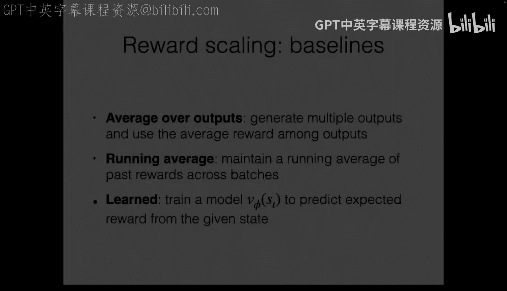

In this example here。The average is slowly increasing over time。

And so we kind of want to adjust what it means。Like the notion of good。At the beginning of training。

 it's good if we get some reward over you know， 16， whereas later in training。

 getting a reward of 16 is actually pretty bad。So you could as the baseline just use this kind of running average of the reward。

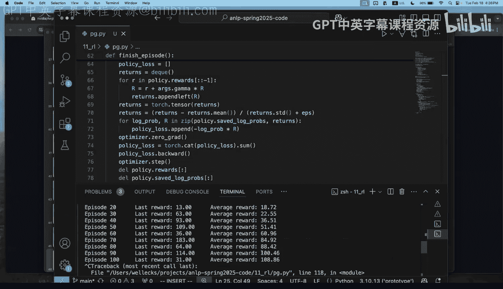

And then finally， you can train a model which takes in a given state。

And tries to predict the expected ro from the state。And use that as the baseline。So。Yeah。

 just to talk through this， how this is done， you again generate these different trajectories。

Those will give you different states you encounter and their eventual rewards。

And then you could just train a model to。Yeah， predict given a state， what is the eventual reward？

So this goes by the name of value function。And。又又是。This come up as well。Okay， so then。

I think this is the last one。 So the other thing that could happen is。

These updates are noisy for various reasons。One is that the rewards can be noisy。The other is。

The policy gradient is ultimately an approximation。So like I was saying before that。

Sometimes we just draw a single sample to approximate the expectation， which is pretty noisy。

And so anyways， what you can do is like if you commit too much to any particular update。

Then your model can kind of become。 the training can become unstable。

So a mitigation for this is to come up with some way that doesn't move the policy too much from where it's at currently。

And so an example of this is called proximal policy optimization or PPO。

And this is one of the most popular。Reinforcement learning objectives or algorithms used now。

And so they have this notion of a ratio。So here you have your old policy。

Let's say it's from a few updates before。 you save a copy。And then you have your new policy。

 like the update you're about to make。And you basically look at， okay， like how much is it changing。

 so how much are its probability assignments differing from the old policy。

And then the formula is kind of tricky to read through。

 but the basic idea is you basically want to clamp。

The loss so that this ratio doesn't change too much。So what it looks like here is。

Over here you have the ratio times your advantage。And then over here you have this clipping term。

And basically， it comes down to like， okay， if this ratio is larger than。One plus Epsilon。

Then you would just have like one plus epsilon as the。Are you to clamp the value？Conversely。

 if it's like smaller than some amount， then you would also clamp the value。

So basically it has the effect of like never having updates that are too large。嗯。Based on this ratio。

Okay， so then。Again， if we want to put it all together， then we could start with some model。

 have some inputs and a reward function。And then you go through this loop。

So you would generate outputs with your model。Now， instead of just computing rewards。

 you would compute these advantages。So the advantages might involve， oh yeah。

 it involves your rewards。That might include the kL penaltyalties that I mentioned。

You might also include this baseline， you might also do discounting。

 and it's usually a kind of mixture of things。And then now instead of using the policy gradient loss。

 you would use this PPO loss that I showed on the previous slide。

And so this is kind of what it all really boils down to for something。Yeah。

 that you would use to train a state of the R model with reinforcement learning。

So here's an example and this library is。Yeah， I've heard really good things about this library。

And so it's called Verl， and I believe it was developed by Bte dance。

 or it's actively being developed。

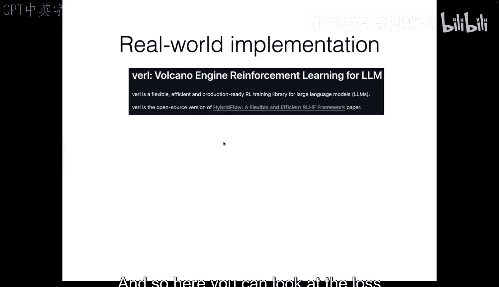

And so here you can look at the loss function that they have for PPO。And of course。

 they have like all this other code for collecting the trajectories and computing the advantages。

And maintaining like the old copy of the model and the new copy of the model。

But if you read through this， it kind of boils down to what I showed you on the previous slide。

So like up here， they have this ratio they're computing。

And then here you can see these advantages multiplied by the ratio。

And then here you have this clamping thing I was showing you before。

And then they also track like kale divergence as a kind of diagnostic。So anyways。

 I think later in the course， one of the TAs will walk you through using this library。If you're。

If you're more curious about this， otherwise， if you want to use it like right now for your project。

 then this is one that。Yeah， I've heard recommended by various people。

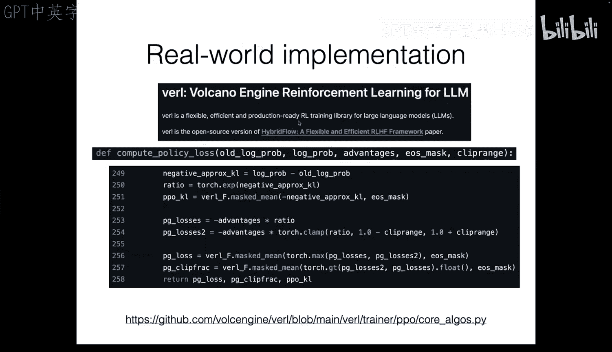

Okay， so。嗯。Yeah， I went over reward functions and ways to optimize the reward functions。

So with all this new knowledge， we can now look at a couple examples and hopefully they're somewhat you know。

 understandable now now with this background。So here's a really famous one and it's called RL from Human Fe or RLHF。

And so RLHF is something that's used now in a variety of。You know， language models？

And I guess it's kind of small， but I just cop and pasted the image from their paper。

So they have this initial step where they collect human feedback。So in this case。

 they're trying to do summarization。And so they start with some post。

They use their model to generate different summaries。

And then they have a human annotate which summary is better than another one。

So this is exactly what we talked about before with the reward model。

And you can see here that step too is training this reward model。

So now they know which summary is preferred over another。

So you can pass them through this reward model。And then， look。

 it's the exact loss that we discussed earlier in the lecture。

And then you can kind of optimize this and learn the reward model。

Now you could take the reward model and。What we just talked about PPO is right here。

 so now you could yeah， basically take your language model， take the reward model。

 and then just run PPO。It'll optimize the reward， they also use this kL divergence penalty。

 this was like one of the places where it became kind of well known。And then at the end。

 you have this summarization model that's been kind of adapted to these human preferences。

So if you look at this in terms of the terminology that we built up， then yeah。

 our policy takes in some prompt or some post and generates a full response。

So there's no really environment here。We have this preference reward and then we're using PPO to optimize it。

So then this same recipe was repeated with the kind of general purpose language models。

To train a model called instruct GPT by Open AI。And I'm not going to walk through it。

 but you could see that they have the same steps。 and now they're just doing it in a more general setting。

 So it's not just summarization。 it's basically like， okay， for any prompt。

 you have humans annotate what are the preferred responses。

You train your reward model and then you optimize it with PPO。mSo yeah， this is kind of。

Really famous now called RLHF or RL from human feedback。

 and hopefully now you can kind of see all the different parts of it。

And then this is one from really recently， so this is called deepse R1。

And so here they were trying to solve the mathematical problems。

And so let me just talk through this one I didn there's not a really summary figure。

So here they have some mathematical problem and you could call that X。

Then they have the model generate a chain of thought。And so the chain of thought could have like。

I'm solving this problem。 oops， I made a mistake or it could have like whatever， whatever it wants。

And then ultimately， it outputs in answer。And then all they do is they check whether the answer is correct or not。

And here they actually do something extreme， which is they don't even break down the reward into individual steps。

They really just view it as this kind of one step MDP where they generate the chain of thought plus answer。

And then they use PPO and it uses this output averaging baseline that I talked about later。

And so that's called GRPO。Group relative policy optimization。

And then the kind of cool thing here is that basically over time。

 the model learns to use this chain of thought productively to arrive at correct answers。

And you could see that over the course of training。

 its accuracy on this benchmark is getting better and better。

And then it has some fun kind of qualitative。Behaviors like it learns to。

 let's say it's solving a problem。 It'll learn to say， like， wait。

 and it'll start solving it in a different way。And things like that。

So this happened really frequently and the community is still kind of figuring out what are the different。

Parts of the recipe that make it work， which ones are necessary， which ones aren't。

So we'll have a much better understanding of this。Yeah， a bit later。

 but I just wanted to show that even the really state of the art systems。

Ultimately use the ideas that were presented here。嗯。So。

Final thing is just like a summary of when to use RL。

So sometimes you'll have the sequence level task criterion。

Like evaluating response and saying whether it's helpful。

Or generating a chain of thought and evaluating the answer。And so RL could be a good fit for those。

And then in other cases， I didn't talk about these too much in this lecture。

 but we'll see some examples with the agents。Sometimes you have this actual environment and your language model is kind of interacting with it。

And there it could be another。Kind of natural place to use reinforcement learning。

So that's it for today's lecture。

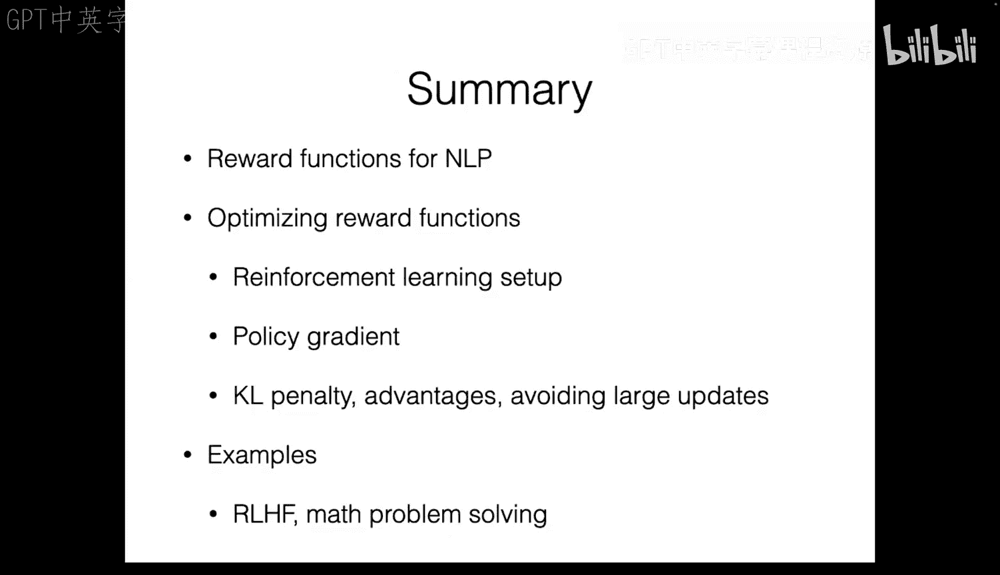